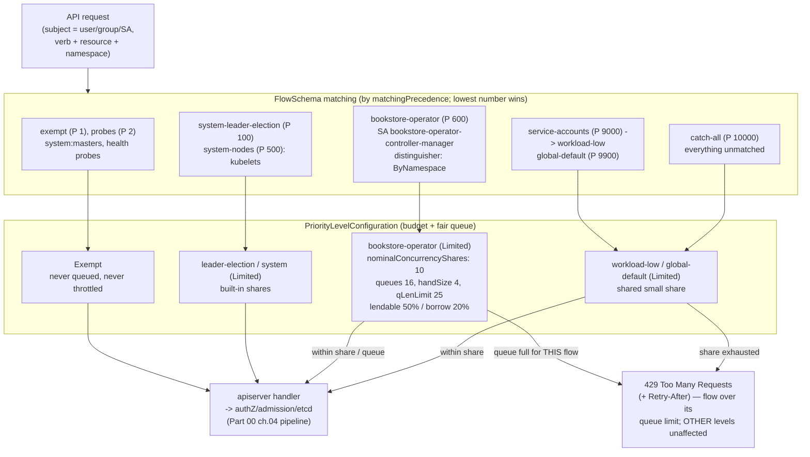

# 03 — API Priority and Fairness

> Why one bad client or a hot-looping controller can starve the apiserver for
> *everyone* (and how the apiserver protects its own availability):
> **API Priority & Fairness** — **FlowSchema** (match by user/SA/group +
> verb/resource/namespace, `matchingPrecedence`, `distinguisherMethod`) →
> **PriorityLevelConfiguration** (`Limited` vs `Exempt`,
> `nominalConcurrencyShares`, queuing: `queues`/`handSize`/`queueLengthLimit`,
> `borrowingLimitPercent`/`lendablePercent`); the built-in flow schemas and
> where a tenant's bulk `LIST`/`WATCH` lands; the APF metrics
> (`apiserver_flowcontrol_nominal_limit_seats`,
> `_rejected_requests_total`, `_current_inqueue_requests`,
> `_dispatched_requests_total`) and what a noisy client sees; the interaction
> with client-side rate limiting (`--kube-api-qps`) and the request-priority
> headers; applied by classifying the [ch.02](02-operator-development.md)
> **BookstoreTenant operator's** apiserver traffic into a bounded custom
> PriorityLevel + FlowSchema so a buggy reconcile can't take down the control
> plane.

**Estimated time:** ~45 min read · ~60 min hands-on · **Lab tier: A (kind).** Run it only against a cluster you own.
**Prerequisites:** [Part 00 ch.04](../00-foundations/04-control-plane-deep-dive.md) — apiserver request path APF protects · [Part 11 ch.02](02-operator-development.md) — operator whose traffic this chapter classifies
**You'll know after this:** • explain how FlowSchema + PriorityLevelConfiguration shape apiserver concurrency · • classify a tenant's noisy LIST/WATCH into a bounded PriorityLevel · • read APF metrics (rejected / inqueue / dispatched) and connect them to client behavior · • tune `--kube-api-qps` / `--kube-api-burst` against APF for a controller · • diagnose a noisy client from its 429s, its response headers and the APF metrics

<!-- tags: platform-engineering, observability, day-2 -->

## Why this exists

[ch.02](02-operator-development.md) shipped a controller. Its production note
warned: *"bounded reconcile … never an unbounded hot loop — see ch.03"*. This
is that chapter. [Part 00
ch.04](../00-foundations/04-control-plane-deep-dive.md) established that **the
API server is the only door** — every `kubectl`, kubelet, and controller goes
through it, and it is horizontally scalable but finite. [Part 08
ch.03](../08-day-2-operations/03-troubleshooting-playbook.md) and the [Part 06
observability](../06-production-readiness/01-observability-metrics.md) chapters
treated "the apiserver is slow / timing out" as a symptom. This chapter is the
*mechanism that prevents it* and the *control surface that diagnoses it*.

The failure mode is concrete and common:

1. **The hot-loop controller.** A reconcile bug (no rate limiter, an error that
   re-enqueues instantly, a watch that re-LISTs every event) makes **one**
   controller issue thousands of `LIST pods` per second. Without APF those
   requests share the apiserver's inflight budget with *everything else* —
   `kubectl`, the scheduler, kubelets renewing leases — and the whole control
   plane goes sluggish or starts timing out. A bug in *your* operator
   ([ch.02](02-operator-development.md)) becomes a cluster-wide outage.
2. **The noisy tenant.** A tenant's CI sprays `LIST secrets --all-namespaces`
   or a misconfigured client sets `--kube-api-qps=1000`. One identity consumes
   the shared budget; well-behaved controllers starve.
3. **The thundering herd after a blip.** A network hiccup ends; 500 controllers
   re-LIST simultaneously. Without fair queueing the apiserver is buried by its
   own clients reconnecting.

Before APF, the apiserver had two global limits, `--max-requests-inflight` and
`--max-mutating-requests-inflight`. They capped total concurrency with no
isolation, so one slow or abusive client could use all of it. **API Priority &
Fairness (APF)** puts isolation in front of those limits: it classifies every
request into a **priority level** with its **own** concurrency share and
**fair queue**, so a flood in one level cannot starve another. It is **on by
default and GA since Kubernetes v1.29** (`flowcontrol.apiserver.k8s.io/v1`).
Operating a cluster, especially one running custom controllers, without
understanding APF means you cannot explain a `429`, cannot protect the control
plane from your own operator, and cannot tune for a multi-tenant or
controller-heavy workload. The references are *Production Kubernetes*
(control-plane availability / multitenancy) and the official [API Priority and
Fairness documentation](https://kubernetes.io/docs/concepts/cluster-administration/flow-control/).

## Mental model

**Every request is sorted (by *who* + *what*) into exactly one queue with a
bounded concurrency share. A flood only fills *its own* queue and burns *its
own* share; other queues — and the rest of the apiserver — are unaffected.
APF is QoS for the API server, the way requests/limits are QoS for nodes.**

- **Two objects, both built-in (no CRD).** A **`FlowSchema`** is the
  *classifier*: rules matching the request's **subject** (user / group /
  ServiceAccount) and **resource/verb/namespace**; the
  highest-`matchingPrecedence` (lowest number) matching FlowSchema wins and
  names a **`PriorityLevelConfiguration`**, the *budget + queue*. They are
  `flowcontrol.apiserver.k8s.io/v1` core kinds, so they **dry-run and apply
  clean on any cluster from v1.29 on, with nothing else installed** (the
  inverse of the CRD-backed files, stated explicitly).
- **PriorityLevel: `Limited` vs `Exempt`.** `Exempt` = never queued, never
  throttled. It is reserved for traffic that must never wait, such as the
  `system:masters` group, which the mandatory `exempt` FlowSchema classifies
  there. Put a busy identity in it and you have recreated the pre-APF problem
  of no isolation. `Limited` = a bounded slice of the apiserver's total
  concurrency, set by **`nominalConcurrencyShares`** (a *weight*, not an
  absolute — each level's nominal share is proportional to its shares).
  `Limited` levels can **lend** idle concurrency (`lendablePercent`) and
  **borrow** spare capacity (`borrowingLimitPercent`) so the floor is
  guaranteed but idle capacity isn't wasted.
- **Fair queueing inside a level: shuffle-sharding.** A `Limited` level with
  `limitResponse.type: Queue` has `queues` queues; each request is hashed (by
  the FlowSchema's **`distinguisherMethod`** — `ByUser` or `ByNamespace`) onto
  `handSize` of them and enqueued on the shortest. This **shuffle-sharding**
  makes it statistically very unlikely that one bad *flow* (one user, one
  namespace) collides with a good one on *all* its queues — so a noisy tenant
  is isolated **within** the level, not just across levels. Past
  `queueLengthLimit`, excess requests get **`429 Too Many Requests`**;
  `limitResponse.type: Reject` skips queueing and 429s immediately.
- **The built-in flow schemas are the defaults you live with.** Every cluster
  ships these FlowSchemas. On the lab server (Kubernetes v1.37.0) they are, in
  precedence order: `exempt` (1), `probes` (2), `system-leader-election` (100),
  `system-node-high` (400), `system-nodes` (500), `kube-controller-manager` and
  `kube-scheduler` (800), `kube-system-service-accounts` (900),
  `service-accounts` (9000), `global-default` (9900) and `catch-all` (10000).
  An authenticated ServiceAccount that no earlier flow names matches
  `service-accounts`, which feeds the shared **`workload-low`** level. Every
  unclassified controller therefore shares that one small bucket. Giving a
  controller its *own* bounded level is the protection this chapter builds.
- **Server-side APF vs client-side rate limiting are complementary.**
  `--kube-api-qps`/`--kube-api-burst` (and a controller's `client-go` rate
  limiter) throttle a client *before it sends* — politeness, easily
  misconfigured or bypassed. APF throttles *at the apiserver*, enforcement the
  client cannot evade. You want **both**: a sane client limiter *and* an APF
  level so a client that ignores its limiter (or a buggy one) still can't starve
  the control plane.

The trap to keep in view: **APF protects the apiserver's *availability*, not
your controller's *correctness*.** If your reconcile hot-loops, APF stops it
from taking down the cluster, but your controller is now being
throttled/429'd and is *not converging*. APF buys the blast-radius
containment that turns "fix it now, cluster is down" into "fix the bug, the
rest of the cluster is fine".
The real fix is still a rate-limited, level-triggered, idempotent loop
([ch.02](02-operator-development.md)); APF is the safety net, not the cure.

## Threats and controls

| ID | Threat | Control in this chapter | Explained in |
|----|--------|-------------------------|--------------|
| D3 | One client starves the apiserver: a hot-looping controller, a `--kube-api-qps` set far too high, or a bulk `LIST` from one identity | A bounded PriorityLevel per identity with its own fair queue; requests past the queue get `429` | This chapter; the client limiter in [ch.02](02-operator-development.md) |

Edge traffic floods (threat D2 in the
[Bookstore threat model](../examples/bookstore/THREAT-MODEL.md)) are a
different layer: edge rate limiting belongs to 13.07. <!-- link-later: 13.07 -->

**APF is fairness, not a security boundary.** It limits how much of the
apiserver one identity can use. It does not decide whether that identity may
do anything: authentication and RBAC still decide that, and a request that APF
admits can still be forbidden (step 2 of the hands-on shows exactly that).
APF also does not stop a valid token from being used up to its share, so a
leaked CI token is still a leaked token; short token lifetimes are the control
for that (S2 in the threat model). The one APF decision with security weight is
who may write FlowSchemas and PriorityLevelConfigurations. Whoever can write
them decides each identity's bound, and can move any identity into `exempt`,
which the hands-on demonstrates. Keep those writes with cluster administrators.

## Diagrams

### Diagram A — request → FlowSchema match → PriorityLevel queue → handler or 429 (Mermaid)



### Diagram B — the built-in flow schemas and where the operator lands (ASCII)

```
 APF: BUILT-IN FLOW SCHEMAS + WHERE THE OPERATOR GOES ─────────────────────

  precedence  FlowSchema                 -> PriorityLevel        who
  ----------  -------------------------     -----------------    ----------------
       1      exempt                     -> exempt (Exempt)      system:masters
       2      probes                     -> exempt               health probes
     100      system-leader-election     -> leader-election      lease renewal
     400      system-node-high           -> node-high            node traffic
     500      system-nodes               -> system               kubelets
  ╔════════════════════════════════════════════════════════════════════════╗
  ║ 600      bookstore-operator  ───────-> bookstore-operator  ◄═ THIS FILE  ║
  ║          (SA bookstore-operator-controller-manager;          (Limited,   ║
  ║           verbs get/list/watch/...; bookstoretenants +        bounded,   ║
  ║           ns/cm/svc/deploy)            shares 10, ByNamespace) own queue)║
  ╚════════════════════════════════════════════════════════════════════════╝
     800      kube-controller-manager    -> workload-high        control plane
              kube-scheduler
     900      kube-system-service-accounts -> workload-high      kube-system SAs
    9000      service-accounts           -> workload-low         ◄ where an
    9900      global-default             -> global-default          unclassified
   10000      catch-all                  -> catch-all (lowest)      operator WOULD
                                                                    land instead
  (precedence values from the step 0 listing on Kubernetes v1.37.0)

  An unclassified BookstoreTenant operator's ServiceAccount matches the
  built-in `service-accounts` FlowSchema (P9000) -> the shared **workload-low**
  level, competing with every other ServiceAccount. A hot-loop bug there
  throttles that shared bucket -> collateral damage to OTHER controllers in it.
  Pinning it to its OWN precedence-600 Limited level (shares 10, queued,
  ByNamespace) — ahead of P9000 and clear of the node flows at 500 — means a
  buggy reconcile drains ONLY its own queue & share: it gets 429'd, the rest of
  the control plane (kubelets, scheduler, other controllers, kubectl) is
  untouched. APF = QoS for the apiserver (cf. requests/limits = QoS for nodes,
  Part 01 ch.03).
```

## Hands-on with the Bookstore

**Assumed working directory: the guide repo root (`full-guide/`).** This
chapter's example file is
[`examples/bookstore/operator/config/apf/bookstore-operator-apf.yaml`](../examples/bookstore/operator/config/apf/bookstore-operator-apf.yaml),
in the operator tree shared with [ch.01](01-admission-webhooks.md) and
[ch.02](02-operator-development.md). It changes no canonical Bookstore manifest,
Helm chart or Kustomize overlay.

We will: (0) see the built-in APF state on any cluster; (1) read the operator's
FlowSchema and PriorityLevelConfiguration and check them on the server; (2)
apply them and show which level the operator's requests use; (3) read the APF
metrics; (4) run a noisy client and see what it gets back, then show what a
writer of these objects can change.

The output in this chapter was captured on a lab cluster named `sf-pilot`
running Kubernetes v1.37.0, not on the kind cluster you create, so object ages
and UIDs on your cluster will differ.

### 0. The APF state every cluster already has

APF is on by default. Look at the built-in objects before you change anything:

```sh
kind create cluster --name bookstore
kubectl get flowschema --sort-by=.spec.matchingPrecedence
kubectl get prioritylevelconfiguration
```

<!-- gate: output -->
```text
NAME                           PRIORITYLEVEL     MATCHINGPRECEDENCE   DISTINGUISHERMETHOD   AGE   MISSINGPL
exempt                         exempt            1                    <none>                13h   False
probes                         exempt            2                    <none>                13h   False
system-leader-election         leader-election   100                  ByUser                13h   False
system-node-high               node-high         400                  ByUser                13h   False
system-nodes                   system            500                  ByUser                13h   False
kube-controller-manager        workload-high     800                  ByNamespace           13h   False
kube-scheduler                 workload-high     800                  ByNamespace           13h   False
kube-system-service-accounts   workload-high     900                  ByNamespace           13h   False
service-accounts               workload-low      9000                 ByUser                13h   False
global-default                 global-default    9900                 ByUser                13h   False
catch-all                      catch-all         10000                ByUser                13h   False
```

<!-- gate: output -->
```text
NAME              TYPE      NOMINALCONCURRENCYSHARES   QUEUES   HANDSIZE   QUEUELENGTHLIMIT   AGE
catch-all         Limited   5                          <none>   <none>     <none>             13h
exempt            Exempt    <none>                     <none>   <none>     <none>             13h
global-default    Limited   20                         128      6          50                 13h
leader-election   Limited   10                         16       4          50                 13h
node-high         Limited   40                         64       6          50                 13h
system            Limited   30                         64       6          50                 13h
workload-high     Limited   40                         128      6          50                 13h
workload-low      Limited   100                        128      6          50                 13h
```

The `service-accounts` row is the one that matters for this chapter. An
unclassified controller's ServiceAccount lands in `workload-low`, which has 100
shares and is shared with every other unclassified ServiceAccount (Diagram B).

### 1. The operator's FlowSchema and PriorityLevelConfiguration

[`config/apf/bookstore-operator-apf.yaml`](../examples/bookstore/operator/config/apf/bookstore-operator-apf.yaml)
gives the [ch.02](02-operator-development.md) operator's ServiceAccount its
**own bounded level**. The file repeats the two objects below with its comments
trimmed. Because both kinds are built in, the server accepts them with no CRD
and no operator installed:

```yaml
apiVersion: flowcontrol.apiserver.k8s.io/v1
kind: PriorityLevelConfiguration          # the budget + queue
metadata:
  name: bookstore-operator
spec:
  type: Limited                           # NOT Exempt: a controller must be bounded
  limited:
    nominalConcurrencyShares: 10          # a small weight: never crowd out workload ctrls
    lendablePercent: 50                   # lend up to half its idle share to others
    borrowingLimitPercent: 20             # may burst 20% over nominal when others idle
    limitResponse:
      type: Queue                         # queue the burst rather than instant-429
      queuing: { queues: 16, handSize: 4, queueLengthLimit: 25 }   # shuffle-shard
---
apiVersion: flowcontrol.apiserver.k8s.io/v1
kind: FlowSchema                          # the classifier
metadata:
  name: bookstore-operator
spec:
  matchingPrecedence: 600                 # BEFORE service-accounts (9000); AFTER system-nodes (500)
  priorityLevelConfiguration: { name: bookstore-operator }
  distinguisherMethod: { type: ByNamespace }  # fair across tenant namespaces
  rules:
    - subjects: [ { kind: ServiceAccount, serviceAccount:
        { name: bookstore-operator-controller-manager, namespace: bookstore-operator-system } } ]
      resourceRules: [ { verbs: ["get","list","watch","create","update","patch","delete"],
        apiGroups: ["bookstore.example.com","","apps"],
        resources: ["bookstoretenants","bookstoretenants/status","namespaces","configmaps","services","deployments"],
        namespaces: ["*"] } ]
```

Dry-run the file against the server. A client-side dry run never contacts the
server; the server dry run also validates the objects it would store:

```sh
kubectl apply --dry-run=server -f examples/bookstore/operator/config/apf/bookstore-operator-apf.yaml
```

<!-- gate: output -->
```text
prioritylevelconfiguration.flowcontrol.apiserver.k8s.io/bookstore-operator created (server dry run)
flowschema.flowcontrol.apiserver.k8s.io/bookstore-operator created (server dry run)
```

The fields, and why each has its value:

- **`type: Limited`.** A controller is bounded. `Exempt` would remove the bound,
  which is the pre-APF problem again (the Mental model explains why).
- **`nominalConcurrencyShares: 10`.** Shares are a weight. The level's nominal
  seats are proportional to its shares among all `Limited` levels. The operator
  level had 24 nominal seats on the lab server (step 4 shows the number).
- **`lendablePercent` and `borrowingLimitPercent`.** The operator's floor is
  guaranteed, but it lends idle seats when quiet and borrows a little when
  others are quiet.
- **`Queue` with `queues`, `handSize` and `queueLengthLimit`.** Burst tolerance
  with shuffle-sharding, which isolates one tenant's churn from another inside
  this level. Past the queue limit the server answers `429` with `retry-after`,
  which a well-behaved client honours (step 4).
- **`matchingPrecedence: 600`.** Matching is in precedence order, lowest first.
  The value sits after `system-nodes` (500), so the node flows keep their
  classification, and far before `service-accounts` (9000), so the operator's
  requests land here instead of in `workload-low`. It is not 500 because two
  FlowSchemas at the same precedence tie, and the tie goes to the lexically
  smaller name. The upstream docs advise against relying on that rule.
- **`distinguisherMethod: ByNamespace`.** The operator manages many tenant
  namespaces. Sharding the flow by namespace keeps one tenant's reconcile churn
  from starving another inside the operator's own level.

### 2. Apply it and check which level a request uses

```sh
kubectl apply -f examples/bookstore/operator/config/apf/bookstore-operator-apf.yaml
kubectl get flowschema bookstore-operator -o wide
kubectl get prioritylevelconfiguration bookstore-operator
```

<!-- gate: output -->
```text
prioritylevelconfiguration.flowcontrol.apiserver.k8s.io/bookstore-operator created
flowschema.flowcontrol.apiserver.k8s.io/bookstore-operator created
```

<!-- gate: output -->
```text
NAME                 PRIORITYLEVEL        MATCHINGPRECEDENCE   DISTINGUISHERMETHOD   AGE   MISSINGPL
bookstore-operator   bookstore-operator   600                  ByNamespace           0s    False
```

<!-- gate: output -->
```text
NAME                 TYPE      NOMINALCONCURRENCYSHARES   QUEUES   HANDSIZE   QUEUELENGTHLIMIT   AGE
bookstore-operator   Limited   10                         16       4          25                 1s
```

Ask the server which flow a request as the operator's ServiceAccount uses. The
`-v=8` flag makes kubectl log the response headers, and the server puts the
classification in them:

```sh
kubectl get --raw='/api/v1/namespaces/default/configmaps' \
  --as=system:serviceaccount:bookstore-operator-system:bookstore-operator-controller-manager \
  -v=8 2>&1 | grep -i 'x-kubernetes-pf-\|Response" status' | sed 's/^[[:space:]]*//' | cut -c1-120
```

<!-- gate: output -->
```text
I1031 08:55:35.564155   16383 round_trippers.go:632] "Response" status="403 Forbidden" headers=<
X-Kubernetes-Pf-Flowschema-Uid: 3f3208cd-36c4-458c-9e17-5538f97417a0
X-Kubernetes-Pf-Prioritylevel-Uid: 3a537671-e452-41b2-a5f5-14faf29ce94d
```

The `403` is expected: that identity has no RBAC grant for configmaps in
`default`. The headers are still there, so the server classified the request
before authorization refused it. Headers carry UIDs, not names. Read the
operator's UIDs with
`kubectl get flowschema bookstore-operator -o jsonpath='{.metadata.uid}'`
and the same command for the PriorityLevelConfiguration. The lab's
ServiceAccount did not exist: the request is impersonated with `--as`, and the
classification does not depend on the ServiceAccount existing. If you have
deployed the [ch.02](02-operator-development.md) operator, the ServiceAccount
exists and the same headers appear.

### 3. The APF metrics

The server exposes APF metrics at `/metrics`, the same endpoint that
[Part 06 ch.01](../06-production-readiness/01-observability-metrics.md)
scrapes. The names in Kubernetes v1.37 are not the names older guides show.
The upstream release-1.37 source defines no
`apiserver_flowcontrol_request_concurrency_limit`. Its replacements are
`apiserver_flowcontrol_nominal_limit_seats` and
`apiserver_flowcontrol_current_limit_seats`. The metrics you watch are:

- `apiserver_flowcontrol_dispatched_requests_total`: requests admitted from a
  level. Throughput.
- `apiserver_flowcontrol_current_inqueue_requests`: requests waiting in a
  level's queues now. Sustained above zero means the level is saturated.
- `apiserver_flowcontrol_rejected_requests_total`: requests answered `429`,
  with a `reason` label. A growing value on a level you own is the alert.
- `apiserver_flowcontrol_nominal_limit_seats` and
  `apiserver_flowcontrol_current_limit_seats`: the seats a level is configured
  for, and the seats it has now as it lends and borrows.
- `apiserver_flowcontrol_request_wait_duration_seconds`: a histogram of how long
  requests waited in their queue.

Each metric's `HELP` line carries a stability tag. Check it before you alert on
a metric. Step 4 shows most of these with values.

### 4. A noisy client, and what it sees

The noisy client is a CI runner outside the cluster that holds a short-lived
token. It gets its own namespace, a ServiceAccount that mounts no token into a
pod, and read access through the built-in `view` ClusterRole, bound in that one
namespace. `view` reads most objects there, but it leaves Secrets out, and it
is broader than this runner needs: a Role with `get`, `list` and `watch` on
`configmaps` alone would be tighter. The lab used `view`. The Pod Security
labels follow the namespace rule in
[01.01](../01-core-workloads/01-pods.md#baseline-namespace), and the
ServiceAccount follows
[`#baseline-service-account`](../01-core-workloads/01-pods.md#baseline-service-account):

```yaml
apiVersion: v1
kind: Namespace
metadata:
  name: noisy-tenant
  labels:
    pod-security.kubernetes.io/enforce: restricted
    pod-security.kubernetes.io/audit: restricted
    pod-security.kubernetes.io/warn: restricted
---
apiVersion: v1
kind: ServiceAccount
metadata:
  name: ci-runner
  namespace: noisy-tenant
automountServiceAccountToken: false
---
apiVersion: rbac.authorization.k8s.io/v1
kind: RoleBinding
metadata:
  name: ci-runner-view
  namespace: noisy-tenant
roleRef:
  apiGroup: rbac.authorization.k8s.io
  kind: ClusterRole
  name: view
subjects:
  - kind: ServiceAccount
    name: ci-runner
    namespace: noisy-tenant
```

Save the three manifests as `noisy-tenant.yaml` and apply them. The lab created
the namespace with the same labels by command and applied the ServiceAccount
and RoleBinding from the manifests, so its namespace line is left out below:

```sh
kubectl apply -f noisy-tenant.yaml
```

<!-- gate: output -->
```text
# ...
serviceaccount/ci-runner created
rolebinding.rbac.authorization.k8s.io/ci-runner-view created
```

Create a token for the runner. It lives in a shell variable and expires after
ten minutes. Do not print it:

```sh
TOKEN=$(kubectl create token ci-runner -n noisy-tenant --duration=10m)
APISERVER=$(kubectl config view --minify -o jsonpath='{.clusters[0].cluster.server}')
CA=$(mktemp)
kubectl config view --minify --raw -o jsonpath='{.clusters[0].cluster.certificate-authority-data}' | base64 -d > "$CA"
URL="$APISERVER/api/v1/namespaces/noisy-tenant/configmaps?limit=500"
```

Check which flow the runner's requests use. It is an ordinary ServiceAccount,
so the built-in `service-accounts` flow should match. Then flood the server with
1000 LIST requests, 20 at a time, and count the status codes:

```sh
curl -s -D - -o /dev/null --cacert "$CA" -H "Authorization: Bearer $TOKEN" "$URL" | grep -i '^HTTP/\|x-kubernetes-pf'
kubectl get flowschema service-accounts -o custom-columns=NAME:.metadata.name,UID:.metadata.uid
kubectl get prioritylevelconfiguration workload-low -o custom-columns=NAME:.metadata.name,UID:.metadata.uid
kubectl get --raw=/metrics | grep '^apiserver_flowcontrol_dispatched_requests_total{flow_schema="service-accounts"'
seq 1 1000 | xargs -P 20 -I{} curl -s -o /dev/null -w '%{http_code}\n' --cacert "$CA" -H "Authorization: Bearer $TOKEN" "$URL" | sort | uniq -c
kubectl get --raw=/metrics | grep '^apiserver_flowcontrol_dispatched_requests_total{flow_schema="service-accounts"'
```

<!-- gate: output -->
```text
HTTP/2 200 
x-kubernetes-pf-flowschema-uid: a11bbaa6-f3f5-4161-a99d-6f0ad416c259
x-kubernetes-pf-prioritylevel-uid: c5e6d839-83ff-483e-bb07-5d6f825f7995
```

<!-- gate: output -->
```text
NAME               UID
service-accounts   a11bbaa6-f3f5-4161-a99d-6f0ad416c259
NAME           UID
workload-low   c5e6d839-83ff-483e-bb07-5d6f825f7995
```

<!-- gate: output -->
```text
apiserver_flowcontrol_dispatched_requests_total{flow_schema="service-accounts",priority_level="workload-low"} 48
1000 200
apiserver_flowcontrol_dispatched_requests_total{flow_schema="service-accounts",priority_level="workload-low"} 1049
```

Under default classification every request got a `200`. The shared level has
room, so the flood is not limited at all. Its dispatched counter rose by 1001,
which is the probe plus the 1000 flood requests. Nothing in the default
setup singles this flood out: it shares `workload-low` with every other
unclassified ServiceAccount.

Now give the runner its own bounded level. This level has one share, may neither
lend nor borrow, and queues only four requests per queue. The FlowSchema matches
only the runner's ServiceAccount. Save the two objects as
`noisy-tenant-apf.yaml`:

```yaml
apiVersion: flowcontrol.apiserver.k8s.io/v1
kind: PriorityLevelConfiguration
metadata:
  name: noisy-tenant
spec:
  type: Limited
  limited:
    nominalConcurrencyShares: 1
    lendablePercent: 0
    borrowingLimitPercent: 0
    limitResponse:
      type: Queue
      queuing:
        queues: 2
        handSize: 1
        queueLengthLimit: 4
---
apiVersion: flowcontrol.apiserver.k8s.io/v1
kind: FlowSchema
metadata:
  name: noisy-tenant
spec:
  matchingPrecedence: 700
  priorityLevelConfiguration:
    name: noisy-tenant
  distinguisherMethod:
    type: ByUser
  rules:
    - subjects:
        - kind: ServiceAccount
          serviceAccount:
            name: ci-runner
            namespace: noisy-tenant
      resourceRules:
        - verbs: ["get", "list", "watch"]
          apiGroups: [""]
          resources: ["configmaps"]
          namespaces: ["*"]
```

The `lendablePercent: 0` and `borrowingLimitPercent: 0` settings are the
strictest form: the tenant gets exactly its nominal seats and nothing from
idle levels. That is the right shape for a tenant you do not trust. Apply the
pair and check them:

```sh
kubectl apply -f noisy-tenant-apf.yaml
kubectl get flowschema noisy-tenant -o wide
kubectl get prioritylevelconfiguration noisy-tenant
```

<!-- gate: output -->
```text
prioritylevelconfiguration.flowcontrol.apiserver.k8s.io/noisy-tenant created
flowschema.flowcontrol.apiserver.k8s.io/noisy-tenant created
NAME           PRIORITYLEVEL   MATCHINGPRECEDENCE   DISTINGUISHERMETHOD   AGE   MISSINGPL
noisy-tenant   noisy-tenant    700                  ByUser                3s    False
NAME           TYPE      NOMINALCONCURRENCYSHARES   QUEUES   HANDSIZE   QUEUELENGTHLIMIT   AGE
noisy-tenant   Limited   1                          2        1          4                  3s
```

Repeat the flood. This time each response's headers go to a file, so one `429`
can be read in full:

```sh
TOKEN=$(kubectl create token ci-runner -n noisy-tenant --duration=10m)
D=$(mktemp -d)
seq 1 1000 | xargs -P 20 -I{} curl -s -D "$D/h{}" -o /dev/null -w '%{http_code}\n' --cacert "$CA" -H "Authorization: Bearer $TOKEN" "$URL" | sort | uniq -c
F=$(grep -l '^HTTP/2 429' "$D"/h* | head -1)
tr -d '\r' < "$F" | grep -iv '^$'
```

<!-- gate: output -->
```text
 910 200
  90 429
```

<!-- gate: output -->
```text
HTTP/2 429 
# ...
retry-after: 1
# ...
x-kubernetes-pf-flowschema-uid: 3e152e8c-4323-43c5-a6bb-4e13c26966b8
x-kubernetes-pf-prioritylevel-uid: 1e41e1e6-ff47-44fa-bd1c-aa5e45d787d2
```

This is what a noisy client sees. Most requests still succeed, but the level
admits only what its seats and queue allow. The rest get `429 Too Many Requests`
with `retry-after: 1`, and the headers name the FlowSchema and the
PriorityLevel that refused them, so the client can tell it is being
throttled rather than broken. A client that honours `Retry-After` backs off.
A client that ignores it only gets more `429`s, and the level stays bounded
either way.

The server's counters show the same split, and that nothing else was
touched:

```sh
kubectl get --raw=/metrics | grep '^apiserver_flowcontrol_\(dispatched_requests_total\|rejected_requests_total\)' | grep 'noisy-tenant'
kubectl get --raw=/metrics | grep 'bookstore-operator' | grep '^apiserver_flowcontrol_\(dispatched\|rejected\|current_inqueue_requests\)'
```

<!-- gate: output -->
```text
apiserver_flowcontrol_dispatched_requests_total{flow_schema="noisy-tenant",priority_level="noisy-tenant"} 910
apiserver_flowcontrol_rejected_requests_total{flow_schema="noisy-tenant",priority_level="noisy-tenant",reason="queue-full"} 90
apiserver_flowcontrol_current_inqueue_requests{flow_schema="bookstore-operator",priority_level="bookstore-operator"} 0
apiserver_flowcontrol_dispatched_requests_total{flow_schema="bookstore-operator",priority_level="bookstore-operator"} 2
```

The operator's level has no `rejected_requests_total` line because it has
rejected nothing: the second command prints none for it. Its dispatched count
comes from the impersonated requests in step 2, and its queue is empty. The
noisy level shows 90 rejections with `reason="queue-full"`.

The lab's seat counts show the bound directly. The noisy level has as many
current seats as nominal seats, because it may neither lend nor borrow. The
operator's level can borrow, so its current count sits above its nominal count:

```sh
kubectl get --raw=/metrics | grep '^apiserver_flowcontrol_\(nominal_limit_seats\|current_limit_seats\){priority_level="\(noisy-tenant\|bookstore-operator\|workload-low\)"}'
kubectl get --raw=/debug/api_priority_and_fairness/dump_priority_levels | grep -m1 -A0 'PriorityLevelName'
kubectl get --raw=/debug/api_priority_and_fairness/dump_priority_levels | grep -A3 '^noisy-tenant' | head -6
```

<!-- gate: output -->
```text
apiserver_flowcontrol_current_limit_seats{priority_level="bookstore-operator"} 27
apiserver_flowcontrol_current_limit_seats{priority_level="noisy-tenant"} 3
apiserver_flowcontrol_current_limit_seats{priority_level="workload-low"} 52
apiserver_flowcontrol_nominal_limit_seats{priority_level="bookstore-operator"} 24
apiserver_flowcontrol_nominal_limit_seats{priority_level="noisy-tenant"} 3
apiserver_flowcontrol_nominal_limit_seats{priority_level="workload-low"} 235
```

<!-- gate: output -->
```text
PriorityLevelName,  ActiveQueues, IsIdle, IsQuiescing, WaitingRequests, ExecutingRequests, DispatchedRequests, RejectedRequests, TimedoutRequests, CancelledRequests
noisy-tenant,       0,            true,   false,       0,               0,                 910,                90,               0,                0
system,             0,            true,   false,       0,               0,                 347,                0,                0,                0
workload-high,      0,            true,   false,       0,               0,                 4747,               0,                0,                0
workload-low,       0,            true,   false,       0,               0,                 1049,               0,                0,                0
```

The debug endpoint is a per-level table of the same counters. It is a debug
endpoint, so read it with an administrator's kubeconfig.

**Who can change the bound.** The next step is a deliberate action on the lab
cluster. It shows what a writer of FlowSchemas can do, and it is not a pattern
to copy. It moves the runner's FlowSchema to the `exempt` level, sends one
request, and moves it back. Run it only on a cluster you own:

```sh
kubectl get prioritylevelconfiguration exempt -o custom-columns=NAME:.metadata.name,UID:.metadata.uid
kubectl patch flowschema noisy-tenant --type=merge -p '{"spec":{"priorityLevelConfiguration":{"name":"exempt"}}}'
sleep 3
TOKEN=$(kubectl create token ci-runner -n noisy-tenant --duration=10m)
curl -s -D - -o /dev/null --cacert "$CA" -H "Authorization: Bearer $TOKEN" "$URL" | grep -i '^HTTP/\|x-kubernetes-pf-prioritylevel'
kubectl patch flowschema noisy-tenant --type=merge -p '{"spec":{"priorityLevelConfiguration":{"name":"noisy-tenant"}}}'
sleep 3
curl -s -D - -o /dev/null --cacert "$CA" -H "Authorization: Bearer $TOKEN" "$URL" | grep -i '^HTTP/\|x-kubernetes-pf-prioritylevel'
kubectl get flowschema noisy-tenant -o jsonpath='{.spec.priorityLevelConfiguration.name}{"\n"}'
```

<!-- gate: output -->
```text
NAME     UID
exempt   9284f3fe-578d-47a4-a904-db2fb99268ce
flowschema.flowcontrol.apiserver.k8s.io/noisy-tenant patched
HTTP/2 200 
x-kubernetes-pf-prioritylevel-uid: 9284f3fe-578d-47a4-a904-db2fb99268ce
flowschema.flowcontrol.apiserver.k8s.io/noisy-tenant patched
HTTP/2 200 
x-kubernetes-pf-prioritylevel-uid: 1e41e1e6-ff47-44fa-bd1c-aa5e45d787d2
noisy-tenant
```

While the FlowSchema pointed at `exempt`, the runner's request was classified
into the exempt level and was never queued or limited. Restoring it returned the
request to `noisy-tenant`. Anyone who can patch that FlowSchema can make the
same change, so the write permission is the real control. Grant it to cluster
administrators only, the way you would grant `cluster-admin`. Recording who
changed these objects belongs with that grant, and the audit trail is in
Part 05 ch.08 <!-- link-later: 05.08 -->.

Clean up. Remove the noisy client, its level, and the operator's objects:

```sh
kubectl delete flowschema noisy-tenant bookstore-operator
kubectl delete prioritylevelconfiguration noisy-tenant bookstore-operator
kubectl delete namespace noisy-tenant
rm -f "$CA"
kubectl delete -f examples/bookstore/operator/config/apf/bookstore-operator-apf.yaml --ignore-not-found
kubectl delete -k examples/bookstore/operator/config/default --ignore-not-found
kind delete cluster --name bookstore
```

The `-k` line removes the [ch.02](02-operator-development.md) operator only if
you deployed it; `--ignore-not-found` makes the line harmless otherwise.

## How it works under the hood

- **Classification then fair dispatch, entirely inside the apiserver.** On each
  request the apiserver evaluates FlowSchemas in `matchingPrecedence` order
  (lowest number first). The first FlowSchema whose `subjects` and
  `resourceRules` or `nonResourceRules` match wins and names a
  `PriorityLevelConfiguration`. If two FlowSchemas tie, the lexically smaller
  name wins, which the docs advise against relying on. Classification runs
  early, before authorization. Step 2 shows it: the `403` still carried the
  flow headers.
- **Nominal seats follow shares, and the limit moves.** A `Limited` level's
  nominal seats are proportional to its shares among all `Limited` levels. On
  the lab server the one-share noisy level had 3 nominal seats, and the
  100-share `workload-low` level had 235. `lendablePercent` lets an idle level
  donate part of its seats to busy levels, and `borrowingLimitPercent` caps how
  far a busy level can exceed its nominal seats. A level has a guaranteed floor,
  and unused capacity is not wasted. The design goal is isolation without hard
  partitioning.
- **Shuffle-sharding is why one bad flow doesn't sink good ones.** Within a
  queued `Limited` level, the FlowSchema's `distinguisherMethod` (`ByUser` or
  `ByNamespace`) yields a flow hash. The request goes to `handSize` queues
  picked by that hash and joins the shortest. Two distinct flows share all
  `handSize` queues only with low probability, so a flooding flow piles into its
  own queues and hits `queueLengthLimit`, while a quiet flow's requests pass
  through other queues. `handSize` too large weakens isolation; too small
  underuses the queues. Change the defaults deliberately.
- **`Exempt` is the bypass.** The mandatory `exempt` level is "for requests that
  are not subject to flow control at all", and the mandatory `exempt`
  FlowSchema classifies every `system:masters` request there. The upstream
  docs say the exemptions exist so that a bad flow configuration cannot
  disable the apiserver. Any FlowSchema can point any identity at `exempt`, so
  the bound is only as strong as the write access to these objects (the
  hands-on's last step shows it).
- **APF vs the old inflight flags vs client-side limiting.** APF replaced the
  two inflight flags as the unit of isolation. Those flags still cap the total
  server concurrency that APF subdivides. `--kube-api-qps`, `--kube-api-burst`
  and a controller's `client-go` rate limiter act before the request leaves the
  client: cooperative, and easily set wrong (too high, or reset on restart). APF
  acts at the server, where a client cannot bypass it. They compose: the client
  limiter smooths normal load and is good citizenship, and APF is the enforced
  backstop for a buggy or hostile client. The response headers
  (`X-Kubernetes-PF-*`) tell a client which flow and level it used, which is the
  first thing to read when a request gets a `429`.
- **What APF does and does not fix.** It keeps the apiserver available and fair
  under a flood: kubelets keep heartbeating, the scheduler keeps scheduling, and
  `kubectl` keeps working, because each is in a protected level. It does **not**
  make a hot-looping controller correct. That controller is now 429'd and not
  converging, with its rejected counter climbing in its own level. APF turns
  "everything is down, fix it now" into "this one controller is throttled, its
  metrics show it, the rest is fine". Containment comes first. You still fix the
  loop ([ch.02](02-operator-development.md): rate-limited work queue,
  idempotent, bounded `RequeueAfter`).

## Production notes

> **In production: give every first-party controller (and noisy tenant) its own
> bounded FlowSchema + PriorityLevel.** An unclassified controller competes in
> `workload-low` and `global-default`, and a bug there is collateral damage to
> every other controller in that bucket. A dedicated `Limited` level, ahead of
> `service-accounts` and clear of the node flows, with modest shares and `Queue`
> with shuffle-sharding, means a buggy reconcile is contained to itself. It gets
> 429'd, and the control plane and other controllers are untouched. This is the
> [ch.02](02-operator-development.md) "bounded reconcile" promise, completed.

> **In production: alert on the APF metrics, don't discover 429s from users.**
> Scrape `apiserver_flowcontrol_*` ([Part 06
> ch.01](../06-production-readiness/01-observability-metrics.md)) and alert on
> `rate(apiserver_flowcontrol_rejected_requests_total[5m]) > 0` for each level
> you own, on `apiserver_flowcontrol_current_inqueue_requests` staying above
> zero, and on a rising `apiserver_flowcontrol_request_wait_duration_seconds`.
> A rejected counter climbing in a controller's level is the earliest signal of
> a hot loop, well before the controller's own lag shows. Use the
> kube-prometheus "API server" dashboards for the same series.

> **In production: size shares and queues deliberately, and re-check them when
> you add a level.** Shares are relative: a new level dilutes every other level.
> Keep `handSize` near the default, since a large value weakens isolation, and
> prefer `Queue` over `Reject` for controllers, because a client that backs off
> on `429` recovers and an instant reject sends a naive client into a busy loop.

> **In production: set client-side limits too — APF is the backstop, not the
> only control.** Configure controllers' `client-go` QPS and burst, and
> `--kube-api-qps` for kubelets and components, to sane values so normal load
> stays smooth and polite. APF contains the misconfigured or buggy client that
> ignores its own limiter. A controller with an absurdly high `client-go` QPS
> is a classic self-inflicted load incident, which APF will then 429. Fix the
> client and keep the APF level.

> **In production on a managed control plane:** the provider sets the
> apiserver's total concurrency and may change the built-in objects. Check what
> the provider ships before you rely on the defaults. You can still create your
> own FlowSchema and PriorityLevelConfiguration, and a dedicated bounded level
> per controller matters more when the control plane is one you do not size.

## Quick Reference

```sh
# Inspect APF (on by default, GA since v1.29)
kubectl get flowschema --sort-by=.spec.matchingPrecedence
kubectl get prioritylevelconfiguration
kubectl get flowschema <FS> -o yaml          # rules / subjects / distinguisher
kubectl get --raw=/debug/api_priority_and_fairness/dump_priority_levels   # per-level counters

# Which flow and level did a request use? (response headers carry UIDs)
kubectl get --raw='/api/v1/namespaces/<NS>/configmaps' \
  --as=system:serviceaccount:<NS>:<SA> -v=8 2>&1 | grep -i 'x-kubernetes-pf-'

# The metrics to alert on (scrape via Prometheus, Part 06 ch.01)
kubectl get --raw=/metrics | grep -E '^apiserver_flowcontrol_(dispatched_requests_total|current_inqueue_requests|rejected_requests_total|nominal_limit_seats)'

# Apply the operator's bounded level (built-in objects, no CRD)
kubectl apply -f examples/bookstore/operator/config/apf/bookstore-operator-apf.yaml
```

Minimal FlowSchema + PriorityLevel skeleton, complete and applyable (the
names are examples; the full file is in
`examples/bookstore/operator/config/apf/`):

```yaml
apiVersion: flowcontrol.apiserver.k8s.io/v1
kind: PriorityLevelConfiguration
metadata: { name: my-controller }
spec:
  type: Limited                              # never Exempt for a controller
  limited:
    nominalConcurrencyShares: 10             # relative weight (re-check when adding levels)
    lendablePercent: 50
    borrowingLimitPercent: 20
    limitResponse:
      type: Queue                            # Queue (back-pressure) > Reject for controllers
      queuing: { queues: 16, handSize: 4, queueLengthLimit: 25 }
---
apiVersion: flowcontrol.apiserver.k8s.io/v1
kind: FlowSchema
metadata: { name: my-controller }
spec:
  matchingPrecedence: 600                    # after system-nodes (500), before service-accounts (9000)
  priorityLevelConfiguration: { name: my-controller }
  distinguisherMethod: { type: ByNamespace } # or ByUser
  rules:
    - subjects: [ { kind: ServiceAccount, serviceAccount: { name: my-controller, namespace: my-controller-system } } ]
      resourceRules: [ { verbs: ["get","list","watch","create","update","patch","delete"],
        apiGroups: ["example.com",""], resources: ["widgets","configmaps"], namespaces: ["*"] } ]
```

Checklist:

- [ ] Understand APF = classify (FlowSchema, by subject and resource,
      `matchingPrecedence`) → bound and fair-queue (PriorityLevel, `Limited`
      vs `Exempt`, shares, shuffle-sharding), which is QoS for the apiserver.
- [ ] Every first-party controller has its **own bounded `Limited` level**,
      placed ahead of the shared buckets, not in the default one.
- [ ] **Never** `Exempt` for busy traffic. Write access to FlowSchema and
      PriorityLevelConfiguration belongs to cluster administrators only.
- [ ] `Queue` (not `Reject`) for controllers. Shares sized relative to each
      other, and re-checked when you add levels.
- [ ] APF metrics scraped and alerted: `rejected_requests_total` rate above
      zero, sustained `current_inqueue_requests`, and a rising
      `request_wait_duration_seconds`.
- [ ] Client-side limits (`--kube-api-qps`, the `client-go` rate limiter) set
      *and* APF as the non-bypassable backstop, so both layers.
- [ ] FlowSchema and PriorityLevelConfiguration are built in
      (`flowcontrol.apiserver.k8s.io/v1`): they apply cleanly with no CRD, the
      inverse of [ch.01](01-admission-webhooks.md) and
      [ch.02](02-operator-development.md).
- [ ] APF contains the blast radius. It is not fairness for security: RBAC and
      admission still decide what a request may do. The real fix for a hot
      loop is still a rate-limited, idempotent, level-triggered controller
      ([ch.02](02-operator-development.md)).

## Test your understanding

> Try each before opening the answer drawer. The act of trying is the exercise; the answer is the check.

1. **What does APF buy you that `--max-requests-inflight` does not?**
   <details><summary>Show answer</summary>

   `--max-requests-inflight` is a single global counter. One noisy client can consume the whole budget and starve everyone else. APF partitions the budget into priority levels with fair queuing within each level, and FlowSchema decides which level a request uses. A bulk LIST from one ServiceAccount lands in `workload-low`, leader election lands in the leader-election level, and a misbehaving controller can be given its own level. Each level has its own share and a bounded queue, so one starving level does not starve another. APF is about *isolation*, not just throttling.

   </details>

2. **Your custom operator is hot-looping. `apiserver_flowcontrol_rejected_requests_total` is rising. Walk through the diagnosis.**
   <details><summary>Show answer</summary>

   First, read `apiserver_flowcontrol_rejected_requests_total` grouped by `priority_level` and `flow_schema`. That tells you which FlowSchema matched the offending requests and which level refused them. Second, check `apiserver_flowcontrol_current_inqueue_requests` for that level. A queue that keeps growing means the level is at its seat limit. Third, identify the client from its ServiceAccount in the audit log, or from the response headers of one of its requests. Fourth, decide. Give the offender its own bounded FlowSchema for containment, and fix the controller too: rate-limit it, make it level-triggered, and stop it from requeueing on its own status updates. APF buys you breathing room, not a fix.

   </details>

3. **A teammate sets `--kube-api-qps=1000` on their controller "to make it fast." What does APF do with that controller?**
   <details><summary>Show answer</summary>

   The client can send up to 1000 requests per second. APF classifies each request into a FlowSchema and its level. Once the level's seats are full, requests queue, up to `queueLengthLimit`. When the queue overflows, the server answers `429 Too Many Requests` with `retry-after`, and a well-behaved client backs off. The apiserver stays up, but the controller burns its own CPU and retry budget and does not converge. The fix is a sane client limit, measured for the controller, with APF as the backstop for when the limit is ignored.

   </details>

4. **Security: a CI pipeline's identity can create and patch FlowSchemas, so it can "tune" APF. What can it do with that, and what do you change?**
   <details><summary>Show answer</summary>

   It can move any identity into the `exempt` level, which is never queued or limited, and it can give its own traffic a larger level. Either move removes the bound that APF exists to enforce, which is the hands-on's last step. The fix is access control on the objects themselves: grant write access to FlowSchema and PriorityLevelConfiguration to cluster administrators only, treat those objects like ClusterRoles, and review changes to them. The pipeline may still use a level its controller was assigned, but it should not be able to choose the level.

   </details>

## Further reading

- **Rosso et al., _Production Kubernetes_, ch.1 ("A Path to Production") &
  ch.12 ("Multitenancy")**: protecting control-plane availability and isolating
  tenants and clients at the API server. This is the operational frame for why
  APF exists and how it fits a multi-tenant, controller-heavy platform.
- **Ibryam & Huß, _Kubernetes Patterns_ 2e — *Elastic Scale* (ch.29) &
  *Predictable Demands* (ch.2)**: bounding and declaring resource demands as a
  pattern. APF is that discipline applied to the API server's own concurrency,
  the node-QoS analogy of [Part 01
  ch.03](../01-core-workloads/03-resources-and-qos.md).
- Official: [API Priority and Fairness](https://kubernetes.io/docs/concepts/cluster-administration/flow-control/).
  The page covers FlowSchema and PriorityLevelConfiguration, the built-in
  schemas, the `exempt` level and the tie-break rule, and the
  `apiserver_flowcontrol_*` metrics and debug endpoints.
