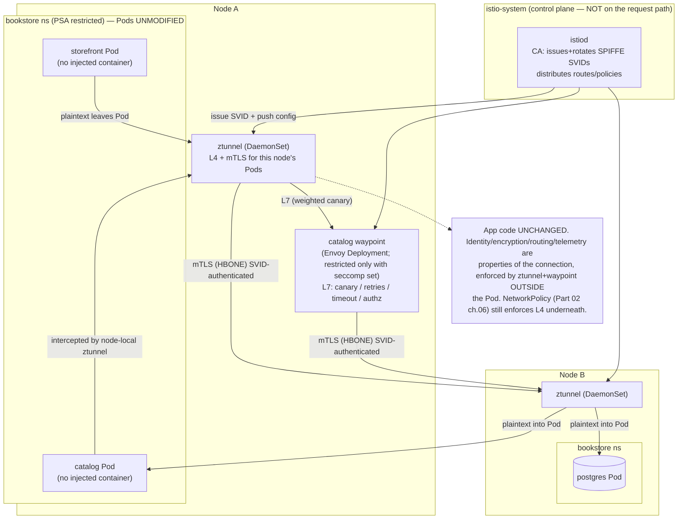

# 04 — Service mesh

> The infrastructure layer that gives **every** service-to-service call
> mTLS-by-default cryptographic identity (SPIFFE/SPIRE — the workload-identity
> gap [Part 05 ch.01](../05-security/01-authn-authz-rbac.md) left open), L7
> traffic management (canary/mirror/retry/timeout/outlier-detection/circuit-
> breaking), and golden-signal observability **without changing application
> code** — the three data-plane models (**sidecar** vs **Istio ambient**
> ztunnel+waypoint vs **Linkerd** micro-proxy), the control plane, how mesh
> **east-west** routing differs from and complements **Gateway API**
> north-south ([Part 02 ch.05](../02-networking/05-gateway-api.md), GAMMA), the
> cost/complexity/**when-NOT**, and the **sidecar-injection-vs-PSA-restricted
> footgun** — applied by meshing the Bookstore with **Istio ambient**, turning
> on strict mTLS for `bookstore`, and running a mesh-layer `catalog` canary
> (contrasted with the Part 07 ch.05 Argo Rollouts replica-ratio canary).

**Estimated time:** ~60 min read · ~120 min hands-on
**Lab tier:** A (kind), on Kubernetes 1.37. Run it only against a cluster you
own. The Istio install is not run in the captured lab; the setup note in the
hands-on says which steps are cited instead of captured.
**Prerequisites:** [Part 02 ch.06](../02-networking/06-network-policies.md) — L3/L4 segmentation the mesh complements at L7 · [Part 05 ch.01](../05-security/01-authn-authz-rbac.md) — workload-identity gap mTLS fills · [Part 02 ch.05](../02-networking/05-gateway-api.md) — Gateway API the mesh interoperates with
**You'll know after this:** • compare sidecar / Istio ambient / Linkerd data-plane models · • turn on strict mTLS for a namespace and verify the cryptographic identity · • run a mesh-layer canary and contrast it with an Argo Rollouts replica-ratio canary · • avoid the sidecar-injection-vs-PSA-restricted footgun · • justify when NOT to adopt a mesh

<!-- tags: networking, security, istio, platform-engineering -->

## Why this exists

By [Part 02 ch.06](../02-networking/06-network-policies.md) the Bookstore had a
default-deny NetworkPolicy: L3/L4 segmentation, who-may-connect-to-whom by
label. By [Part 05 ch.01](../05-security/01-authn-authz-rbac.md) it had RBAC
and per-service ServiceAccounts — but that chapter ended on an explicit gap:
**a NetworkPolicy proves a packet came from a Pod with label `app: catalog`;
it does not cryptographically prove the *workload identity* of the caller, and
nothing encrypts catalog→postgres on the wire.** A compromised Pod that
acquires the right label, or anyone who can sniff the pod network inside an
allowed edge, defeats L3/L4 alone. [Part 02 ch.06](../02-networking/06-network-policies.md)'s
own Production note said it: *"NetworkPolicy is L3/L4 only — identity-aware/L7
authz needs a mesh."* This chapter is that mesh.

A **service mesh** is an infrastructure layer that intercepts every
service-to-service connection and, **without any application code change**,
adds three things the app would otherwise each have to build itself, badly,
and inconsistently:

1. **Identity + encryption by default.** Every workload gets a cryptographic
   identity (a **SPIFFE** SVID — `spiffe://<TRUST-DOMAIN>/ns/bookstore/sa/<SA>`)
   and every call is **mutual TLS**, issued and rotated automatically. This is
   the **SPIFFE/SPIRE workload-identity** model [Part 05 ch.01](../05-security/01-authn-authz-rbac.md)
   pointed at: identity that is *proven*, not *asserted by a label*.
2. **L7 traffic management.** Weighted canaries, request mirroring, retries,
   timeouts, outlier detection (passive health), circuit breaking — as data,
   not as code in every service. This is the *traffic primitive* that
   [Part 07 ch.05](../07-delivery/05-progressive-delivery.md)'s progressive
   delivery actuates.
3. **Golden-signal observability for free.** Because the proxy is on the path
   of every request, it emits consistent rate/error/latency metrics and
   distributed-trace spans for traffic the app never instrumented — the
   data-plane half of [Part 06 ch.01](../06-production-readiness/01-observability-metrics.md)/[ch.03](../06-production-readiness/03-tracing.md).

The honest counterweight — and this chapter teaches it as hard as the
benefits: **a mesh is not free.** It adds a control plane, a data plane on the
hot path of every call (latency + a new failure domain), operational surface,
and — in the PSA-`restricted` `bookstore` namespace — a **specific, common
outage**: sidecar injection that produces a non-restricted-compliant Pod which
PSA then rejects. Many systems do not need a mesh; NetworkPolicy + Gateway API
+ app-level retries cover a lot. You adopt a mesh when **mTLS-everywhere,
identity-aware L7, and uniform observability across many services** are
requirements you would otherwise hand-roll. The reference is *Production
Kubernetes* ch.6 (Service Routing) and ch.10 (Identity), plus the SPIFFE
project.

## Mental model

**A mesh moves the network concerns out of your code and into a proxy you
don't write: identity, encryption, retries, routing, and telemetry become
properties of the *connection*, configured as data, applied to unmodified
workloads.**

- **Data plane vs control plane.** The **data plane** is the set of proxies
  that actually carry traffic (a per-Pod sidecar, a per-node ztunnel, or a
  micro-proxy). The **control plane** (istiod / Linkerd's controller) issues
  certificates, distributes config (routes, policies), and watches the API —
  it is *not* on the request path. Mesh config is declarative CRDs; the
  control plane translates them into proxy config.
- **Three data-plane models, one job.**
  - **Sidecar** (classic Istio, the original model): an Envoy container
    **injected into every Pod**, all traffic redirected through it. Most
    powerful/per-workload, **most expensive** (a proxy per Pod), and the model
    that triggers the **PSA footgun** (the injected container must itself be
    restricted-compliant).
  - **Istio ambient** (sidecar-less, GA): a per-**node** **ztunnel**
    DaemonSet does L4 + mTLS for all Pods on that node; an optional
    per-namespace/service **waypoint** Envoy does L7. **No container is
    injected into app Pods** — the data path lives *outside* the workload, so
    a restricted namespace's Pods are unchanged. Lower overhead; L7 only where
    you deploy a waypoint.
  - **Linkerd**: a purpose-built **micro-proxy** (Rust `linkerd2-proxy`)
    injected as a sidecar — far smaller/faster than Envoy, deliberately fewer
    knobs. Same sidecar PSA consideration as Istio sidecar, but a tiny,
    security-focused proxy.
- **mTLS + SPIFFE identity.** The mesh runs its own CA. Each workload's
  ServiceAccount maps to a **SPIFFE ID**; the control plane issues a
  short-lived X.509 **SVID** for it and rotates it. A connection is
  mutually authenticated **by identity**, not by IP or label — the missing
  half of [Part 05 ch.01](../05-security/01-authn-authz-rbac.md). `STRICT`
  mTLS makes plaintext to a meshed workload simply refused.
- **East-west, not north-south.** [Part 02 ch.05](../02-networking/05-gateway-api.md)'s
  Gateway/HTTPRoute governs **north-south** traffic *entering* the cluster.
  The mesh governs **east-west** traffic *between* services *inside* it. They
  are complementary layers; **GAMMA** (Gateway API for Mesh) lets you express
  east-west routing with the *same* HTTPRoute kind, just attached to a Service
  instead of a Gateway. One model, two attachment points.
- **It complements, does not replace, NetworkPolicy.** NetworkPolicy is
  L3/L4 deny/allow enforced by the CNI ([Part 02 ch.06](../02-networking/06-network-policies.md)).
  mTLS is cryptographic identity + encryption. A mesh adds L7 authorization on
  top. Defense in depth keeps **all** of them: a NetworkPolicy still contains
  a popped Pod at L4 even if mesh policy is misconfigured.

The trap to keep in view: **the data plane is on the hot path of every call
and is a new failure domain, and in a PSA-`restricted` namespace a naive
sidecar install is a self-inflicted outage.** "Just add a mesh" is rarely
just. Pick the lowest-overhead model that meets the requirement (often
ambient), roll mTLS out `PERMISSIVE`→`STRICT`, and make absolutely sure
anything injected into `bookstore` is restricted-compliant.

## Threats and controls

This chapter adds two rows to the Bookstore threat model in
[`THREAT-MODEL.md`](../examples/bookstore/THREAT-MODEL.md). Most of a mesh's
job is traffic and operations, and the threat model does not track those.

| Threat | Control this chapter teaches | Goes deeper in |
|--------|------------------------------|----------------|
| S6: a Pod copies a label such as `app: storefront` and is trusted as that workload | SPIFFE identity from the ServiceAccount, checked by an authorization policy that denies by default at the waypoint, and a Layer 4 policy that admits only the waypoint's identity to `catalog` Pods, so a direct Pod-IP call cannot skip the waypoint (step 3b) | [Part 05 ch.01](../05-security/01-authn-authz-rbac.md): workload X.509 identity, and who may run Pods as a ServiceAccount |
| I5: a Pod on the pod network reads the traffic of an edge that policy allows | Strict mTLS between meshed workloads, so no plaintext crosses the pod network (step 2) | [Part 02 ch.06](../02-networking/06-network-policies.md): the NetworkPolicy still applies underneath |

The identity control is only as strong as the rule on who may create Pods.
Kubernetes lets anyone who can create Pods in a namespace run them as any
ServiceAccount in that namespace
([RBAC good practices](https://kubernetes.io/docs/concepts/security/rbac-good-practices/)),
so the mesh's identity and the RBAC on Pod creation must be read together.

## Diagrams

### Diagram A — data path + control plane + mTLS (Istio ambient, the Bookstore's choice) (Mermaid)



### Diagram B — sidecar vs ambient vs Linkerd, and mesh vs Gateway API (ASCII)

```
 DATA-PLANE MODEL — pick the lowest overhead that meets the requirement ─────

  SIDECAR (classic Istio)      AMBIENT (Istio, GA)        LINKERD
  ┌────────────────────┐       ┌────────────────────┐     ┌──────────────────┐
  │ Pod                │       │ Pod  (UNMODIFIED)  │     │ Pod              │
  │  app + envoy ◄─inj │       │  app               │     │  app + µproxy◄inj│
  └────────────────────┘       └────────────────────┘     └──────────────────┘
  proxy PER POD                per-NODE ztunnel (L4)       Rust µproxy PER POD
  most knobs, most cost        + per-svc waypoint (L7)     tiny/fast, fewer knobs
  ► PSA FOOTGUN (injected      no injected container ►      ► same sidecar PSA
    container must be            NO PSA footgun for           consideration as
    restricted-compliant)        app Pods  ◄═ Bookstore       Istio sidecar
                                 picks THIS

  NORTH-SOUTH vs EAST-WEST  (they COMPLEMENT — keep both)
  ───────────────────────────────────────────────────────────────────────────
   Gateway API (Part 02 ch.05)         Service mesh (this chapter)
   GatewayClass→Gateway→HTTPRoute      PeerAuthentication + HTTPRoute(GAMMA)/
   parentRef = a GATEWAY               VirtualService ; parentRef = a SERVICE
   traffic ENTERING the cluster        traffic BETWEEN services inside it
   TLS termination at the edge         mTLS on EVERY hop, by identity (SPIFFE)
   ── GAMMA unifies the spelling: SAME HTTPRoute kind, Gateway vs Service ──

  WHEN **NOT** to add a mesh: few services; NetworkPolicy + Gateway API +
  app-level retries already suffice; you can't run/operate the control plane;
  the latency and the extra failure domain outweigh uniform mTLS/L7/telemetry.
```

## Hands-on with the Bookstore

**Assumed working directory: the guide repo root (`full-guide/`).** This
chapter adds the **new** [`examples/bookstore/mesh/`](../examples/bookstore/mesh/)
tree and meshes the running Bookstore. It does **not** modify any canonical
manifest, Helm chart, Kustomize overlay, or other `examples/bookstore/**`
file — the namespace enrollment is a `kubectl label` *patch* on the existing
`00-namespace.yaml`, never a redefinition (same additive discipline as the
Gateway-vs-Ingress and operator precedents).

We will: (0) self-bootstrap the Bookstore; (1) install **Istio ambient** via
pinned Helm, with its namespace labelled privileged first; (2) enroll
`bookstore` and turn on **strict mTLS**; (3) add a waypoint and a **mesh-layer
canary** on `catalog`, contrasted with the Part 07 ch.05 replica-ratio canary;
(3b) apply **default-deny authorization** at that waypoint; (4) confront the
**sidecar-injection-vs-PSA footgun** explicitly.

> **What was run and what was not (read first).** The captured output below
> came from a kind cluster named `sf-pilot` (its node is
> `sf-pilot-control-plane`), not `bookstore`, and from the namespace
> `p11-04-mesh` where this chapter prints `bookstore`. The captured runs cover
> the chart renders, the `restricted` admission of the node agents, the
> waypoint and the init container, and the Pods that were refused. **Not
> run:** the Istio install itself, the mTLS and authorization behaviour, and
> the canary split. Those steps are marked **cited, not captured**, and their
> behaviour is taken from Istio's documentation.

### 0. Prerequisites — the running Bookstore (self-bootstrapping)

Identical self-bootstrap to the prior chapters (the four `bookstore/*:dev`
images `kind load`ed; Istio installs into its **own** `istio-system`, never
`bookstore`):

```sh
kind delete cluster --name bookstore 2>/dev/null || true
kind create cluster --name bookstore
cd examples/bookstore/app
for s in catalog orders payments-worker storefront; do docker build -t bookstore/$s:dev ./$s; done
cd ../../..
for s in catalog orders payments-worker storefront; do kind load docker-image bookstore/$s:dev --name bookstore; done

kubectl apply -f examples/bookstore/raw-manifests/00-namespace.yaml
kubectl apply -f examples/bookstore/raw-manifests/05-serviceaccounts-rbac.yaml
kubectl apply -f examples/bookstore/raw-manifests/15-catalog-config.yaml
kubectl apply -f examples/bookstore/raw-manifests/16-db-credentials.yaml
kubectl apply -f examples/bookstore/raw-manifests/35-priorityclasses.yaml
kubectl apply -f examples/bookstore/raw-manifests/20-postgres-statefulset.yaml
kubectl rollout status statefulset/postgres -n bookstore
kubectl apply -f examples/bookstore/raw-manifests/10-catalog-deploy.yaml
kubectl apply -f examples/bookstore/raw-manifests/11-storefront-deploy.yaml
kubectl apply -f examples/bookstore/raw-manifests/14-orders-deploy.yaml
kubectl apply -f examples/bookstore/raw-manifests/40-services.yaml
kubectl apply -f examples/bookstore/raw-manifests/21-db-migrate-job.yaml
kubectl wait --for=condition=complete job/db-migrate -n bookstore --timeout=120s
kubectl rollout status deployment/catalog -n bookstore
```

### 1. Install Istio ambient (pinned Helm) — and why ambient

**Why Istio ambient over sidecar Istio or Linkerd for *this* app:** the
`bookstore` namespace is `pod-security.kubernetes.io/enforce: restricted`
([Part 05 ch.02](../05-security/02-pod-security.md)). Sidecar meshes mutate
every Pod to add a proxy container — which **must** then be
restricted-compliant or PSA rejects the Pod (the footgun, step 4). **Ambient
injects nothing into app Pods**: a per-node `ztunnel` DaemonSet and an
optional per-service `waypoint` carry the data path *outside* the workload, in
`istio-system`/their own namespace — so enrolling a restricted namespace
leaves every Bookstore Pod byte-for-byte unchanged and PSA-clean. That is the
decisive reason here. (Linkerd is an excellent, smaller sidecar mesh; it has
the same restricted-namespace sidecar consideration as Istio sidecar — covered
in step 4. The decision is Diagram B.)

Install via the **pinned Helm charts** — per this guide's rule, **never**
`kubectl apply -f .../releases/latest/download/<PINNED-FILE>.yaml` (it 404s
when a new release ships; same precedent as the Kyverno/KEDA/Argo CD/cert-
manager installs):

Istio 1.30.7 is pinned. Its charts are the latest stable release in Istio's
chart repository, and their digests match the repository index. Istio's
supported-releases page lists 1.31 as the only current minor that supports
Kubernetes 1.37, but no 1.31 chart is published yet, so this chapter pins
1.30.7, whose listed Kubernetes range is 1.32 to 1.36. Before you install on a
1.37 cluster, check that page and move the pin to a chart that supports your
version.

```sh
ISTIO_CHART_VERSION=1.30.7          # pinned; see the note above
helm repo add istio https://istio-release.storage.googleapis.com/charts
helm repo update

# Label the namespace before anything runs in it. The node agents need hostPath
# volumes and added capabilities, which restricted and baseline both refuse, so
# the lowest level that works for this namespace is privileged (step 4).
kubectl create namespace istio-system
kubectl label namespace istio-system pod-security.kubernetes.io/enforce=privileged pod-security.kubernetes.io/audit=privileged pod-security.kubernetes.io/warn=privileged

# 1. base (CRDs + cluster roles), 2. istiod (control plane), 3. CNI
#    (sets up ambient redirection), 4. ztunnel (the per-node L4/mTLS proxy):
helm install istio-base istio/base -n istio-system \
  --version "$ISTIO_CHART_VERSION" --set defaultRevision=default --wait
# gateways.seccompProfile sets the seccomp profile on the waypoint Pods that
# istiod creates. The chart default is empty, and restricted refuses a Pod with
# no seccomp profile (step 4).
helm install istiod istio/istiod -n istio-system \
  --version "$ISTIO_CHART_VERSION" --set profile=ambient \
  --set gateways.seccompProfile.type=RuntimeDefault --wait
helm install istio-cni istio/cni -n istio-system \
  --version "$ISTIO_CHART_VERSION" --set profile=ambient --wait
helm install ztunnel istio/ztunnel -n istio-system \
  --version "$ISTIO_CHART_VERSION" --wait

kubectl -n istio-system get pods       # istiod + istio-cni-node + ztunnel
# Waypoints and GAMMA routes need the Gateway API CRDs (Part 02 ch.05). Install
# the version your Istio release documents. The check below does nothing if
# they are present:
kubectl get crd gateways.gateway.networking.k8s.io >/dev/null 2>&1 \
  || echo "install the Gateway API CRDs first"
```

Installing Istio created the `istio.io` CRDs (`PeerAuthentication`,
`VirtualService`, `DestinationRule`, …). **This is what makes the mesh
manifests dry-runnable.** Before it, a server dry-run of them is refused with
a CRD message. The lab captured that refusal for the strict mTLS file, before
Istio was installed:

<!-- gate: output -->
```
$ kubectl apply --dry-run=server -f mesh-copy/10-peerauthentication-strict-mtls.yaml
error: resource mapping not found for name: "bookstore-strict-mtls" namespace: "p11-04-mesh" from "mesh-copy/10-peerauthentication-strict-mtls.yaml": no matches for kind "PeerAuthentication" in version "security.istio.io/v1"
ensure CRDs are installed first
```

The `mesh-copy` path and the `p11-04-mesh` namespace are the lab's; the file
itself is `mesh/10-peerauthentication-strict-mtls.yaml` in the reader's
namespace `bookstore`.

### 2. Enroll `bookstore` and turn on strict mTLS

Enroll the namespace into the ambient data plane. This is a **label patch on
the existing canonical namespace**, *not* a re-apply of a Namespace object
([`mesh/00-ambient-enroll.yaml`](../examples/bookstore/mesh/00-ambient-enroll.yaml)
documents exactly why `kubectl apply -f` it would be wrong — it would strip
the canonical PSA/quota labels):

```sh
kubectl label namespace bookstore istio.io/dataplane-mode=ambient
# Pods are NOT restarted and NOT mutated — ambient enrollment is transparent.
kubectl get pods -n bookstore        # same Pods, same age, NO extra container
kubectl get pod -n bookstore -l app=catalog \
  -o jsonpath='{.items[0].spec.containers[*].name}'; echo
# expected, not captured in the lab: `catalog` alone. Ambient injects no
# istio-proxy container into the app Pod, so nothing is mutated for PSA to refuse.
```

Now enforce **strict mTLS** for the whole namespace with
[`mesh/10-peerauthentication-strict-mtls.yaml`](../examples/bookstore/mesh/10-peerauthentication-strict-mtls.yaml).
Go through a migration window first, because a namespace-wide `STRICT` refuses
every client that is not meshed yet. Copy the file, change `mode: STRICT` to
`mode: PERMISSIVE` in the copy, apply it, and confirm in Istio's telemetry that
every edge already uses mTLS. Then apply the strict file. Do not leave
PERMISSIVE in place after that window. This is the same staged rollout as the
Audit→Enforce lifecycle in [Part 05 ch.03](../05-security/03-supply-chain.md)
and the webhook Ignore→Fail in [ch.01](01-admission-webhooks.md).

```sh
kubectl apply -f examples/bookstore/mesh/10-peerauthentication-strict-mtls.yaml
kubectl get peerauthentication -n bookstore
```

Ambient keeps each workload's SVID in its node's ztunnel, not in the app Pod,
so the app Pod has no certificate to inspect. Istio's ambient documentation
describes how to read the certificates a ztunnel holds
([Istio ambient](https://istio.io/latest/docs/ambient/)). That check is
**cited, not captured** in this lab.

**What STRICT buys (cited, not captured).** Under `STRICT`, a meshed workload
accepts only mutual TLS, and the peer must present a SPIFFE identity. Istio
documents the modes in its
[PeerAuthentication reference](https://istio.io/latest/docs/reference/config/security/peer_authentication/).
A NetworkPolicy allows an edge by label and does not encrypt it, so anyone who
can observe the pod network reads the traffic on an allowed edge. With
`STRICT`, a Pod outside the mesh cannot send that traffic in plaintext, and
step 3b checks the caller's identity, not its label.

### 3. A mesh-layer canary on `catalog` — contrast the Part 07 ch.05 canary

The Bookstore already learned a canary in [Part 07 ch.05](../07-delivery/05-progressive-delivery.md):
**Argo Rollouts shifts the *replica ratio*** (a second ReplicaSet, N% of
*Pods*). A **mesh canary shifts the *request ratio*** between two stable
Services regardless of replica counts — 10% means 10% of *requests*, not "1
Pod in 10". Deploy the **additive** v2 `catalog` Deployment + `catalog-canary`
Service ([`mesh/05-catalog-v2-deploy.yaml`](../examples/bookstore/mesh/05-catalog-v2-deploy.yaml)),
and the canonical `10-catalog-deploy.yaml`/`40-services.yaml` are untouched. Its
Pods carry `app: catalog-canary`, not `app: catalog`: the canonical `catalog`
Service selects `app: catalog`, and a v2 Pod with that label would take stable
traffic too. Then deploy a waypoint so `catalog` has an L7 enforcement point in
ambient, and apply the GAMMA route:

```sh
# Additive v2 backend for the demo. NOTE: `bookstore` enforces PSA
# `restricted`, so a bare `kubectl create deployment` (no securityContext)
# would have its Pods REJECTED — the chapter's own footgun, self-inflicted.
# 05- carries the SAME restricted securityContext as the canonical catalog
# (10-) so it admits; same kind-loaded bookstore/catalog:dev image (step 0):
kubectl apply -f examples/bookstore/mesh/05-catalog-v2-deploy.yaml
kubectl rollout status deployment/catalog-v2 -n bookstore

# L7 in ambient needs a waypoint for `catalog`. It runs restricted only with
# the seccomp setting from step 1, and step 4 shows the refusal without it.
# Ambient waypoint scoping
# is TWO parts: the waypoint Gateway carries `istio.io/waypoint-for: service`
# (set in 30-), and the target Service opts in with `istio.io/use-waypoint`
# (least blast radius: ONLY catalog is waypointed, not the whole namespace):
kubectl apply -f examples/bookstore/mesh/30-waypoint.yaml
kubectl wait --for=condition=Programmed gateway/catalog-waypoint -n bookstore --timeout=120s
kubectl label service catalog -n bookstore istio.io/use-waypoint=catalog-waypoint

# The 90/10 GAMMA split (HTTPRoute parentRef = the catalog SERVICE):
kubectl apply -f examples/bookstore/mesh/20-catalog-canary-httproute.yaml
kubectl get httproute catalog-mesh-canary -n bookstore \
  -o jsonpath='{.status.parents[*].conditions[*].type}{"\n"}'   # Accepted/ResolvedRefs
```

**Where the split shows (cited, not captured).** A weighted route is
request-proportional: 10% of requests go to `catalog-canary` whatever the
replica counts, while an Argo Rollouts canary changes how many Pods are v2.
Istio's standard metrics count requests per destination workload
([Istio metrics reference](https://istio.io/latest/docs/reference/config/metrics/)),
so watch those counts while you change the weights. The lab did not drive this
traffic, so the split is not measured here. In production, step the weights
gradually and gate each step on the catalog SLO
(`raw-manifests/81-prometheusrule.yaml`: `CatalogHighErrorRate` and the P95
alert).

Use the Istio-native form
([`mesh/21-catalog-canary-virtualservice.yaml`](../examples/bookstore/mesh/21-catalog-canary-virtualservice.yaml))
**instead of** `20-` (apply one, not both — same "alternative, not addition"
rule as `50-ingress`/`51-gateway`) when you also want mesh-native **retries,
timeouts, and outlier detection / circuit breaking** in one place; that file's
`DestinationRule` carries exactly those L7 resilience knobs.

### 3b. Default-deny authorization at the waypoint

Strict mTLS says who the caller is. Authorization says what it may do, and its
default must be deny. [`mesh/40-authz-default-deny.yaml`](../examples/bookstore/mesh/40-authz-default-deny.yaml)
holds two `AuthorizationPolicy` objects, both attached to the waypoint through
`targetRefs`. The first is an ALLOW policy with no rules, so it matches
nothing. Istio's reference says an ALLOW policy with no rules denies every
request to the workload, and that a workload with no ALLOW policy allows
everything that is not denied
([AuthorizationPolicy reference](https://istio.io/latest/docs/reference/config/security/authorization-policy/)).
The second policy adds one allow:

```yaml
  rules:
    - from:
        - source:
            principals: ["cluster.local/ns/bookstore/sa/storefront-sa"]
      to:
        - operation:
            methods: ["GET"]
            paths: ["/books"]
```

The principal is the caller's identity, written as its trust domain, namespace
and ServiceAccount. It is only available under mTLS, which is why step 2
comes first. A Pod labelled `app: storefront` that runs as another
ServiceAccount matches no principal and is denied.

```sh
kubectl apply -f examples/bookstore/mesh/40-authz-default-deny.yaml
kubectl get authorizationpolicy -n bookstore
```

**The bypass.** Both policies above are enforced at the waypoint, and only
traffic that goes through the waypoint reaches it. Istio's waypoint page says
that a request sent straight to a workload IP, when the waypoint handles only
service traffic (the default), skips the waypoint, and that any Layer 7 policy
the waypoint would have enforced then never takes effect. So a meshed Pod that
dials a `catalog` Pod IP directly gets no L7 check at all. The `app: storefront`
label is not the issue here: the bypass removes the check for every caller.

The third policy closes the bypass. It selects the `catalog` Pods and admits
only the waypoint's identity. A waypoint uses the ServiceAccount named after its
Gateway, so that identity is `catalog-waypoint`. Because the policy selects
workloads rather than the waypoint, ztunnel enforces it at Layer 4, and it holds
for a direct call as well:

```yaml
apiVersion: security.istio.io/v1
kind: AuthorizationPolicy
metadata:
  name: catalog-require-waypoint
  namespace: bookstore
spec:
  selector:
    matchLabels:
      app: catalog
  action: ALLOW
  rules:
    - from:
        - source:
            principals: ["cluster.local/ns/bookstore/sa/catalog-waypoint"]
```

It is a second ALLOW policy on the same Pods, so any meshed caller that is not
the waypoint is denied at Layer 4, and that includes a Pod that dials a
`catalog` Pod IP. Check the waypoint's ServiceAccount on your cluster before
you apply it:

```sh
kubectl get pod -n bookstore -l gateway.networking.k8s.io/gateway-name=catalog-waypoint -o jsonpath='{.items[0].spec.serviceAccountName}{"\n"}'
```

**Cited, not captured.** The behaviour above is documented by Istio and was not
run in the lab. Three things to check before you rely on the rules. First, the
storefront calls `/api/books`, but the proxy location in
`app/storefront/nginx.conf` is commented out, so enable it and confirm which
ServiceAccount actually calls `catalog`. Second, a principal is an allow for one
identity only: add one for each other caller and nothing else. Third, a direct
call to a `catalog` Pod IP should now be refused, and the waypoint's own call
admitted. Test both on your cluster; the lab did not.

### 4. The sidecar-injection-vs-PSA-restricted footgun (the core lesson)

This is the single most important operational point in the chapter, and the
reason the Bookstore uses ambient. [`mesh/10-sidecar-mode-podtemplate.yaml`](../examples/bookstore/mesh/10-sidecar-mode-podtemplate.yaml)
is a teaching artifact — a Pod showing the restricted-compliant shape an
**injected** istio-proxy sidecar *must* have:

The mesh file [`mesh/10-sidecar-mode-podtemplate.yaml`](../examples/bookstore/mesh/10-sidecar-mode-podtemplate.yaml)
shows the restricted shape of an injected proxy. Its `istio-proxy` container
sets every field restricted asks for, including `seccompProfile`, and the Pod
runs as a dedicated ServiceAccount with its token unmounted. The lab did not
apply this file after its fixes. The refusals below turn on the same fields,
and they are what a sidecar mesh does to a restricted namespace when one of
those fields is missing.

**Refusal 1: no seccomp profile.** The waypoint's container in the 1.30.7
chart has `runAsNonRoot`, a non-root UID and `drop: ["ALL"]`, but no seccomp
profile unless `gateways.seccompProfile` is set (step 1). This fragment is that
container without the profile. It is the deliberate failure:

```yaml
    - name: istio-proxy
      securityContext:
        privileged: false
        runAsNonRoot: true
        runAsUser: 1337
        runAsGroup: 1337
        allowPrivilegeEscalation: false
        readOnlyRootFilesystem: true
        capabilities:
          drop: ["ALL"]
```

<!-- gate: output -->
```
$ kubectl apply -f pods/waypoint-no-seccomp.yaml
Error from server (Forbidden): error when creating "pods/waypoint-no-seccomp.yaml": pods "waypoint-shape-no-seccomp" is forbidden: violates PodSecurity "restricted:latest": seccompProfile (pod or container "istio-proxy" must set securityContext.seccompProfile.type to "RuntimeDefault" or "Localhost")
```

The same Pod with `seccompProfile: {type: RuntimeDefault}` at pod level is
admitted. Here it is in full, with the baseline, so you can apply it:

```yaml
apiVersion: v1
kind: Pod
metadata:
  name: waypoint-shape-seccomp
  namespace: bookstore
  labels:
    app: mesh-proxy-shape              # not `catalog`: the catalog Service would select it
    app.kubernetes.io/part-of: bookstore
spec:
  serviceAccountName: catalog-sa
  automountServiceAccountToken: false
  securityContext:
    seccompProfile:
      type: RuntimeDefault
  containers:
    - name: istio-proxy
      image: bookstore/catalog:dev
      imagePullPolicy: IfNotPresent
      securityContext:
        privileged: false
        runAsNonRoot: true
        runAsUser: 1337
        runAsGroup: 1337
        allowPrivilegeEscalation: false
        readOnlyRootFilesystem: true
        capabilities:
          drop: ["ALL"]
      resources:
        requests: { cpu: 10m, memory: 64Mi }
        limits: { memory: 128Mi }
      volumeMounts:
        - name: tmp
          mountPath: /tmp
  volumes:
    - name: tmp
      emptyDir: {}
```

The lab applied the same shape from its own file, `pods/waypoint-seccomp.yaml`.
That copy was labelled `app: catalog`, which the manifest above changes so the
catalog Service does not select it. The admission and the value read back were
captured:

<!-- gate: output -->
```
$ kubectl apply -f pods/waypoint-seccomp.yaml
pod/waypoint-shape-seccomp created

$ kubectl get pod waypoint-shape-seccomp -n p11-04-mesh -o jsonpath='{.spec.securityContext.seccompProfile.type}'; echo
RuntimeDefault
```

**Refusal 2: the classic `istio-init` container.** Sidecar injection without
the CNI plugin adds an init container that programs iptables. It needs
`NET_ADMIN` and `NET_RAW`, which restricted refuses. The fragment is that
container, and the refusal is the lab's output:

```yaml
  initContainers:
    - name: istio-init
      securityContext:
        runAsNonRoot: false
        runAsUser: 0
        capabilities:
          add: ["NET_ADMIN", "NET_RAW"]
```

<!-- gate: output -->
```
$ kubectl apply -f pods/istio-init-shape.yaml
Error from server (Forbidden): error when creating "pods/istio-init-shape.yaml": pods "istio-init-shape" is forbidden: violates PodSecurity "restricted:latest": allowPrivilegeEscalation != false (container "istio-init" must set securityContext.allowPrivilegeEscalation=false), unrestricted capabilities (container "istio-init" must set securityContext.capabilities.drop=["ALL"]; container "istio-init" must not include "NET_ADMIN", "NET_RAW" in securityContext.capabilities.add), runAsNonRoot != true (container "istio-init" must not set securityContext.runAsNonRoot=false), runAsUser=0 (container "istio-init" must not set runAsUser=0)
```

Either refusal rejects the **whole** Pod. The app container never starts. This
is the textbook incident: the mesh is enabled, and the hardened namespace stops
scheduling. The fixes differ by data plane.

**(1) Ambient, the Bookstore's choice.** The app Pods get no injected
container, so there is nothing to refuse. The node agents run in `istio-system`
instead. The lab's dry-run of them against a `restricted` namespace shows what
they need. The ztunnel warning, from a dry-run that created nothing:

<!-- gate: output -->
```
$ kubectl apply --dry-run=server -f pods/ztunnel-ds.yaml
Warning: would violate PodSecurity "restricted:latest": allowPrivilegeEscalation != false (container "istio-proxy" must set securityContext.allowPrivilegeEscalation=false), unrestricted capabilities (container "istio-proxy" must not include "NET_ADMIN", "NET_RAW", "SYS_ADMIN" in securityContext.capabilities.add), restricted volume types (volume "cni-ztunnel-sock-dir" uses restricted volume type "hostPath"), runAsNonRoot != true (container "istio-proxy" must not set securityContext.runAsNonRoot=false), runAsUser=0 (container "istio-proxy" must not set runAsUser=0), seccompProfile (pod or container "istio-proxy" must set securityContext.seccompProfile.type to "RuntimeDefault" or "Localhost")
daemonset.apps/ztunnel created (server dry run)
```

The CNI node agent gives the same kind of warning, with `hostPath` volumes and
`NET_ADMIN`, `NET_RAW`, `SYS_ADMIN`, `DAC_OVERRIDE` and `SYS_PTRACE` added. Both
agents run as root, so the namespace that holds them must be `privileged`.
That is the label step 1 sets on `istio-system`. Istio's
[Pod Security page](https://istio.io/latest/docs/setup/additional-setup/pod-security-admission/)
says the same: the CNI namespace must enforce `privileged`.

**(2) Sidecar mode with the Istio CNI plugin.** The CNI agent replaces the
`istio-init` container; Istio's
[CNI page](https://istio.io/latest/docs/setup/additional-setup/cni/) calls it
"effectively a replacement for the `istio-init` container". The injected proxy
then needs no `NET_ADMIN` or `NET_RAW`. The agent itself still needs elevated
privileges, so it stays in `istio-system`. The injected proxy also needs a
seccomp profile. The sidecar injection template emits one only when
`global.proxy.seccompProfile` is set, and its 1.30.7 default is empty. Set it
to `RuntimeDefault` for sidecar mode.

**(3) Verify the shape, do not assume it.** The waypoint is itself a
restricted-compliant container only with the step 1 setting. Confirm it after
apply, and keep a check in CI that meshed Pods still satisfy `restricted`
([Part 05 ch.02](../05-security/02-pod-security.md), [ch.01](01-admission-webhooks.md)).
The expected value is in the comment, and the lab did not capture it:

```sh
kubectl get pod -n bookstore \
  -l gateway.networking.k8s.io/gateway-name=catalog-waypoint \
  -o jsonpath='{.items[0].spec.containers[0].securityContext.seccompProfile.type}{"\n"}'
# expected, not captured in the lab: RuntimeDefault
```

Clean up:

```sh
kubectl delete -f examples/bookstore/mesh/20-catalog-canary-httproute.yaml --ignore-not-found
kubectl label service catalog -n bookstore istio.io/use-waypoint-   # un-enroll from waypoint
kubectl delete -f examples/bookstore/mesh/30-waypoint.yaml --ignore-not-found
kubectl delete -f examples/bookstore/mesh/10-peerauthentication-strict-mtls.yaml --ignore-not-found
kubectl delete -f examples/bookstore/mesh/05-catalog-v2-deploy.yaml --ignore-not-found
kubectl label namespace bookstore istio.io/dataplane-mode-      # un-enroll
helm uninstall ztunnel istio-cni istiod istio-base -n istio-system
kind delete cluster --name bookstore
```

## How it works under the hood

- **The data plane intercepts the connection; the control plane never sees the
  request.** In **sidecar** Istio an init container programs iptables so all
  Pod traffic is redirected through the in-Pod Envoy; in **ambient** the Istio
  CNI redirects the node's Pod traffic to the per-node **ztunnel** (L4 + mTLS
  over the HBONE tunnel protocol), and a **waypoint** Envoy is inserted only
  where L7 is needed. **Linkerd** injects its Rust micro-proxy as a sidecar.
  In every model the application socket is unchanged — the proxy terminates
  and re-originates the connection. `istiod`/the Linkerd controller only
  *configures* proxies and *issues certs*; it is off the request path, so a
  control-plane outage degrades config changes, not in-flight traffic
  (existing certs/config keep working until expiry).
- **mTLS and SPIFFE identity.** Each ServiceAccount maps to a **SPIFFE ID**
  (`spiffe://<TRUST-DOMAIN>/ns/<NS>/sa/<SA>`). The mesh CA (istiod, or an
  external SPIRE / cert-manager issuer) signs a short-lived X.509 **SVID** for
  the workload; the proxy presents it on every connection and validates the
  peer's. `PeerAuthentication: STRICT` makes a proxy **refuse** any non-mTLS
  connection; `PERMISSIVE` accepts both (the migration mode). This is the
  cryptographic workload identity [Part 05 ch.01](../05-security/01-authn-authz-rbac.md)
  pointed at — proven by a rotating certificate chained to the mesh CA, not
  asserted by a Pod label a compromised neighbour could also carry. Authorization
  policies (Istio `AuthorizationPolicy`) then allow/deny **by SPIFFE identity**
  at L7 — identity-aware authz NetworkPolicy's L3/L4 model cannot express.
- **L7 traffic management is proxy config compiled from CRDs.** A weighted
  route, a timeout, `retryOn: 5xx`, outlier detection (eject a Pod after N
  consecutive 5xx — passive health / circuit breaking), connection-pool caps
  (bound concurrency = the circuit-breaker input) are declared as
  `VirtualService`/`DestinationRule` or, portably, **Gateway API GAMMA**
  HTTPRoute. The control plane translates them to Envoy/ztunnel config and
  pushes them; the proxy enforces them per request. None of it is in the
  application — which is exactly why a mesh canary is *request-proportional*
  and independent of replica count, unlike the Argo Rollouts replica-ratio
  canary ([Part 07 ch.05](../07-delivery/05-progressive-delivery.md)) — and
  why progressive delivery *drives* these weights rather than reimplementing
  them.
- **East-west vs north-south, unified by GAMMA.** [Part 02 ch.05](../02-networking/05-gateway-api.md)'s
  HTTPRoute with `parentRefs` → a **Gateway** is north-south (ingress).
  **GAMMA** is the same `HTTPRoute` kind with `parentRefs` → a **Service** —
  east-west, in-mesh. Same schema, same conditions (`Accepted`/`ResolvedRefs`),
  different attachment point: the mesh implements the Service-attached route,
  the ingress controller the Gateway-attached one. They stack — north-south
  TLS terminates at the edge Gateway, then every internal hop is mesh mTLS.
- **Observability comes from the proxy being on the path.** Because every
  request traverses a proxy, the mesh emits uniform RED metrics (request
  rate, error rate, duration histograms) and propagates/generates
  distributed-trace spans for traffic the app never instrumented — the
  data-plane complement to [Part 06 ch.01](../06-production-readiness/01-observability-metrics.md)/[ch.03](../06-production-readiness/03-tracing.md).
  (The app must still forward trace-context headers for end-to-end traces; the
  mesh gives you the hop spans and the golden signals for free.)
- **The PSA-restricted footgun, mechanically.** Sidecar injection is a
  **mutating admission webhook** ([ch.01](01-admission-webhooks.md)): it
  rewrites the Pod to add `istio-proxy` (and classically an `istio-init` that
  needs `NET_ADMIN`/`NET_RAW`). PSA validates the **final, mutated** Pod
  (mutate-before-validate, [ch.01](01-admission-webhooks.md)). In a
  `restricted` namespace, an injected container lacking `runAsNonRoot` /
  non-root UID / `drop: ["ALL"]` / `seccompProfile: RuntimeDefault`, or an
  init container needing `NET_ADMIN`, makes PSA **reject the whole Pod** — the
  app never runs. Ambient sidesteps this by not injecting anything into app
  Pods. Its node agents run in a privileged `istio-system`, and its waypoint
  runs restricted once the seccomp setting from step 1 is applied. The Istio
  CNI plugin sidesteps the `istio-init` part for sidecar mode. This is *the*
  reason data-plane model choice and PSA interact, and why this guide meshes
  the restricted Bookstore with ambient.
- **Workload X.509 identity from Kubernetes is a separate API.** Pod
  certificates (`PodCertificateRequest`) and ClusterTrustBundles are served as
  `certificates.k8s.io/v1`. The 1.37 documentation marks both stable. The
  PodCertificateRequests section says "Feature state: Stable since Kubernetes
  v1.37; enabled by default", and the cluster trust bundle sections use the
  same wording ([certificate signing requests](https://kubernetes.io/docs/reference/access-authn-authz/certificate-signing-requests/)).
  The feature gate table lists PodCertificateRequest as alpha in 1.34, beta in
  1.35 to 1.36, and stable in 1.37, and ClusterTrustBundle as alpha in 1.27,
  beta in 1.33 to 1.36, and stable in 1.37
  ([feature gates](https://kubernetes.io/docs/reference/command-line-tools-reference/feature-gates/)).
  This chapter does not use them: the mesh's own CA issues the SVIDs. Workload
  X.509 identity belongs to [Part 05 ch.01](../05-security/01-authn-authz-rbac.md),
  and whether a given mesh can consume Pod certificates is a question for that
  mesh's own documentation.

## Production notes

> **In production: a mesh is a commitment, not a feature toggle — adopt it
> only when mTLS-everywhere + identity-aware L7 + uniform telemetry are
> requirements you'd otherwise hand-roll.** It adds a control plane to
> operate, a data plane on every request's hot path (latency + a new failure
> domain), and version-skew/upgrade surface. For a handful of services,
> NetworkPolicy ([Part 02 ch.06](../02-networking/06-network-policies.md)) +
> Gateway API + app-level retries may be enough. When you do adopt one, prefer
> the **lowest-overhead model that meets the requirement** — ambient or
> Linkerd over classic per-Pod sidecars unless you need per-workload Envoy.

> **In production: run the control plane HA and treat data-plane upgrades like
> app rollouts.** istiod/Linkerd-controller with ≥2 replicas + a PDB
> ([Part 06 ch.05](../06-production-readiness/05-reliability-and-disruptions.md));
> a control-plane outage blocks config/cert issuance (and eventually traffic
> when SVIDs expire), so monitor cert age and control-plane health. Mesh
> upgrades have **data-plane/control-plane version skew** rules — use revisioned
> installs (Istio revisions / Linkerd's staged upgrade) and roll the data
> plane behind the control plane, canarying on the app SLOs.

> **In production (managed control planes):** several providers offer a
> managed mesh. The mesh **CRDs and policies in this chapter are the portable
> part**; the install, the upgrade path and the interaction with the cluster's
> CNI are provider-specific, so read the provider's documentation before you
> adopt one. Multi-cluster mesh (shared trust domain, cross-cluster service
> discovery) is the natural next step; [ch.06](06-multi-cluster-and-fleet.md)
> covers the fleet side.

## Quick Reference

```sh
# Install Istio AMBIENT (pinned charts, verified at 1.30.7; check the support
# matrix for your Kubernetes version first). Never a releases/latest URL.
helm repo add istio https://istio-release.storage.googleapis.com/charts && helm repo update
kubectl create namespace istio-system
kubectl label namespace istio-system pod-security.kubernetes.io/enforce=privileged pod-security.kubernetes.io/audit=privileged pod-security.kubernetes.io/warn=privileged
helm install istio-base istio/base -n istio-system --version 1.30.7 --set defaultRevision=default --wait
helm install istiod istio/istiod -n istio-system --version 1.30.7 --set profile=ambient --set gateways.seccompProfile.type=RuntimeDefault --wait
helm install istio-cni istio/cni -n istio-system --version 1.30.7 --set profile=ambient --wait
helm install ztunnel istio/ztunnel -n istio-system --version 1.30.7 --wait

# Enroll a namespace (LABEL PATCH on the existing ns — never re-apply the ns object)
kubectl label namespace bookstore istio.io/dataplane-mode=ambient
kubectl get pod -n bookstore -l app=catalog -o jsonpath='{.items[0].spec.containers[*].name}'  # catalog only: no proxy injected

# Strict mTLS (after a PERMISSIVE window), the waypoint, default-deny authz, the canary
kubectl apply -f examples/bookstore/mesh/10-peerauthentication-strict-mtls.yaml
kubectl apply -f examples/bookstore/mesh/30-waypoint.yaml
kubectl apply -f examples/bookstore/mesh/40-authz-default-deny.yaml
kubectl apply -f examples/bookstore/mesh/20-catalog-canary-httproute.yaml
kubectl get peerauthentication,authorizationpolicy,httproute,gateway -n bookstore
```

Minimal skeletons (full files in `examples/bookstore/mesh/`):

```yaml
# Strict mTLS, namespace-wide (PERMISSIVE only inside the migration window)
apiVersion: security.istio.io/v1
kind: PeerAuthentication
metadata: { name: strict, namespace: bookstore }      # CRD: needs Istio installed
spec: { mtls: { mode: STRICT } }
---
# Default deny at a waypoint: an ALLOW policy with no rules matches nothing
apiVersion: security.istio.io/v1
kind: AuthorizationPolicy
metadata: { name: catalog-allow-nothing, namespace: bookstore }  # CRD: needs Istio installed
spec:
  targetRefs: [ { kind: Gateway, group: gateway.networking.k8s.io, name: catalog-waypoint } ]
  action: ALLOW
---
# Mesh (east-west) canary — GAMMA: HTTPRoute parentRef = a SERVICE
apiVersion: gateway.networking.k8s.io/v1
kind: HTTPRoute
metadata: { name: canary, namespace: <NS> }      # CRD — needs Gateway API + GAMMA mesh
spec:
  parentRefs: [ { group: "", kind: Service, name: <SVC>, port: 80 } ]
  rules:
    - backendRefs:
        - { group: "", kind: Service, name: <SVC>,        port: 80, weight: 90 }
        - { group: "", kind: Service, name: <SVC>-canary, port: 80, weight: 10 }
```

Checklist:

- [ ] Mesh adopted because **mTLS-everywhere / identity-aware L7 / uniform
      telemetry** is a requirement — not by default; **when-NOT** considered
- [ ] **Data-plane model** chosen deliberately: ambient/Linkerd over classic
      sidecar unless per-Pod Envoy is needed; **ambient for PSA-restricted ns**
- [ ] System components in **`istio-system`**, labelled `privileged` and
      registered in `security/namespace-exceptions.yaml`; never `bookstore`.
      Anything injected or deployed into `bookstore` is
      **restricted-compliant**, with the waypoint's seccomp profile set
- [ ] mTLS rolled **`PERMISSIVE` → verify → `STRICT`** (no PERMISSIVE left
      behind); NetworkPolicy ([Part 02 ch.06](../02-networking/06-network-policies.md))
      kept underneath
- [ ] **Default-deny** `AuthorizationPolicy` at the waypoint, with principals
      that name ServiceAccounts; who may create Pods is restricted
      ([Part 05 ch.01](../05-security/01-authn-authz-rbac.md))
- [ ] Chart pinned to a verified version, and the support matrix checked for
      your Kubernetes version
- [ ] Mesh **east-west** routing understood vs **Gateway API north-south**
      ([Part 02 ch.05](../02-networking/05-gateway-api.md)); GAMMA where portable
- [ ] Mesh canary (request-ratio) vs Argo Rollouts canary (replica-ratio,
      [Part 07 ch.05](../07-delivery/05-progressive-delivery.md)) understood;
      weights gated on the catalog SLO ([Part 06 ch.05](../06-production-readiness/05-reliability-and-disruptions.md))
- [ ] Control plane **HA + PDB**; cert age & skew monitored; install via
      **pinned Helm**; every CRD manifest carries the **CRD-intrinsic** note

## Test your understanding

> Try each before opening the answer drawer. The act of trying is the exercise; the answer is the check.

1. **What does a service mesh give you that NetworkPolicy + JWT-in-app cannot?**
   <details><summary>Show answer</summary>

   Cryptographic workload identity (SPIFFE SVIDs) bound to the ServiceAccount, automatically rotated mTLS without app code changes, L7 traffic management (retries, timeouts, circuit breakers, outlier detection, request-ratio canary), golden-signal observability per service-to-service edge, and policy at the L7 level (HTTP path + method + header). NetworkPolicy is L3/L4 and can't see the JWT in the request; JWT-in-app is per-service work that doesn't compose with traffic management. The mesh adds these without per-service code.

   </details>

2. **You install Istio with automatic sidecar injection enabled on the `bookstore` namespace, but the namespace has PSA-restricted set. Pods fail to start with "init container istio-init not allowed." What's happening and what are your options?**
   <details><summary>Show answer</summary>

   The `istio-init` init container needs `NET_ADMIN` and `NET_RAW` capabilities to set up iptables for traffic redirection. PSA-restricted forbids these capabilities. Options: (a) switch to Istio CNI mode: the cluster-wide CNI plugin installs the iptables rules once per node so the init container is not needed; (b) switch to **Istio ambient mode**: no sidecar at all, ztunnel handles L4 mTLS at the node, optional waypoint Pods handle L7. Downgrading the tenant namespace to `baseline` does not help, because baseline refuses `NET_ADMIN` as well. The only namespace that may run the node agents is a privileged control-plane namespace such as `istio-system`, never a tenant namespace. Ambient is the cleanest answer because it removes the sidecar-vs-PSA tension for the app Pods entirely.

   </details>

3. **Compare mesh request-ratio canary against Argo Rollouts replica-ratio canary. When is each the right tool?**
   <details><summary>Show answer</summary>

   Mesh canary (VirtualService traffic weights, Istio `DestinationRule` subsets) splits *requests* — you can run 5% traffic to v2 with the same Pod count as v1. It is the right tool when traffic shaping is the variable (sticky session by header, geographic routing, header-based routing). Argo Rollouts replica-ratio splits by Pod count — 19 v1 Pods + 1 v2 Pod gives ~5% traffic on a round-robin Service. Replica-ratio is the right tool when you want concrete resource-level rollback (k8s native), simpler ops without a mesh, or when you want HPA to interact cleanly with the canary. In a mesh-using shop, the two compose: Rollouts uses VirtualService analytics templates to gate progression on SLO. See [Part 07 ch.05](../07-delivery/05-progressive-delivery.md).

   </details>

4. **`storefront → catalog` calls are intermittently returning 503 after meshing. `kubectl get peerauthentication` shows `STRICT` mTLS. What three failure modes do you check?**
   <details><summary>Show answer</summary>

   (1) Is `catalog` actually meshed? If a Pod is unmeshed (no sidecar, no ztunnel waypoint), STRICT mTLS in the destination namespace will reject plain-text traffic from it. (2) Are there pre-existing direct connections (long-lived gRPC streams) that pre-date the policy and aren't using mTLS? Cycle the Pods. (3) Is the destination's port not declared in the Service (mesh needs the Service port to route)? Run `istioctl analyze`. The most common cause is (1) — a workload Pod in a different namespace without sidecar injection enabled.

   </details>

5. **A teammate adds `labels: {app: storefront}` to a Pod in another namespace and expects the catalog waypoint to let it read `/books`. Using the authorization policy in step 3b, why does the request still fail, and what would have to change for a Pod to be allowed?**
   <details><summary>Show answer</summary>

   The policy names principals, which are SPIFFE identities derived from a ServiceAccount (`cluster.local/ns/bookstore/sa/storefront-sa`), not labels. A Pod that copies the label has a different ServiceAccount and therefore a different identity, and it is outside the `bookstore` namespace besides. The ALLOW policy with no rules denies it by default, and the single allow matches only the storefront principal. To allow the Pod, its identity would have to be added as a principal, which is a deliberate review decision. The control also depends on who may create Pods: anyone who can create Pods in a namespace can run one as any ServiceAccount there, so restrict Pod creation as well. Istio's [AuthorizationPolicy reference](https://istio.io/latest/docs/reference/config/security/authorization-policy/) describes the principal format and the default.

   </details>

## Further reading

- **Rosso et al., _Production Kubernetes_, ch.6 — "Service Routing"** (where a
  mesh sits relative to ingress/Service routing and the L7 traffic-management
  concerns) **and ch.10 — "Identity"** (workload identity, the SPIFFE/SVID
  model and cloud-IAM bridging — the backbone of the mTLS-identity section).
- **Ibryam & Huß, _Kubernetes Patterns_ 2e — *Service Discovery* (ch.13)**
  for where mesh-mediated discovery/routing fits relative to Services and
  Gateway API as a pattern.
- Official: Istio ambient mesh
  <https://istio.io/latest/docs/ambient/>, Istio security / mTLS &
  PeerAuthentication
  <https://istio.io/latest/docs/concepts/security/>, Linkerd
  <https://linkerd.io/2/overview/>, the **SPIFFE** project
  <https://spiffe.io/docs/latest/spiffe-about/overview/>, and Gateway API for
  Mesh (GAMMA) <https://gateway-api.sigs.k8s.io/mesh/>.
- The sources this chapter cites for its security claims: Istio's supported
  releases <https://istio.io/latest/docs/releases/supported-releases/>, its
  Pod Security admission page
  <https://istio.io/latest/docs/setup/additional-setup/pod-security-admission/>,
  its CNI page <https://istio.io/latest/docs/setup/additional-setup/cni/>,
  the AuthorizationPolicy reference
  <https://istio.io/latest/docs/reference/config/security/authorization-policy/>,
  Kubernetes' Pod Security Standards
  <https://kubernetes.io/docs/concepts/security/pod-security-standards/>, its
  RBAC good practices
  <https://kubernetes.io/docs/concepts/security/rbac-good-practices/>, and the
  feature gates reference
  <https://kubernetes.io/docs/reference/command-line-tools-reference/feature-gates/>.
