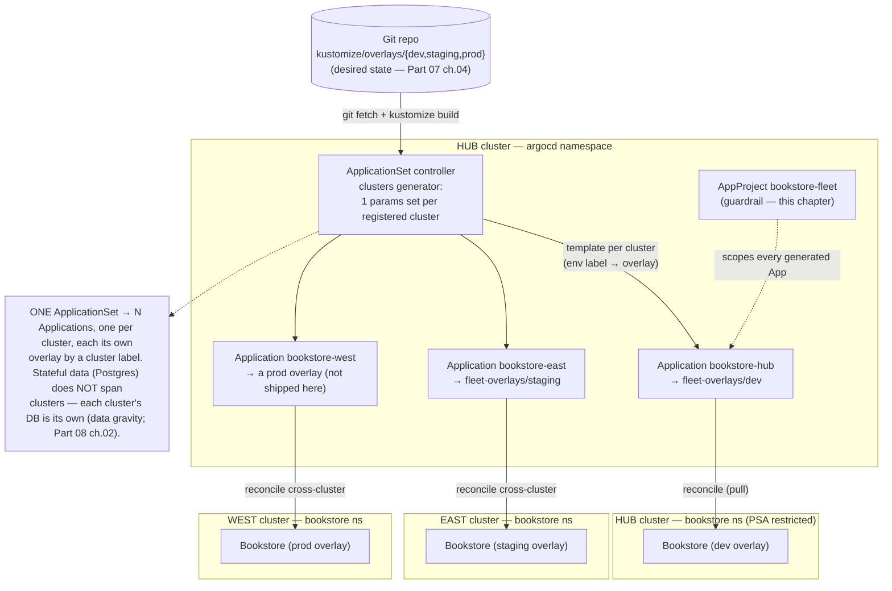

# 06 — Multi-cluster and fleet

> When **one big cluster** stops being enough (blast radius, region/latency,
> hard tenancy, regulatory) and the fleet topologies that answer it
> (per-env / per-region / per-tenant / hub-spoke); **Argo CD ApplicationSet**
> (cluster / git / matrix generators) delivering the Bookstore to N clusters
> from one object — building on [Part 07 ch.04](../07-delivery/04-gitops-argocd.md)'s
> App-of-Apps, not re-teaching it; **Karmada / Cluster API** fleet management
> as the alternative model; cross-cluster **service discovery & networking**
> (multi-cluster mesh / Submariner / the MCS API — the [ch.04](04-service-mesh.md)
> mesh, federated); **failover/DR & data gravity** (Postgres can't trivially
> span clusters — [Part 08 ch.02](../08-day-2-operations/02-backup-and-dr.md));
> fleet observability/policy — applied with **two kind clusters**, Argo CD on
> a hub, and an `ApplicationSet` that syncs the Bookstore to both with a
> per-cluster overlay.

**Estimated time:** ~60 min read · ~120 min hands-on
**Prerequisites:** [Part 07 ch.04](../07-delivery/04-gitops-argocd.md) — App-of-Apps this chapter scales to ApplicationSet · [Part 08 ch.04](../08-day-2-operations/04-multi-tenancy-and-namespaces.md) — single-cluster tenancy this chapter contrasts with · [Part 11 ch.04](04-service-mesh.md) — mesh federated for cross-cluster
**You'll know after this:** • choose between single-cluster + namespaces and a fleet for a given driver (blast / region / tenancy / regulatory) · • author an Argo CD ApplicationSet with a cluster generator to roll one config across N clusters · • compare Karmada / Cluster API / Argo CD as fleet-management models · • design cross-cluster service discovery via mesh federation or MCS API · • plan a failover where data-gravity (Postgres) gates the fleet topology · • scope the credential a hub holds for each member, and keep the hub from becoming the fleet's weakest point
**Lab tier:** A (kind). Run it only against clusters you own.

<!-- tags: multi-cluster, gitops, argo-cd, platform-engineering, dr -->

## Why this exists

Every prior part ran the Bookstore on **one cluster**. [Part 08 ch.04](../08-day-2-operations/04-multi-tenancy-and-namespaces.md)
showed how far one cluster goes with namespaces + RBAC + quotas — and that is
*correct and simpler* for most teams. But [Part 07 ch.04](../07-delivery/04-gitops-argocd.md)'s
Production notes ended on a forward reference: *"One Argo CD can manage many
clusters … an ApplicationSet with a cluster generator rolls a change
cluster-by-cluster."* And [Part 06 ch.05](../06-production-readiness/05-reliability-and-disruptions.md)/[Part
08 ch.02](../08-day-2-operations/02-backup-and-dr.md) kept circling the same
limit: **a single cluster is a single blast radius**, a single region, a
single regulatory boundary, a single control-plane upgrade that can take
*everything* down at once. This chapter is where one cluster becomes a
**fleet**.

You go multi-cluster when one of these forcing functions applies — not
before:

1. **Blast radius / availability.** A bad cluster upgrade, a corrupted etcd,
   an apiserver outage, a runaway controller — on one cluster, that is *total*
   outage. Splitting the workload across clusters bounds the damage.
2. **Region / latency / data residency.** Users (or laws) in multiple regions:
   you want a cluster close to each, and data that stays in-region.
3. **Hard tenancy / isolation.** Namespaces + RBAC are a *soft* boundary
   ([Part 08 ch.04](../08-day-2-operations/04-multi-tenancy-and-namespaces.md));
   some tenants/compliance regimes require a *hard* one — a separate cluster.
4. **Environment separation.** prod on entirely separate infrastructure from
   dev/staging, so a non-prod mistake cannot touch prod.

The honest counterweight, taught as hard as the motivation: **multi-cluster
multiplies operational cost** — N control planes to upgrade and observe,
cross-cluster service discovery and networking to solve, **data gravity**
(stateful systems like the Bookstore's Postgres *cannot* trivially span
clusters), fleet-wide policy/identity, and a delivery system that must reach
all of them safely. *One big cluster with good multi-tenancy is the right
default until a forcing function above makes it untenable.* The reference is
*Production Kubernetes* ch.2 (Deployment Models), ch.11 (Building Platform
Services), and ch.12 (Multitenancy); Argo CD Up & Running ch.10 for
ApplicationSet at scale.

## Mental model

**A fleet has two orthogonal problems: (1) the clusters' *lifecycle* (create,
upgrade, delete them) and (2) the *workloads' delivery* across them. Different
tools own each; don't conflate them.**

- **Lifecycle ≠ delivery.** **Cluster API / clusterctl** (and managed
  equivalents — EKS/GKE/AKS provisioners, [Part 10 ch.02](../10-cloud-and-managed-kubernetes/02-provisioning-and-iac.md))
  *create and upgrade the clusters themselves*. **Argo CD ApplicationSet** or
  **Karmada** *run workloads on clusters that already exist*. This chapter is
  mostly the second; it names the first.
- **ApplicationSet = a generator + a template → N Applications.** This is the
  fleet-scale evolution of [Part 07 ch.04](../07-delivery/04-gitops-argocd.md)'s
  App-of-Apps (one root → hand-written Applications). A **generator** is a
  data source — the **clusters** generator (one params set per registered
  cluster), the **git** generator (one per directory/file in the repo), the
  **list**, and the **matrix** (the product of two generators). One
  `ApplicationSet` + one template = one auto-generated `Application` per
  generated element. Add a cluster → an Application appears; no hand-editing.
- **Two fleet delivery philosophies.** **GitOps-fans-out** (ApplicationSet):
  Argo CD reconciles the *same Git* into each member cluster; each cluster
  pulls its own copy; differences via overlays. **Fleet control plane**
  (**Karmada**): you apply a workload + a `PropagationPolicy` to a *fleet
  apiserver* and it *schedules/spreads* the workload across members (replica
  division, cluster affinity, weighting, failover) — "a scheduler for
  clusters". Pick one model per workload, not both.
- **Topologies.** *Per-environment* (prod cluster ≠ staging cluster),
  *per-region* (latency/residency), *per-tenant* (hard isolation),
  *hub-spoke* (one management/hub cluster runs Argo CD/Karmada; spokes run
  workloads). They compose (per-region × per-env is a matrix).
- **What is portable, and what is not.** The *declarative manifests* (the
  Bookstore's Kustomize overlays) port to any cluster. **Stateful data does
  not** — Postgres has *data gravity*; you don't span one Postgres across
  clusters, you replicate/failover it deliberately ([Part 08 ch.02](../08-day-2-operations/02-backup-and-dr.md)).
  **Cross-cluster service discovery is not free** — a Service in cluster A is
  *not* reachable from B without a multi-cluster mesh / Submariner / the MCS
  API.
- **The hub holds a key to every member.** In a hub-spoke fleet the hub's
  controller stores a credential for each member. That makes the hub the most
  valuable target in the fleet. The hands-on scopes each member's credential
  before the hub holds it.

The trap to keep in view: **multi-cluster does not make the stateful problem
disappear — it sharpens it, and it adds cross-cluster networking and
fleet-wide policy as new problems.** "Just add clusters" trades one blast
radius for N control planes plus data-gravity and discovery problems you must
now solve explicitly. Adopt it for a forcing function, with the stateful tier
and the network designed first.

## Threats and controls

A fleet adds one threat that a single cluster does not have: a credential on
the hub that reaches every member.

| ID | Threat | Control taught here | Deeper |
|----|--------|---------------------|--------|
| S8 | The hub's token reaches every member, so one stolen Secret opens the whole fleet | A ServiceAccount per member, a Role in the `bookstore` namespace only, and a token that lasts 24 hours ([Fleet credentials](#fleet-credentials-the-hub-is-the-target)) | [Part 05 ch.01](../05-security/01-authn-authz-rbac.md) for RBAC |
| TB10 | A token crosses from the hub into a member's API server | The member identity holds nothing cluster-scoped, so the crossing buys one namespace, not the cluster (step 2) | [Part 05 ch.01](../05-security/01-authn-authz-rbac.md) |

Two existing rows apply as well. I2 applies because the hub's cluster Secrets
are readable by anyone who can read Secrets in the `argocd` namespace. E4
applies because the fleet deploys into a `restricted` namespace, so a
member's Deployment cannot ask for host access.

## Diagrams

### Diagram A — hub Argo CD → ApplicationSet → fleet reconcile (Mermaid)



### Diagram B — topologies + what's portable (ASCII)

```
 MULTI-CLUSTER TOPOLOGIES — pick for the forcing function ───────────────────

  PER-ENV            PER-REGION         PER-TENANT         HUB-SPOKE
  ┌────┐ ┌────┐      ┌────┐ ┌────┐      ┌────┐ ┌────┐      ┌─────HUB─────┐
  │dev │ │prod│      │ us │ │ eu │      │ t1 │ │ t2 │      │ Argo/Karmada│
  └────┘ └────┘      └────┘ └────┘      └────┘ └────┘      └──┬───┬───┬──┘
  prod blast-        latency &          HARD isolation     spoke spoke spoke
  isolated from      data residency     / compliance       (workloads only)
  non-prod           per region         per tenant         one mgmt plane
   (compose: per-region × per-env = a MATRIX generator — 20-)

  PORTABLE vs NOT (design the NOT first)
  ───────────────────────────────────────────────────────────────────────────
   PORTABLE  ► declarative manifests (Kustomize overlays) → any cluster
              ► Argo CD ApplicationSet / Karmada policy (the delivery layer)
   NOT       ► STATEFUL DATA — Postgres has DATA GRAVITY; replicate/failover
              ► deliberately, do NOT span one DB across clusters (Part 08 ch.02)
   NOT FREE  ► cross-cluster Service discovery → multi-cluster MESH (ch.04) /
              ► Submariner / MCS API (needs non-overlapping CIDRs + a tunnel)

  FLEET MODELS:  ApplicationSet = GitOps reconciles same repo into N clusters
                 Karmada        = fleet apiserver SCHEDULES/spreads workloads
                 Cluster API    = creates/UPGRADES the clusters (orthogonal)
```

## Hands-on with the Bookstore

**Assumed working directory: the guide repo root (`full-guide/`).** This
chapter adds the **new** [`examples/bookstore/multicluster/`](../examples/bookstore/multicluster/)
tree and operates it. It does **not** modify the Kustomize tree, the
`examples/bookstore/argocd/` tree ([Part 07 ch.04](../07-delivery/04-gitops-argocd.md)),
or any canonical file. The fleet overlays reuse the Part 07 overlays and add
one component that drops the cluster-scoped objects. The fleet AppProject is
new, and the Part 07 `bookstore` project stays as it was.

We will: (0) the two-cluster requirement; (1) Argo CD on the hub, in a
`restricted` namespace; (2) scope each member's identity before the hub holds
one; (3) register the members with Secrets written by hand; (4) one
**ApplicationSet** that delivers the Bookstore to both, with a per-cluster
overlay; (5) the cross-cluster networking and data gravity reality, honestly.

> **The honest setup story (read first).** Multi-cluster needs at least two
> clusters. The lab for this chapter had one kind cluster, so the captured run
> used that cluster for both roles. Step 1 was checked with a chart render and
> a server dry run; its install was not run. Steps 2 and 3 ran against the
> cluster: the member identity was created in its own namespace, its rights
> were checked with impersonation and with its own token, and the hub's
> Secrets were applied as server dry runs. Steps 0, 1 (the install), 4 and 5
> were not run. The Argo CD controllers were not started, because the lab
> schedules heavy installs one at a time and the lock was taken. The
> ApplicationSet and AppProject were checked against the CRD schema that the
> pinned chart renders, not against a live controller. The captured output
> came from a lab cluster with a different name from the one this chapter
> prints, and the lab used its own namespace names. The transcript is
> `full-guide/examples/security-lab/evidence/11-06.txt`. The cross-cluster
> networking is explained, not reproduced.

### 0. The two-cluster requirement (honest, reproducible)

[`multicluster/00-two-cluster-topology.yaml`](../examples/bookstore/multicluster/00-two-cluster-topology.yaml)
is a **not-applied doc carrier** (same honesty pattern as the apiserver-level
`cluster/` files): the real artifacts are the `kind` / `argocd cluster add`
commands it documents. Two clusters — a **hub** (runs Argo CD) and a member:

```sh
kind delete cluster --name bookstore-hub  2>/dev/null || true
kind delete cluster --name bookstore-east 2>/dev/null || true
kind create cluster --name bookstore-hub
kind create cluster --name bookstore-east
kubectl config get-contexts | grep bookstore   # kind-bookstore-hub / -east
```

### 1. Argo CD on the hub (pinned Helm, restricted namespace)

This repeats [Part 07 ch.04](../07-delivery/04-gitops-argocd.md) step 1 with
two changes. The chart is pinned to 10.11.6, which renders Argo CD v3.5.6
(checked with `helm show chart`). The namespace is labelled `restricted`
before the install. Part 07 ch.04 leaves it unlabelled. The chart's rendered
objects pass a restricted server dry run with their default values, so no
registry entry is needed. The lab checked that before any install:

```sh
ARGOCD_CHART_VERSION=10.11.6        # argo-cd chart; renders Argo CD v3.5.6
kubectl config use-context kind-bookstore-hub
helm repo add argo https://argoproj.github.io/argo-helm
helm repo update
kubectl create namespace argocd
kubectl label namespace argocd \
  pod-security.kubernetes.io/enforce=restricted \
  pod-security.kubernetes.io/audit=restricted \
  pod-security.kubernetes.io/warn=restricted
helm install argocd argo/argo-cd -n argocd \
  --version "$ARGOCD_CHART_VERSION" --wait
kubectl -n argocd rollout status deploy/argocd-server
```

The lab rendered the chart, then ran a server-side dry run of the 59 rendered
objects into the labelled namespace. The dry run accepted all of them, with
no Pod Security warning:

<!-- gate: output -->
```text
exit=0
59
0
```

The dry run was:

```sh
helm template argocd argo/argo-cd --version 10.11.6 --namespace argocd > argo-render.yaml
kubectl apply --server-side --field-manager=dryrun -n argocd --dry-run=server -f argo-render.yaml > dryrun.txt 2>&1; echo exit=$?
grep -c 'server dry run' dryrun.txt; grep -c 'would violate' dryrun.txt
```

A clean result means something only if the check can fail. The lab dry-ran
a Pod that `restricted` must refuse, and a Deployment that it only warns
about. The Pod was refused:

```text
Error from server (Forbidden): error when creating "STDIN": pods "psa-control" is forbidden: violates PodSecurity "restricted:latest": allowPrivilegeEscalation != false (container "app" must set securityContext.allowPrivilegeEscalation=false), unrestricted capabilities (container "app" must set securityContext.capabilities.drop=["ALL"]), runAsNonRoot != true (pod or container "app" must set securityContext.runAsNonRoot=true), seccompProfile (pod or container "app" must set securityContext.seccompProfile.type to "RuntimeDefault" or "Localhost")
```

The Deployment was accepted with this warning, which the chart's objects
did not produce:

<!-- gate: output -->
```text
Warning: would violate PodSecurity "restricted:latest": allowPrivilegeEscalation != false (container "app" must set securityContext.allowPrivilegeEscalation=false), unrestricted capabilities (container "app" must set securityContext.capabilities.drop=["ALL"]), runAsNonRoot != true (pod or container "app" must set securityContext.runAsNonRoot=true), seccompProfile (pod or container "app" must set securityContext.seccompProfile.type to "RuntimeDefault" or "Localhost")
```

The Pod's denial and the Deployment's warning are copies with the reader's
names. The lab's transcript holds the originals.

Installing Argo CD created the `argoproj.io` CRDs **including the
ApplicationSet controller** (bundled with the `argo-cd` Helm chart). **This is what
makes the ApplicationSet manifests dry-runnable** — before this, a client
dry-run prints `no matches for kind "ApplicationSet"` (the documented
CRD-intrinsic behaviour; each file header — the exact precedent of
`examples/bookstore/argocd/*.yaml` and `raw-manifests/70-`/`83-`).

To use the UI, port-forward `argocd-server` and read the first admin password
from the `argocd-initial-admin-secret` Secret. Change the password and delete
that Secret. This chapter uses `kubectl` only, so it does not log in with the
`argocd` CLI over a certificate it has not checked.

### 2. Scope each member's identity before the hub holds it

Do this on every member, the hub included, before the hub has a credential
for it. Each member gets a namespace for the identity, a ServiceAccount that
does not mount its token, and a Role that works only inside `bookstore`.

The Bookstore base also carries one `Namespace` and three `PriorityClass`
objects. Both kinds are cluster-scoped. The identity must not hold rights to
cluster-scoped objects, and RBAC cannot narrow a `create` to one object name.
So the platform team applies those two base files with its own identity, and
the fleet overlays drop them:

```sh
kubectl apply -f examples/bookstore/kustomize/base/00-namespace.yaml
kubectl apply -f examples/bookstore/kustomize/base/35-priorityclasses.yaml
```

The identity itself is four objects. The namespace carries the Pod Security
labels, the ServiceAccount has `automountServiceAccountToken: false`, and the
Role lists the namespaced kinds the fleet overlays render. It gives no access
to `Namespace`, `PriorityClass` or anything in another namespace.

Run the steps below on each member, the hub included. Point `kubectl` at the
member first:

```sh
kubectl config use-context kind-bookstore-east
```

```yaml
apiVersion: v1
kind: Namespace
metadata:
  name: fleet-system
  labels:
    pod-security.kubernetes.io/enforce: restricted
    pod-security.kubernetes.io/audit: restricted
    pod-security.kubernetes.io/warn: restricted
---
apiVersion: v1
kind: ServiceAccount
metadata:
  name: fleet-argocd
  namespace: fleet-system
automountServiceAccountToken: false
---
apiVersion: rbac.authorization.k8s.io/v1
kind: Role
metadata:
  name: fleet-deployer
  namespace: bookstore
rules:
  - apiGroups: [""]
    resources: [configmaps, limitranges, resourcequotas, secrets, serviceaccounts, services]
    verbs: [get, list, watch, create, update, patch, delete]
  - apiGroups: [apps]
    resources: [deployments, statefulsets]
    verbs: [get, list, watch, create, update, patch, delete]
  - apiGroups: [batch]
    resources: [cronjobs, jobs]
    verbs: [get, list, watch, create, update, patch, delete]
  - apiGroups: [autoscaling]
    resources: [horizontalpodautoscalers]
    verbs: [get, list, watch, create, update, patch, delete]
  - apiGroups: [policy]
    resources: [poddisruptionbudgets]
    verbs: [get, list, watch, create, update, patch, delete]
  - apiGroups: [networking.k8s.io]
    resources: [ingresses, networkpolicies]
    verbs: [get, list, watch, create, update, patch, delete]
  - apiGroups: [rbac.authorization.k8s.io]
    resources: [roles, rolebindings]
    verbs: [get, list, watch, create, update, patch, delete]
  - apiGroups: [""]
    resources: [pods]
    verbs: [get, list, watch]
  - apiGroups: [apps]
    resources: [replicasets]
    verbs: [get, list, watch]
---
apiVersion: rbac.authorization.k8s.io/v1
kind: RoleBinding
metadata:
  name: fleet-deployer
  namespace: bookstore
subjects:
  - kind: ServiceAccount
    name: fleet-argocd
    namespace: fleet-system
roleRef:
  apiGroup: rbac.authorization.k8s.io
  kind: Role
  name: fleet-deployer
```

Save the block as `fleet-identity.yaml` and apply it to the member:

```sh
kubectl apply -f fleet-identity.yaml
```

Read the identity's rights with impersonation. The Role has to allow what the
fleet deploys and refuse what it must not:

```sh
kubectl get sa fleet-argocd -n fleet-system -o jsonpath='{.automountServiceAccountToken}'; echo
kubectl get secrets -n fleet-system --field-selector type=kubernetes.io/service-account-token -o name | wc -l
kubectl auth can-i create deployments.apps -n bookstore --as=system:serviceaccount:fleet-system:fleet-argocd
kubectl auth can-i get pods -n bookstore --as=system:serviceaccount:fleet-system:fleet-argocd
kubectl auth can-i get secrets -n bookstore --as=system:serviceaccount:fleet-system:fleet-argocd
kubectl auth can-i get secrets -n kube-system --as=system:serviceaccount:fleet-system:fleet-argocd
kubectl auth can-i list namespaces --as=system:serviceaccount:fleet-system:fleet-argocd
kubectl auth can-i create priorityclasses.scheduling.k8s.io --as=system:serviceaccount:fleet-system:fleet-argocd
```

<!-- gate: output -->
```text
false
# ...
       0
# ...
yes
# ...
yes
# ...
yes
# ...
no
# ...
Warning: resource 'namespaces' is not namespace scoped
# ...
no
# ...
Warning: resource 'priorityclasses' is not namespace scoped in group 'scheduling.k8s.io'
# ...
no
```

The identity cannot read `kube-system`, cannot list Namespaces, and cannot
create PriorityClasses, which can preempt other workloads. It can read every
Secret in `bookstore`, because a Deployment needs them. That is the one place
where the fleet identity holds data, and the next section explains what to
keep out of it. The ServiceAccount has no token Secret. Since Kubernetes 1.24
the control plane no longer creates one automatically, and the Kubernetes
documentation calls a long-lived token a risk, to be created only when the
TokenRequest API will not do.

The token is what the hub holds, so test the token itself. The first attempt
in the lab passed `--token` to the kubeconfig the lab already used. The request
still authenticated with that kubeconfig's client certificate, so the test said
nothing about the token. The test below builds a kubeconfig that holds only
the token:

```sh
kubectl config use-context kind-bookstore-east
TOKEN=$(kubectl create token fleet-argocd -n fleet-system --duration=24h)
kubectl config view --raw --minify -o jsonpath='{.clusters[0].cluster.certificate-authority-data}' | base64 -d > member-ca.crt
kubectl config set-cluster member --server="$(kubectl config view --minify -o jsonpath='{.clusters[0].cluster.server}')" --certificate-authority=member-ca.crt --embed-certs=true --kubeconfig=fleet.kubeconfig
kubectl config set-credentials fleet-argocd --token="$TOKEN" --kubeconfig=fleet.kubeconfig
kubectl config set-context fleet --cluster=member --user=fleet-argocd --kubeconfig=fleet.kubeconfig
kubectl --kubeconfig=fleet.kubeconfig --context=fleet auth can-i delete deployments.apps -n bookstore
kubectl --kubeconfig=fleet.kubeconfig --context=fleet get configmaps -n kube-system 2>&1 | head -1
kubectl --kubeconfig=fleet.kubeconfig --context=fleet get namespaces 2>&1 | head -1
rm -f fleet.kubeconfig member-ca.crt
```

The token can act in its own namespace. The first two denials below are the
deliberate ones, shown with the reader's names:

<!-- gate: output -->
```text
yes
```

```text
Error from server (Forbidden): configmaps is forbidden: User "system:serviceaccount:fleet-system:fleet-argocd" cannot list resource "configmaps" in API group "" in the namespace "kube-system"
Error from server (Forbidden): namespaces is forbidden: User "system:serviceaccount:fleet-system:fleet-argocd" cannot list resource "namespaces" in API group "" at the cluster scope
```

The token's lifetime is the second limit. `kubectl create token` asks for a
TokenRequest, and the Kubernetes documentation says that without a duration it
lasts one hour. The lab requested a 24-hour token and then a one-year token.
A short decoder (not shipped with this chapter) read each token's `exp` and
`iat` claims. The lab cluster did not cap the request at a short default:

<!-- gate: output -->
```text
lifetime_seconds: 86400
```

<!-- gate: output -->
```text
lifetime_seconds: 31536000
```

So set `--duration` explicitly. The hub is given 24 hours in this chapter, and
the rotation section below explains what that costs.

The fleet overlays must render inside this identity's Role. Dry-run each one
as the identity. A server dry run creates nothing, so the lab first created
the Role `catalog-config-reader` for real, because the RoleBinding in the
same overlay refers to it:

```sh
kubectl kustomize examples/bookstore/multicluster/fleet-overlays/dev | kubectl --as=system:serviceaccount:fleet-system:fleet-argocd apply --dry-run=server -n bookstore -f -
kubectl kustomize examples/bookstore/multicluster/fleet-overlays/staging | kubectl --as=system:serviceaccount:fleet-system:fleet-argocd apply --dry-run=server -n bookstore -f -
kubectl kustomize examples/bookstore/multicluster/fleet-overlays/dev | grep -cE '^kind: (Namespace|PriorityClass)$' || true
```

<!-- gate: output -->
```text
exit=0
41
# ...
exit=0
45
# ...
0
```

Each overlay has the same number of objects as its Part 07 overlay minus the
cluster-scoped kinds. The unfiltered Part 07 overlay, dry-run as the same
identity, is refused for the Namespace:

```text
Error from server (Forbidden): error when retrieving current configuration of:
from server for: "STDIN": namespaces "bookstore" is forbidden: User "system:serviceaccount:fleet-system:fleet-argocd" cannot get resource "namespaces" in API group "" in the namespace "bookstore"
```

### 3. Register the members with Secrets written by hand

Do not register members with `argocd cluster add`. Its source in the Argo CD
repository (the `util/clusterauth` package) installs the `argocd-manager`
ServiceAccount in `kube-system`, binds it to a ClusterRole named
`argocd-manager-role` with `*` on every API group, resource, verb and
non-resource URL, and stores a token Secret that does not expire. This
chapter's identity does the same job with one namespace's rights and a
24-hour token.

Each member is a Secret in the hub's `argocd` namespace. Argo CD reads the
label, the API address, the CA and the bearer token from it. The two templates
below hold variables only in the value fields, so each file is a complete,
valid Secret. The name and label are fixed per member:

```yaml
apiVersion: v1
kind: Secret
metadata:
  name: bookstore-east
  namespace: argocd
  labels:
    argocd.argoproj.io/secret-type: cluster
    bookstore.example.com/fleet: "true"
    env: staging
type: Opaque
stringData:
  name: east
  server: ${MEMBER_SERVER}
  config: |
    {"bearerToken": "${MEMBER_TOKEN}", "tlsClientConfig": {"caData": "${MEMBER_CA_B64}"}}
```

```yaml
apiVersion: v1
kind: Secret
metadata:
  name: bookstore-hub
  namespace: argocd
  labels:
    argocd.argoproj.io/secret-type: cluster
    bookstore.example.com/fleet: "true"
    env: dev
type: Opaque
stringData:
  name: hub
  server: ${MEMBER_SERVER}
  config: |
    {"bearerToken": "${MEMBER_TOKEN}", "tlsClientConfig": {"caData": "${MEMBER_CA_B64}"}}
```

This function fills the variables and applies the file. The token is held in
a shell variable and piped straight into `kubectl`. It is never printed and
never written to disk:

```sh
register_member() {  # FILE CONTEXT: write one member's cluster Secret to the hub
  export MEMBER_SERVER MEMBER_CA_B64 MEMBER_TOKEN
  MEMBER_SERVER=$(kubectl --context "$2" config view --minify -o jsonpath='{.clusters[0].cluster.server}')
  MEMBER_CA_B64=$(kubectl --context "$2" config view --raw --minify -o jsonpath='{.clusters[0].cluster.certificate-authority-data}')
  MEMBER_TOKEN=$(kubectl --context "$2" create token fleet-argocd -n fleet-system --duration=24h)
  envsubst < "$1" | kubectl --context kind-bookstore-hub apply -n argocd -f -
}
register_member member-secret-east.yaml kind-bookstore-east
register_member member-secret-hub.yaml kind-bookstore-hub
kubectl -n argocd get secret -l argocd.argoproj.io/secret-type=cluster -o name | wc -l
```

The lab ran the same function, with the same templates in its own namespace.
It applied both Secrets as server dry runs, so none was stored. The count at
the end is zero. After a real apply it reads 2.

<!-- gate: output -->
```text
secret/bookstore-east created (server dry run)
secret/bookstore-hub created (server dry run)
# ...
       0
```

The hub is a member too. Its own Argo CD uses the same identity to reach its
own API, so the hub holds a token to itself. Scope that one the same way.

Rotation is the open problem. A 24-hour token means re-running this function
every day, from a machine that can reach every member. That machine is itself
a credential holder. Two ways to remove the stored copy are for later. An
external secret store can render the Secret from a source that rotates
(<!-- link-later: 05.05 --> Secrets at scale), and a cloud workload identity
can let the hub mint its own token from an IAM role instead of holding one
([Part 10 ch.03](../10-cloud-and-managed-kubernetes/03-cloud-identity.md)).

### 4. One ApplicationSet → the Bookstore on both clusters

Apply the fleet AppProject and the ApplicationSet. The Part 07 `bookstore`
project allows one destination, the in-cluster API, so an Application for a
member would be refused. The fleet project allows the two members by their
Argo CD names, and the `bookstore` namespace on each. It allows no
cluster-scoped kind:

```sh
kubectl apply -n argocd -f examples/bookstore/multicluster/05-appproject-fleet.yaml
kubectl apply -n argocd -f examples/bookstore/multicluster/10-applicationset-cluster-generator.yaml
kubectl get applicationset -n argocd
kubectl get applications -n argocd
#   bookstore-hub   → fleet-overlays/dev      (on hub)
#   bookstore-east  → fleet-overlays/staging  (on east)
#   ONE object generated BOTH. Adding a third labelled member → a third
#   Application appears automatically (no edit). That is the fleet primitive.
```

The lab could not apply these objects, because the Argo CD CRDs are not
installed in it. It checked both files against the `applicationsets` and
`appprojects` schemas that the pinned chart renders, with unknown fields
rejected. A misspelt field fails that check:

```sh
kubectl apply -n argocd --dry-run=server -f examples/bookstore/multicluster/10-applicationset-cluster-generator.yaml
kubectl apply -n argocd --dry-run=server -f examples/bookstore/multicluster/05-appproject-fleet.yaml
```

<!-- gate: output -->
```text
error: resource mapping not found for name: "bookstore-fleet" namespace: "argocd" from "examples/bookstore/multicluster/10-applicationset-cluster-generator.yaml": no matches for kind "ApplicationSet" in version "argoproj.io/v1alpha1"
ensure CRDs are installed first
```

<!-- gate: output -->
```text
ApplicationSet/bookstore-fleet: valid against applicationsets.argoproj.io (v1alpha1, unknown fields rejected)
ApplicationSet/bookstore-fleet-matrix: valid against applicationsets.argoproj.io (v1alpha1, unknown fields rejected)
# ...
AppProject/bookstore-fleet: valid against appprojects.argoproj.io (v1alpha1, unknown fields rejected)
```

The **per-cluster overlay value** is the lesson: the *same* ApplicationSet
gives the hub the dev fleet overlay and the east member the staging fleet
overlay, purely from a cluster label, with no hand-written Application per
cluster. The two overlays are the Part 07 dev and staging overlays with the
cluster-scoped objects dropped.

The **matrix generator** variant
([`multicluster/20-applicationset-matrix-generator.yaml`](../examples/bookstore/multicluster/20-applicationset-matrix-generator.yaml))
is the (clusters × overlay-directories) product for "every environment on every
cluster". Apply **either** `10-` **or** `20-`, not both (they would both
generate Applications targeting the same clusters: the same "alternative, not
addition" rule as the Part 02 `50-`/`51-` pairing). The matrix variant also
needs a namespace per overlay before dev and staging can share a cluster. Both
overlays target `bookstore` today, and the example does not add that.

> **The honest local-vs-real-Git note (from Part 07 ch.04, still in force).**
> `repoURL` is the generic placeholder `https://github.com/your-org/bookstore`.
> With a real fork the generation + reconcile is fully real; with the
> placeholder Argo reports the repo unreachable — *expected*, the same GitOps
> honesty as [Part 07 ch.04](../07-delivery/04-gitops-argocd.md). The fleet
> *mechanics* (generator → N Applications → per-cluster overlay) are not
> faked; only the repo location is substituted.

### 5. Cross-cluster networking & data gravity — the honest reality

The Bookstore now runs on **two clusters**, but each cluster's `catalog`
**cannot** reach the *other* cluster's `postgres` — Services are
cluster-local; cross-cluster discovery needs a **multi-cluster mesh**
([ch.04](04-service-mesh.md), with a shared trust domain) or **Submariner** /
the **MCS API** (`ServiceExport`/`ServiceImport`), all of which require
**non-overlapping pod CIDRs + a tunnel** between clusters — *not reproduced on
kind here* (called out, not faked; the `00-` topology file documents why and
the distinct-CIDR kind config you'd need):

```sh
# Each cluster's Bookstore is self-contained: hub's catalog → hub's postgres,
# east's catalog → east's postgres. They are NOT one system across clusters.
kubectl --context kind-bookstore-east get pods -n bookstore   # east's OWN DB
# Postgres has DATA GRAVITY: you do NOT span one Postgres across clusters.
# The fleet pattern is per-cluster data + deliberate replication/failover
# and a tested DR runbook (Part 08 ch.02). The DECLARATIVE state is portable
# (Argo rebuilds it anywhere); the DATA is not — design that first.
```

The **Karmada alternative** ([`multicluster/30-karmada-propagationpolicy.yaml`](../examples/bookstore/multicluster/30-karmada-propagationpolicy.yaml))
is shown as the *fleet-control-plane* model (apply a workload + a
`PropagationPolicy` to a Karmada apiserver; it spreads replicas across
members) — heavier to install than ApplicationSet (its header documents the
CRD-intrinsic dry-run and that it targets the *Karmada* apiserver, not a
member cluster). Clean up:

```sh
kubectl delete -n argocd -f examples/bookstore/multicluster/10-applicationset-cluster-generator.yaml --ignore-not-found
kubectl delete -n argocd -f examples/bookstore/multicluster/05-appproject-fleet.yaml --ignore-not-found
kubectl -n argocd delete secret -l argocd.argoproj.io/secret-type=cluster
kubectl --context kind-bookstore-east delete namespace fleet-system bookstore
helm uninstall argocd -n argocd
kubectl delete namespace argocd
kind delete cluster --name bookstore-hub
kind delete cluster --name bookstore-east
```

## How it works under the hood

- **ApplicationSet is a controller that generates Applications.** It watches
  `ApplicationSet` objects; for each it runs the **generators** to produce a
  list of parameter sets, renders the **template** once per set, and
  creates/updates the resulting `Application`s (Argo CD then reconciles each
  exactly as in [Part 07 ch.04](../07-delivery/04-gitops-argocd.md) — nothing
  about the per-Application sync changes). It is purely *additive* over Part 07
  ch.04: same `Application`, a fleet `AppProject` guardrail, same Kustomize
  overlays with the cluster-scoped objects dropped — just *machine-generated*
  instead of hand-written, which is the only thing that scales to a fleet.
- **The generators.** **clusters** — one params set per cluster `Secret`
  Argo CD stores, selectable by the Secret's labels, exposing `{{.name}}`,
  `{{.server}}`, and the Secret's labels (the Bookstore uses an `env` label
  to pick the overlay). **git** — one params set per directory or file matched
  in the repo (so adding `fleet-overlays/<X>/` adds Applications with no
  edit). **list** — a static inline list. **matrix** — the Cartesian product
  of two child generators (clusters × git = "every env on every cluster"). The
  generator is *data*; the template is *one* Application shape — that
  separation is why a fleet change is a one-line generator/label edit, not N
  file edits.
- **Cluster registration and the hub model.** Each member is a Secret in the
  hub's `argocd` namespace, labelled `argocd.argoproj.io/secret-type=cluster`,
  holding the member's API address, its CA and a bearer token. The application
  controller uses that token to reconcile into the member. The hub runs the
  control plane and the members run workloads only. That concentration of
  credentials is the subject of the next section.
- **Argo CD ApplicationSet vs Karmada — the real difference.** ApplicationSet
  is **GitOps fan-out**: the same Git, reconciled independently into each
  member; each member has its own copy; per-cluster differences are *overlays*
  or generator params. Karmada is a **fleet scheduler**: you submit a workload
  + `PropagationPolicy`/`OverridePolicy` to the Karmada apiserver and it
  *places and spreads* it (replica division, cluster affinity, weighting,
  failover) across members — the cluster set is a scheduling domain. Cluster
  API/clusterctl is **orthogonal**: it provisions/upgrades the *clusters
  themselves* (the lifecycle), then ApplicationSet/Karmada run workloads on
  them. Don't conflate lifecycle, fleet-scheduling, and GitOps-delivery —
  they're three layers.
- **Cross-cluster service discovery is a separate, non-trivial layer.** A
  Kubernetes `Service` is cluster-scoped; nothing makes `catalog` in cluster A
  resolvable/reachable from B by default. The options: a **multi-cluster
  mesh** ([ch.04](04-service-mesh.md)) with a *shared trust domain* (SPIFFE
  identities valid across clusters, east-west gateways bridging them),
  **Submariner** (an L3 tunnel + Lighthouse DNS across clusters), or the
  **Multi-Cluster Services (MCS) API** (`ServiceExport`/`ServiceImport`,
  `clusterset.local`). All require **non-overlapping pod/Service CIDRs** and a
  network path between clusters — which is exactly why it is *not* a kind
  one-liner and is called out, not faked, here. The mesh's mTLS identity from
  [ch.04](04-service-mesh.md) is what makes cross-cluster calls *trustable*,
  not just *reachable*. Plan the CIDRs before the second cluster, since
  retrofitting them is painful. Treat the link between clusters as a security
  boundary: encrypt it and police it with policy
  ([Part 02 ch.06](../02-networking/06-network-policies.md)).
- **Data gravity is the hard limit.** Stateless tiers (catalog/orders/
  storefront) are *portable* — Argo rebuilds them on any cluster from the
  same overlay. The Bookstore's **Postgres is not**: you cannot transparently
  span one Postgres StatefulSet across clusters (latency, consensus, the PVC
  is cluster-local — [Part 03 ch.05](../03-config-and-storage/05-stateful-data-patterns.md)/[Part
  08 ch.02](../08-day-2-operations/02-backup-and-dr.md)). Real multi-cluster
  designs make the data tier an explicit decision: a primary cluster + async
  replicas, a cloud regional/global database, or per-cluster independent data
  with app-level reconciliation — and a **tested failover/DR runbook** ([Part
  08 ch.02](../08-day-2-operations/02-backup-and-dr.md)). The control plane
  recovers the *declarative* state; nothing but your replication strategy
  recovers the *data*.
- **Fleet observability & policy.** N clusters need *aggregated* signals
  (federated Prometheus / Thanos / a managed metrics backend — [Part 06
  ch.01](../06-production-readiness/01-observability-metrics.md)) and
  *consistent* policy (the [ch.01](01-admission-webhooks.md) admission/Kyverno
  layer, the [ch.04](04-service-mesh.md) mTLS posture, the [Part 05](../05-security/01-authn-authz-rbac.md)
  RBAC) applied to *every* member — itself GitOps-delivered by the same
  ApplicationSet. A fleet you can't observe or police uniformly is N
  inconsistent clusters, not one fleet.

### Fleet credentials: the hub is the target

A hub that holds a token for every member is the most valuable target in the
fleet. Anyone who reads the cluster Secrets in the hub's `argocd` namespace
holds every member's token, and the Argo CD controllers read those Secrets
constantly. Three rules keep one leak from becoming a fleet-wide compromise.

- **Scope each member's token.** The member identity from step 2 acts in one
  namespace and holds nothing cluster-scoped. A stolen token gives one
  namespace on one member. It cannot list other namespaces, read another
  namespace's Secrets, or create PriorityClasses. The lab checked each of
  these with `kubectl auth can-i` and with the token itself. The identity can
  still read every Secret in `bookstore`, so keep the credentials that matter
  out of Git and out of that namespace (<!-- link-later: 05.05 -->).
- **Limit the lifetime.** A TokenRequest token expires. Ask for a duration
  every time (`--duration=24h` here), because the default is one hour and a
  long request is honoured. Never create a long-lived token Secret for a
  member. The Kubernetes documentation calls that a risk and reserves it for
  cases where the TokenRequest API will not do. Revoke a member at once by
  deleting its RoleBinding: the token keeps its identity but loses every right.
- **Prefer pull.** In the model above the hub reaches out to each member, so
  the hub holds a credential for each one. In a pull model each member runs its
  own reconciler that reads from Git, and the member needs read access to Git
  only. A compromised hub then cannot push changes into members, and a
  compromised member holds nothing that reaches the hub. This chapter teaches
  the hub model because the ApplicationSet is Argo CD's fleet generator. Where
  the members can reconcile themselves, prefer pull.
- **Lock down the hub's own Secrets.** Restrict `get`, `list` and `watch` on
  Secrets in the `argocd` namespace to the Argo CD service accounts and the
  platform team. Every member token sits in those Secrets.

## Production notes

> **In production: stay single-cluster until a forcing function demands
> otherwise — then design the data tier and the network *first*.**
> Multi-cluster multiplies operational cost (N control planes, fleet
> observability, cross-cluster networking, data gravity). One cluster with
> rigorous multi-tenancy ([Part 08 ch.04](../08-day-2-operations/04-multi-tenancy-and-namespaces.md))
> is the right default. When blast radius / region / hard tenancy / regulatory
> forces the split, decide the **stateful** strategy (primary+replicas /
> regional managed DB / per-cluster data + DR runbook — [Part 08 ch.02](../08-day-2-operations/02-backup-and-dr.md))
> and the **cross-cluster network** before the first extra cluster.

> **In production: deliver the fleet with one ApplicationSet, gated and
> progressive.** A cluster generator + the per-cluster overlay (this chapter)
> means a new cluster is one labelled registration, not N files. Use an
> ApplicationSet **progressive sync strategy** (canary clusters first, then
> waves) so a bad change rolls cluster-by-cluster, not fleet-wide at once —
> the infrastructure analog of [Part 07 ch.05](../07-delivery/05-progressive-delivery.md)'s
> per-Pod canary; gate promotion on each cluster's app SLOs ([Part 06 ch.05](../06-production-readiness/05-reliability-and-disruptions.md)).
> Keep the fleet AppProject tight on every generated Application.

> **In production: pick ONE fleet model per workload, and keep lifecycle
> separate.** ApplicationSet (GitOps fan-out) *or* Karmada (fleet scheduler) —
> running both for the same workloads fights for ownership. Provision/upgrade
> the clusters with **Cluster API / a managed provisioner** ([Part 10 ch.02](../10-cloud-and-managed-kubernetes/02-provisioning-and-iac.md))
> — that lifecycle layer is orthogonal to whichever delivery model you choose
> and must not be conflated with it.

> **In production (managed Kubernetes):** each provider has its own fleet
> membership, multi-cluster service and managed database tier. Use the
> provider's fleet identity and observability rather than rebuilding them. The
> Bookstore's overlays are portable across providers. The provisioning, the
> membership and the managed data tier are provider-specific.

## Quick Reference

```sh
# Argo CD on the HUB: pinned chart, restricted namespace
ARGOCD_CHART_VERSION=10.11.6
kubectl create namespace argocd
kubectl label namespace argocd pod-security.kubernetes.io/enforce=restricted pod-security.kubernetes.io/audit=restricted pod-security.kubernetes.io/warn=restricted
helm install argocd argo/argo-cd -n argocd --version "$ARGOCD_CHART_VERSION" --wait

# Each member: a namespace for the identity, a scoped Role, no automatic token
kubectl apply -f fleet-identity.yaml
kubectl auth can-i --list --as=system:serviceaccount:fleet-system:fleet-argocd -n bookstore

# A token for the hub, with an explicit lifetime (never printed, never in Git)
kubectl create token fleet-argocd -n fleet-system --duration=24h

# Register a member on the hub (writes its cluster Secret; define register_member first)
register_member member-secret-east.yaml kind-bookstore-east

# One ApplicationSet -> N Applications
kubectl apply -n argocd -f examples/bookstore/multicluster/05-appproject-fleet.yaml
kubectl apply -n argocd -f examples/bookstore/multicluster/10-applicationset-cluster-generator.yaml
kubectl get applicationset,applications -n argocd
```

Checklist:

- [ ] Multi-cluster adopted for a **forcing function** (blast radius / region
      / hard tenancy / regulatory) — **not** by default ([Part 08 ch.04](../08-day-2-operations/04-multi-tenancy-and-namespaces.md)
      first)
- [ ] **Data tier + cross-cluster network designed before** the second
      cluster (data gravity; [Part 08 ch.02](../08-day-2-operations/02-backup-and-dr.md))
- [ ] Fleet delivered by **one ApplicationSet** (cluster/matrix generator),
      per-cluster overlay by label; **progressive** cluster rollout, SLO-gated
- [ ] **One fleet model** per workload (ApplicationSet *or* Karmada);
      lifecycle (Cluster API) kept **separate** ([Part 10 ch.02](../10-cloud-and-managed-kubernetes/02-provisioning-and-iac.md))
- [ ] Argo CD on a **hub** in a `restricted` namespace; the fleet AppProject
      guardrail on every generated Application
- [ ] Every member's identity: its own namespace, a Role in the workload
      namespace only, no cluster-scoped rights, `automountServiceAccountToken:
      false`, and a token lifetime set explicitly
- [ ] No `argocd cluster add` (it binds a cluster-admin-equivalent ClusterRole
      and stores a token that never expires)
- [ ] Hub Secrets readable only by Argo CD and the platform team; a rotation
      owner for every member token
- [ ] **Pull** where members can reconcile themselves; the hub holds no member
      credential it does not need
- [ ] Cross-cluster traffic = **mesh (shared trust domain) / MCS / Submariner**
      with non-overlapping CIDRs ([ch.04](04-service-mesh.md), [Part 02 ch.06](../02-networking/06-network-policies.md))
- [ ] Fleet **observability + policy** aggregated/uniform across members;
      every CRD manifest carries the **CRD-intrinsic** dry-run note

## Test your understanding

> Try each before opening the answer drawer. The act of trying is the exercise; the answer is the check.

1. **Name three failure modes that one-big-cluster cannot avoid no matter how you scale it.**
   <details><summary>Show answer</summary>

   (1) **Blast radius**: a control-plane outage (etcd corruption, bad CRD upgrade, a misconfigured webhook with `Fail`) takes every workload down at once. (2) **Region-pinned latency / regulatory**: serving EU customers from us-east-1 violates GDPR data residency and adds 100ms+ baseline latency — no scaling solves geography. (3) **Hard tenancy**: PSA + namespaces + NetworkPolicy isolate at the *soft* level, but a malicious tenant with a kernel exploit or a noisy neighbor saturating the kubelet can affect siblings; the only hard isolation is a separate cluster (or kernel — see [Part 05](../05-security/01-authn-authz-rbac.md)).

   </details>

2. **An `ApplicationSet` with a cluster generator is supposed to deploy to 5 clusters, but only 3 received the workload. What's the diagnostic order?**
   <details><summary>Show answer</summary>

   (1) `kubectl get applicationset -n argocd <name> -o yaml` and read `status.resources`: the generated Applications and their status. A member missing from the list means the generator did not see it. (2) `kubectl get secrets -n argocd -l argocd.argoproj.io/secret-type=cluster` — is the missing member's Secret there, and labelled `bookstore.example.com/fleet=true`? (3) Check the Secret's `env` label against the overlay path it selects. (4) Check the member's token. A token issued for 24 hours and not re-minted leaves the member unreachable; read the Application's connection status. (5) If the Applications exist but do not sync, check the AppProject's `destinations` (the Argo CD cluster names) and the member identity's Role.

   </details>

3. **You have two clusters that both run a `catalog` Service in namespace `bookstore`. How do you make `storefront` in cluster A call `catalog` in cluster B?**
   <details><summary>Show answer</summary>

   Three layers: (a) **Reachability** — non-overlapping Pod/Service CIDRs and a cross-cluster L3 path (Submariner with IPsec/VXLAN, cloud-native VPC peering, or a mesh gateway). (b) **Identity** — the two clusters need a shared trust domain so mTLS works; either both mesh into the same Istio multi-cluster mesh (primary-remote or multi-primary), or you stitch via external CA. (c) **Discovery** — the Kubernetes MCS API gives you `ServiceImport`/`ServiceExport`, or the mesh provides remote-Service auto-discovery. Pick a stack: simple is "Istio multi-primary with shared root CA" — Service `catalog.bookstore.svc.cluster.local` resolves transparently across clusters.

   </details>

4. **You're failing over Postgres from cluster A to cluster B. The CloudNativePG `Cluster` had 3 replicas in cluster A; cluster B was empty. Why is data-gravity the gating constraint?**
   <details><summary>Show answer</summary>

   Postgres replicas don't span clusters trivially because the WAL stream needs a stable network identity and storage in the standby cluster. Options: (a) **WAL archiving to object storage** — A streams WAL to S3, B replicas restore-from-archive — adds RPO seconds to minutes. (b) **Synchronous cross-cluster replication** — high WAN latency hurts every write. (c) **Async streaming replication via a public service** — works but exposes Postgres or needs careful network policy. Active-active multi-master is harder still (conflict resolution). The bookstore answer is usually "active-passive with WAL archiving + a tested failover runbook" — see [Part 13 ch.03](../13-grand-capstone-bookstore-platform/03-multi-region-active-active.md).

   </details>

5. **Hands-on: spin up two kind clusters, register both with one Argo CD on a hub cluster, and apply an `ApplicationSet` that targets both. Now delete the cluster-B Secret from the hub. What happens to the Bookstore already deployed to cluster B?**
   <details><summary>What you should see</summary>

   The generator no longer produces an Application for cluster B, so the ApplicationSet controller acts on the Application it generated before. What happens next is set by the ApplicationSet's own sync policy, not by the Secret: read `spec.syncPolicy` in the `applicationsets` CRD (the `applicationsSync` and `preserveResourcesOnDeletion` fields) and the generated Application's finalizers. Those decide whether the workload on cluster B is removed or left behind as an orphan. Test it on a throwaway member before you rely on either outcome.

   </details>

6. **A member's token leaks. What can the holder do, what can it not do, and how long does it work?**
   <details><summary>Show answer</summary>

   (1) Inside `bookstore` on that member only: create, change and delete the objects the Role lists, and read every Secret in that namespace. It cannot read other namespaces (the lab's `kube-system` read was refused), list Namespaces, or create PriorityClasses, which are cluster-scoped. (2) It works until its expiry, 24 hours here, because the duration was set explicitly. (3) Containment: delete the RoleBinding `fleet-deployer` in `bookstore`, and the token loses every right at once. Then re-check the identity before you mint a new token. The Secrets the namespace holds are the real exposure, which is why they stay out of Git.

   </details>

## Further reading

- **Rosso et al., _Production Kubernetes_, ch.2 — "Deployment Models"** (single
  vs multi-cluster trade-offs, topologies), **ch.11 — "Building Platform
  Services"** (the fleet as a platform), and **ch.12 — "Multitenancy"** (when
  a cluster boundary beats a namespace boundary) — the backbone of this
  chapter.
- **_Argo CD Up & Running_, ch.10 — "Applications at Scale" (App-of-Apps &
  ApplicationSet)** — the generator model and fleet delivery in depth, and
  **Ibryam & Huß, _Kubernetes Patterns_ 2e, ch.12 — _Stateful Service_** for
  why data does not fan out the way stateless workloads do.
- Official: Argo CD ApplicationSet
  <https://argo-cd.readthedocs.io/en/stable/operator-manual/applicationset/>,
  Argo CD declarative cluster Secrets
  <https://argo-cd.readthedocs.io/en/stable/operator-manual/declarative-setup/>,
  the `argocd cluster add` source in the Argo CD repository
  <https://github.com/argoproj/argo-cd/blob/master/util/clusterauth/clusterauth.go>,
  Kubernetes ServiceAccount administration (TokenRequest, long-lived tokens)
  <https://kubernetes.io/docs/reference/access-authn-authz/service-accounts-admin/>,
  Karmada <https://karmada.io/docs/>, Cluster API
  <https://cluster-api.sigs.k8s.io/>, and the Multi-Cluster Services API
  <https://multicluster.sigs.k8s.io/concepts/multicluster-services-api/> (with
  Submariner <https://submariner.io/>).
