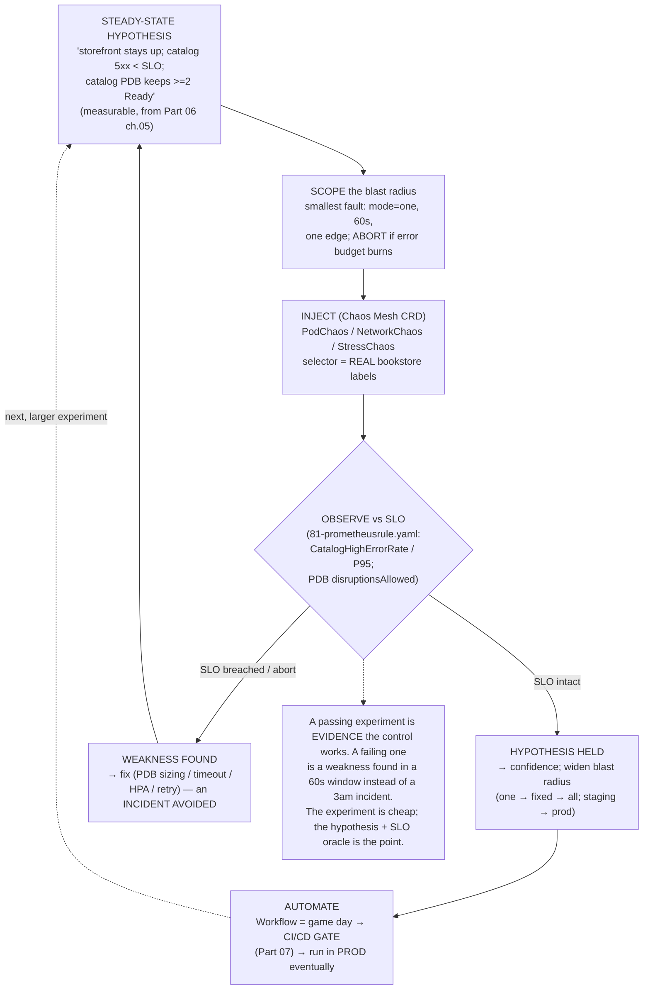

# 07 — Chaos engineering

> Resilience as a *discipline*, not random breakage: the **steady-state
> hypothesis → bounded blast radius → inject → observe → abort/learn →
> automate** loop, game days, and run-in-prod-eventually; **Chaos Mesh**
> experiment types (pod-kill / pod-failure, container-kill, network
> latency/loss/partition, IO fault/delay, stress CPU/mem, time skew, DNS
> chaos), scoping/selectors/scheduling/duration, the dashboard and abort;
> chaos as a **CI/CD gate** ([Part 07](../07-delivery/03-cicd-pipeline.md));
> and validating against the Bookstore's **SLOs/PDBs** ([Part 06 ch.05](../06-production-readiness/05-reliability-and-disruptions.md))
> — applied by running pod-kill, network-latency, and CPU-stress experiments
> against the running Bookstore and checking that the storefront stays up,
> the catalog PDB holds, and the SLO is preserved. The chaos tooling is the
> one part of this chapter that needs a privileged namespace, so it gets a
> scoped install.

**Estimated time:** ~45 min read · ~120 min hands-on
**Prerequisites:** [Part 06 ch.05](../06-production-readiness/05-reliability-and-disruptions.md) — PDBs + SLOs this chapter exercises · [Part 06 ch.01](../06-production-readiness/01-observability-metrics.md) — metrics that prove steady-state · [Part 07 ch.03](../07-delivery/03-cicd-pipeline.md) — CI/CD gate this chapter plugs chaos into
**You'll know after this:** • articulate the steady-state hypothesis → bounded blast-radius → inject → observe → abort/learn loop · • author Chaos Mesh experiments (pod-kill / network-latency / IO fault / stress) with scoping + duration · • prove a PDB holds and an SLO is preserved under pod-kill chaos · • gate a release on chaos pass/fail in a CI/CD pipeline · • design a game-day plan that ratchets blast radius safely

<!-- tags: day-2, observability, slo, platform-engineering, chaos -->

## Why this exists

[Part 06 ch.05](../06-production-readiness/05-reliability-and-disruptions.md)
built the reliability machinery — PodDisruptionBudgets, replicas + spread,
graceful shutdown, an SLO + error budget — and ended on the precise sentence
this chapter cashes: *"budget healthy → you have room for aggressive delivery
and **chaos testing of the disruption path**."* It also said an **untested PDB
is a latent incident**. Every resilience control in this guide — the catalog
PDB ([Part 06 ch.05](../06-production-readiness/05-reliability-and-disruptions.md)),
the HPA ([Part 06 ch.04](../06-production-readiness/04-autoscaling.md)),
timeouts/retries ([ch.04](04-service-mesh.md)), graceful shutdown ([Part 01
ch.02](../01-core-workloads/02-health-and-lifecycle.md)) — is a *hypothesis*
until something actually takes a Pod away, slows the network, or burns CPU
**and you observe the system survive**. Chaos engineering is how you turn
"should be resilient" into "is resilient, verified".

The discipline exists because the alternative — *discovering* whether your
resilience works during a real incident — is the most expensive possible time
to find out. Crucially, chaos engineering is **not** "randomly break things":

1. **It starts from a steady-state hypothesis.** A measurable claim about
   normal behaviour ("catalog 5xx ratio stays under the SLO; the storefront
   stays up") that you expect to *still hold* under the fault.
2. **It bounds the blast radius.** One Pod, one edge, 60 seconds — the
   *smallest* fault that tests the hypothesis, with an explicit abort
   condition, *then* climb the ladder.
3. **It observes against the SLO**, learns, and **automates** — chaos becomes
   a repeatable game day and eventually a CI/CD gate, run (eventually) in
   production where the real failure modes live.

The Bookstore is the perfect subject because [Part 06](../06-production-readiness/05-reliability-and-disruptions.md)
already gave it the things to *test*: a `catalog` PDB (`minAvailable: 2` of 3),
a catalog HPA, and a catalog SLO (`CatalogHighErrorRate`/`CatalogHighLatencyP95`
in `raw-manifests/81-prometheusrule.yaml`). The reference is the principles of
chaos engineering, *Production Kubernetes* ch.14 (Application Considerations),
and the Google SRE Workbook.

## Mental model

**Chaos engineering is the scientific method applied to resilience: form a
hypothesis about steady state, inject the smallest fault that could disprove
it, observe against your SLO, and either learn (you found a weakness) or gain
confidence (it held) — then make it routine.**

- **Steady-state hypothesis, not "what breaks?".** You don't inject a fault to
  see what happens; you inject it to test a *specific prediction* ("the
  storefront stays up and catalog stays under its error SLO when one catalog
  replica dies"). A passing experiment is *evidence the control works*; a
  failing one is *a weakness found in a controlled window instead of an
  incident*.
- **Blast radius is a dial you turn up slowly.** Start with the **smallest**
  scope (`mode: one` — one Pod), shortest duration, least-critical
  environment; widen (one → a fixed count → all; staging → prod; longer)
  **only as confidence accrues**. An abort condition (the real error budget
  burning — [Part 06 ch.05](../06-production-readiness/05-reliability-and-disruptions.md))
  stops it immediately.
- **Experiments are typed CRDs with selectors + duration.** Chaos Mesh models
  each fault as an object: **PodChaos** (pod-kill / pod-failure /
  container-kill), **NetworkChaos** (delay / loss / partition / corrupt),
  **IOChaos** (fault / delay on filesystem), **StressChaos** (CPU / memory),
  **TimeChaos** (clock skew), **DNSChaos** (resolution failure). A
  `selector` (namespace + label) picks the targets — *must match the real
  workload labels* — and `mode` + `duration` bound the scope and time.
- **Observe against the SLO, not vibes.** The experiment's verdict is the
  Bookstore's existing telemetry: did `CatalogHighErrorRate` stay quiet, did
  p95 stay under threshold, did the PDB keep ≥2 catalog Pods Ready? The SLO is
  the hypothesis's pass/fail oracle ([Part 06 ch.01](../06-production-readiness/01-observability-metrics.md)/[ch.05](../06-production-readiness/05-reliability-and-disruptions.md)).
- **Automate it: game day → CI gate → prod.** A one-off experiment proves a
  point once. A **Workflow** chains experiments into a repeatable game day;
  wired into delivery it becomes a **gate** ([Part 07](../07-delivery/03-cicd-pipeline.md))
  — promote only if the system survived the fault set; ultimately run
  controlled chaos **in production**, where the real dependencies and failure
  modes are.

The trap to keep in view: **chaos without a hypothesis, a bounded blast
radius, an abort condition, and SLO observation is just an outage you caused.**
The value is entirely in the discipline — the experiment is the cheap part;
the steady-state claim, the small scope, and the observed verdict are the
chapter.

## Threats and controls

Chaos tooling works by breaking things on purpose, and that reach is the
risk. The daemon runs with node privilege, and the controller can delete
Pods. The table names the one threat specific to this chapter and the
controls it teaches. The workloads under test keep the baseline they already
carry, so they add no row.

| ID | Threat | Control this chapter teaches | Deeper |
|----|--------|------------------------------|--------|
| E9 | The chaos daemon runs privileged on every node, so a compromised daemon reaches the node. The controller can also delete Pods outside the workload under test. | The daemon runs in its own `chaos-mesh` namespace, enforced at `privileged` because no lower level admits it, with `audit` and `warn` at `restricted`. The controller is namespace-scoped with `clusterScoped: false`. Optional features stay off. The namespace is registered. | [05.02](../05-security/02-pod-security.md), Pod Security levels; the registry entry in `security/namespace-exceptions.yaml` |

## Diagrams

### Diagram A — the chaos loop: hypothesis → inject → observe (SLO) → learn → automate (Mermaid)



### Diagram B — experiment catalog + the blast-radius ladder (ASCII)

```
 CHAOS MESH EXPERIMENT CATALOG (typed CRDs; selector = REAL labels) ─────────

  PodChaos      pod-kill | pod-failure | container-kill   ► tests PDB/Deploy
  NetworkChaos  delay | loss | partition | corrupt | dup  ► tests timeouts/SLO
  IOChaos       fault | delay  (filesystem)               ► tests storage paths
  StressChaos   cpu | memory                              ► tests limits + HPA
  TimeChaos     clock skew                                ► tests time logic
  DNSChaos      resolution error (DNS server on)         ► tests resolver/retry

 BLAST-RADIUS LADDER — climb only as confidence grows ──────────────────────
   1. mode: one          one Pod, 60s, staging        ◄═ START HERE
   2. mode: fixed N       a few Pods, longer, staging
   3. mode: all           a whole tier, bounded, staging
   4. ↑ same, in PRODUCTION, low-traffic window, ABORT armed
   5. continuous / CI gate (Workflow) — chaos as a routine, prod, automated
   ── every rung: a HYPOTHESIS + an SLO oracle + an ABORT condition ──
   ── reversible: duration auto-reverts; `kubectl delete -f` aborts now ──

  DISCIPLINE vs RANDOM BREAKAGE
   chaos engineering = hypothesis + smallest scope + SLO verdict + learn
   random breakage    = an outage you caused, with no oracle and no lesson
```

## Hands-on with the Bookstore

**Assumed working directory: the guide repo root (`full-guide/`).** This
chapter adds the **new** [`examples/bookstore/chaos/`](../examples/bookstore/chaos/)
tree and runs it against the running Bookstore. It does **not** modify any
canonical manifest — the experiments *select* the real Bookstore Pods by
their existing labels (`app: catalog` / `app: postgres`, verified against
`raw-manifests/10-`/`20-`) and inject nothing into them (the same additive
discipline as the mesh/ESO/operator precedents).

> **What the lab run covered.** The output in this chapter comes from a lab
> cluster, and its namespaces carry a `p11-07` prefix, so the names in the
> output differ from the commands. The run installed Chaos Mesh 2.8.7 and
> checked its RBAC, its daemon privilege and the chart's admission behaviour.
> It did not run the three experiments. The lab's control plane was unstable,
> postgres stayed Pending, and the run never got the catalog to Ready. That
> run did not apply `12-redis.yaml`, which the bootstrap now applies, because
> catalog's `/readyz` needs the cache. So the Ready result says nothing about
> the Redis dependency, and the bootstrap is not re-run here. Treat the
> experiment steps as checked against the CRD schema and by reading, not as
> observed here. kube-prometheus-stack and metrics-server were not installed
> in this run. A later pass checked the stack's workloads against the
> `restricted` level with a server dry run, without installing it.

We will: (0) self-bootstrap the Bookstore *with* its PDB/HPA/SLO; (1) install
**Chaos Mesh** (pinned Helm, own namespace) and justify it over Litmus;
(2) **Experiment 1** — pod-kill a catalog Pod, PDB holds; (3) **Experiment 2**
— network latency catalog→postgres, observe SLO impact; (4) **Experiment 3** —
CPU stress, HPA reacts; (5) chain them as a **game day Workflow / CI gate**.

> **The honest setup story (read first).** Chaos Mesh genuinely needs
> installing (CRDs + a controller + a privileged node DaemonSet) — no
> zero-setup path. Everything here is **fully reproducible on a single kind
> cluster**. Experiments are **bounded** (`duration`, auto-revert) and
> **reversible** (`kubectl delete -f` aborts immediately); no output is faked.
> Chaos Mesh's fault-injection DaemonSet is privileged and runs in **its own
> `chaos-mesh` namespace**, never `bookstore`; the Bookstore Pods are *not*
> mutated and stay PSA-`restricted`-compliant throughout. Every manifest
> dry run checks it against the installed CRDs
> (`kubectl apply --dry-run=server`).

### 0. Prerequisites — the Bookstore with PDB + HPA + the SLO-oracle stack (self-bootstrapping)

The experiments are only meaningful against the resilience controls [Part
06](../06-production-readiness/05-reliability-and-disruptions.md) added — so
the bootstrap applies `84-pdb.yaml` (catalog `minAvailable: 2`) **and**
`82-hpa-catalog.yaml` (the autoscaler Experiment 3 tests).

> **Honest prerequisite — the SLO oracle is a Part 06 ch.01 stack, not
> magic.** This chapter's own rule is *"no oracle ⇒ just an outage"*, so be
> precise about what the oracle *is*: the HPA needs **metrics-server**, and
> the SLO alerts (`raw-manifests/80-servicemonitor.yaml` /
> `81-prometheusrule.yaml`) need **kube-prometheus-stack** (Prometheus
> Operator) — both are [Part 06 ch.01](../06-production-readiness/01-observability-metrics.md)/[ch.04](../06-production-readiness/04-autoscaling.md)
> prerequisites, **not** re-taught here. Two honest options, pick one:
> **(A) Full oracle** — install the pinned stacks below and apply `80-`/`81-`,
> then every "observe the SLO" step is literal; **(B) Conceptual** — skip the
> stacks and *reason about* the SLO/HPA outcome (the PDB and `kubectl get hpa`/pod state
> are still directly observable without Prometheus). The
> bootstrap below does **(A)** so its claims match exactly what the shell
> runs; drop the marked block for **(B)**.

```sh
kind delete cluster --name bookstore 2>/dev/null || true
kind create cluster --name bookstore
cd examples/bookstore/app
for s in catalog orders payments-worker storefront; do docker build -t bookstore/$s:dev ./$s; done
cd ../../..
for s in catalog orders payments-worker storefront; do kind load docker-image bookstore/$s:dev --name bookstore; done

kubectl apply -f examples/bookstore/raw-manifests/00-namespace.yaml
kubectl apply -f examples/bookstore/raw-manifests/05-serviceaccounts-rbac.yaml
kubectl apply -f examples/bookstore/raw-manifests/15-catalog-config.yaml
kubectl apply -f examples/bookstore/raw-manifests/16-db-credentials.yaml
kubectl apply -f examples/bookstore/raw-manifests/35-priorityclasses.yaml
kubectl apply -f examples/bookstore/raw-manifests/20-postgres-statefulset.yaml
kubectl rollout status statefulset/postgres -n bookstore
kubectl apply -f examples/bookstore/raw-manifests/12-redis.yaml   # catalog's /readyz needs the cache
kubectl apply -f examples/bookstore/raw-manifests/10-catalog-deploy.yaml
kubectl apply -f examples/bookstore/raw-manifests/11-storefront-deploy.yaml
kubectl apply -f examples/bookstore/raw-manifests/14-orders-deploy.yaml
kubectl apply -f examples/bookstore/raw-manifests/40-services.yaml
kubectl apply -f examples/bookstore/raw-manifests/21-db-migrate-job.yaml
kubectl wait --for=condition=complete job/db-migrate -n bookstore --timeout=120s
kubectl rollout status deployment/catalog -n bookstore
kubectl apply -f examples/bookstore/raw-manifests/84-pdb.yaml          # the PDB to test
kubectl get pdb catalog -n bookstore   # catalog minAvailable 2 / disruptionsAllowed 1

# --- The SLO-oracle stack (Part 06 ch.01/ch.04 prerequisites — option (A)).
#     Drop this whole block for option (B) "reason conceptually". PINNED Helm
#     (never releases/latest/download URL — same rule as every add-on):
helm repo add metrics-server https://kubernetes-sigs.github.io/metrics-server/
helm repo add prometheus-community https://prometheus-community.github.io/helm-charts
helm repo update
helm install metrics-server metrics-server/metrics-server \
  -n kube-system --version 3.12.2 --set 'args={--kubelet-insecure-tls}' --wait   # kind only: kubelet certificates do not verify
kubectl create namespace monitoring
kubectl label namespace monitoring \
  pod-security.kubernetes.io/enforce=restricted \
  pod-security.kubernetes.io/enforce-version=latest \
  pod-security.kubernetes.io/audit=restricted \
  pod-security.kubernetes.io/audit-version=latest \
  pod-security.kubernetes.io/warn=restricted \
  pod-security.kubernetes.io/warn-version=latest
helm install kube-prometheus-stack prometheus-community/kube-prometheus-stack \
  -n monitoring --version 65.1.1 --wait \
  --set nodeExporter.enabled=false                                                # Prometheus Operator; node-exporter off (see below)
kubectl -n monitoring rollout status deploy/kube-prometheus-stack-operator
kubectl apply -f examples/bookstore/raw-manifests/82-hpa-catalog.yaml   # the HPA Experiment 3 tests
kubectl apply -f examples/bookstore/raw-manifests/80-servicemonitor.yaml   # scrape catalog metrics
kubectl apply -f examples/bookstore/raw-manifests/81-prometheusrule.yaml   # the SLO ALERTS (the oracle)
kubectl get hpa catalog -n bookstore                       # the autoscaler under test
kubectl get servicemonitor,prometheusrule -n bookstore     # the SLO oracle is now live
# (metrics-server installs into kube-system and kube-prometheus-stack into
#  monitoring, NOT bookstore; the catalog/postgres Pods stay PSA-restricted.)
```

The release name is part of the contract, and it is not a free choice. The
chart's Prometheus selects ServiceMonitors and PrometheusRules whose `release`
label equals the Helm release name. Rendered at release
`kube-prometheus-stack`, the Prometheus object carries `release:
"kube-prometheus-stack"` in both selectors, which is the value that
`80-servicemonitor.yaml` and `81-prometheusrule.yaml` carry. Install under any
other name and Prometheus silently ignores both objects. The render shows the
label is set on seven objects:

```sh
helm template kube-prometheus-stack prometheus-community/kube-prometheus-stack \
  --version 65.1.1 -n monitoring --set nodeExporter.enabled=false \
  | grep -c 'release: kube-prometheus-stack'
```

<!-- gate: output -->
```text
7
```

The chart's own workloads are three Deployments (the operator, kube-state-metrics
and Grafana) and two admission Jobs. A server dry run into a namespace labelled
`restricted` prints no PodSecurity warning for any of them. The check is only
worth something if it can fail, so the same dry run was made with a control
Deployment whose pod template sets `hostNetwork: true`. The control was written
for the check and deleted after it. The warning it prints is the one the check
must give:

<!-- gate: output -->
```text
Warning: would violate PodSecurity "restricted:latest": host namespaces (hostNetwork=true), allowPrivilegeEscalation != false (container "app" must set securityContext.allowPrivilegeEscalation=false), unrestricted capabilities (container "app" must set securityContext.capabilities.drop=["ALL"]), runAsNonRoot != true (pod or container "app" must set securityContext.runAsNonRoot=true), seccompProfile (pod or container "app" must set securityContext.seccompProfile.type to "RuntimeDefault" or "Localhost")
deployment.apps/psa-control created (server dry run)
```

The chart's workloads, dry-run in the same namespace:

<!-- gate: output -->
```text
deployment.apps/kube-prometheus-stack-grafana created (server dry run)
deployment.apps/kube-prometheus-stack-kube-state-metrics created (server dry run)
deployment.apps/kube-prometheus-stack-operator created (server dry run)
job.batch/kube-prometheus-stack-admission-create created (server dry run)
job.batch/kube-prometheus-stack-admission-patch created (server dry run)
```

This is not an install. Prometheus and Alertmanager run as Pods that the
operator creates from custom resources, and the CRDs were not on the lab
cluster, so those Pods were not checked. The lab did not install the release.
Run the install above on a cluster you own, then check that the Prometheus
selector matches the label on `80-` and `81-`.

The monitoring namespace is labelled `restricted` before anything is created
in it, and node-exporter is turned off. node-exporter is a DaemonSet with host
networking, host PID and host paths, so it cannot run under `restricted`. The
oracle does not need it: the SLO alerts in `81-prometheusrule.yaml` read the
catalog's own request metrics and its `up` series, not host metrics. Turn a
privileged feature off when the lab does not need it, and the namespace needs
no entry in the exceptions registry.

### 1. Install Chaos Mesh in its own namespace

**Why Chaos Mesh over Litmus for this guide:** Chaos Mesh models each fault as
a **typed CRD** (`PodChaos`, `NetworkChaos`, `StressChaos`, and so on) with a
label `selector` and a `duration`. That fits the Bookstore's label model, and it
has a focused dashboard and a `Workflow` kind for game days. LitmusChaos is an
equally valid CNCF project with a different model of experiments. The
principles are the same. The choice here is the cleanest fit of one CRD per
fault.

Create the namespace and label it before anything else lands in it. The daemon
needs privilege, so the namespace enforces `privileged`. Audit and warn stay at
`restricted`, so any Pod that falls short of that profile is recorded in the
audit log and returned as a warning. Only the daemon is meant to be excused:

```sh
kubectl create namespace chaos-mesh
kubectl label namespace chaos-mesh \
  pod-security.kubernetes.io/enforce=privileged \
  pod-security.kubernetes.io/audit=restricted \
  pod-security.kubernetes.io/warn=restricted
```

Check the labels. The lab run printed this table:

```sh
kubectl get namespaces chaos-mesh bookstore \
  -L pod-security.kubernetes.io/enforce -L pod-security.kubernetes.io/audit \
  -L pod-security.kubernetes.io/warn
```

<!-- gate: output -->
```text
NAME               STATUS   AGE   ENFORCE      AUDIT        WARN
p11-07-bookstore   Active   1s    restricted   restricted   restricted
p11-07-chaos       Active   0s    privileged   restricted   restricted
```

Why `privileged` and not a lower level. The chaos daemon sets `hostPID: true`,
mounts three `hostPath` volumes (the container runtime socket, `/sys` and
`/lib/modules`), and runs a privileged container. Baseline forbids all three.
The chart can drop the privileged flag with `chaosDaemon.privileged: false`,
but `hostPID` and the `hostPath` mounts stay, and the capability list that
replaces the flag includes `SYS_ADMIN` and `NET_ADMIN`, which baseline also
forbids. No lower level admits the daemon, so the namespace is `privileged`.
The rules are in the
[Pod Security Standards](https://kubernetes.io/docs/concepts/security/pod-security-standards/#baseline).
A server dry run shows the rules the daemon breaks at `restricted`, the level
the audit and warn labels use. Render the chart and dry-run the result:

```sh
helm template chaos-mesh chaos-mesh/chaos-mesh --version 2.8.7 -n chaos-mesh \
  -f examples/bookstore/chaos/helm/chaos-mesh-values.yaml > chaos-mesh-rendered.yaml
kubectl apply --dry-run=server -f chaos-mesh-rendered.yaml
```

The first warning belongs to the daemon. It lists the host PID, the privileged
flag, the `hostPath` volumes and the capability rules that `restricted`
breaks. Baseline forbids the first three as well:

<!-- gate: output -->
```text
Warning: would violate PodSecurity "restricted:latest": host namespaces (hostPID=true), privileged (container "chaos-daemon" must not set securityContext.privileged=true), allowPrivilegeEscalation != false (container "chaos-daemon" must set securityContext.allowPrivilegeEscalation=false), unrestricted capabilities (container "chaos-daemon" must set securityContext.capabilities.drop=["ALL"]; container "chaos-daemon" must not include "SYS_PTRACE" in securityContext.capabilities.add), restricted volume types (volumes "socket-path", "sys-path", "lib-modules" use restricted volume type "hostPath"), runAsNonRoot != true (pod or container "chaos-daemon" must set securityContext.runAsNonRoot=true), seccompProfile (pod or container "chaos-daemon" must set securityContext.seccompProfile.type to "RuntimeDefault" or "Localhost")
daemonset.apps/chaos-daemon created (server dry run)
```

The controller and the dashboard also warn, on privilege escalation, dropped
capabilities and `runAsNonRoot`, which the values file does not set (see the
gaps below).

The values file keeps the daemon's privilege and narrows everything else:
[`examples/bookstore/chaos/helm/chaos-mesh-values.yaml`](../examples/bookstore/chaos/helm/chaos-mesh-values.yaml).

- **Namespace-scoped controller.** `clusterScoped: false` with
  `controllerManager.targetNamespace: bookstore`. The chart then binds the
  controller's pod-delete and pod-patch rights as a RoleBinding in `bookstore`
  only, not cluster-wide. The daemon is still one DaemonSet on every node, and
  the controller reaches it over mTLS. The scope limits which Pods the
  controller asks the daemon to touch.
- **Optional features off.** `dnsServer.create: false`, because DNSChaos is not
  used here, and `enableProfiling: false`, which removes the pprof endpoints
  from the controller and the daemon. The BPF kernel component is off by default
  and stays off.
- **Digest pins.** Each of the three images is pinned by digest, with the
  version tag in front of it. The chart's own default names a tag only.
- **Dashboard login.** `dashboard.securityMode: true` keeps the dashboard behind
  a token. This is the chart default too.
- **Runtime.** `chaosDaemon.runtime: containerd` and the containerd socket path,
  because a kind node runs containerd and the chart's default is Docker.

Two gaps stay open. The chart exposes only a pod-level `securityContext` for the
controller and the dashboard, so the values file sets the seccomp profile there
and nothing else. It cannot set `allowPrivilegeEscalation: false` or drop
capabilities for those two. The upstream Dockerfiles set no non-root user, so
`runAsNonRoot` is not set either. The threat model records both as open items.

Install the chart at its pinned version, with the values file:

```sh
helm repo add chaos-mesh https://charts.chaos-mesh.org
helm repo update
helm install chaos-mesh chaos-mesh/chaos-mesh -n chaos-mesh \
  --version 2.8.7 -f examples/bookstore/chaos/helm/chaos-mesh-values.yaml --wait
kubectl -n chaos-mesh get pods
```

Confirm what the daemon asks for. Both fields read `true`, as the lab run shows:

```sh
kubectl -n chaos-mesh get daemonset chaos-daemon \
  -o jsonpath="hostPID={.spec.template.spec.hostPID} privileged={.spec.template.spec.containers[0].securityContext.privileged}"; echo
```

<!-- gate: output -->
```text
hostPID=true privileged=true
```

Check the scope from the RBAC the chart created. Each command answers `yes`
or `no`:

```sh
kubectl auth can-i delete pods -n bookstore \
  --as system:serviceaccount:chaos-mesh:chaos-controller-manager
kubectl auth can-i delete pods -n default \
  --as system:serviceaccount:chaos-mesh:chaos-controller-manager
kubectl auth can-i get secrets -n bookstore \
  --as system:serviceaccount:chaos-mesh:chaos-controller-manager
```

The lab run answered `yes`, `no` and `yes`:

<!-- gate: output -->
```text
yes
# ...
no
# ...
yes
```

The third answer is the price of the scope. The RoleBinding in `bookstore` also
lets the controller read and patch Secrets there, so keep only the workloads
under test in that namespace.

Installing Chaos Mesh creates the `chaos-mesh.org` CRDs. Until then, a dry run
of an experiment file is refused with `no matches for kind "PodChaos"`, as the
lab run shows when it dry-runs the first experiment before the install:

```sh
kubectl apply --dry-run=server -f examples/bookstore/chaos/10-podchaos-kill-catalog.yaml
```

<!-- gate: output -->
```text
error: resource mapping not found for name: "kill-one-catalog" namespace: "p11-07-bookstore" from "experiment-10.lab.yaml": no matches for kind "PodChaos" in version "chaos-mesh.org/v1alpha1"
ensure CRDs are installed first
```

The CRD is missing, not the file.

### 2. Experiment 1: pod-kill a catalog Pod

**Hypothesis:** killing one of catalog's 3 replicas leaves 2 Ready Pods, the
Deployment replaces the lost one, and the catalog SLO does not fire. Apply
[`chaos/10-podchaos-kill-catalog.yaml`](../examples/bookstore/chaos/10-podchaos-kill-catalog.yaml)
(`mode: one`, the smallest blast radius; selector = the real `app: catalog`
label) and observe:

```sh
# Watch the steady-state oracles in another shell BEFORE injecting:
#   kubectl get pdb catalog -n bookstore -w        # disruptionsAllowed
#   kubectl get pods -n bookstore -l app=catalog -w

kubectl apply -f examples/bookstore/chaos/10-podchaos-kill-catalog.yaml
kubectl get podchaos -n bookstore
# Observe: ONE catalog Pod is deleted. The ReplicaSet (Part 01 ch.04)
# schedules a replacement at once, and two Ready Pods remain throughout,
# because only one was removed.
kubectl delete -f examples/bookstore/chaos/10-podchaos-kill-catalog.yaml   # stop
```

The PDB does not protect this experiment, and the chapter should say so. A
PodDisruptionBudget gates the eviction API, which `kubectl drain` uses. Chaos
Mesh's pod-kill is a direct delete, so the budget is not consulted. Two Ready
Pods remain because the replica count is 3 and only one Pod is removed. The
experiment tests the healing and the sizing: the Deployment replaces the Pod,
and the replica count keeps the PDB's floor of two. [Part 06 ch.05](../06-production-readiness/05-reliability-and-disruptions.md)
calls an untested PDB a latent incident. This experiment is the replica side of
that test. To exercise the eviction gate, drain a node. Both matter, and they
test different controls.

### 3. Experiment 2 — network latency catalog→postgres; observe the SLO

**Hypothesis:** 200ms±50ms latency on the catalog→postgres edge for 60s
*degrades* catalog p95 but does **not** breach the error SLO (timeouts +
pooling absorb a slow dependency rather than cascading). Latency is the most
common real degradation — higher-value than a clean kill. Apply
[`chaos/20-networkchaos-latency-catalog-postgres.yaml`](../examples/bookstore/chaos/20-networkchaos-latency-catalog-postgres.yaml)
(scoped to the catalog→postgres edge specifically — `direction: to` + a
postgres-side target selector, both real labels):

> **Why this one is `mode: all`, not `mode: one` (consistent with the
> ladder).** The blast-radius ladder starts at `mode: one` for a *Pod-targeted*
> fault (Experiments 1 & 3 — one Pod is the smallest unit). This is an **edge
> experiment**: the *hypothesis is about the catalog→postgres EDGE*, so the
> edge/service **is** the blast-radius unit — impairing only one of three
> catalog Pods' egress would not actually test "the catalog→postgres
> dependency is slow" (the other two Pods serve unaffected and mask it).
> `mode: all` on the source + the postgres-side `target` selector is therefore
> the *deliberate, correct* minimal scope for *this* hypothesis (still bounded:
> one edge, 60s, auto-revert) — not a ladder violation. Climbing the ladder is
> per-hypothesis: pick the smallest scope that can actually disprove *that*
> claim.

```sh
kubectl apply -f examples/bookstore/chaos/20-networkchaos-latency-catalog-postgres.yaml
# OBSERVE vs the SLO oracle (raw-manifests/81-prometheusrule.yaml):
#   • CatalogHighLatencyP95 — EXPECTED to rise (the fault is latency)
#   • CatalogHighErrorRate  — should STAY QUIET if catalog's timeouts/pooling
#                             are correct (THE hypothesis). If 5xx climbs, you
#                             found a real weakness (missing/short timeout,
#                             no retry budget) — an incident avoided.
kubectl get networkchaos -n bookstore                 # status / records
kubectl delete -f examples/bookstore/chaos/20-networkchaos-latency-catalog-postgres.yaml
# (Auto-reverts after 60s anyway — `duration` bounds it; delete aborts early.)
```

### 4. Experiment 3 — CPU stress; the HPA reacts

**Hypothesis:** burning CPU in a catalog Pod for 60s drives CPU toward the
container limit, the catalog HPA ([Part 06 ch.04](../06-production-readiness/04-autoscaling.md))
scales out, and the SLO is preserved — requests/limits + autoscaling absorb
the pressure as designed. Apply
[`chaos/30-stresschaos-catalog-cpu.yaml`](../examples/bookstore/chaos/30-stresschaos-catalog-cpu.yaml)
(`mode: one`):

```sh
kubectl apply -f examples/bookstore/chaos/30-stresschaos-catalog-cpu.yaml
#   kubectl get hpa catalog -n bookstore -w     # replicas should rise as CPU
#                                               # pressure crosses the target
kubectl get stresschaos -n bookstore
kubectl delete -f examples/bookstore/chaos/30-stresschaos-catalog-cpu.yaml
# The container cpu LIMIT (Part 01 ch.03) is the natural ceiling on the
# damage; the HPA is the designed reaction. If the SLO still breached, the
# weakness is HPA sizing / limits — found in 60s, not at 3am.
```

### 5. Make it a game day / CI gate — the Workflow

Three ad-hoc applies prove three points once. [`chaos/40-workflow-gameday.yaml`](../examples/bookstore/chaos/40-workflow-gameday.yaml)
chains the *same three specs* into a sequential, time-bounded **Workflow** —
the discipline as code, a repeatable **game day**, and the shape you wire into
delivery as a **CI/CD gate** ([Part 07](../07-delivery/03-cicd-pipeline.md)):
promote only if the Bookstore survived the fault set with its SLO intact:

```sh
kubectl apply -f examples/bookstore/chaos/40-workflow-gameday.yaml
kubectl get workflow,workflownode -n bookstore        # the run progresses serially
# In CI this is: run the Workflow against a prod-like env → assert no SLO
# alert fired during it → only then promote (Part 07 ch.03/04). The Chaos
# Dashboard (port-forward svc/chaos-dashboard -n chaos-mesh) visualizes it.
kubectl delete -f examples/bookstore/chaos/40-workflow-gameday.yaml   # abort
```

Clean up:

```sh
kubectl delete -f examples/bookstore/chaos/ --ignore-not-found     # all experiments
helm uninstall chaos-mesh -n chaos-mesh
for crd in $(kubectl get crd -o name | grep 'chaos-mesh.org'); do kubectl delete "$crd"; done   # Helm keeps the CRDs
kubectl delete namespace chaos-mesh
kind delete cluster --name bookstore
```

## How it works under the hood

- **An experiment is a controller-reconciled CRD, and the daemon does the
  node-side work.** You apply a `PodChaos`, `NetworkChaos` or similar object.
  The **controller-manager** resolves its `selector` to concrete Pods. Pod kill
  needs no node access, because the controller holds the verb to delete Pods in
  the target namespace. Faults that act inside a Pod's network or cgroup go to
  the per-node **chaos-daemon**, over mTLS. The daemon programs `tc`/`netem` on
  the Pod's network namespace (NetworkChaos) or runs a stressor in its cgroup
  (StressChaos). For these faults the **target Pods are not mutated**: no
  injected container, no change to the Pod spec. The daemon reverts a fault when
  its `duration` expires or the object is deleted, which is why every experiment
  here is bounded and abortable. Pod failure is the exception. It swaps each
  container's image for a pause image, so it does change the Pod. The chart's
  default pause image is `gcr.io/google-containers/pause:latest`, which is not
  pinned. Pin it through `controllerManager.podChaos.podFailure.pauseImage`
  before you use pod-failure.
- **The daemon's privilege is the part to guard.** `hostPID: true` and the
  `hostPath` mounts are unconditional in the chart. Only the container's
  `privileged` flag depends on `chaosDaemon.privileged`. The BPF container is
  privileged too, and it is off by default. A compromised daemon can reach the
  node. That is E9 in the threats table, and it is why this namespace is
  registered and the rest of the cluster is not.

- **The `selector` is the blast radius, and label correctness is safety.** An
  experiment acts on exactly the Pods its `namespaces` + `labelSelectors`
  match, narrowed by `mode` (`one` = a single random match; `fixed: N`;
  `fixed-percent`; `all`). A selector that matches the *wrong* or *too many*
  workloads is the chaos-engineering analog of a too-broad NetworkPolicy/PDB
  selector ([Part 02 ch.06](../02-networking/06-network-policies.md)/[Part 06
  ch.05](../06-production-readiness/05-reliability-and-disruptions.md)) — which
  is why these files pin to the *verified* Bookstore labels (`app: catalog`,
  `app: postgres`) and start at `mode: one`. Scope is the primary safety
  control; `duration` and an external abort are the others.
- **The namespace is a second boundary.** The controller's pod-delete rights
  exist only as a RoleBinding in `bookstore`. A selector that matches a Pod in
  another namespace still cannot delete it, whatever the selector says. Scope
  is enforced by RBAC here, and not by the selector alone.
- **The hypothesis's oracle is the SLO, evaluated independently.** The
  experiment does not decide pass/fail — the Bookstore's existing
  observability does. `CatalogHighErrorRate` / `CatalogHighLatencyP95`
  (`raw-manifests/81-prometheusrule.yaml`) and the PDB's `disruptionsAllowed`
  ([Part 06 ch.05](../06-production-readiness/05-reliability-and-disruptions.md))
  are the steady-state measures; if they hold under the fault the hypothesis
  is confirmed, if they break you found a weakness. This is *why* [Part 06](../06-production-readiness/01-observability-metrics.md)
  (metrics + SLOs) is a prerequisite for chaos: without an oracle, an
  experiment is just an outage.
- **Pod-kill vs the eviction API (a precise distinction).** Part 06 ch.05
  established that a PDB gates the **eviction API** (`kubectl drain`), **not** a
  direct `DELETE`. Chaos Mesh's pod-kill is a direct delete, so the PDB is not
  consulted. What you test is the recovery: the Deployment replaces the Pod, and
  the replica count keeps enough Ready Pods for the PDB floor. Drain a node to
  exercise the eviction path. Both matter, and they test different controls.
- **Game days, CI gates, and run-in-prod.** A **Workflow** sequences
  experiments with per-step deadlines and an overall deadline — a *repeatable*
  game day instead of a one-off. Wired into delivery ([Part 07 ch.03](../07-delivery/03-cicd-pipeline.md)/[ch.04](../07-delivery/04-gitops-argocd.md))
  it is a **gate**: run the Workflow against a prod-like environment, assert no
  SLO alert fired during it, and only then promote — resilience becomes a
  release criterion, not a hope. The discipline's endpoint is **controlled
  chaos in production** (low-traffic window, abort armed, error-budget-aware —
  [Part 06 ch.05](../06-production-readiness/05-reliability-and-disruptions.md)),
  because staging never has prod's real dependencies, scale, and failure
  modes — but you *earn* prod chaos by climbing the blast-radius ladder in
  staging first.
- **Why this is a discipline, not breakage.** The mechanical fault injection
  is the easy 10%. The 90% that makes it engineering: a *falsifiable
  steady-state hypothesis*, the *smallest* fault that could disprove it, an
  *independent SLO oracle*, an *abort condition*, and a *learning loop* that
  feeds fixes back into the resilience controls ([Part 06 ch.05](../06-production-readiness/05-reliability-and-disruptions.md)).
  Remove any of those and you have an outage you caused with no lesson — the
  exact anti-pattern this chapter exists to prevent.

## Production notes

> **In production: always run from a hypothesis, with a bounded blast radius
> and an armed abort.** Never inject a fault without a measurable steady-state
> claim and an SLO oracle ([Part 06 ch.01](../06-production-readiness/01-observability-metrics.md)/[ch.05](../06-production-readiness/05-reliability-and-disruptions.md)).
> Start at `mode: one`, short `duration`, least-critical environment; tie the
> abort to the **real error budget** burning — budget healthy is the
> *precondition* for running chaos ([Part 06 ch.05](../06-production-readiness/05-reliability-and-disruptions.md)).
> Chaos with no oracle/abort is a self-inflicted incident, not a test.

> **In production: pin selectors to verified labels and climb the blast-radius
> ladder deliberately.** A wrong/too-broad `selector` makes a chaos experiment
> hit the wrong workload — the same class of mistake as a mis-scoped
> PDB/NetworkPolicy. Verify labels against the live workload, start narrow
> (one Pod, one edge), widen (fixed → all; staging → prod; longer) **only as
> each rung passes**. Where the daemon runs, and who may create chaos objects,
> is set in the hands-on section above.

> **In production: make resilience a release criterion — chaos as a CI/CD
> gate, then continuous in prod.** A Workflow run against a prod-like
> environment that asserts no SLO alert fired is a promotion gate ([Part 07](../07-delivery/03-cicd-pipeline.md));
> mature programs run continuous, automated, low-blast-radius chaos **in
> production** (where real failure modes live) during business hours with
> on-call aware. The endpoint of [Part 06 ch.05](../06-production-readiness/05-reliability-and-disruptions.md)'s
> "test it" is "test it *continuously, automatically, in prod*".

> **In production: every experiment must be reversible and time-bounded, and
> game days are organizational, not just technical.** Always set `duration`
> (auto-revert) and have `kubectl delete` as the kill switch; rehearse the
> abort. Run **game days** with the on-call team, a written hypothesis, a
> scribe, and a blameless review that feeds findings back into PDB sizing,
> timeouts/retries ([ch.04](04-service-mesh.md)), HPA tuning ([Part 06 ch.04](../06-production-readiness/04-autoscaling.md)),
> and runbooks ([Part 08 ch.03](../08-day-2-operations/03-troubleshooting-playbook.md))
> — the learning loop is the deliverable, not the broken Pod.

> **In production (managed — EKS/GKE/AKS):** the principles and Chaos
> Mesh/Litmus are cloud-agnostic, but the highest-value experiments are often
> cloud-level — **AZ failure, node-group/instance termination
> (spot reclaim — [Part 10 ch.06](../10-cloud-and-managed-kubernetes/06-node-autoscaling-cost-multicloud.md)),
> managed-DB failover, LB/ingress disruption** — exercised with the provider's
> fault tooling (**AWS FIS**, GCP fault injection, **Azure Chaos Studio**)
> alongside in-cluster chaos. Test the controls you don't own (managed node
> upgrades respecting PDBs — [Part 06 ch.05](../06-production-readiness/05-reliability-and-disruptions.md);
> multi-AZ spread — [Part 04 ch.02](../04-scheduling/02-affinity-taints-topology.md))
> against real provider faults, not just simulated ones.

## Quick Reference

```sh
# Install Chaos Mesh: own namespace labelled first, pinned chart and values
kubectl create namespace chaos-mesh
kubectl label namespace chaos-mesh pod-security.kubernetes.io/enforce=privileged \
  pod-security.kubernetes.io/audit=restricted pod-security.kubernetes.io/warn=restricted
helm repo add chaos-mesh https://charts.chaos-mesh.org && helm repo update
helm install chaos-mesh chaos-mesh/chaos-mesh -n chaos-mesh --version 2.8.7 \
  -f examples/bookstore/chaos/helm/chaos-mesh-values.yaml --wait

# Run an experiment (CRD-backed → dry-run "no matches" until Chaos Mesh installed)
kubectl apply -f examples/bookstore/chaos/10-podchaos-kill-catalog.yaml      # pod-kill
kubectl get podchaos,networkchaos,stresschaos,workflow -n bookstore
# OBSERVE the oracle (the verdict, not the experiment):
kubectl get pdb catalog -n bookstore -w        # >=2 Ready THROUGH the fault?
#   + the catalog SLO alerts (raw-manifests/81-prometheusrule.yaml)
kubectl delete -f examples/bookstore/chaos/10-podchaos-kill-catalog.yaml     # ABORT now
# (every experiment is bounded by `duration` and abortable by delete)
```

Experiment spec fragment (full files in `examples/bookstore/chaos/`). It has
no `apiVersion` or `kind`, so it is not applied as is. Wrap it in a
`PodChaos` object of `apiVersion: chaos-mesh.org/v1alpha1`:

```yaml
spec:
  action: pod-kill
  mode: one                                # smallest blast radius
  selector:
    namespaces: [ bookstore ]
    labelSelectors: { app: catalog }       # must match the live workload
# NetworkChaos and StressChaos add `duration:` (auto-revert) and action params.
# Always: a written hypothesis, an SLO oracle and an abort condition.
```

Checklist:

- [ ] Every experiment starts from a **measurable steady-state hypothesis**
      with an **SLO oracle** ([Part 06 ch.01](../06-production-readiness/01-observability-metrics.md)/[ch.05](../06-production-readiness/05-reliability-and-disruptions.md))
- [ ] **Smallest blast radius first** (`mode: one`, short `duration`,
      staging); climb the ladder only as each rung passes
- [ ] **Abort condition armed** (real error budget burning — [Part 06 ch.05](../06-production-readiness/05-reliability-and-disruptions.md));
      `duration` set; `kubectl delete` rehearsed as the kill switch
- [ ] Selectors pinned to **verified real labels**; experiment can't hit the
      wrong workload (the mis-scoped-selector trap)
- [ ] The chaos daemon runs **privileged in its own namespace**, enforced at
      `privileged` with audit and warn at `restricted`, and registered in the
      exceptions file; the controller is **namespace-scoped**; app Pods stay
      unmutated
- [ ] RBAC decides who may **create chaos objects** in `bookstore`; grant it
      to the people who run game days, not to every workload's ServiceAccount
- [ ] Resilience is a **CI/CD gate** (Workflow + "no SLO alert" assertion,
      [Part 07](../07-delivery/03-cicd-pipeline.md)); eventually **continuous,
      in prod**
- [ ] Findings fed back via **blameless game-day review** into PDB/HPA/
      timeout/runbook ([Part 06 ch.05](../06-production-readiness/05-reliability-and-disruptions.md)/[Part
      08 ch.03](../08-day-2-operations/03-troubleshooting-playbook.md))

## Test your understanding

> Try each before opening the answer drawer. The act of trying is the exercise; the answer is the check.

1. **What is the "steady-state hypothesis" and why is it the first step of a chaos experiment, not the last?**
   <details><summary>Show answer</summary>

   The steady-state hypothesis is a falsifiable statement about system behavior under normal conditions, expressed as observable metrics: e.g. "storefront p99 latency stays under 250ms and error rate under 0.5% when measured over a 5-min window." It is the *first* step because without it you can't tell whether the chaos experiment broke anything — you'd be just kicking the system and seeing what falls over. A steady-state hypothesis lets you (a) abort the experiment if the metric breaches, (b) declare success/failure deterministically, (c) regress the result over time as the system evolves.

   </details>

2. **You run a pod-kill experiment against `catalog` and the storefront 99th-percentile latency jumps from 200ms to 4s, then recovers in 30s. What is happening, and what would you change?**
   <details><summary>Show answer</summary>

   When the Pod is killed, its IP is briefly still in the Service Endpoints (kube-proxy hasn't reconciled yet), so calls to `catalog` go to a dead Pod and hang until the client's timeout fires. The 30s recovery is "kube-proxy notices, removes the endpoint, traffic flows to healthy Pods." Fix: (a) add a `preStop` hook of 5-10s + `terminationGracePeriodSeconds` to let the Pod stop accepting new connections while still draining in-flight; (b) tune the client's connect/read timeouts shorter (4s is too long); (c) use the mesh's outlier detection to eject the bad endpoint within ~1s. The experiment is doing its job by surfacing all three issues.

   </details>

3. **You scope a Chaos Mesh `PodChaos` with selector `app=catalog`. A teammate adds `app=catalog` as a label on a different team's Pod. What goes wrong, and what's the discipline that prevents it?**
   <details><summary>Show answer</summary>

   The experiment acts on every Pod that matches its selector in the namespaces the selector names. A label is not a namespace, and a label selector does not isolate anything, so the other team's Pod is a target when it sits in a covered namespace. The discipline: (a) name the namespace in `selector.namespaces` and keep the target namespace to the workloads under test; (b) use a chaos-specific label, such as `chaos.target=catalog`, rather than reusing an application label; (c) list the matches with `kubectl get pods -n <NS> -l <selector>` before the experiment runs. In this chapter the controller's RBAC also stops it from deleting a Pod outside `bookstore`, so a mistake in one namespace does not reach another.

   </details>

4. **Your chaos CI gate runs pod-kill on `catalog` every PR. The CI fails 10% of the time intermittently — sometimes the SLO breaches, sometimes not. What's the right response?**
   <details><summary>Show answer</summary>

   Intermittent failure is a *signal*, not a flake — the system is at the edge of meeting its SLO under failure. Options: (a) reduce the chaos intensity (single Pod kill, not all Pods) and tighten the gate; (b) keep the chaos and treat the failures as findings — file each one as a reliability bug; (c) loosen the SLO if the chaos is unrealistic (you'd never kill all `catalog` Pods in production at once). The wrong response is "mark flaky and retry" — that masks the signal. Use the variability to tune PDBs, HPA cooldown, preStop, and connection-pool retries.

   </details>

5. **Hands-on: design a "network latency" chaos experiment that adds 200ms latency on egress from the `catalog` Pods only (not ingress). What change in `storefront` behavior do you expect, and what happens to your storefront SLO?**
   <details><summary>What you should see</summary>

   `catalog` outbound calls (to Postgres) take 200ms longer; `catalog` request latency increases by ~200ms per upstream round-trip; storefront's calls to `catalog` increase by the same amount. If storefront's SLO is p99 < 500ms and its baseline is 200ms, the experiment pushes p99 to ~400ms — within budget. If the SLO is p99 < 250ms, you'll breach. The experiment exposes the layered nature of latency budgets: every downstream sensitivity compounds. The mesh's request-timeout setting is a hard upper bound — make sure it's looser than your SLO target plus expected variance.

   </details>

6. **The controller is namespace-scoped to `bookstore`, yet its Role can read and patch Secrets there. Why does the chapter accept that, and what changes about where you put the target?**
   <details><summary>Show answer</summary>

   The controller must read and patch Pods in its target namespace, so the chart's ClusterRole for that namespace grants those verbs together with `secrets` and `configmaps`, bound there by a RoleBinding. Namespace scoping limits where the rights apply, not which kinds of object they cover. A compromised controller can therefore read or change the Bookstore's Secrets, including the database credentials. The chapter accepts this because the chart needs it and the scope confines it. The fix is operational: keep only the workloads under test in the target namespace, and keep other systems' secrets elsewhere. A wider target widens that exposure, so the target namespace belongs in each experiment's blast radius.

   </details>

## Further reading

- **Rosso et al., _Production Kubernetes_, ch.14 — "Application
  Considerations"** (designing and *verifying* applications that survive
  disruption — the production framing around the chaos mechanics) — paired
  with the **Google SRE Workbook, "Reliability Testing" / chaos & disaster
  role-playing (DiRT)** for the game-day discipline and error-budget gating.
- **Ibryam & Huß, _Kubernetes Patterns_ 2e — *Health Probe* (ch.4) and
  *Singleton Service* (ch.10)** for the resilience properties chaos
  experiments validate, and the principles of chaos engineering
  (<https://principlesofchaos.org/>).
- Chaos Mesh 2.8.7: [installing with Helm](https://chaos-mesh.org/docs/production-installation-using-helm/),
  [simulating pod faults](https://chaos-mesh.org/docs/simulate-pod-chaos-on-kubernetes/), and the chart's
  [values.yaml](https://github.com/chaos-mesh/chaos-mesh/blob/v2.8.7/helm/chaos-mesh/values.yaml), which
  carries the `privileged`, `clusterScoped` and `enableProfiling` comments this chapter relies on.
- Official: Chaos Mesh
  <https://chaos-mesh.org/docs/>, LitmusChaos
  <https://docs.litmuschaos.io/>, and the CNCF chaos-engineering landscape;
  pair with the Kubernetes disruptions docs
  <https://kubernetes.io/docs/concepts/workloads/pods/disruptions/> (the
  voluntary/involuntary model chaos exercises).
