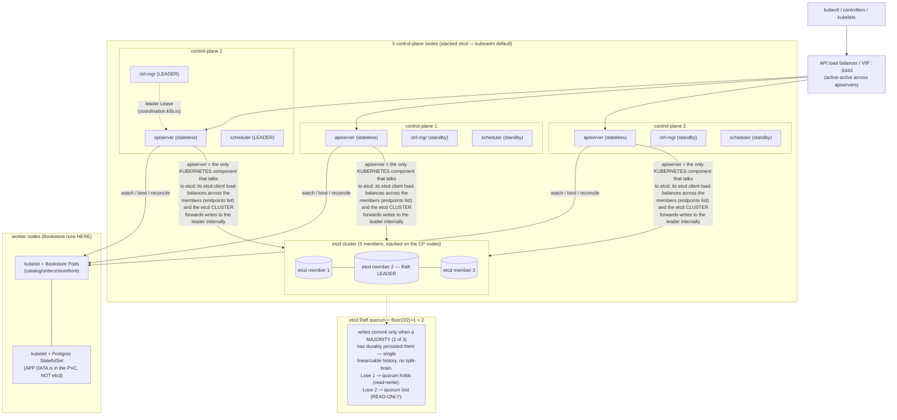

# 08 — HA control plane and etcd

> [Part 00 ch.04](../00-foundations/04-control-plane-deep-dive.md) sketched the
> HA topology and the quorum table; [Part 08
> ch.02](../08-day-2-operations/02-backup-and-dr.md) did the snapshot basics
> (`etcdctl snapshot save`, `etcdutl snapshot restore`).
> This chapter goes to **operations depth**: stacked vs
> external etcd and **why ≥3 control-plane nodes behind an API LB**
> (apiserver stateless/active-active vs etcd the consensus core); **etcd Raft &
> quorum** (leader election, quorum = ⌊n/2⌋+1, the failure-tolerance table for
> 1/3/5/7, why even counts waste, split-brain prevention); **etcd maintenance**
> — `member list`/`endpoint status`/`endpoint health`, **defragmentation**
> (post-compaction fragmentation, the latency spike, one-member-at-a-time),
> **auto-compaction** (revision vs periodic), the **space quota +
> `NOSPACE`/`alarm disarm`** recovery, backend-DB-size monitoring; **etcd DR
> beyond a snapshot** (single failed member vs full-cluster restore, the
> `--data-dir`/`--initial-cluster` reconstruction, the "restore = a NEW logical
> cluster" gotcha, member replace); **node-loss recovery** (lose 1 of 3 → quorum
> holds; lose 2 of 3 → lost-quorum recovery); **component leader election**
> (`Lease`, `--leader-elect`). The labs read the control plane's TLS flags,
> show that port 2379 refuses a client with no certificate, and show that a
> snapshot holds Secret values. The quorum and node-loss labs need a
> **three-control-plane kind cluster**, a heavy install, so they are narrated
> and marked as not run. The **Bookstore stays up because its data is in the
> Postgres StatefulSet, not etcd** (cluster state ≠ app data).

**Estimated time:** ~60 min read · ~120 min hands-on
**Prerequisites:** [Part 00 ch.04](../00-foundations/04-control-plane-deep-dive.md) — HA topology + quorum table this chapter operationalises · [Part 08 ch.02](../08-day-2-operations/02-backup-and-dr.md) — etcd snapshot save/restore basics this chapter deepens
**You'll know after this:** • justify ≥3 control-plane nodes behind an API LB from the Raft quorum math · • run defragmentation, set the space quota, and recover from `NOSPACE` alarms · • restore etcd from a snapshot and explain "restore = a new logical cluster" · • diagnose a lost-quorum scenario and execute member-replace recovery · • separate cluster state (etcd) from app data (Postgres) in a DR plan

**Lab tier:** A (kind). Run the labs only against a cluster you own. Sections
0 to 6 run on a kind cluster with one control-plane node, which is what the
captured run used. Sections 7 to 9 need more than one control-plane node or a
kubeadm node, so they are narrated. The captured run is in
[`examples/security-lab/evidence/11-08.txt`](../examples/security-lab/evidence/11-08.txt).

<!-- tags: foundations, day-2, dr, observability, platform-engineering -->

## Why this exists

[Part 00 ch.04](../00-foundations/04-control-plane-deep-dive.md) ended on a
Production note: *"run 3 (or 5) control-plane nodes with etcd quorum sized odd…
a single control-plane node is acceptable only for learning (kind is exactly
that)."* [Part 08 ch.02](../08-day-2-operations/02-backup-and-dr.md) gave you
the snapshot and the stop-apiserver→restore→repoint sequence — and was explicit
it was **deepened here**: *"restoring a single failed member vs full-cluster
restore… the 'restore is a new logical cluster' gotcha, member replace"*. This
is that chapter, and it is the difference between *having* an HA control plane
and *operating* one without making it worse under pressure.

The control plane fails in production in a small number of specific, avoidable
ways, and every one is an etcd or quorum misunderstanding:

1. **Quorum lost by losing the wrong number of members.** A 3-member etcd
   tolerates **one** failure. Lose two (a bad two-node drain, an AZ outage with
   2 of 3 etcd in it, a botched rolling upgrade) and etcd goes **read-only** —
   the apiserver can serve reads from cache but **no writes**: no scheduling, no
   scaling, no deploys, until you recover quorum. Teams discover the
   failure-tolerance table *during* the outage.
2. **The disk filled and nobody knew the alarm semantics.** etcd's keyspace
   grows; after compaction the file does **not** shrink (it is only
   internally freed) until you **defrag**; the backend hits
   `--quota-backend-bytes`; etcd raises a **`NOSPACE` alarm** and goes
   **read-only cluster-wide** — and stays there even after you free space until
   you explicitly **`etcdctl alarm disarm`**. This is one of the most common
   real etcd outages and it is 100% operational.
3. **"Restore" was treated as "undo".** Restoring an etcd snapshot creates a
   **new logical cluster** with a new cluster ID — you cannot restore one member
   from a snapshot into a live cluster and expect it to rejoin; doing so
   corrupts the cluster. Single-member loss and full-cluster loss have
   **different** procedures, and conflating them turns a one-member blip into a
   total outage.
4. **Defrag run cluster-wide at once.** `etcdctl defrag` blocks the member it
   runs against (it rewrites the backend file). Defragging **all members
   simultaneously** stalls the whole etcd cluster — the maintenance becomes the
   incident. It must be **one member at a time**.
5. **Anyone who can reach etcd reads every Secret.** etcd sits below the
   API server, so RBAC and admission do not apply to it. A client that opens a
   TLS connection to port 2379 and presents a certificate the member trusts
   reads the whole keyspace, Secrets included. A snapshot of that keyspace
   holds the same values. Whether this happens depends on the TLS settings
   and on who can reach the port, which this chapter covers in sections 0, 3
   and 4.

This chapter makes the control plane operable: the quorum arithmetic you size
for, the maintenance you schedule (defrag/compaction/alarm), the DR procedures
you rehearse (single-member vs full-cluster), and the node-loss recovery you
practice — with the Bookstore proving the orthogonality the whole guide leans
on: **app data lives in the Postgres PVC, not etcd**, so cluster-state failures
and data failures are *different* failure domains with *different* recoveries
([Part 08 ch.02](../08-day-2-operations/02-backup-and-dr.md)'s three layers).
The reference is *Production Kubernetes* ch.1–2 and the official etcd/k8s HA
docs.

## Mental model

**The control plane is one stateless, replicate-freely front (apiserver +
leader-elected controller-manager/scheduler) sitting in front of one
consensus-bound back (etcd). You scale the front by adding replicas behind a
load balancer; you make the back survivable by an odd Raft quorum. Almost every
control-plane outage is a quorum or maintenance fact about the back.**

- **The apiserver is stateless; etcd is the cluster.** The apiserver holds no
  durable state ([Part 00 ch.04](../00-foundations/04-control-plane-deep-dive.md))
  — it is the *only* etcd client, and N apiservers behind an LB/VIP are all
  active. So front-end HA is trivial: add apiservers. **etcd** is the hard part:
  it is a Raft cluster where every write must be durably acknowledged by a
  **majority** before it commits. Lose the majority and the cluster is
  read-only. "Make the control plane HA" overwhelmingly means "size and operate
  etcd's quorum correctly".
- **Quorum = ⌊n/2⌋+1; failures tolerated = n − quorum.** A Raft cluster of `n`
  members commits a write only when a strict **majority** has persisted it
  (this guarantees a single linearizable history — no split-brain, because two
  disjoint majorities cannot exist). So 3 members → quorum 2 → tolerate **1**
  loss; 5 → quorum 3 → tolerate **2**; 7 → quorum 4 → tolerate **3**. An **even**
  count never improves tolerance (4 still tolerates only 1, like 3) while adding
  a member that can fail and slowing every write — hence **always odd, almost
  always 3, 5 for large/critical, rarely 7**. Beyond ~5–7, cross-member
  replication latency dominates and write throughput drops.
- **Stacked vs external is a failure-domain choice.** *Stacked* (kubeadm
  default): etcd runs on the same nodes as the apiservers — fewer machines, but
  a node loss removes an apiserver **and** an etcd member together (coupled
  domains). *External*: etcd is its own dedicated cluster — more machines and
  surface, but etcd and apiservers fail independently and etcd can be tuned in
  isolation. 3 stacked control-plane nodes is the right default for most
  clusters; external is for large/high-stakes ones.
- **etcd needs maintenance the apiserver does not.** etcd is an MVCC store: every
  write creates a new **revision**; old revisions accumulate until
  **compaction** discards history below a revision. Compaction frees space
  *logically* but the backend file stays the same size until **defragmentation**
  physically reclaims it. Unbounded growth hits the **space quota**
  (`--quota-backend-bytes`), which trips a **`NOSPACE` alarm** that makes etcd
  **read-only until disarmed**. So an operated etcd has: **auto-compaction on**,
  **periodic defrag (one member at a time)**, **quota set**, and **DB size
  alerted** — none of which the stateless apiserver requires.
- **Restore creates a NEW logical cluster — single-member ≠ full-cluster
  recovery.** A snapshot (`etcdctl snapshot save`) is a consistent copy of the
  keyspace; `snapshot restore` builds a **fresh** etcd data-dir with a **new
  cluster ID**. Therefore: to replace **one** failed member in a still-quorate
  cluster you do **member replace** (`member remove` the dead one, fresh
  data-dir, `member add` + `--initial-cluster-state existing`) — you do **not**
  restore a snapshot into it. You restore a snapshot only for **total loss**
  (lost quorum / all members gone), and the result is a new cluster the
  apiservers must be repointed at. Conflating the two is the canonical way to
  turn a recoverable blip into a rebuild.
- **Controller-manager/scheduler HA is just a `Lease`.** They run on every
  control-plane node but only the **leader-elected** one acts (`--leader-elect`
  renews a `coordination.k8s.io/Lease`; on leader loss another acquires it
  within the lease duration). This is *why* running them redundantly is safe —
  exactly one is active, so no work is done twice. It is the same declarative
  model applied to the control plane's own coordination ([Part 00
  ch.04](../00-foundations/04-control-plane-deep-dive.md)).
- **etcd trusts certificates, not network position.** Port 2379 listens on
  the control-plane node's address as well as on loopback, so any host that
  can route to that address can open a connection. What stops it is the TLS
  handshake. With `--client-cert-auth=true`, etcd refuses a client that does
  not present a certificate signed by its trusted CA, and
  `--peer-client-cert-auth=true` applies the same rule to members on 2380. A
  firewall or security group decides who can route there. NetworkPolicy is not
  the gate, because Kubernetes leaves its effect on `hostNetwork` pods
  undefined ([Network Policies](https://kubernetes.io/docs/concepts/services-networking/network-policies/)).

The trap to keep in view: **HA is not "more replicas everywhere" — it is "an
odd, correctly-operated etcd quorum, an LB in front of stateless apiservers,
and rehearsed member-level recovery".** Adding a 4th etcd member, defragging all
members at once, restoring a snapshot to fix one dead member, or not knowing
`alarm disarm` are each a way an "HA" cluster takes a *longer* outage than a
single-node one would have. And throughout, remember the Bookstore: its
**Postgres data is in a PVC**, not etcd — an etcd disaster loses *cluster
state* (recoverable from snapshot + GitOps, [Part 08
ch.02](../08-day-2-operations/02-backup-and-dr.md)), never the *application
data*.

## Threats and controls

| Threat | Control in this chapter | Deeper |
|---|---|---|
| I7: clear etcd traffic. A host on the path reads Secrets off etcd traffic, or a client talks to etcd with no certificate. | Peer and client TLS, with client certificates required (`--client-cert-auth`, `--peer-client-cert-auth`). Port 2379 is reached only from control-plane nodes. | 05.04 (the same settings in context); 05.06 <!-- link-later: 05.06 --> (control-plane flags under kube-bench) |
| A snapshot file gives every Secret value. | Treat each snapshot as a Secret: restricted permissions, and encrypted before it leaves the node (section 4). | 05.04 (encryption at rest); 08.02 (backup and restore) |

The Bookstore threat model holds the first row as I7 in
[`THREAT-MODEL.md`](../examples/bookstore/THREAT-MODEL.md).

## Diagrams

### Diagram A — HA topology: LB → 3 stateless apiservers, odd etcd Raft quorum, workers (Mermaid)



### Diagram B — etcd member count → quorum / failure tolerance, and the maintenance loop (ASCII)

```
 etcd QUORUM & FAILURE TOLERANCE — always ODD, almost always 3 ──────────────

  members  quorum=floor(n/2)+1  failures tolerated   verdict
  -------   ------------------   ------------------   -----------------------
    1              1                    0             no HA (kind = this)
    3              2                    1             DEFAULT (most clusters)
    4              3                    1             WASTE: == 3 tolerance,
                                                       extra member can fail,
                                                       slower writes
    5              3                    2             large / high-stakes
    6              4                    2             WASTE: == 5 tolerance
    7              4                    3             rare; write latency cost
  -> even N never raises tolerance (majority unchanged) while ADDING a member
     that can fail and SLOWING every commit. Beyond ~5-7, cross-member
     replication latency dominates -> throughput falls. ODD, 3 default.

  WHY: a write commits only on a strict MAJORITY ack. Two disjoint majorities
  cannot exist -> at most one leader -> single linearizable history -> NO
  split-brain. A minority partition CANNOT elect a leader or accept writes.

 etcd MAINTENANCE LOOP (the apiserver needs none of this) ───────────────────

   every write -> new REVISION (MVCC)         keyspace grows unbounded
        |                                          |
        v                                          v
   AUTO-COMPACTION  ── discards history below ──>  space freed LOGICALLY
   (revision or periodic)                          (file size UNCHANGED)
        |                                          |
        v                                          v
   DEFRAG (one member   ── physically reclaims ──> file shrinks; brief
    at a time! blocks)      the freed pages          per-member latency spike
        |
        v   if growth outruns this:
   --quota-backend-bytes hit -> NOSPACE ALARM -> etcd READ-ONLY cluster-wide
        |
        v   recovery: free/compact/defrag THEN  etcdctl alarm disarm
                      (stays read-only until DISARMED, even after space freed)

 RECOVERY DECISION — single member vs total loss (DIFFERENT procedures)
   1 of 3 down, quorum HOLDS  -> MEMBER REPLACE (remove dead, fresh data-dir,
                                  member add, --initial-cluster-state existing)
                                  *** do NOT restore a snapshot here ***
   2 of 3 down, quorum LOST   -> SNAPSHOT RESTORE = a NEW logical cluster
                                  (new cluster ID; repoint apiservers at it)
```

## Hands-on with the Bookstore

**Assumed working directory: the guide repo root (`full-guide/`).** This
chapter adds the **new**
[`examples/bookstore/platform/`](../examples/bookstore/platform/) tree's HA
artefact
[`ha-kind-3cp.yaml`](../examples/bookstore/platform/ha-kind-3cp.yaml) — a
**`kind` Cluster config** (a *kind* config object, **not** a Kubernetes API
object: it is validated as well-formed YAML, never `kubectl apply`-ed; the
real artefact is the `kind create cluster --config` command, the same honesty
pattern as the apiserver-level `cluster/` files and
`multicluster/00-two-cluster-topology.yaml`). It modifies **no** canonical
Bookstore manifest, Helm chart, Kustomize overlay, the operator, or any other
`examples/bookstore/**` file — purely additive (the Gateway-vs-Ingress / CNPG /
multicluster precedent).

We will, in order: (0) read the control plane's TLS flags, which changes
nothing in the cluster; (1) talk to etcd with its client certificates; (2) read
the backend size; (3) show that port 2379 refuses a client with no certificate;
(4) show that a snapshot holds Secret values, then delete it; (5) defragment,
and read the quota and alarm mechanics; (6) read the `kube-scheduler` `Lease`.
Sections 0 to 6 run on one control-plane node. Sections 7 and 8 need three:
quorum and node loss are narrated there. Section 9 needs a kubeadm node, so
the restore procedures are narrated too.

> **The honest HA story (read this first).** A three-control-plane kind
> cluster *can* run on one machine (kind runs each control-plane node as a
> container, and three nodes give a real three-member etcd with a real quorum),
> and `etcdctl` against kind's etcd static Pod is real. What a laptop cannot
> reproduce: a real **API load balancer / VIP**, true **machine or AZ** failure
> domains, **external etcd** on dedicated hosts, and full-cluster etcd restore
> on a kubeadm node with `/etc/kubernetes/`. Those are given as the exact
> commands and marked "needs real HW / kubeadm / a cloud", the same honesty as
> [Part 08 ch.02](../08-day-2-operations/02-backup-and-dr.md)'s etcd-restore
> narration. The captured run in the evidence file covers sections 0 to 6 only.
> The three-member commands in sections 7 and 8 are illustrative: when the
> captured run happened, the lab's heavy-install lock was held, so no
> three-control-plane cluster was created for them.

### 0. Read the control plane's TLS flags

The static Pod's command line is etcd's whole configuration. Read it before
any client talks to etcd:

```sh
kubectl -n kube-system get pod -l component=etcd \
  -o jsonpath='{.items[0].spec.containers[0].command}' | tr ',' '\n'
```

The lab's control-plane node is named `sf-pilot-control-plane`, and the output
below is kept verbatim from it. Your node has your cluster's name and address.
Lines the output leaves out are marked `# ...`.

<!-- gate: output -->
```text
["etcd"
"--unsafe-no-fsync=true"
"--advertise-client-urls=https://172.18.0.2:2379"
"--cert-file=/etc/kubernetes/pki/etcd/server.crt"
"--client-cert-auth=true"
# ...
"--listen-client-urls=https://127.0.0.1:2379
https://172.18.0.2:2379"
# ...
"--peer-client-cert-auth=true"
# ...
"--trusted-ca-file=/etc/kubernetes/pki/etcd/ca.crt"
```

Each TLS field is explained where it first appears:

- `--client-cert-auth=true` makes etcd refuse a request that does not carry a
  valid client certificate. The etcd security guide puts it as "requests that
  don't supply a valid client certificate will fail"
  ([etcd security](https://etcd.io/docs/latest/op-guide/security/)).
- `--peer-client-cert-auth=true` applies the same check to the other members,
  which talk on port 2380.
- `--cert-file`, `--key-file` and `--trusted-ca-file` give etcd its server
  certificate, its key, and the CA that signs the client certificates it will
  accept. The `--peer-*` flags do the same for member-to-member traffic.
- `--listen-client-urls` names two addresses: loopback, and the node's own
  address. The second one is what makes port 2379 reachable from other hosts,
  and section 3 tests it.
- `--listen-metrics-urls=http://127.0.0.1:2381` serves metrics and health over
  plain HTTP, on loopback only, so no remote client reaches it.

The Pod also runs with host networking, so etcd listens on the node's address
and not on a Pod address:

```sh
kubectl -n kube-system get pod -l component=etcd \
  -o jsonpath='{.items[0].spec.hostNetwork}{"\n"}'
```

<!-- gate: output -->
```text
true
```

The one flag in the list that must not reach a production cluster is
`--unsafe-no-fsync=true`. kind sets it to make the lab faster. The etcd help
text gives the cost, and the same help text gives the quota default that
section 5 sizes against:

```sh
ETCD_POD=$(kubectl -n kube-system get pod -l component=etcd \
  -o jsonpath='{.items[0].metadata.name}')
kubectl -n kube-system exec "$ETCD_POD" -- etcd --help \
  | grep -A1 -E 'quota-backend-bytes|unsafe-no-fsync'
```

<!-- gate: output -->
```text
  --quota-backend-bytes '0'
    Sets the maximum size (in bytes) that the etcd backend database may consume. Exceeding this triggers an alarm and puts etcd in read-only mode. Set to 0 to use the default 2GiB limit.
--
  --unsafe-no-fsync 'false'
    Disables fsync, unsafe, will cause data loss.
```

The API server is etcd's only client, and its flags name the CA it trusts and
the client certificate it presents:

```sh
kubectl -n kube-system get pod -l component=kube-apiserver \
  -o jsonpath='{.items[0].spec.containers[0].command}' | tr ',' '\n' | grep etcd
```

<!-- gate: output -->
```text
"--etcd-cafile=/etc/kubernetes/pki/etcd/ca.crt"
"--etcd-certfile=/etc/kubernetes/pki/apiserver-etcd-client.crt"
"--etcd-keyfile=/etc/kubernetes/pki/apiserver-etcd-client.key"
"--etcd-servers=https://127.0.0.1:2379"
```

The list has no `--encryption-provider-config`. This cluster therefore stores
Secrets in etcd without encryption at rest. Section 4 shows what a backup then
holds, and [05.04](../05-security/04-secrets-and-cluster-hardening.md) covers
the fix.

### 1. Talk to etcd: member list, endpoint status, endpoint health

kind runs etcd as a static Pod in `kube-system`, with the control-plane
certificates mounted from `/etc/kubernetes/pki/etcd/`. The Pod's certificates
are the client credentials, so run `etcdctl` inside the Pod with them:

```sh
ETCD_POD=$(kubectl -n kube-system get pod -l component=etcd \
  -o jsonpath='{.items[0].metadata.name}')
etcd() { kubectl -n kube-system exec "$ETCD_POD" -- etcdctl \
  --endpoints=https://127.0.0.1:2379 \
  --cacert=/etc/kubernetes/pki/etcd/ca.crt \
  --cert=/etc/kubernetes/pki/etcd/server.crt \
  --key=/etc/kubernetes/pki/etcd/server.key "$@"; }

etcd member list -w table
etcd endpoint status -w table
etcd endpoint health -w table
```

<!-- gate: output -->
```text
┌─────────────────┬─────────┬────────────────────────┬─────────────────────────┬─────────────────────────┬────────────┐
│       ID        │ STATUS  │          NAME          │       PEER ADDRS        │      CLIENT ADDRS       │ IS LEARNER │
├─────────────────┼─────────┼────────────────────────┼─────────────────────────┼─────────────────────────┼────────────┤
│ e58c878e0e01014 │ started │ sf-pilot-control-plane │ https://172.18.0.2:2380 │ https://172.18.0.2:2379 │      false │
└─────────────────┴─────────┴────────────────────────┴─────────────────────────┴─────────────────────────┴────────────┘
```

<!-- gate: output -->
```text
┌────────────────────────┬─────────────────┬─────────┬─────────────────┬─────────┬────────┬───────────────────────┬────────┬───────────┬────────────┬───────────┬────────────┬────────────────────┬────────┬──────────────────────────┬───────────────────┐
│        ENDPOINT        │       ID        │ VERSION │ STORAGE VERSION │ DB SIZE │ IN USE │ PERCENTAGE NOT IN USE │ QUOTA  │ IS LEADER │ IS LEARNER │ RAFT TERM │ RAFT INDEX │ RAFT APPLIED INDEX │ ERRORS │ DOWNGRADE TARGET VERSION │ DOWNGRADE ENABLED │
├────────────────────────┼─────────────────┼─────────┼─────────────────┼─────────┼────────┼───────────────────────┼────────┼───────────┼────────────┼───────────┼────────────┼────────────────────┼────────┼──────────────────────────┼───────────────────┤
│ https://127.0.0.1:2379 │ e58c878e0e01014 │   3.7.0 │           3.7.0 │   49 MB │  12 MB │                   76% │ 2.1 GB │      true │      false │         3 │     151715 │             151715 │        │                          │             false │
└────────────────────────┴─────────────────┴─────────┴─────────────────┴─────────┴────────┴───────────────────────┴────────┴───────────┴────────────┴───────────┴────────────┴────────────────────┴────────┴──────────────────────────┴───────────────────┘
```

<!-- gate: output -->
```text
┌────────────────────────┬────────┬─────────────┬───────┐
│        ENDPOINT        │ HEALTH │    TOOK     │ ERROR │
├────────────────────────┼────────┼─────────────┼───────┤
│ https://127.0.0.1:2379 │   true │ 13.931169ms │       │
└────────────────────────┴────────┴─────────────┴───────┘
```

`member list` shows one member, `endpoint status` shows the leader and the
quota, and `endpoint health` is the heartbeat. The quota column reads 2.1 GB,
which is the 2 GiB default from section 0. Three-member clusters add rows; the
commands are the same.

### 2. Backend DB size: the number you alert on

The backend file only grows until you compact and defragment. Read its size,
its live data, and its quota:

```sh
etcd endpoint status -w json | python3 -m json.tool \
  | grep -E '"dbSize|"dbSizeInUse|"dbSizeQuota'
etcd alarm list
```

<!-- gate: output -->
```text
            "dbSize": 48664576,
            "dbSizeInUse": 12152832,
            "dbSizeQuota": 2147483648,
```

`dbSize` is the file on disk, and `dbSizeInUse` is the live data. In the first
read, 48.7 MB sat on disk with 12.2 MB live, so most of the file was free
space that defragmentation can return (section 5). `etcd alarm list` prints
nothing when no alarm is set. An alarm that is set is the first thing to check
during an outage.

### 3. Who can reach 2379, and what a client without a certificate gets

Port 2379 answers on the node's address, as section 0 showed. Any Pod on the
cluster network can route to that address, so the question is what the port
asks of its caller. This probe is a restricted Pod on the control-plane node,
where etcd runs. It calls the member's health endpoint with no client
certificate. Save the manifest as `etcd-probe.yaml`:

```yaml
apiVersion: v1
kind: Namespace
metadata:
  name: etcd-probe
  labels:
    pod-security.kubernetes.io/enforce: restricted
    pod-security.kubernetes.io/audit: restricted
    pod-security.kubernetes.io/warn: restricted
---
apiVersion: v1
kind: ServiceAccount
metadata:
  name: etcd-probe
  namespace: etcd-probe
automountServiceAccountToken: false
---
apiVersion: v1
kind: Pod
metadata:
  name: etcd-probe
  namespace: etcd-probe
spec:
  automountServiceAccountToken: false
  serviceAccountName: etcd-probe
  restartPolicy: Never
  nodeSelector:
    node-role.kubernetes.io/control-plane: ""
  tolerations:
    - key: node-role.kubernetes.io/control-plane
      operator: Exists
      effect: NoSchedule
  securityContext:
    runAsNonRoot: true
    runAsUser: 100                  # curl_user, declared by the image
    runAsGroup: 101                 # curl_group
    seccompProfile:
      type: RuntimeDefault
  containers:
    - name: probe
      # curlimages/curl:8.23.0, index digest
      image: curlimages/curl@sha256:3fb7e13e5d179a845c97d78204f3f1064d1907037f26a3ebf91710571151fd93
      imagePullPolicy: IfNotPresent
      command: ["curl"]
      args:
        - --silent
        - --show-error
        - --insecure                # skips server verification on purpose
        - https://$(HOST_IP):2379/health
      env:
        - name: HOST_IP
          valueFrom:
            fieldRef:
              fieldPath: status.hostIP
      securityContext:
        allowPrivilegeEscalation: false
        readOnlyRootFilesystem: true
        capabilities:
          drop: ["ALL"]
      resources:
        requests:
          cpu: 10m
          memory: 16Mi
        limits:
          memory: 64Mi
      volumeMounts:
        - name: tmp
          mountPath: /tmp
  volumes:
    - name: tmp
      emptyDir: {}
```

The probe runs as `curl_user` (UID 100, GID 101), the user the image declares,
so the numeric IDs match the image, as the
[baseline](../01-core-workloads/01-pods.md#baseline-run-as) asks. The
`nodeSelector` and toleration place it on a control-plane node, so
`status.hostIP` is that node's address.

`--insecure` is deliberate. The probe does not hold the etcd CA, so without
the flag curl would stop at the server-certificate check and never reach the
client-certificate check. The failure below is the result this step is after.
Never use `--insecure` with a real client.

Apply it, wait for it to fail, and read the log:

```sh
kubectl apply -f etcd-probe.yaml
kubectl -n etcd-probe wait --for=jsonpath='{.status.phase}'=Failed \
  pod/etcd-probe --timeout=240s
kubectl -n etcd-probe logs pod/etcd-probe
```

<!-- gate: output -->
```text
curl: (55) OpenSSL SSL_read: OpenSSL/3.5.9: error:0A00045C:SSL routines::tlsv13 alert certificate required, errno 0
```

The server answered the handshake and refused it, because the probe presented
no certificate. The container exited with code 55. The same endpoint answers a
client that holds the control-plane certificates, as section 1 showed.

NetworkPolicy does not close this gap. The Kubernetes docs leave its effect on
`hostNetwork` pods undefined: the network plugin may or may not apply policy
to them ([Network Policies](https://kubernetes.io/docs/concepts/services-networking/network-policies/)).
etcd runs with host networking, so a policy written for it may or may not
apply. Limit port 2379 with the node firewall or the security group, to the
control-plane nodes. The kubeadm port table lists 2379 as the etcd client API
on control-plane nodes ([ports and protocols](https://kubernetes.io/docs/reference/networking/ports-and-protocols/)).
Keep the TLS check as the control that does not depend on the network, and rerun
this probe after any network change.

### 4. The backup holds your Secrets

A snapshot is a copy of the whole keyspace, and Secrets are objects in it. Test
that with a canary value. Store it in a Secret:

```sh
kubectl -n etcd-probe create secret generic etcd-canary \
  --from-literal=token=canary-7f3a9c2e
```

<!-- gate: output -->
```text
secret/etcd-canary created
```

Take a snapshot inside the etcd container. The lab's first attempt ran this
through `kubectl exec`, and the API server dropped the stream after twenty
seconds with `keepalive ping failed to receive ACK within timeout`, because the
lab was overloaded. The command below runs the same save through the node's
container runtime. It worked, and it is the form the captured output came from.
Replace `kind-control-plane` with your node's name in the copy step:

```sh
docker exec kind-control-plane sh -c 'crictl exec \
  $(crictl ps -q --name etcd | head -1) etcdctl \
  --endpoints=https://127.0.0.1:2379 \
  --cacert=/etc/kubernetes/pki/etcd/ca.crt \
  --cert=/etc/kubernetes/pki/etcd/server.crt \
  --key=/etc/kubernetes/pki/etcd/server.key \
  snapshot save /var/lib/etcd/etcd-canary.db'
docker cp kind-control-plane:/var/lib/etcd/etcd-canary.db ./etcd-canary.db
grep -a -c 'canary-7f3a9c2e' ./etcd-canary.db
```

<!-- gate: output -->
```text
{"level":"info","ts":"2026-10-31T05:03:42.810201Z","caller":"snapshot/v3_snapshot.go:121","msg":"saved","path":"/var/lib/etcd/etcd-canary.db"}
Snapshot saved at /var/lib/etcd/etcd-canary.db
Server version 3.7.0
```

<!-- gate: output -->
```text
snapshot bytes: 48664608
```

<!-- gate: output -->
```text
1
```

The count is 1: the canary value sits in the snapshot in plain text. Section 0
showed that nothing encrypts Secrets in this cluster, so the backup is a
Secret store. Anyone who can read the file reads every Secret in it. Treat each
snapshot as a credential: restrict who reads it, store it encrypted outside the
node, and turn on encryption at rest
([05.04](../05-security/04-secrets-and-cluster-hardening.md)) so the file holds
ciphertext. The backup procedure is in
[Part 08 ch.02](../08-day-2-operations/02-backup-and-dr.md).

Only one subcommand in `etcdctl snapshot` writes a snapshot, and etcd 3.6 and
later restore one only with `etcdutl`. The lab's etcd 3.7.0 lists `save` alone:

<!-- gate: output -->
```text
Available Commands:
  save        Stores an etcd node backend snapshot to a given file
```

The etcd recovery guide says: "For v3.6 and later, users can only use etcdctl
to take the data to a snapshot, but use etcdutl to restore data"
([etcd recovery](https://etcd.io/docs/latest/op-guide/recovery/)).

Delete the canary Secret with its namespace when you finish:

```sh
kubectl delete namespace etcd-probe
```


### 5. Compaction, defragmentation, the space quota and the NOSPACE alarm

**Compaction** discards MVCC history below a revision (Kubernetes' apiserver
auto-compacts by default: the `--etcd-compaction-interval`, default `5m0s`, it frees
space *logically only*. **Defragmentation** physically rewrites the backend
file to reclaim it — and it **blocks the member it runs on** (it holds the
backend while rewriting), so it is done **one member at a time**, off-peak,
**and the current Raft leader LAST**: defragging the leader stops it long
enough to trigger a leader **re-election** (a cluster-wide write blip), so you
defrag every follower first and the leader last (by which point its load has
moved):

```sh
# Manual compaction to a revision (apiserver does this automatically; shown for
# the mechanism). Get the current revision, compact below it:
REV=$(etcd endpoint status -w json | python3 -c 'import sys,json;print(json.load(sys.stdin)[0]["Status"]["header"]["revision"])')
etcd compact "$REV"
#   compacted revision <REV>   (history below REV gone; dbSize UNCHANGED yet)

# Identify the current LEADER so we defrag it LAST (its stop-the-world window
# would otherwise force a leader re-election mid-maintenance):
etcd endpoint status --cluster -w table        # the row with IS LEADER = true
LEADER_EP=$(etcd endpoint status --cluster -w json \
  | python3 -c 'import sys,json; print(next(e["Endpoint"] for e in json.load(sys.stdin) if e["Status"]["leader"]==e["Status"]["header"]["member_id"]))')

# DEFRAG — ONE MEMBER AT A TIME, FOLLOWERS FIRST, LEADER LAST. Per-endpoint,
# never --cluster all-at-once (a production script defers $LEADER_EP exactly so):
EPS=$(etcd member list -w json | python3 -c 'import sys,json;print(" ".join(m["clientURLs"][0] for m in json.load(sys.stdin)["members"]))')
for EP in $EPS; do
  [ "$EP" = "$LEADER_EP" ] && continue        # skip the leader on this pass
  echo "defrag follower $EP (blocks THIS member only; brief latency spike)"
  etcd --endpoints="$EP" defrag
  sleep 5      # let it settle before the next member (never simultaneous)
done
echo "defrag LEADER $LEADER_EP LAST (its load has moved; minimal re-election risk)"
etcd --endpoints="$LEADER_EP" defrag
etcd endpoint status --cluster -w json | python3 -m json.tool | grep -E '"dbSize"|"dbSizeInUse"'
#   dbSize now ≈ dbSizeInUse -> the fragmentation was physically reclaimed.
```

The lab did not run the manual compaction: the API server already compacts
every five minutes, and a second compaction adds nothing. The lab did read the
fragmentation before it tried a defrag:

<!-- gate: output -->
```text
            "dbSize": 48664576,
            "dbSizeInUse": 8335360,
            "dbSizeQuota": 2147483648,
```

The file is 48.7 MB and 8.3 MB of it is live, so defragmentation has about
40 MB to return. On this one-member cluster the loop above has no followers
and defragments only the leader. The lab's defrag did not finish. The client
gave up after five seconds, while the API server was overloaded:

<!-- gate: output -->
```text
Failed to defragment etcd member[https://127.0.0.1:2379]. took 5.006531169s. (context deadline exceeded)
```

A second attempt, through the node's runtime, found the etcd container had
restarted, so the lab has no defrag result to show. Run the loop on a quiet
cluster and expect `dbSizeInUse` to stay the same while `dbSize` falls.

> **The `NOSPACE` alarm — the classic etcd outage, and its recovery.** etcd is
> started with **`--quota-backend-bytes`**. Left at `0`, it uses etcd's built-in
> 2 GiB quota; the endpoint status in section 2 reports it as `dbSizeQuota`.
> Set it explicitly for your cluster. If the backend exceeds the quota, etcd
> raises a **`NOSPACE` alarm** and
> rejects **all writes cluster-wide** (reads still work) — and **stays
> read-only even after you free space**, until you explicitly **disarm** it.
> The recovery, in order: `etcd alarm list` (see `NOSPACE`) → free space
> (compact to a recent revision → defrag every member, one at a time,
> followers first and the leader last) →
> **`etcd alarm disarm`** → verify writes resume (`etcd endpoint status`
> healthy, `etcd alarm list` empty). Skipping the **disarm** is why a
> "disk-full → cleared the disk" incident *stays* an outage. On kind you can
> see the knob and the (empty) alarm list; deliberately filling etcd to trip it
> is destructive and is **described, not run**, here — the exact precedent of
> [Part 08 ch.02](../08-day-2-operations/02-backup-and-dr.md)'s narrated
> destructive sequences.

**Auto-compaction** is the prevention: etcd's `--auto-compaction-mode` is
`periodic` (e.g. retain `1h` of history) or `revision` (retain the last `N`
revisions); the Kubernetes apiserver additionally compacts on its own interval.
You set it once at etcd start; you still **defrag on a schedule** (compaction
without defrag never shrinks the file) and **alert on `dbSize`**.

### 6. Component leader election: the `Lease`

controller-manager and scheduler run on all 3 control-plane nodes but exactly
one of each is active, holding a `coordination.k8s.io/Lease` it renews
(`--leader-elect`, [Part 00
ch.04](../00-foundations/04-control-plane-deep-dive.md)). Inspect it:

```sh
kubectl -n kube-system get lease kube-scheduler kube-controller-manager
#   NAME                      HOLDER                              AGE
#   kube-scheduler            bookstore-ha-control-plane2_<UUID>  ...
#   kube-controller-manager   bookstore-ha-control-plane_<UUID>   ...
kubectl -n kube-system get lease kube-scheduler -o jsonpath='{.spec.holderIdentity}{"\n"}'
kubectl -n kube-system get lease kube-scheduler \
  -o jsonpath='{.spec.renewTime} (renews every {.spec.leaseDurationSeconds}s){"\n"}'
# Only the HOLDER schedules. If that node dies, another scheduler acquires the
# Lease within leaseDurationSeconds and takes over — no double-scheduling,
# zero config beyond --leader-elect. THIS is why running 3 is safe.
```

The lab's single control-plane node holds both leases. The output is:

<!-- gate: output -->
```text
NAME                      HOLDER                                                        AGE
kube-scheduler            sf-pilot-control-plane_c31bbbd1-ae69-4a7f-9fd6-47d8c1e2256f   14h
kube-controller-manager   sf-pilot-control-plane_6a0f2bb1-06cd-4c17-8509-2d7857d9cee4   14h
```

The lease lasts 15 seconds unless its holder renews it, so a dead holder is
replaced within that window.

### 7. Three control planes: prerequisites (heavy, narrated)

**Narrated, not run.** This needs three control-plane nodes. The lab's heavy-install lock was held when the captured run happened, so this cluster was not created.

[`platform/ha-kind-3cp.yaml`](../examples/bookstore/platform/ha-kind-3cp.yaml)
declares 3 control-plane + 2 worker nodes. kind, given ≥2 control-plane nodes,
**stands up a real stacked-etcd cluster** (and an internal Envoy load balancer
as the API front; kind v0.32.0 replaced HAProxy with Envoy, per the
[kind release notes](https://github.com/kubernetes-sigs/kind/releases), and the
lab's v0.33.0 keeps it), a faithful, laptop-sized HA control plane:

```sh
# It is a KIND config, not a k8s object — validate it's well-formed YAML,
# never `kubectl apply` it (the real artefact is the create command):
python3 -c 'import yaml,sys; list(yaml.safe_load_all(open("examples/bookstore/platform/ha-kind-3cp.yaml"))); print("ha-kind-3cp.yaml: valid YAML (kind Cluster config)")'

kind delete cluster --name bookstore-ha 2>/dev/null || true
kind create cluster --name bookstore-ha --config examples/bookstore/platform/ha-kind-3cp.yaml
kubectl get nodes -o wide
#   3x role=control-plane + 2x worker. kind put a load-balancer container in
#   front of the 3 apiservers (active-active) and ran 3 stacked etcd members.
kubectl -n kube-system get pods -l component=etcd -o wide        # 3 etcd static Pods
kubectl -n kube-system get pods -l component=kube-apiserver       # 3 apiservers
```

The Bookstore (the four `bookstore/*:dev` images + the standard raw-manifests
chain from [Part 08 ch.02](../08-day-2-operations/02-backup-and-dr.md) step 0)
runs on the **workers** — bring it up so there is real cluster state in etcd
and a real app to keep available through the failures below:

```sh
cd examples/bookstore/app
for s in catalog orders payments-worker storefront; do docker build -t bookstore/$s:dev ./$s; done
cd ../../..
for s in catalog orders payments-worker storefront; do kind load docker-image bookstore/$s:dev --name bookstore-ha; done
# the standard prereq -> workload chain (Part 08 ch.02 step 0):
kubectl apply -f examples/bookstore/raw-manifests/00-namespace.yaml
kubectl apply -f examples/bookstore/raw-manifests/05-serviceaccounts-rbac.yaml
kubectl apply -f examples/bookstore/raw-manifests/15-catalog-config.yaml
kubectl apply -f examples/bookstore/raw-manifests/16-db-credentials.yaml
kubectl apply -f examples/bookstore/raw-manifests/35-priorityclasses.yaml
kubectl apply -f examples/bookstore/raw-manifests/12-redis.yaml
kubectl apply -f examples/bookstore/raw-manifests/13-rabbitmq.yaml
kubectl apply -f examples/bookstore/raw-manifests/20-postgres-statefulset.yaml
kubectl apply -f examples/bookstore/raw-manifests/40-services.yaml
kubectl apply -f examples/bookstore/raw-manifests/10-catalog-deploy.yaml
kubectl apply -f examples/bookstore/raw-manifests/11-storefront-deploy.yaml
kubectl apply -f examples/bookstore/raw-manifests/14-orders-deploy.yaml
kubectl apply -f examples/bookstore/raw-manifests/19-payments-worker-deploy.yaml
kubectl apply -f examples/bookstore/raw-manifests/21-db-migrate-job.yaml
kubectl wait --for=condition=complete job/db-migrate -n bookstore --timeout=120s
kubectl wait --for=condition=available deploy --all -n bookstore --timeout=180s
# seed a row — proves later that an etcd/control-plane failure does NOT lose it:
kubectl exec -n bookstore postgres-0 -- psql -U bookstore -d bookstore -c \
  "CREATE TABLE IF NOT EXISTS ha_demo(note text); INSERT INTO ha_demo VALUES ('survives-cp-loss');"
```

### 8. Lose a control-plane node: quorum holds, the Bookstore stays up (heavy, narrated)

**Narrated, not run.** It needs the three-node cluster from section 7.

Stop one control-plane node (an etcd member + an apiserver go down together —
the stacked-topology coupling). With 3 members, quorum is 2: **losing 1 keeps
read+write**. The Bookstore is unaffected — and crucially **its data was never
in etcd**:

```sh
docker stop bookstore-ha-control-plane3      # kill 1 of 3 control-plane nodes
# etcd: 2 of 3 members -> quorum (2) STILL MET -> cluster fully read+write:
etcd endpoint health --cluster -w table 2>/dev/null
#   ...control-plane3...:2379  false  ...  context deadline exceeded   <- the dead one
#   ...:2379  true   ...                                                <- the live 2 =
#   ...:2379  true   ...                                                   STILL A QUORUM
etcd member list -w table        # member3 still LISTED (down, not removed)

# The cluster keeps working: a write succeeds (scheduling, scaling, deploys OK):
kubectl scale deploy/catalog -n bookstore --replicas=3
kubectl rollout status deploy/catalog -n bookstore --timeout=120s    # SUCCEEDS

# The Bookstore — and its DATA — are untouched (data is in the Postgres PVC,
# NOT etcd; an apiserver loss never touches a worker's running Pods):
kubectl exec -n bookstore postgres-0 -- psql -U bookstore -d bookstore -c 'SELECT * FROM ha_demo;'
#   survives-cp-loss     <- app data intact: cluster STATE != app DATA

docker start bookstore-ha-control-plane3     # member rejoins, re-syncs Raft
sleep 20; etcd endpoint health --cluster -w table 2>/dev/null   # 3/3 healthy again
```

> **Lose 2 of 3 → quorum LOST (read-only) — the recovery.** `docker stop`-ing a
> **second** control-plane node leaves 1 of 3 members: **below quorum (2)**.
> etcd goes **read-only**: `kubectl get` (served from apiserver/etcd cache)
> mostly works, but **every write hangs/fails** — no scheduling, no scaling, no
> deploys. **The already-running Bookstore Pods keep serving** (the kubelet
> runs them independently of the control plane; the data is still in the PVC) —
> but you cannot *change* anything. Recovery is **not** "wait": with quorum
> permanently lost you either bring a stopped member back (restores quorum
> instantly — the kind-feasible path: `docker start` the node) **or**, if
> members are truly gone, perform the **full-cluster snapshot restore** of §9.
> This destructive 2-of-3 case is **described, not run** (it wedges the lab
> cluster); the kind-reproducible lesson is the **1-of-3** case above — quorum
> *held*.

### 9. etcd DR beyond a snapshot: single-member replace vs full-cluster restore (narrated)

**Narrated, not run.** It needs a kubeadm node, which kind does not provide.

[Part 08 ch.02](../08-day-2-operations/02-backup-and-dr.md) covered `snapshot
save` and the stop-apiserver→restore→repoint sequence for **total loss**. The
operational depth it deferred to here is **which procedure for which
failure** — they are *different*, and conflating them is the canonical
own-goal. Both are narrated against a **kubeadm** control-plane node (kind has
no `/etc/kubernetes/manifests/` to move; [Part 08
ch.02](../08-day-2-operations/02-backup-and-dr.md)'s "why narrated, not run on
kind" applies identically — and on **managed EKS/GKE/AKS you cannot do *either***:
etcd is the provider's):

```sh
# CASE A — ONE member dead, quorum STILL HELD (e.g. lost 1 of 3).
#   DO NOT restore a snapshot. The cluster is fine; just replace the member:
#   1. remove the dead member from the cluster:
etcd member remove <DEAD_MEMBER_ID>
#   2. on the replacement node: WIPE its old etcd data-dir (stale = corruption):
#      rm -rf /var/lib/etcd
#   3. add it back, then start etcd with --initial-cluster-state=existing:
etcd member add <NEW-NAME> --peer-urls=https://<NEW_NODE_IP>:2380
#      (start etcd: --initial-cluster="<SURVIVING-MEMBERS>,<NEW-NAME>=https://<NEW_NODE_IP>:2380"
#       --initial-cluster-state=existing)   # JOIN an existing cluster, do NOT bootstrap a new one
etcd member list -w table        # 3 'started' again; quorum restored. NO snapshot used.

# CASE B — quorum LOST / all members gone (total etcd loss).
#   ONLY here do you restore a snapshot — and it builds a NEW LOGICAL CLUSTER:
#   1. stop ALL apiservers + etcd (move static-Pod manifests out — Part 08 ch.02).
#   2. on EACH intended member, restore the SAME snapshot into a FRESH data-dir
#      with that member's identity baked in (etcdutl restores snapshots: from etcd 3.6 on,
#      etcdctl only takes them):
etcdutl snapshot restore /backups/etcd-<DATE>.db \
  --name <MEMBER-NAME> \
  --initial-cluster <M1>=https://<IP1>:2380,<M2>=https://<IP2>:2380,<M3>=https://<IP3>:2380 \
  --initial-cluster-token <NEW-UNIQUE-TOKEN> \
  --initial-advertise-peer-urls https://<THIS-IP>:2380 \
  --data-dir /var/lib/etcd-restored
#   3. point each etcd static-Pod manifest at /var/lib/etcd-restored, restore
#      the manifests -> the kubelet starts a NEW etcd cluster from the snapshot.
#   4. bring apiservers back; they now talk to the restored (NEW-cluster-ID) etcd.
```

> **The "restore is a NEW logical cluster" gotcha.** `snapshot restore` mints a
> new cluster ID and `--initial-cluster-token`. You therefore **cannot** restore
> a snapshot into a *single* member and have it rejoin a surviving cluster (the
> cluster IDs won't match — it is rejected, or worse). Single-member loss =
> **member replace** (Case A, no snapshot); snapshot restore = **whole-cluster,
> all-members-from-the-same-snapshot** (Case B). For the **Bookstore
> specifically**, the practical total-loss recovery is *not* the etcd restore
> at all — it is **GitOps**: a fresh cluster + Argo CD re-points at Git and
> rebuilds every object ([Part 07
> ch.04](../07-delivery/04-gitops-argocd.md)/[Part 08
> ch.02](../08-day-2-operations/02-backup-and-dr.md)), and only the **Postgres
> PVC** needs a data restore. Cluster state is regenerable; the data is the
> only irreplaceable layer — which is the whole point of the three-layer model.

Clean up:

```sh
kind delete cluster --name bookstore-ha
```

## How it works under the hood

- **Raft commits on a majority — that is the entire HA story of etcd.** etcd
  elects one **leader** per term; clients' writes are forwarded to the leader,
  which appends to its log and replicates to followers. The entry **commits**
  only once a **strict majority** (⌊n/2⌋+1) has persisted it to disk; only then
  is it applied to the state machine and acknowledged. Because two disjoint
  majorities cannot exist in the same cluster, at most one leader can make
  progress at a time → a **single linearizable history** → **no split-brain**. A
  minority partition cannot elect a leader (it can't reach a majority of votes)
  or accept writes — it goes read-only, by design, rather than diverge. This is
  why "lose a minority → fine; lose the majority → read-only" is not a policy
  choice but a mathematical consequence, and why the member count must be
  **odd** (an even N has the same majority threshold as N−1 while adding a
  failure point and a replication target).
- **The apiserver's statelessness is what makes the front trivially HA.** Every
  apiserver is an identical, stateless REST front over the *same* etcd ([Part 00
  ch.04](../00-foundations/04-control-plane-deep-dive.md)); an LB/VIP spreads
  clients across all of them and any can serve any request (linearizable reads
  go to etcd; cached reads from the apiserver's watch cache). So front-end HA =
  "add apiservers behind an LB" with no coordination. The *only* stateful,
  consensus-bound component is etcd — which is precisely why this chapter is
  90% about etcd and 10% about everything else.
- **MVCC is why etcd needs compaction *and* defrag, and the apiserver doesn't.**
  Every write creates a new key **revision**; reads can target old revisions
  (this is what `watch` and consistent lists are built on). History is bounded
  by **compaction** (drop everything below revision R) — but compaction only
  marks pages free in the bbolt backend; the file does **not** shrink.
  **Defragmentation** rewrites the backend to actually return the space, and
  because it must hold the backend while rewriting, it **blocks that member**
  for its duration — hence one-member-at-a-time and off-peak. The Kubernetes
  apiserver auto-compacts (its `--etcd-compaction-interval`, default `5m0s`); etcd can *also*
  auto-compact (`--auto-compaction-mode/-retention`). Defrag is *not*
  automatic — it is the operator's scheduled job, and "compaction is on so
  we're fine" is the common mistake that ends in a slowly-growing,
  never-shrinking backend.
- **The space quota + alarm is a deliberate fail-safe, not a bug.**
  `--quota-backend-bytes` bounds the backend; exceeding it raises a **`NOSPACE`
  alarm** and etcd **rejects writes cluster-wide** (reads continue). This is
  *intentional*: a full etcd that kept accepting writes would corrupt or crash;
  read-only is the safe degradation. The alarm is **sticky** — it persists in
  the cluster's alarm state until **`etcdctl alarm disarm`**, even after you
  free space, so that an operator consciously confirms the cluster is healthy
  before writes resume. (Same shape for the `CORRUPT` alarm.) Understanding
  this is the difference between a 5-minute and a multi-hour etcd outage.
- **Stacked vs external is a coupling decision the recovery procedures
  inherit.** Stacked: one node = one apiserver + one etcd member, so a
  node-loss event is *simultaneously* an apiserver and an etcd-quorum event
  (lose 2 of 3 stacked nodes and you've lost 2 apiservers *and* etcd quorum at
  once). External etcd decouples them: apiserver nodes and etcd nodes fail
  independently, etcd is sized/tuned/secured in isolation, at the cost of more
  machines and a separate cluster to operate. The quorum math is identical
  either way — the topology only changes *which failures are correlated*, which
  is exactly what you reason about when sizing AZ spread.
- **Member replace ≠ snapshot restore — different invariants.** A still-quorate
  cluster has an authoritative current state; a replacement member must **catch
  up from the leader** (`member add` + a wiped data-dir + `--initial-cluster-
  state=existing`) — a snapshot would inject *stale* state and a *foreign
  cluster ID*. A cluster that lost quorum has **no authoritative state to catch
  up from**; the snapshot *is* the new source of truth, so restore mints a
  **new cluster** (new ID/token) that every member is rebuilt from
  consistently. The apiserver doesn't care that the cluster ID changed (it
  reconnects), but the *etcd members* absolutely do — which is why you never
  mix the procedures.
- **Leader election makes redundant controllers safe and is itself a
  reconciled object.** `--leader-elect` makes controller-manager/scheduler
  contend for a `coordination.k8s.io/Lease`; the holder renews it within
  `leaseDurationSeconds`, and on holder death another acquires it after the
  lease expires. So N replicas → exactly one active → no duplicated work, and
  failover is automatic and bounded. It is the same level-triggered,
  declarative model as everything else ([Part 00
  ch.04](../00-foundations/04-control-plane-deep-dive.md)/[Part 11
  ch.02](02-operator-development.md)'s operator uses the *identical* mechanism)
  — the control plane coordinating itself with the same primitives it offers
  workloads.

## Production notes

> **In production: 3 (or 5) control-plane nodes, odd etcd, apiservers behind an
> LB/VIP, spread across failure domains.** 3 stacked control-plane nodes
> (tolerate 1 loss) is the right default; 5 for large/critical; **never even**
> (no tolerance gain, slower writes, more to fail). Put each etcd member in a
> **different AZ/rack** so a single domain failure can't take the majority — a
> 3-member etcd with 2 members in one AZ tolerates **zero** AZ failures despite
> "having HA". Prefer **external etcd** for large/high-stakes clusters
> (independent failure domains, isolated tuning); stacked is fine for most.
> Keep control-plane ↔ kubelet version skew within support ([Part 08
> ch.01](../08-day-2-operations/01-cluster-lifecycle.md)).

> **In production: put etcd on fast, low-jitter SSD and treat its disk latency
> as the cluster's floor.** Every write blocks on a majority **fsync**; slow or
> jittery etcd disks are the classic cause of a sluggish/flapping control plane
> ([ch.09](09-performance-and-scalability.md) quantifies this — `etcd_disk_wal_fsync_duration_seconds` is the metric).
> Dedicated disks for etcd, no
> noisy neighbours, low-latency network between members; `--heartbeat-interval`
> /`--election-timeout` tuned to the inter-member RTT (defaults assume a tight
> LAN — too tight across regions causes spurious leader elections).

> **In production: schedule defrag (one member at a time, followers first then
> the leader), keep auto-compaction on, set the quota, and alert on backend
> size *before* the alarm.** Enable `--auto-compaction-mode`/`-retention`; run
> **defrag on a cron, sequentially across members, off-peak, the Raft leader
> last** (cluster-wide simultaneous defrag is a self-inflicted stall;
> defragging the leader mid-pass forces a needless re-election); set
> `--quota-backend-bytes` deliberately
> sized to your data and alert on `etcd_mvcc_db_total_size_in_bytes` approaching
> `etcd_server_quota_backend_bytes` and on `etcd_server_has_leader == 0` /
> `etcd_server_health_failures` — so you defrag/compact **before** `NOSPACE`,
> not after. **Rehearse the `alarm list → free space → alarm disarm`
> recovery** — the disarm step is the one teams forget under pressure.

> **In production: rehearse single-member replace and full-cluster restore as
> *distinct* runbooks.** A dead member in a quorate cluster is **member
> replace** (remove → wiped data-dir → `member add` → `--initial-cluster-state=existing`)
> — **never** a snapshot restore. Total etcd loss is **restore
> the same snapshot into a fresh data-dir on every member** (a *new* logical
> cluster, repoint apiservers). Test restore on a schedule and validate the
> *cluster*, not just that etcd starts. Treat snapshots as Secrets and keep client and peer TLS on (sections 0
> and 4). Raw etcd access bypasses RBAC entirely ([Part 05
> ch.04](../05-security/04-secrets-and-cluster-hardening.md)). For
> declaratively-managed apps (the Bookstore), **GitOps makes the etcd restore
> optional**: rebuild cluster state from Git, restore only the PVC data ([Part
> 08 ch.02](../08-day-2-operations/02-backup-and-dr.md)).

> **In production (managed — EKS/GKE/AKS):** the provider runs etcd and the
> apiservers, sizes the quorum, handles HA across AZs, defrag/compaction,
> upgrades, and etcd backup/restore behind an SLA — **you cannot `etcdctl` it,
> snapshot it, or disarm its alarms**. What stays yours: assuming the provider's
> control-plane SLA is finite (design app availability so a brief control-plane
> blip doesn't take the *app* down — your already-running Pods keep serving),
> the **declarative state in Git**, and **PV data backup** ([Part 08
> ch.02](../08-day-2-operations/02-backup-and-dr.md)). Know exactly which layer
> the provider owns so you don't assume coverage you don't have.

## Quick Reference

```sh
# 3-control-plane kind cluster (real multi-member etcd quorum on a laptop)
kind create cluster --name bookstore-ha --config examples/bookstore/platform/ha-kind-3cp.yaml

# etcdctl into kind's etcd static Pod (the etcd image has no shell but ships
# etcdctl; the app pods don't, so they use `kubectl debug --profile=restricted`)
E0=$(kubectl -n kube-system get pod -l component=etcd -o jsonpath='{.items[0].metadata.name}')
ETCD="kubectl -n kube-system exec $E0 -- etcdctl --endpoints=https://127.0.0.1:2379 \
  --cacert=/etc/kubernetes/pki/etcd/ca.crt --cert=/etc/kubernetes/pki/etcd/server.crt \
  --key=/etc/kubernetes/pki/etcd/server.key"
$ETCD member list -w table                 # members; quorum = floor(n/2)+1
$ETCD endpoint status --cluster -w table   # LEADER, DB SIZE, RAFT TERM/INDEX
$ETCD endpoint health  --cluster -w table  # quorum heartbeat
$ETCD alarm list                           # NOSPACE/CORRUPT — check FIRST
$ETCD --endpoints=<ONE-EP> defrag          # ONE at a time, off-peak, LEADER LAST
$ETCD alarm disarm                         # AFTER freeing space (sticky alarm!)

# Self-managed kubeadm node (NOT kind; managed = provider's, you can't):
ETCDCTL_API=3 etcdctl --endpoints=https://127.0.0.1:2379 \
  --cacert=/etc/kubernetes/pki/etcd/ca.crt --cert=/etc/kubernetes/pki/etcd/server.crt \
  --key=/etc/kubernetes/pki/etcd/server.key snapshot save snap.db
# single dead member, quorum held: member remove -> wipe data-dir -> member add
#   -> start etcd --initial-cluster-state=existing      (NO snapshot)
# total loss only: etcdutl snapshot restore --data-dir <FRESH>
#   --name <MEMBER> --initial-advertise-peer-urls https://<IP>:2380
#   --initial-cluster <ALL> --initial-cluster-token <NEW>
#   (a NEW logical cluster; repoint apiservers)

# TLS on a control-plane node: the client and peer flags must be true
kubectl -n kube-system get pod -l component=etcd -o jsonpath='{.items[0].spec.containers[0].command}' | tr ',' '\n' | grep -E 'client-cert-auth'

# Component leader election (why running 3 ctrl-mgr/scheduler is safe)
kubectl -n kube-system get lease kube-scheduler kube-controller-manager
```

Minimal HA control-plane shape (the thing to provision):

```
   API LB / VIP : :6443
        |  (active-active; apiserver is STATELESS — add replicas freely)
        +-- apiserver x3        (any serves any request)
        +-- controller-manager x3   (1 leader via coordination.k8s.io/Lease)
        +-- scheduler         x3    (1 leader via coordination.k8s.io/Lease)
        +-- etcd: 3 (or 5) members, ODD, Raft         quorum = floor(n/2)+1
              stacked (kubeadm default)  OR  external (independent domains)
              spread across AZs/racks    quota set + auto-compact + sched defrag
```

Checklist:

- [ ] **TLS on** for client and peer (`--client-cert-auth=true`,
      `--peer-client-cert-auth=true`); port 2379 reached only from control-plane
      nodes (the section 3 probe proves it); no `--unsafe-no-fsync` outside the
      lab; snapshots handled as Secrets (section 4)
- [ ] **Odd** etcd (3 default / 5 large); **never even** (no tolerance gain);
      members spread across **failure domains** (no AZ holds the majority)
- [ ] Apiservers **active-active behind an LB/VIP**; ctrl-mgr & scheduler
      **`--leader-elect`** (redundant is safe — exactly one active)
- [ ] etcd on **fast low-jitter SSD**; `--heartbeat-interval`/`--election-
      timeout` matched to inter-member RTT
- [ ] **Auto-compaction on**, **defrag scheduled one-member-at-a-time off-peak,
      followers first then the Raft leader last** (leader defrag mid-pass =
      needless re-election), `--quota-backend-bytes` set, **`dbSize` alerted
      before `NOSPACE`**
- [ ] `NOSPACE` recovery rehearsed: `alarm list` → free/compact/defrag →
      **`alarm disarm`** (the sticky-alarm step teams forget)
- [ ] **Single-member replace** (member remove → wiped data-dir → `member add`
      → `--initial-cluster-state=existing`, **no snapshot**) vs **full-cluster
      restore** (same snapshot, fresh data-dir, **new logical cluster**) — two
      distinct rehearsed runbooks
- [ ] Lose 1 of 3 → quorum holds; lose 2 of 3 → read-only recovery understood;
      **app data (Postgres PVC) is independent of etcd** — GitOps recovers
      cluster state, PV backup recovers data ([Part 08
      ch.02](../08-day-2-operations/02-backup-and-dr.md))

## Test your understanding

> Try each before opening the answer drawer. The act of trying is the exercise; the answer is the check.

1. **Why is 3 etcd members better than 2, and why is 4 worse than 3?**
   <details><summary>Show answer</summary>

   Quorum = ⌊n/2⌋+1. With 3 members, quorum is 2 — you can lose 1 and still write. With 2 members, quorum is 2 — you can lose 0 and still write (any single failure stops writes; effectively "no HA"). With 4 members, quorum is 3 — you can still only lose 1, the same as 3 members, but you've added a fourth member's failure surface and cross-DC latency. Even counts waste resources without improving tolerance. The useful counts are 3, 5, 7.

   </details>

2. **Your etcd cluster shows steady backend-DB growth and `etcd_disk_backend_commit_duration_seconds` p99 is climbing. What do you check and in what order?**
   <details><summary>Show answer</summary>

   (1) `etcdctl endpoint status` — is the DB size near the `--quota-backend-bytes` limit? If yes, you're about to get a `NOSPACE` alarm. (2) `etcdctl compact` and `etcdctl defrag`: post-compaction defrag releases space; do it one member at a time to avoid taking quorum offline. (3) `etcdctl alarm list` — if `NOSPACE` is set, after freeing space you must `etcdctl alarm disarm` (the sticky-alarm step everyone forgets). (4) Long-term: enable auto-compaction (`--auto-compaction-mode=periodic --auto-compaction-retention=8h`), raise the quota, and audit what's writing — runaway controllers writing to large Lease objects, large ConfigMaps, or huge audit events that aren't supposed to be in etcd.

   </details>

3. **The apiserver tail latency p99 is at 2s; etcd metrics are clean (sub-10ms fsync). What else could be the bottleneck?**
   <details><summary>Show answer</summary>

   apiserver tail latency without etcd contention usually points to: (a) admission webhooks (one slow webhook adds latency to every Create/Update — see [ch.01](01-admission-webhooks.md) and `apiserver_admission_webhook_admission_duration_seconds`); (b) APF queueing under load (see [ch.03](03-api-priority-and-fairness.md)); (c) the watch cache being undersized so cache-miss reads hit etcd directly; (d) audit logging to a slow sink (`apiserver_audit_event_total` vs egress latency); (e) authentication callouts to an external OIDC provider. Always check `apiserver_request_duration_seconds` broken down by `verb`, `resource`, and `subresource` — that tells you which layer is hot.

   </details>

4. **Hands-on: in a 3-member etcd cluster, simulate a member failure (stop one node). Run `etcdctl endpoint status` and try a `kubectl get pods`. Now stop a second member. What changes?**
   <details><summary>What you should see</summary>

   After stopping 1 of 3, quorum is preserved (2/3) — writes still succeed, reads are fine, leader election may happen if you stopped the leader. After stopping 2 of 3, no quorum — writes block (the apiserver hangs on Update/Create), but reads from the cache may still work for a while. `etcdctl endpoint status` will hang on the unreachable endpoints. Recovery: bring at least one of the failed members back; if both data dirs are intact, the cluster regains quorum automatically.

   </details>

5. **Distinguish "single member replace" from "full cluster restore" — when does each apply?**
   <details><summary>Show answer</summary>

   **Single member replace**: one member's disk is corrupted/lost, but the cluster still has quorum (e.g. 2 of 3 healthy). Procedure: `etcdctl member remove` the bad one, wipe its data-dir, `etcdctl member add` it back with the same name, start with `--initial-cluster-state=existing`. The new member learns the keyspace from the leader via Raft. **No snapshot is used** — the cluster's live state is the source. **Full cluster restore**: you lost quorum (all members or majority gone). Procedure: use the most recent snapshot, `etcdutl snapshot restore` it to a fresh data-dir on each member (with that member's `--name` and `--initial-advertise-peer-urls https://<THIS-IP>:2380`, the full `--initial-cluster` and a new `--initial-cluster-token`; left out, the peer URL defaults to `http://localhost:2380`, which does not match that member's `--initial-cluster` entry, so the restore is rejected), then start every member on its restored data-dir as a new cluster (`--initial-cluster-state=new`, etcd's default; it is a flag of `etcd` itself, not of the restore) — **this creates a NEW logical cluster** (new cluster ID), so all controllers/operators must reauthenticate, and any in-flight writes after the snapshot are lost. The two are entirely different runbooks; confusing them is a recovery incident on top of an outage.

   </details>

6. **A colleague says port 2379 is only on the control-plane subnet, so etcd needs no client certificates. What is wrong with that, and what do you check?**
   <details><summary>Show answer</summary>

   etcd listens on the node's own address (`--listen-client-urls`), and its Pod runs with host networking. A subnet limits which hosts route to the port, but a misrouted host, a second host on that subnet, or a compromised workload on the node still reaches it. The control that holds without the network is `--client-cert-auth=true`: the handshake fails for any client that lacks a certificate from the trusted CA (section 3 shows the refusal). NetworkPolicy does not fix it, because its effect on hostNetwork pods is undefined. Check the flags in section 0, rerun the probe in section 3 after each network change, and confirm that the firewall admits only control-plane nodes to 2379 and 2380.

   </details>

## Further reading

- **Rosso et al., _Production Kubernetes_, ch.1 — "A Path to Production" & ch.2
  — "Deployment Models"**: control-plane architecture, HA topology (stacked vs
  external etcd, AZ spread), and etcd operability from a production standpoint
  — the operational backbone of this chapter.
- **Lukša, _Kubernetes in Action_ 2e, ch.3** — the control-plane components and
  etcd's role; pair with the book's HA / securing-the-control-plane material
  for the quorum and topology grounding this chapter deepens.
- Official: operating etcd for Kubernetes
  <https://kubernetes.io/docs/tasks/administer-cluster/configure-upgrade-etcd/>
  (backup/restore, the stop→restore→repoint sequence), the etcd operations
  guides — maintenance (compaction, defragmentation, space quota/alarms)
  <https://etcd.io/docs/latest/op-guide/maintenance/>, disaster recovery
  <https://etcd.io/docs/latest/op-guide/recovery/>, runtime reconfiguration
  (member add/remove)
  <https://etcd.io/docs/latest/op-guide/runtime-configuration/>, and the
  high-availability/HA topology options
  <https://kubernetes.io/docs/setup/production-environment/tools/kubeadm/ha-topology/>.
- etcd security guide, TLS and client certificate authentication:
  <https://etcd.io/docs/latest/op-guide/security/>
- etcd recovery guide, where `etcdctl` takes snapshots and `etcdutl` restores them:
  <https://etcd.io/docs/latest/op-guide/recovery/>
- Kubernetes ports and protocols, the etcd client API on control-plane nodes:
  <https://kubernetes.io/docs/reference/networking/ports-and-protocols/>
