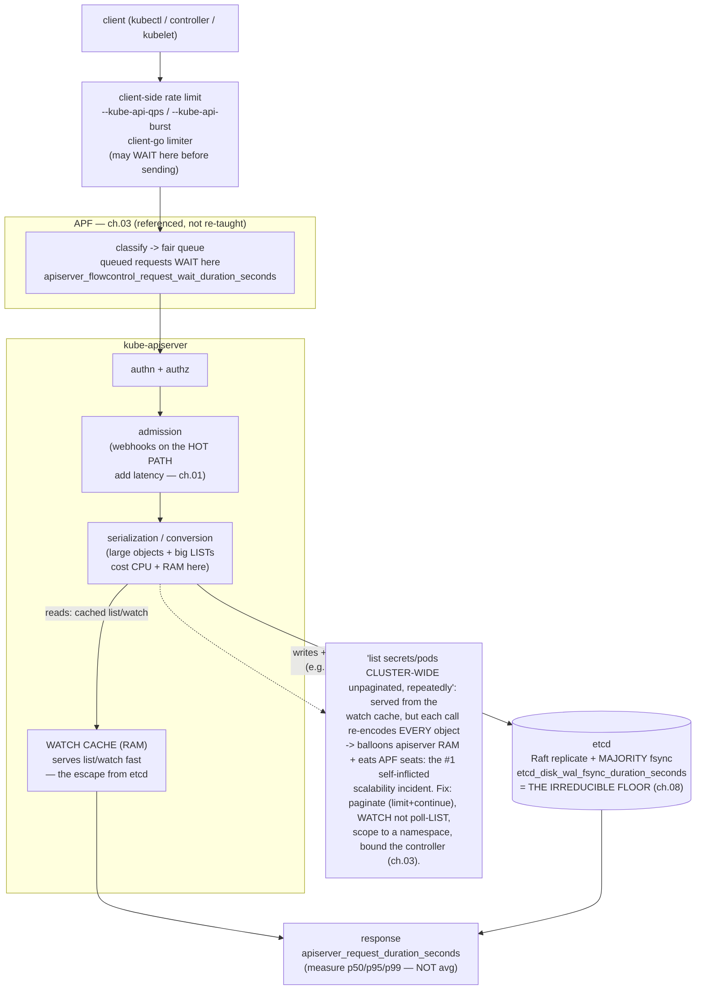

# 09 — Performance and scalability

> Where control-plane latency and limits actually come from, and the numbers
> the project guarantees: the **request path** client→(client qps/burst)→**APF**
> ([ch.03](03-api-priority-and-fairness.md) — referenced, not re-taught)→
> apiserver(authn/authz/admission/**watch cache**)→etcd (**disk fsync latency
> is the floor** — [ch.08](08-ha-control-plane-and-etcd.md)); **apiserver
> tuning** (`--max-requests-inflight`/`--max-mutating-requests-inflight` vs APF,
> the watch cache, audit cost, large-LIST /
> `limit`+`continue` pagination, the "list secrets/configmaps cluster-wide"
> anti-pattern); **etcd performance** (SSD/fsync, `--heartbeat-interval`/
> `--election-timeout`, keyspace size, #objects/watchers); **kubelet/node**
> (`--max-pods`, image GC, PLEG, cgroup v2); **scheduler throughput**
> (`percentageOfNodesToScore`); the official **Kubernetes scalability
> thresholds & SLOs** (≤5000 nodes / ≤150k pods; API
> LIST/WATCH/mutating-latency SLOs) and *why* they exist; **profiling**
> (`/debug/pprof` on apiserver/controller-manager/scheduler,
> `kubectl get --raw`, flamegraphs); **load/scale testing** (kube-burner & clusterloader2 —
> pinned, a SMALL kind-scale run, steady-state/percentiles-not-averages/
> control-vs-treatment methodology); the cost of observability / large objects
> / leader-election churn at scale — applied by scraping the Bookstore
> cluster's apiserver+etcd metrics, a tiny pinned **kube-burner** Bookstore-like
> object run with percentile readout, and reading **apiserver pprof**, honest
> that real limits need real scale.

**Estimated time:** ~60 min read · ~120 min hands-on
**Prerequisites:** [Part 11 ch.03](03-api-priority-and-fairness.md) — APF in the request path · [Part 11 ch.08](08-ha-control-plane-and-etcd.md) — etcd fsync latency as the floor · [Part 06 ch.01](../06-production-readiness/01-observability-metrics.md) — metrics scraping for apiserver+etcd
**You'll know after this:** • trace a request through client qps/burst → APF →
apiserver → etcd · • tune apiserver inflight limits, watch-cache, and audit
cost · • read the official Kubernetes scalability thresholds + SLOs (≤5000
nodes / ≤150k pods) · • profile the apiserver from its control-plane node with
a read-only token · • bound one tenant's object count and LIST cost · • run a
small kube-burner load test and read percentile latencies correctly

**Tier A (kind).** The hands-on runs on a kind cluster that you own, and
section 4 runs a kube-burner load test on it. Run it only against clusters you
own.

<!-- tags: day-2, observability, platform-engineering, slo -->

## Why this exists

[Part 06 ch.01](../06-production-readiness/01-observability-metrics.md) taught
RED/USE for *application* latency; [Part 06
ch.06](../06-production-readiness/06-capacity-and-cost.md) right-sized
*workload* requests; [ch.03](03-api-priority-and-fairness.md) protected the
apiserver's *availability* under a flood; [ch.08](08-ha-control-plane-and-etcd.md)
established that **etcd disk fsync latency is the control plane's floor**. The
question none of them answered: *how big can this cluster get, where does the
latency come from before it gets there, and how do I prove it under load
instead of finding out in production?*

Scalability fails in production in specific, measurable ways:

1. **A latency cliff nobody could explain.** p99 of `kubectl`/controller
   requests climbs from 50 ms to seconds with no obvious cause. It is almost
   always one of a *short* list — etcd disk fsync slowed (the floor moved), a
   client doing huge unpaginated `LIST`s, the watch cache thrashing, or
   admission webhooks on the hot path ([ch.01](01-admission-webhooks.md)). You
   can only debug it if you know the request path's contributors *by name*.
2. **The "list everything" anti-pattern at scale.** A controller or dashboard
   does `LIST secrets`/`LIST pods` **cluster-wide, unpaginated, repeatedly**.
   On a 50-object lab it's invisible; on a 50,000-object cluster each call
   serialises every object through the apiserver and spikes its memory: the
   most common self-inflicted scalability incident. It is also a security
   problem, because a cluster-wide `LIST secrets` returns every Secret's
   bytes to whichever identity holds the grant (threat I2, below).
3. **Hitting an undocumented wall.** A team scales toward 8,000 nodes or
   200,000 pods and the cluster degrades — because they never read that
   Kubernetes **publishes** scalability thresholds (≈5,000 nodes and 150,000
   pods) and **SLOs** (API call latency, pod-startup) that define
   *the envelope it is engineered and tested for*. Past the envelope you are in
   unsupported territory and need to shard into more clusters
   ([ch.06](06-multi-cluster-and-fleet.md)).
4. **"It's fine" measured wrong.** Capacity is judged by an *average* over a
   quiet window, or a single ad-hoc run, so a p99 cliff and a regression
   between releases are both invisible. Performance is **percentiles at steady
   state, control vs treatment** — or it is anecdote.

This chapter makes control-plane performance *legible*: the request path's
latency contributors, the apiserver/etcd/kubelet/scheduler knobs that move
them, the official numbers that bound the whole thing, the profiling that finds
the hot spot, and the load testing (kube-burner / clusterloader2) that proves
it — with the Bookstore cluster as the (honestly small) measurement subject and
a clear line between what a laptop shows and what needs real scale. The
reference is *Production Kubernetes* ch.9 (Observability) & ch.13 (Autoscaling)
and the Kubernetes scalability-SIG thresholds/SLOs.

## Mental model

**Every API request walks a fixed pipeline, and each stage adds latency from a
known cause. The cluster's size limit is whichever resource that pipeline
exhausts first (almost always etcd or apiserver memory). You make it fast by
removing work from the hot path, and you *prove* it with percentiles at steady
state — never averages, never one run.**

- **The request path is the latency budget.** A write/read traverses:
  **client-side rate limit** (`--kube-api-qps`/`-burst`, `client-go` limiter —
  the request may *wait here before it is even sent*) → **APF**
  ([ch.03](03-api-priority-and-fairness.md): classify + fair-queue; queued
  requests wait here) → **apiserver** (authn → authz → **admission**, incl. any
  webhooks on the hot path [ch.01](01-admission-webhooks.md) → **serialization**
  → **watch cache** for reads, or → **etcd** for writes & non-cached reads) →
  **etcd** (Raft replicate + a **majority fsync** — the irreducible floor,
  [ch.08](08-ha-control-plane-and-etcd.md)). Every latency investigation is
  "which stage, and why" — and the metrics name the stages exactly
  (`apiserver_request_duration_seconds`, `etcd_disk_wal_fsync_duration_
  seconds`, `apiserver_flowcontrol_request_wait_duration_seconds`).
- **etcd disk fsync is the floor; the watch cache is the escape from it.**
  Every write blocks on a majority of etcd members fsync'ing to disk
  ([ch.08](08-ha-control-plane-and-etcd.md)) — no apiserver tuning beats a slow
  etcd disk; that is *the* number to protect (`etcd_disk_wal_fsync_duration_
  seconds` p99, read from etcd's own metrics listener). Reads mostly avoid
  etcd via the apiserver's **watch cache** (it serves list/watch from RAM. On
  1.37, consistent LISTs come from the cache too, because the
  `ConsistentListFromCache` gate is gone, and continuation pages use cache
  snapshots behind `ListFromCacheSnapshot`, a beta gate that is on by
  default). That does not make the
  "list everything" pattern cheap: every call still copies, converts and
  encodes the whole result set in apiserver memory, and APF charges it seats
  in proportion to the objects returned, so it balloons apiserver memory and
  crowds out the rest of its priority level.
- **The big knobs, by component.** *apiserver*: `--max-requests-inflight` /
  `--max-mutating-requests-inflight` cap **total** concurrency that **APF then
  subdivides** ([ch.03](03-api-priority-and-fairness.md) — APF is the *unit of
  isolation*, these are the global ceiling); the watch cache, which
  `--watch-cache-sizes` can only disable per resource (`0` turns it off, and
  every other value is equivalent, so it is not a size to tune); **audit**
  logging cost (a verbose policy is real per-request latency); **pagination**
  (`limit` + `continue`). *etcd*:
  SSD/fsync,
  `--heartbeat-interval`/`--election-timeout` vs inter-member RTT, keyspace
  size, # objects & watchers ([ch.08](08-ha-control-plane-and-etcd.md)).
  *kubelet/node*: `--max-pods`, image GC, **PLEG** (pod lifecycle event
  generator) health, cgroup v2. *scheduler*: `percentageOfNodesToScore`
  (score fewer nodes per pod → higher throughput, slightly worse spread).
- **The envelope is published — design inside it.** Kubernetes is engineered
  and continuously tested against explicit **scalability thresholds**
  (per-cluster, *roughly*: **≤5,000 nodes**, **≤150,000 pods**, and at most
  min(110, 10 × cores) pods per node) and **SLOs** that hold *within* that
  envelope: mutating API-call p99 **≤1 s**, read-only single-object or
  resource-scope p99 **≤1 s**, namespace- or cluster-scope reads p99 **≤30 s**,
  and pod-startup p99 **≤5 s** (image already present). Watch propagation is a
  work-in-progress measure with no threshold yet. These are *guarantees of
  the test envelope*, not hard caps, but past them you are unsupported and
  the answer is **more clusters** ([ch.06](06-multi-cluster-and-fleet.md)),
  not a bigger one.
- **Profiling localises; load testing proves.** The apiserver,
  controller-manager and scheduler expose **`/debug/pprof`** (CPU, heap, goroutines). On kubeadm, the scheduler and controller-manager listen only on
  localhost, so pull a profile from the control-plane node with a read-only
  token (section 2) and read a flame graph to find *where the
  time/RAM goes*. **kube-burner** / **clusterloader2** *generate* controlled
  load (create/churn N objects, drive M namespaces) and **measure** the
  pipeline (API latency percentiles, pod-startup, error rate) against the
  SLOs. Profiling answers "why is it slow"; load testing answers "is it within
  SLO at scale, and did this change regress it".
- **Performance is percentiles at steady state, control vs treatment.**
  Averages hide the cliff (an average of 50 ms with a p99 of 4 s is a broken
  cluster). Measure **p50/p95/p99** during **steady state** (after warm-up,
  caches primed, under sustained load — not the transient), and always compare
  a **control** vs a **treatment** (one variable changed) over enough samples.
  A single number from one ad-hoc run is an anecdote, not a measurement.

The trap to keep in view: **most "Kubernetes doesn't scale" is a workload doing
something quadratic to the control plane — not a Kubernetes limit.** The
fix is almost never "tune the apiserver harder"; it is *remove the work*
(paginate, watch instead of poll-LIST, scope LISTs to a namespace, bound the
controller [ch.03](03-api-priority-and-fairness.md)) and *protect the floor*
(fast etcd disk [ch.08](08-ha-control-plane-and-etcd.md)). Tuning knobs help at
the margin; the order of magnitude is in the workload.

## Threats and controls

This chapter adds no threat rows. The Bookstore threat model
(`examples/bookstore/THREAT-MODEL.md`) already names the threats it teaches
against, D3 and I2. Each row below gives the control this chapter teaches:

| Threat | Control taught here | Deeper |
|---|---|---|
| D3: one client starves the apiserver with a bulk `LIST` or a hot loop | Paginated and watch-based reads, scoped to one namespace | [11.03](03-api-priority-and-fairness.md), APF |
| D3, object count: one tenant fills a namespace until every LIST slows | A `ResourceQuota` with `count/` keys | [08.04](../08-day-2-operations/04-multi-tenancy-and-namespaces.md) |
| I2: a broad grant lets one identity `LIST` every Secret | A namespaced Role, so a cluster-wide `LIST secrets` is refused | [05.01](../05-security/01-authn-authz-rbac.md) |

APF bounds how fast one client can use the apiserver. It does not bound how
many objects that client leaves behind. Every object stays in etcd and counts
toward every LIST of its kind, so object count needs its own control. The
threat model names APF as the control for D3. The quota is a second control
that this chapter adds for the same threat. It bounds the total, where APF
bounds the rate. The threat model's D3 row does not list the quota yet, so the
row does not cover it.

A Namespace is cluster-scoped, and no namespace's quota counts it, so who may
create Namespaces is an RBAC decision. Policy checks on that belong to policy
as code ([05.07](../05-security/07-admission-control-and-policy-as-code.md)).

## Diagrams

### Diagram A — request latency contributors: client → APF → apiserver → watch-cache/etcd (Mermaid)



### Diagram B — Kubernetes scalability thresholds & SLO cheat-table (ASCII)

```
 KUBERNETES SCALABILITY ENVELOPE — designed/tested-for, not hard caps ───────

  PER-CLUSTER THRESHOLDS (roughly; the official scalability-SIG numbers)
    nodes            <= 5,000
    pods             <= 150,000        (total)
    pods per node    min(110, 10 x cores)   (kubelet --max-pods default 110)
    services/eps     bounded (large headless / huge EndpointSlices hurt)
  -> WITHIN this envelope the SLOs below hold. PAST it = UNSUPPORTED:
     sub-divide into MORE clusters (ch.06 fleet), not a bigger one.

  SLOs (steady state, within the envelope; p99)
    mutating API call (create/update/delete, per resource)   <= 1 s
    read-only API call, single object or resource scope       <= 1 s
    read-only API call, namespace or cluster scope            <= 30 s
    watch propagation (change visible to watchers)            no SLO yet (WIP)
    pod startup (image already present, excl. image pull)     <= 5 s

  THE LATENCY FLOOR & THE BIG KNOBS (where the time actually goes)
    etcd majority fsync .... etcd_disk_wal_fsync_duration_seconds  <- FLOOR
       protect with: dedicated SSD, low jitter (ch.08). NO apiserver
       tuning beats a slow etcd disk.
    apiserver ........ --max-requests-inflight / --max-mutating-* (TOTAL
       ceiling APF subdivides, ch.03); the watch cache;
       AUDIT policy cost; pagination (limit+continue) vs huge LISTs
    etcd ............. SSD; --heartbeat-interval/--election-timeout vs RTT;
       keyspace size; #objects & #watchers (ch.08)
    kubelet/node ..... --max-pods; image GC; PLEG health; cgroup v2
    scheduler ........ percentageOfNodesToScore (lower => more throughput,
       slightly worse spread)

  MEASURE LIKE THIS (or it's anecdote):
    percentiles (p50/p95/p99) — NEVER averages (avg hides the cliff)
    STEADY STATE — after warm-up/caches primed, under sustained load
    CONTROL vs TREATMENT — one variable, enough samples, repeatable
    profiling (/debug/pprof) localises WHY; kube-burner/clusterloader2
      proves WITHIN-SLO-at-scale and catches regressions
```

## Hands-on with the Bookstore

**Assumed working directory: the guide repo root (`full-guide/`).** This
chapter adds the **new**
[`examples/bookstore/platform/kube-burner-bookstore.yaml`](../examples/bookstore/platform/kube-burner-bookstore.yaml)
(a kube-burner *config*, not a Kubernetes API object — a YAML doc carrier whose
real artefact is the pinned `kube-burner init` command; validated as well-formed
YAML, never `kubectl apply`-ed — same honesty pattern as the kind config in
[ch.08](08-ha-control-plane-and-etcd.md) and the apiserver-level `cluster/`
files). It modifies **no** canonical Bookstore manifest, Helm chart, Kustomize
overlay, the operator, or any other `examples/bookstore/**` file — purely
additive.

We will: (0) the honest laptop-vs-real-scale story; (1) scrape the Bookstore
cluster's **apiserver** request-latency and **etcd** fsync metrics; (2)
profile the **apiserver** from the control-plane node, and show the two routes
that fail; (3) bound the object count of one namespace and what one identity
may read; (4) a **tiny pinned kube-burner** run that creates and deletes
Bookstore-like objects, with the percentile readout; (5) the scalability SLOs
as the yardstick; (6) the "list everything" anti-pattern shown concretely.

> **The honest scale story (read this first).** A single kind node is **~3-4
> orders of magnitude** below the scalability envelope (1 node vs 5,000;
> ~dozens of pods vs 150,000). So **real limits genuinely need real scale** —
> a 5,000-node test is a cloud + clusterloader2 exercise, not a laptop one,
> and that is stated, not faked. What **is** real on kind: the apiserver/etcd
> metrics and their *shape*, `/debug/pprof` flame graphs, and a **small
> kube-burner run** (create/churn a few hundred objects) that exercises the
> *exact same* pipeline and percentile methodology — just at small N. The
> numbers won't be production numbers; the **method** is identical and
> transferable. This is the same established honesty as [ch.08](08-ha-control-plane-and-etcd.md)'s
> "multi-CP kind is real, real HA HW is narrated".

> **What this revision ran, and what it did not.** The lab ran on a kind
> cluster, Kubernetes v1.37.0, with kubectl v1.37.2. Captured here: the
> apiserver and etcd metrics, the apiserver and scheduler profile routes and
> the two refusals they return, the namespace and its object-count quota, the
> RBAC grant and its checks, the kube-burner checksum and version, and the
> apiserver certificate check. Not captured: the quota refusal (the lab's
> controller manager was crash-looping) and the kube-burner pod-latency run
> (the ReplicaSet controller was not creating pods). Section 3 and section 4
> say so where they apply.

### 0. Prerequisites — the Bookstore cluster (a real measurement subject)

Bring up the cluster + Bookstore exactly as in [Part 08 ch.02](../08-day-2-operations/02-backup-and-dr.md)
step 0 (kind, the four `bookstore/*:dev` images, the standard raw-manifests
chain, the migrate Job complete, deployments available). That gives a live
apiserver/etcd to scrape and a real workload to perturb. (kube-burner /
clusterloader2 tooling installs into its **own** namespace / runs as a CLI —
**never** into the PSA-`restricted` `bookstore` namespace; the run creates its
objects in `bookstore-perf`, which section 2 labels `restricted`.)

### 1. Scrape the apiserver & etcd latency metrics (the request path, measured)

The apiserver exposes Prometheus metrics at `/metrics` (the same
endpoint [Part 06 ch.01](../06-production-readiness/01-observability-metrics.md)
scrapes). Read the **request path** directly with `kubectl get --raw`:

```sh
# apiserver request latency — the top-line number. histogram buckets per
# verb/resource; this is what the API-call SLO is measured against:
kubectl get --raw='/metrics' | grep '^apiserver_request_duration_seconds_bucket' \
  | grep -E 'verb="(GET|LIST|POST|PUT|PATCH|DELETE)"' | grep 'resource="pods"' | head
#   apiserver_request_duration_seconds_bucket{...verb="LIST",resource="pods"...,le="0.1"} ...
#   ^ compute p99: the smallest `le` whose cumulative count >= 0.99 * total.
#     (Prometheus: histogram_quantile(0.99, sum by (le,verb,resource)
#      (rate(apiserver_request_duration_seconds_bucket[5m]))) — Part 06 ch.01.)

# etcd disk WAL fsync: THE FLOOR (ch.08). If this is slow, NOTHING the
# apiserver does makes writes fast. etcd serves its own metrics on a localhost
# listener (127.0.0.1:2381 on kubeadm and kind), not on the apiserver's
# /metrics. Run this on the control-plane node:
curl -s http://127.0.0.1:2381/metrics | grep -E '^etcd_disk_wal_fsync_duration_seconds_(count|sum)'
#   The mean fsync time is sum / count. The p99 comes from the _bucket series,
#   read with histogram_quantile. A healthy SSD is well under 10 ms per fsync;
#   tens of milliseconds means a slow disk, and a slow cluster whatever the
#   apiserver is set to (ch.08).

# APF wait time — how long requests QUEUED before dispatch (ch.03, referenced):
kubectl get --raw='/metrics' | grep '^apiserver_flowcontrol_request_wait_duration_seconds_bucket' | grep 'priority_level' | head -3

# watch-cache effectiveness: LISTs served from the cache vs from etcd. 1.37
# no longer exposes apiserver_cache_list_*; the unified metric's storage
# label says which layer served each LIST:
kubectl get --raw='/metrics' | grep '^apiserver_storage_list_total' \
  | head -4                       # one row per resource and storage layer
```

On the lab node, the etcd command returned the two lines below. The lab
cluster has a different name from the one these commands use, and its host
was under heavy load, so the mean here is not a benchmark:

<!-- gate: output -->
```text
etcd_disk_wal_fsync_duration_seconds_sum 0.633285448
etcd_disk_wal_fsync_duration_seconds_count 2
```

The watch-cache query returned its first four rows. The watch cache served
the `configmaps` and `endpoints` lists, and etcd served the other two:

<!-- gate: output -->
```text
apiserver_storage_list_total{group="",index="",resource="apiServerIPInfo",storage="etcd"} 32
apiserver_storage_list_total{group="",index="",resource="configmaps",storage="watchcache"} 40
apiserver_storage_list_total{group="",index="",resource="endpoints",storage="watchcache"} 40
apiserver_storage_list_total{group="",index="",resource="events",storage="etcd"} 82
```

The discipline: read these as **percentiles** (compute from buckets / via
Prometheus `histogram_quantile`), at **steady state**, and **compare** before
vs after a change — never eyeball a single average.

### 2. Profile the apiserver from the control-plane node

Every control-plane component serves Go `pprof` at `/debug/pprof`: CPU, heap
and goroutine profiles, read with `go tool pprof`. A profile also shows
internals such as goroutine stacks, so treat it as a privileged read, and give
the profiling identity one grant: `get` on the debug paths.

Create the namespace for the tooling first. It is labelled `restricted` like
every namespace in this guide, and the tooling never runs in `bookstore`:

```yaml
apiVersion: v1
kind: Namespace
metadata:
  name: bookstore-perf
  labels:
    pod-security.kubernetes.io/enforce: restricted
    pod-security.kubernetes.io/audit: restricted
    pod-security.kubernetes.io/warn: restricted
```

Two obvious routes fail on a kubeadm cluster, and the failures show why. The
first asks the apiserver to proxy the request to the scheduler's secure port.
That port is bound to `127.0.0.1`, so the proxy is refused:

```sh
kubectl get --raw="/api/v1/namespaces/kube-system/pods/https:kube-scheduler-bookstore-control-plane:10259/proxy/debug/pprof/heap"
```

<!-- gate: output -->
```text
Error from server (ServiceUnavailable): error trying to reach service: dial tcp 172.18.0.2:10259: connect: connection refused
```

The second asks the same proxy route for the apiserver's own profile. The
request reaches the apiserver as `system:anonymous`, and RBAC refuses it:

```sh
kubectl get --raw="/api/v1/namespaces/kube-system/pods/https:kube-apiserver-bookstore-control-plane:6443/proxy/debug/pprof/heap"
```

<!-- gate: output -->
```text
Error from server (Forbidden): forbidden: User "system:anonymous" cannot get path "/debug/pprof/heap"
```

Because those components listen on localhost, take the profile on the
control-plane node, with a token from a ServiceAccount that can read only the
debug paths. The three objects below are the whole grant. `nonResourceURLs`
can only be granted through a ClusterRole, so the ClusterRole is cluster-scoped.
It names no resource, no Secret and no `pods/proxy`:

```yaml
apiVersion: v1
kind: ServiceAccount
metadata:
  name: pprof-reader
  namespace: bookstore-perf
automountServiceAccountToken: false
---
apiVersion: rbac.authorization.k8s.io/v1
kind: ClusterRole
metadata:
  name: pprof-reader
rules:
  - nonResourceURLs: ["/debug/pprof/*"]
    verbs: ["get"]
---
apiVersion: rbac.authorization.k8s.io/v1
kind: ClusterRoleBinding
metadata:
  name: pprof-reader
roleRef:
  apiGroup: rbac.authorization.k8s.io
  kind: ClusterRole
  name: pprof-reader
subjects:
  - kind: ServiceAccount
    name: pprof-reader
    namespace: bookstore-perf
```

```sh
kubectl apply -f pprof-reader.yaml
TOKEN=$(kubectl -n bookstore-perf create token pprof-reader --duration=600s)
```

On the control-plane node, with `TOKEN` set in that shell (copy it across, do
not write it to a file), pull a heap profile and read it:

```sh
curl -s --cacert /etc/kubernetes/pki/ca.crt \
  -H "Authorization: Bearer ${TOKEN}" \
  https://127.0.0.1:6443/debug/pprof/heap > apiserver-heap.pprof
go tool pprof -top -nodecount=10 apiserver-heap.pprof
```

The same URL answers differently with and without the token. Without it, the
apiserver refuses the request as `system:anonymous`:

```sh
curl -s -o /dev/null -w '%{http_code}\n' --cacert /etc/kubernetes/pki/ca.crt \
  https://127.0.0.1:6443/debug/pprof/heap
```

<!-- gate: output -->
```text
403
```

With the token, the same URL answers `200`:

```sh
curl -s -o /dev/null -w '%{http_code}\n' --cacert /etc/kubernetes/pki/ca.crt \
  -H "Authorization: Bearer ${TOKEN}" https://127.0.0.1:6443/debug/pprof/heap
```

<!-- gate: output -->
```text
200
```

The top entries of the lab apiserver's heap profile, from `go tool pprof -top`
(the header lines are elided). Most of the top rows are CustomResourceDefinition
schema code, memory the apiserver spends on CRDs:

<!-- gate: output -->
```text
# ...
Showing nodes accounting for 105.95MB, 33.61% of 315.24MB total
Dropped 637 nodes (cum <= 1.58MB)
Showing top 10 nodes out of 437
      flat  flat%   sum%        cum   cum%
   13.51MB  4.28%  4.28%    14.51MB  4.60%  k8s.io/apiextensions-apiserver/pkg/apiserver/schema.(*Structural).ToKubeOpenAPI
   12.71MB  4.03%  8.32%    16.21MB  5.14%  encoding/json.Marshal
   12.51MB  3.97% 12.28%    12.51MB  3.97%  k8s.io/apiextensions-apiserver/pkg/apis/apiextensions/v1.autoConvert_apiextensions_JSONSchemaProps_To_v1_JSONSchemaProps
   11.50MB  3.65% 15.93%    13.01MB  4.13%  k8s.io/apiextensions-apiserver/pkg/apis/apiextensions/v1.(*JSONSchemaProps).Unmarshal
   11.03MB  3.50% 19.43%    11.03MB  3.50%  bytes.Clone
   10.01MB  3.17% 22.61%    12.01MB  3.81%  k8s.io/apiextensions-apiserver/pkg/apiserver/validation.convertMapOfJSONSchemaProps
   10.01MB  3.17% 25.78%    10.01MB  3.17%  reflect.mapassign0
    9.67MB  3.07% 28.85%     9.67MB  3.07%  bytes.growSlice
```

`--cacert` makes curl check the apiserver's serving certificate against the
cluster CA, so the token is never sent to another process that happens to
answer on the port. The scheduler and controller-manager listen on localhost
too, on ports 10259 and 10257. This chapter profiles only the apiserver. A
profile shows where the time and memory go, and the next section makes the load
that makes it useful.

### 3. Bound the object count, and what one identity can read

Two controls keep one tenant from taking the shared apiserver, and they answer
different questions. APF limits how fast a client can send requests
([ch.03](03-api-priority-and-fairness.md)). A `ResourceQuota` limits how many
objects of each kind a namespace may hold. `count/<resource>` names a kind in
the core API group, and `count/<resource>.<group>` names one elsewhere, as the
[quota reference](https://kubernetes.io/docs/concepts/policy/resource-quotas/#quota-on-object-count)
lists them. This quota caps the perf namespace:

```yaml
apiVersion: v1
kind: ResourceQuota
metadata:
  name: object-cap
  namespace: bookstore-perf
spec:
  hard:
    count/configmaps: "20"
    count/deployments.apps: "12"
    count/pods: "20"
```

```sh
kubectl apply -f object-cap.yaml
kubectl -n bookstore-perf get resourcequota object-cap
```

The quota is enforced when an object is created: a create that would take a
count past its `hard` value is refused. The lab run did not capture that
refusal. Its kube-controller-manager was crash-looping, which keeps the
quota's `status.used` current, so the quota showed no usage and all 21
ConfigMap creates were accepted. The refusal is the upstream behaviour, and
this chapter does not demonstrate it here. Check it on a cluster whose
controller manager is healthy before you rely on it. The quota covers only its
own namespace, and a Namespace is cluster-scoped, so the quota cannot limit how
many namespaces a tenant creates. That is an RBAC decision.

The second control is what one identity may read. A broad grant turns one
`LIST` into a read of every Secret, which is threat I2. This Role lets one
ServiceAccount read ConfigMaps in its own namespace and nothing else:

```yaml
apiVersion: v1
kind: ServiceAccount
metadata:
  name: perf-reader
  namespace: bookstore-perf
automountServiceAccountToken: false
---
apiVersion: rbac.authorization.k8s.io/v1
kind: Role
metadata:
  name: configmap-reader
  namespace: bookstore-perf
rules:
  - apiGroups: [""]
    resources: ["configmaps"]
    verbs: ["get", "list"]
---
apiVersion: rbac.authorization.k8s.io/v1
kind: RoleBinding
metadata:
  name: perf-reader
  namespace: bookstore-perf
roleRef:
  apiGroup: rbac.authorization.k8s.io
  kind: Role
  name: configmap-reader
subjects:
  - kind: ServiceAccount
    name: perf-reader
    namespace: bookstore-perf
```

Ask the apiserver what that identity may do, with `--as`:

```sh
kubectl apply -f perf-reader.yaml
kubectl get secrets -A --as=system:serviceaccount:bookstore-perf:perf-reader
kubectl auth can-i list secrets -n bookstore-perf --as=system:serviceaccount:bookstore-perf:perf-reader
kubectl auth can-i list configmaps -n bookstore-perf --as=system:serviceaccount:bookstore-perf:perf-reader
```

The captured lines below come from the lab run, whose namespace was
`p11-09-perf`, so that name appears in the first one. The cluster-wide `LIST` is
refused, and the namespaced reads are allowed:

<!-- gate: output -->
```text
Error from server (Forbidden): secrets is forbidden: User "system:serviceaccount:p11-09-perf:perf-reader" cannot list resource "secrets" in API group "" at the cluster scope
```

`auth can-i list secrets` in that namespace:

<!-- gate: output -->
```text
no
```

`auth can-i list configmaps` in that namespace:

<!-- gate: output -->
```text
yes
```

### 4. A tiny pinned kube-burner run: create and churn, then read percentiles

kube-burner creates a controlled number of objects, churns them, and reports
API and pod-startup percentiles. Install one pinned release, and check it
against the release's published checksums before you run it. Never use a
`releases/latest/` URL: the binary you verify must be the binary you run.

```sh
KUBE_BURNER_VERSION=2.8.7
OS=$(uname | tr '[:upper:]' '[:lower:]')
ARCH=$(uname -m | sed 's/aarch64/arm64/')
ASSET="kube-burner-V${KUBE_BURNER_VERSION}-${OS}-${ARCH}.tar.gz"
BASE="https://github.com/kube-burner/kube-burner/releases/download/v${KUBE_BURNER_VERSION}"
curl -sSLO "${BASE}/${ASSET}"
curl -sSLO "${BASE}/kube-burner-checksums.txt"
grep -F "${ASSET}" kube-burner-checksums.txt | shasum -a 256 -c -
tar -xzf "${ASSET}" -C /tmp kube-burner
/tmp/kube-burner version
```

On the lab Mac, the checksum check passed, and the version command printed:

<!-- gate: output -->
```text
kube-burner-V2.8.7-darwin-arm64.tar.gz: OK
```

<!-- gate: output -->
```text
Version: 2.8.7
Git Commit: 397b2a9fa4d289ac4a630cf0beb6de44299c80b8
Build Date: 2026-10-26T17:14:50Z
Go Version: go1.25.14
```

The workload config and its two templates live in `examples/bookstore/platform`.
Run from there, so the template paths resolve. Apply the namespace from
section 2 first, then run and clean up:

```sh
cd examples/bookstore/platform
/tmp/kube-burner init -c kube-burner-bookstore.yaml --log-level=info
kubectl delete namespace bookstore-perf --ignore-not-found
```

When the run prints its pod-latency summary, read the P99 rows, not the
averages. The `podLatency` measurement uses the same percentile method a
clusterloader2 run uses at scale; only the object count and the cluster change.
Repeat the run with one variable changed, control against treatment, before you
read a difference as real. The pods carry the baseline, and the pause image is
pinned by digest, so every run creates the same pods.

This revision did not capture the pod-latency run. In the lab, the ReplicaSet
controller was not creating pods when the run was attempted, so no percentile
summary was printed. The config and its templates have not been executed
against a cluster here. Run them on a healthy cluster you own before you cite
a number from them.

### 5. The scalability SLOs as the yardstick

The numbers you measure only mean something against the published envelope
(Diagram B). On this one-node cluster every percentile sits far inside the
SLOs, which is expected and proves nothing at scale. The SLOs are the pass/fail
line for a real scale test. A clusterloader2 run at the target size is green
only when mutating API calls and single-resource reads are within 1 s at p99,
namespace-scoped and cluster-scoped reads are within 30 s, pod startup without
an image pull is within 5 s, and node and pod counts stay inside the thresholds.
Watch propagation has no threshold yet, so measure it and report it without a
pass mark. Past the envelope, the engineering answer is to shard into more
clusters ([ch.06](06-multi-cluster-and-fleet.md)), not to push one further. The
[SLO document](https://github.com/kubernetes/community/blob/master/sig-scalability/slos/slos.md)
defines the measurement windows.

### 6. The "list everything" anti-pattern, concretely

The most common self-inflicted scalability incident, shown on the Bookstore
(small here — imagine the object count ×10,000):

```sh
# ANTI-PATTERN: cluster-wide, UNPAGINATED list (a bad dashboard/controller).
# The watch cache serves it (not etcd; default since 1.31), but each call still
# encodes EVERY object into one response, spiking apiserver RAM at scale.
# kubectl pages by default (--chunk-size=500); 0 forces the bad shape:
time kubectl get pods -A -o json --chunk-size=0 >/dev/null  # all pods, no limit

# BETTER: paginate (limit + continue) — bounded memory per call. This is what
# a well-written client/controller does (client-go's pager, informers):
kubectl get pods -A --chunk-size=100 -o name >/dev/null # kubectl's limit+continue
# In a controller: WATCH (informer cache) instead of poll-LIST; scope LISTs to
# a namespace; never `LIST secrets --all-namespaces` on a loop (it also reads
# every Secret's bytes — a security AND a scale problem). Bound the controller
# with its own APF level so a regression is contained (ch.03).
```

The fix is *removing work from the hot path* (paginate, watch, scope), not
tuning the apiserver — exactly the chapter's core claim. Clean up:

```sh
kubectl delete namespace bookstore-perf --ignore-not-found
kind delete cluster --name bookstore
```

## How it works under the hood

- **The apiserver request pipeline is the latency budget, stage by stage.** A
  request is gated by the **client's own rate limiter** first (`client-go`
  QPS/burst — a request can sit here unsent, invisible server-side), then
  classified and possibly **queued by APF** ([ch.03](03-api-priority-and-fairness.md):
  `apiserver_flowcontrol_request_wait_duration_seconds` is *that* wait), then
  authn/authz, then **admission** (each webhook on the path is a synchronous
  network call added to the request — [ch.01](01-admission-webhooks.md)'s
  `timeoutSeconds` is a per-request latency tax), then **serialization** (large
  objects/big LISTs cost CPU + a large allocation here), then either the
  **watch cache** (RAM, fast) or **etcd**. `apiserver_request_duration_
  seconds` is the sum; you decompose it with the per-stage metrics. There is no
  mystery latency — only a stage you haven't measured yet.
- **etcd fsync is the irreducible floor; the watch cache is how reads avoid
  it.** A write returns only after the etcd leader replicated it and a
  **majority fsync'd to disk** ([ch.08](08-ha-control-plane-and-etcd.md)) —
  `etcd_disk_wal_fsync_duration_seconds` is a hard physical lower bound on
  write latency; a slow/jittery etcd disk slows *every* write and no apiserver
  setting compensates. Reads are kept off etcd by the apiserver's **watch
  cache** (it materialises objects from a watch stream and serves
  list/watch from memory at a recent resourceVersion). That now covers
  consistent (quorum) LISTs too: the apiserver asks etcd for its current
  revision, waits for the cache to catch up, then answers from memory (the
  `ConsistentListFromCache` gate no longer exists in 1.37, so this is the
  default path), and continuation pages come from cache snapshots
  (`ListFromCacheSnapshot`, a beta gate that is on by default). So a
  cluster-wide,
  unpaginated `LIST` no longer hammers etcd by default. Its cost moves to the
  apiserver, which allocates, converts and encodes the whole result set on
  every call, and to APF, which charges it seats in proportion to the objects
  it returns: it spikes apiserver RAM and starves its priority level.
- **`--max-*-inflight` vs APF, and where each bites.** `--max-requests-inflight`
  / `--max-mutating-requests-inflight` cap the apiserver's **total** concurrent
  requests; **APF subdivides that total into fair, isolated shares**
  ([ch.03](03-api-priority-and-fairness.md) is the *isolation* layer, these are
  the *global ceiling*). Raising the inflight limits without faster etcd just
  moves the bottleneck onto etcd (more concurrent writes → more fsync
  contention). The watch cache serves reads from memory. `--watch-cache-sizes`
  can only turn it off for one resource (size `0`); every other value is
  equivalent, so there is no size to tune. The cache's memory follows the
  objects it holds. Verbose **audit** policy is
  per-request synchronous work (every request serialised to the audit sink) —
  a real, often-overlooked latency and I/O cost at scale.
- **etcd capacity scales with objects, watchers, and keyspace, not just QPS.**
  Total object count and size set the keyspace and the per-write replication
  cost; the number of **watchers** sets fan-out work on every change; keyspace
  growth interacts with compaction/defrag ([ch.08](08-ha-control-plane-and-etcd.md)).
  `--heartbeat-interval`/`--election-timeout` must match inter-member RTT —
  too tight across AZs causes spurious leader elections (a latency *and*
  availability event); too loose slows failure detection. This is why "how
  many objects" matters more than "how many requests/sec" for sizing.
- **kubelet/node throughput: PLEG, max-pods, image GC, cgroup v2.** Per node,
  the **PLEG** (Pod Lifecycle Event Generator) relists container state to
  generate events; at high pod density its relist period and the container
  runtime's responsiveness bound pod-startup latency (a slow PLEG shows as
  `PLEG is not healthy` and node `NotReady`). `--max-pods` (default 110) caps
  density; **image GC** thresholds (high/low disk %) and **cgroup v2** (more
  accurate, lower-overhead resource accounting) affect node-level latency and
  stability. Node count × pods/node is one axis of the scalability envelope for
  exactly these reasons.
- **Scheduler throughput: `percentageOfNodesToScore`.** For each pending pod
  the scheduler **filters** then **scores** feasible nodes ([Part 00
  ch.04](../00-foundations/04-control-plane-deep-dive.md)). Scoring *every*
  node in a 5,000-node cluster is expensive; `percentageOfNodesToScore` makes
  it score only a sample once enough feasible nodes are found — **higher
  scheduling throughput at slightly worse spread quality**. It is the
  scheduler's primary scale knob and a deliberate latency/quality trade-off,
  the scheduler-side analog of the apiserver's pagination trade-off.
- **Why profiling localises and load testing proves.** `/debug/pprof` exposes
  the Go runtime's CPU/heap/goroutine profiles for the apiserver/
  controller-manager/scheduler; a flame graph shows the *function-level* hot
  spot or allocation source (e.g. serialization of a huge LIST, a controller's
  reflector). That tells you **why**. **kube-burner**/**clusterloader2**
  generate reproducible load and emit the **percentile** measurements
  (API latency, pod-startup, errors) the SLOs are defined in — that tells you
  **whether you're within SLO at size and whether a change regressed it**.
  Profiling without load testing finds a hot spot you can't size; load testing
  without profiling tells you it's slow but not where. Production performance
  work uses both, always at **steady state**, always **control vs treatment**.

## Production notes

> **In production: protect the etcd disk first — it is the floor.** Before any
> apiserver tuning, ensure etcd is on **dedicated, fast, low-jitter SSD** and
> alert on `etcd_disk_wal_fsync_duration_seconds` p99 (and `etcd_disk_backend_commit_duration_seconds`)
> — a slow etcd disk makes every write slow and **no
> apiserver knob fixes it** ([ch.08](08-ha-control-plane-and-etcd.md)). This is
> the single highest-leverage performance action; everything else is margin by
> comparison.

> **In production: remove work from the hot path before tuning knobs.** The
> dominant scale incidents are workload-shaped: **paginate** every large LIST
> (`limit`+`continue`), **watch (informers) not poll-LIST**, **scope LISTs to a
> namespace**, and **never `LIST secrets`/`pods` cluster-wide on a loop**
> (quadratic apiserver load, and an access problem: see I2 above). Give every
> first-party controller its **own bounded APF level** so a regression is
> contained, not cluster-wide ([ch.03](03-api-priority-and-fairness.md)); keep
> **audit policy lean** (verbose audit is per-request latency + I/O). Tuning
> `--max-*-inflight`/watch-cache helps at the margin; the order of magnitude is
> in the workload.

> **In production: design inside the published envelope; shard, don't
> super-size.** Treat ≈**5,000 nodes / 150,000 pods** and
> the API/pod-startup **SLOs** as the engineered, tested envelope. As you
> approach it, the supported answer is **more clusters** ([ch.06](06-multi-cluster-and-fleet.md)'s
> fleet), *not* one bigger cluster — past the envelope you are unsupported and
> on your own for the failure modes. Track cluster size (nodes/pods/objects)
> as a first-class capacity signal ([Part 06
> ch.06](../06-production-readiness/06-capacity-and-cost.md)).

> **In production: measure with percentiles at steady state, control vs
> treatment — and load-test before you scale, not after.** Alert on apiserver
> request p99 (`apiserver_request_duration_seconds`), etcd fsync p99, APF
> rejects/wait ([ch.03](03-api-priority-and-fairness.md)), and scheduling
> latency — **never averages** (they hide the cliff). Run **clusterloader2/
> kube-burner** against the target scale in a staging cluster *before*
> production grows into it, and as a **regression gate** on control-plane/
> controller changes (a new webhook, a CRD with many objects, an operator
> [ch.02](02-operator-development.md) — profile it under load with
> `/debug/pprof`). "It was fine in the small cluster" is not evidence about
> the large one.

> **In production (managed — EKS/GKE/AKS):** the provider sizes/tunes the
> apiserver and etcd and runs them within (often their own, sometimes lower)
> scalability limits — you usually **cannot** set `--max-*-inflight`, etcd
> flags, or pull the apiserver's `/debug/pprof`, and the provider may **cap
> nodes/QPS** below the upstream envelope. What stays yours and matters *more*
> on managed: **client/controller behaviour** (pagination, watch-not-LIST,
> bounded controllers, sane `client-go` QPS), staying within the **provider's
> published limits**, and using the provider's **control-plane metrics**
> (managed apiserver/etcd dashboards) since you can't scrape your own. Your
> workload is still the dominant scale variable on a control plane you don't
> tune.

## Quick Reference

```sh
# The request path, measured (compute PERCENTILES from buckets — Part 06 ch.01)
kubectl get --raw='/metrics' | grep '^apiserver_request_duration_seconds_bucket'
kubectl get --raw='/metrics' | grep '^apiserver_flowcontrol_request_wait_duration_seconds_bucket'
kubectl get --raw='/metrics' | grep '^apiserver_storage_list_total'        # watchcache vs etcd
kubectl get --raw='/metrics' | grep '^apiserver_resource_objects'          # object count per resource
# Prometheus: histogram_quantile(0.99, sum by (le,verb,resource)
#   (rate(apiserver_request_duration_seconds_bucket[5m])))   # p99, not avg

# THE FLOOR: etcd's own listener, on the control-plane node (ch.08)
curl -s http://127.0.0.1:2381/metrics | grep '^etcd_disk_wal_fsync_duration_seconds_bucket'

# Profile the apiserver from the control-plane node, with a read-only token
kubectl -n bookstore-perf create token pprof-reader --duration=600s   # on the workstation
curl -s --cacert /etc/kubernetes/pki/ca.crt -H "Authorization: Bearer ${TOKEN}" \
  https://127.0.0.1:6443/debug/pprof/heap > heap.pprof                # on the node
go tool pprof -top -nodecount=15 heap.pprof     # or: go tool pprof -http=:0 heap.pprof

# Load test: kube-burner 2.8.7, pinned, small on kind; run from examples/bookstore/platform
/tmp/kube-burner init -c kube-burner-bookstore.yaml --log-level=info
# real scale / standardised: clusterloader2 (the project's own harness) on a cloud

# Bound the object count per tenant: count/ keys in a ResourceQuota (08.04)
#   hard: count/configmaps: "20", count/deployments.apps: "12", count/pods: "20"

# Scheduler throughput knob (lower => more throughput, slightly worse spread)
#   KubeSchedulerConfiguration: percentageOfNodesToScore: <N>
```

Scalability envelope + SLO yardstick (the numbers to design inside):

```
THRESHOLDS  nodes<=5000  pods<=150000  pods/node<=min(110, 10*cores)
SLOs (p99)  mutating API <=1s   resource-scoped read <=1s
            namespace/cluster-scoped read <=30s   pod startup (no pull) <=5s
            watch propagation: work in progress, no threshold yet
PAST IT  -> shard into MORE clusters (ch.06), NOT a bigger one (unsupported)
MEASURE  -> percentiles @ steady state, control vs treatment; pprof localises,
            kube-burner/clusterloader2 proves & gates regressions
```

Checklist:

- [ ] **etcd disk is the floor** — dedicated fast SSD, alert
      `etcd_disk_wal_fsync_duration_seconds` p99 before any apiserver tuning
      ([ch.08](08-ha-control-plane-and-etcd.md))
- [ ] Workload off the hot path: **paginate** big LISTs, **watch not
      poll-LIST**, **namespace-scope**, never cluster-wide `LIST secrets/pods`
      on a loop; bounded controllers ([ch.03](03-api-priority-and-fairness.md))
- [ ] Object count bounded per tenant with `count/` keys in a `ResourceQuota`
      ([08.04](../08-day-2-operations/04-multi-tenancy-and-namespaces.md)), and
      RBAC that decides who may create Namespaces
- [ ] apiserver `--max-*-inflight` understood as the **total ceiling APF
      subdivides** ([ch.03](03-api-priority-and-fairness.md)); watch cache on (its
      `--watch-cache-sizes` only disables it per resource, so leave it on);
      **audit policy lean**
- [ ] Design **inside ≈5000 nodes / 150000 pods**, plus the API and
      pod-startup **SLOs**; past the envelope **shard**
      ([ch.06](06-multi-cluster-and-fleet.md)), not super-size
- [ ] Profile with **`/debug/pprof`** from the control-plane node, with a
      read-only token, to localise; `percentageOfNodesToScore` for scheduler
      throughput
- [ ] Load-test with **kube-burner/clusterloader2** (pinned) at target scale
      **before** production grows, and as a **regression gate**
- [ ] Measure **percentiles at steady state, control vs treatment** — never
      averages, never one ad-hoc run

## Test your understanding

> Try each before opening the answer drawer. The act of trying is the
exercise; the answer is the check.

1. **Why is etcd disk fsync latency "the floor" for apiserver write latency?**
   <details><summary>Show answer</summary>

   Every mutating apiserver call ends in `etcdserver.Write` which calls Raft's
   append-entry, which calls disk fsync on the leader plus quorum followers
   before acknowledging. The apiserver cannot return success until that
   round-trip completes. If fsync p99 is 30ms, no amount of apiserver tuning
   brings write latency below 30ms; the floor is the disk. The fix is faster
   storage (local NVMe), not bigger apiserver flags. This is why production
   etcd runs on dedicated low-latency disks, not shared cloud storage.

   </details>

2. **A teammate writes `kubectl get pods --all-namespaces` from a script every
   10s. The cluster has 50,000 Pods. What is the impact on the control plane
   and what's the fix?**
   <details><summary>Show answer</summary>

   Each call reads the full 50k Pods (a large JSON response). The watch cache
   serves it (not an etcd keyspace scan), and kubectl already pages it in
   chunks of 500 (`--chunk-size`), but the apiserver still converts and
   encodes every object every 10s, and APF charges each LIST seats in
   proportion to the objects it returns. With many such clients, the
   apiserver's RAM balloons, GC churns, and
   `apiserver_request_duration_seconds` p99 spikes. Pagination (`limit` +
   `continue`) only bounds each response; the fix is a watch with a
   resourceVersion to receive only deltas. Better: use a SharedInformer /
   client-go cache. Never pull a full snapshot in a loop. This anti-pattern
   is the #1 cause of large-cluster apiserver pressure.

   </details>

3. **You bump `--max-requests-inflight=400` and
   `--max-mutating-requests-inflight=200`, but apiserver still tail-latency
   spikes. What did you miss?**
   <details><summary>Show answer</summary>

   APF is the active limiter; the inflight flags set the total it divides.
   Tuning the legacy flags higher just raises the ceiling; APF still
   partitions traffic per priority level and queues. The real diagnostic is
   `apiserver_flowcontrol_nominal_limit_seats` per level vs
   `apiserver_flowcontrol_current_inqueue_requests` (see
   [ch.03](03-api-priority-and-fairness.md)). Likely the bottleneck is a slow
   admission webhook, a watch-cache miss path, audit logging, or etcd write
   pressure. Always profile (`/debug/pprof`) before tuning concurrency.

   </details>

4. **Hands-on: with `kube-burner` or `clusterloader2`, ramp up 1000 namespaces
   × 10 Deployments × 3 replicas. What do you watch on the control plane?**
   <details><summary>What you should see</summary>

   `apiserver_request_duration_seconds` per verb (POST/PATCH for create, LIST
   for the bootstrap, WATCH for the long-poll).
   `etcd_disk_backend_commit_duration_seconds` and
   `etcd_disk_wal_fsync_duration_seconds`.
   `apiserver_flowcontrol_current_inqueue_requests` for APF queueing.
   `apiserver_resource_objects` by resource: Pods will be 30k, Endpoints will
   be 10k, ReplicaSets 10k. Scheduler
   `scheduler_scheduling_attempt_duration_seconds`. Run two passes: once at
   baseline, once with the change, and compare *percentiles*, not means. If
   anything degrades 2x at the percentile, you've found your regression.

   </details>

5. **A tenant's controller creates ConfigMaps in a loop, at 5 requests per
   second, inside its own APF level. What does APF stop, what does it leave
   open, and what closes the gap?**
   <details><summary>Show answer</summary>

   APF stops the controller from taking more than its share of apiserver
   concurrency, so other clients keep their seats. It does not limit the total.
   Each ConfigMap it creates stays in etcd and counts toward the namespace's
   object total, and every LIST of ConfigMaps in that namespace grows with it.
   A `ResourceQuota` with `count/configmaps` caps the total in that namespace,
   and later creates are refused. The upstream error reads `exceeded quota`,
   which the lab run did not capture (section 3). No namespace's
   quota counts Namespace objects, so who may create Namespaces is an RBAC
   question. See
   [08.04](../08-day-2-operations/04-multi-tenancy-and-namespaces.md)
   for the quota, and the threat table above for the controls.

   </details>

## Further reading

- **Rosso et al., _Production Kubernetes_, ch.9 — "Observability" & ch.13 —
  "Autoscaling"**: instrumenting and reasoning about control-plane/workload
  performance, the metrics that matter, and scaling behaviour under load — the
  operational frame for this chapter's request-path and load-testing model.
- **Ibryam & Huß, _Kubernetes Patterns_ 2e — *Predictable Demands* (ch.2) &
  *Elastic Scale* (ch.29)**: declaring and bounding resource demand and scaling
  as a pattern — the workload-side discipline that keeps a cluster inside its
  scalability envelope (the through-line from [Part 06
  ch.06](../06-production-readiness/06-capacity-and-cost.md)).
- Official: the Kubernetes scalability **thresholds**
  <https://github.com/kubernetes/community/blob/master/sig-scalability/configs-and-limits/thresholds.md>
  and **SLOs**
  <https://github.com/kubernetes/community/blob/master/sig-scalability/slos/slos.md>,
  building large clusters
  <https://kubernetes.io/docs/setup/best-practices/cluster-large/>, profiling
  with pprof <https://kubernetes.io/docs/tasks/debug/debug-cluster/profiling/>,
  and the load-testing tools **clusterloader2**
  <https://github.com/kubernetes/perf-tests/tree/master/clusterloader2> and
  **kube-burner** <https://kube-burner.github.io/kube-burner/>.
