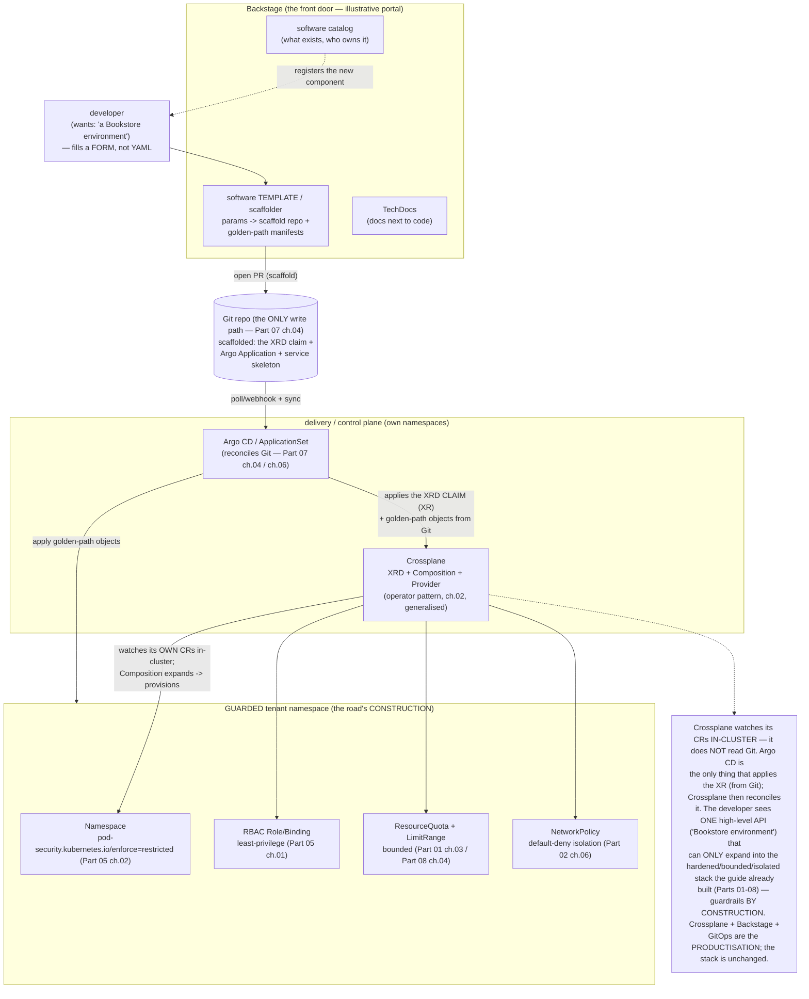

# 10 — Platform engineering

> The internal-developer-platform thesis: dev teams want a **paved road**, not
> raw Kubernetes — platform engineering = productise the cluster (**self-service
> + guardrails**); "platform as a product" / Team Topologies; the **golden
> path**. **Crossplane** as the control-plane-for-infra (`Provider` /
> `ProviderConfig` / **CompositeResourceDefinition (XRD)** / **Composition** /
> **Claim** — and the v2 namespaced-XR model that supersedes the Claim term;
> reconcile-to-target via the Kubernetes API — ties [Part 10](../10-cloud-and-managed-kubernetes/01-managed-kubernetes-model.md)
> cloud-identity + the operator pattern [ch.02](02-operator-development.md));
> **Backstage** (software catalog, **scaffolder / software templates**,
> TechDocs, plugins); **Score** / portable workload spec; the
> self-service-with-guardrails stack = everything the guide already built made
> consumable — PSA-restricted (Part 05) + RBAC (Part 05) + ResourceQuota/
> LimitRange (Part 01/08) + NetworkPolicy (Part 02) + policy (Part 05 ch.03
> Kyverno / [ch.01](01-admission-webhooks.md)) + GitOps (Part 07) +
> ApplicationSet ([ch.06](06-multi-cluster-and-fleet.md)) + the BookstoreTenant
> operator ([ch.02](02-operator-development.md)) — assembled into a "request a
> Bookstore environment" golden path; metrics that matter (DORA / adoption /
> cognitive load); build-vs-buy (Backstage vs commercial IDPs) & "don't build a
> platform nobody asked for" — applied by installing **Crossplane** (pinned
> Helm, own ns) and shipping a tiny **XRD + Composition + Claim** that
> provisions a **guarded namespace** (RBAC + Quota + NetworkPolicy + PSA
> labels) — the paved-road primitive for a Bookstore tenant — plus the
> conceptual Backstage software-template flow, in the new
> [`examples/bookstore/platform/`](../examples/bookstore/platform/) tree.

**Estimated time:** ~60 min read · half-day hands-on
**Prerequisites:** [Part 11 ch.02](02-operator-development.md) — operator pattern Crossplane composes with · [Part 11 ch.06](06-multi-cluster-and-fleet.md) — ApplicationSet delivery for the paved road · [Part 05 ch.03](../05-security/03-supply-chain.md) — Kyverno guardrails inside the paved road
**You'll know after this:** • articulate the "platform as a product" thesis and the golden-path mental model · • author a Crossplane XRD + Composition + Claim that provisions a guarded namespace · • compare Crossplane / Backstage / Score and where each fits the IDP stack · • measure platform success via DORA / adoption / cognitive-load metrics · • decide build-vs-buy between Backstage and commercial IDPs

**Tier A (kind).** The hands-on runs on a disposable kind cluster that you
own. Step 1 installs cluster-scoped controllers, so do not run it on a shared
cluster.

<!-- tags: platform-engineering, crossplane, backstage, gitops, multi-tenancy -->

## Why this exists

Every prior part built a *capability*: [Part 05](../05-security/02-pod-security.md)
hardened workloads (PSA, RBAC, policy); [Part 01 ch.03](../01-core-workloads/03-resources-and-qos.md)/[Part
08 ch.04](../08-day-2-operations/04-multi-tenancy-and-namespaces.md) bounded
them (Quota/LimitRange); [Part 02 ch.06](../02-networking/06-network-policies.md)
isolated them (NetworkPolicy); [Part 07](../07-delivery/04-gitops-argocd.md)
delivered them (GitOps); [ch.02](02-operator-development.md) encoded an
org-specific tenant primitive (the `BookstoreTenant` operator);
[ch.06](06-multi-cluster-and-fleet.md) fanned them across a fleet
(ApplicationSet). [Part 08 ch.04](../08-day-2-operations/04-multi-tenancy-and-namespaces.md)
even ended on the thread: *"namespace + quota + RBAC + NetworkPolicy as a
single declarative thing a tenant can request — that is the platform-
engineering chapter."* This is that chapter, and it is the **synthesis** of the
whole guide: not a new capability, but the *productisation* of every capability
already built.

Platform engineering exists because of a specific, recurring organisational
failure:

1. **Every team re-solves the same Kubernetes.** Without a paved road, each
   product team independently learns PSA, writes RBAC, sets quotas, authors
   NetworkPolicies, wires GitOps, and gets some of it subtly wrong — N teams ×
   the same undifferentiated heavy lifting, N inconsistent (and N
   inconsistently-secure) results. The platform's job is to do it **once,
   correctly, as a self-service product**.
2. **"Raw Kubernetes" is the wrong interface for a product developer.** A
   developer shipping the next Bookstore service should not have to know
   `securityContext`, `ResourceQuota`, `NetworkPolicy`, `Application`, and the
   conversion-webhook story to get an environment. The platform's job is to
   offer a *higher-level interface* ("give me a Bookstore environment") that
   *expands into* all of that, hardened, behind the scenes.
3. **Central ticket-ops doesn't scale; ungoverned self-service is chaos.** A
   platform team that manually provisions every namespace is a bottleneck; a
   free-for-all where anyone can create anything is a security and cost
   incident. Platform engineering is the synthesis: **self-service** (no ticket)
   **with guardrails** (the request can only produce a hardened, bounded,
   policy-compliant result — the [Part 05](../05-security/02-pod-security.md)/[Part
   08 ch.04](../08-day-2-operations/04-multi-tenancy-and-namespaces.md) stack,
   enforced *by construction*).
4. **Platforms built without users.** The opposite failure: a platform team
   builds an elaborate IDP nobody asked for, on assumptions never validated,
   and adoption is zero. "Platform as a product" means **a product** — with
   users, a backlog, adoption metrics, and the discipline to *not* build what
   no team needs.

This chapter is the capstone of Part 11: the **paved road** assembled from
parts the guide already shipped — Crossplane to expose infra/environments as
a custom Kubernetes API, the guardrail stack as what those APIs *produce*,
Backstage as the developer-facing catalog/scaffolder, GitOps as the delivery
spine — with the honest counterweight that *most teams should buy or stay
simple, and a platform nobody asked for is waste*. The reference is *Production
Kubernetes* ch.11 (Building Platform Services) & ch.16 (Platform Abstractions),
*Kubernetes Patterns* ch.27–28 (Controller/Operator), and the Crossplane /
Backstage docs.

## Mental model

**A platform is a product whose interface is a small set of high-level,
self-service APIs ("a Bookstore environment", "a database"), each of which
*expands* — by a controller you configure, not code per request — into the
hardened, bounded, isolated, GitOps-delivered stack the guide already built.
The developer sees the road; the guardrails are the road's construction, not a
gate they negotiate.**

- **Paved road = self-service × guardrails, productised.** The two are *not* in
  tension when the guardrails are *what the self-service API produces*. "Request
  a Bookstore tenant" can *only* yield a namespace that is PSA-`restricted`
  ([Part 05 ch.02](../05-security/02-pod-security.md)), RBAC-scoped ([Part 05
  ch.01](../05-security/01-authn-authz-rbac.md)), Quota/LimitRange-bounded
  ([Part 01 ch.03](../01-core-workloads/03-resources-and-qos.md)/[Part 08
  ch.04](../08-day-2-operations/04-multi-tenancy-and-namespaces.md)),
  NetworkPolicy-isolated ([Part 02
  ch.06](../02-networking/06-network-policies.md)), policy-checked ([Part 05
  ch.03](../05-security/03-supply-chain.md)/[ch.01](01-admission-webhooks.md)),
  and GitOps-reconciled ([Part 07
  ch.04](../07-delivery/04-gitops-argocd.md)) — because the platform *defines
  the expansion*. Guardrails by construction, not by review.
- **Crossplane = a control plane for infra/environments, expressed as your own
  Kubernetes API.** It is the operator pattern ([ch.02](02-operator-development.md))
  generalised to *anything*: a **`Provider`** + **`ProviderConfig`** teach the
  cluster to manage external resources (a cloud, or — via
  *provider-kubernetes* — *in-cluster* objects, tying [Part 10
  ch.03](../10-cloud-and-managed-kubernetes/03-cloud-identity.md)'s cloud
  identity); a **`CompositeResourceDefinition` (XRD)** declares a *new
  high-level API* (e.g. `BookstoreEnvironment`); a **`Composition`** is the
  *recipe* that one XRD instance expands into (the guarded-namespace stack); the
  developer creates an **instance of the XRD** (historically a separate
  **`Claim`**; in **Crossplane v2** the XR is itself namespaced and you create
  it directly — the Claim term is legacy, [How it works](#how-it-works-under-the-hood)),
  and Crossplane **continuously reconciles** the real objects to it.
- **Backstage = the developer's front door (catalog + scaffolder + docs).** The
  **software catalog** is the inventory of everything ("which services exist,
  who owns them"); the **scaffolder / software templates** turn "I want a new
  Bookstore service" into a *parameterised* action that **scaffolds a repo +
  the golden-path manifests (the XRD claim, the Argo `Application`) and opens a
  PR** — the developer fills a form, the platform's template materialises the
  paved road; **TechDocs** keeps docs next to code; **plugins** surface CI/CD,
  cost, k8s state in one pane.
- **Score (and the portable-spec idea).** A developer writes a workload **once**
  in a platform-agnostic spec; the platform *translates* it to the concrete
  target (Kubernetes manifests, a Compose file). It is the same "high-level
  intent → platform expands it" principle as Crossplane/Backstage, applied to
  the *workload* rather than the *environment*.
- **The platform IS the guide's stack, assembled.** Nothing here is a new
  primitive: PSA + RBAC + Quota/LimitRange + NetworkPolicy + Kyverno/webhooks +
  GitOps + ApplicationSet + the `BookstoreTenant` operator — each built in an
  earlier Part — composed into one self-service request. Platform engineering
  is *integration and productisation discipline*, not new Kubernetes.
- **A platform is a product: measure it, and don't build what nobody asked
  for.** Success is **adoption** (are teams using the road?), **DORA**
  (deploy frequency, lead time, change-fail rate, MTTR — does the road make
  delivery better?), and **cognitive load** (Team Topologies: does it *reduce*
  what a product team must know?). The dominant failure is a platform built on
  unvalidated assumptions: build-vs-buy is real (Backstage and commercial IDPs
  are heavy), and the right amount of platform is often **less** than a
  platform team wants to build.

The trap to keep in view: **a platform that adds a layer without removing
cognitive load is negative value — it is one more thing to learn on top of
Kubernetes, not instead of it.** The paved road only pays off if the high-level
API genuinely hides the guardrail stack (the developer does *not* now also
debug Crossplane Compositions and Backstage templates). Build the *narrowest*
golden path real teams asked for, buy/stay-simple where you can, and treat
adoption as the only proof it worked — exactly the [ch.02](02-operator-development.md)
"build only your own domain logic, and run it like a product" discipline,
scaled to the whole developer interface.

## Threats and controls

The golden path is itself a control, so its threats are about the identity that
does the writing and about the request a developer can make. Most of the
guardrails it expands into are inherited from earlier parts, and this chapter
does not repeat them. The tenant namespaces follow
[01.01](../01-core-workloads/01-pods.md#baseline),
[05.02](../05-security/02-pod-security.md) and
[02.06](../02-networking/06-network-policies.md), through the Composition.
Crossplane's own pods run under the chart's restricted values, and the provider
and function pods run under the runtime config in step 1. The namespaces that
hold those controllers get no default-deny NetworkPolicy in this chapter. The
controllers reach the API server and the package registry, and a default-deny
policy for them needs egress allows that this chapter does not work out. That
gap is named here, not hidden.

| Threat | Control in this chapter | Deeper |
|---|---|---|
| E10: the provider's ServiceAccount holds more rights than the recipe needs, so a compromised provider, or a bad change to the recipe, reaches objects in every namespace | RBAC named to the kinds the recipe writes, the `bind` verb on the built-in `view` ClusterRole and nothing else, no `cluster-admin` binding, and Crossplane's RBAC manager turned off. By default the manager binds the provider to whatever its package asks for, which for provider-kubernetes includes Secrets in every namespace. A requester Role limited to the request namespace | Step 4 checks the boundary; [05.01](../05-security/01-authn-authz-rbac.md) for RBAC; 05.07 <!-- link-later: 05.07 --> for the admission policy that pins names and label changes |
| A request names a tenant that is another tenant's namespace | The XRD's CEL rule requires `spec.tenant` to equal the request's name. All requests share one namespace, so names are unique there. Not exercised in this revision: the rule is in the schema the API server checks on create | Step 2 shows the rule; the residual is under the table |

RBAC cannot restrict `create` or `update` to a name pattern, and namespaces are
cluster-scoped. So the provider keeps cluster-wide `create`, `update`, `patch`
and `delete` on namespaces, and cluster-wide writes on its ResourceQuota,
LimitRange, NetworkPolicy and RoleBinding kinds. That residual is named here,
not hidden. The update and patch verbs carry the larger risk. A compromised
provider, or a bad edit to the recipe, could relabel any namespace, for example
set `pod-security.kubernetes.io/enforce=privileged` on `bookstore` or
`kube-system`. Cluster-wide patch and delete on NetworkPolicy and RoleBinding
can also remove a default-deny policy or a tenant's access. The recipe bounds
only what it creates: the `bookstore-tenant-` prefix is fixed in the
Composition. Nothing in the recipe bounds an update to a namespace that already
exists. The admission policy that must close this, denying changes to
`pod-security.kubernetes.io/*` labels by the provider's ServiceAccount, belongs
with policy as code in 05.07 <!-- link-later: 05.07 -->.

Requests share the `platform-tenants` namespace and one group, and the tenant
name is free text. The CEL rule ties `spec.tenant` to the request's name, so a
request in that namespace cannot target another tenant's namespace. A second
request namespace, with its own role, would need the same rule to hold across
namespaces, and this chapter grants only one. The recipe does not set
`managementPolicies` on its Objects, so the Crossplane default applies to them,
and this chapter does not narrow it.

## Diagrams

### Diagram A — the paved road: developer → Backstage template → Git → GitOps/Crossplane → guarded cluster (Mermaid)



### Diagram B — platform capability stack: guardrails ↔ self-service, mapped to the Part that built each (ASCII)

```
 THE PAVED ROAD = the guide's stack, PRODUCTISED (nothing new — assembled) ──

  SELF-SERVICE FACE (what the developer touches)
   Backstage software template / catalog ......... this chapter (illustrative)
   ONE high-level API: "a Bookstore environment" .. XRD claim (this chapter)
        |  expands (Crossplane Composition; operator pattern = ch.02) into:
        v
  GUARDRAILS BY CONSTRUCTION (what the request can ONLY produce)
   ┌──────────────────────────────────────────────────────────────────────┐
   │ PSA enforce=restricted ............... Part 05 ch.02 (pod security)   │
   │ RBAC Role/RoleBinding (least-priv) ... Part 05 ch.01 (authn/authz)    │
   │ ResourceQuota + LimitRange ........... Part 01 ch.03 / Part 08 ch.04  │
   │ NetworkPolicy (default-deny) ......... Part 02 ch.06 (segmentation)   │
   │ Policy (Kyverno / adm. webhook) ...... Part 05 ch.03 / ch.01          │
   │ BookstoreTenant operator (optional) .. ch.02 (org tenant primitive)   │
   └──────────────────────────────────────────────────────────────────────┘
        |  delivered & kept-true by:
        v
  DELIVERY SPINE
   GitOps (the only write path) .......... Part 07 ch.04 (Argo CD)
   ApplicationSet (fan-out to a fleet) ... ch.06 (multi-cluster)
        |  provisioned/reconciled by:
        v
  CONTROL PLANE FOR INFRA/ENVIRONMENTS
   Crossplane Provider/ProviderConfig .... this chapter (+ Part 10 ch.03
     XRD / Composition / Claim(=v2 XR)        cloud identity for cloud infra)

  MEASURE IT (it's a PRODUCT, not a project):
   adoption (teams ON the road?) · DORA (deploy freq / lead time / CFR /
   MTTR) · cognitive load (Team Topologies — did it REDUCE what a product
   team must know?).  Build-vs-buy is real; a platform nobody asked for = 0.
```

## Hands-on with the Bookstore

**Assumed working directory: the guide repo root (`full-guide/`).** The steps
add the platform's own artefacts,
[`crossplane-xrd.yaml`](../examples/bookstore/platform/crossplane-xrd.yaml),
[`crossplane-composition.yaml`](../examples/bookstore/platform/crossplane-composition.yaml),
[`bookstore-env-claim.yaml`](../examples/bookstore/platform/bookstore-env-claim.yaml)
and the Backstage carrier
[`backstage-template.yaml`](../examples/bookstore/platform/backstage-template.yaml).
They change no canonical Bookstore manifest, chart, overlay, operator or
`argocd/`, `operators/` or `multicluster/` tree.

**Tier A (kind).** Run these steps only against a disposable kind cluster that
you own. Step 1 installs cluster-scoped controllers and CRDs, and step 4 adds a
ClusterRole and a binding. Do not run them against a shared cluster.

> **What this revision ran, and what it did not.** The lab ran on a kind
> cluster, Kubernetes v1.37.0, with kubectl v1.37.2 and Helm v4.1.4. The
> captured blocks are real output: the restricted dry run of the chart, the
> Crossplane install, the provider and the function reaching Healthy, and the
> provider's rights checked by impersonation. The first install ran with
> Crossplane's RBAC manager on, and the captured check shows what that grants.
> The XRD and the Composition applied. The XRD never reported status conditions
> and the claim never reconciled in the window, because the shared lab's
> apiserver was restarting. So the tenant namespace, quota, RoleBinding and
> NetworkPolicy are described from the Composition, and are not shown running.
> The Backstage portal is illustrative and was not run. The output came from a
> lab cluster with a different name from the one these commands use.

### 0. Prerequisites: a cluster (the golden path provisions INTO it)

A kind cluster is enough. The golden path provisions objects in the cluster
through provider-kubernetes, so no cloud account is needed for the namespace
primitive. Provisioning cloud infrastructure would add a cloud `Provider` and a
cloud identity from [Part 10 ch.03](../10-cloud-and-managed-kubernetes/03-cloud-identity.md),
which this chapter does not run. The Bookstore app need not be running. To
deploy a tenant into the provisioned namespace afterwards, bring it up with the
[Part 08 ch.02](../08-day-2-operations/02-backup-and-dr.md) step 0 chain:

```sh
kind delete cluster --name bookstore 2>/dev/null || true
kind create cluster --name bookstore
kubectl cluster-info
```

### 1. Install Crossplane at the restricted level

Crossplane runs controller pods, so it gets its own namespace, and the label
goes on before the install. The chart's pods run as non-root, but its container
security values default to no `capabilities.drop`, so `restricted` refuses
them. Two values maps, `securityContextCrossplane` and
`securityContextRBACManager`, take a free-form container `securityContext`, and
the commands below set them. First check the chart against the label with a
dry run. It renders the chart and sends it to the API server, which creates
nothing:

```sh
kubectl create namespace crossplane-probe
kubectl label namespace crossplane-probe \
  pod-security.kubernetes.io/enforce=restricted \
  pod-security.kubernetes.io/audit=restricted \
  pod-security.kubernetes.io/warn=restricted
helm repo add crossplane-stable https://charts.crossplane.io/stable
helm repo update crossplane-stable
helm template crossplane crossplane-stable/crossplane --version 2.4.3 \
  --namespace crossplane-probe \
  --set-json 'podSecurityContextCrossplane={"runAsNonRoot":true,"seccompProfile":{"type":"RuntimeDefault"}}' \
  --set-json 'podSecurityContextRBACManager={"runAsNonRoot":true,"seccompProfile":{"type":"RuntimeDefault"}}' \
  --set-json 'securityContextCrossplane={"runAsUser":65532,"runAsGroup":65532,"allowPrivilegeEscalation":false,"readOnlyRootFilesystem":true,"capabilities":{"drop":["ALL"]}}' \
  --set-json 'securityContextRBACManager={"runAsUser":65532,"runAsGroup":65532,"allowPrivilegeEscalation":false,"readOnlyRootFilesystem":true,"capabilities":{"drop":["ALL"]}}' \
  | kubectl apply --dry-run=server -f - 2>&1 | grep -E '^Warning|^deployment|^Error'
kubectl delete namespace crossplane-probe
```

<!-- gate: output -->

```text
deployment.apps/crossplane created (server dry run)
deployment.apps/crossplane-rbac-manager created (server dry run)
```

The dry run prints no `Warning` line, so the namespace takes `restricted` at
enforce, audit and warn, and the registry needs no exception for it. The probe
renders the RBAC manager, which the chart enables by default. The install below
turns it off, for the reason in the next paragraph.

Crossplane's RBAC manager gives each provider the rights its package asks for.
For provider-kubernetes, that request includes Secrets, ConfigMaps, events and
leases in every namespace. The first lab install ran with the manager on, and
the rights check in step 4 answered `yes` to `get secrets -A` for the
provider. The install below turns the manager off, so the only binding for the
provider is the one this chapter writes:

```sh
kubectl apply -f - <<'EOF'
apiVersion: v1
kind: Namespace
metadata:
  name: crossplane-system
  labels:
    pod-security.kubernetes.io/enforce: restricted
    pod-security.kubernetes.io/audit: restricted
    pod-security.kubernetes.io/warn: restricted
EOF
helm install crossplane crossplane-stable/crossplane \
  --namespace crossplane-system --version 2.4.3 --wait \
  --set rbacManager.deploy=false \
  --set-json 'podSecurityContextCrossplane={"runAsNonRoot":true,"seccompProfile":{"type":"RuntimeDefault"}}' \
  --set-json 'podSecurityContextRBACManager={"runAsNonRoot":true,"seccompProfile":{"type":"RuntimeDefault"}}' \
  --set-json 'securityContextCrossplane={"runAsUser":65532,"runAsGroup":65532,"allowPrivilegeEscalation":false,"readOnlyRootFilesystem":true,"capabilities":{"drop":["ALL"]}}' \
  --set-json 'securityContextRBACManager={"runAsUser":65532,"runAsGroup":65532,"allowPrivilegeEscalation":false,"readOnlyRootFilesystem":true,"capabilities":{"drop":["ALL"]}}'
```

Crossplane creates the provider and the function pods itself. A
`DeploymentRuntimeConfig` gives them the baseline. The container name
`package-runtime` is the runtime container Crossplane gives each package.
`runAsUser` is set to a number because the function image's user is named
`nonroot`, and the kubelet cannot verify a user name as non-root. The UID 65532
is the one the chart's own pods run as. The volume gives `/tmp` a writable
path, as in [01.01's baseline](../01-core-workloads/01-pods.md#baseline).
`serviceAccountTemplate` fixes the provider's ServiceAccount name. Without it,
each new provider revision gets a new ServiceAccount, and a bump of the pinned
version would leave the binding in step 1 pointing at the old one.

```sh
kubectl apply -f - <<'EOF'
apiVersion: pkg.crossplane.io/v1beta1
kind: DeploymentRuntimeConfig
metadata:
  name: bookstore-paved-road
spec:
  serviceAccountTemplate:
    metadata:
      name: bookstore-paved-road
  deploymentTemplate:
    spec:
      selector: {}
      template:
        spec:
          securityContext:
            runAsNonRoot: true
            runAsUser: 65532
            runAsGroup: 65532
            seccompProfile:
              type: RuntimeDefault
          containers:
            - name: package-runtime
              securityContext:
                allowPrivilegeEscalation: false
                readOnlyRootFilesystem: true
                capabilities:
                  drop: ["ALL"]
              volumeMounts:
                - name: tmp
                  mountPath: /tmp
          volumes:
            - name: tmp
              emptyDir: {}
EOF
```

The Provider and the Function take no pod template of their own. They
run under the runtime config above, and the step waits for both to be
Healthy.

```sh
kubectl apply -f - <<'EOF'
apiVersion: pkg.crossplane.io/v1
kind: Provider
metadata:
  name: provider-kubernetes
spec:
  # v1.4.1 is the newest release of the provider's repository at the time of
  # writing. Pin it, and bump it on purpose.
  package: xpkg.crossplane.io/crossplane-contrib/provider-kubernetes:v1.4.1
  runtimeConfigRef:
    name: bookstore-paved-road
---
apiVersion: pkg.crossplane.io/v1
kind: Function
metadata:
  name: function-patch-and-transform
spec:
  package: xpkg.crossplane.io/crossplane-contrib/function-patch-and-transform:v0.11.2
  runtimeConfigRef:
    name: bookstore-paved-road
EOF
kubectl wait --for=condition=Healthy provider/provider-kubernetes --timeout=300s
kubectl wait --for=condition=Healthy function/function-patch-and-transform --timeout=300s
```

<!-- gate: output -->

```text
provider.pkg.crossplane.io/provider-kubernetes condition met
# ...
function.pkg.crossplane.io/function-patch-and-transform condition met
```

The order matters. The Function and the Provider must be Healthy before the
Composition in step 2 is applied, or its pipeline never runs and the request
never reconciles.

The provider's ServiceAccount needs rights on the objects the recipe writes,
and on Crossplane's own managed-resource kinds. The provider-kubernetes README
shows an in-cluster setup that binds the provider to `cluster-admin`. This
chapter does not take that step. One ClusterRole names the kinds the recipe
writes, the managed-resource kinds, and the `bind` verb on the built-in `view`
ClusterRole. It has no Secrets:

```sh
kubectl apply -f - <<'EOF'
apiVersion: rbac.authorization.k8s.io/v1
kind: ClusterRole
metadata:
  name: bookstore-paved-road
rules:
  # Namespaces are cluster-scoped, so these verbs apply to every namespace.
  # RBAC cannot restrict create by name, so the name check is a policy
  # (05.07 names the gap).
  - apiGroups: [""]
    resources: ["namespaces", "resourcequotas", "limitranges"]
    verbs: ["get", "list", "watch", "create", "update", "patch", "delete"]
  - apiGroups: ["networking.k8s.io"]
    resources: ["networkpolicies"]
    verbs: ["get", "list", "watch", "create", "update", "patch", "delete"]
  - apiGroups: ["rbac.authorization.k8s.io"]
    resources: ["rolebindings"]
    verbs: ["get", "list", "watch", "create", "update", "patch", "delete"]
  # `bind` on one named ClusterRole: the provider may bind `view` in a tenant
  # namespace without holding every permission `view` grants.
  - apiGroups: ["rbac.authorization.k8s.io"]
    resources: ["clusterroles"]
    resourceNames: ["view"]
    verbs: ["bind"]
  # Crossplane's own managed resources: the Object kinds and their
  # ProviderConfig usage records. No Secrets and no ConfigMaps here.
  - apiGroups: ["kubernetes.m.crossplane.io", "kubernetes.crossplane.io"]
    resources:
      - objects
      - objects/status
      - observedobjectcollections
      - observedobjectcollections/status
      - providerconfigs
      - providerconfigs/status
      - providerconfigusages
      - providerconfigusages/status
    verbs: ["get", "list", "watch", "update", "patch", "create"]
  - apiGroups: ["kubernetes.m.crossplane.io", "kubernetes.crossplane.io"]
    resources: ["*/finalizers"]
    verbs: ["update"]
  # Read-only: the provider checks each kind's scope before it watches it.
  - apiGroups: ["apiextensions.k8s.io"]
    resources: ["customresourcedefinitions"]
    verbs: ["get", "list", "watch"]
EOF
kubectl create clusterrolebinding bookstore-paved-road \
  --clusterrole=bookstore-paved-road \
  --serviceaccount=crossplane-system:bookstore-paved-road
```

Step 4 checks what this binding allows.

### 2. The API and the recipe: the XRD and the Composition

Before Crossplane is installed, the API server has no such kinds, and the
dry run fails. These are the captured results, from the lab, before step 1:

```sh
kubectl apply --dry-run=server -f examples/bookstore/platform/crossplane-xrd.yaml
kubectl apply --dry-run=server -f examples/bookstore/platform/crossplane-composition.yaml
kubectl apply --dry-run=server -f examples/bookstore/platform/bookstore-env-claim.yaml
```

<!-- gate: output -->

```text
error: resource mapping not found for name: "bookstoreenvironments.platform.bookstore.example.com" namespace: "" from "examples/bookstore/platform/crossplane-xrd.yaml": no matches for kind "CompositeResourceDefinition" in version "apiextensions.crossplane.io/v2"
ensure CRDs are installed first
```

<!-- gate: output -->

```text
error: resource mapping not found for name: "bookstore-guarded-namespace" namespace: "" from "examples/bookstore/platform/crossplane-composition.yaml": no matches for kind "Composition" in version "apiextensions.crossplane.io/v1"
ensure CRDs are installed first
```

<!-- gate: output -->

```text
error: resource mapping not found for name: "acme" namespace: "platform-tenants" from "examples/bookstore/platform/bookstore-env-claim.yaml": no matches for kind "BookstoreEnvironment" in version "platform.bookstore.example.com/v1alpha1"
ensure CRDs are installed first
```

That is the expected result, and it is the same as for any CRD-backed object in
this guide. After step 1 the dry run succeeds, and the XRD becomes a served API.
Crossplane creates the CRD from the XRD asynchronously, so the reader waits for
the CRD to exist before waiting for it to be Established:

```sh
kubectl apply -f examples/bookstore/platform/crossplane-xrd.yaml
until kubectl get crd bookstoreenvironments.platform.bookstore.example.com \
  >/dev/null 2>&1; do sleep 2; done
kubectl wait --for=condition=Established \
  crd/bookstoreenvironments.platform.bookstore.example.com --timeout=120s
kubectl apply -f examples/bookstore/platform/crossplane-composition.yaml
```

In the lab run, the XRD had not reported any status condition within the
window. The composite controller could not start its watch while the apiserver
restarted, so the Composition was applied but did not run. The rest of this
step describes what the Composition does. It is not shown running in this
revision.

The XRD in [`crossplane-xrd.yaml`](../examples/bookstore/platform/crossplane-xrd.yaml)
declares the API `BookstoreEnvironment`, in the Crossplane v2 model. Its scope
defaults to `Namespaced`, so the developer creates the request directly in a
namespace. The schema has one field, `tenant`. A CEL rule on the schema
requires `spec.tenant` to equal the request's name, so the tenant name and the
request name cannot diverge. Nothing about securityContext, RBAC, quota or
NetworkPolicy is in the request.

The Composition is the recipe. It turns one `BookstoreEnvironment` into five
objects, each wrapped in a namespaced `kubernetes.m.crossplane.io` Object in the
request namespace:

- a Namespace labelled `restricted` at enforce, audit and warn,
- a RoleBinding that gives the tenant group the built-in `view` ClusterRole,
- a ResourceQuota and a LimitRange,
- a default-deny NetworkPolicy.

A namespaced composite resource can compose only into its own namespace, so the
namespaced Object is the one that fits. The cluster-scoped
`kubernetes.crossplane.io` Object is the older form, and this chapter does not
use it. The recipe binds `view` instead of writing a Role of its own. A provider
that creates a Role must already hold every permission the Role grants, or the
API server refuses the create. `view` is read-only and carries no Secrets, and
step 4 checks both.

### 3. The request namespace and the requester's rights

Claims live in a request namespace. This one is labelled `restricted` because it
runs no pods. The ProviderConfig tells the namespaced Objects to use the
provider's own identity, so no credentials are stored. The Role lets one group
create and manage claims here, and nothing else. The claim itself is applied in
step 4, after the checks.

```sh
kubectl apply -f - <<'EOF'
apiVersion: v1
kind: Namespace
metadata:
  name: platform-tenants
  labels:
    pod-security.kubernetes.io/enforce: restricted
    pod-security.kubernetes.io/audit: restricted
    pod-security.kubernetes.io/warn: restricted
---
apiVersion: kubernetes.m.crossplane.io/v1alpha1
kind: ProviderConfig
metadata:
  name: default
  namespace: platform-tenants
spec:
  credentials:
    source: InjectedIdentity
---
apiVersion: rbac.authorization.k8s.io/v1
kind: Role
metadata:
  name: bookstore-environment-requester
  namespace: platform-tenants
rules:
  - apiGroups: ["platform.bookstore.example.com"]
    resources: ["bookstoreenvironments"]
    verbs: ["get", "list", "watch", "create", "update", "patch", "delete"]
---
apiVersion: rbac.authorization.k8s.io/v1
kind: RoleBinding
metadata:
  name: bookstore-environment-requester
  namespace: platform-tenants
roleRef:
  apiGroup: rbac.authorization.k8s.io
  kind: Role
  name: bookstore-environment-requester
subjects:
  - kind: Group
    apiGroup: rbac.authorization.k8s.io
    # placeholder: map this to the requesting team's group in your IdP
    name: bookstore-platform-requesters
EOF
```

### 4. Prove what the provider and the requester can do

These checks ask the API server about permissions, so they create nothing. Run
them after step 1, against the real provider ServiceAccount, and before the
claim is applied. Set `PROVIDER` first:

```sh
PROVIDER="system:serviceaccount:crossplane-system:bookstore-paved-road"
kubectl auth can-i create namespaces --as="$PROVIDER"
kubectl auth can-i delete namespaces --as="$PROVIDER"
kubectl auth can-i get secrets -A --as="$PROVIDER"
kubectl auth can-i create clusterrolebindings --as="$PROVIDER"
kubectl auth can-i create roles -A --as="$PROVIDER"
kubectl auth can-i create deployments -A --as="$PROVIDER"
kubectl auth can-i create rolebindings -A --as="$PROVIDER"
kubectl auth can-i bind clusterrole/view --as="$PROVIDER"
kubectl auth can-i bind clusterrole/cluster-admin --as="$PROVIDER"
```

<!-- gate: output -->

```text
Warning: resource 'namespaces' is not namespace scoped
yes
# ...
Warning: resource 'namespaces' is not namespace scoped
yes
# ...
no
# ...
Warning: resource 'clusterrolebindings' is not namespace scoped in group 'rbac.authorization.k8s.io'
no
# ...
no
# ...
no
# ...
yes
# ...
Warning: resource 'clusterroles' is not namespace scoped in group 'rbac.authorization.k8s.io'
yes
# ...
Warning: resource 'clusterroles' is not namespace scoped in group 'rbac.authorization.k8s.io'
no
```

The warnings are part of the output. `kubectl auth can-i` prints them for
cluster-scoped kinds, and they do not change the answer. The `get secrets -A` answer is the one that changed. On the first
install, with the RBAC manager on, it answered `yes`. The manager's grant gave
the provider Secrets in every namespace. After the manager was turned off and
the ClusterRole above was applied, it answers `no`.

The provider may create and delete namespaces, and may write RoleBindings. It
may bind `view`, and it may not bind `cluster-admin`. It cannot read Secrets
anywhere, and it cannot create ClusterRoleBindings, Roles or Deployments.

Next, the requester check. `kubectl auth can-i` maps the resource name through
the server's discovery. When the server does not serve the kind yet, it prints
a warning, drops the group, and answers about a different resource, so its `no`
is for the wrong reason. The lab run showed this for `bookstoreenvironments`
before the XRD existed. A SubjectAccessReview asks the server the same question
with the group and the resource given, so its answer is right either way. The
first answer should be `true`, for a claim in the request namespace, and the
other two `false`, for the `default` namespace and for a Secret:

```sh
echo '{"apiVersion":"authorization.k8s.io/v1","kind":"SubjectAccessReview","spec":{"user":"tenant-dev","groups":["bookstore-platform-requesters"],"resourceAttributes":{"namespace":"platform-tenants","verb":"create","group":"platform.bookstore.example.com","resource":"bookstoreenvironments"}}}' | kubectl create -o jsonpath='{.status.allowed}{"\n"}' -f -
echo '{"apiVersion":"authorization.k8s.io/v1","kind":"SubjectAccessReview","spec":{"user":"tenant-dev","groups":["bookstore-platform-requesters"],"resourceAttributes":{"namespace":"default","verb":"create","group":"platform.bookstore.example.com","resource":"bookstoreenvironments"}}}' | kubectl create -o jsonpath='{.status.allowed}{"\n"}' -f -
echo '{"apiVersion":"authorization.k8s.io/v1","kind":"SubjectAccessReview","spec":{"user":"tenant-dev","groups":["bookstore-platform-requesters"],"resourceAttributes":{"namespace":"platform-tenants","verb":"get","resource":"secrets"}}}' | kubectl create -o jsonpath='{.status.allowed}{"\n"}' -f -
```

<!-- gate: output -->

```text
true
false
false
```

Only now apply the claim. The Composition creates the tenant namespace from the
claim's name, so the tenant checks need the reconciled namespace:

```sh
kubectl apply -f examples/bookstore/platform/bookstore-env-claim.yaml
kubectl get bookstoreenvironment acme -n platform-tenants
```

Expected output, illustrative and not captured in this revision. Once the
claim reconciles, the status shows:

```text
NAME    SYNCED   READY
acme    True     True
```

Crossplane then creates the five objects, and the tenant namespace appears with
`pod-security.kubernetes.io/enforce=restricted` on it. The objects are owned by
the claim, so deleting the claim deletes them.

Once the namespace exists, a developer in the tenant's group can read its pods
and cannot read its Secrets or create workloads. These answer `yes` only when
the Composition's RoleBinding exists in `bookstore-tenant-acme`, so run them
after the claim reconciles. Expected, illustrative and not captured here:
`yes`, `no`, `no`, `no`.

```sh
kubectl auth can-i get pods -n bookstore-tenant-acme --as=tenant-dev --as-group=bookstore-tenant-acme
kubectl auth can-i get secrets -n bookstore-tenant-acme --as=tenant-dev --as-group=bookstore-tenant-acme
kubectl auth can-i create deployments -n bookstore-tenant-acme --as=tenant-dev --as-group=bookstore-tenant-acme
kubectl auth can-i get pods -n default --as=tenant-dev --as-group=bookstore-tenant-acme
```

### 5. Backstage: the developer's front door (illustrative)

Backstage turns "I want a new Bookstore service on the golden path" into a
form. [`backstage-template.yaml`](../examples/bookstore/platform/backstage-template.yaml)
is a real Backstage `Template` (`scaffolder.backstage.io/v1beta3`) with a
`catalog-info` sketch. It declares form parameters and steps that fetch a
skeleton, render the golden-path manifests (the `BookstoreEnvironment` claim
and an Argo `Application`), and open a pull request. Delivery then runs through
the same GitOps path as [Part 07 ch.04](../07-delivery/04-gitops-argocd.md).
The template is a Backstage catalog object, not a Kubernetes object, so it is
checked as YAML only and never applied:

```sh
python3 -c 'import yaml; list(yaml.safe_load_all(open("examples/bookstore/platform/backstage-template.yaml"))); print("backstage-template.yaml: valid YAML (Backstage Template, not a k8s object)")'
```

The full portal is a Node app with a database, auth and plugins, and it is
heavy. Its value here is the template and catalog model, so this chapter does
not install it. The portal chart is `backstage/backstage`, version 2.10.2,
checked with `helm show chart`. A real install belongs in a namespace labelled
`restricted` first, with the chart's security values set.

The conceptual flow, end to end: the developer picks the "Bookstore service
(golden path)" template and fills in `name` and `owner`. Backstage scaffolds a
repository with the service skeleton, the `BookstoreEnvironment` claim and the
Argo `Application`, and opens a pull request. The merge is reconciled by Argo
CD, Crossplane provisions the guarded namespace, and the new component appears
in the catalog. Backstage never applies anything to the cluster. It commits to
Git, and Git is still the only write path.

### 6. Where the operator and ApplicationSet plug into the same road

The golden path composes with what earlier chapters built, on the same road:

- The `BookstoreTenant` operator ([ch.02](02-operator-development.md)) can be
  the Composition's output. Instead of writing RBAC and quota objects directly,
  the recipe creates one `BookstoreTenant` and lets that operator reconcile the
  slice. The operator is the org-specific logic, and Crossplane is the
  composition and API layer.
- ApplicationSet ([ch.06](06-multi-cluster-and-fleet.md)) delivers the
  scaffolded repository to every fleet cluster from one object. The
  scaffolder's pull request lands in Git, and the ApplicationSet reconciles it
  per cluster.
- Policy is the backstop. Even if a hand-written object tried to create a
  non-restricted workload in a tenant namespace, Pod Security admission would
  refuse it ([Part 05 ch.02](../05-security/02-pod-security.md)). A
  ValidatingAdmissionPolicy that pins the namespace names the provider may
  create is the control this chapter leaves for
  05.07 <!-- link-later: 05.07 -->. It closes the gap that step 4 shows.

### 7. Clean up

Delete the claim first, so Crossplane removes the composed objects and the
tenant namespace, then remove the platform objects and the packages. The CRDs
that Crossplane installed stay after `helm uninstall`, so delete them too:

```sh
kubectl delete -f examples/bookstore/platform/bookstore-env-claim.yaml --ignore-not-found
kubectl delete -f examples/bookstore/platform/crossplane-composition.yaml --ignore-not-found
kubectl delete -f examples/bookstore/platform/crossplane-xrd.yaml --ignore-not-found
kubectl delete namespace platform-tenants --ignore-not-found
kubectl delete clusterrolebinding bookstore-paved-road --ignore-not-found
kubectl delete clusterrole bookstore-paved-road --ignore-not-found
kubectl delete function function-patch-and-transform --ignore-not-found
kubectl delete provider provider-kubernetes --ignore-not-found
kubectl delete deploymentruntimeconfig bookstore-paved-road --ignore-not-found
helm uninstall crossplane -n crossplane-system
kubectl delete namespace crossplane-system --ignore-not-found
kubectl get crd -o name | grep 'crossplane.io' | xargs kubectl delete
kind delete cluster --name bookstore        # also removes everything above
```


## How it works under the hood

- **Crossplane is the operator pattern ([ch.02](02-operator-development.md))
  generalised into a composition engine.** A **`Provider`** is a packaged
  controller (an OCI package via `pkg.crossplane.io`) that teaches the cluster
  to manage a class of resources — a cloud's, or *in-cluster* objects
  (provider-kubernetes); a **`ProviderConfig`** supplies its credentials/
  identity (here `InjectedIdentity` = the provider's own ServiceAccount, the
  in-cluster analog of [Part 10
  ch.03](../10-cloud-and-managed-kubernetes/03-cloud-identity.md)'s workload
  identity). A **`CompositeResourceDefinition` (XRD)** *creates a new CRD* (a
  new high-level API the apiserver then serves like any built-in — that is why
  the claim dry-runs `no matches` until the XRD is installed). A
  **`Composition`** is the reconcile *recipe*: given one XR, a pipeline of
  **functions** (the current model — `function-patch-and-transform` etc.)
  renders the set of managed/provider resources and Crossplane's controllers
  drive the world to match, **continuously** (level-triggered, idempotent — the
  *identical* loop semantics as [ch.02](02-operator-development.md)/[Part 00
  ch.06](../00-foundations/06-declarative-api-model.md), which is why a deleted
  child is healed back).
- **XR vs Claim — and why v2 changes the term.** In Crossplane **v1**, an XRD
  defaulted to *cluster-scoped* (`scope: LegacyCluster`) and you defined
  **`claimNames`**: a developer created a *namespaced* **Claim** which Crossplane
  bound to a cluster-scoped **Composite Resource (XR)** — Claim = the
  namespaced developer handle, XR = the cluster-scoped real thing. In
  **Crossplane v2** (`apiextensions.crossplane.io/v2`) the XR is itself
  **`scope: Namespaced`** and you create it **directly** in a namespace — the
  separate Claim is **legacy** (still supported via `scope: LegacyCluster` +
  `claimNames` for back-compat). This guide teaches the **v2 namespaced-XR
  model** (current, better isolation, simpler) and names the legacy Claim so
  the term — and older clusters/tutorials — make sense. Either way the
  developer-facing object is a small, namespaced, RBAC-scopable API; the
  guardrail expansion is identical.
- **Guardrails by construction = the Composition is the only producer.** The
  developer's RBAC lets them create a `BookstoreEnvironment` (2 fields) and
  *nothing else* in that path; only Crossplane's provider ServiceAccount (the
  ClusterRole in step 1, scoped to the kinds the recipe emits, plus `bind`
  on `view`, see [Part 05 ch.01](../05-security/01-authn-authz-rbac.md)) can
  create the namespace/RBAC/quota/NetworkPolicy. So a tenant *cannot* produce an
  un-restricted, unbounded, un-isolated environment — not because a reviewer
  caught it, but because the only path from their API to real objects is the
  Composition, which always emits the hardened stack. This is the structural
  difference between "guardrails as policy you might violate" and "guardrails as
  the construction itself"; PSA/Kyverno ([Part 05 ch.02](../05-security/02-pod-security.md)/[Part
  05 ch.03](../05-security/03-supply-chain.md)) then sit *behind* it as the
  admission backstop — defense in depth.
- **Backstage is a catalog + a templating/scaffolding engine, not a control
  plane.** The **catalog** ingests `catalog-info.yaml` entities (Component/
  System/API/Resource/Group) into a graph — the inventory and ownership map. A
  **`Template`** (`scaffolder.backstage.io`) declares input **parameters** (a
  JSON-schema form) and ordered **steps** (`fetch:template` a skeleton →
  `publish:github`/open a PR → `catalog:register`). Crucially Backstage does
  **not** apply anything to the cluster — its scaffolder **commits to Git**, and
  **GitOps** ([Part 07 ch.04](../07-delivery/04-gitops-argocd.md)) +
  **Crossplane** do the actual provisioning. So Backstage is the *front door
  and inventory*; the *write path is still Git*; the *expansion* is still
  Crossplane/Argo — clean separation, each layer doing one job.
- **Score / portable spec is intent-translation, same principle one layer
  down.** A developer writes a single `score.yaml` (containers, resources,
  dependencies — platform-agnostic); a platform implementation (`score-compose`,
  `score-k8s`) *translates* it to the concrete target (a Compose file, or
  Kubernetes manifests fed into *this* golden path). It is the Crossplane idea
  (high-level intent → controller expands it) applied to the **workload**
  rather than the **environment** — and it composes: Score for the *what*, the
  XRD/Composition for the *where it runs*, GitOps for *how it ships*.
- **"Platform as a product" is an operating model, and it has failure modes.**
  Team Topologies frames the platform team as a **platform team** offering a
  product to **stream-aligned** (product) teams; the product's job is to
  **reduce their cognitive load**. The measurable signals are **adoption** (a
  golden path nobody walks is dead weight), **DORA** (does the road improve
  deploy frequency / lead time / change-fail rate / MTTR?), and explicitly
  **cognitive load** (did the abstraction *remove* Kubernetes detail, or *add*
  Crossplane+Backstage detail on top?). The dominant anti-pattern — an elaborate
  IDP built on unvalidated assumptions — is why build-vs-buy is real (Backstage
  and commercial IDPs are months of work to operate) and why the right answer
  is frequently *less platform*, bought or kept simple, validated against real
  team demand — the [ch.02](02-operator-development.md) "build only your own
  domain, run it like a product, don't build what nobody asked for" rule, scaled
  to the entire developer interface.

## Production notes

> **In production: the golden path must make guardrails the *construction*, not
> a gate — and keep a policy backstop.** The whole value is that a self-service
> request can *only* yield the hardened/bounded/isolated stack ([Part 05](../05-security/02-pod-security.md)/[Part
> 01 ch.03](../01-core-workloads/03-resources-and-qos.md)/[Part 02
> ch.06](../02-networking/06-network-policies.md)/[Part 08
> ch.04](../08-day-2-operations/04-multi-tenancy-and-namespaces.md)) — enforced
> by the Composition being the *only* producer (least-privilege provider RBAC),
> with **PSA + Kyverno/VAP** ([Part 05 ch.02](../05-security/02-pod-security.md)/[Part
> 05 ch.03](../05-security/03-supply-chain.md)/[ch.01](01-admission-webhooks.md))
> as the admission backstop behind it. Guardrails a developer can negotiate
> around are not guardrails; defense in depth (constructed *and* enforced) is.

> **In production: deliver the platform through GitOps; Crossplane/Backstage do
> not bypass it.** Backstage's scaffolder **commits to Git**; Argo CD/
> ApplicationSet ([Part 07 ch.04](../07-delivery/04-gitops-argocd.md)/[ch.06](06-multi-cluster-and-fleet.md))
> reconcile; Crossplane provisions from declared state. Nothing in the platform
> should hold cluster credentials or `kubectl apply` out of band — the platform
> *inherits* the [Part 07 ch.04](../07-delivery/04-gitops-argocd.md) trust
> boundary (Git is the only write path), and Crossplane's providers must use
> scoped identity ([Part 10 ch.03](../10-cloud-and-managed-kubernetes/03-cloud-identity.md)),
> never broad static credentials. Run Crossplane/Backstage **in their own
> namespaces**, pinned (chart + provider versions), monitored like any
> production component ([ch.02](02-operator-development.md)).

> **In production: operate Crossplane Compositions like the production software
> they are.** An XRD is a **cluster-wide API contract** and a Composition is
> reconcile logic teams depend on — version XRDs deliberately (additive,
> defaulted fields; never break a served version — the [ch.02](02-operator-development.md)
> CRD-versioning discipline applies *identically*), test Compositions
> (`crossplane composition render`, piped into `crossplane resource validate`,
> in CI), pin every Provider
> package, scope provider RBAC to exactly what the recipe emits, and roll
> Composition changes progressively (a bad Composition is a fleet-wide blast
> radius — the same care as a bad operator [ch.02](02-operator-development.md)
> or a bad ApplicationSet [ch.06](06-multi-cluster-and-fleet.md)).

> **In production: it is a product — measure adoption/DORA/cognitive load, and
> don't build what nobody asked for.** Track **adoption** (teams actually on
> the golden path), **DORA** (deploy frequency, lead time, change-fail rate,
> MTTR — does the road *improve* delivery?), and **cognitive load** (did the
> abstraction remove Kubernetes detail or add platform detail?). Start with the
> **narrowest** path real teams requested; **buy** (a commercial IDP) or
> **stay simple** (GitOps + a couple of golden-path templates, *no* full
> Backstage) when that beats building — a Backstage portal is months to operate.
> A platform with no users is the most expensive way to add cognitive load.

> **In production (managed — EKS/GKE/AKS):** providers ship platform building
> blocks — **EKS Blueprints / GKE Enterprise (Config Controller is hosted
> Crossplane) / AKS + Azure Service Operator**, plus managed Argo/fleet
> ([ch.06](06-multi-cluster-and-fleet.md)) and managed databases ([Part 08
> ch.02](../08-day-2-operations/02-backup-and-dr.md)). The **golden-path model
> is portable** (an XRD/Composition + a Backstage template + GitOps); the
> *infra provider*, *fleet/identity mechanism*, and *managed data tier* are
> provider-specific. Prefer the provider's hosted control-plane/identity
> primitives over self-operating Crossplane where they fit, and reserve a
> self-built platform for the org-specific abstractions ([ch.02](02-operator-development.md))
> no provider ships.

## Quick Reference

```sh
# Crossplane: its own namespace, at the restricted level (no registry entry)
kubectl apply -f - <<'EOF'
apiVersion: v1
kind: Namespace
metadata:
  name: crossplane-system
  labels:
    pod-security.kubernetes.io/enforce: restricted
    pod-security.kubernetes.io/audit: restricted
    pod-security.kubernetes.io/warn: restricted
EOF
helm repo add crossplane-stable https://charts.crossplane.io/stable && helm repo update
helm install crossplane crossplane-stable/crossplane -n crossplane-system \
  --version 2.4.3 --wait --set rbacManager.deploy=false \
  --set-json 'podSecurityContextCrossplane={"runAsNonRoot":true,"seccompProfile":{"type":"RuntimeDefault"}}' \
  --set-json 'podSecurityContextRBACManager={"runAsNonRoot":true,"seccompProfile":{"type":"RuntimeDefault"}}' \
  --set-json 'securityContextCrossplane={"runAsUser":65532,"runAsGroup":65532,"allowPrivilegeEscalation":false,"readOnlyRootFilesystem":true,"capabilities":{"drop":["ALL"]}}' \
  --set-json 'securityContextRBACManager={"runAsUser":65532,"runAsGroup":65532,"allowPrivilegeEscalation":false,"readOnlyRootFilesystem":true,"capabilities":{"drop":["ALL"]}}'
# Step 1 also applies the DeploymentRuntimeConfig, the Provider and the Function.
# Wait for both packages before anything else:
kubectl wait --for=condition=Healthy provider/provider-kubernetes --timeout=300s
kubectl wait --for=condition=Healthy function/function-patch-and-transform --timeout=300s

# The golden path, in this order: XRD -> Composition -> request namespace ->
# claim. The Function and Provider must be Healthy before the Composition.
kubectl apply -f examples/bookstore/platform/crossplane-xrd.yaml
kubectl apply -f examples/bookstore/platform/crossplane-composition.yaml
kubectl apply -f examples/bookstore/platform/bookstore-env-claim.yaml
kubectl get bookstoreenvironment -n platform-tenants           # SYNCED / READY
kubectl get rolebinding,resourcequota,limitrange,networkpolicy \
  -n bookstore-tenant-acme

# Provider rights, checked without changing anything
PROVIDER="system:serviceaccount:crossplane-system:bookstore-paved-road"
kubectl auth can-i bind clusterrole/cluster-admin --as="$PROVIDER"   # no
kubectl auth can-i get secrets -A --as="$PROVIDER"                  # no

# Backstage: the Template is the lesson; the portal is not installed here
```

Minimal skeletons are not repeated here. The full manifests are in the steps
above and in [`examples/bookstore/platform/`](../examples/bookstore/platform/).

Checklist:

- [ ] Golden path = **self-service API** (XRD claim) whose **only** expansion
      is the guide's hardened, bounded and isolated stack: guardrails **by
      construction**, with admission as the backstop
- [ ] Crossplane in its own namespace at the **restricted** level, with the
      chart's container and pod values set, and no registry exception
- [ ] Provider and function pods under a DeploymentRuntimeConfig that carries
      the baseline and fixes the provider's ServiceAccount name
- [ ] Crossplane's RBAC manager off (`rbacManager.deploy=false`), so the
      provider holds only the binding this chapter writes
- [ ] Provider rights: only the kinds the recipe writes and Crossplane's own
      managed-resource kinds, `bind` on `view` alone, no Secrets, no
      `cluster-admin` binding; checked with `kubectl auth can-i --as`
- [ ] Requester rights limited to the request namespace
- [ ] Composed objects are **namespaced** `kubernetes.m.crossplane.io` Objects
      in the XR's namespace; pinned chart and provider versions
- [ ] Delivered via **GitOps** ([Part 07
      ch.04](../07-delivery/04-gitops-argocd.md)/[ch.06](06-multi-cluster-and-fleet.md));
      composes with the **`BookstoreTenant` operator**
      ([ch.02](02-operator-development.md)) and **ApplicationSet**
- [ ] XRD/Composition versioned and tested like production software: additive
      schema, `crossplane composition render` in CI, progressive rollout
      ([ch.02](02-operator-development.md) discipline)
- [ ] It is a **product**: measure **adoption / DORA / cognitive load**; build
      the **narrowest** path real teams asked for
- [ ] Every Crossplane CR carries the documented **CRD-intrinsic dry-run**
      note; the Backstage `Template` is a YAML-valid **non-k8s carrier**

## Test your understanding

> Try each before opening the answer drawer. The act of trying is the exercise; the answer is the check.

1. **What is the difference between Crossplane and a Terraform module that provisions the same RDS instance?**
   <details><summary>Show answer</summary>

   Terraform is *imperative-from-plan*: you run `terraform apply` and the engine reconciles once. Crossplane is *continuous reconciliation* — the `Provider` controller watches the cloud resource and drifts it back if someone changes it via the console, like a Deployment controller for cloud infra. Crossplane also stores the desired state as Kubernetes objects, so RBAC, GitOps, and the same controller patterns apply uniformly. Terraform wins for bootstrapping the cluster (you need *something* to make the cluster before Crossplane can run). Crossplane wins for day-2 self-service inside the cluster.

   </details>

2. **A developer needs an S3 bucket. The platform team built a `BookstoreTenant` XRD that creates a namespace + RBAC + Postgres + quota — but no S3 bucket. How does the developer get a bucket, and what's the trade-off in extending the XRD vs adding a separate `Bucket` claim?**
   <details><summary>Show answer</summary>

   Two options: (a) **Extend the XRD** to include an optional `spec.buckets[]` field — Composition adds an S3 `Bucket` Composite Resource per declared bucket. Pros: single declarative tenant manifest. Cons: every change to the XRD requires versioned migration, more coupling. (b) **Add a separate XRD `BookstoreBucket`** — developers create both objects independently. Pros: smaller blast radius per change, easier to evolve. Cons: developers must compose them themselves. The platform-engineering discipline: extend the XRD when the resource is *always* needed; add a separate claim when it's optional. The Backstage scaffolder template can render both shapes from one developer-facing form.

   </details>

3. **The "platform as a product" framing means measuring adoption. What three metrics would you track?**
   <details><summary>Show answer</summary>

   (1) **Adoption**: number of teams/services using the golden path vs going around it (e.g. `kubectl apply -f` vs Backstage scaffolder; `BookstoreTenant` count). (2) **DORA**: deployment frequency, lead time, change-failure rate, MTTR — does the platform make these better than self-managed teams? (3) **Cognitive load**: developer survey + support-ticket volume per service-team — is the platform reducing the burden of running Kubernetes, or has it just moved the burden? A platform that nobody adopts is failing regardless of how clever the architecture is.

   </details>

4. **Hands-on: write a Crossplane XRD `BookstoreTenant` with one field `spec.tier: free|premium`. Author a Composition that creates Namespace + ResourceQuota where `premium` gets 4 CPU and `free` gets 1 CPU. Apply two tenants, one of each tier. What does drift detection look like if you `kubectl edit` the ResourceQuota directly?**
   <details><summary>What you should see</summary>

   Crossplane reconciles the ResourceQuota back to what the Composition declared — your `kubectl edit` change is reverted within seconds. The reconciler reads the XR's `spec.tier`, renders the desired ResourceQuota, and patches the live object back. This is "infrastructure has a controller now" — drift is rejected without a CI bot. The only way to change the quota is to change the tier (or the Composition logic), which is what the platform team intended.

   </details>

5. **When is platform engineering the wrong choice for an organisation?**
   <details><summary>Show answer</summary>

   When (a) the engineering org is small enough that one cluster + a shared README is cheaper than building and maintaining XRDs + Backstage; (b) the workloads are too heterogeneous for a golden path to be useful (every service is bespoke); (c) the platform team can't sustain investment — a half-built platform is worse than no platform because it adds an abstraction that breaks. The signal that platform engineering is *right*: multiple service teams asking for the same thing repeatedly (Postgres + bucket + namespace + RBAC), with enough scale that one-off provisioning is the constraint. Don't build a platform nobody asked for.

   </details>

6. **The recipe cannot make a namespace outside the `bookstore-tenant-` prefix,
   because the Composition adds the prefix. What can still create one, and which
   control closes that gap?**
   <details><summary>Show answer</summary>

   A hand-written object, or a later edit to the Composition, can. The
   provider's ServiceAccount may create any namespace, and RBAC cannot restrict
   `create` to a name pattern, so the prefix is only a convention in the recipe.
   A ValidatingAdmissionPolicy that matches requests from that ServiceAccount and
   allows only names with the prefix closes it. It belongs with policy as code,
   in 05.07 <!-- link-later: 05.07 -->.

   </details>

## Further reading

- **Rosso et al., _Production Kubernetes_, ch.11 — "Building Platform Services"
  & ch.16 — "Platform Abstractions"**: the internal-platform thesis, the
  build-vs-buy boundary, golden paths, and abstractions over raw Kubernetes —
  the backbone of this chapter (paired with ch.12 "Multitenancy" for the
  guardrail/isolation framing the paved road productises).
- **Ibryam & Huß, _Kubernetes Patterns_ 2e — *Controller* (ch.27) & *Operator*
  (ch.28)**: the reconcile-loop pattern Crossplane generalises into a
  composition control plane — read here as "operational knowledge as a
  *composable, self-service API*", the producer-side discipline from
  [ch.02](02-operator-development.md) scaled to the platform.
- Official: Crossplane docs <https://docs.crossplane.io/> (Composite Resource
  Definitions, Compositions, Providers; the v2 namespaced-XR model and the
  legacy Claim), provider-kubernetes
  <https://github.com/crossplane-contrib/provider-kubernetes>, Backstage
  <https://backstage.io/docs/overview/what-is-backstage> (software catalog &
  the scaffolder/software templates), and Score <https://docs.score.dev/>;
  Team Topologies / "platform as a product"
  <https://teamtopologies.com/>.
- Crossplane v2.4 docs: composite resource definitions (the namespaced
  scope and what a namespaced composite may compose), the command
  reference (`crossplane composition render`, `crossplane resource
  validate`), and runtime configs for provider and function pods:
  <https://docs.crossplane.io/latest/composition/composite-resource-definitions/>,
  <https://docs.crossplane.io/latest/cli/command-reference/>.
- provider-kubernetes README, including the in-cluster RBAC step this
  chapter does not copy: <https://github.com/crossplane-contrib/provider-kubernetes>.
- Kubernetes RBAC: escalation prevention, the `bind` verb, and why
  `create` cannot be limited by resource name:
  <https://kubernetes.io/docs/reference/access-authn-authz/rbac/>.
