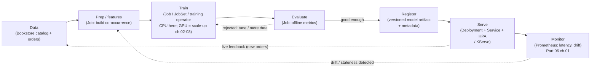

# 01 — Why ML on Kubernetes

> The ML workload taxonomy (interactive notebooks, batch **training**,
> hyperparameter tuning, batch inference, online **serving**,
> **pipelines/orchestration**) and how each maps to the Kubernetes primitives
> the guide already built; **why** Kubernetes for ML (uniform
> scheduling/packaging/scaling/multi-tenancy/reproducibility/cost vs. bespoke ML
> infra); the **MLOps loop** (data → train → evaluate → register → serve →
> monitor → retrain) as the spine of Part 12; what is genuinely *different* from
> the stateless web app the guide built so far (GPUs as scarce countable
> resources, gang/all-or-nothing scheduling, long jobs & checkpointing, data
> gravity, determinism, the $$$ cost profile); a one-paragraph map of the
> players (Kubeflow, Ray, KServe, Kueue/Volcano) — applied by introducing the
> Bookstore **recommendations** use case and the new
> [`examples/bookstore/ml/`](../examples/bookstore/ml/README.md) thread.

**Estimated time:** ~30 min read · short hands-on on a kind cluster
**Prerequisites:** [Part 01 ch.01](../01-core-workloads/01-pods.md) — Pod baseline ML workloads extend · [Part 06 ch.06](../06-production-readiness/06-capacity-and-cost.md) — cost framing this part deepens for GPUs
**You'll know after this:** • map each ML workload (notebook / train / tune / serve / pipeline) onto a K8s primitive · • articulate why Kubernetes is the unifying ML substrate (vs bespoke ML infra) · • describe the MLOps loop (data → train → register → serve → monitor → retrain) · • name what is structurally different about ML (GPUs as countable, gang scheduling, data gravity) · • name the ML-specific threats and the Part 12 chapter that owns each · • place Kubeflow / Ray / KServe / Kueue / Volcano on a one-page map

**Tier A (kind).** The hands-on runs on a kind cluster. Run it only against
a cluster you own.

<!-- tags: ml, mental-model, foundations -->

## Why this exists

The earlier Parts of this guide made the Bookstore a **stateless-ish web
system**: Deployments that scale on CPU, a StatefulSet for Postgres, Jobs for
migrations, all hardened to PSA `restricted`, delivered by GitOps. That is the
overwhelmingly common Kubernetes workload — and it is *not* what a machine
learning system looks like.

An ML system has a different center of gravity. Its expensive, long-running
work is a **training job** that may run for hours on a **GPU** — a resource the
scheduler must treat as a *scarce, countable, non-overcommittable* device, not
the elastic CPU/memory the guide has used everywhere. Its serving path looks
like a Deployment but with a multi-gigabyte model artifact, a warm-up cost, and
autoscaling driven by a queue or token rate rather than CPU. Between them sits a
**pipeline** — data prep → train → evaluate → register → deploy → monitor →
*retrain* — that is itself a graph of Jobs with data dependencies. And the
people running it want exactly what platform teams always want: to not buy and
babysit a second, bespoke "ML cluster" when they already operate Kubernetes.

This chapter is the **map of Part 12**. It classifies the ML workload types,
shows that each one maps onto a Kubernetes primitive the guide *already taught*
(Job, Deployment, StatefulSet, HPA, CRDs/operators) plus a few ML-specific
extensions covered in the chapters ahead (GPUs ch.02, gang/queue scheduling
ch.03, training operators, KServe, pipelines, feature/vector stores, LLM
serving), and is honest about the handful of things that are genuinely new.
It also introduces the worked example for the whole part: the Bookstore
**recommendations** model — deliberately tiny so the entire train→serve path
runs **CPU-only on kind**, with GPUs as the honestly-marked "now scale it up"
path. This is the [Batch Job](#further-reading) and
[Elastic Scale](#further-reading) patterns applied to ML.

ML also brings a security problem the web tier mostly did not have. The
hardware is expensive enough to steal, the data a training job reads is
concentrated in one place, and a model file can run code when it is loaded.
The next section names those threats and the chapter that owns each.

## Mental model

**ML on Kubernetes is not a new platform — it is the same primitives with two
new pressures: scarce accelerators and all-or-nothing batch.**

Hold three ideas:

- **Every ML workload is a workload you already know, plus a twist.** A
  notebook is a `Deployment`/`StatefulSet` you exec into. Training is a
  run-to-completion `Job` ([Part 01 ch.07](../01-core-workloads/07-jobs-and-cronjobs.md))
  — possibly *many coordinated* Pods (ch.03). Serving is a `Deployment` +
  `Service` + `HPA` ([Part 06 ch.04](../06-production-readiness/04-autoscaling.md))
  with a big artifact and a custom scaling signal. A pipeline is a DAG of Jobs
  (a CRD-driven controller, [Part 08 ch.05](../08-day-2-operations/05-operators-and-crds.md)).
  The Kubernetes object model already expresses all of it.
- **The genuinely new bits are few and specific.** (1) **GPUs/accelerators**
  are *extended resources* the kubelet advertises via a **device plugin** —
  countable, request==limit, not overcommittable, and *expensive* (ch.02). (2)
  Distributed training is **gang-scheduled**: N worker Pods must *all* start or
  *none* should, or they deadlock holding partial capacity (ch.03). (3) The
  unit of value is a **model artifact** produced by a job and consumed by
  serving — so reproducibility, data lineage, and a registry matter more than
  for a stateless API. Everything else (scheduling, packaging, scaling,
  multi-tenancy, security, delivery) is the guide you already read.
- **The MLOps loop is the spine.** data → **train** → evaluate → **register**
  → **serve** → **monitor** → (drift) → **retrain**. Part 12 walks this loop:
  ch.01 frames it, ch.02–03 make the *train* step schedulable on accelerators
  at scale, later chapters do training operators, serving (KServe), pipelines,
  and feature/vector stores. Keep the loop in view — every chapter is *a step
  on it*.

Why Kubernetes at all, rather than a bespoke ML stack (a hand-rolled Slurm
cluster, a vendor "AI platform", a pile of cloud notebooks)? The same four
reasons the guide opened with, now applied to ML: **one scheduler/packaging
model** (a training Job, a serving Deployment, and the web app share a cluster,
a registry, RBAC, NetworkPolicy, and an autoscaler — no second control plane);
**multi-tenancy & cost** (quota and fair-sharing let teams share scarce GPUs
instead of each buying idle ones — ch.03, [Part 06 ch.06](../06-production-readiness/06-capacity-and-cost.md));
**reproducibility** (a container image + a manifest + a pinned dataset is a
reproducible experiment — the *Configuration Template* idea from
[Part 07 ch.01](../07-delivery/01-packaging-helm.md)); and **portability**
(the same manifests run on kind locally and EKS/GKE/AKS with GPU node pools —
[Part 10](../10-cloud-and-managed-kubernetes/01-managed-kubernetes-model.md)).
The trap, stated up front: Kubernetes does *not* make GPUs cheap or training
fast — it makes them *schedulable, shareable, and reproducible*. The hard ML
problems (model quality, data) are still yours.

## Threats and controls

Part 12 keeps the baseline from
[01.01](../01-core-workloads/01-pods.md#baseline) on every workload. The
baseline answers the generic threats: a root process, a privilege escalation,
a writable image. The threats below come with this subject. Each has one
owner chapter that holds the control, and every other chapter links to it
rather than adding a second one.

### What is new

- **Expensive hardware is a theft target.** An accelerator hour costs far more
  than a CPU hour. A Pod that can reach one can spend that money on work nobody
  approved, such as cryptomining or a training run no team asked for. The
  attacker needs no data to profit. OWASP's Unbounded Consumption entry covers
  this class of abuse (LLM10, below).
- **Data access is concentrated.** A training Job reads a whole dataset in one
  run, from a PVC or an object store, and often holds credentials for other
  systems to do it. A Pod compromised during training can read all of that
  data, or change it, from one place.
- **Loading a file runs code.** Model artifacts are commonly stored in Python's
  pickle format. The
  [Python `pickle` documentation](https://docs.python.org/3/library/pickle.html)
  warns that malicious pickle data can run arbitrary code during the load, and
  says to unpickle only data you trust. The training chapter writes
  `model.joblib`, and joblib writes pickle-based files. A model file from an
  unverified source is code, so the artifact is the attack path.

| Threat | Control taught in this chapter | Owner, where it goes deeper |
|---|---|---|
| A root-by-default image runs as root on a shared node | The namespace enforces `restricted` before any Pod lands | [02](02-gpus-and-accelerators.md) for a compliant GPU Pod; [05.02](../05-security/02-pod-security.md) for the mechanism |
| Accelerator hours spent on unapproved work | Accelerators are requested per Pod as countable devices; no ML Pod is privileged | [02](02-gpus-and-accelerators.md) for the GPU stack and sharing; [03](03-batch-and-gang-scheduling.md) for queues and quota; [08](08-ml-platform-cost-and-mlops.md) for cost abuse |
| Untrusted training inputs: images, data, pretrained weights | None taught here | [04](04-distributed-training.md) |
| Notebook code runs what its user types | None taught here; a notebook is an ordinary restricted Pod | [05](05-notebooks-and-interactive.md) |
| A model file runs code when loaded | Named here; the artifact is treated as code | [06](06-model-serving-and-inference.md) verifies before load; [07](07-ml-pipelines-and-workflows.md) records the digest |
| A serving endpoint that anyone in the cluster can reach | A default-deny NetworkPolicy in the namespace | [02.06](../02-networking/06-network-policies.md) for enforcement; [06](06-model-serving-and-inference.md) for serving auth |
| Pipeline steps holding broad rights | None taught here | [07](07-ml-pipelines-and-workflows.md) |
| Tracking, scaffolding and cost data read by other teams | None taught here | [08](08-ml-platform-cost-and-mlops.md) |

### OWASP LLM Top 10 as a map

The
[OWASP Top 10 for LLM Applications, 2025 edition](https://genai.owasp.org/llm-top-10/)
is written for applications built on large language models. The recommender in
this part takes no prompt, so several items do not apply to it. The list is
still the common vocabulary for ML and LLM risk, so this part uses it as a map.
Each row says where Part 12 meets the risk, or why it does not.

| OWASP item | Where Part 12 meets it | Owner |
|---|---|---|
| LLM01 Prompt Injection | Not present: the recommender takes no prompt. It returns if an LLM is served. | not in this part |
| LLM02 Sensitive Information Disclosure | Training data is order history; notebooks and serving can expose it | 04, 05, 06 |
| LLM03 Supply Chain | Pretrained weights, base images, and the pickle loader | 02, 04, 06 |
| LLM04 Data and Model Poisoning | Training inputs and the model file itself | 04, 07 |
| LLM05 Improper Output Handling | Not present: the output is a list of book ids, not free text | not in this part |
| LLM06 Excessive Agency | Pipeline steps and the scaffolder act with broad rights | 07, 08 |
| LLM07 System Prompt Leakage | Not present: there is no system prompt | not in this part |
| LLM08 Vector and Embedding Weaknesses | Not present: the recommender keeps no vector store | not in this part |
| LLM09 Misinformation | A poor recommendation is a quality problem, handled by evaluation, not a security control | 07 |
| LLM10 Unbounded Consumption | Accelerator hours and serving capacity, abused as cost | 02, 03, 08 |

## Diagrams

### The MLOps loop — the spine of Part 12 (Mermaid)



### ML-workload taxonomy → Kubernetes primitive (ASCII)

```
 ML WORKLOAD                WHAT IT IS                  K8s PRIMITIVE (guide ref)
 -------------------------  --------------------------  ----------------------------------
 Interactive / notebook     ad-hoc dev, exec'd into     Deployment/StatefulSet + Service
                                                          + PVC  (Part 01 ch.04/05)
 Batch TRAINING             run-to-completion, hours,   Job / Indexed Job  (Part 01 ch.07);
   single-node                often a GPU                 + nvidia.com/gpu  (ch.02)
 Distributed TRAINING       N workers, ALL-or-NOTHING   JobSet + gang scheduling
   (multi-node)               (gang), checkpointed        (Kueue/Volcano)  (ch.03)
 Hyperparameter tuning      many short training trials  parallel Jobs / Indexed Job;
                              + a search controller       a tuning operator  (fwd-ref)
 Batch inference            score a big dataset once    Job / Indexed Job (sharded)
                                                          (Part 01 ch.07)
 Online SERVING             low-latency model API       Deployment + Service + HPA
                                                          (Part 06 ch.04) / KServe (fwd-ref)
 Pipeline / orchestration   DAG: prep→train→…→deploy    CRD + controller; a pipeline
                                                          engine  (Part 08 ch.05; fwd-ref)
 Feature / vector store     low-latency feature/embed   StatefulSet + PVC + Service
                              lookup                      (Part 01 ch.05; fwd-ref)

 THE TWIST (what is NEW vs. the stateless web app):
   • GPUs = countable, non-overcommittable extended resource (device plugin) — ch.02
   • distributed training = gang / all-or-nothing scheduling                  — ch.03
   • the unit of value = a versioned MODEL ARTIFACT (reproducibility, lineage)
   • cost profile dominated by idle accelerators (utilisation is the lever)   — ch.02/03
```

## Hands-on with the Bookstore

**Assumed working directory: the guide repo root (`full-guide/`).** This is the
framing chapter, so the hands-on is **setup, not a running model yet**. It
creates the `examples/bookstore/ml/` thread's files, a PSA-`restricted`
`bookstore-ml` namespace that *every* Part 12 ML workload uses, and a
default-deny NetworkPolicy in that namespace. No model trains here. ch.03 runs
a gang-scheduled CPU demo, and ch.04 trains the model. Nothing in the existing
Bookstore changes.

**Tier A (kind).** The recorded run is in
[`examples/security-lab/evidence/12-01.txt`](../examples/security-lab/evidence/12-01.txt),
made by
[`examples/security-lab/labs/12-01.sh`](../examples/security-lab/labs/12-01.sh),
and the denied connection of section 2 by
[`12-01-netpol.sh`](../examples/security-lab/labs/12-01-netpol.sh).
It ran in a namespace of its own, standing in for `bookstore-ml`, on a kind
cluster whose name and node name differ from the guide's. Captured lines keep
the lab's namespace name, which ends in `bookstore-ml`; on your cluster it
reads `bookstore-ml`. Every command below names `bookstore-ml`.

### 1. The ML thread overview and dataset stub (already created)

The Part 12 example tree is introduced here:

- [`examples/bookstore/ml/README.md`](../examples/bookstore/ml/README.md) — the
  recommendations thread: dataset = the Bookstore's `catalog`+`orders` data,
  model = item-kNN / co-occurrence ("customers who bought X also bought Y"),
  the train→serve plan, **CPU-runnable on kind** with GPU as the scale-up path,
  and the PSA-`restricted` `bookstore-ml` namespace contract.
- [`examples/bookstore/ml/dataset/README.md`](../examples/bookstore/ml/dataset/README.md)
  — the **data shape**: it is *synthetic and generated, not shipped*; this stub
  documents exactly which Bookstore tables it derives from and the
  item-co-occurrence matrix the training Job (ch.04) builds.

Read both now — they are the spec the rest of Part 12 implements. Confirm they
exist:

```sh
# from the repo root (full-guide/)
ls examples/bookstore/ml examples/bookstore/ml/dataset
cat examples/bookstore/ml/README.md          # the thread overview / contract
```

### 2. The dedicated ML namespace and its default-deny policy

ML work is a **new concern**, so it gets its **own namespace**, not the
`bookstore` one. Two reasons: (a) **blast radius and quota**: GPU and
long-running training quota (ch.03) is set per ML team, separate from the
app's; (b) **the PSA footgun, taught up front**: many GPU, training and
notebook base images default to **root**. PSA `restricted` does **not** exempt
ML pods. So `bookstore-ml` is labelled `restricted` *exactly like* `bookstore`
([Part 05 ch.02](../05-security/02-pod-security.md)), and every ML Pod in Part 12
is made restricted-compliant. Naming the namespace `restricted` and then running
a stock root CUDA image is a real, common production failure. ch.02 shows the
compliant `securityContext` that still works on a GPU image.

The same apply creates the default-deny NetworkPolicy that the later chapters
build on. It selects every Pod in the namespace and allows no traffic in or
out. Each later chapter adds an allow for its own workload. The namespace comes
first, in the same manifest:

```sh
kubectl apply -f - <<'EOF'
apiVersion: v1
kind: Namespace
metadata:
  name: bookstore-ml
  labels:
    app.kubernetes.io/part-of: bookstore-ml
    pod-security.kubernetes.io/enforce: restricted
    pod-security.kubernetes.io/enforce-version: latest
    pod-security.kubernetes.io/audit: restricted
    pod-security.kubernetes.io/audit-version: latest
    pod-security.kubernetes.io/warn: restricted
    pod-security.kubernetes.io/warn-version: latest
---
apiVersion: networking.k8s.io/v1
kind: NetworkPolicy
metadata:
  name: default-deny
  namespace: bookstore-ml
spec:
  podSelector: {}
  policyTypes: ["Ingress", "Egress"]
EOF
```

<!-- gate: output -->

```text
namespace/p12-01-bookstore-ml created
networkpolicy.networking.k8s.io/default-deny created
```

The lab cluster's CNI is kindnet, the one that comes with kind. kind has
enforced NetworkPolicy since v0.24.0, through the policy engine in kindnet.
[Part 02 ch.06](../02-networking/06-network-policies.md) cites that and checks
it with a denied request. A cluster on another CNI needs the same check, because
a policy that the CNI ignores protects nothing. The two blocks that follow show
the policy accepted and stored. The denied connection comes after them.

Check that the Pod Security labels landed and the policy is stored. The
`-version` labels tell the admission check to use the newest Pod Security rules
this cluster supports:

```sh
kubectl get namespace bookstore-ml -o jsonpath='{.metadata.labels}' \
  | tr ',' '\n' | grep pod-security
kubectl get networkpolicy -n bookstore-ml
```

<!-- gate: output -->

```text
"pod-security.kubernetes.io/audit":"restricted"
"pod-security.kubernetes.io/audit-version":"latest"
"pod-security.kubernetes.io/enforce":"restricted"
"pod-security.kubernetes.io/enforce-version":"latest"
"pod-security.kubernetes.io/warn":"restricted"
"pod-security.kubernetes.io/warn-version":"latest"}
```

<!-- gate: output -->

```text
NAME           POD-SELECTOR   AGE
default-deny   <none>         0s
```

Stored is not enforced, so the lab also sent a connection through the policy.
It ran one identical Pod in two restricted namespaces: the chapter's namespace
with its default-deny policy, and a second namespace with no policy. The Pod
opens a TCP connection to the cluster's own API Service address, which it reads
from its environment, and prints what happened. The two namespaces differ only
in the policy. The Pod in the namespace with the policy timed out, which is what
a dropped packet looks like. The Pod in the namespace without one connected:

<!-- gate: output -->

```text
$ kubectl apply -f - <<'EOF'   # Namespace bookstore-ml and default-deny NetworkPolicy
namespace/p12-finish-bookstore-ml created
networkpolicy.networking.k8s.io/default-deny created
$ kubectl create namespace p12-finish-open (restricted, no NetworkPolicy)
namespace/p12-finish-open created
$ kubectl apply -f connect-check.yaml (in p12-finish-bookstore-ml)
pod/connect-check created
$ kubectl apply -f connect-check.yaml (in p12-finish-open)
pod/connect-check created
$ kubectl logs connect-check -n p12-finish-bookstore-ml
connect to the API Service address: TimeoutError timed out
$ kubectl logs connect-check -n p12-finish-open
connect to the API Service address: connected
```

The lab names its two namespaces `p12-finish-bookstore-ml` and `p12-finish-open`
in the capture. They stand in for `bookstore-ml` and for any namespace with no
policy. The connection was an outbound one, so this shows the egress half of
the policy. Each later chapter adds an allow for its own workload, and
[Part 02 ch.06](../02-networking/06-network-policies.md) carries on with the
allows.

### 3. A refused Pod: the control working

**Deliberate failure.** The next command is meant to fail. It asks for a Pod
built from the catalog image with no `securityContext`, which is the state a
root-by-default image leaves a workload in. A server-side dry run sends the Pod
through admission and stores nothing.

```sh
kubectl run unhardened --image=bookstore/catalog:dev --restart=Never \
  --dry-run=server -n bookstore-ml
```

<!-- gate: output -->

```text
Error from server (Forbidden): pods "unhardened" is forbidden: violates PodSecurity "restricted:latest": allowPrivilegeEscalation != false (container "unhardened" must set securityContext.allowPrivilegeEscalation=false), unrestricted capabilities (container "unhardened" must set securityContext.capabilities.drop=["ALL"]), runAsNonRoot != true (pod or container "unhardened" must set securityContext.runAsNonRoot=true), seccompProfile (pod or container "unhardened" must set securityContext.seccompProfile.type to "RuntimeDefault" or "Localhost")
```

The refusal names four baseline fields, one per check:
`allowPrivilegeEscalation`, `capabilities`, `runAsNonRoot` and `seccompProfile`.
Each is explained against its threat in
[01.01](../01-core-workloads/01-pods.md#baseline). ch.02 builds a GPU Pod that
sets all four and passes this check. Before you set `enforce` on a namespace
that already runs workloads, run a server dry run like this one. `warn` and
`audit` only report, so they will not stop a workload from landing.

### 4. Where the rest of Part 12 goes (forward map)

Nothing more *runs* here. The thread proceeds:

| Step on the MLOps loop | Part 12 chapter | `examples/bookstore/ml/` |
|---|---|---|
| interactive notebook work | ch.05 | `notebook/` |
| accelerators for *train* | ch.02 | `gpu/` (a restricted GPU train Pod) |
| schedule *train* at scale | ch.03 | `batch/` (Kueue + a JobSet) |
| the *train* step itself (CPU) | ch.04 | `train/` |
| *register* (tracking server) | ch.08 | (no tree) |
| *serve* | ch.06 | `serve/` |
| the whole *loop* as a pipeline | ch.07 | `pipeline/` |

This chapter creates only `ml/README.md` and `ml/dataset/`. Each later chapter
adds its own tree.

## How it works under the hood

- **Why a "GPU" is not "more CPU" to the scheduler.** CPU and memory are
  *compressible/overcommittable* — the kubelet can throttle CPU and the
  scheduler bin-packs on *requests* while limits may exceed allocatable. A GPU
  is the opposite: it is an **extended resource** (`nvidia.com/gpu`) advertised
  by a per-node **device plugin** as a fixed integer count; the scheduler
  treats it like any extended resource (must fit `allocatable`), and crucially
  for devices you set **`limits` == `requests`** (you cannot fractionally
  overcommit a physical GPU by default — sharing needs explicit MIG/time-slicing,
  ch.02). So the *Predictable Demands* pattern
  ([Part 01 ch.03](../01-core-workloads/03-resources-and-qos.md)) becomes
  load-bearing. By default, a Pod that asks for one GPU owns one whole device,
  and sharing is an explicit setting that ch.02 covers.
- **Why distributed training breaks default Job scheduling.** A multi-worker
  training job is N Pods that must rendezvous (all-reduce / parameter server).
  The default scheduler places Pods *independently* and *greedily*: with 8 GPUs
  free and two 8-worker jobs queued, it can place 4 workers of each, and now
  **both jobs are stuck** holding half the cluster, waiting for peers that can
  never schedule — a classic resource deadlock. The fix is **gang (all-or-
  nothing) scheduling**: admit the *whole* group or none. That is exactly what
  JobSet + Kueue/Volcano add (ch.03); it is the single biggest scheduling
  difference between ML batch and the guide's web workloads.
- **The artifact is the unit, so reproducibility is structural.** For the web
  app, the deployable is an *image*. For ML, the deployable is a **model
  artifact** that some *Job* produced from *specific data + code +
  hyperparameters*. If you cannot say "this serving Pod runs model `v7`, trained
  by Job `…`, from dataset snapshot `…`, with config `…`", you cannot debug a
  regression or satisfy an audit. Kubernetes gives you the mechanisms
  (immutable images, content-addressed artifacts, labels/annotations, a Job's
  recorded spec); MLOps is the discipline of *using* them — which is why the
  loop diagram has explicit **register** and **monitor** nodes and why the
  Bookstore thread pins its (generated) dataset.
- **The cost profile inverts.** A stateless API's cost is roughly proportional
  to traffic and bin-packs well. ML cost is dominated by **accelerator idle
  time**: a GPU node left holding a finished or stalled job burns money doing
  nothing, and GPUs do not bin-pack like CPU. So the levers Part 06 taught —
  requests/limits accuracy, autoscaling, capacity/cost
  ([Part 06 ch.04](../06-production-readiness/04-autoscaling.md),
  [ch.06](../06-production-readiness/06-capacity-and-cost.md)) — get a sharper
  edge here: GPU **utilisation** (DCGM → Prometheus, ch.02), **quota +
  fair-sharing** so idle GPUs are reclaimable (ch.03), **scale-to-zero** serving
  and node autoscaling for spiky inference. "Make the GPU busy or give it back"
  is the through-line.
- **Where the ecosystem fits (one map; chapters expand it).** **Kubeflow** is
  an umbrella of CRDs/operators for ML on Kubernetes (training operators,
  pipelines, notebooks, KServe) — you adopt *pieces*, not the monolith.
  **Ray** is a distributed-compute framework with a Kubernetes operator
  (KubeRay) for training/tuning/serving as Ray clusters. **KServe** is the
  CRD-based model-serving layer (scale-to-zero, canary, multi-framework) — the
  ML-specialised version of the Deployment+HPA serving you already know.
  **Kueue** and **Volcano** are the batch/gang schedulers that make training
  share a cluster fairly (ch.03). None of these *replace* Kubernetes; each is
  an operator/CRD on top of the primitives in Parts 01–08 — which is the entire
  thesis of Part 12.

## Production notes

> **In production:** do **not** stand up a separate "ML cluster" by reflex.
> The default should be ML workloads as first-class tenants on the *same*
> Kubernetes you already operate — shared scheduler, registry, RBAC,
> NetworkPolicy, observability, GitOps. A separate cluster is justified by
> *isolation/compliance or radically different hardware lifecycle*, not by "ML
> is special". Treat that as a deliberate [Part 10](../10-cloud-and-managed-kubernetes/01-managed-kubernetes-model.md)/[Part
> 11 ch.06](../11-advanced-production-patterns/06-multi-cluster-and-fleet.md)
> multi-cluster decision, not a default.

> **In production:** give each ML team its **own namespace(s)**, a ResourceQuota
> that caps `requests.nvidia.com/gpu`, and its own RBAC. The quota turns a
> runaway job into a refused request instead of an invoice. ch.03 sets the quota
> up. Each such namespace gets the `restricted` labels from section 2.

> **In production:** budget for **GPU scarcity and cost from day one**. GPU
> nodes are expensive, often supply-constrained, and do not bin-pack like CPU.
> Make utilisation observable (DCGM, ch.02), enforce fair-sharing/quota (Kueue,
> ch.03), and prefer scale-to-zero serving + autoscaled GPU node pools so idle
> accelerators are returned. "We bought GPUs that sit at 15% utilisation" is
> the single most common ML-infra cost failure.

> **In production:** make experiments **reproducible** — pin the dataset
> snapshot, the image digest, and the hyperparameters; record which model
> version each serving release runs. Without lineage you cannot explain a
> quality regression or pass an audit. Reproducibility is an architecture
> property here, not a nicety (it is why Part 12 has explicit register/monitor
> steps and a pinned dataset).

> **In production:** adopt the ecosystem **incrementally**. Start with native
> Job + HPA + a registry; add Kueue when GPU contention appears (ch.03), a
> training operator when single-node Jobs stop fitting, KServe when serving
> needs scale-to-zero/canary. Adopting "all of Kubeflow" on day one is the ML
> equivalent of the "platform nobody asked for"
> ([Part 11 ch.10](../11-advanced-production-patterns/10-platform-engineering.md)).

## Quick Reference

```sh
# Create the dedicated, PSA-restricted ML namespace with its default-deny
# policy (the Part 12 contract; the same manifest as step 2). The part-of label
# is the one ch.03's Kueue namespace selector matches, so it must be present.
kubectl apply -f - <<'EOF'
apiVersion: v1
kind: Namespace
metadata:
  name: bookstore-ml
  labels:
    app.kubernetes.io/part-of: bookstore-ml
    pod-security.kubernetes.io/enforce: restricted
    pod-security.kubernetes.io/enforce-version: latest
    pod-security.kubernetes.io/audit: restricted
    pod-security.kubernetes.io/audit-version: latest
    pod-security.kubernetes.io/warn: restricted
    pod-security.kubernetes.io/warn-version: latest
---
apiVersion: networking.k8s.io/v1
kind: NetworkPolicy
metadata:
  name: default-deny
  namespace: bookstore-ml
spec:
  podSelector: {}
  policyTypes: ["Ingress", "Egress"]
EOF
kubectl get ns bookstore-ml --show-labels | tr ',' '\n' | grep -E 'part-of|pod-security'

# The ML thread spec (read these — they are the Part 12 plan)
cat examples/bookstore/ml/README.md
cat examples/bookstore/ml/dataset/README.md
```

ML-workload → primitive map (the one-screen version):

```
notebook ........ Deployment/StatefulSet + Service + PVC
train (1 node) .. Job / Indexed Job  (+ nvidia.com/gpu — ch.02)
train (N nodes) . JobSet + gang scheduling (Kueue/Volcano — ch.03)
tuning .......... parallel/Indexed Jobs + a search controller
batch inference . Indexed Job (sharded)
serving ......... Deployment + Service + HPA  (KServe, ch.06)
pipeline ........ CRD + controller (a pipeline engine, ch.07)
```

Checklist (before any ML workload lands):

- [ ] ML work is in its **own** namespace, PSA `enforce: restricted` + `audit`/`warn`
- [ ] A default-deny NetworkPolicy is in the namespace, and the cluster's CNI
  enforces it
- [ ] You can name the primitive each ML workload maps to (no bespoke control plane)
- [ ] GPU is treated as a countable, request==limit extended resource (ch.02)
- [ ] Distributed training is gang-scheduled, never default-scheduled (ch.03)
- [ ] Dataset/image/hyperparameters are pinned; model version is recorded
- [ ] A model file is loaded only after its digest matches the record from the
  training run (ch.06, ch.07)
- [ ] GPU utilisation is (or will be) observable; quota/fair-sharing planned
- [ ] Ecosystem adopted incrementally, not "all of Kubeflow on day one"

## Test your understanding

> Try each before opening the answer drawer. The act of trying is the exercise; the answer is the check.

1. **Name three things that are genuinely different about ML workloads vs the stateless web app you built in Parts 00-09.**
   <details><summary>Show answer</summary>

   (1) **GPUs are countable, non-overcommittable resources** — you can't oversubscribe a GPU like CPU; one Pod gets the device or it doesn't. (2) **Gang scheduling** — a distributed training job needs all 8 workers running simultaneously or none of them are useful; partial placement = deadlock. (3) **Long jobs + checkpointing** — a 6-hour training run can't be casually preempted; the workload needs to checkpoint to durable storage and resume. Bonus: data gravity (TB-scale datasets where compute moves to data, not data to compute) and cost profile ($$$ per GPU-hour means utilization is the headline metric).

   </details>

2. **A teammate says "let's run our notebooks and training on EC2 directly, not Kubernetes — it's simpler." What's the counter-argument?**
   <details><summary>Show answer</summary>

   You already have Kubernetes for the web tier. Bespoke ML infra adds a separate scheduler, security model, identity, networking, secrets, logging, monitoring, CI/CD, and on-call — all of which exist for the web tier. Kubernetes gives you uniform primitives: GPU as a resource (request it in a Pod spec), Job for training, Deployment for serving, ResourceQuota for tenant fairness, IRSA for S3, Prometheus for metrics. ML on EC2 means rebuilding all of that for one workload type. "Simpler today" almost always means "more painful at year two" when you need multi-tenant fairness, autoscaling, or audit.

   </details>

3. **Map each ML workload type to its Kubernetes primitive: interactive notebook, single-node training, multi-node training, batch inference, online serving, scheduled retrain.**
   <details><summary>Show answer</summary>

   Interactive notebook → long-lived Pod with PVC (often via JupyterHub StatefulSet); single-node training → Job or Argo Workflow step; multi-node training → JobSet or PyTorchJob (gang-scheduled); batch inference → Job processing from queue/S3; online serving → Deployment + Service + HPA (or KServe `InferenceService`); scheduled retrain → CronJob or CronWorkflow triggering a Workflow. The point of the chapter is that none of these need bespoke control planes — the existing K8s primitives cover them with ML-specific operators on top.

   </details>

4. **The training image runs as root by default. What does `restricted` do with a Pod that uses it, and which fields change?**
   <details><summary>Show answer</summary>

   `restricted` refuses the Pod at admission, with one message per failed check: `allowPrivilegeEscalation`, `capabilities`, `runAsNonRoot` and `seccompProfile`. The fix is the baseline from 01.01: set those fields and a numeric `runAsUser` that the image declares. Setting `runAsNonRoot: true` on an image that runs as root does not help, because the kubelet refuses to start the container. The image itself has to get a non-root user in its Dockerfile. ch.02 works through this footgun for a GPU image.

   </details>

5. **A data scientist wants to load `model.joblib` from a bucket another team owns. What is the risk, and which control comes first?**
   <details><summary>Show answer</summary>

   joblib files are pickle-based, and unpickling can run arbitrary code during the load, as the [Python `pickle` documentation](https://docs.python.org/3/library/pickle.html) and the [`joblib.load` reference](https://joblib.readthedocs.io/en/stable/generated/joblib.load.html) warn. Loading the file runs the file author's code, so treat the artifact as code. The first control is to load only an artifact whose digest matches the record from the training run, from a read-only mount in a restricted Pod. ch.06 covers the load-time check, and ch.07 records the digest.

   </details>

## Further reading

- **Ibryam & Huß, _Kubernetes Patterns_ 2e — *Batch Job* (ch.7)** and
  ***Elastic Scale* (ch.29)** — run-to-completion work and demand-driven
  scaling as patterns; the conceptual basis for treating training as a Job and
  serving as an elastically-scaled service.
- **Rosso et al., _Production Kubernetes_, ch.13 — "Autoscaling"** and
  **ch.12 — "Multitenancy"** — scaling and fair multi-tenant resource sharing,
  which become acute once scarce GPUs are shared across ML teams.
- OWASP, _Top 10 for LLM Applications_ (2025 edition)
  <https://genai.owasp.org/llm-top-10/>, the risk map used in the threats
  section above.
- Python documentation, the `pickle` module and its security warning
  <https://docs.python.org/3/library/pickle.html>.
- Official: Kubernetes scheduling/extended-resources overview
  <https://kubernetes.io/docs/concepts/scheduling-eviction/>, the Kubeflow
  project overview <https://www.kubeflow.org/docs/started/introduction/>, and
  the cloud-native MLOps framing in the CNCF/cloud-native ML landscape
  <https://landscape.cncf.io/> (the "machine learning" category).
