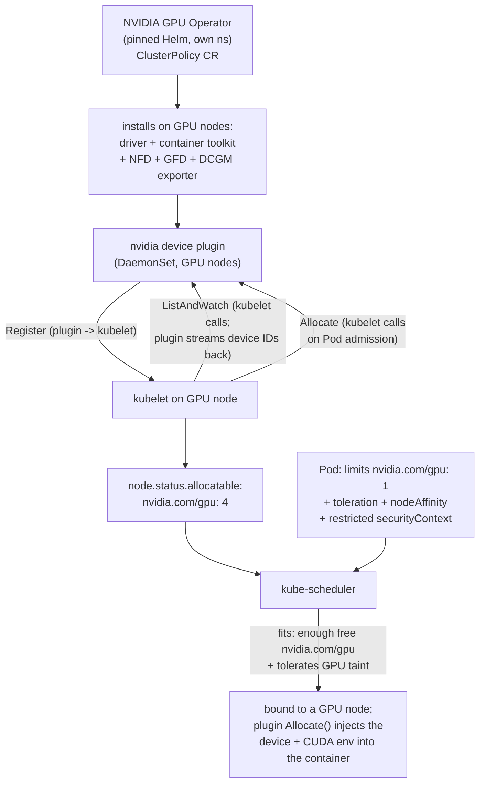

# 02 — GPUs and accelerators

> The **device-plugin** model (kubelet ↔ device-plugin gRPC, the
> `nvidia.com/gpu` extended resource, why GPUs are countable,
> non-overcommittable resources unlike CPU/memory); the **NVIDIA GPU Operator**
> (driver, container toolkit, device plugin, DCGM exporter, node feature
> discovery — what each component does) installed via **pinned Helm** into its
> own namespace; requesting a GPU in a Pod (`limits: nvidia.com/gpu: 1`, why
> `limits == requests` for devices); GPU node pools + the
> `nvidia.com/gpu:NoSchedule` taint + tolerations + nodeAffinity so only GPU
> work lands on costly GPU nodes; **sharing** a GPU — time-slicing vs MPS vs
> **MIG** (tradeoffs, when which); GPU **observability** (DCGM → Prometheus,
> ties [Part 06 ch.01](../06-production-readiness/01-observability-metrics.md))
> and utilisation as the cost lever
> ([Part 06 ch.06](../06-production-readiness/06-capacity-and-cost.md)); and the
> PSA-`restricted` GPU-pod footgun (CUDA images default to root) — applied with
> the **honest GPU reality** (a real GPU node is required; exact commands +
> representative labelled output, never faked) plus a CPU-only fallback note,
> the one privileged namespace the GPU stack needs (a registered exception),
> and a restricted-compliant GPU training Pod in
> [`examples/bookstore/ml/gpu/`](../examples/bookstore/ml/gpu/).

**Estimated time:** ~45 min read · ~90 min hands-on
**Prerequisites:** [Part 01 ch.03](../01-core-workloads/03-resources-and-qos.md) — CPU/memory resources GPUs structurally differ from · [Part 04 ch.02](../04-scheduling/02-affinity-taints-topology.md) — taints/tolerations that gate GPU node pools · [Part 06 ch.01](../06-production-readiness/01-observability-metrics.md) — Prometheus pipeline DCGM exporter feeds
**You'll know after this:** • explain the device-plugin model and why GPUs are non-overcommittable · • install the NVIDIA GPU Operator and verify driver + DCGM + device plugin · • request a GPU in a Pod and gate scheduling via taints + nodeAffinity · • compare time-slicing vs MPS vs MIG for GPU sharing · • avoid the PSA-restricted CUDA-image root-user footgun · • say which GPU components need host access, and why they get the one exception

<!-- tags: ml, gpu, mig, scheduling, observability, cost -->

## Why this exists

[Part 01 ch.03](../01-core-workloads/03-resources-and-qos.md) taught CPU and
memory as the two resources a Pod requests. The whole guide bin-packed on them:
the scheduler places Pods by `requests`, the kubelet throttles CPU, limits may
exceed allocatable because CPU is *compressible*. **A GPU breaks every one of
those assumptions.** A physical GPU is not time-sliced by the kernel the way
CPU is; you cannot give a Pod "0.3 of a GPU" by default; you cannot overcommit
it; and a node either *has* the NVIDIA driver + runtime wired up or the GPU is
invisible to Kubernetes entirely. On top of that, GPU nodes are the most
expensive thing in the cluster and are frequently supply-constrained — so
*which* Pods are even allowed onto them, and how busy they are kept, is a
first-order cost decision, not a tuning detail.

[ch.01](01-why-ml-on-kubernetes.md) named this as one of the two genuinely-new
things ML brings to Kubernetes. This chapter is the mechanism: how the kubelet
learns a node has GPUs (the **device-plugin** API), how the **NVIDIA GPU
Operator** installs the entire driver/runtime/plugin/exporter stack for you,
how a Pod *requests* a GPU and why `limits == requests`, how to keep general
workloads *off* costly GPU nodes (the [Part 04 ch.02](../04-scheduling/02-affinity-taints-topology.md)
taint/toleration/affinity recipe, now load-bearing), the three ways to *share*
one GPU (time-slicing / MPS / MIG), and how to *see* GPU utilisation (DCGM →
Prometheus, the [Part 06 ch.01](../06-production-readiness/01-observability-metrics.md)
pipeline). And it is **honest**: real GPU steps need a real GPU node — the
Bookstore recommendations model is deliberately tiny and CPU-only (chapters
[03](03-batch-and-gang-scheduling.md) and [04](04-distributed-training.md)),
so GPU here is the *"now scale it up"* path with exact commands and
representative, clearly-labelled output, never invented `nvidia-smi` numbers.

## Mental model

**A GPU is an *extended resource* a per-node agent advertises — countable,
indivisible by default, request==limit, and gated onto a tainted node pool.**

- **Device plugin = "this node has N of resource X".** The kubelet does not
  know about GPUs natively. A **device plugin** (a DaemonSet Pod on each GPU
  node) registers over a local gRPC socket and tells the kubelet "I have 4
  `nvidia.com/gpu`". The kubelet adds that to the node's `allocatable`. The
  scheduler then treats `nvidia.com/gpu` like any **extended resource**: a Pod
  that requests it only fits a node with enough *uncommitted* count. This is
  the same extended-resource machinery the guide mentioned for scheduling
  ([Part 04 ch.01](../04-scheduling/01-scheduler-and-nodes.md)) — GPUs are its
  most important real use.
- **You don't request a GPU; you *limit* one.** For devices you set
  `resources.limits["nvidia.com/gpu"]: 1`. Kubernetes auto-copies it to
  `requests` and **requires `limits == requests` for extended resources** —
  there is no fractional or burstable GPU at the core API level. A whole device
  is assigned to the container for its lifetime. (Sharing one GPU across Pods
  is possible but *opt-in* via time-slicing / MPS / MIG — below — never the
  default.)
- **GPU nodes are a fenced, expensive pool.** A GPU node should run *only* GPU
  work, or you waste money parking a stateless web Pod on a $$$ accelerator
  host. The recipe is exactly [Part 04 ch.02](../04-scheduling/02-affinity-taints-topology.md):
  **taint** the GPU pool (`nvidia.com/gpu=present:NoSchedule`, applied when the
  node pool is created), give GPU Pods a matching **toleration**, and
  add **nodeAffinity** so they are *attracted* to GPU nodes (a toleration only
  removes the fence; affinity pulls them in). General Bookstore Pods carry no
  toleration, so they cannot drift onto GPU nodes. This fence is a cost
  control. It is not a security boundary: a Pod author who writes the same
  toleration and affinity gets onto the GPU nodes, and nothing in this chapter
  stops an author from writing them.
- **The GPU Operator installs the whole stack so you don't.** Driver + NVIDIA
  container toolkit + device plugin + DCGM metrics exporter + node feature
  discovery is a lot of node plumbing. The **NVIDIA GPU Operator** is a single
  operator (one `ClusterPolicy` CR) that deploys and lifecycles all of it via a
  pinned Helm chart in its own namespace — the [Operator](#further-reading)
  pattern applied to "make GPUs work". That namespace is the one privileged
  namespace in Part 12, because the stack needs host access (below).

The trap to keep in view: PSA `restricted` does **not** exempt GPU pods, and
most CUDA/framework images default to **root**. The refusal, and the four
fields it asks for, are shown once in
[Part 12 ch.01 step 3](01-why-ml-on-kubernetes.md#3-a-refused-pod-the-control-working).
A GPU Pod needs the same four fields, set the same way
([Part 05 ch.02](../05-security/02-pod-security.md)). The hands-on checks what
is specific to the CUDA image and then runs the compliant shape.

A second trap sits under the GPU Pods. The stack that makes the GPU visible
(driver, container toolkit, device plugin, DCGM exporter, GPU feature discovery
and node feature discovery) needs host access, and it cannot run `restricted`.
It gets its own namespace, the registered exception, and no workload shares it.

## Threats and controls

Each row is specific to GPUs. The fourth row is a cost fence. It is not a
security boundary, and the note below the table says what would be needed to
make it one.

| Threat | Control taught here | Goes deeper |
|---|---|---|
| The GPU stack's node agents run with host access. A compromised driver, toolkit or device plugin is a compromised node | Their own namespace, `gpu-operator`, labelled `privileged` and registered as the one exception in Part 12, with a reason, an upstream citation and an expiry. Step 1 shows which components need what | [05.02](../05-security/02-pod-security.md) for the levels; the registry in `security/namespace-exceptions.yaml` |
| A GPU workload runs as root, because CUDA images declare no user | Every GPU workload is `restricted`: a non-root UID, dropped capabilities and a seccomp profile. Step 3 reads the CUDA image's declared user | [01.01](../01-core-workloads/01-pods.md#baseline); the refusal in [Part 12 ch.01](01-why-ml-on-kubernetes.md#3-a-refused-pod-the-control-working) |
| Two tenants share one GPU and see each other's memory or faults | Exclusive GPUs by default. Time-slicing only where tenants trust each other, and MIG for hardware isolation. Step 5 cites both | [08.04](../08-day-2-operations/04-multi-tenancy-and-namespaces.md) |
| An ordinary Pod takes a costly GPU node by accident | A taint on the GPU pool, and a toleration and a required nodeAffinity on GPU Pods only. This is a cost fence, so it does not stop a tenant who writes the same toleration on purpose | [04.02](../04-scheduling/02-affinity-taints-topology.md) |

The first row is the exception, and it is the only privileged namespace in
Part 12. A GPU workload never joins it. A GPU workload that asks for privilege
is refused like any other Pod.

**Not in this chapter: keeping tenants off the GPU pool.** A toleration is a
scheduling filter, and any Pod author can add one. Stopping a tenant from
adding the GPU toleration, or the affinity that pulls its Pods onto GPU nodes,
needs an admission control. A `ValidatingAdmissionPolicy` that limits which
namespaces may set those fields, or the `PodTolerationRestriction` admission
plugin with a namespace-level toleration allow-list, would do it. This chapter
installs neither, so the taint keeps honest workloads off the pool and does
not protect it.

## Diagrams

### kubelet ↔ device plugin → GPU allocation → Pod (Mermaid)



### Full GPU vs MIG vs time-slicing vs MPS (ASCII)

```
 ONE PHYSICAL GPU, FOUR WAYS TO HAND IT OUT
 ─────────────────────────────────────────────────────────────────────────────
 Mode          What a "GPU" means      Isolation         Best for
 ------------  ----------------------  ----------------  --------------------------
 Exclusive     1 Pod = 1 whole GPU     no sharing        training; the safe default
  (default)      limits: nvidia.com/      by design
                 gpu: 1

 MIG           HW-partitioned into     STRONG (HW        many smaller, isolated
  (supported)    instances, e.g.         partitions:       jobs/inference on big
                 nvidia.com/             mem + compute     GPUs; predictable QoS
                 mig-1g.10gb: 1          fenced)

 Time-slicing  N Pods share 1 GPU by   NONE (round-      dev/notebooks, bursty
                 the driver round-       robin time; no    low-duty inference;
                 robining; advertised    mem isolation,    NOT for guaranteed
                 as N "nvidia.com/gpu"   noisy neighbour)  perf or untrusted tenants

 MPS           N Pods share via CUDA   separate GPU      concurrent small kernels
  (Multi-       Multi-Process Service   address spaces;  from cooperating
   Process)      (concurrent contexts)   limited fault     workloads; better
                                         containment       throughput than slicing

 RULE OF THUMB:  training → exclusive (or MIG slice).  Inference/dev that can't
   fill a GPU → MIG if the HW supports it (real isolation); else time-slicing
   (cheap, no isolation) or MPS (better throughput, limited fault containment).
   Tenants who do not trust each other get exclusive GPUs or MIG. Sharing is
   always OPT-IN config on the device plugin / GPU Operator — never automatic.
```

## Hands-on with the Bookstore

**Assumed working directory: the guide repo root (`full-guide/`).** Requires
the PSA-`restricted` `bookstore-ml` namespace from
[ch.01](01-why-ml-on-kubernetes.md)
(`kubectl get ns bookstore-ml`). This chapter adds **one new file**,
[`examples/bookstore/ml/gpu/recommender-train-gpu.yaml`](../examples/bookstore/ml/gpu/recommender-train-gpu.yaml),
and changes nothing in the existing Bookstore.

> **The honest GPU reality (read first).** kind runs in containers on your
> machine and has **no GPU**. The GPU Operator install, `nvidia-smi`, and the
> GPU Pod in step 2 require a **real GPU node pool** (a cloud GPU node group, or
> a bare-metal box with an NVIDIA GPU + driver). Steps 1, 2 and 5 are **cited,
> not run**: their outputs are **representative, labelled illustrative** text,
> not captures. Steps 3 and 4 ran on a kind cluster, and their output is
> captured below. The lab cluster's node has a different name from the examples
> below, and the captured lines keep the name the lab printed.
> **The recommendations model itself needs no GPU**: it is tiny and CPU-only.
> Chapter 03 gang-schedules a two-worker CPU training run, and chapter 04 trains
> it on CPU. GPU here is purely the *"scale training up"* path, marked as such
> everywhere.

### 1. Install the GPU Operator in its own namespace (not run here)

On a cluster with GPU nodes, create the operator's namespace and label it
before the install. The operator's Pods need the `privileged` level, so the
namespace must allow it when the cluster enforces Pod Security admission. The
[GPU Operator docs](https://docs.nvidia.com/datacenter/cloud-native/gpu-operator/latest/getting-started.html)
give the same label. Then install from the operator's **pinned** Helm chart,
never from a `releases/latest/download/<FILE>.yaml` URL, the same rule as every
operator install in this guide:

```sh
# Label first. privileged is the lowest level the stack runs under (the table
# below shows why). audit and warn stay at restricted, so every privileged Pod
# still shows up as a restricted violation in the logs.
kubectl create namespace gpu-operator
kubectl label namespace gpu-operator \
  pod-security.kubernetes.io/enforce=privileged \
  pod-security.kubernetes.io/audit=restricted \
  pod-security.kubernetes.io/warn=restricted --overwrite

# Pin the chart you have tested and bump it deliberately. v26.7.2 was the
# newest chart when this chapter was checked (helm search repo nvidia/gpu-operator).
GPU_OPERATOR_VERSION="v26.7.2"

helm repo add nvidia https://helm.ngc.nvidia.com/nvidia && helm repo update
helm install gpu-operator nvidia/gpu-operator -n gpu-operator \
  --version "$GPU_OPERATOR_VERSION" --wait
# Nodes that already carry the NVIDIA driver: add --set driver.enabled=false.
```

What each component does, and the host access it asks for. The access column
comes from the operator's v26.7.2 sources and the chart render. The lab checked
both, and its counts are below:

| Component | Role | Host access in the v26.7.2 sources |
|---|---|---|
| **NVIDIA driver** (DaemonSet) | the kernel driver on each GPU node, or a check of a pre-installed host driver | privileged containers, `hostPID`, mounts of the host root `/` and `/sys` |
| **NVIDIA container toolkit** | wires the container runtime so containers can see the GPU | privileged containers, `hostPID`, mounts of the host root `/` and `/dev/char` |
| **device plugin** (DaemonSet) | advertises `nvidia.com/gpu` to the kubelet over the device-plugin gRPC API | privileged containers, mounts of the host root `/` and the kubelet's device-plugin directory |
| **DCGM exporter** | exports GPU metrics (utilisation, memory, power) for Prometheus | privileged containers, a mount of the kubelet's pod-resources directory |
| **GPU Feature Discovery** (DaemonSet) | emits `nvidia.com/gpu.*` labels such as `product`, `count` and `memory` | privileged containers, a mount of `/sys` |
| **Node Feature Discovery** (worker) | labels each node with hardware features, such as the NVIDIA PCI vendor ID | not privileged, but seven `hostPath` mounts, among them `/boot`, `/sys` and `/usr/lib` |

The chart renders one DaemonSet, NFD's worker. The GPU components are created
at runtime from the `ClusterPolicy`, so their privileges come from the
operator's sources. Each count below is the number of matching lines in a
file, not a count of containers, so read the counts as a sign of host access:

<!-- gate: output -->
```
privileged: true in the render: 0
hostPath volumes in the render: 7
```

<!-- gate: output -->
```
state-driver/0500_daemonset.yaml             privileged=6 hostPID=1 hostPath=14
state-container-toolkit/0500_daemonset.yaml  privileged=2 hostPID=1 hostPath=8
state-device-plugin/0500_daemonset.yaml      privileged=3 hostPID=0 hostPath=7
state-dcgm-exporter/0800_daemonset.yaml      privileged=2 hostPID=0 hostPath=2
gpu-feature-discovery/0500_daemonset.yaml    privileged=3 hostPID=0 hostPath=3
```

The seven `hostPath` mounts in the render all belong to the NFD worker. Baseline
forbids privileged containers, host namespaces and `hostPath` volumes, so the
stack cannot run at `baseline` either. The
[Pod Security Standards](https://kubernetes.io/docs/concepts/security/pod-security-standards/#baseline)
list those restrictions. `privileged` is the lowest level that admits all of
it, and the namespace holds the stack and nothing else. Its registry entry in
`security/namespace-exceptions.yaml` names this chapter and expires within
twelve months.

Two things shrink the surface. `driver.enabled=false` leaves out the driver
DaemonSet on nodes that already carry the driver, as the
[operator docs](https://docs.nvidia.com/datacenter/cloud-native/gpu-operator/latest/getting-started.html)
describe. And the chart version is a security control: a driver bump runs with
host access on every GPU node, so upgrade it like a node-OS change and test it
on a canary pool first. A silent bump can break every training job on the
cluster.

The operator reconciles a single **`ClusterPolicy`** CR. On a GPU cluster it
brings up the stack, and the commands below show what to watch:

```sh
kubectl get pods -n gpu-operator
kubectl get nodes -o custom-columns=\
'NODE:.metadata.name,GPU:.status.allocatable.nvidia\.com/gpu'
```

Illustrative output from a GPU node, not captured here. The names are the
DaemonSets' own names in the operator sources:

```
nvidia-driver-daemonset-xxxxx                      Running
nvidia-container-toolkit-daemonset-xxxxx           Running
nvidia-device-plugin-daemonset-xxxxx               Running
nvidia-dcgm-exporter-xxxxx                         Running
gpu-feature-discovery-xxxxx                        Running
gpu-operator-node-feature-discovery-worker-xxxxx   Running
gpu-operator-xxxxxxxxxx-xxxxx                      Running

NODE         GPU
gpu-node-1   1        <- the device plugin advertised the GPU
cpu-node-1   <none>   <- no GPU here
```

### 2. `nvidia-smi` from a GPU Pod (GPU node, not run here)

The check that a GPU is usable from a Pod. The manifest is complete and
restricted-compliant. Its base image declares no user (the image config in the registry says so),
so the UID is ours to pick: 65532, the same number the Job uses. Save the two
documents as `gpu-smoketest.yaml`:

```yaml
apiVersion: v1
kind: ServiceAccount
metadata:
  name: gpu-smoketest
  namespace: bookstore-ml
automountServiceAccountToken: false
---
apiVersion: v1
kind: Pod
metadata:
  name: gpu-smoketest
  namespace: bookstore-ml
spec:
  serviceAccountName: gpu-smoketest
  automountServiceAccountToken: false
  restartPolicy: Never
  tolerations:                      # PERMISSION past the GPU pool taint
    - { key: nvidia.com/gpu, operator: Exists, effect: NoSchedule }
  affinity:                         # ATTRACTION: GPU nodes only
    nodeAffinity:
      requiredDuringSchedulingIgnoredDuringExecution:
        nodeSelectorTerms:
          - matchExpressions:
              - { key: nvidia.com/gpu.present, operator: In, values: ["true"] }
  securityContext:
    runAsNonRoot: true
    runAsUser: 65532
    runAsGroup: 65532
    seccompProfile: { type: RuntimeDefault }
  containers:
    - name: gpu-smoketest
      # nvidia/cuda:12.4.1-base-ubuntu22.04, pinned by its index digest.
      image: nvidia/cuda@sha256:0f6bfcbf267e65123bcc2287e2153dedfc0f24772fb5ce84afe16ac4b2fada95
      command: ["nvidia-smi"]
      securityContext:
        allowPrivilegeEscalation: false
        readOnlyRootFilesystem: true
        capabilities: { drop: ["ALL"] }
      resources:
        requests: { cpu: 100m, memory: 128Mi }
        limits: { cpu: 500m, memory: 256Mi, nvidia.com/gpu: 1 }
      volumeMounts:
        - { name: tmp, mountPath: /tmp }
  volumes:
    - name: tmp
      emptyDir: {}
```

```sh
kubectl apply -f gpu-smoketest.yaml
kubectl logs -n bookstore-ml gpu-smoketest
kubectl delete -n bookstore-ml pod gpu-smoketest
```

Illustrative `nvidia-smi` output **from a real GPU node**, not captured here
(the model, driver and numbers depend on your hardware):

```
+-----------------------------------------------------------------------------+
| NVIDIA-SMI 550.xx       Driver Version: 550.xx     CUDA Version: 12.4        |
|-------------------------------+----------------------+----------------------+
| GPU  Name        Persistence-M| Bus-Id        Disp.A | Volatile Uncorr. ECC |
| Fan  Temp  Perf  Pwr:Usage/Cap|         Memory-Usage | GPU-Util  Compute M. |
|===============================+======================+======================|
|   0  <GPU model>          On  | 00000000:00:1E.0 Off |                  Off |
| N/A   34C    P0    25W / 300W |      0MiB / <NN>MiB  |      0%      Default |
+-------------------------------+----------------------+----------------------+
```

`0%` and `0MiB` mean idle: the command ran, and no workload did. The point is
that the container **sees the GPU** under a `restricted` securityContext. If it
fails with a permission error, do not relax the namespace. The exception is for
the GPU stack, and a GPU workload never joins it. Change the workload's UID or
its image and keep the namespace restricted. If you see `nvidia-smi: command
not found` or no GPU, the device plugin or toolkit is not ready. Re-check
step 1, because that is the usual failure.

### 3. The restricted profile refuses the root default (run on kind)

The refusal itself is shown once, in
[Part 12 ch.01 step 3](01-why-ml-on-kubernetes.md#3-a-refused-pod-the-control-working).
A GPU Pod built from a root-default CUDA image gets the same four refusals, so
this step does not repeat that output. What is specific to GPUs is the image.
The CUDA base image used in this chapter declares no user, so a Pod that leaves
the user unset runs as root. Read the declared user from the registry, pinned
by digest:

```sh
docker buildx imagetools inspect nvidia/cuda@sha256:0f6bfcbf267e65123bcc2287e2153dedfc0f24772fb5ce84afe16ac4b2fada95 \
  --format '{{json .Image}}' \
  | python3 -c 'import json,sys; d=json.load(sys.stdin)["linux/amd64"]; print(d.get("config",{}).get("User") or "<no USER declared>")'
```

<!-- gate: output -->
```
<no USER declared>
```

Admission refuses a Pod built from this image before a node runs it, so the
image is never pulled. The fix is the securityContext in step 2, not a looser
namespace. The UID the Pod sets must also be able to read the CUDA libraries and
the training code, because the image's files were written for root. Step 4 runs
the compliant shape.

### 4. The restricted GPU Job, admitted and then Pending (run on kind)

The committed manifest
[`examples/bookstore/ml/gpu/recommender-train-gpu.yaml`](../examples/bookstore/ml/gpu/recommender-train-gpu.yaml)
is the *"now train the recommender on a GPU"* shape. It holds two documents: a
ServiceAccount of its own, and a built-in `Job`, so it dry-runs without a CRD.
The Pod carries the baseline, the GPU toleration and a required nodeAffinity.
Validate it on the client, then ask the API server to admit it into the
restricted namespace. A dry run does not schedule, so none of this needs a GPU:

```sh
# from the repo root (full-guide/)
kubectl apply --dry-run=client -f examples/bookstore/ml/gpu/recommender-train-gpu.yaml

# PSA proof: the server runs admission, Pod Security included, in bookstore-ml
kubectl apply --dry-run=server -n bookstore-ml \
  -f examples/bookstore/ml/gpu/recommender-train-gpu.yaml
```

Captured output. The client dry run:

<!-- gate: output -->
```
serviceaccount/recommender-train-gpu created (dry run)
job.batch/recommender-train-gpu created (dry run)
```

The server dry run, with no PodSecurity warning:

<!-- gate: output -->
```
serviceaccount/recommender-train-gpu created (server dry run)
job.batch/recommender-train-gpu created (server dry run)
```

Applying the Job for real is safe on this cluster, and it shows the scheduler's
reason. The Pod stays `Pending`, because nothing on the cluster is a GPU node.
On a GPU cluster the same command schedules the Pod.

```sh
kubectl apply -f examples/bookstore/ml/gpu/recommender-train-gpu.yaml
kubectl get pods -n bookstore-ml -l job-name=recommender-train-gpu
kubectl get events -n bookstore-ml --field-selector reason=FailedScheduling
```

The Pod and the events, as captured:

<!-- gate: output -->
```
NAME                          READY   STATUS    RESTARTS   AGE
recommender-train-gpu-9gcr9   0/1     Pending   0          0s
```

<!-- gate: output -->
```
REASON             MESSAGE
FailedScheduling   0/1 nodes are available: 1 node(s) didn't match Pod's node affinity/selector. preemption: 0/1 nodes are available: 1 Preemption is not helpful for scheduling.
```

The message names the affinity, not the GPU count. This node does not carry
`nvidia.com/gpu.present=true`, which the GPU Operator sets on GPU nodes, so the
required nodeAffinity removes it before the GPU count matters. On a GPU node
with that label, the affinity passes and the GPU count decides. The Pod never
starts, so no training image is pulled. The recommender does not need this path
to work end to end: [chapter 03](03-batch-and-gang-scheduling.md) and
[chapter 04](04-distributed-training.md) run it CPU-only. Remove the Job
when you are done:

```sh
kubectl delete -f examples/bookstore/ml/gpu/recommender-train-gpu.yaml
```

### 5. Sharing a GPU and seeing utilisation (cited, not run here)

You rarely give every small job a whole GPU. **Sharing is opt-in config** on
the device plugin / GPU Operator:

- **Time-slicing** — a device-plugin config tells the plugin to advertise one
  physical GPU as N `nvidia.com/gpu` "replicas"; the driver round-robins. The
  replicas have **no memory or fault isolation** between them. The
  [GPU Operator's sharing page](https://docs.nvidia.com/datacenter/cloud-native/gpu-operator/latest/gpu-sharing.html)
  says so, and it is fine for dev notebooks and bursty, non-critical work. It is
  *never* the choice for guaranteed performance or for tenants who do not trust
  each other: a neighbour's crash or memory use reaches you.
- **MPS** — CUDA Multi-Process Service gives each client its own GPU address
  space and runs the clients' kernels concurrently. NVIDIA documents only
  **limited fault containment** for it
  ([MPS memory protection and error containment](https://docs.nvidia.com/deploy/mps/when-to-use-mps.html)).
  It suits cooperating workloads from one trust domain, and throughput is its
  point, not isolation.
- **MIG** — on supported GPUs, hardware-partitions the card into instances
  advertised as, for example, `nvidia.com/mig-1g.10gb`. Each instance has
  dedicated compute and memory. The GPU Operator's sharing page states that MIG
  gives **memory and fault isolation at the hardware layer**, and the
  [MIG user guide](https://docs.nvidia.com/datacenter/tesla/mig-user-guide/)
  describes the instances as isolated. This is the right answer for many
  isolated jobs or inference on one large GPU.

Exclusive GPUs stay the default. Sharing is a deliberate choice, and the
threat table's second-tenant row is the reason.

Utilisation is the **cost lever** (idle GPUs burn money — [ch.01](01-why-ml-on-kubernetes.md)
and [Part 06 ch.06](../06-production-readiness/06-capacity-and-cost.md)). The
GPU Operator's **DCGM exporter** publishes Prometheus metrics; scrape them with
the exact [Part 06 ch.01](../06-production-readiness/01-observability-metrics.md)
pipeline (a `ServiceMonitor`/scrape config), then alert/dashboard on idle:

```sh
# Metric names from the exporter's default counters file (etc/default-counters.csv
# in NVIDIA/dcgm-exporter); the values come from a GPU node:
#   DCGM_FI_DEV_GPU_UTIL        GPU utilisation %      (the headline cost signal)
#   DCGM_FI_DEV_FB_USED         framebuffer (VRAM) MiB used
#   DCGM_FI_DEV_POWER_USAGE     watts
# Wire them into Prometheus exactly like Part 06 ch.01 (ServiceMonitor / scrape
# config) and alert on GPUs allocated-but-idle = paying for nothing.
kubectl get svc -n gpu-operator -l app=nvidia-dcgm-exporter
```

## How it works under the hood

- **The device-plugin gRPC contract.** A device plugin is a Pod (DaemonSet) on
  each node that mounts the kubelet's device-plugin socket directory and
  implements the **DevicePlugin** gRPC service. It calls `Register` to claim a
  resource name (`nvidia.com/gpu`), then `ListAndWatch` streams the set of
  healthy device IDs to the kubelet; the kubelet sums them into
  `node.status.allocatable["nvidia.com/gpu"]`. When the scheduler binds a Pod
  that requested the resource, the kubelet calls the plugin's **`Allocate`**
  with the chosen device IDs; the plugin returns the env vars, device-node
  mounts, and any extra mounts to inject so the container can use that specific
  GPU. The kubelet enforces the count; the *scheduler* only does fit math on
  the advertised integer. This is why a node with no plugin (or a broken
  driver) shows `nvidia.com/gpu: <none>` and GPU Pods stay `Pending` — exactly
  the failure mode shown honestly in the hands-on.
- **Why `limits == requests` and no overcommit.** Extended resources have no
  notion of compressibility or burst. For an extended resource the API server
  accepts two forms: a limit alone, which Kubernetes copies into the request,
  or a request and a limit with equal values. A request with no limit is
  refused, so the GPU count is always explicit. A whole device is bound to
  the container; there is no kernel-level fair-share like CFS for CPU. So a
  Pod's GPU "QoS" is effectively always Guaranteed for that resource, and
  *Predictable Demands* ([Part 01 ch.03](../01-core-workloads/03-resources-and-qos.md))
  is not advice here, it is the only mode. **Sharing** (slicing/MPS/MIG) does
  not change this at the core API — it changes *what one advertised unit means*
  (a slice, an MPS context, a MIG instance) at the device-plugin layer.
- **What the GPU Operator actually reconciles.** It owns one cluster-scoped
  **`ClusterPolicy`** CR that describes the desired stack. Its controllers label
  each node that **NFD** marks as an NVIDIA PCI device with
  `nvidia.com/gpu.present=true`, which the operator's
  [state manager](https://github.com/NVIDIA/gpu-operator/blob/v26.7.2/controllers/state_manager.go)
  reads from NFD's `pci-10de` labels. On those nodes it deploys the driver (or
  checks a host driver), the NVIDIA container toolkit, the device plugin, the
  DCGM exporter, and **GFD**. GFD adds the `nvidia.com/gpu.product`, `count` and
  `memory` labels that describe the hardware. The `nodeAffinity` in this chapter
  matches the operator's `gpu.present` label, not a GFD label. The
  `ClusterPolicy` is a custom resource, so the chart installs its CRD before the
  policy exists.
- **Taint/affinity is the cost fence, mechanically.** The fence is a
  `NoSchedule` taint on the GPU pool, which you apply when you create the pool.
  From [Part 04 ch.02](../04-scheduling/02-affinity-taints-topology.md): the taint
  makes the scheduler's `TaintToleration` plugin **Filter out** GPU nodes for
  any Pod lacking the matching toleration, so the stateless Bookstore web Pods
  *cannot* land there. A GPU Pod adds the toleration (removes the fence) **and**
  a required nodeAffinity for the GPU label. The required term is also a filter:
  a node without the label is removed, so the Pod can only land on a GPU node. A
  *preferred* term would score GPU nodes up instead, which is attraction without
  a fence. The required form plus the toleration is the recipe from that
  chapter, now protecting real money.
- **Utilisation, mechanically, is just Part 06 ch.01.** DCGM exporter is a
  normal Prometheus target; `DCGM_FI_DEV_GPU_UTIL` and friends flow through the
  *same* metrics pipeline you built in
  [Part 06 ch.01](../06-production-readiness/01-observability-metrics.md). The
  only ML-specific insight is *what to alert on*: a GPU that is **allocated but
  near-0% utilised** is the cost smell — it is the GPU equivalent of an
  over-provisioned request, and the lever for the
  [Part 06 ch.06](../06-production-readiness/06-capacity-and-cost.md) /
  [Part 10 ch.06](../10-cloud-and-managed-kubernetes/06-node-autoscaling-cost-multicloud.md)
  cost story. Scheduling efficiency (gang/quota) in ch.03 is the *other* half of
  keeping that number high.

## Production notes

> **In production:** put GPU nodes in a **dedicated, tainted node pool** and
> add the matching toleration + nodeAffinity to *only* GPU workloads, the
> [Part 04 ch.02](../04-scheduling/02-affinity-taints-topology.md) recipe. Let
> the cluster autoscaler scale the pool on its own, down to **zero** when it is
> idle. A stray web Pod on a GPU host is pure waste, and an untainted GPU pool
> guarantees that waste.

> **In production: utilisation is the GPU cost metric.** Scrape DCGM into
> Prometheus ([Part 06 ch.01](../06-production-readiness/01-observability-metrics.md))
> and alert on **allocated-but-idle** GPUs. Choose sharing deliberately: MIG
> for isolated multi-tenant or inference work on big GPUs, time-slicing only
> for dev and bursty non-critical work (no memory or fault isolation), MPS for
> cooperating concurrent small kernels. "We bought GPUs running at 15%" is the
> dominant ML cost failure. Fix it with sharing and scheduling
> ([ch.03](03-batch-and-gang-scheduling.md)), not with more GPUs.

> **In production (managed clusters):** GPU node pools on managed Kubernetes
> use the same API, so the rules above carry over: a pinned operator, a tainted
> pool, restricted workload Pods, and DCGM scraped into Prometheus. Node-pool
> settings differ by provider, and this guide does not run them on a cloud, so
> read the provider's GPU node pool documentation for those. The Kubernetes
> surface (`nvidia.com/gpu`, taints, the operator) is the same as the local
> model ([Part 10](../10-cloud-and-managed-kubernetes/01-managed-kubernetes-model.md)).

## Quick Reference

```sh
# Install the GPU Operator: label its namespace privileged, then pinned Helm (GPU cluster)
kubectl create namespace gpu-operator
kubectl label namespace gpu-operator \
  pod-security.kubernetes.io/enforce=privileged \
  pod-security.kubernetes.io/audit=restricted \
  pod-security.kubernetes.io/warn=restricted --overwrite
GPU_OPERATOR_VERSION="v26.7.2"   # pin a tested release; bump deliberately
helm repo add nvidia https://helm.ngc.nvidia.com/nvidia && helm repo update
helm install gpu-operator nvidia/gpu-operator -n gpu-operator \
  --version "$GPU_OPERATOR_VERSION" --wait

# See GPUs the cluster knows about / inspect a GPU node
kubectl get nodes -o custom-columns=\
'NODE:.metadata.name,GPU:.status.allocatable.nvidia\.com/gpu'
kubectl describe node <GPU-NODE> | sed -n '/Allocatable/,/System Info/p'
kubectl get pods -n gpu-operator                       # the stack
kubectl get svc  -n gpu-operator -l app=nvidia-dcgm-exporter   # metrics target

# Validate the restricted GPU Job (no GPU needed to validate)
kubectl apply --dry-run=client  -f examples/bookstore/ml/gpu/recommender-train-gpu.yaml
kubectl apply --dry-run=server  -n bookstore-ml \
  -f examples/bookstore/ml/gpu/recommender-train-gpu.yaml      # PSA proof
```

Minimal `restricted`-compliant GPU Pod skeleton:

```yaml
spec:
  automountServiceAccountToken: false           # a ServiceAccount of its own
  serviceAccountName: <own-sa>                  # never default
  tolerations:                                  # PERMISSION past the GPU taint
    - { key: nvidia.com/gpu, operator: Exists, effect: NoSchedule }
  affinity:                                     # REQUIRED: GPU nodes only
    nodeAffinity:
      requiredDuringSchedulingIgnoredDuringExecution:
        nodeSelectorTerms:
          - matchExpressions:
              - { key: nvidia.com/gpu.present, operator: In, values: ["true"] }
  securityContext:                              # NOT exempt from restricted
    runAsNonRoot: true
    runAsUser: 65532                            # the image's UID, or one you chose
    seccompProfile: { type: RuntimeDefault }
  containers:
    - name: train
      image: <CUDA-OR-FRAMEWORK-IMAGE@sha256:...>   # pinned by digest
      resources:
        limits: { nvidia.com/gpu: 1, memory: 1Gi }  # devices: limit == request
      securityContext:
        allowPrivilegeEscalation: false
        readOnlyRootFilesystem: true
        capabilities: { drop: ["ALL"] }
      volumeMounts:
        - { name: tmp, mountPath: /tmp }
  volumes:
    - name: tmp
      emptyDir: {}
```

Checklist:

- [ ] The GPU stack is installed via **pinned Helm** into its own `gpu-operator`
      namespace, labelled `privileged` and registered as the Part 12 exception
- [ ] GPU nodes **tainted**; only GPU pods carry the toleration + nodeAffinity
- [ ] GPU requested as `limits: nvidia.com/gpu: N` (limit == request; no overcommit)
- [ ] GPU workloads are **restricted**-compliant with a pinned image; the root
      default is refused, not waived
- [ ] Sharing chosen deliberately: exclusive or MIG for tenants that do not
      trust each other; time-slicing only for trusted dev work
- [ ] DCGM → Prometheus; alert on allocated-but-idle GPUs (the cost lever)
- [ ] GPU-needing steps honestly marked; a CPU path exists (the recommender)

## Test your understanding

> Try each before opening the answer drawer. The act of trying is the exercise; the answer is the check.

1. **Why is `nvidia.com/gpu` declared under `limits` *and* `requests` with the same value, never just `requests`?**
   <details><summary>Show answer</summary>

   Extended resources (devices) can't be overcommitted: a Pod either has the GPU or doesn't. The kubelet's device-plugin manager exposes a finite count of GPUs per node; the scheduler treats them like an integer count, not fungible compute time. For `nvidia.com/gpu` the API server accepts a limit alone, which Kubernetes copies into the request, or a request and a limit with the same value, and it refuses a request with no limit. Setting `requests: 1, limits: 0` is invalid because a request cannot exceed its limit, and the device is exclusively bound for the Pod's lifetime, so there is no limit to enforce over time, only "the Pod owns this device or doesn't."

   </details>

2. **Your GPU node has 8 GPUs but only 4 Pods schedule on it, leaving 4 GPUs idle. DCGM shows 0% utilization on those 4. What's the diagnosis order?**
   <details><summary>Show answer</summary>

   (1) `kubectl describe node` — does the node advertise 8 `nvidia.com/gpu`? If less, the device plugin DaemonSet may be unhealthy on that node — check its logs. (2) Are 4 Pods *actually* requesting GPUs? If the workload requests `nvidia.com/gpu: 2` per Pod, 4 Pods consume 8 GPUs — fully utilized at the device level even though usage is 0%. (3) Pending Pods that *want* GPUs but didn't schedule — `kubectl get pods --field-selector=status.phase=Pending` then `describe` to see if taints/tolerations/affinity blocked them. (4) Is MIG enabled? Then the device count is 7×1g.5gb or similar, not 8 GPUs — the resource name is `nvidia.com/mig-1g.5gb`, not `nvidia.com/gpu`.

   </details>

3. **You enable time-slicing for the dev environment so multiple notebooks share one GPU. A user complains "my training run takes 4x as long." What's happening?**
   <details><summary>Show answer</summary>

   Time-slicing is exactly what it says: it multiplexes CUDA contexts onto one GPU via the NVIDIA driver, round-robining at the kernel level. If 4 workloads share, each gets ~25% of the GPU's compute time — a training run that takes 1 hour on a dedicated GPU takes ~4 hours sharing 4-way. Time-slicing trades throughput for cost. For dev/notebooks where utilization is bursty, that's a win. Sharing also removes isolation: the replicas have no memory or fault isolation, so one notebook that exhausts GPU memory or faults can take down the training run beside it. For production training, you want MIG (hardware isolation, partitioned GPU memory + compute slices) or dedicated GPUs. The user's complaint is the expected behavior, so surface it in dashboards so people understand.

   </details>

4. **A teammate runs a CUDA training Pod in `bookstore-ml` with `runAsNonRoot: true` and `runAsUser: 1000`. The Pod fails with a permission error once the training code touches the GPU. The namespace is `restricted`. What do you check first, and what do you refuse to change?**
   <details><summary>Show answer</summary>

   Start with the error. It names the file or device the process could not open. The base image declares no user, so its files were written for root, and UID 1000 may not be allowed to read what the training code needs. Fix the workload, not the namespace. Either build the image so that the files the process reads are readable by UID 1000, and set `USER 1000` in the Dockerfile, or choose a UID that the image's files already allow. Then confirm the choice on a GPU node, since the lab cluster has none. Refuse two changes: moving the workload to a `baseline` or `privileged` namespace, and adding privileges to its securityContext. The only privileged namespace in Part 12 is the GPU stack's, and a GPU workload never joins it.

   </details>

5. **On a cluster with no GPU, a Pod requests `nvidia.com/gpu: 1` and a required nodeAffinity on `nvidia.com/gpu.present=true`. What does the scheduler report, and what changes once a GPU node exists?**
   <details><summary>What you should see</summary>

   The event reports `0/1 nodes are available: 1 node(s) didn't match Pod's node affinity/selector`, as step 4 captured. The scheduler never reaches the GPU count, because the node lacks the `nvidia.com/gpu.present=true` label. Once the GPU Operator labels a GPU node, the affinity passes, and the scheduler checks the request against that node's allocatable `nvidia.com/gpu`. If the count is zero, the message becomes an `Insufficient nvidia.com/gpu` message. The GPU is still an inert, countable resource: the device plugin advertises it, the scheduler fits the count, and the kubelet binds a device when the Pod starts.

   </details>

## Further reading

- **Ibryam & Huß, _Kubernetes Patterns_ 2e — *Operator* (ch.28)** and
  ***Predictable Demands* (ch.2)** — operators that manage node-level
  infrastructure (the GPU Operator), and why declaring exact resource demands
  is mandatory for a non-overcommittable device.
- **Rosso et al., _Production Kubernetes_, ch.9 — "Observability"** and
  **ch.13 — "Autoscaling"** — wiring device/GPU metrics into the monitoring
  pipeline and scaling expensive capacity by real utilisation.
- Official: NVIDIA GPU Operator docs
  <https://docs.nvidia.com/datacenter/cloud-native/gpu-operator/latest/index.html>,
  Kubernetes device-plugin API
  <https://kubernetes.io/docs/concepts/extend-kubernetes/compute-storage-net/device-plugins/>,
  and scheduling GPUs
  <https://kubernetes.io/docs/tasks/manage-gpus/scheduling-gpus/>.
- Sources for the claims in this chapter: the GPU Operator's getting-started
  page, which gives the Pod Security label
  <https://docs.nvidia.com/datacenter/cloud-native/gpu-operator/latest/getting-started.html>;
  its GPU sharing page <https://docs.nvidia.com/datacenter/cloud-native/gpu-operator/latest/gpu-sharing.html>;
  the MIG user guide <https://docs.nvidia.com/datacenter/tesla/mig-user-guide/>;
  the MPS memory protection page <https://docs.nvidia.com/deploy/mps/when-to-use-mps.html>;
  the operator's v26.7.2 assets <https://github.com/NVIDIA/gpu-operator/tree/v26.7.2/assets>;
  and the Pod Security Standards
  <https://kubernetes.io/docs/concepts/security/pod-security-standards/>.
