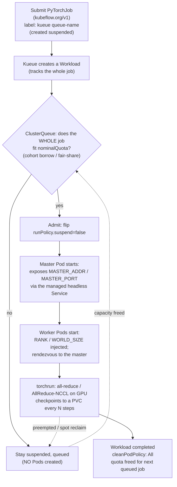

# 04 — Distributed training

> Why a single-node `Job` (or even a gang-scheduled `JobSet`) stops being
> enough as models grow — multi-worker training needs a **coordinated set of
> Pods that all run together** (rendezvous + all-reduce / parameter server);
> **Kubeflow Training Operator** (`PyTorchJob`/`TFJob`/`MPIJob`/`PaddleJob` —
> master + workers, `cleanPodPolicy`, elastic, `runPolicy.suspend` for Kueue);
> **Ray / KubeRay** (`RayCluster` head + workers; `RayJob` for batch submit;
> autoscaling Ray workers; Ray Train); **torchrun & Horovod** patterns
> (all-reduce, NCCL on GPU); **checkpointing** (PVC vs cloud object store;
> resumable training; ties [Part 03 ch.05](../03-config-and-storage/05-stateful-data-patterns.md));
> **elastic & fault-tolerant** training (`torchrun --max-restarts`,
> `PyTorchJob` elastic; preemption from spot — ties [Part 06 ch.05](../06-production-readiness/05-reliability-and-disruptions.md) PDBs /
> [Part 10 ch.06](../10-cloud-and-managed-kubernetes/06-node-autoscaling-cost-multicloud.md) spot);
> **data loading** (RWX PVCs, S3/GCS via cloud identity from
> [Part 10 ch.03](../10-cloud-and-managed-kubernetes/03-cloud-identity.md));
> and how Kueue admits a PyTorchJob/RayJob as a `Workload` (deepens
> [ch.03](03-batch-and-gang-scheduling.md)) — applied by installing the
> Kubeflow Training Operator and KubeRay (pinned, own namespaces) and
> running the CPU-only recommendations training as a `batch/v1` Job on kind,
> in [`examples/bookstore/ml/train/`](../examples/bookstore/ml/train/), then
> showing the same training as a `PyTorchJob` and a `RayJob` (CRD-backed,
> dry-run honest). The worker traffic is locked down with a NetworkPolicy,
> the operators' RBAC is read before install, and every training Pod gets its
> own ServiceAccount.

**Estimated time:** ~60 min read · half-day hands-on
**Prerequisites:** [Part 12 ch.03](03-batch-and-gang-scheduling.md) — gang scheduling that admits these workloads · [Part 03 ch.05](../03-config-and-storage/05-stateful-data-patterns.md) — PVC patterns checkpointing uses · [Part 10 ch.03](../10-cloud-and-managed-kubernetes/03-cloud-identity.md) — cloud identity for S3/GCS data loading
**You'll know after this:** • author a Kubeflow PyTorchJob with master + workers + `cleanPodPolicy` + Kueue suspend · • compare PyTorchJob vs RayJob vs raw JobSet for distributed training · • design checkpointing against a PVC or object store for resumable runs · • configure elastic + fault-tolerant training under spot preemption · • load training data via RWX PVC or cloud object store + workload identity · • restrict rank-to-rank traffic with a NetworkPolicy and read the operators' RBAC before you install them

<!-- tags: ml, batch, gpu, stateful, kueue -->

## Why this exists

[ch.03](03-batch-and-gang-scheduling.md) made the **whole gang** the unit of
admission: Kueue creates a Job/JobSet **suspended**, fits it against quota,
and only then lets Pods exist. It does not make placement atomic: quota is a
logical count, so the scheduler can still place an admitted gang in part (see
[ch.03](03-batch-and-gang-scheduling.md#how-it-works-under-the-hood)). That
solved the *admission* problem for multi-Pod training. It did **not** solve
two other things distributed training needs:

1. **A workload shape that knows about training**, not just "a group of
   Pods". A distributed PyTorch run has *master* and *worker* replicas, an
   `RDZV_ENDPOINT` for rendezvous, an environment of `RANK` / `WORLD_SIZE` /
   `MASTER_ADDR` to wire, a head-of-line policy ("if the master dies, kill
   the workers"), and an elastic mode ("if a worker dies, resume from the
   last checkpoint with `N-1`"). A bare `JobSet` is a coordinated group of
   Jobs — true, but you re-invent every one of those concerns. The
   **Kubeflow Training Operator** (`PyTorchJob`/`TFJob`/`MPIJob`/`PaddleJob`)
   *is* those concerns expressed as CRDs.
2. **A dataflow shape for Python-native distributed compute** — Ray runs
   tasks/actors across a *cluster* you can submit jobs to, with its own
   autoscaler and the `Ray Train` library for training. KubeRay turns that
   into Kubernetes-native `RayCluster` + `RayJob` CRDs. Different from a
   PyTorchJob because Ray is a *runtime*, not a per-job orchestrator.

This chapter is honest in scope: the Bookstore recommendations model is a
deliberately tiny item-kNN / co-occurrence recommender (see
[`../examples/bookstore/ml/README.md`](../examples/bookstore/ml/README.md)
and [`dataset/README.md`](../examples/bookstore/ml/dataset/README.md)). The
**real CPU-only training** in
[`examples/bookstore/ml/train/`](../examples/bookstore/ml/train/) produces a
`model.joblib` the next chapters serve. There is no GPU and no PyTorch all-reduce. The
`PyTorchJob` and `RayJob` files in that directory are the *CRD shapes* with
the same training as a stand-in: real operator wiring, real Kueue admission,
real PSA-`restricted` securityContext, and the CRD-intrinsic header note
(`no matches for kind …` until the operator is installed), the same
precedent as the rest of this guide.

## Mental model

**Distributed training = a workload shape (`PyTorchJob`/`RayJob`) + a
rendezvous endpoint + checkpoints on a durable volume + Kueue admission of
the whole shape via `suspend`.**

- **Single-node `Job` -> distributed**. A `Job` runs `parallelism: N` Pods
  but they do not know each other exists. The moment training is multi-Pod
  *with rendezvous* you need either (a) a JobSet wiring the headless Service
  yourself or (b) a workload type that does it. `PyTorchJob` does (b) — it
  exposes `MASTER_ADDR`/`MASTER_PORT`/`WORLD_SIZE`/`RANK` on every replica
  and brings the master up before the workers. The operator adds an init
  container to each worker that waits for the master's name to resolve (see
  [under the hood](#how-it-works-under-the-hood)).
- **Two ecosystems, different jobs.** **Kubeflow Training Operator** is the
  *per-framework* path: `PyTorchJob` for PyTorch (`torchrun`), `TFJob` for
  TensorFlow's `ClusterSpec`, `MPIJob` for Horovod/MPI all-reduce,
  `PaddleJob` for PaddlePaddle. **Ray / KubeRay** is the *runtime* path:
  bring up a `RayCluster` (head + workers, optionally autoscaling), submit
  `RayJob`s against it (or attach via the Ray client), and let Ray Train /
  Ray Tune / Ray Data parallelise the work in Python. They are not
  interchangeable: PyTorchJob *runs one specific training script across N
  ranks*; Ray *gives you a cluster runtime your script schedules tasks on*.
  Pick PyTorchJob when training is a single torchrun-shaped script; pick
  Ray when training is part of a broader pipeline of Python tasks (hyperparam
  sweeps, RLHF, mixed batch/streaming).
- **Rendezvous + checkpoints are the durability story.** Distributed
  training is a *very* long single tool invocation. It will be interrupted
  — by a preemption ([Part 04 ch.03](../04-scheduling/03-priority-and-preemption.md)),
  by a spot reclaim ([Part 10 ch.06](../10-cloud-and-managed-kubernetes/06-node-autoscaling-cost-multicloud.md)),
  by a node going Unschedulable. Two things prevent that becoming a
  total-loss incident: **a rendezvous backend** that lets new processes
  rejoin (`c10d` / `etcd-v2` for `torchrun`; the operator's headless Service
  handles the address), and **checkpoints** written to a *durable*
  shared volume (a PVC backed by RWX-capable storage, or an object store
  via the Pod's cloud identity from
  [Part 10 ch.03](../10-cloud-and-managed-kubernetes/03-cloud-identity.md)).
  Elastic mode (`torchrun --max-restarts=N` / `PyTorchJob` elasticPolicy)
  lets the workload *shrink and recover* without restarting from scratch.
- **Kueue still rules admission.** Every workload type — Job, JobSet,
  PyTorchJob, RayJob — has a `suspend` (or `runPolicy.suspend`) field, and
  Kueue's integrations wrap them all the same way: created suspended ->
  `Workload` fits in `ClusterQueue` quota -> flipped admitted. Distributed
  training is not a *new* admission story; ch.03's gang/quota mechanics
  cover it the same way they cover a JobSet. The new piece is the
  *workload shape*, not the *queue*.

## Threats and controls

A distributed run is many Pods that trust each other by default. Each rank
opens ports to the others, the framework's rendezvous and collective traffic
does not check who is on the other end, and the operators that create the
Pods hold cluster-wide rights. The threats below are specific to training.
Everything else about a training Pod is the
[baseline](../01-core-workloads/01-pods.md#baseline) from 01.01.

| Threat | Control taught here | Goes deeper |
|---|---|---|
| A Pod outside the run joins the rendezvous or reads traffic between ranks | A NetworkPolicy per training group that admits only that group, in [step 3](#3-only-the-training-group-talks-to-itself) (PyTorch) and [step 5](#5-the-same-training-as-a-rayjob-not-run) (Ray) | [02.06](../02-networking/06-network-policies.md); mTLS in [11.04](../11-advanced-production-patterns/04-service-mesh.md) |
| Any client that reaches the Ray head submits a job, and the job runs code on the head | The Ray group's own NetworkPolicy admits the group on every port, and the KubeRay operator on the dashboard port only ([step 5](#5-the-same-training-as-a-rayjob-not-run)) | [02.06](../02-networking/06-network-policies.md); the CVE under How it works |
| A compromised training Pod calls out to the internet and sends data or pulls code | Default-deny egress, with DNS and the group as the only destinations | [02.06](../02-networking/06-network-policies.md) |
| A training image, dependency, pretrained weight or data file from outside runs code in the cluster | Images pinned by digest from the first pull, including the operators' images. Outside weights and data are verified by digest and loaded in a format that cannot run code ([step 6](#6-checkpointing-elastic-and-data-access-not-run)). This chapter's own data is generated in-process | [05.03](../05-security/03-supply-chain.md); the load-time check in [12.06](06-model-serving-and-inference.md) |
| Training data is read with a static cloud key that leaks | Workload identity for object storage, with no key on the Pod | [Part 10 ch.03](../10-cloud-and-managed-kubernetes/03-cloud-identity.md) |
| Two Pods write the model artifact, or a compromised worker replaces the file the server loads | Only one Pod mounts the model PVC read-write; the serving side mounts it read-only | [12.06](06-model-serving-and-inference.md) |
| A training Pod uses its ServiceAccount token to call the API | A dedicated ServiceAccount with no RoleBinding, and no mounted token | [05.01](../05-security/01-authn-authz-rbac.md) |
| The operator that creates the Pods holds more rights than it needs | Read the operator's ClusterRole before you install it, and keep the operator in its own namespace | [08.05](../08-day-2-operations/05-operators-and-crds.md) |
| The operator's own Pod runs as root, and restricted would refuse it | The namespace is labelled at the lowest level that admits the Pod, and the exception is recorded | [05.02](../05-security/02-pod-security.md) |
| The operator injects a root init container into each worker, and restricted refuses the worker | The operator is configured with a digest-pinned, non-root init image and a hardened template ([step 1](#1-read-what-the-operators-can-do-then-install-them)) | [05.02](../05-security/02-pod-security.md) |
| A run with no deadline holds GPUs or CPU for days | `activeDeadlineSeconds` on the run (the PyTorchJob's `runPolicy` and the RayJob's spec), and a quota per team | [01.03](../01-core-workloads/03-resources-and-qos.md); [ch.03](03-batch-and-gang-scheduling.md) |

## Diagrams

### PyTorchJob (master+worker) -> Kueue admission -> gang training -> PVC checkpoint (Mermaid)



### PyTorchJob vs RayJob vs plain Job — role matrix (ASCII)

```
 WHO IS THIS FOR
 ────────────────────────────────────────────────────────────────────────────
 plain Job        ONE python invocation. Single Pod (or parallelism:N of
   (batch/v1)       independent shards). NO rendezvous, NO master/worker
                    wiring. = the CPU-runnable recommender artifact path
                    (recommender-train-job.yaml). The kind-friendly path.
                    Built-in — dry-runs cleanly anywhere.

 PyTorchJob       ONE distributed training script across N ranks. The
   (kubeflow.org)   operator brings up Master + Worker replicas, sets RANK /
                    WORLD_SIZE / MASTER_ADDR, wires a headless Service for
                    rendezvous, enforces cleanPodPolicy, supports elastic.
                    Submit with label kueue-queue-name; Kueue gates via
                    runPolicy.suspend. = the per-framework path. (Same for
                    TFJob/MPIJob/PaddleJob.)

 RayJob           A SUBMISSION against a RayCluster (head + workers). Ray is
   (ray.io)         a Python runtime: your script `ray.init()`s into a cluster
                    and uses Ray Train / Tune / Data / Actors. The CRD
                    brings up an ephemeral RayCluster, runs `entrypoint`,
                    tears the cluster down (shutdownAfterJobFinishes).
                    Kueue gates via spec.suspend. = the Python-runtime path,
                    for mixed pipelines and hyperparam sweeps.

 INSTALLS — operators live in their OWN namespaces (pinned Helm; ch.03 rule)
   Kubeflow Training Operator   ns `kubeflow` (or `kubeflow-system`)
   KubeRay operator              ns `kuberay-operator`
   Kueue + JobSet                ns `kueue-system` / `jobset-system` (ch.03)
   PVC for checkpoints           per training job / per team
```

## Hands-on with the Bookstore

**Assumed working directory: the guide repo root (`full-guide/`).** Requires
the PSA-`restricted` `bookstore-ml` namespace and its default-deny
NetworkPolicy from [ch.01](01-why-ml-on-kubernetes.md), and the Kueue
capacity/queue from [ch.03](03-batch-and-gang-scheduling.md). This chapter
installs the **Kubeflow Training Operator** and **KubeRay** (pinned, own
namespaces), adds the CPU training image and manifests under
[`examples/bookstore/ml/train/`](../examples/bookstore/ml/train/), and proves
the train -> joblib loop end-to-end on kind. The serving side comes in
[ch.06](06-model-serving-and-inference.md).

> **What was run here, and what was not.** The captured output in this
> chapter came from a lab cluster whose node has a different name from the
> one you will see. The operator checks were dry runs against that cluster
> and renders of the pinned upstream release. The Training Operator and
> KubeRay were not installed there: a shared lock for heavy installs was held
> during the run. The worker check in step 4 is therefore a server dry run of
> the worker Pod that the operator builds from its template, not a run under a
> live operator. The training image build did not finish on the shared lab
> machine, so no training Pod ran. Each captured block is real output from a
> command the lab ran. Sample output is labelled illustrative.

> **The recommender is tiny and CPU-only by design.** The real artifact
> ([`train.py`](../examples/bookstore/ml/train/train.py)) is item-kNN /
> co-occurrence, in the same training shape ch.03 demonstrated as a stand-in.
> The `PyTorchJob` and `RayJob` files in this tree run that same `train.py`
> as a stand-in — they exist to demonstrate the CRD shape and Kueue
> admission, not to fake an all-reduce. The kind-runnable artifact path is
> the plain `batch/v1 Job`.

### 1. Read what the operators can do, then install them

An operator holds more rights than the workloads it creates. Before you
install one, read its ClusterRole. These commands render the pinned Training
Operator release and print the rules that matter for training.

```sh
TRAINING_OP_VERSION="v1.9.4"   # Kubeflow Training Operator release tag
git clone --depth 1 --branch "$TRAINING_OP_VERSION" \
  https://github.com/kubeflow/training-operator
kubectl kustomize training-operator/manifests/overlays/standalone > training-operator.yaml
grep -B3 -A3 -e '^  - pods/exec$' -e '^  - secrets$' -e '^  - rolebindings$' training-operator.yaml | head -40
```

<!-- gate: output -->

```text
- apiGroups:
  - ""
  resources:
  - pods/exec
  verbs:
  - create
- apiGroups:
  - ""
  resources:
  - secrets
  verbs:
  - get
  - list
--
- apiGroups:
  - rbac.authorization.k8s.io
  resources:
  - rolebindings
  verbs:
  - create
  - list
```

The operator's ClusterRole is cluster-wide. It lets the operator create and
exec into Pods in any namespace, read and update Secrets in any namespace, and
create RoleBindings. Training across namespaces needs some of that, which is
why the operator belongs in its own namespace and why each release is read
before it is applied.

KubeRay's chart carries the same kind of rule. Its ClusterRole can create and
delete Secrets and RoleBindings:

```sh
helm repo add kuberay https://ray-project.github.io/kuberay-helm/
helm template kuberay-operator kuberay/kuberay-operator --version 1.7.1 \
  -n kuberay-operator --include-crds | grep -B3 -A4 -e '^  - secrets$' -e '^  - rolebindings$' | head -30
```

<!-- gate: output -->

```text
- apiGroups:
  - ""
  resources:
  - secrets
  verbs:
  - create
  - delete
  - get
--
- apiGroups:
  - rbac.authorization.k8s.io
  resources:
  - rolebindings
  verbs:
  - create
  - delete
  - get
```

Both operators also run in Pods, and those Pods go through Pod Security
admission like any other. The Training Operator's Deployment sets only
`allowPrivilegeEscalation: false` on its container:

```sh
sed -n '/^kind: Deployment/,/^---/p' training-operator.yaml \
  | grep -n -E 'image:|serviceAccountName|securityContext|runAsNonRoot|seccompProfile|allowPrivilegeEscalation|capabilities'
```

<!-- gate: output -->

```text
31:        image: ghcr.io/kubeflow/training-v1/training-operator:v1-93c5489
52:        securityContext:
53:          allowPrivilegeEscalation: false
58:      serviceAccountName: training-operator
```

Its image records user `0` in its configuration. You can check that without
pulling the image:

```sh
docker buildx imagetools inspect ghcr.io/kubeflow/training-v1/training-operator:v1-93c5489 \
  --format '{{json .Image}}' | python3 -c 'import json,sys; d=json.load(sys.stdin); [print(p, "User", repr(v["config"]["User"])) for p,v in d.items()]'
```

<!-- gate: output -->

```text
linux/amd64 User '0'
linux/arm64 User '0'
linux/ppc64le User '0'
```

Those facts decide the namespace level. The next two checks are server dry
runs. Each builds a Pod from the Training Operator's Deployment template and
submits it to a namespace. A dry run runs admission, so the answer shows what
the cluster would refuse. Create two namespaces, one labelled `restricted` and
one `baseline` with `restricted` warnings:

```sh
kubectl create namespace pss-check-restricted
kubectl label namespace pss-check-restricted pod-security.kubernetes.io/enforce=restricted
kubectl create namespace pss-check-baseline
kubectl label namespace pss-check-baseline \
  pod-security.kubernetes.io/enforce=baseline pod-security.kubernetes.io/warn=restricted
```

Then copy the Deployment's Pod template into a Pod, drop its ServiceAccount
(a dry run does not need one), and submit it to the `restricted` namespace:

```sh
python3 -c 'import sys, yaml
for d in yaml.safe_load_all(sys.stdin):
    if d and d.get("kind") == "Deployment":
        spec = d["spec"]["template"]["spec"]
        spec.pop("serviceAccountName", None)
        pod = {"apiVersion": "v1", "kind": "Pod", "metadata": {"name": "operator-pod-check"}, "spec": spec}
        print(yaml.safe_dump(pod, sort_keys=False))
        break' < training-operator.yaml | kubectl apply --dry-run=server -n pss-check-restricted -f -
```

<!-- gate: output -->

```text
Error from server (Forbidden): error when creating "STDIN": pods "operator-pod-check" is forbidden: violates PodSecurity "restricted:latest": unrestricted capabilities (container "training-operator" must set securityContext.capabilities.drop=["ALL"]), runAsNonRoot != true (pod or container "training-operator" must set securityContext.runAsNonRoot=true), seccompProfile (pod or container "training-operator" must set securityContext.seccompProfile.type to "RuntimeDefault" or "Localhost")
```

The `restricted` namespace refuses the Pod. The same command against
`pss-check-baseline` is admitted. Baseline does not require a non-root user, so
the warnings name the restricted rules it reports without enforcing them:

<!-- gate: output -->

```text
Warning: would violate PodSecurity "restricted:latest": unrestricted capabilities (container "training-operator" must set securityContext.capabilities.drop=["ALL"]), runAsNonRoot != true (pod or container "training-operator" must set securityContext.runAsNonRoot=true), seccompProfile (pod or container "training-operator" must set securityContext.seccompProfile.type to "RuntimeDefault" or "Localhost")
pod/operator-pod-check created (server dry run)
```

Delete the two check namespaces once you have the output:

```sh
kubectl delete namespace pss-check-restricted pss-check-baseline
```

So the operator namespace is labelled `baseline`, with `audit` and `warn` at
`restricted`. That is the lowest level at which the pinned release runs as
shipped. It is recorded in
`security/namespace-exceptions.yaml`
with a reason, the upstream file and an expiry. A non-root run of this image is
not verified in this chapter. When it is, the Pod moves to `restricted` and the
exception is removed.

KubeRay's chart sets the container fields that `restricted` needs, including
`seccompProfile: RuntimeDefault` on the container. Its image runs as UID
65532. Render the chart's Deployment and read those fields:

```sh
helm template kuberay-operator kuberay/kuberay-operator --version 1.7.1 -n kuberay-operator --show-only templates/deployment.yaml --set image.tag="v1.7.1@sha256:e69b9cde8f1d55c6111e4ab9005b7a8f9139e3783a38205069a2c4ac94f6745d" | grep -n -E 'runAsNonRoot|seccompProfile|readOnlyRootFilesystem|image:|serviceAccountName'
```

<!-- gate: output -->

```text
28:      serviceAccountName: kuberay-operator
36:            readOnlyRootFilesystem: true
37:            runAsNonRoot: true
38:            seccompProfile:
40:          image: "quay.io/kuberay/operator:v1.7.1@sha256:e69b9cde8f1d55c6111e4ab9005b7a8f9139e3783a38205069a2c4ac94f6745d"
```

Submit the same Pod template, rendered from the chart, as a dry run to the
`restricted` namespace. The Pod is admitted:

```sh
helm template kuberay-operator kuberay/kuberay-operator --version 1.7.1 -n pss-check-restricted --show-only templates/deployment.yaml | python3 -c 'import sys, yaml
for d in yaml.safe_load_all(sys.stdin):
    if d and d.get("kind") == "Deployment":
        spec = d["spec"]["template"]["spec"]
        spec.pop("serviceAccountName", None)
        pod = {"apiVersion": "v1", "kind": "Pod", "metadata": {"name": "kr-pod-check"}, "spec": spec}
        print(yaml.safe_dump(pod, sort_keys=False))
        break' | kubectl apply --dry-run=server -n pss-check-restricted -f -
```

<!-- gate: output -->

```text
pod/kr-pod-check created (server dry run)
```

So `kuberay-operator` takes `restricted` with no exception. Install both
operators with the namespace labelled first. The lab installed neither
operator, so these lines are illustrative until a reader runs them.

```sh
TRAINING_OP_VERSION="v1.9.4"   # Kubeflow Training Operator release tag
kubectl create namespace kubeflow
kubectl label namespace kubeflow \
  pod-security.kubernetes.io/enforce=baseline \
  pod-security.kubernetes.io/enforce-version=latest \
  pod-security.kubernetes.io/audit=restricted \
  pod-security.kubernetes.io/audit-version=latest \
  pod-security.kubernetes.io/warn=restricted \
  pod-security.kubernetes.io/warn-version=latest
kubectl apply --server-side -k examples/bookstore/ml/train/operators/training-operator

KUBERAY_CHART="1.7.1"          # KubeRay chart; app image quay.io/kuberay/operator:v1.7.1
KUBERAY_DIGEST="sha256:e69b9cde8f1d55c6111e4ab9005b7a8f9139e3783a38205069a2c4ac94f6745d"
kubectl create namespace kuberay-operator
kubectl label namespace kuberay-operator \
  pod-security.kubernetes.io/enforce=restricted \
  pod-security.kubernetes.io/enforce-version=latest \
  pod-security.kubernetes.io/audit=restricted \
  pod-security.kubernetes.io/audit-version=latest \
  pod-security.kubernetes.io/warn=restricted \
  pod-security.kubernetes.io/warn-version=latest
helm install kuberay-operator kuberay/kuberay-operator \
  --version "$KUBERAY_CHART" -n kuberay-operator \
  --set image.tag="v1.7.1@${KUBERAY_DIGEST}" --wait
```

The Training Operator overlay wraps the pinned upstream standalone overlay
from `v1.9.4`. It lives in
[`operators/training-operator/`](../examples/bookstore/ml/train/operators/training-operator/kustomization.yaml)
and adds three things: the operator image pinned by digest, a worker
init-container template that is restricted-compliant, and the operator argument
that names the init image, also pinned by digest. Step 4 shows why the worker
needs them. The KubeRay chart is given its image by digest as well, so neither
tag can move under the install.

The overlay's `?ref=` names the full commit SHA that tag `v1.9.4` resolves
to, not the tag (`git ls-remote` printed
`4445c12aa62e4345b0c2c6ac9b215a70eca46ed7` for it). That follows
[07.02](../07-delivery/02-packaging-kustomize.md): a tag can be moved, and a
full SHA cannot. A render with the SHA and a render with the tag came out byte
for byte the same.

KubeRay's chart also ships feature gates for mTLS and a NetworkPolicy
generator. In the 1.7.1 chart both are off by default, and this chapter writes
its own policy rather than relying on either:

```sh
helm template kuberay-operator kuberay/kuberay-operator --version 1.7.1 -n kuberay-operator --include-crds | grep -o 'RayClusterNetworkPolicy=[a-z]*\|RayClusterMTLS=[a-z]*'
```

<!-- gate: output -->

```text
RayClusterMTLS=false
RayClusterNetworkPolicy=false
```

The chart's version comes from its metadata:

```sh
helm show chart kuberay/kuberay-operator --version 1.7.1 | grep -E '^(name|version|appVersion):'
```

<!-- gate: output -->

```text
name: kuberay-operator
version: 1.7.1
```

### 2. Run the CPU training as a Job

The plain Job is the path that produces the artifact. It builds one image,
loads it into kind, and runs `train.py` once. The Job file creates three
objects: a ServiceAccount for the training Pods, the `recommender-model` PVC,
and the Job itself.

```sh
docker build -t bookstore/recommender-train:dev examples/bookstore/ml/train
kind load docker-image bookstore/recommender-train:dev   # only if using kind
kubectl apply -f examples/bookstore/ml/train/recommender-train-job.yaml
kubectl wait --for=condition=complete job/recommender-train -n bookstore-ml --timeout=300s
```

Three things in that file are the security shape. The ServiceAccount has no
RoleBinding, so the Pod has no API rights, and `automountServiceAccountToken:
false` means no token is mounted at all. The Job runs as UID 65532 with a
read-only root filesystem and an `emptyDir` for `/tmp`. And only this Job
mounts `recommender-model` read-write: the serving side in
[ch.06](06-model-serving-and-inference.md) mounts it read-only, so one Pod
holds write scope on the artifact.

The Job needs no network. Its data is generated in-process, so the namespace's
default-deny policy applies to it unchanged, and it needs no allow rule. The
lab's image build did not finish on the shared machine, so the Job was run as
a server dry run only. The line for the ServiceAccount says `configured`
because the lab had already created it in step 3. The command, run against the
file as written, is:

```sh
kubectl apply --dry-run=server -f examples/bookstore/ml/train/recommender-train-job.yaml
```

The lab ran that command on a copy whose namespace was changed, because the lab
cluster has no `bookstore-ml` namespace. Its output:

<!-- gate: output -->

```text
serviceaccount/recommender-train configured (server dry run)
persistentvolumeclaim/recommender-model created (server dry run)
job.batch/recommender-train created (server dry run)
```

### 3. Only the training group talks to itself

Ranks in a distributed run trust each other by default. The rendezvous and
collective traffic between them does not check the identity of the peer, and
Ray's ports are open to whoever can reach them. The network is the boundary,
so the boundary needs a rule. A NetworkPolicy selects the Pods of one training
group by a label, admits traffic only from Pods with the same label, and lets
those Pods reach DNS and nothing else.

```yaml
apiVersion: networking.k8s.io/v1
kind: NetworkPolicy
metadata:
  name: allow-recommender-train-pt
  namespace: bookstore-ml
spec:
  podSelector:
    matchLabels:
      ml.bookstore/training-group: recommender-train-pt
  policyTypes: ["Ingress", "Egress"]
  ingress:
    - from:
        - podSelector:
            matchLabels:
              ml.bookstore/training-group: recommender-train-pt
  egress:
    - to:
        - podSelector:
            matchLabels:
              ml.bookstore/training-group: recommender-train-pt
    - to:
        - namespaceSelector:
            matchLabels:
              kubernetes.io/metadata.name: kube-system
          podSelector:
            matchLabels:
              k8s-app: kube-dns
      ports:
        - { protocol: UDP, port: 53 }
        - { protocol: TCP, port: 53 }
```

The same policy is saved as
[`allow-recommender-train-pt.yaml`](../examples/bookstore/ml/train/allow-recommender-train-pt.yaml),
which the steps below apply. It selects only the PyTorch group. The Ray job
uses its own group value, `recommender-train-ray`, so
[step 5](#5-the-same-training-as-a-rayjob-not-run) has a policy of its own for
the Ray Pods. The group is allowed on every port, because NCCL
and Ray pick ports at run
time. Narrowing the rule to the rendezvous port is the next step once a run
pins its ports. The policy has no effect unless the cluster's network plugin
enforces NetworkPolicy. [02.06](../02-networking/06-network-policies.md)
explains how to check that, and the lab result below shows it working here.

The steps that follow use three Pods from
[`rendezvous-check.yaml`](../examples/bookstore/ml/train/rendezvous-check.yaml).
`rdzv-master` serves HTTP on TCP 23456, the default PyTorch rendezvous port.
`rdzv-worker` carries the group label. `rdzv-probe` does not, and it stands
in for any Pod outside the run. The image is busybox pinned by digest, which
the check uses only for `httpd` and `wget`:

```sh
kubectl apply -f examples/bookstore/ml/train/recommender-train-job.yaml   # creates the ServiceAccount
kubectl apply -f examples/bookstore/ml/train/rendezvous-check.yaml
kubectl wait --for=condition=Ready pod/rdzv-master pod/rdzv-worker pod/rdzv-probe -n bookstore-ml --timeout=180s
MASTER=$(kubectl get pod rdzv-master -n bookstore-ml -o jsonpath='{.status.podIP}')
kubectl exec -n bookstore-ml rdzv-worker -- sh -c "wget -q -O - -T 5 http://$MASTER:23456/ && echo reached || echo 'not reached'"
```

The worker is a member, so its request is admitted. The probe is a
**deliberate denied request**: it is not a member, and the policy refuses it:

<!-- gate: output -->

```text
rendezvous-ok
reached
```

<!-- gate: output -->

```text
wget: download timed out
not reached
```

Now remove the allow rule. Default-deny alone refuses the worker too, which
shows the allow rule is what admits the group. Then apply it again:

```sh
kubectl delete -n bookstore-ml -f examples/bookstore/ml/train/allow-recommender-train-pt.yaml
kubectl exec -n bookstore-ml rdzv-worker -- sh -c "wget -q -O - -T 5 http://$MASTER:23456/ && echo reached || echo 'not reached'"
kubectl apply -f examples/bookstore/ml/train/allow-recommender-train-pt.yaml
kubectl exec -n bookstore-ml rdzv-worker -- sh -c "wget -q -O - -T 5 http://$MASTER:23456/ && echo reached || echo 'not reached'"
```

<!-- gate: output -->

```text
wget: download timed out
not reached
```

<!-- gate: output -->

```text
rendezvous-ok
reached
```

Each Pod in the check carries the baseline. The worker's fields, read from
the running Pod, show the ServiceAccount, the token setting, the user, the
seccomp profile, the read-only root and the dropped capabilities:

```sh
kubectl get pod rdzv-worker -n bookstore-ml -o custom-columns=NAME:.metadata.name,SA:.spec.serviceAccountName,AUTOMOUNT:.spec.automountServiceAccountToken,UID:.spec.securityContext.runAsUser,SECCOMP:.spec.securityContext.seccompProfile.type,RO_ROOT:.spec.containers[0].securityContext.readOnlyRootFilesystem,DROP:.spec.containers[0].securityContext.capabilities.drop
```

<!-- gate: output -->

```text
NAME          SA                  AUTOMOUNT   UID     SECCOMP          RO_ROOT   DROP
rdzv-worker   recommender-train   false       65532   RuntimeDefault   true      [ALL]
```

The ServiceAccount has no RoleBinding, so it cannot read Pods or Secrets in
its own namespace:

```sh
kubectl auth can-i get pods -n bookstore-ml --as=system:serviceaccount:bookstore-ml:recommender-train
```

<!-- gate: output -->

```text
no
```

Clean up the check Pods. The allow rule stays, because steps 4 and 5 use it:

```sh
kubectl delete -n bookstore-ml -f examples/bookstore/ml/train/rendezvous-check.yaml
```

### 4. The same training as a `PyTorchJob` (not run)

[`recommender-pytorchjob.yaml`](../examples/bookstore/ml/train/recommender-pytorchjob.yaml)
is the Kubeflow Training Operator path: **master + 1 worker**, restricted
SC on every Pod, the same ServiceAccount, and the Kueue label for gang
admission. The container runs the same `train.py` as a stand-in. A real
distributed PyTorch run would launch `torchrun --nproc-per-node=...` and an
actual all-reduce. Two details matter for security. The master is the only
Pod that mounts the model PVC read-write, because a worker that wrote the same
file would race the master. The worker writes its own copy under `/tmp`. And
both Pods carry the training-group label, so the NetworkPolicy from step 3
covers them.

The operator also adds a container that this manifest does not declare. For
each worker, Training Operator v1.9.4 appends an init container named
`init-pytorch`. It loops on `nslookup` until the master's name resolves, so each
worker waits for the master. Its default template sets no securityContext and uses the
image `alpine:3.10`, which runs as root. The manifest's own securityContext does
not reach it, so `restricted` refuses the worker Pod. Step 1 gives the operator
a template and an image that pass the check.

With the Training Operator installed from step 1, the manifest applies as
written:

```sh
kubectl apply -f examples/bookstore/ml/train/recommender-pytorchjob.yaml
kubectl get pytorchjob -n bookstore-ml
kubectl get pods -n bookstore-ml -l training.kubeflow.org/job-name=recommender-train-pt -o wide
```

Illustrative output, not captured here: the master Pod runs first, and the
worker starts after the master and rendezvouses with it.

```text
recommender-train-pt-master-0 ...   Running
recommender-train-pt-worker-0 ...   Running   (started AFTER the master,
                                                rendezvous to it)
```

Without the operator, the same file is refused by the cluster's API. The
CRD is not there, so the server has no kind for it. The lab cluster had no
CRD, and its answer is captured here:

```sh
kubectl apply --dry-run=server -f examples/bookstore/ml/train/recommender-pytorchjob.yaml
```

<!-- gate: output -->

```text
error: resource mapping not found for name: "recommender-train-pt" namespace: "bookstore-ml" from "full-guide/examples/bookstore/ml/train/recommender-pytorchjob.yaml": no matches for kind "PyTorchJob" in version "kubeflow.org/v1"
ensure CRDs are installed first
```

Before the operator runs, you can check the worker's shape. The operator
appends the init container from step 1 to each worker, so the file below is the
worker Pod with that container written out. It is a dry-run check, and the
operator never creates this Pod:
[`pytorch-worker-pod-check.yaml`](../examples/bookstore/ml/train/pytorch-worker-pod-check.yaml).
Dry-run it against the namespace. The namespace needs the `recommender-train`
ServiceAccount from the file in step 2:

```sh
kubectl apply --dry-run=server -f examples/bookstore/ml/train/pytorch-worker-pod-check.yaml
```

<!-- gate: output -->

```text
pod/recommender-train-pt-worker-check created (server dry run)
```

The same Pod with the operator's default template is refused. That copy is not
in the repository, because `restricted` refuses it. It differs only in the init
container. Its image is `alpine:3.10`, which declares no user, and the container
has no securityContext. The lab's refusal:

<!-- gate: output -->

```text
Error from server (Forbidden): error when creating "pytorch-worker-pod-check-default.yaml": pods "recommender-train-pt-worker-check" is forbidden: violates PodSecurity "restricted:latest": allowPrivilegeEscalation != false (container "init-pytorch" must set securityContext.allowPrivilegeEscalation=false), unrestricted capabilities (container "init-pytorch" must set securityContext.capabilities.drop=["ALL"])
```

The `alpine:3.10` image declares no user, so its init container runs as root
unless the Pod says otherwise. The registry shows that:

```sh
docker buildx imagetools inspect alpine:3.10 --format '{{json .Image}}' \
  | python3 -c 'import json,sys; d=json.load(sys.stdin)["linux/amd64"]; print(d.get("config",{}).get("User") or "<no USER declared>")'
```

<!-- gate: output -->

```text
<no USER declared>
```

This is a dry run of the Pod that the operator builds, not a run under the
operator. The operator's own handling of the worker is checked when the
PyTorchJob runs on an installed operator, which the lab did not do. The
PyTorchJob's run policy and elastic settings are read from the operator's
CRD. `elasticPolicy` sits under `spec`, next to `runPolicy`, not inside it.

### 5. The same training as a `RayJob` (not run)

[`recommender-rayjob.yaml`](../examples/bookstore/ml/train/recommender-rayjob.yaml)
is the KubeRay path: an ephemeral `RayCluster` (head + 1 worker), a submitter
Pod, and `entrypoint: "python /workspace/train.py"`. Three security points
carry over from step 4, and one is new.

The submitter is the new one. KubeRay creates the submitter Pod from
`submitterPodTemplate`, and without that field its default Pod would be
refused by `bookstore-ml`. The file gives it the restricted shape, the same
ServiceAccount and the group label. The submitter reaches the head over HTTP
and needs no Kubernetes API access.

The head's dashboard and job port are the risk. Ray's job submission API has
no token authentication in the version this chapter pins. NVD records
CVE-2023-48022 against that API: it allows remote code execution in Ray
2.6.3 and 2.8.0, and the vendor disputes the report. The NVD record gives
the CVSS v3.1 score as 9.8, and the vendor states that optional token
authentication arrived in 2.52.0. The pinned 2.40.0 predates that release, so
the Ray group's NetworkPolicy is the control here. Only the group's own Pods
reach the head, and the KubeRay operator reaches the dashboard port and no
other.

The image is pinned to `rayproject/ray:2.40.0`. Its digest and user come from
the registry, and its configuration sets user 1000, so `runAsNonRoot` can be
verified. The digest comes from the registry:

```sh
docker buildx imagetools inspect rayproject/ray:2.40.0 | head -4
```

<!-- gate: output -->

```text
Name:      docker.io/rayproject/ray:2.40.0
MediaType: application/vnd.docker.distribution.manifest.v2+json
Digest:    sha256:41d1f003119564fb00dc256881fc54d3ddfe607c79e4bdef49b9bce8ebf78428
```

The user comes from the image configuration:

```sh
docker buildx imagetools inspect rayproject/ray:2.40.0 --format '{{json .Image}}' | python3 -c 'import json,sys; print("User", json.load(sys.stdin)["config"]["User"])'
```

<!-- gate: output -->

```text
User 1000
```

The guide's own train image has no Ray, so the RayJob's Pods need the Ray base
with the recommender's `requirements.txt` added on top. The file does not run
until such an image exists, and this chapter labels it not run.

The Ray Pods carry the group label `recommender-train-ray` from their pod
templates, so the PyTorch policy does not select them. The Ray group needs its
own policy. It is saved as
[`allow-recommender-train-ray.yaml`](../examples/bookstore/ml/train/allow-recommender-train-ray.yaml).
It admits the group to itself on every port, admits the KubeRay operator's
namespace to the dashboard port only, and allows DNS and nothing else. The
dashboard port is where the operator reads a job's status. Dry-run it against
the namespace. It needs no operator, because a NetworkPolicy is a core kind:

```sh
kubectl apply --dry-run=server -f examples/bookstore/ml/train/allow-recommender-train-ray.yaml
```

<!-- gate: output -->

```text
networkpolicy.networking.k8s.io/allow-recommender-train-ray created (server dry run)
```

With KubeRay installed from step 1, the RayJob applies as written. Apply the
policy first, so that the Pods are admitted from their first start:

```sh
kubectl apply -f examples/bookstore/ml/train/allow-recommender-train-ray.yaml
kubectl apply -f examples/bookstore/ml/train/recommender-rayjob.yaml
kubectl get rayjob recommender-train-ray -n bookstore-ml
kubectl get raycluster,job -n bookstore-ml -l ray.io/originated-from-cr-name=recommender-train-ray
kubectl get pods -n bookstore-ml -l ml.bookstore/training-group=recommender-train-ray
```

KubeRay names the RayCluster after the job, with a random suffix, so its name
is not fixed. It labels the RayCluster and the submitter Job with
`ray.io/originated-from-cr-name`. The Pods carry the group label from their
templates. Select the Pods by the group label, not by the RayCluster's name. The RayJob sets
`activeDeadlineSeconds: 1800`, so KubeRay ends a hung run after 30 minutes. The
`shutdownAfterJobFinishes` setting tears the cluster down only after the job
ends, so it does not cover a hung job.

Without KubeRay, the cluster refuses the file the same way it refused the
PyTorchJob. The lab captured that answer:

```sh
kubectl apply --dry-run=server -f examples/bookstore/ml/train/recommender-rayjob.yaml
```

<!-- gate: output -->

```text
error: resource mapping not found for name: "recommender-train-ray" namespace: "bookstore-ml" from "full-guide/examples/bookstore/ml/train/recommender-rayjob.yaml": no matches for kind "RayJob" in version "ray.io/v1"
ensure CRDs are installed first
```

### 6. Checkpointing, elastic, and data access (not run)

For the recommender the run is seconds, so checkpointing is overkill. For a
**real** PyTorchJob you would:

- Mount a checkpoint PVC (RWX-capable, e.g. CSI NFS/EFS/Filestore — see
  [Part 03 ch.05](../03-config-and-storage/05-stateful-data-patterns.md))
  at e.g. `/workspace/checkpoints` and write every N steps. The PVC outlives
  the Pod, so a re-run resumes from the last checkpoint. Only the writer
  mounts it read-write, as in step 4.
- Use **elastic** torchrun (`torchrun --rdzv-backend c10d
  --max-restarts=5`) inside the master/worker containers; the Training
  Operator's `elasticPolicy` extends the PyTorchJob CRD to expose this
  declaratively (min/max replicas, rdzv backend) so a worker dying triggers
  a *resume*, not a restart from zero.
- On GPU (ch.02), each container requests `limits.nvidia.com/gpu: 1`, the
  base image is CUDA + NCCL, `MASTER_ADDR` is the headless Service, and
  the all-reduce primitive is NCCL over the GPU NICs. The PSA-restricted
  shape stays the same (the chapter's footgun). NCCL's ports are chosen at
  run time, which is why the group policy in step 3 allows the group on all
  ports.
- For very large datasets, **read** from object storage via the Pod's cloud
  identity ([Part 10 ch.03](../10-cloud-and-managed-kubernetes/03-cloud-identity.md)).
  The Pod carries no static key, and the training group's egress rule must
  name the storage endpoint, because default-deny refuses everything else.
  A key in a Secret is one leak away from every bucket the key reaches.
- For **spot / preemptible** GPU nodes
  ([Part 10 ch.06](../10-cloud-and-managed-kubernetes/06-node-autoscaling-cost-multicloud.md)),
  *checkpointing is mandatory* (ch.03's last "in production" note): an
  un-checkpointed 6-hour training preempted at hour 5 is a pure-loss incident.

#### Outside weights and data (illustrative, not run)

The recommender in this chapter reads no file from outside the Pod. It
generates its data in-process, so nothing outside is loaded. A real run often
loads a pretrained checkpoint, and a pickle-format file can run code when it is
loaded. The control has three parts. Pin the file by digest
and check the digest before the first read. Load only a format that cannot
run code. Keep the download out of the training group, in a Pod whose egress
names the one storage endpoint, so the training Pods never reach the internet.
The snippet below shows the first two parts. It is not run here, and it needs
the `safetensors` and `torch` packages that the recommender does not install.

```python
import hashlib
from safetensors.torch import load_file

PINNED_SHA256 = "<digest recorded when the file was reviewed>"
path = "/workspace/weights/model.safetensors"

with open(path, "rb") as f:
    digest = hashlib.sha256(f.read()).hexdigest()
if digest != PINNED_SHA256:
    raise SystemExit("weights do not match the pinned digest; refusing to load")

state = load_file(path)   # tensors only: no pickle, so no code runs on load
```

For a PyTorch `.pt` file that is a pickle, pass `weights_only=True` to
`torch.load`, which restricts the unpickler to tensors and plain data. PyTorch
2.6 and later use that as their default. The pinned digest still applies first.

## How it works under the hood

- **The Training Operator's PyTorchJob shape.** A `PyTorchJob` carries
  `pytorchReplicaSpecs.Master` and `pytorchReplicaSpecs.Worker` (and
  optionally `Launcher`, for `mpirun`-style frameworks). The operator
  reconciles these into a **headless Service** (per-replica DNS so
  `<JOB>-master-0.<JOB>.<NS>.svc.cluster.local` is stable rendezvous
  address), one Job per replica group, and **env vars on every Pod**:
  `MASTER_ADDR` (the master's DNS), `MASTER_PORT` (default 23456; the operator
  sets this as `PyTorchJobDefaultPort` in
  [`pkg/apis/kubeflow.org/v1/pytorch_types.go`](https://github.com/kubeflow/training-operator/blob/v1.9.4/pkg/apis/kubeflow.org/v1/pytorch_types.go)
  at v1.9.4), `RANK` (the Pod's global rank), `WORLD_SIZE` (master + workers).
  The headless Service is created in
  [`pkg/controller.v1/common/service.go`](https://github.com/kubeflow/training-operator/blob/v1.9.4/pkg/controller.v1/common/service.go),
  with `ClusterIP: None`. Your container consumes the variables:
  `torchrun --nnodes=$WORLD_SIZE --node-rank=$RANK
  --master-addr=$MASTER_ADDR --master-port=$MASTER_PORT train.py`. The
  master-first start comes from the init container described under
  [step 4](#4-the-same-training-as-a-pytorchjob-not-run). `cleanPodPolicy`
  decides which Pods are deleted once the job finishes: `All`, `Running` or
  `None`, and `None` is the default. It does not stop or restart Pods during
  the run. A replica's `restartPolicy` governs restarts of its containers. A
  `successPolicy`, `runPolicy.activeDeadlineSeconds` and
  `ttlSecondsAfterFinished` round out the lifecycle. **Kueue integration**:
  the operator honours `runPolicy.suspend`, so Kueue's PyTorchJob
  integration creates the job suspended, builds a `Workload`, and flips
  `suspend: false` once it fits — identical to the ch.03 mechanism, just
  on a different field.
- **KubeRay's RayJob and RayCluster, precisely.** A **`RayCluster`** is the
  CRD that owns a head Pod (Ray GCS + dashboard + scheduler) and one or
  more worker groups (each a template with `replicas`, optionally
  autoscaled by `enableInTreeAutoscaling: true`). A **`RayJob`** is a *job
  shape* over Ray: it can `rayClusterSpec`-up an ephemeral cluster,
  `submitterPodTemplate` a tiny submitter Pod that runs `ray job submit`
  with the `entrypoint`, and `shutdownAfterJobFinishes: true` to tear it
  all down. Inside the cluster, Ray is its own scheduler: tasks
  (`@ray.remote def`) and actors (`@ray.remote class`) are placed on
  worker nodes, with placement groups for gang/affinity at the Ray level.
  Ray Train wraps PyTorch/Lightning/HuggingFace to parallelise training
  across workers from inside Python. **Kueue integration**: Kueue's RayJob
  integration honours `spec.suspend` — created suspended, `Workload`
  reserves quota for the *whole* RayCluster, flips on admission. The
  RayCluster's autoscaler then sizes the worker group within that
  reservation.
- **Worker traffic has no identity of its own.** The rendezvous store, the
  collective ports and Ray's GCS and job API accept a connection from any
  Pod that can route to them. A NetworkPolicy is the only boundary this
  chapter adds, and it is written per training group, so one job's Pods
  cannot reach another job's. For Ray, the job API is the sharpest case:
  CVE-2023-48022 describes remote code execution through it, with a CVSS v3.1
  score of 9.8 in NVD, published 2023-11-28. The vendor disputes the report,
  saying Ray is meant for tightly controlled networks. The pinned release
  predates the optional token authentication the vendor names.
- **Rendezvous: `c10d` / `etcd-v2`.** PyTorch's distributed runtime needs a
  rendezvous backend so workers can find each other. The default (`c10d`,
  TCPStore-based) is fine for static membership: the master process is the
  TCPStore, workers connect, world size is known up front. For
  **elastic** training (`torchrun --rdzv-backend etcd-v2`), an external
  etcd lets the world *change size* — a worker dying removes it from the
  group, a new one rejoining adds it (under `min`/`max-nodes`). The
  PyTorchJob `elasticPolicy` CRD field exposes this declaratively. The
  Bookstore example does not exercise this (the recommender is one CPU
  invocation), but the shape is identical.
- **Pod Security for training Pods.** The Training Operator does not set a
  securityContext on the containers in your spec. Your PyTorchJob or RayJob
  spec must carry `runAsNonRoot`, a non-root UID, dropped capabilities,
  `RuntimeDefault` seccomp and `allowPrivilegeEscalation: false`. The PyTorch
  worker needs one more step. Training Operator v1.9.4 adds an `init-pytorch`
  container to every worker, and the manifest does not declare it. Its default
  template uses `alpine:3.10`, which runs as root, and sets no securityContext,
  so `restricted` refuses the worker. [Step 1](#1-read-what-the-operators-can-do-then-install-them)
  gives the operator a non-root, digest-pinned image and a hardened template.
  The root-by-default refusal and its four fields are shown once, in
  [Part 12 ch.01 step 3](01-why-ml-on-kubernetes.md#3-a-refused-pod-the-control-working).
  Step 1 showed the operator's own Pod failing that test, and that is why its
  namespace is the one exception in this chapter.
- **The operators' RBAC is the other half.** Step 1 printed the rules. The
  Training Operator's ClusterRole can exec into Pods and read Secrets in every
  namespace, and KubeRay's can create and delete Secrets and RoleBindings.
  Both are scoped cluster-wide by their upstream manifests. Install each
  operator in its own namespace, read the rules of each release, and treat
  an operator upgrade like a change to cluster-wide RBAC. The ownership of
  operator RBAC is in [08.05](../08-day-2-operations/05-operators-and-crds.md).
- **Checkpoints are the durability primitive.** A training script reads
  `--checkpoint-dir` and on every N steps writes `<STEP>.pt` (or
  `<STEP>.safetensors`). On startup it lists the dir and resumes from the
  latest. The **shape of the checkpoint storage** is the thing that
  changes by environment: on kind, an RWO PVC the same pod re-mounts on
  retry; in prod, an RWX PVC (NFS / EFS / Filestore / Lustre) so a
  *different* node can resume; on cloud, an object store mounted via
  fsspec/s3fs or written directly via the cloud SDK using the Pod's
  workload identity. The
  [Part 03 ch.05](../03-config-and-storage/05-stateful-data-patterns.md)
  snapshot story applies: snapshot the checkpoint PVC nightly for true
  durability.
- **Why elastic training is the only sane answer to spot.**
  [Part 10 ch.06](../10-cloud-and-managed-kubernetes/06-node-autoscaling-cost-multicloud.md)
  warned that spot reclaim is *the* operational rule, not an edge case. A
  two-minute spot notice (the AWS figure) is *not* enough time to restart a
  10-hour training job by hand. Elastic PyTorch + checkpointing every N minutes
  means the reclaim costs you N minutes, not 10 hours. Kueue's preemption
  pairs with this: a higher-priority Workload reclaims quota, the
  preempted training resumes when admitted again from its last checkpoint
  — the [Part 04 ch.03](../04-scheduling/03-priority-and-preemption.md)
  preemption story applied to the *gang*.
- **Kueue's Workload bookkeeping for distributed.** When Kueue admits a
  PyTorchJob it computes the total resource ask across `Master` + every
  `Worker` replica and reserves that as a single `Workload`. One Pod failing
  (a worker OOM) does not by itself re-queue the job. With `waitForPodsReady`
  on, as ch.03 sets it, a replacement Pod that stays unready past the recovery
  timeout makes Kueue evict and requeue the whole `Workload`. So you see *one*
  `Workload` per PyTorchJob, not per Pod, and `kubectl get workloads -n
  bookstore-ml` lets you reason about *which gangs are pending why* (look at the
  conditions block: `QuotaReserved`, `Admitted`, `PodsReady`, `Finished`).
- **Where the Bookstore tree fits.**
  [`recommender-train-job.yaml`](../examples/bookstore/ml/train/recommender-train-job.yaml)
  is the **artifact-producing path** — built-ins only, dry-runs cleanly,
  runs on kind, produces `model.joblib` on a PVC the serving side mounts.
  [`recommender-pytorchjob.yaml`](../examples/bookstore/ml/train/recommender-pytorchjob.yaml)
  and
  [`recommender-rayjob.yaml`](../examples/bookstore/ml/train/recommender-rayjob.yaml)
  are the **distributed-shape paths** — CRD-backed, need their operators,
  documented in their headers; they run the same `train.py` as a stand-in
  so the file is honest about scope. All three are PSA-`restricted`-compliant
  and labelled onto Kueue's `bookstore-ml-lq`. The network check
  [`rendezvous-check.yaml`](../examples/bookstore/ml/train/rendezvous-check.yaml)
  is the one place in the tree that runs a server.

## Production notes

> **In production:** distributed training is a **PyTorchJob / TFJob /
> MPIJob / PaddleJob** (the per-framework Training Operator CRD) or a
> **RayJob** (the Python-runtime path) — never a bare `Job` with hand-rolled
> rendezvous. Pick by *what the script needs*: torchrun -> PyTorchJob;
> Horovod / mpi -> MPIJob; broader Python pipeline / Ray Train / Ray Tune ->
> RayJob. Document the choice; do not run two ecosystems on day one.

> **In production:** **install Training Operator + KubeRay via pinned**
> manifests / Helm charts in their **own namespaces**, treat upgrades like
> any control-plane component, and run them on the same control-plane
> cluster as Kueue (so admission and the operator see the same API). Read each
> release's ClusterRole diff before you upgrade. Step 1 shows how.

> **In production:** **checkpoint to a durable shared volume** every few
> minutes (or every N steps). On cloud that means **RWX** storage (CSI NFS
> / EFS / Filestore / Lustre) so a *different* node can resume after
> preemption, OR object storage accessed via the Pod's cloud identity
> ([Part 10 ch.03](../10-cloud-and-managed-kubernetes/03-cloud-identity.md)).
> Snapshot the checkpoint PVC nightly
> ([Part 03 ch.05](../03-config-and-storage/05-stateful-data-patterns.md))
> so a corrupted training run does not corrupt its history. Pair with
> **elastic** training (`torchrun --max-restarts` or the operator's
> `elasticPolicy`) so a worker dying triggers a resume, not a restart.
> If the master Pod dies (OOM, node failure), its replica restarts it under
> `restartPolicy`, and the workers must rendezvous with it again. Without a
> checkpoint at `/workspace/checkpoints`, the run restarts from step zero.

> **In production:** pair every long training with **PDB / spot reclaim
> handling** ([Part 06 ch.05](../06-production-readiness/05-reliability-and-disruptions.md)
> + [Part 10 ch.06](../10-cloud-and-managed-kubernetes/06-node-autoscaling-cost-multicloud.md)).
> Kueue's preemption + checkpoints means a reclaim is a resume, not a
> failure — but only if the script supports it. Test reclaim, do not
> assume.

## Quick Reference

```sh
# Read the operator's rules before you install it
git clone --depth 1 --branch v1.9.4 https://github.com/kubeflow/training-operator
kubectl kustomize training-operator/manifests/overlays/standalone > training-operator.yaml
grep -B3 -A3 -e '^  - pods/exec$' -e '^  - secrets$' training-operator.yaml

# Install the operators with their namespaces labelled first (step 1 has the reasons)
kubectl create namespace kubeflow
kubectl label namespace kubeflow \
  pod-security.kubernetes.io/enforce=baseline \
  pod-security.kubernetes.io/enforce-version=latest \
  pod-security.kubernetes.io/audit=restricted \
  pod-security.kubernetes.io/audit-version=latest \
  pod-security.kubernetes.io/warn=restricted \
  pod-security.kubernetes.io/warn-version=latest
kubectl apply --server-side -k examples/bookstore/ml/train/operators/training-operator
kubectl create namespace kuberay-operator
kubectl label namespace kuberay-operator \
  pod-security.kubernetes.io/enforce=restricted \
  pod-security.kubernetes.io/enforce-version=latest \
  pod-security.kubernetes.io/audit=restricted \
  pod-security.kubernetes.io/audit-version=latest \
  pod-security.kubernetes.io/warn=restricted \
  pod-security.kubernetes.io/warn-version=latest
helm install kuberay-operator kuberay/kuberay-operator --version 1.7.1 \
  -n kuberay-operator --set image.tag="v1.7.1@sha256:e69b9cde8f1d55c6111e4ab9005b7a8f9139e3783a38205069a2c4ac94f6745d" --wait

# Build the image, then train (CPU/kind: the artifact path)
docker build -t bookstore/recommender-train:dev examples/bookstore/ml/train
kind load docker-image bookstore/recommender-train:dev
kubectl apply -f examples/bookstore/ml/train/recommender-train-job.yaml
kubectl wait --for=condition=complete job/recommender-train -n bookstore-ml --timeout=300s

# Restrict the training groups (PyTorch and Ray), then check the boundary
kubectl apply -f examples/bookstore/ml/train/allow-recommender-train-pt.yaml
kubectl apply -f examples/bookstore/ml/train/allow-recommender-train-ray.yaml
kubectl apply -f examples/bookstore/ml/train/rendezvous-check.yaml
kubectl exec -n bookstore-ml rdzv-probe -- sh -c "wget -q -O - -T 5 http://<MASTER-IP>:23456/ || echo 'not reached'"

# The CRD-backed paths (need the operators)
kubectl apply -f examples/bookstore/ml/train/recommender-pytorchjob.yaml
kubectl apply -f examples/bookstore/ml/train/recommender-rayjob.yaml

# Observe Kueue admission of the gang
kubectl get workloads.kueue.x-k8s.io,pytorchjobs,rayjobs -n bookstore-ml
# why pending: QuotaReserved/Admitted
kubectl describe workloads.kueue.x-k8s.io -n bookstore-ml <NAME>
```

Pod template fragment for one training Pod, in the restricted shape. It is a
fragment, not a manifest, so no `kind:` is shown. The complete manifests are
in `examples/bookstore/ml/train/`:

```yaml
metadata:
  labels:
    ml.bookstore/training-group: recommender-train-pt
spec:
  serviceAccountName: recommender-train
  automountServiceAccountToken: false
  securityContext:
    runAsNonRoot: true
    runAsUser: 65532
    runAsGroup: 65532
    seccompProfile:
      type: RuntimeDefault
  containers:
    - name: pytorch
      image: bookstore/recommender-train:dev
      securityContext:
        allowPrivilegeEscalation: false
        readOnlyRootFilesystem: true
        capabilities:
          drop: ["ALL"]
      resources:
        requests: { cpu: 250m, memory: 256Mi }
        limits: { memory: 512Mi }
      volumeMounts:
        - name: tmp
          mountPath: /tmp
  volumes:
    - name: tmp
      emptyDir: {}
```

Checklist:

- [ ] Distributed training is a **PyTorchJob / RayJob** (not a bare Job)
- [ ] Operator and CRDs installed via **pinned** manifests or chart, in their
      own namespaces, after their ClusterRole has been read
- [ ] PSA-`restricted` shape on every training Pod (master, worker, head,
      submitter), with the baseline fields from [01.01](../01-core-workloads/01-pods.md#baseline),
      and the operator-injected init container configured to the same shape
- [ ] Each training Pod has its own ServiceAccount with no RoleBinding
- [ ] A NetworkPolicy per training group (PyTorch and Ray) admits only that
      group, with DNS as the only other egress
- [ ] Outside weights and data are verified by digest and loaded in a format
      that cannot run code
- [ ] Only one Pod mounts the model PVC read-write; serving mounts it read-only
- [ ] Training data is read through workload identity, with no static key
- [ ] **Kueue admission** via `runPolicy.suspend` / `spec.suspend` (gang)
- [ ] **Checkpoints** on durable RWX-capable storage (or object store via cloud identity)
- [ ] **Elastic** training mode if spot/preempt is in play
- [ ] The kind-runnable artifact path is a plain `batch/v1 Job` (no operator)

## Test your understanding

> Try each before opening the answer drawer. The act of trying is the exercise; the answer is the check.

1. **What does the Kubeflow Training Operator do that a plain JobSet does not?**
   <details><summary>Show answer</summary>

   The Training Operator (`PyTorchJob`, `TFJob`, `MPIJob`, `PaddleJob`) provides framework-specific semantics: it generates the right environment variables (`MASTER_ADDR`, `MASTER_PORT`, `WORLD_SIZE`, `RANK`) for PyTorch's `dist.init_process_group`, manages MPI runner topology, handles `cleanPodPolicy` (running vs all vs none cleanup), and supports elastic training (`elasticPolicy` and replica resizing during training). JobSet is more general: coordinated groups of Jobs without framework knowledge. For PyTorch specifically, both work; the operator removes boilerplate. For multi-framework or simpler patterns, JobSet is cleaner. Kueue admits both as gangs.

   </details>

2. **Your training job OOM'd at hour 6 of an 8-hour run. What do you check, in what order, and how do you prevent it next time?**
   <details><summary>Show answer</summary>

   (1) `kubectl describe pod` — was it OOMKilled (exit code 137, reason `OOMKilled`)? Container memory limit hit. (2) `kubectl top pod` / Prometheus `container_memory_working_set_bytes` time series — was usage steady or growing? Growing = memory leak (e.g. accumulating tensors in a list, not detaching gradients). Steady = limit was too low. (3) The training data — did batch 6 have larger samples (variable-length sequences)? (4) Were you accumulating gradients across micro-batches without `optimizer.zero_grad()`? Prevention: enable PyTorch's `torch.cuda.empty_cache()` between epochs, use `pin_memory=True` carefully, set memory limit ≥ peak observed + 20% headroom, and **checkpoint every epoch to durable storage** so an OOM costs you 30 min, not 6 hours. The checkpoint is the difference between "incident" and "minor annoyance."

   </details>

3. **You're running PyTorch DDP on 4 GPUs with NCCL. Workers 0-2 are at 99% GPU util; worker 3 is at 5%. What is happening?**
   <details><summary>Show answer</summary>

   All-reduce is synchronous — the gradient reduction step waits for the slowest worker. Worker 3 is the bottleneck. Reasons: (a) heterogeneous nodes — worker 3 landed on a slower GPU (V100 vs A100); (b) data loader stall — worker 3's DataLoader is starved (insufficient `num_workers`, slow disk, network filesystem); (c) network jitter — NCCL ring traversal includes worker 3's NIC and it's flaky; (d) worker 3 got an unlucky batch shape that takes longer. Diagnostics: GPU type via node labels, `nvidia-smi dmon`, NCCL `NCCL_DEBUG=INFO`. Fix: node anti-affinity / nodeSelector to ensure homogeneous GPUs, pre-warm shuffled data into local PVC, use NCCL hierarchical reduction. The 99/5 split is the classic data-loader-stall signature.

   </details>

4. **You're training on spot instances. AWS reclaims worker 2 mid-training. What does PyTorchJob elastic mode do, and what's the data-side requirement?**
   <details><summary>Show answer</summary>

   With `spec.elasticPolicy` and `torchrun --max-restarts=N`, the surviving workers detect worker 2's loss via the rendezvous (etcd or c10d store), rejoin with a new world_size, and resume from the last checkpoint. Data-side requirement: every worker must have read access to the latest checkpoint on durable shared storage (RWX PVC like EFS, or object store via cloud identity from [Part 10 ch.03](../10-cloud-and-managed-kubernetes/03-cloud-identity.md)). If only worker 2 had the latest checkpoint, you lose progress since the last all-reduce barrier. The pattern is: write checkpoints every N steps, write them atomically, write them to shared storage, and design the rendezvous to tolerate replacement. Note that the rendezvous must also still admit the replacement Pod: the NetworkPolicy from step 3 has to cover it, which it does because it carries the same group label.

   </details>

5. **Hands-on: spin up a 2-worker `PyTorchJob` that trains a tiny model and writes a checkpoint to a PVC. Now `kubectl delete pod` on worker 1 mid-training. What recovery path does the operator take vs what happens with a plain Job?**
   <details><summary>What you should see</summary>

   Expected behaviour, from the operator's documentation; not run in this lab. A replica's `restartPolicy` governs the restarts of its containers, and the operator recreates a replica whose Pod is gone, under the same name. The surviving master and worker then rendezvous again. With `elasticPolicy` and `torchrun`, the group can re-form at a new world size and resume from the latest checkpoint. Without elastic settings, the script's own checkpoint logic decides how much work is kept. With a plain `Job` and `parallelism: 2`, deleting a Pod causes the Job controller to start a replacement, but the original PyTorch process group has no way to recover: the surviving worker is blocked on rendezvous, the new worker initializes a fresh process group, and they don't reconnect. The Job hangs. This is why distributed training needs an operator that understands the framework's rendezvous semantics, not just generic Pod orchestration.

   </details>

6. **Your PyTorchJob's master and worker both mount `recommender-model` read-write. A worker is compromised. What can it do, and what do you change?**
   <details><summary>Show answer</summary>

   A Pod that mounts the PVC read-write can replace `model.joblib`. The serving side loads that file with joblib, which is pickle, so a replaced file is code that runs the moment the server loads it. That is the threat of [12.06](06-model-serving-and-inference.md). The fix has three parts: mount the PVC only in the one Pod that writes, make the other ranks write their copies to scratch, and mount the file read-only where it is served. The load-time check that verifies the artifact before loading it also belongs to 12.06.

   </details>

7. **A RayJob's head exposes the dashboard and job port. The namespace has a default-deny policy and the group policy from step 3, and nothing else. Which Pods should reach the head, and what is the risk if the policy admits the whole namespace?**
   <details><summary>Show answer</summary>

   Only the submitter and the training group's own Pods should reach the head. Any Pod in the namespace that could reach the job submission API could submit code that runs on the head. CVE-2023-48022 describes that path in older Ray releases, with a CVSS v3.1 score of 9.8 in NVD, and the vendor disputes the report. The pinned release has no token authentication, so the NetworkPolicy is the control, and widening it to the namespace removes it.

   </details>

## Further reading

- **Ibryam & Huß, _Kubernetes Patterns_ 2e — *Batch Job* (ch.7)** — the
  run-to-completion model; distributed training is the multi-Pod
  extension this chapter adds with the per-framework operator on top.
- **Rosso et al., _Production Kubernetes_, ch.12 — "Multitenancy"** and
  **ch.13 — "Autoscaling"** — the production context for shared GPU
  clusters running multi-tenant training under Kueue.
- Official: **Kubeflow Training Operator** docs
  <https://www.kubeflow.org/docs/components/training/> (PyTorchJob /
  TFJob / MPIJob / PaddleJob; elastic; rendezvous);
  **KubeRay** docs <https://docs.ray.io/en/latest/cluster/kubernetes/index.html>
  (`RayCluster` / `RayJob` / `RayService`; Ray Train; autoscaling); the
  **Kueue PyTorchJob and RayJob integrations**
  <https://kueue.sigs.k8s.io/docs/tasks/run/> (admission via suspend); the
  PyTorch distributed overview
  <https://pytorch.org/docs/stable/distributed.html>.
- **NVD, CVE-2023-48022** <https://nvd.nist.gov/vuln/detail/CVE-2023-48022>:
  the Ray job submission API, with the vendor's dispute and token
  authentication note.
- **Kubernetes, Pod Security Standards** <https://kubernetes.io/docs/concepts/security/pod-security-standards/>
  define the baseline and restricted profiles that the operator labels use.
