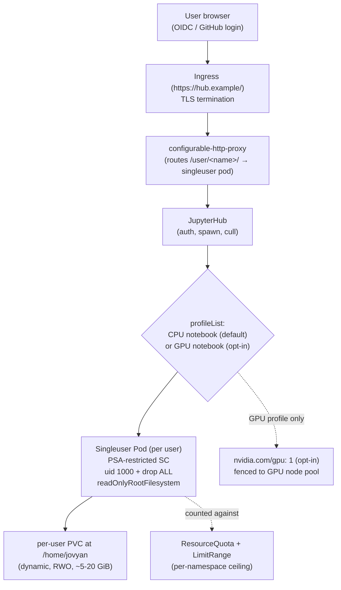

# 05 — Notebooks and interactive ML

> Interactive ML on Kubernetes as long-lived, **PVC-backed dev environments**
> (the dev side of the train -> serve loop); **JupyterHub on Kubernetes**
> (Zero-to-JupyterHub / z2jh: hub, proxy/configurable-http-proxy, per-user
> singleuser servers, profileList for image/resource selection, named-servers
> + culler) vs **Kubeflow Notebooks** (the Kubeflow-native equivalent with
> multi-user/RBAC management); **per-user PVC** for the notebook home (data
> gravity: keep the dataset close); a **namespace `ResourceQuota` /
> `LimitRange`** ([Part 01 ch.03](../01-core-workloads/03-resources-and-qos.md)
> / [Part 08 ch.04](../08-day-2-operations/04-multi-tenancy-and-namespaces.md)
> — deepened, not re-taught); **GPU notebooks** (request `nvidia.com/gpu`,
> the GPU-on-shared-Jupyter pattern from [ch.02](02-gpus-and-accelerators.md));
> the **PSA-`restricted` notebook footgun** (stock Jupyter images run as
> `jovyan` uid 1000 and need writable home, cache and `/tmp`; other notebook
> images can default to *root*) with the compliant singleuser Pod shape; and
> the **dev -> train -> serve** workflow (notebook explores ->
> exports a training script to Git -> CI builds the train image -> a
> PyTorchJob/RayJob runs from [ch.04](04-distributed-training.md) -> KServe
> serves from [ch.06](06-model-serving-and-inference.md)) — applied by
> installing JupyterHub via pinned z2jh Helm into its own namespace, with
> restricted-compliant singleuser Pods (set through KubeSpawner), a per-user
> PVC, and a profileList that includes a "GPU notebook" choice plus the CPU
> default, referencing the example Pod shape in
> [`examples/bookstore/ml/notebook/`](../examples/bookstore/ml/notebook/).

**Estimated time:** ~45 min read · ~120 min hands-on
**Prerequisites:** [Part 12 ch.02](02-gpus-and-accelerators.md) (the GPU model the GPU-notebook profile extends) · [Part 08 ch.04](../08-day-2-operations/04-multi-tenancy-and-namespaces.md) (the namespace quota the hub depends on) · [Part 05 ch.02](../05-security/02-pod-security.md) (PSA-restricted that the notebook image must satisfy)
**Lab tier:** A (kind). Run the lab only against a cluster you own.
**You'll know after this:** • install z2jh (pinned chart) with restricted-compliant notebook Pods · • configure per-user PVCs to keep dataset gravity in the cluster · • author a `profileList` with a GPU-notebook choice plus a CPU default · • configure idle culling so unused singleuser servers do not bleed cost · • check a notebook image's default user before it runs under PSA `restricted`

<!-- tags: ml, gpu, multi-tenancy, psa-restricted, cost -->

## Why this exists

So far Part 12 has named the **batch** side of ML (training as a Job/JobSet/
PyTorchJob/RayJob — ch.03, ch.04) and the *artifact* it produces. But before
training is *a script that runs in CI*, it is **a person poking at a
dataset** — a notebook, with a kernel, with a PVC of data they refuse to
re-download every morning. Pretending that part doesn't happen leads to
two predictable failures: (a) data scientists run notebooks on their laptops
against production data ("just this once" — until the laptop dies), and
(b) the notebook code that produced "the model that worked" lives only in
the kernel's RAM and is gone the moment it shuts down. Neither is
acceptable.

Kubernetes-native notebooks fix both: the notebook is a **Pod** with a
**PVC** mounted at `$HOME`, lifecycled by a **Hub** that handles login and
spawning, in the same cluster as the data and the training/serving stack.
The notebook code lives in Git (committed from inside the notebook), the
data lives on the PVC, and the **same restricted SecurityContext that
holds for [ch.04](04-distributed-training.md)'s training Pods holds for
the notebook Pods** — they are not exempt.

This chapter is the **dev side of the loop**: how to run JupyterHub on
Kubernetes the way the rest of the guide runs anything on Kubernetes
(pinned Helm, own namespace, PSA-`restricted`-compliant, per-user PVCs and
quotas), how to offer GPU notebooks without giving every data scientist
the cluster, and the singleuser-pod footgun no quickstart shows you.

## Mental model

**A notebook is a Pod with a PVC and a kernel. JupyterHub is the
"hub + proxy + spawner" that creates one per user. PSA-`restricted` applies.
Quotas keep one user from ruining the cluster for everyone.**

- **Notebook = Pod + PVC + Kernel.** A Jupyter / JupyterLab notebook is just
  an HTTP server (port 8888) running inside a container. Give it a PVC at
  `$HOME` and the notebook *and* its dataset survive Pod restarts. Give it
  resource requests/limits and it lives in your QoS world
  ([Part 01 ch.03](../01-core-workloads/03-resources-and-qos.md)). Give it
  a restricted securityContext and it lives in your security world
  ([Part 05 ch.02](../05-security/02-pod-security.md)). There is no magic
  here — the *long-lived* nature is the only thing that differs from a
  training Job.
- **JupyterHub = hub + proxy + spawner.** Multi-user Jupyter on Kubernetes
  is **JupyterHub** (Python). Its three moving parts: the **hub** (Python
  service that authenticates users and decides when to spawn/cull a
  notebook), a **proxy** (`configurable-http-proxy` — a small Node proxy
  that maps each user's URL to their singleuser pod), and the per-user
  **singleuser** Pod (the actual notebook). The
  **Zero-to-JupyterHub (z2jh)** Helm chart is the canonical way to deploy
  this on Kubernetes; pin a release, put it in its own namespace, and
  set `singleuser.image`, `singleuser.profileList` and the KubeSpawner
  security settings. **Kubeflow Notebooks** is the
  Kubeflow-native alternative: it integrates with Kubeflow's
  authentication and multi-user `Profile` CRDs, owns `Notebook` CRDs
  per user, and is more "platform" and less "chart". Pick z2jh when
  Jupyter is the whole story; pick Kubeflow Notebooks when Jupyter is
  one component of a larger Kubeflow install.
- **Data gravity = per-user PVC at `$HOME`.** Notebooks live or die on the
  size of the dataset they can keep close. A per-user dynamically
  provisioned PVC at `/home/jovyan` (or `/home/$USER` in Kubeflow
  Notebooks) is the standard: ~2-20 GiB by default, larger for ML teams,
  on a CSI StorageClass with a sensible `reclaimPolicy` and snapshots
  ([Part 03 ch.05](../03-config-and-storage/05-stateful-data-patterns.md))
  for "I deleted the wrong cell in my notebook" recovery.
- **Quota is the only thing between you and runaway costs.** The default
  Jupyter image is large, the default kernel will gladly hold 10 GiB of
  pandas DataFrames, and a forgotten GPU notebook costs more per hour than
  every CI runner you have combined. z2jh puts every singleuser Pod in the
  hub's namespace, so one **`ResourceQuota`** there caps the whole notebook
  fleet, not each user ([Part 08 ch.04](../08-day-2-operations/04-multi-tenancy-and-namespaces.md)
  covers the namespace model). Per-user limits come from three settings:
  one server per user (`allowNamedServers` stays `false`), the pod limits in
  `singleuser.cpu` and `singleuser.memory`, and z2jh's **culler**
  (`cull.timeout`, idle servers stopped). The `singleuser.profileList` menu
  decides which image and resource pair a user can pick, GPU included.
  Without these, notebooks become the single biggest line item on the
  Kubernetes bill and you only find out at month-end.
- **PSA-`restricted` is the footgun.** The quay.io/jupyter images bake a
  non-root user: the scipy and CUDA 12 PyTorch images checked for this
  chapter both have a config `User` of `1000` (`jovyan`). Other notebook
  images are not so tidy. Some default to root and write everywhere, and
  `restricted` refuses them. Check the image's config `User` before you use
  it. Even the good images want a writable `$HOME`, `/tmp` and `~/.cache`
  once the root filesystem is read-only. The
  [`notebook/singleuser-restricted-podtemplate.yaml`](../examples/bookstore/ml/notebook/singleuser-restricted-podtemplate.yaml)
  file in this tree is the compliant shape, and the hands-on gives
  KubeSpawner the same fields. The admission check itself is
  [Part 05 ch.02](../05-security/02-pod-security.md).

## Threats and controls

| Threat | Control in this chapter | Deeper |
|---|---|---|
| A notebook is arbitrary code running in your cluster | Restricted Pod: non-root, no privilege escalation, all capabilities dropped, seccomp, read-only root filesystem | [Part 05 ch.02](../05-security/02-pod-security.md) |
| Someone reaches the hub, or a notebook, without logging in | The hub authenticates every login. The lab password lives in a Secret. Production puts an IdP in front of the hub | [Part 05 ch.01](../05-security/01-authn-authz-rbac.md) |
| A notebook calls the cluster API with a ServiceAccount token | Notebook Pods get a dedicated ServiceAccount with no RBAC and no token mounted | [Part 05 ch.01](../05-security/01-authn-authz-rbac.md) |
| The hub's Role is used to create Pods or read Secrets | One namespaced Role, bound only to the hub's ServiceAccount | [Part 05 ch.01](../05-security/01-authn-authz-rbac.md) |
| A notebook reaches the cloud metadata server or the internet | NetworkPolicy allows the hub, the proxy and DNS only. The chart's privileged metadata-blocking init container is off | [Part 02 ch.06](../02-networking/06-network-policies.md) |
| One user, or a forgotten GPU server, exhausts the fleet | Namespace ResourceQuota, pod limits, one server per user, the culler | [Part 01 ch.03](../01-core-workloads/03-resources-and-qos.md), [Part 08 ch.04](../08-day-2-operations/04-multi-tenancy-and-namespaces.md) |

Multi-tenant isolation between teams lives in
[Part 08 ch.04](../08-day-2-operations/04-multi-tenancy-and-namespaces.md).
This chapter adds the controls that only a notebook needs.

## Diagrams

### User -> Ingress -> Hub -> Spawner -> Per-user singleuser Pod + PVC + (optional GPU) (Mermaid)



### JupyterHub (z2jh) vs Kubeflow Notebooks + PSA-restricted checklist (ASCII)

```
 PICK ONE
 ────────────────────────────────────────────────────────────────────────────
 JupyterHub (z2jh)        - Helm chart (Zero-to-JupyterHub). Pinned, own ns.
                             Hub + configurable-http-proxy + per-user pods.
                             Authenticator = OIDC/GitHub/LDAP via Hub config.
                             Multi-tenancy = NAMESPACE + ResourceQuota.
                             = "I want JupyterHub on Kubernetes" — the simple,
                              focused choice. WE LEAD WITH THIS.

 Kubeflow Notebooks       - Part of Kubeflow. `Notebook` CRDs per user, owned
                             by a Kubeflow Profile. Tight integration with
                             other Kubeflow components (Pipelines, Training,
                             Katib, KServe). Heavier install footprint.
                             = "I already run Kubeflow / I want a platform"

 PSA-RESTRICTED SINGLEUSER POD CHECKLIST (the footgun, made compliant)
   [ ] runAsNonRoot: true + runAsUser: 1000 (the jovyan uid baked into image)
   [ ] fsGroup: 100 (the docker-stacks users group, so the PVC is writable)
   [ ] seccompProfile: RuntimeDefault
   [ ] allowPrivilegeEscalation: false
   [ ] capabilities: { drop: ["ALL"] }
   [ ] readOnlyRootFilesystem: true
   [ ] emptyDir at /tmp  (size-limited)
   [ ] emptyDir at /home/jovyan/.cache  (pip/conda cache, ephemeral)
   [ ] persistentVolumeClaim at /home/jovyan  (per-user, dynamic, RWO)
   [ ] automountServiceAccountToken: false  (notebooks rarely need API token)
   [ ] no cloud-metadata init container; egress limited by NetworkPolicy
   [ ] image bakes uid 1000 (`jovyan`) — choose a base that does, OR rebuild
   [ ] for GPU notebooks: also tolerate the GPU pool taint + nodeAffinity
   [ ] for GPU notebooks: limits.nvidia.com/gpu: 1 (whole device, ch.02)
```

## Hands-on with the Bookstore

**Assumed working directory: the guide repo root (`full-guide/`).** This
chapter installs **JupyterHub from the pinned z2jh chart 4.4.4** into a
namespace named `jupyter`. Each step below creates the namespace at
`restricted` first, so the chart is checked at that level before it runs.
The values file sets the hardening fields the chart exposes and gives
KubeSpawner the rest. The example Pod shows the shape one notebook Pod takes.
The Bookstore example for review is
[`examples/bookstore/ml/notebook/singleuser-restricted-podtemplate.yaml`](../examples/bookstore/ml/notebook/singleuser-restricted-podtemplate.yaml).

> **What the lab run covered.** The captured output below came from a lab
> kind cluster whose cluster and node names differ from the ones shown here.
> The lab used the namespace `p12-05-jupyter` where this chapter says
> `jupyter`, and the transcript header records that substitution. The
> transcript is committed at
> [`evidence/12-05.txt`](../examples/security-lab/evidence/12-05.txt), and the
> script is [`labs/12-05.sh`](../examples/security-lab/labs/12-05.sh). The run
> checked the chart and the Pods by server dry run, and it refused one Pod on
> purpose. The hub did not start in that run, because another install held
> the lab's heavy-install lock. The in-browser login is described, not run.

### 1. Create the namespace and the login Secret

The namespace comes first, labelled `restricted`, so every object in it is
checked at that level. Z2JH is platform infrastructure, so it gets its own
namespace, not `bookstore-ml`.

```sh
kubectl apply -f - <<'EOF'
apiVersion: v1
kind: Namespace
metadata:
  name: jupyter
  labels:
    pod-security.kubernetes.io/enforce: restricted
    pod-security.kubernetes.io/enforce-version: latest
    pod-security.kubernetes.io/audit: restricted
    pod-security.kubernetes.io/audit-version: latest
    pod-security.kubernetes.io/warn: restricted
    pod-security.kubernetes.io/warn-version: latest
EOF
```

<!-- gate: output -->
```text
$ kubectl apply -f - <<'EOF'   # Namespace jupyter, labelled restricted
namespace/p12-05-jupyter created
```

The demo login is one user, `lab`, and one generated password, held in a
Secret. The chart reads
`values.yaml` from the Secret named by `hub.existingSecret` and merges it into
the hub's configuration, so the password never sits in a values file or in
Git. The lab's authenticator, `shared-password`, is for a lab only (see
[How it works](#how-it-works-under-the-hood)).

```sh
umask 077
printf 'hub:\n  config:\n    SharedPasswordAuthenticator:\n      user_password: "%s"\n' \
  "$(openssl rand -hex 24)" > hub-secret-values.yaml
kubectl create secret generic jupyterhub-hub-secrets -n jupyter \
  --from-file=values.yaml=hub-secret-values.yaml
rm hub-secret-values.yaml
```

<!-- gate: output -->
```text
$ kubectl create secret generic jupyterhub-hub-secrets -n p12-05-jupyter --from-file=values.yaml=<generated file>
secret/jupyterhub-hub-secrets created
```

Secrets are stored base64-encoded. Unless the cluster encrypts Secrets at
rest, anyone who can read this Secret can read the password. Use an identity
provider for anything beyond a lab.

### 2. The values file

Save this as `jupyterhub-values.yaml`. It sets every hardening field the
chart exposes, and it sets the KubeSpawner settings the chart does not
expose as values. Images are pinned by digest, with the tag in front of the
`@`.

```yaml
# jupyterhub-values.yaml: Zero-to-JupyterHub chart 4.4.4 (JupyterHub 5.5.4).
hub:
  config:
    JupyterHub:
      authenticator_class: shared-password  # demo login; production uses an IdP
    Authenticator:
      # The base Authenticator admits nobody unless allow_all is set or a user
      # list is given. The demo login admits only the user named here.
      allowed_users:
        - lab
  existingSecret: jupyterhub-hub-secrets    # holds the shared password
  resources:                                # the chart default is {}
    requests:
      cpu: 100m
      memory: 256Mi
    limits:
      memory: 512Mi
  image:
    name: quay.io/jupyterhub/k8s-hub
    tag: "4.4.4@sha256:bbce7a924eac0dfe10d738ff2d966cb306a40973519005a160282415561a774b"
  containerSecurityContext:
    runAsUser: 1000
    runAsGroup: 1000
    allowPrivilegeEscalation: false
    readOnlyRootFilesystem: true
    capabilities:
      drop: ["ALL"]
  extraVolumes:
    - name: tmp
      emptyDir:
        sizeLimit: 64Mi
  extraVolumeMounts:
    - name: tmp
      mountPath: /tmp
  extraConfig:
    notebook-hardening: |
      c.KubeSpawner.automount_service_account_token = False
      c.KubeSpawner.pod_security_context = {
          "runAsNonRoot": True,
          "seccompProfile": {"type": "RuntimeDefault"},
      }
      c.KubeSpawner.container_security_context = {
          "readOnlyRootFilesystem": True,
          "capabilities": {"drop": ["ALL"]},
      }

proxy:
  service:
    type: ClusterIP                         # no public LoadBalancer; use an Ingress
  chp:
    resources:                              # the chart default is {}
      requests:
        cpu: 50m
        memory: 64Mi
      limits:
        memory: 128Mi
    image:
      name: quay.io/jupyterhub/configurable-http-proxy
      tag: "5.2.0@sha256:522738d5285e4be758da5023194cbc95249efdadaa62a0998c8ed1aa2890b2da"
    containerSecurityContext:
      runAsNonRoot: true
      runAsUser: 65534
      runAsGroup: 65534
      allowPrivilegeEscalation: false
      readOnlyRootFilesystem: true
      capabilities:
        drop: ["ALL"]
      seccompProfile:
        type: "RuntimeDefault"

scheduling:
  userScheduler:
    enabled: false                          # packing only, not a boundary
  userPlaceholder:
    enabled: false

prePuller:
  hook:
    enabled: false
  continuous:
    enabled: false
  pullProfileListImages: false              # keeps the GPU image off every node

cull:
  enabled: true
  timeout: 3600                             # idle for an hour: server stopped
  every: 600

singleuser:
  image:
    name: quay.io/jupyter/scipy-notebook
    tag: "2024-08-12@sha256:a8925f5242a701edd718a4c1afc3bdeabb7dcb9ae6ff55116db790379a6f6e04"
  cmd: start-singleuser.sh
  defaultUrl: /lab
  uid: 1000
  fsGid: 100
  allowPrivilegeEscalation: false
  serviceAccountName: jupyterhub-singleuser
  cloudMetadata:
    blockWithIptables: false                # the default adds a privileged init container
  networkPolicy:
    enabled: true
    egressAllowRules:
      cloudMetadataServer: false
      dnsPortsCloudMetadataServer: true
      dnsPortsKubeSystemNamespace: true
      dnsPortsPrivateIPs: true
      nonPrivateIPs: false                  # no internet egress; mirror package indexes
      privateIPs: false
  storage:
    type: dynamic
    capacity: 5Gi
    homeMountPath: /home/jovyan
    extraVolumes:
      - name: tmp
        emptyDir:
          sizeLimit: 256Mi
      - name: cache
        emptyDir:
          sizeLimit: 512Mi
    extraVolumeMounts:
      - name: tmp
        mountPath: /tmp
      - name: cache
        mountPath: /home/jovyan/.cache
  extraEnv:
    JUPYTER_RUNTIME_DIR: /home/jovyan/.local/share/jupyter/runtime
    JUPYTER_DATA_DIR: /home/jovyan/.local/share/jupyter
    PIP_CACHE_DIR: /home/jovyan/.cache/pip
  cpu:
    limit: 2
    guarantee: 0.25
  memory:
    limit: 2G
    guarantee: 0.5G
  profileList:
    - display_name: "CPU notebook (default)"
      description: "scipy, pandas, scikit-learn; 2 CPU, 2 GiB"
      default: true
    - display_name: "GPU notebook"
      description: "CUDA 12 notebook; needs a GPU node (Part 12 ch.02)"
      kubespawner_override:
        image: quay.io/jupyter/pytorch-notebook:cuda12-2024-08-12@sha256:e1ffb5e44ed261f51e524393b8ae621a79da957e712b084aac00a967fb41f6be
        extra_resource_limits: { "nvidia.com/gpu": "1" }
        node_affinity_required:
          - matchExpressions:
              - { key: "nvidia.com/gpu.present", operator: In, values: ["true"] }
        extra_tolerations:
          - { key: "nvidia.com/gpu", operator: "Exists", effect: "NoSchedule" }
```

Each hardening field, where it first appears:

- **`readOnlyRootFilesystem: true`** (hub, proxy and notebook). The image
  filesystem cannot be written. Writes go to an `emptyDir` (`/tmp`, the
  cache) or to the per-user PVC. Jupyter needs its runtime and data
  directories under `$HOME` for the same reason, so the env lines point
  there.
- **`capabilities.drop: ["ALL"]`**. No Linux capabilities. A notebook needs
  none.
- **`allowPrivilegeEscalation: false`**. A setuid binary cannot raise
  privilege inside the container.
- **`runAsNonRoot`, `runAsUser`**. The hub image names its user `jovyan`
  rather than a number. Without `runAsUser`, the kubelet cannot verify
  non-root for a named user and refuses to start the container, so the chart
  sets `runAsUser: 1000` numerically.
- **`seccompProfile: RuntimeDefault`**. The container runtime's default
  syscall filter.
- **`c.KubeSpawner.automount_service_account_token = False`**. A notebook
  Pod gets no API token, even with a ServiceAccount set.
- **`pod_security_context` and `container_security_context`** (in
  `hub.extraConfig`). The chart has no value for these. KubeSpawner applies
  them to every notebook Pod, and profile overrides do not change them.
- **`singleuser.serviceAccountName`**. A dedicated ServiceAccount, not
  `default`, with no RBAC (step 5 creates it).
- **`cloudMetadata.blockWithIptables: false`**. The chart's default adds a
  privileged init container that runs as root and adds `NET_ADMIN`, to block
  the metadata server with iptables. Step 5 shows restricted refusing that
  shape. The NetworkPolicy blocks the metadata server instead.
- **`networkPolicy.egressAllowRules`**. Notebooks reach the hub, the proxy
  and DNS. Other internet and private-range traffic is not allowed. Package
  installs then need a mirror and a rule you add for it.
- **`userScheduler`, `userPlaceholder`, `prePuller`**. Off. They add objects
  and images, and the user scheduler is a packing optimisation, not a
  boundary.
- **`proxy.service.type: ClusterIP`**. Nothing is published by a LoadBalancer.
  Put an Ingress that terminates TLS in front of `proxy-public`.
- **Digests**. The digests were read from the registries for this chapter.
  Read them again when you bump a tag.

The image configs behind the `User` claims were read from the registries
without a pull. Restricted checks the `User` in that config when a Pod does
not set one, so it is the first thing to look at:

<!-- gate: output -->
```text
quay.io/jupyter/scipy-notebook:2024-08-12
  digest=sha256:a8925f5242a701edd718a4c1afc3bdeabb7dcb9ae6ff55116db790379a6f6e04
  config={'User': '1000', 'Entrypoint': ['tini', '-g', '--', 'start.sh'], 'Cmd': ['start-notebook.py']}
quay.io/jupyter/pytorch-notebook:cuda12-2024-08-12
  digest=sha256:e1ffb5e44ed261f51e524393b8ae621a79da957e712b084aac00a967fb41f6be
  config={'User': '1000', 'Entrypoint': ['tini', '-g', '--', 'start.sh'], 'Cmd': ['start-notebook.py']}
quay.io/jupyterhub/k8s-hub:4.4.4
  digest=sha256:bbce7a924eac0dfe10d738ff2d966cb306a40973519005a160282415561a774b
  config={'User': 'jovyan', 'Entrypoint': ['tini', '--'], 'Cmd': ['jupyterhub', '--config', '/usr/local/etc/jupyterhub/jupyterhub_config.py']}
```

### 3. Render the chart and dry-run it at restricted

The chart renders to plain objects. Pipe them to a server dry run in the
restricted namespace:

```sh
helm repo add jupyterhub https://hub.jupyter.org/helm-chart/
helm repo update
helm template jupyterhub jupyterhub/jupyterhub --version 4.4.4 \
  -n jupyter -f jupyterhub-values.yaml \
  | kubectl apply --dry-run=server -n jupyter -f -
```

A server dry run sends the objects to the API server, runs admission, and
stores nothing. A client dry run skips admission, so `--dry-run=client` cannot
tell you whether restricted accepts a Pod. The lab output lists what the chart
creates. It printed no PodSecurity warning. The namespace's `warn` label is
`restricted`, so a Deployment whose pod template broke the level would have
printed one. A dry run starts no Pod, so the hub and proxy were not running.

<!-- gate: output -->
```text
$ helm template jupyterhub jupyterhub/jupyterhub --version 4.4.4 -n p12-05-jupyter -f jupyterhub-values.yaml | kubectl apply --dry-run=server -n p12-05-jupyter -f -
networkpolicy.networking.k8s.io/hub created (server dry run)
networkpolicy.networking.k8s.io/proxy created (server dry run)
networkpolicy.networking.k8s.io/singleuser created (server dry run)
serviceaccount/hub created (server dry run)
secret/hub created (server dry run)
configmap/hub created (server dry run)
persistentvolumeclaim/hub-db-dir created (server dry run)
role.rbac.authorization.k8s.io/hub created (server dry run)
rolebinding.rbac.authorization.k8s.io/hub created (server dry run)
service/hub created (server dry run)
service/proxy-api created (server dry run)
service/proxy-public created (server dry run)
deployment.apps/hub created (server dry run)
deployment.apps/proxy created (server dry run)
```

The render has no ClusterRole, because the user scheduler is off. The one Role
is the hub's own permission, and the chart binds it only to the hub's
ServiceAccount. It grants `get`, `watch`, `list`, `create` and `delete` on
Pods, PVCs, Secrets and Services in the namespace, and read on events. A
notebook Pod in the same namespace cannot use that Role, because it has no
token. That is why the notebook Pods get none.

<!-- gate: output -->
```text
rules:
  - apiGroups: [""]       # "" indicates the core API group
    resources: ["pods", "persistentvolumeclaims", "secrets", "services"]
    verbs: ["get", "watch", "list", "create", "delete"]
  - apiGroups: [""]       # "" indicates the core API group
    resources: ["events"]
    verbs: ["get", "watch", "list"]
---
```

### 4. Install (what you run; the lab did not)

Pin the chart version and keep the digests in the values file. Never install
from a `releases/latest` URL, because a moving chart changes the hub's
defaults without a review. The lab run did not install, so there is no
captured output for this step. Run it on a cluster you own:

```sh
helm install jupyterhub jupyterhub/jupyterhub \
  --version 4.4.4 -n jupyter \
  -f jupyterhub-values.yaml --wait

kubectl get pods -n jupyter
#   hub-* and proxy-* should be Running
```

### 5. One notebook Pod: accepted, and one refused on purpose

Notebook Pods run as a ServiceAccount that exists only to be named. It has
no RBAC, and automount is off, so no token file appears in the Pod:

```sh
kubectl apply -n jupyter -f - <<'EOF'
apiVersion: v1
kind: ServiceAccount
metadata:
  name: jupyterhub-singleuser
  namespace: jupyter
automountServiceAccountToken: false
EOF
```

Then check the example Pod against restricted. It has the labels the chart's
NetworkPolicy selects on, `component: singleuser-server`, and the shape
KubeSpawner builds from the values: the Pod-level `runAsNonRoot`, `fsGroup: 100`
and seccomp profile, and the container-level user, privilege, root-filesystem
and capability settings.

```sh
kubectl apply --dry-run=server -n jupyter \
  -f examples/bookstore/ml/notebook/singleuser-restricted-podtemplate.yaml
```

<!-- gate: output -->
```text
$ kubectl apply -f - <<'EOF'   # ServiceAccount jupyterhub-singleuser, no token
serviceaccount/jupyterhub-singleuser created
$ kubectl apply --dry-run=server -n p12-05-jupyter -f <the example notebook Pod>
pod/jupyter-singleuser-illustrative created (server dry run)
```

**Deliberate refusal.** The step below sends a Pod with the chart's default
init container, on purpose, to show restricted refusing it. Nothing is
created. The default init container is privileged, runs as root and adds
`NET_ADMIN`. It is the reason the values file sets
`blockWithIptables: false`.

<!-- gate: output -->
```text
$ kubectl apply --dry-run=server -n p12-05-jupyter -f <Pod with the default init container>
Error from server (Forbidden): error when creating "STDIN": pods "jupyter-singleuser-privileged-init" is forbidden: violates PodSecurity "restricted:latest": privileged (container "block-cloud-metadata" must not set securityContext.privileged=true), allowPrivilegeEscalation != false (container "block-cloud-metadata" must set securityContext.allowPrivilegeEscalation=false), unrestricted capabilities (container "block-cloud-metadata" must set securityContext.capabilities.drop=["ALL"]; container "block-cloud-metadata" must not include "NET_ADMIN" in securityContext.capabilities.add), runAsUser=0 (container "block-cloud-metadata" must not set runAsUser=0)
```

### 6. The fleet quota: one ceiling for the namespace

Every notebook Pod in the namespace counts against one set of totals. Admission
refuses a Pod that would push requests past them, so this is the ceiling for
the whole fleet. It is not a per-user quota: z2jh creates every notebook in
the hub's namespace, and KubeSpawner's `namespace` setting is a single string.

```sh
kubectl create quota nb-quota -n jupyter \
  --hard=requests.cpu=8,requests.memory=16Gi,requests.nvidia.com/gpu=2 \
  --dry-run=server
```

<!-- gate: output -->
```text
$ kubectl create quota nb-quota --hard=requests.cpu=8,requests.memory=16Gi,requests.nvidia.com/gpu=2 -n p12-05-jupyter --dry-run=server
resourcequota/nb-quota created (server dry run)
```

Per-user limits come from elsewhere: `allowNamedServers` stays `false` in the
values, so each user has one server, and that server's pod limits come from
`singleuser.cpu` and `singleuser.memory`.

### 7. Egress, and the network plugin that decides enforcement

The `singleuser` NetworkPolicy in the render allows egress to the hub's
ports, to the proxy's port, and to DNS. The hub-facing rules select the
`hub` and `proxy` components, and the DNS rules allow port 53 only, including
to the metadata address. HTTP to the metadata server and to the internet is
not in the policy.

<!-- gate: output -->
```text
$ helm template jupyterhub jupyterhub/jupyterhub --version 4.4.4 -n p12-05-jupyter -f jupyterhub-values.yaml --show-only templates/singleuser/netpol.yaml | grep "component: \|cidr:\|port: \|metadata.name: "
    component: singleuser
    app.kubernetes.io/component: singleuser
      component: singleuser-server
        - port: notebook-port
              component: hub
        - port: 8081
              component: proxy
        - port: 8000
              component: autohttps
        - port: 8080
        - port: 8443
        - port: 53
        - port: 53
            cidr: 169.254.169.254/32
              kubernetes.io/metadata.name: kube-system
            cidr: 10.0.0.0/8
            cidr: 172.16.0.0/12
            cidr: 192.168.0.0/16
```

A NetworkPolicy object is only a request until a network plugin enforces it.
Check which plugin the cluster runs:

<!-- gate: output -->
```text
$ kubectl get daemonset kindnet -n kube-system -o name
daemonset.apps/kindnet
```

The lab cluster runs kindnet, and kindnet enforces NetworkPolicy here. Step 11
of the lab applies the chart's `singleuser` policy and captures the result: a
notebook-labelled Pod cannot reach the API server, while an unlabelled Pod in
the same namespace reaches it. Enforcement depends on the cluster's plugin, so
check yours before you rely on the egress rules above
([Part 02 ch.06](../02-networking/06-network-policies.md)).

The capture below is step 11 of the lab. The notebook-labelled Pod carries the
policy's three selector labels, so the policy applies to it. Its DNS lookup
works, because the policy allows port 53, and its connection to the API server
fails. The unlabelled control reaches the API server. The endpoint address is
read into a variable and not printed.

<!-- gate: output -->
```text
$ kubectl apply -f netpol.yaml -n p12-05-jupyter
networkpolicy.networking.k8s.io/singleuser created
$ kubectl get endpoints kubernetes -n default (the address is read into a variable and not printed)
$ kubectl apply -f notebook-probe.yaml (labels: component: singleuser-server
app: jupyterhub
release: jupyterhub)
pod/notebook-probe created
pod/notebook-probe condition met
$ kubectl apply -f control.yaml (labels: app: control)
pod/control created
pod/control condition met
$ kubectl exec -i notebook-probe -- python -I - < probe.py
dns kubernetes.default.svc: 10.96.0.1
https GET /version on the API server: failed: URLError
$ kubectl exec -i control -- python -I - < probe.py
dns kubernetes.default.svc: 10.96.0.1
https GET /version on the API server: HTTP 200
```

Clean up the lab namespace when you are done:

```sh
kubectl delete namespace jupyter
```

<!-- gate: output -->
```text
$ kubectl delete namespace p12-05-jupyter --wait=true
namespace "p12-05-jupyter" deleted
```

### 8. The dev -> train -> serve loop (how this chapter ties the next two)

The recommendations thread end-to-end:

1. **Notebook (this chapter).** A data scientist opens
   `https://hub.example/`, picks the CPU profile, gets a singleuser pod
   with `/home/jovyan` PVC. They explore the
   [`../examples/bookstore/ml/dataset/`](../examples/bookstore/ml/dataset/)
   schema, prototype the recommender, and export `train.py` to a Git repo.
2. **Train ([ch.04](04-distributed-training.md)).** CI builds the image,
   `kubectl apply -f recommender-train-job.yaml` produces `model.joblib`
   on the `recommender-model` PVC. PyTorchJob / RayJob variants exist as
   the distributed shapes.
3. **Serve ([ch.06](06-model-serving-and-inference.md)).** A KServe
   `InferenceService` (or the plain Deployment fallback) loads the same
   `model.joblib` and exposes the recommender API the Bookstore
   `catalog` / `storefront` services call.

Notebooks are the *front of the loop*, not a separate thing.

## How it works under the hood

- **JupyterHub's three Pods, precisely.** The **hub** is a Python service
  (image `quay.io/jupyterhub/k8s-hub`) running JupyterHub itself — it
  authenticates, decides spawn/cull, owns the database of users and active
  servers (SQLite by default; Postgres for HA). The **proxy** is
  `configurable-http-proxy` (Node), image
  `quay.io/jupyterhub/configurable-http-proxy`, listening on a public
  port and dynamically registering routes per user (`/user/<NAME>/` ->
  the user's singleuser Pod). The **user-scheduler** is a kube-scheduler
  *shim* (image `registry.k8s.io/kube-scheduler` with a custom config)
  that packs singleuser pods onto already-active notebook nodes (so a
  scaled-down cluster keeps notebook nodes warm rather than draining
  them). It is purely a packing/cost optimisation, not a security boundary,
  and this chapter's values turn it off.
- **Spawn lifecycle.** When a logged-in user clicks "Start My Server",
  the hub's **`KubeSpawner`** (the kubernetes-spawner plugin) creates: a
  PVC from `singleuser.storage.dynamic`, a Pod
  (`jupyter-<USERNAME>`) using `singleuser.image`, the KubeSpawner
  security settings and the chosen profile's `kubespawner_override`, a
  Service pointing at the Pod, and a route on the proxy. The hub watches the
  Pod's readiness, registers the route once ready, and redirects the user's
  browser. On idle, the **culler** (a small client running inside the hub)
  deletes the Pod + Service (the PVC survives: that is the point).
- **One namespace for the fleet.** KubeSpawner's `namespace` setting is one
  string, not a per-user function, so z2jh creates every notebook Pod in the
  hub's namespace. The quota in step 6 and the Role in step 3 therefore cover
  all users together. A namespace per user is the stronger boundary, because
  the quota, the NetworkPolicy and the Role can then differ per user. This
  chapter does not build that. It needs a provisioning step that creates each
  namespace with its quota and its RoleBinding, which Kubeflow Profiles does
  for you. Plan it before you open the hub to more than one team.
- **Why per-user PVC matters operationally.** Without it, a user who
  shuts down their notebook loses everything in `/home/jovyan` —
  uncommitted code, kernel state, a half-trained model. With it, the
  notebook is *the same kernel state* across days. The PVC outlives the
  Pod, snapshot it ([Part 03 ch.05](../03-config-and-storage/05-stateful-data-patterns.md)),
  back it up — it is the user's workspace.
- **GPU notebooks on a shared cluster.** The
  [ch.02](02-gpus-and-accelerators.md) recipe applies unchanged: the GPU
  profile adds `extra_resource_limits.nvidia.com/gpu: 1` + the GPU
  toleration + nodeAffinity. Because a GPU is *whole-device*, an idle
  GPU notebook holds the GPU even when the user is asleep — **the culler
  is mandatory**, not optional. The culler is the only control on an idle GPU
  notebook. Kueue does not queue or preempt notebook Pods: its namespace
  selector matches only `bookstore-ml`, and notebooks run in `jupyter`. This is the
  ch.02 "keep the expensive GPU busy" loop applied to notebooks: idle
  notebooks must not hoard GPUs. The profile changes no security setting:
  the GPU Pod gets the same context as the CPU Pod, and nothing in it asks
  for privilege.
- **Kubeflow Notebooks, the alternative.** A `Notebook` CRD
  (`kubeflow.org/v1`) holds the same shape — `spec.template.spec` is a
  PodSpec — owned by a Kubeflow `Profile`. The Notebook Controller
  reconciles it into a `StatefulSet` (so the Pod can be restarted with a
  stable identity) + a Service + a Virtual Service (for Istio
  ingress / per-user URLs through Kubeflow's central dashboard). The
  multi-user model is heavier (Profiles, AuthorizationPolicies, Istio)
  and tighter to the rest of Kubeflow (Pipelines, KServe). Pick it if
  you are already running Kubeflow; pick z2jh otherwise.
- **The PSA-restricted footgun, explained.** Two things bite. First, a
  notebook image that runs as root is **rejected** by `restricted`, because
  `runAsNonRoot` cannot hold for a root image. An image that names its user
  rather than giving a number, and a Pod that does not set `runAsUser`, is
  refused too, because the kubelet cannot verify non-root. Check the image
  config's `User` first. The quay.io/jupyter images use `1000`, and
  KubeSpawner sets `runAsUser` from `singleuser.uid`. Second, Jupyter wants
  writable paths it does not expose as
  options: the kernel writes runtime files, pip writes a cache, sklearn
  writes `__pycache__` everywhere, `/tmp` is needed by half the
  filesystem layer. `readOnlyRootFilesystem: true` breaks all of that
  unless you mount `emptyDir`s at the writable paths *and* point Jupyter
  at them via env (`JUPYTER_RUNTIME_DIR`, `PIP_CACHE_DIR`,
  `JUPYTER_DATA_DIR`, etc.). The example Pod in this tree does that, so the
  shape is a real Pod that the server dry run accepts, not a sketch.
- **Auth in front of the Hub.** The Hub's `JupyterHub.authenticator_class`
  picks the login: OIDC (Keycloak, Auth0, Okta), GitHub, LDAP, generic OAuth,
  or a static password. This chapter uses `shared-password`. JupyterHub's
  own docstring for it says the password is stored in plain text in config,
  and anyone with it can log in as any user. The chart's default `dummy`
  authenticator is weaker: `DummyAuthenticator` accepts any username and
  password when no password is set. Use the static password for the lab only.
  In production, terminate TLS at an Ingress in front of `proxy-public`, and
  authenticate at the Hub against your IdP. The notebook sees only the
  hub-injected `JUPYTERHUB_USER`. Each user gets their own Pod, which is the
  process boundary that matters, because a notebook runs arbitrary code.

## Production notes

> **In production:** per-user PVCs are non-negotiable, with a
> reasonable default (5-20 GiB) and a snapshot policy
> ([Part 03 ch.05](../03-config-and-storage/05-stateful-data-patterns.md)).
> Document a path for "I deleted the wrong cell" (PVC snapshot rollback)
> and "I left the company" (PVC archive). The notebook IS the user's
> workspace, treat it like one.

> **In production:** **enable the culler** with an aggressive timeout (an
> hour of idle, not a day). Idle CPU notebooks waste memory; idle GPU
> notebooks waste *real money*. Pair with a **namespace `ResourceQuota`**
> ([Part 08 ch.04](../08-day-2-operations/04-multi-tenancy-and-namespaces.md))
> and, for GPUs, the **culler**: Kueue does not preempt notebook Pods, so
> nothing else reclaims an idle GPU ([ch.03](03-batch-and-gang-scheduling.md)
> covers what Kueue does manage).

> **In production:** the data scientist's exit from the notebook is
> **commit to Git**, not "the kernel still has it in memory". The
> dev -> train -> serve loop (notebook explores -> exports `train.py` ->
> CI builds the train image -> PyTorchJob / RayJob -> KServe) is
> doctrine, not aspiration. The notebook is the *front* of the loop,
> not a substitute for it.

## Quick Reference

```sh
# Namespace at restricted, then the chart (pinned)
kubectl create namespace jupyter
kubectl label namespace jupyter pod-security.kubernetes.io/enforce=restricted
helm repo add jupyterhub https://hub.jupyter.org/helm-chart/
helm install jupyterhub jupyterhub/jupyterhub --version 4.4.4 \
  -n jupyter -f jupyterhub-values.yaml --wait

# Check the render against restricted before you install
helm template jupyterhub jupyterhub/jupyterhub --version 4.4.4 \
  -n jupyter -f jupyterhub-values.yaml \
  | kubectl apply --dry-run=server -n jupyter -f -

# The fleet ceiling for the namespace (not per user)
kubectl create quota nb-quota -n jupyter \
  --hard=requests.cpu=8,requests.memory=16Gi,requests.nvidia.com/gpu=2

# One notebook Pod shape, server dry run
kubectl apply --dry-run=server -n jupyter \
  -f examples/bookstore/ml/notebook/singleuser-restricted-podtemplate.yaml
```

The notebook settings that matter, as an excerpt of the values file:

```yaml
# Excerpt of jupyterhub-values.yaml: the notebook settings that matter.
hub:
  existingSecret: jupyterhub-hub-secrets
  extraConfig:
    notebook-hardening: |
      c.KubeSpawner.automount_service_account_token = False
      c.KubeSpawner.pod_security_context = {"runAsNonRoot": True, "seccompProfile": {"type": "RuntimeDefault"}}
      c.KubeSpawner.container_security_context = {"readOnlyRootFilesystem": True, "capabilities": {"drop": ["ALL"]}}
singleuser:
  uid: 1000
  fsGid: 100
  allowPrivilegeEscalation: false
  serviceAccountName: jupyterhub-singleuser
  cloudMetadata:
    blockWithIptables: false
  networkPolicy:
    egressAllowRules:
      nonPrivateIPs: false
      privateIPs: false
```

Checklist:

- [ ] JupyterHub installed via a **pinned** chart version in its own namespace
- [ ] Namespace labelled **`restricted`** before the chart is applied
- [ ] Hub login from a **Secret**, not a values file, and an IdP in production
- [ ] Notebook Pods: **no API token**, a dedicated ServiceAccount with no RBAC
- [ ] **No privileged init container**: `cloudMetadata.blockWithIptables: false`
- [ ] Egress limited to the hub, the proxy and DNS by NetworkPolicy on an
  enforcing plugin
- [ ] **Per-user PVC** at `/home/jovyan`, dynamic, sensible default size,
  snapshotted
- [ ] **Namespace `ResourceQuota`** caps the notebook fleet (not per user),
  with one server per user
- [ ] **Culler enabled** with an aggressive timeout (idle GPU notebooks are
  pure cost)
- [ ] **GPU profile** uses the [ch.02](02-gpus-and-accelerators.md) taint +
  affinity + `limits.nvidia.com/gpu`
- [ ] Notebook image's config `User` checked: a numeric non-root user
- [ ] Data scientists commit `train.py` to **Git** — the notebook is the front
  of the loop

## Test your understanding

> Try each before opening the answer drawer. The act of trying is the exercise; the answer is the check.

1. **Why per-user PVC at `/home/jovyan` and not a shared one?**
   <details><summary>Show answer</summary>

   Notebooks are personal dev environments — datasets being explored,
   half-written code, secrets pasted into cells, cached Python packages. A
   shared PVC has every user stepping on each other's files and creates
   cross-user data exposure (one user's reading another's `client_secret.json`
   they accidentally cell-magicked into the home dir). Per-user PVC also lets
   you size and quota individually, snapshot per-user for portability, and
   delete cleanly when a user offboards. RWX is required only when multiple
   Pods (e.g. a notebook + a training Job triggered from it) need the same
   files; even then, per-*user* not per-*Pod*.

   </details>

2. **Your data scientist's notebook has been "idle" for 4 days, holding a GPU. The cost dashboard shows it's the single most expensive resource. What's the policy fix?**
   <details><summary>Show answer</summary>

   Enable the **culler**. Z2JH ships with `cull.enabled: true` — set
   `cull.timeout: 3600` (1 hour idle), `cull.every: 600` (check every 10 min),
   and `cull.users: true` to also stop the user record. For GPU notebooks
   specifically, set a tighter cull timeout (30 min) because idle-GPU cost is
   acute. Also: surface "your notebook will be culled in 5 min" via Jupyter UI
   extension. Culling doesn't delete the PVC — when the user logs in next,
   they get a fresh notebook attached to the same volume; their files are
   intact. Idle GPU cost is the #1 ML notebook problem in production; the
   culler is the only sustainable answer.

   </details>

3. **A notebook image passes PSA-restricted only if its Pod and container settings meet it. In this chapter's values, which settings supply `runAsNonRoot`, the seccomp profile, the read-only root filesystem and the dropped capabilities? Why does the hub need `hub.extraConfig` for some of them?**
   <details><summary>Show answer</summary>

   At Pod level, `c.KubeSpawner.pod_security_context` gives `runAsNonRoot:
   True` and `seccompProfile: RuntimeDefault`. The chart has no value for it,
   which is why it goes in `hub.extraConfig`. At container level,
   `c.KubeSpawner.container_security_context` gives `readOnlyRootFilesystem:
   True` and `capabilities.drop: ["ALL"]`, also from `hub.extraConfig`.
   `singleuser.uid: 1000` sets the container's `runAsUser`, `singleuser.fsGid:
   100` sets the Pod's `fsGroup` (the docker-stacks users group, which keeps
   the per-user PVC writable), and `singleuser.allowPrivilegeEscalation:
   false` sets the privilege flag. Restricted itself requires `runAsNonRoot`
   and `drop: ALL`, so a Pod missing either is refused.
   `readOnlyRootFilesystem` is not a restricted rule. It is this Part's
   baseline, and the chapter sets it anyway.

   </details>

4. **Your ResourceQuota is `requests.cpu=8` in the `jupyter` namespace. Ten users log in at once, each on the default CPU profile. What stops them, and what does the quota protect against?**
   <details><summary>Show answer</summary>

   All ten start. Each default server requests 0.25 CPU
   (`singleuser.cpu.guarantee`), so ten servers request 2.5 of the 8 CPUs in
   the quota. The quota stops the fleet at 32 default servers, because CPU
   runs out first. The 33rd spawn is refused at admission with an "exceeded
   quota" error, and only that user's spawn fails. The quota is not a per-user
   limit. One user with one server is capped by the pod limits in the values,
   and `allowNamedServers: false` keeps each user to one server. A per-user
   namespace is the design that gives per-user quota, and it is the
   provisioning step in the "One namespace for the fleet" bullet.

   </details>

## Further reading

- **Ibryam & Huß, _Kubernetes Patterns_ 2e — *Self-Awareness* (ch.16)** and
  ***Stateful Service* (ch.12)** — long-lived stateful Pods (which is what
  a per-user notebook is) and how data gravity drives shape decisions.
- **Rosso et al., _Production Kubernetes_, ch.12 — "Multitenancy"** —
  exactly the multi-tenant ceiling story the per-user PVC + per-namespace
  quota + Hub-authenticator stack is solving.
- Official: **Zero-to-JupyterHub on Kubernetes** docs <https://z2jh.jupyter.org/>
  (the chart, values, the singleuser shape); **Kubeflow Notebooks** docs
  <https://www.kubeflow.org/docs/components/notebooks/> (CRD, Profiles,
  Istio integration); **KubeSpawner** docs
  <https://jupyterhub-kubespawner.readthedocs.io/> (the
  the spawner settings this chapter sets, and `profileList` semantics).
- Sources checked for the claims in this chapter, at the versions named:
  the Pod Security Standards <https://kubernetes.io/docs/concepts/security/pod-security-standards/>;
  the z2jh chart 4.4.4 templates and values <https://github.com/jupyterhub/zero-to-jupyterhub-k8s>;
  KubeSpawner 7.1.0 (`objects.py`, `spawner.py`) <https://github.com/jupyterhub/kubespawner>;
  JupyterHub 5.5.4 (`authenticators/shared.py`, `auth.py`) <https://github.com/jupyterhub/jupyterhub>;
  and the docker-stacks base image, which installs `jupyterhub-singleuser`
  and `start-singleuser.sh` <https://github.com/jupyter/docker-stacks>.
