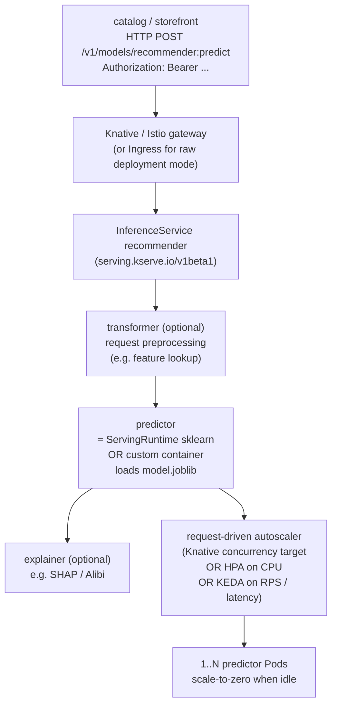

# 06 — Model serving and inference

> The serving problem (low-latency request/response over HTTP/gRPC,
> autoscaling on **request load** rather than CPU, **scale-to-zero**, model
> versioning, **A/B** + canary at the model level); **KServe** (`InferenceService`
> + `ServingRuntime`, serverless via Knative or raw `Deployment`) installed
> from its pinned release; **Seldon Core** and **NVIDIA Triton** at the right
> depth; autoscaling for serving; GPU serving; and model canary, A/B and shadow
> at the InferenceService level. The chapter serves the trained recommender two
> ways, as a **KServe `InferenceService`** and as a **plain Deployment +
> Service**, and it adds the security the serving endpoint needs: a caller
> check, a cost ceiling, and a model file that is read as code.

**Estimated time:** ~60 min read · ~120 min hands-on
**Prerequisites:** [Part 12 ch.04](04-distributed-training.md): model artifact this chapter serves · [Part 06 ch.04](../06-production-readiness/04-autoscaling.md): autoscaling primitives Knative/HPA/KEDA build on · [Part 07 ch.05](../07-delivery/05-progressive-delivery.md): replica-driven canary contrasted with request-driven KServe canary · [01.01](../01-core-workloads/01-pods.md#baseline): the baseline every Pod here carries
**You'll know after this:** • author a KServe InferenceService with a custom predictor and `storageUri` · • compare KServe / Seldon / Triton for a given multi-framework workload · • put a bearer-token check in front of a model endpoint, and name what a NetworkPolicy does not do · • cap what one caller can cost with a request limit and a quota · • show that `joblib.load` runs code, and load model weights from safetensors where you can · • configure scale-to-zero serving via Knative and a fall-back HPA/KEDA path

<!-- tags: ml, llm-serving, kserve, autoscaling, gpu, security, pickle, denial-of-wallet -->

## Why this exists

[ch.04](04-distributed-training.md) ended with a `model.joblib` on a PVC.
That is not a product. **Serving** is the bridge from "we trained a thing" to
"the Bookstore's `catalog` and `storefront` make a request and get
recommendations back fast enough that the page does not stutter". The serving
workload has three properties no other Bookstore workload combines:

1. **Latency-sensitive**: the recommendation lands inside a user-facing
   request budget (milliseconds). [Part 06 ch.04](../06-production-readiness/04-autoscaling.md)
   gave us HPA on CPU, KEDA on event backlog. Neither is the right *target*
   metric for inference. The right target is **requests-in-flight** or
   **p95 latency**.
2. **Load-spiky**: a recommendation endpoint follows the user-traffic curve,
   not a steady RPS. It is idle for hours, then spikes. **Scale-to-zero** is
   the cost lever: no replicas while no requests are coming in.
3. **Versioned, not mutated**: "roll the model back to yesterday's version"
   should be a PR, not a hot edit. Models are artifacts with versions. The
   serving layer is a router over those versions, and canary, A/B and shadow
   are traffic splitting at the model boundary, not a replica rollout (which is
   what [Part 07 ch.05](../07-delivery/05-progressive-delivery.md) Argo Rollouts
   does for app code).

A fourth property belongs to this chapter, and the first three make it worse.
The endpoint is reachable from inside the cluster, it answers anyone who calls
it, and every request costs CPU or GPU time. A caller that loops, or that sends
a huge batch, spends the cluster's money. And the model file itself is a
program: the `joblib` format that `predictor.py` loads is Python's pickle, and
loading a pickle runs the code inside it.

The Kubernetes-native answer to the first three properties is **KServe**
(`InferenceService` + `ServingRuntime`): a CRD that *is* a model endpoint,
autoscaled by requests (Knative serverless mode), with versioned `storageUri`s
and declarative traffic splits. It is to inference what a Deployment, Service
and HPA are to a stateless app, one level up and aware of models.
Alternatives: **Seldon Core** (richer graph-of-components, explainers, drift
detectors), **NVIDIA Triton** (high-throughput multi-framework runtime), and,
for the recommender's tiny CPU case, a **plain Deployment + Service**. The
chapter ships that last one too, so the serving path runs on kind without
KServe installed.

## Mental model

**Serving = a versioned model artifact + a runtime that loads it + a
request-driven autoscaler in front, and a gate on every request. KServe wraps
the first three as one CRD. The gate is yours to build.**

- **A model is an artifact at a URI.** A `model.joblib` (sklearn), a
  `model.pt` (PyTorch), a `saved_model/` (TF), a `*.safetensors`
  (transformers), all live somewhere: an object store (`s3://`, `gs://`,
  `oci://`), a PVC (`pvc://`), an OCI artifact, a Hugging Face hub URL.
  The **serving runtime** (sklearn server, TorchServe, TF Serving, Triton,
  vLLM, TGI) is a container that *loads* that URI on startup and *serves* it
  over HTTP/gRPC.
- **`InferenceService` + `ServingRuntime` decouple "what model" from "what
  runtime".** A KServe **`ServingRuntime`** is a recipe: image, supported
  `modelFormat`s (sklearn / pytorch / tensorflow / xgboost / huggingface /
  triton / vllm / tgi), container shape. An **`InferenceService`** is the
  per-model resource: which runtime to use, which `storageUri` to fetch the
  model from, autoscaling bounds, traffic splits. Custom-predictor mode
  bypasses the runtime catalogue. You point `predictor.containers[]` at your
  own image, and the Bookstore does that because its model is a custom joblib
  schema.
- **Autoscaling: requests, not CPU.** Three options for scaling serving:
  - **Knative request-driven** (`min-scale: 0`, `target: 10` concurrent
    requests per pod): scale-to-zero, scale-up on request, ideal for spiky
    serving. KServe's default in serverless mode.
  - **HPA on CPU** ([Part 06 ch.04](../06-production-readiness/04-autoscaling.md)):
    the boring, robust choice. No scale-to-zero, no Knative install, works on
    the plain Deployment fallback.
  - **KEDA on a custom metric** (RPS, p95 latency from Prometheus or OTel):
    the same "scale on real signal" goal as Knative request-driven, without the
    Knative cold-start mechanics. Pick it when you want `min-scale > 0` with
    always-warm pods and request-aware scaling.
- **Canary and A/B at the model boundary are request routing, not replica
  rollout.** [Part 07 ch.05](../07-delivery/05-progressive-delivery.md) Argo
  Rollouts splits *replicas* between versions of the same Deployment. At the
  model boundary the *runtime* is the same, and what differs is which model URI
  it loads. KServe's `canaryTrafficPercent` adds a second Revision and splits
  traffic by request. **A/B** is the same primitive at 50/50.
- **GPU serving is fractional and batched.** Triton can serve N models on one
  GPU concurrently (dynamic batching across requests). MIG
  ([ch.02](02-gpus-and-accelerators.md)) gives isolated GPU slices per tenant.
  vLLM and TGI are LLM runtimes that pack many concurrent generations onto one
  GPU. The Kubernetes primitives are the same as [ch.02](02-gpus-and-accelerators.md)
  (`limits.nvidia.com/gpu`, a taint and affinity to the GPU pool). The
  restricted profile applies too: a runtime image that runs as root is refused
  unless the Pod sets a non-root user. Out of scope for the Bookstore, whose
  recommender is sklearn-tiny, but the pattern is identical.

## Threats and controls

Each threat below is specific to a model endpoint. The rest of the Pod's
surface is in [Part 01 ch.01](../01-core-workloads/01-pods.md#threats-and-controls).

| Threat | Control taught here | Goes deeper |
|---|---|---|
| Any caller that can reach the Service queries the model, because nothing identifies the caller (OWASP API2:2023 Broken Authentication) | The predictor requires a bearer token on every route except the probes, and refuses to start without one. A NetworkPolicy narrows who can connect, where the cluster enforces it. Section 2 shows the policy refusing an unlabelled Pod, and the token refusing a labelled caller that sends none | Per-caller identity with mutual TLS in [Part 11 ch.04](../11-advanced-production-patterns/04-service-mesh.md); NetworkPolicy in [Part 02 ch.06](../02-networking/06-network-policies.md) |
| A caller drives up cost with a large batch or a loop, and the scale-up follows (denial of wallet; OWASP API4:2023 Unrestricted Resource Consumption, and LLM10:2025 Unbounded Consumption for LLM endpoints) | A cap of 50 instances per request, a replica ceiling, and a namespace quota that a scale-up cannot exceed. Section 3 shows the quota refusing the sixth pod | Quota mechanics in [Part 01 ch.03](../01-core-workloads/03-resources-and-qos.md); cost showback and GPU budgets in [ch.08](08-ml-platform-cost-and-mlops.md) |
| Loading a model file runs code, because `joblib.load` is pickle (OWASP LLM03:2025 Supply Chain) | The serving Pod mounts the file read-only, and a load runs as uid 65532 with a read-only root filesystem and all capabilities dropped. Section 1 runs a harmless file that proves the code runs and that this securityContext refuses its write. Nothing in the cluster yet stops another Pod in the namespace from writing the claim, so writing it only from the trainer is a convention until a policy enforces it. For new weights, use safetensors, which holds tensors and no code | Provenance and digests in [ch.07](07-ml-pipelines-and-workflows.md); image signing in [Part 05 ch.03](../05-security/03-supply-chain.md) |
| A prompt is treated as trusted instructions (OWASP LLM01:2025 Prompt Injection) | Not in this predictor, which takes numbers and returns numbers. It applies to the LLM runtimes named in the GPU paragraph above. There, treat the prompt as data, cap the output length, and give the generated text no tools | OWASP LLM01:2025; the GPU stack exception is in [ch.02](02-gpus-and-accelerators.md) |

## Diagrams

### Request -> KServe `InferenceService` (transformer -> predictor -> explainer) -> autoscaler (Mermaid)



### KServe vs Seldon Core vs Triton vs plain Deployment (ASCII)

```
 WHEN WHICH
 ────────────────────────────────────────────────────────────────────────────
 KServe                  CRD-FIRST. `InferenceService` + `ServingRuntime`.
   (kserve.io)             Serverless via Knative (scale-to-zero, request
                           autoscale) OR raw Deployment mode. Built-in
                           runtimes for sklearn / pytorch / tensorflow /
                           xgboost / huggingface / triton / vllm. Canary and
                           A/B at the InferenceService level.
                           = the Kubernetes-native default; we lead with it.

 Seldon Core             GRAPH-OF-COMPONENTS. `SeldonDeployment` (v1) or
   (seldon-core.io)        `Model` (v2). Multiple predictor/transformer/
                           explainer/router nodes wired in a DAG. Drift and
                           outlier detection are part of its model. = "I need
                           an inference graph, not a single model", or you
                           standardised on Seldon.

 NVIDIA Triton           HIGH-THROUGHPUT MULTI-MODEL RUNTIME. One Triton
   (Triton Inference       Pod serves N models from N frameworks (TensorRT,
    Server)                ONNX, PyTorch, TF, Python backend), with dynamic
                           batching + concurrent execution + ensembles. Use
                           as a ServingRuntime under KServe, OR stand-alone
                           via Triton's own Helm chart. = the right runtime
                           when you need GPU throughput, NOT a competitor
                           to KServe at the API layer.

 plain Deployment        APP-FIRST. Deployment + Service + HPA. No CRDs,
   + Service + HPA         no Knative, no operator. = the right fit for a
                           tiny CPU model where serverless and canary are
                           overkill, and the kind-runnable fallback in
                           this guide.

 OUR BOOKSTORE TREE
   recommender-deployment.yaml + recommender-service.yaml   (kind-runnable)
   recommender-security.yaml   ServiceAccount, caller allow-list, quota
   recommender-inferenceservice.yaml (CRD-backed; needs KServe + Knative)
   Both paths consume the SAME image bookstore/recommender-serve:dev and the
   SAME model.joblib produced by ch.04's recommender-train Job.
```

## Hands-on with the Bookstore

**Assumed working directory: the guide repo root (`full-guide/`).** The steps
need the restricted `bookstore-ml` namespace from [ch.01](01-why-ml-on-kubernetes.md)
(with its default-deny NetworkPolicy) and the `model.joblib` artifact from
[ch.04](04-distributed-training.md).

> **Where the output came from.** Every command in this chapter ran in the
> lab script [`12-06.sh`](../examples/security-lab/labs/12-06.sh) on a kind
> cluster the guide's authors own (tier A), except the docs-route check in
> section 2, which ran later in
> [`12-06-docs.sh`](../examples/security-lab/labs/12-06-docs.sh) as steps 10
> and 11 of the same transcript. The lab used its own namespaces in place of
> `bookstore-ml` and `bookstore`, and applied the same files with only those
> names replaced. The cluster's only node is named `sf-pilot-control-plane`,
> and the captured output keeps that name, so the node names you see on your
> cluster will differ. Output in blocks marked captured is verbatim from the
> recorded transcript. Any other output is illustrative.

> **Two serving paths, both real.** The plain Deployment + Service is the
> kind-runnable path: built-ins, no CRDs, and it ran end to end in the lab. The
> KServe InferenceService is the CRD-backed equivalent. It adds scale-to-zero,
> canary and A/B. The lab checked its schema from the release's own CRD chart
> but did not run a serverless install, because that stack is heavy. Both paths
> consume the same image and the same `model.joblib`.

### 1. Read the model file before you load it (pickle)

`predictor.py` loads its model with `joblib.load(...)`. The joblib format is
pickle with some framing, and pickle is a stack machine. A pickle can name any
importable callable and call it with arguments that the file holds. Loading the
file therefore runs whatever it names. joblib's own reference for the function
warns that `joblib.load` relies on the pickle module, can run arbitrary Python
code, and should never load files from untrusted sources
([joblib, `joblib.load`](https://joblib.readthedocs.io/en/stable/generated/joblib.load.html)).
The Python documentation says the same in its own warning: it is "possible to
construct malicious pickle data which will execute arbitrary code during
unpickling", and "only unpickle data you trust"
([docs.python.org, pickle](https://docs.python.org/3/library/pickle.html)).

The Bookstore's own `model.joblib` is harmless: the trainer wrote it. The
control is about who may write the file, and about what a load can do even
when a file is hostile. The serving Pod mounts the claim read-only, and loads
it as a non-root UID with a read-only root filesystem. The training Job is the
only writer this chapter intends. Nothing here enforces that: the pipeline's
eval Pod mounts the same claim read-write, and any Pod in `bookstore-ml` can
mount it. The load-time digest check that would close that gap is not in the
predictor yet.

To see that the code runs, the lab builds a model file that is a pickle which
calls `exec`. The file prints one line, then tries to write under the root
filesystem. Its opcodes are disassembled first, and nothing runs while they are
read.

```sh
# pickletools reads the opcodes and does not execute them.
python -m pickletools path/to/poisoned-model.joblib
```

Captured output from the lab, step 3 of the transcript (the first lines come
from the disassembly, the last ones from the Pod):

<!-- gate: output -->
```text
$ python: pickletools.dis on the file (disassembles the opcodes; runs nothing)
    0: c    GLOBAL     'builtins exec'
   15: (    MARK
   16: S        STRING     'print("payload ran as uid", __import__("os").getuid()); open("/workspace/pwned.txt", "w")'
  109: t        TUPLE      (MARK at 15)
  110: R    REDUCE
  111: .    STOP
highest protocol among opcodes = 0
# ...
$ kubectl wait --for=jsonpath='{.status.phase}'=Failed pod/pickle-check -n p12-06-ml --timeout=180s
pod/pickle-check condition met
$ kubectl logs pod/pickle-check -n p12-06-ml
payload ran as uid 65532
Traceback (most recent call last):
  File "<string>", line 1, in <module>
  File "/opt/venv/lib/python3.12/site-packages/joblib/numpy_pickle.py", line 658, in load
    obj = _unpickle(fobj, filename, mmap_mode)
          ^^^^^^^^^^^^^^^^^^^^^^^^^^^^^^^^^^^^
  File "/opt/venv/lib/python3.12/site-packages/joblib/numpy_pickle.py", line 577, in _unpickle
    obj = unpickler.load()
          ^^^^^^^^^^^^^^^^
  File "/usr/local/lib/python3.12/pickle.py", line 1256, in load
    dispatch[key[0]](self)
  File "/usr/local/lib/python3.12/pickle.py", line 1632, in load_reduce
    stack[-1] = func(*args)
                ^^^^^^^^^^^
  File "<string>", line 1, in <module>
OSError: [Errno 30] Read-only file system: '/workspace/pwned.txt'
$ kubectl get pod pickle-check -n p12-06-ml -o jsonpath='{.status.containerStatuses[0].state.terminated.exitCode}'
1
```

The disassembly shows the `GLOBAL builtins exec` opcode and the `REDUCE` that
calls it. The Pod ran the payload (`payload ran as uid 65532`). The write then
failed with `Read-only file system`, because `readOnlyRootFilesystem` is set and
the file is not allowed to change the root. `joblib.load` raised, the container
exited with code 1, and the Pod ended `Failed`. The code ran, and the Pod's own
limits stopped the rest. Those limits are the same baseline every Pod carries,
which [01.01](../01-core-workloads/01-pods.md#baseline) explains field by field.

The Pod that performed the load is
[`pickle-check.yaml`](../examples/bookstore/ml/serve/pickle-check.yaml). It is a
complete manifest with the baseline, and its three choices carry the argument:
it has the serving ServiceAccount with no token mounted, it runs the image as
uid 65532 under `RuntimeDefault`, and its root filesystem is read-only. It
differs from the serving Pod in one place: the serving Pod also mounts the
caller token at `/workspace/auth`, which the payload has no use for. The
containment argument rests on the securityContext, which both Pods share. The
artifact is a ConfigMap mounted read-only at `/artifacts`. The file goes into
that ConfigMap, so the image never carries it.

Safetensors removes the code path rather than containing it. A safetensors file
is a JSON header that names tensors by dtype, shape and offset, followed by the
raw bytes of the tensors. The format has no opcode that calls anything, and the
project's README says it exists "for storing tensors safely (as opposed to
pickle)" ([huggingface/safetensors](https://github.com/huggingface/safetensors)).
The recommender stores a dictionary of neighbour lists, which is not tensor
data, so it stays joblib in this chapter. A PyTorch or transformers model
should use safetensors where the framework supports it. The lab did not run a
safetensors file, because the serving image does not carry the library.

### 2. Serve with a caller check, an identity and an allow-list

Two things protect the endpoint, and they are different in kind. The bearer
token is a check on the request: the predictor reads the token from a file at
startup, compares every request's `Authorization` header with
`hmac.compare_digest`, and answers `401` when the header is missing or wrong.
The NetworkPolicy is a rule about the network: it names which Pods may open a
connection to port 8080. A policy says who may connect. It never tells the
endpoint who is calling, and a token that every catalog Pod carries is still a
shared secret.

The token is created at apply time and is never written into Git. The
predictor refuses to start without it, so a missing Secret fails closed:

```sh
kubectl create secret generic recommender-caller-token -n bookstore-ml \
  --from-literal=token="$(openssl rand -hex 32)"
```

The file [`recommender-security.yaml`](../examples/bookstore/ml/serve/recommender-security.yaml)
holds three objects, and the lab applied it before any Pod ran. The ServiceAccount
is the serving Pod's own identity. It calls no API, so it mounts no token. The
NetworkPolicy adds an ingress rule for Pods labelled `app: catalog` or
`app: storefront` in the `bookstore` namespace. The ResourceQuota is the cost
ceiling of section 3. Its header explains all three. The full allow-list is:

```yaml
# The ingress rule in recommender-security.yaml. The default-deny that
# ch.01 applied to bookstore-ml stays in place; this rule only adds allows.
spec:
  podSelector:
    matchLabels:
      app.kubernetes.io/component: recommender-serve
  policyTypes: ["Ingress"]
  ingress:
    - from:
        - namespaceSelector:
            matchLabels:
              kubernetes.io/metadata.name: bookstore
          podSelector:
            matchExpressions:
              - key: app
                operator: In
                values: ["catalog", "storefront"]
      ports:
        - protocol: TCP
          port: 8080
```

Both selectors sit in one `from` entry, so a source must match the namespace
and the label together. The canonical Bookstore manifests label their Pods with
`app`, which is what the rule matches.

The Deployment is [`recommender-deployment.yaml`](../examples/bookstore/ml/serve/recommender-deployment.yaml).
It is complete, and it carries the baseline on the Pod and the container.
It mounts the token read-only at `/workspace/auth`, and it uses the
`recommender-sa` ServiceAccount with no token mounted:

```yaml
apiVersion: apps/v1
kind: Deployment
metadata:
  name: recommender
  namespace: bookstore-ml
  labels:
    app.kubernetes.io/part-of: bookstore-ml
    app.kubernetes.io/component: recommender-serve
    ml.bookstore/path: deployment
spec:
  replicas: 1                          # HPA can scale this; see chapter
  revisionHistoryLimit: 3
  strategy:
    type: RollingUpdate
    rollingUpdate:
      maxUnavailable: 0
      maxSurge: 1
  selector:
    matchLabels:
      app.kubernetes.io/part-of: bookstore-ml
      app.kubernetes.io/component: recommender-serve
  template:
    metadata:
      labels:
        app.kubernetes.io/part-of: bookstore-ml
        app.kubernetes.io/component: recommender-serve
    spec:
      serviceAccountName: recommender-sa   # its own SA, from recommender-security.yaml
      automountServiceAccountToken: false
      securityContext:                 # pod-level, restricted
        runAsNonRoot: true
        runAsUser: 65532
        runAsGroup: 65532
        fsGroup: 65532                 # PVC and token mounts readable by uid 65532
        seccompProfile:
          type: RuntimeDefault
      containers:
        - name: recommender
          image: bookstore/recommender-serve:dev
          imagePullPolicy: IfNotPresent
          ports:
            - containerPort: 8080
              name: http
          env:
            - name: MODEL_DIR
              value: /workspace/model
            - name: MODEL_NAME
              value: recommender
            - name: DEFAULT_K
              value: "5"
            - name: AUTH_TOKEN_FILE
              value: /workspace/auth/token
          resources:
            requests:
              cpu: "100m"
              memory: 256Mi
            limits:
              cpu: "1"
              memory: 512Mi
          readinessProbe:
            httpGet: { path: /ready, port: 8080 }
            initialDelaySeconds: 2
            periodSeconds: 5
          livenessProbe:
            httpGet: { path: /healthz, port: 8080 }
            initialDelaySeconds: 10
            periodSeconds: 20
          securityContext:             # container-level, restricted
            allowPrivilegeEscalation: false
            readOnlyRootFilesystem: true
            capabilities:
              drop: ["ALL"]
          volumeMounts:
            - name: model
              mountPath: /workspace/model
              readOnly: true
            - name: caller-token
              mountPath: /workspace/auth
              readOnly: true
            - name: scratch
              mountPath: /tmp
      volumes:
        - name: model                  # the same PVC the train Job wrote
          persistentVolumeClaim:
            claimName: recommender-model
            readOnly: true             # serve never writes to the model
        - name: caller-token
          secret:
            secretName: recommender-caller-token
            defaultMode: 0440          # group-readable for fsGroup 65532
        - name: scratch
          emptyDir:
            sizeLimit: 64Mi
```

Apply the Deployment and its Service:

```sh
kubectl apply -f examples/bookstore/ml/serve/recommender-deployment.yaml
kubectl apply -f examples/bookstore/ml/serve/recommender-service.yaml
kubectl rollout status deploy/recommender -n bookstore-ml --timeout=120s
```

<!-- gate: output -->
```text
$ sed 's/namespace: bookstore-ml/namespace: p12-06-ml/' examples/bookstore/ml/serve/recommender-deployment.yaml | kubectl apply -f -
deployment.apps/recommender created
$ sed 's/namespace: bookstore-ml/namespace: p12-06-ml/' examples/bookstore/ml/serve/recommender-service.yaml | kubectl apply -f -
service/recommender created
$ kubectl rollout status deploy/recommender -n p12-06-ml --timeout=180s
Waiting for deployment "recommender" rollout to finish: 0 of 1 updated replicas are available...
deployment "recommender" successfully rolled out
$ kubectl get deploy recommender -n p12-06-ml -o jsonpath='{.spec.template.spec.serviceAccountName} automount={.spec.template.spec.automountServiceAccountToken}'
recommender-sa automount=false
```

Call it from your machine through a port-forward, the way a reader would, and
check each answer. The probes are open. Every other route needs the token. The
first denied call is deliberate: it shows the check working.

```sh
kubectl port-forward -n bookstore-ml svc/recommender 18080:8080 &
TOKEN=$(kubectl get secret recommender-caller-token -n bookstore-ml \
  -o jsonpath='{.data.token}' | base64 -d)

curl -s -w ' %{http_code}\n' http://127.0.0.1:18080/ready
# Deliberate denial: no token, so the request is refused.
curl -s -w ' %{http_code}\n' 'http://127.0.0.1:18080/recommend?book_id=1&k=3'
curl -s -w ' %{http_code}\n' -H "Authorization: Bearer $TOKEN" \
  'http://127.0.0.1:18080/recommend?book_id=1&k=3'
```

<!-- gate: output -->
```text
$ curl -s -w ' %{http_code}\n' http://127.0.0.1:18080/ready
{"status":"ready"} 200
$ curl -s -w ' %{http_code}\n' 'http://127.0.0.1:18080/recommend?book_id=1&k=3'   (no token: denied)
{"detail":"missing or invalid bearer token"} 401
$ curl -s -w ' %{http_code}\n' -H "Authorization: Bearer $TOKEN" 'http://127.0.0.1:18080/recommend?book_id=1&k=3'
{"book_id":1,"k":3,"recommendations":[{"book_id":2,"score":0.5475654006004333,"title":"Book 0002","author":"Author 031"},{"book_id":3,"score":0.45379704236984253,"title":"Book 0003","author":"Author 004"},{"book_id":4,"score":0.41209733486175537,"title":"Book 0004","author":"Author 028"}]} 200
$ curl -s -o /dev/null -w '%{http_code}\n' -H "Authorization: Bearer $TOKEN" -X POST -d '<51 instances>' .../v1/models/recommender:predict   (over the cap)
422
$ curl -s -w ' %{http_code}\n' -H "Authorization: Bearer $TOKEN" -H 'content-type: application/json' -X POST -d '{"instances":[{"book_id":1,"k":3},{"book_id":2,"k":2}]}' .../v1/models/recommender:predict
{"predictions":[{"book_id":1,"k":3,"recommendations":[{"book_id":2,"score":0.5475654006004333,"title":"Book 0002","author":"Author 031"},{"book_id":3,"score":0.45379704236984253,"title":"Book 0003","author":"Author 004"},{"book_id":4,"score":0.41209733486175537,"title":"Book 0004","author":"Author 028"}]},{"book_id":2,"k":2,"recommendations":[{"book_id":1,"score":0.5475654006004333,"title":"Book 0001","author":"Author 004"},{"book_id":3,"score":0.3439466953277588,"title":"Book 0003","author":"Author 004"}]}]} 200
```

The second `GET` answered `401`, which proves the check runs before any model
work. Its body does not confirm whether a token exists. The third answered `200`
with the neighbours. The next call is another deliberate denial: a batch of
51 instances is over the cap of 50 that `PredictRequest` sets, so FastAPI
returns `422` before the model is touched. That cap is the request-size half
of the cost control in section 3.

A NetworkPolicy takes effect only where the cluster's network plugin enforces
it, so the lab tested the allow-list rather than assuming it. A Pod in
`bookstore` namespace labelled `app: catalog` is one the policy admits. A Pod in
another namespace, with no labels, is one it refuses. Both ran the same request,
with no token:

<!-- gate: output -->
```text
$ kubectl get networkpolicy -n p12-06-ml
NAME                        POD-SELECTOR                                    AGE
default-deny-ingress        <none>                                          68s
recommender-allow-callers   app.kubernetes.io/component=recommender-serve   68s
$ kubectl apply -f - (a client Pod in p12-06-store, label app=catalog)
pod/catalog-client created
$ kubectl get pod catalog-client -n p12-06-store -o jsonpath='{.status.phase}'
Succeeded
$ kubectl logs pod/catalog-client -n p12-06-store
401
$ kubectl apply -f - (a client Pod in p12-06-other, label app=none)
pod/stranger created
$ kubectl get pod stranger -n p12-06-other -o jsonpath='{.status.phase}'
Failed
$ kubectl logs pod/stranger -n p12-06-other
Traceback (most recent call last):
# ...
TimeoutError: timed out
# ...
urllib.error.URLError: <urlopen error timed out>
```

The labelled caller reached the application and got its `401`, so the token
check did its job. The unlabelled caller got no answer at all. Its connection
timed out, and its Pod ended in an error, which means the policy dropped the
connection before any application code ran. The two layers answer different
questions. The policy decides which Pods may connect. The token decides what an
admitted caller may do, and an admitted caller with no token still gets
nothing. A policy that the cluster does not enforce protects nothing, so check
enforcement on your cluster before you rely on it. The same check applies to
the default-deny from ch.01. [Part 00 ch.07](../00-foundations/07-local-cluster-setup.md)
builds a cluster that enforces NetworkPolicy.

**The interactive docs are off.** FastAPI serves an OpenAPI document and two
interactive pages, at `/openapi.json`, `/docs` and `/redoc`, and none of them
sits behind the check above. Left on, they would list every route and its
schema for any caller that can connect. `predictor.py` sets the three URLs to
`None`, which is how FastAPI turns them off
([FastAPI, metadata and docs URLs](https://fastapi.tiangolo.com/tutorial/metadata/)).
The lab started the image's own server in a Pod with a two-book stand-in model,
because the predictor will not start without a model and a token, and asked
for each route without a token. The first try used the older image from the
main run of this chapter, built before that change, and `/docs`, `/redoc` and
`/openapi.json` all answered `200`. The capture below is the second try, from
an image built from the current file:

<!-- gate: output -->
```text
$ kubectl create namespace p12-finish-docs (restricted)
namespace/p12-finish-docs created
$ kubectl apply -f docs-check.yaml (one Pod: the predictor on localhost and a probe)
pod/docs-check created
$ kubectl wait --for=jsonpath='{.status.phase}'=Succeeded pod/docs-check -n p12-finish-docs --timeout=180s
pod/docs-check condition met
$ kubectl logs docs-check -n p12-finish-docs
2026-10-31 07:53:36,487 INFO recommender loading model artifact from /tmp/model/model.joblib
2026-10-31 07:53:36,488 INFO recommender model loaded kind=stand-in version=lab n_books=2 top_k=1
GET /healthz without a token: 200
GET /recommend?book_id=1 without a token: 401
GET /docs without a token: 404
GET /redoc without a token: 404
GET /openapi.json without a token: 404
GET /recommend?book_id=1 with the token: 200
```

The three routes answer `404`, the probe stays open, a route that needs the
token answers `401` without it, and the same route answers `200` with it. If
you built your image before this change, rebuild it, because a stale image
keeps the docs open. Disabling the pages hides the route list. It does not
replace the token, which protects the routes themselves.

For identity per caller, a token is shared, so it cannot say which catalog Pod
called. Mutual TLS through a service mesh gives each workload an identity from
its ServiceAccount, and an authorization policy can name that identity:
[Part 11 ch.04](../11-advanced-production-patterns/04-service-mesh.md). Keep the
token until that is in place. Rotate it by creating a new Secret value, then
rolling the Deployment.

### 3. The cost ceiling: a quota and a request cap

The denial-of-wallet threat has two sides, and the lab tests each. The request
cap of 50 instances bounds the work in one call. The namespace quota bounds
the number of pods a scale-up can create. Quota mechanics are covered in
[Part 01 ch.03](../01-core-workloads/03-resources-and-qos.md). The part this
chapter needs is the ceiling: `recommender-quota` in `recommender-security.yaml`
sets `requests.cpu: 500m` and `limits.memory: 2560Mi`. At 100m CPU request and a
512Mi memory limit per pod, the namespace fits five replicas and no more.

The lab scales the Deployment to ten and reads what happened:

<!-- gate: output -->
```text
$ kubectl get resourcequota recommender-quota -n p12-06-ml
NAME                REQUEST                   LIMIT                         AGE
recommender-quota   requests.cpu: 100m/500m   limits.memory: 512Mi/2560Mi   98s
$ kubectl scale deploy/recommender -n p12-06-ml --replicas=10
deployment.apps/recommender scaled
$ kubectl get deploy recommender -n p12-06-ml
NAME          READY   UP-TO-DATE   AVAILABLE   AGE
recommender   1/10    5            1           55s
$ kubectl get events -n p12-06-ml --field-selector reason=FailedCreate
LAST SEEN   TYPE      REASON         OBJECT                              MESSAGE
3s          Warning   FailedCreate   replicaset/recommender-669bb9fd47   Error creating: pods "recommender-669bb9fd47-rdskt" is forbidden: exceeded quota: recommender-quota, requested: limits.memory=512Mi,requests.cpu=100m, used: limits.memory=2560Mi,requests.cpu=500m, limited: limits.memory=2560Mi,requests.cpu=500m
# ...
0s          Warning   FailedCreate   replicaset/recommender-669bb9fd47   (combined from similar events): Error creating: pods "recommender-669bb9fd47-j6tdn" is forbidden: exceeded quota: recommender-quota, requested: limits.memory=512Mi,requests.cpu=100m, used: limits.memory=2560Mi,requests.cpu=500m, limited: limits.memory=2560Mi,requests.cpu=500m
$ kubectl describe resourcequota recommender-quota -n p12-06-ml
Name:          recommender-quota
Namespace:     p12-06-ml
Resource       Used    Hard
--------       ----    ----
limits.memory  2560Mi  2560Mi
requests.cpu   500m    500m
```

The ReplicaSet controller created five pods and refused the other five. Each
refusal is an event that reads `exceeded quota: recommender-quota`, and the
quota's own `describe` shows 500m of CPU requests and 2560Mi of memory limits in
use, which is the ceiling. The Deployment says ten desired replicas, and its
ready count rises as the five pods start. The refusal is an event a team can
alert on. On a budget that is the right failure mode. A horizontal autoscaler
that asks for more replicas gets the same answer.

The HPA on CPU from [Part 06 ch.04](../06-production-readiness/04-autoscaling.md)
also needs a source of metrics. The lab cluster has no metrics API. Step 0 of
the transcript asks for `v1beta1.metrics.k8s.io` and gets `NotFound`, so the
HPA is described here and not run.

Without a metrics source, an HPA reports `<unknown>` for its target. The lab did
not install metrics-server. The quota above is the ceiling that holds regardless
of which autoscaler is in front of the Deployment.

### 4. The KServe InferenceService: pinned, and checked from its CRD

[`recommender-inferenceservice.yaml`](../examples/bookstore/ml/serve/recommender-inferenceservice.yaml)
is the CRD-backed equivalent. With KServe installed it adds, over the plain
Deployment, scale-to-zero (`min-scale: 0`), request-driven autoscaling
(`autoscaling.knative.dev/target: 10` concurrent requests per pod), traffic
splits for canary and A/B, and the v1 inference-protocol routing. It uses the
**custom-predictor** shape, the same image as the plain Deployment, so the
recommender's joblib schema works. The same token file and the same
ServiceAccount apply, so the endpoint's check is the same on either path.

**Pins.** The pins come from the KServe v0.21.0 release, the newest KServe
release at the time of writing. Every version below was confirmed against its
registry or release page:

| Component | Version | How it was confirmed |
|---|---|---|
| KServe CRD chart `kserve-crd` | `v0.21.0` | `helm show chart` and a rendered CRD |
| KServe controller chart `kserve-resources` | `v0.21.0` | release tag; not rendered in the lab |
| cert-manager | `v1.17.0` | release tag; not rendered in the lab |
| Knative operator and Knative Serving | `1.21.1` | release tag exists; not rendered in the lab |
| Istio, Knative networking layer | `1.27.1` | release tag exists; not rendered in the lab |

The release's own script installs that stack. This chapter does not reproduce
it, and you should read it before running it:

```sh
# Pinned to the release, not to "latest". Read the script before running it.
curl -LO https://github.com/kserve/kserve/releases/download/v0.21.0/kserve-knative-mode-full-install-with-manifests.sh
```

**Two Knative flags, enabled after the install.** The InferenceService below
sets a pod-level `securityContext` and mounts a PVC. Knative Serving gates both
behind feature flags, and the `config-features` ConfigMap ships both as
`disabled` ([`features.yaml` at the `knative-v1.21.1` tag](https://github.com/knative/serving/blob/knative-v1.21.1/config/core/configmaps/features.yaml),
lines 136 and 223). With them off, Knative rejects the revision. Turn them on
once the Serving install is up:

```sh
kubectl -n knative-serving patch configmap config-features --type merge \
  -p '{"data":{"kubernetes.podspec-securitycontext":"enabled","kubernetes.podspec-persistent-volume-claim":"enabled"}}'
```

Knative's own comment on the security-context flag says it
"Cannot safely be disabled once enabled." Enable it in a cluster you mean to
keep. The lab did not run this patch, because the lab cluster has no Knative
Serving installed.

**Namespaces, labelled first.** The script creates its namespaces if they do
not exist. Create them yourself and label them before the script runs. The
levels are a choice you verify, not a fact this chapter gives you. Render
each chart and read the pod specs it produces: a pod that sets
`runAsNonRoot`, `seccompProfile: RuntimeDefault`, no privilege escalation and
drops ALL capabilities passes `restricted`. The lab did not render these
charts, so the three labels below are the intended level, not a checked one.
Istio and the Knative operator are not covered at all, so do not label their
namespaces `restricted` on trust. Check their rendered pods first. If one needs more than `restricted`, give it its own namespace, the
lowest level it works under, and an entry in
`security/namespace-exceptions.yaml` in the repository
with a reason, an upstream citation and an expiry.

```sh
kubectl create namespace kserve
kubectl label namespace kserve pod-security.kubernetes.io/enforce=restricted
kubectl create namespace knative-serving
kubectl label namespace knative-serving pod-security.kubernetes.io/enforce=restricted
kubectl create namespace cert-manager
kubectl label namespace cert-manager pod-security.kubernetes.io/enforce=restricted
```

The lab did not install this stack. It is heavy, and the chapter's check of
the schema did not need it. The lab rendered the CRD chart with `helm template`
and read the predictor's fields from the rendered `InferenceService` schema.
It then asked the cluster to dry-run the manifest. There are no KServe CRDs on
the lab cluster, so the server returns the message the CRD-backed manifests in
this tree document:

<!-- gate: output -->
```text
$ helm template kserve-crd oci://ghcr.io/kserve/charts/kserve-crd --version v0.21.0 | check the v1beta1 predictor fields
predictor.serviceAccountName: present
# ...
predictor.scaleMetric: present
$ sed 's/namespace: bookstore-ml/namespace: p12-06-ml/' examples/bookstore/ml/serve/recommender-inferenceservice.yaml | kubectl apply --dry-run=server -f -
error: resource mapping not found for name: "recommender" namespace: "p12-06-ml" from "STDIN": no matches for kind "InferenceService" in version "serving.kserve.io/v1beta1"
ensure CRDs are installed first
```

The predictor fields the manifest uses are all in the v0.21.0 schema, and the
check above lists each of them as present. The dry-run error is the expected
one without the CRD installed. With KServe installed, the same command passes or
prints a warning for any field the schema does not know.

Apply the manifest once KServe is installed. It is a plain manifest with the
baseline on the predictor:

```sh
kubectl apply -f examples/bookstore/ml/serve/recommender-inferenceservice.yaml
kubectl get inferenceservice -n bookstore-ml
kubectl get revisions,services.serving.knative.dev -n bookstore-ml
```

Scale-to-zero is the Knative part. When no requests arrive for the stable window,
the autoscaler scales the revision to zero, and the next request waits in the
activator while a pod starts. [Part 06 ch.04](../06-production-readiness/04-autoscaling.md)
covers the autoscaler. The security side of scale-to-zero is that a Pod that
starts on demand runs the same restricted spec as one that never stopped.

### 5. Canary and A/B at the InferenceService level (illustrative, not run)

This is the field that turns "deploy a new model" from a config dance into a
one-line PR. With the v1 model serving 100% of traffic:

```yaml
# Fragment. A canary update routes 20% of requests to a new model URI.
spec:
  predictor:
    canaryTrafficPercent: 20
    minReplicas: 0
    maxReplicas: 5
    containers:
      - name: kserve-container
        image: bookstore/recommender-serve:dev
        env: [{ name: MODEL_DIR, value: /workspace/model-v2 }]
        # The v2 artifact is on its own volume; the rest of the spec, the
        # ServiceAccount and the restricted securityContext, is unchanged.
```

`canaryTrafficPercent` is a field of the v0.21.0 predictor schema, which the
lab checked. Its effect is to keep the previous revision live and route that
share of requests to the new one. Bump it to 50, then 100, then delete the old
revision. That is [Part 07 ch.05](../07-delivery/05-progressive-delivery.md)'s
progressive delivery, applied at the request boundary and not the replica
boundary. The lab did not run a canary, so the fragment is illustrative.

Shadow traffic, where a copy of each request goes to the candidate and its
answer is discarded, is not shown here. The mechanism belongs to KServe's
routing layer and is not verified in this chapter. Check the release's own
documentation before relying on it.

A canary needs a gate, or it is only a slow rollout. Gate on p95 latency, the
error rate, and a domain signal such as recommendation acceptance. Tie the gate
to the same metrics [Part 06 ch.01](../06-production-readiness/01-observability-metrics.md)
collects.

### 6. The `catalog` / `storefront` integration

The recommender's in-cluster DNS name is `recommender.bookstore-ml.svc.cluster.local:8080`.
The "you might also like" rail on a book page is one `GET /recommend` call. The
caller must now send the token, and the canonical app does not do that today.
The token is a credential, so it arrives the way every credential does in
this guide: a Secret mounted as a file in the caller's own Pod, read at call
time, never an environment variable copied into logs. The canonical app is not
changed in this chapter. Adding the call is a feature change, and it goes
through the delivery pipeline in [Part 07 ch.03](../07-delivery/03-cicd-pipeline.md)
like any other change.

```sh
# Shape of the call, not an app change. The token path is the caller's own mount.
curl -s -H "Authorization: Bearer $(cat /var/run/recommender/token)" \
  "http://recommender.bookstore-ml.svc.cluster.local:8080/recommend?book_id=1&k=3"
```

The call goes to the Service. The NetworkPolicy from section 2 is the rule
that admits it, and the token is the check that admits the request. Keep both,
and remember that the policy depends on the cluster enforcing it.

## How it works under the hood

- **The KServe `InferenceService` reconcile.** When you apply an
  `InferenceService`, the KServe controller looks at
  `spec.predictor.model.modelFormat.name` and picks a matching
  `ServingRuntime`, or it uses `spec.predictor.containers[]` for a **custom
  predictor**. It also reads `spec.predictor.minReplicas`, `maxReplicas` and
  the Knative annotations. In **serverless** mode it creates a Knative
  `Service`, then a `Configuration`, a `Revision` and a `Deployment`. In
  **RawDeployment** mode it creates a plain `Deployment` and an
  `HorizontalPodAutoscaler`. For a `storageUri` on the model path, a
  storage-initializer init container fetches the artifact on Pod start. For a
  custom predictor there is no init container, and your image loads the model
  itself from a path you mount, which is what the Bookstore does.
- **Knative autoscaling, concretely.** The Knative pod autoscaler (KPA) sits in
  front of the Deployment and scales on concurrency or RPS seen at the
  activator, against a target such as 10 in-flight requests per pod. At zero
  replicas the activator buffers the next request and holds it until a pod is
  ready. Cold-start latency is pod scheduling, container start and model load
  together, so a large model cold-starts slowly.
- **HPA, KEDA and Knative, and which to pick.** HPA on CPU is the default for a
  stateless model with steady traffic, and it works on any Deployment. KEDA
  wraps an HPA and can scale a workload to zero from an external metric such as
  an RPS or latency query, without Knative. Knative is the request-driven
  autoscaler that KServe uses in serverless mode. The HPA scale-to-zero rule
  is the one the lab's question 4 covers. Scale to zero needs an object or
  external metric. A CPU or memory metric cannot reach zero, because it comes
  only from running Pods.
- **Canary and shadow at the InferenceService.** A `predictor` is a default
  revision with an optional canary. Knative routes the canary share by request,
  so the split is exact rather than the replica-bucket approximation of
  [Part 07 ch.05](../07-delivery/05-progressive-delivery.md). Argo Rollouts
  still belongs to the predictor *image*: a CVE patch in the runtime container
  is a code rollout, and KServe splits between *models*. The two coexist.
- **Seldon Core and when to pick it.** Seldon Core models a serving artifact
  as a `Model`, a `Pipeline` as a graph of models, and an `Experiment` for
  traffic between graphs. Pick it when the unit of work is a graph, such as a
  feature lookup, a model and a rule override in one path. Pick KServe when the
  unit of work is one model endpoint, which is the common case.
- **GPU serving: Triton, MIG and vLLM/TGI.** A Triton `ServingRuntime` is a
  Triton container that loads N models from a model repository, so one
  InferenceService is one Triton pod with many models. GPU access follows
  [ch.02](02-gpus-and-accelerators.md): `limits.nvidia.com/gpu: 1`, a taint and
  affinity to the GPU pool, and a restricted securityContext. Check each
  runtime image's declared user before you assume a UID, and set `runAsUser`
  explicitly if the image declares none. MIG slices a GPU into isolated
  instances, which keeps one tenant's models off another's memory. vLLM and TGI
  are LLM runtimes with continuous batching. Their prompts are untrusted input,
  as the threats table says.
- **The security of a KServe Pod.** KServe wraps the predictor in a Knative
  `Service`, which creates a `Deployment`, which creates the Pods. The
  `securityContext` on the InferenceService propagates to them, and so does the
  `serviceAccountName`. The Knative activator and queue-proxy sidecars are
  injected by the platform. Their securityContext is set by their own manifests,
  and the lab did not check the Knative Serving core pods or the sidecars injected
  into your namespace. Check the rendered sidecars with `kubectl get pod -o yaml`
  before you assume restricted for them.
- **GitOps for models.** [Part 07 ch.04](../07-delivery/04-gitops-argocd.md)
  puts cluster state in Git. For models, the `InferenceService` manifest
  lives in Git, its `storageUri` and `image` are the versioned fields, and a
  model promotion (v1 to v2) is a PR. The retrain pipeline
  ([ch.04](04-distributed-training.md) and [ch.07](07-ml-pipelines-and-workflows.md))
  writes a PR that bumps `storageUri` and `canaryTrafficPercent: 20`. Review
  and merge, Argo CD applies, and KServe shifts traffic. A rollback is a revert.

## Production notes

> **In production:** pick **KServe + Knative serverless** for spiky,
> request-driven workloads where scale-to-zero saves real money. Pick **KServe
> RawDeployment**, or a plain Deployment with HPA, for steady always-on
> inference where cold-start risk outweighs the savings. Document the choice,
> and do not run two serving stacks on one cluster by accident.

> **In production:** install KServe and its dependencies from **pinned release
> assets** into their own namespaces, as section 4 sets out. Treat upgrades as
> control-plane changes. Never install from a `releases/latest` URL.

> **In production:** the model artifact lives in an object store, or a
> registry, not on a per-cluster PVC. Fetch it with the Pod's cloud identity
> ([Part 10 ch.03](../10-cloud-and-managed-kubernetes/03-cloud-identity.md)),
> and never with a static key in a Secret. The `storageUri` is the versioned
> address, and a promotion is a PR.

> **In production:** canary at the InferenceService boundary with a small
> `canaryTrafficPercent` first (5%, 20%, 50%, 100%). Promote on metrics. The
> [Part 07 ch.05](../07-delivery/05-progressive-delivery.md) analysis pattern
> applies to inference SLOs: p95 latency, error rate, and a quality signal such
> as a CTR uplift measured on shadow traffic. Use shadow before any percent goes
> live for a high-risk change, once you have verified its mechanism for your
> KServe version.

> **In production:** every InferenceService should expose Prometheus metrics
> (request count, latency histogram per revision, model load time, error
> counters). Wire them into the [Part 06 ch.01](../06-production-readiness/01-observability-metrics.md)
> stack, and add a quality metric from a periodic eval job scored against a
> held-out set. The GPU metrics in [ch.02](02-gpus-and-accelerators.md) cover
> the accelerator side.

## Quick Reference

The secure forms only. Every object carries the baseline, and the token never
appears in a file.

```sh
# The caller token, created at apply time
kubectl create secret generic recommender-caller-token -n bookstore-ml \
  --from-literal=token="$(openssl rand -hex 32)"

# ServiceAccount, the caller allow-list and the quota, then the workloads
kubectl apply -f examples/bookstore/ml/serve/recommender-security.yaml
kubectl apply -f examples/bookstore/ml/serve/recommender-deployment.yaml
kubectl apply -f examples/bookstore/ml/serve/recommender-service.yaml
kubectl rollout status deploy/recommender -n bookstore-ml --timeout=120s

# Read the model file the way the serving Pod does, in a restricted Pod
kubectl apply -f examples/bookstore/ml/serve/pickle-check.yaml

# Call the endpoint: probes open, everything else with the token
kubectl port-forward -n bookstore-ml svc/recommender 18080:8080 &
TOKEN=$(kubectl get secret recommender-caller-token -n bookstore-ml \
  -o jsonpath='{.data.token}' | base64 -d)
curl -s -H "Authorization: Bearer $TOKEN" \
  'http://127.0.0.1:18080/recommend?book_id=1&k=3'
```

Minimal skeleton (KServe `InferenceService`, custom predictor, serverless):

```yaml
apiVersion: serving.kserve.io/v1beta1
kind: InferenceService
metadata:
  name: recommender
  namespace: bookstore-ml
  annotations:
    autoscaling.knative.dev/min-scale: "0"
    autoscaling.knative.dev/max-scale: "5"
    autoscaling.knative.dev/target: "10"
spec:
  predictor:
    minReplicas: 0
    maxReplicas: 5
    canaryTrafficPercent: 20      # OPTIONAL, for canary rollouts
    serviceAccountName: recommender-sa
    automountServiceAccountToken: false
    securityContext:
      runAsNonRoot: true
      runAsUser: 65532
      runAsGroup: 65532
      fsGroup: 65532
      seccompProfile: { type: RuntimeDefault }
    containers:
      - name: kserve-container
        image: bookstore/recommender-serve:dev   # a digest-pinned reference in production
        ports: [{ containerPort: 8080, name: http1 }]
        env:
          - name: MODEL_DIR
            value: /workspace/model
          - name: AUTH_TOKEN_FILE
            value: /workspace/auth/token
        resources:
          requests: { cpu: "100m", memory: 256Mi }
          limits: { memory: 512Mi }
        securityContext:
          allowPrivilegeEscalation: false
          readOnlyRootFilesystem: true
          capabilities: { drop: ["ALL"] }
        volumeMounts:
          - name: model
            mountPath: /workspace/model
            readOnly: true
          - name: caller-token
            mountPath: /workspace/auth
            readOnly: true
          - name: scratch
            mountPath: /tmp
    volumes:
      - name: model                  # the PVC the train Job wrote
        persistentVolumeClaim:
          claimName: recommender-model
          readOnly: true
      - name: caller-token
        secret:
          secretName: recommender-caller-token
          defaultMode: 0440
      - name: scratch
        emptyDir:
          sizeLimit: 64Mi
```

Checklist:

- [ ] KServe and its dependencies installed from **pinned** release assets, each
  namespace labelled before the install, at the lowest level its pods pass
- [ ] **Custom predictor** or built-in **`ServingRuntime`** chosen deliberately
- [ ] **`storageUri`** points at an object store (cloud) or PVC (kind), never a
  path baked into the image, and the model is mounted read-only
- [ ] A model file is treated as code: `joblib` and pickle are loaded only from
  a trusted writer, and new weights use safetensors where the framework supports it
- [ ] Caller check on every route except the probes, and a fail-closed start
  when the token is missing
- [ ] A NetworkPolicy allow-list, confirmed to be **enforced** by the CNI
- [ ] A request cap, a replica ceiling and a namespace quota for denial of wallet
- [ ] **PSA-`restricted`** on every predictor, transformer, explainer and init
  container, with the sidecars checked on the cluster
- [ ] **Canary and shadow** at the InferenceService for model rollouts; Argo
  Rollouts for runtime rollouts
- [ ] Plain Deployment + Service + HPA is a valid choice for small CPU models,
  and it is the kind-runnable path in this chapter

## Test your understanding

> Try each before opening the answer drawer. The act of trying is the exercise; the answer is the check.

1. **What does KServe give you that a `Deployment + Service + HPA` does not?**
   <details><summary>Show answer</summary>

   (1) A standard model-loading contract through `storageUri`: fetch from an
   object store or PVC at startup. (2) Built-in `ServingRuntime`s for sklearn,
   pytorch, triton, huggingface and vllm, so you do not write a server per
   framework. (3) `predictor`, `transformer` and `explainer` separation for
   pre- and post-processing. (4) Knative-backed scale-to-zero for bursty
   inference. (5) Traffic splits at the InferenceService level for model canary.
   (6) The standard `/v1/models/<name>:predict` surface. For a small CPU model
   with steady traffic, a plain Deployment is enough.

   </details>

2. **Your KServe `InferenceService` has `scaleTarget: 5` and `scaleMetric: rps`, but during a spike to 200 RPS the pod count stays at 1 with high latency. What is the most likely cause?**
   <details><summary>Show answer</summary>

   The most common cause is that `containerConcurrency` is not set, so the
   autoscaler assumes one pod can take an unbounded number of requests, and the
   target never reaches the pod count it needs. Check that first. Then check
   that the RPS metric is being scraped, that the stable window is not so long
   that a short spike never triggers scaling, and that the cluster can add
   capacity fast enough. Do not tune the stable window before confirming the
   concurrency setting.

   </details>

3. **You want to canary v2 of the recommender at 5% of traffic. Walk through the InferenceService syntax and what happens if v2's p99 latency triples.**
   <details><summary>Show answer</summary>

   Set `predictor.canaryTrafficPercent: 5` and point the canary at the new model
   URI. The default revision keeps 95%, and the canary takes 5% by request. If
   v2's p99 triples, the users who reach the canary see slow responses, which is
   the cost of a canary. Without a gate, you stay at 5% until a person notices.
   The discipline is that every canary has a quality gate (latency, error rate,
   and a business signal), not just "deploy and watch".

   </details>

4. **What is the difference between scale-to-zero via Knative and HPA `minReplicas: 0`?**
   <details><summary>Show answer</summary>

   The Kubernetes documentation for v1.37 says the `HPAScaleToZero` feature
   gate is beta and enabled by default, and that `minReplicas: 0` needs at least
   one object or external metric. The API server rejects the HPA otherwise. A
   CPU or memory metric cannot reach zero, because those metrics come only from
   running Pods. Earlier releases shipped that gate switched off, so the feature
had to be turned on. Knative scales a
   request-driven revision to zero behind an activator, which holds the first
   request while a pod starts. For storefront recommendations, where latency
   matters, keep `minScale: 1` and accept the cost floor.

   </details>

5. **Hands-on, illustrative: deploy a small model with `scaleMetric: rps` and `containerConcurrency: 10`, then send 50 concurrent requests for 30 seconds. What do you see?**
   <details><summary>What you should see (illustrative, not run in the lab)</summary>

   At `containerConcurrency: 10` and 50 concurrent requests, the autoscaler
   targets about five pods. It starts from one and ramps up over tens of seconds,
   faster in panic mode. Latency spikes during the ramp, while the first pod is
   saturated, then settles. After the load stops, the pods scale back to the
   minimum within the scale-down delay. The latency curve is a ramp spike, then a
   plateau. That spike is the cold-start cost you pay for scale-to-zero.

   </details>

6. **Security. The predictor has a bearer-token check and a NetworkPolicy allow-list. A colleague says the allow-list is enough, because only catalog and storefront can reach the Service. What is wrong with that?**
   <details><summary>Show answer</summary>

   Two things. First, the allow-list is a network rule, and it works only where
   the cluster's network plugin enforces NetworkPolicy. Check that on the
   cluster you run it on. Second, the policy says who may connect, not who is
   calling. Any Pod that carries the `app` label passes, and the endpoint has no
   idea which Pod it is. The token is the check on the request, and mutual TLS
   with a per-workload identity is the check on the caller
   ([Part 11 ch.04](../11-advanced-production-patterns/04-service-mesh.md)).
   Keep all three, and confirm enforcement before you rely on it.

   </details>

7. **Security. A training team sends you `model.joblib` and says it was made on a laptop and has never been reviewed. What do you check before you serve it?**
   <details><summary>Show answer</summary>

   Treat the file as code. `joblib.load` is pickle, and pickle runs whatever the
   file names, so do not load it into a Pod that can reach the network, a token,
   or a writable root. Load it only in an isolated, restricted Pod, and only
   after the file's provenance is known: who wrote it, from which pipeline, and
   what digest it has. Record that digest in the pipeline ([ch.07](07-ml-pipelines-and-workflows.md)),
   and check the file against it before the serving Pod mounts it. If the team
   can export the weights as tensors, ask for safetensors, which carries no code.

   </details>

## Further reading

- **Rosso et al., _Production Kubernetes_, ch.13 — "Autoscaling"** and
  **ch.7, "Workload Runtimes"**: the production basis for the request-driven
  autoscaling and runtime-as-component patterns KServe formalises.
- **Ibryam & Huß, _Kubernetes Patterns_ 2e, *Elastic Scale* (ch.29)** and
  **_Service Mesh_ (ch.17)**: elastic, request-aware scaling, and the mesh layer
  that propagates traffic splits.
- **OWASP Top 10 for LLM Applications 2025**, LLM01 Prompt Injection, LLM03
  Supply Chain and LLM10 Unbounded Consumption:
  <https://genai.owasp.org/llm-top-10/>.
- **OWASP API Security Top 10 2023**, API2 Broken Authentication and API4
  Unrestricted Resource Consumption: <https://api-security.owasp.org/editions/2023/en/0x11-t10>.
- **Python `pickle` documentation**, the security warning and the note on
  `pickletools`: <https://docs.python.org/3/library/pickle.html>.
- **joblib**, `joblib.load` and its warning about untrusted files:
  <https://joblib.readthedocs.io/en/stable/generated/joblib.load.html>.
- **FastAPI**, metadata and docs URLs, where `docs_url=None` turns the
  interactive docs off: <https://fastapi.tiangolo.com/tutorial/metadata/>.
- **safetensors**, the format and its goal of storing tensors "safely (as
  opposed to pickle)": <https://github.com/huggingface/safetensors>.
- Official: **KServe** release v0.21.0 and its install scripts
  <https://github.com/kserve/kserve/releases/tag/v0.21.0>; **Knative Serving**
  docs <https://knative.dev/docs/serving/> (KPA, concurrency targets,
  scale-to-zero); **Seldon Core** docs <https://docs.seldon.io/> (Models,
  Pipelines, Experiments); **NVIDIA Triton** docs
  <https://docs.nvidia.com/deeplearning/triton-inference-server/> (multi-model,
  dynamic batching, MIG).
