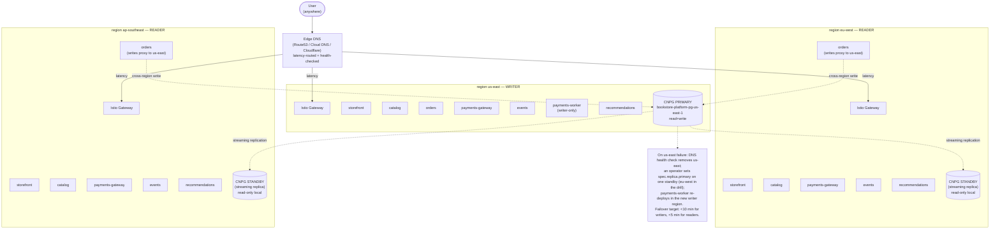

# 13.03 — Multi-region active-active

> Three regions, ApplicationSet propagation, CloudNativePG cross-region
> replicas, DNS failover, a real DR drill.

**Estimated time:** ~60 min read · half-day hands-on
**Prerequisites:** [Part 11 ch.06](../11-advanced-production-patterns/06-multi-cluster-and-fleet.md) — fleet/ApplicationSet baseline this chapter extends · [Part 08 ch.02](../08-day-2-operations/02-backup-and-dr.md) — DR drill framework · [Part 13 ch.02](02-tenancy-and-crossplane-onboarding.md) — tenancy that multi-region inherits
**You'll know after this:** • design a three-region active-active deployment with ApplicationSet propagation · • configure CloudNativePG cross-region replicas + failover semantics · • plan DNS-based regional failover with TTLs that hit RTO/RPO targets · • execute a real DR drill across regions and read the postmortem signals · • identify the data-gravity constraints that gate active-active

<!-- tags: bookstore-v2, multi-region, multi-cluster, cnpg, dr, day-2 -->

## Why this exists

Single-region production runs **until your region fails**. Every major
cloud publishes post-incident reports for regional outages, so treat a
region as a failure domain. For a business that takes money, a
single-region outage is direct revenue loss plus customer-trust damage
that can take a quarter to recover from.

Multi-region active-active is the **default** for production e-commerce
for three reasons:

1. **The customer is global.** A reader in Tokyo wants the catalog served
   from ap-southeast, not us-east. Even on the happy path, single-region
   serves a global customer poorly.
2. **Downtime is direct revenue loss.** Every minute the storefront is
   down = lost orders + lost trust. The CFO can put a dollar amount on
   the SLO; the platform team's job is to meet it.
3. **Regulators in some markets require regional data residency.** EU
   GDPR, India DPDP, Australia Privacy Act all impose constraints on
   where personal data lives. A multi-region architecture is the
   substrate for "this tenant's data stays in EU"; single-region cannot
   satisfy it.

Kubernetes **does not make this easy**. The control plane is per-cluster,
the data plane is per-cluster, the network is per-cluster, the storage is
per-cluster. Multi-region on Kubernetes is multi-cluster + a data layer
that reconciles consistency + an edge that routes by health and latency.
The platform v2 takes a **specific stance** — Argo CD ApplicationSet over
the Cluster generator + CloudNativePG cross-region streaming + DNS-based
failover — and this chapter walks it end-to-end.

## Mental model

**"Active-active" means every region serves traffic; the data layer
reconciles consistency. The 3 regions each run a full copy of the v2
stack. Postgres has one primary and two streaming standbys; writes go to
the primary's region; reads are local. Failover = promote a standby. Edge
DNS routes by latency and shifts on health.**

- **Three regions, one platform, one source of truth.** us-east, eu-west,
  ap-southeast — each a separate cluster (separate cloud control plane,
  separate VPC, separate kube-apiserver). The us-east cluster runs the
  **management Argo CD**; it has all three clusters registered via
  `argocd cluster add`; one ApplicationSet fans the platform stack into
  every region from one Git source of truth.
- **CNPG cross-region replication, not multi-master.** Postgres does not
  do multi-region multi-write safely (no Postgres distribution we are
  aware of does, without sacrificing consistency or write throughput).
  CloudNativePG does **one primary + N replicas, with streaming
  replication**: writes route to the primary's region; reads are local to
  each region. On primary loss, promote a standby with an explicit change
  to its cluster spec. The promotion is quick; the DNS update is slower
  (TTL-bounded). The failover budget is "minutes", not "seconds" — be
  honest.
- **Active workload set differs slightly per region.** Storefront,
  catalog, orders, payments-gateway, events, recommendations all run
  active-active across the three regions. The async **payments-worker**
  runs **only in the writer region** because writing to the Postgres
  primary from a different region is wasteful (cross-region write
  latency). When the writer flips, the payments-worker follows.
- **Edge DNS routes by latency, fails over on health.** Production uses
  Route53 (AWS), Cloud DNS (GCP), or Cloudflare. The DNS provider does
  latency-based routing in the happy path and health-checked failover on
  region loss. On kind locally, we simulate the cutover with an
  `/etc/hosts` flip — the lesson is the failover path, not the DNS
  product.
- **Split-brain is the failure mode to fear.** A network partition
  between regions where each side believes it is the writer is the
  worst-case for any distributed data layer. CNPG's design avoids it:
  a replica cluster becomes primary only when someone changes its
  `spec.replica.primary`, so a partitioned region cannot promote itself.
  The trade-off: failover needs explicit intent, not automatic election.
  Worth it.

The trap to keep in view: **"active-active" sounds like "writes go
anywhere"**. They don't. Writes go to one region's primary; reads go
local. Marketing the architecture as "five-9s writes everywhere" is a lie
that will hurt at the first failover. Sell the targets, labelled as targets:
"<5 min reader failover and <10 min writer failover, design targets not
measured on the lab; writes are routed; reads are local".

## Threats and controls

| Threat | Control in this chapter | Deeper |
|---|---|---|
| A region outage takes the only writer with it | A standby in each other region, promoted by an explicit change | [Part 08 ch.02](../08-day-2-operations/02-backup-and-dr.md) |
| A replication credential is stolen or reused | TLS client certificates with `verify-full`; no shared password; key pairs are copied, never written into a repo | [13.06](06-payments-and-event-sourcing.md) for how secrets reach the cluster |
| The management Argo CD changes every region at once | Each cluster is registered with a ServiceAccount whose ClusterRole names only Namespaces, PriorityClasses and Kueue queues; RBAC stays out of its sync (step 3) | [13.01](01-bookstore-2-from-toy-to-platform.md) for platform roles |
| Personal data leaves its residency region in a replica, backup, log or metric | None in this chapter. The Postgres stream copies the whole database to every region, which is the flow this row names (see the production note) | [13.09](09-observability-otel-tempo-loki-prometheus-grafana.md) and [13.10](10-cost-opencost-per-tenant-finops.md) add telemetry and cost flows this chapter does not constrain |

`argocd cluster add` gives the management Argo CD full cluster privileges
unless you name a ServiceAccount. The CLI prints that warning before it
writes ([source](https://github.com/argoproj/argo-cd/blob/master/cmd/argocd/commands/cluster.go)).

## Diagrams

### Diagram A — three regions + DNS + CNPG streaming (Mermaid)



### Diagram B — workload activity matrix (ASCII)

```text
WORKLOAD               US-EAST                EU-WEST                  AP-SOUTHEAST
─────────────────────  ─────────────────────  ───────────────────────  ──────────────────────
storefront             active                 active                   active
catalog                active                 active (local reads)     active (local reads)
orders                 active (local writes)  active (writes -> us)    active (writes -> us)
payments-gateway       active                 active                   active
events (Kafka)         active                 active                   active
payments-worker        ACTIVE                 dormant                  dormant
recommendations        active                 active                   active
CNPG postgres          PRIMARY (rw)           standby (ro)             standby (ro)
S3 platform-assets     PRIMARY                replica (cross-region)   replica (cross-region)
S3 tenant-assets       PRIMARY (per-tenant)   replica                  replica
ApplicationSet target  yes                    yes                      yes
Argo CD (management)   YES (only here)        no                       no

On us-east loss:
  CNPG -> promote eu-west standby; payments-worker re-deploys in eu-west.
  Argo CD management cluster -> ALSO need to re-target (either run a 2nd
  Argo CD in eu-west passive-active OR rebuild on eu-west from Git — the
  Production notes walk both options + their trade-offs).
```

## Hands-on with the Bookstore Platform

This chapter assumes the three kind clusters from
[13.01](01-bookstore-2-from-toy-to-platform.md) are up and the
platform-base is applied in each. We add Argo CD on us-east, register all
three, fan the platform-base via ApplicationSet, then walk the DR drill.

The commands use the reader's names. The captured output came from one lab
cluster with a different name, in namespaces prefixed `p13-03-`. The
transcript in `full-guide/examples/security-lab/evidence/13-03.txt` records
that substitution.

### 1. Create the namespaces with Pod Security labels

Pod Security levels are set on the namespace, so each namespace is created
with its labels before anything installs into it. `restricted` is the level
from the [baseline](../01-core-workloads/01-pods.md#baseline). The
`bookstore-platform-system` namespace already carries these labels from
platform-base in [13.01](01-bookstore-2-from-toy-to-platform.md).

```sh
for ctx in \
  kind-bookstore-platform-us-east \
  kind-bookstore-platform-eu-west \
  kind-bookstore-platform-ap-southeast
do
  kubectl --context "$ctx" apply -f - <<'EOF'
apiVersion: v1
kind: Namespace
metadata:
  name: argocd
  labels:
    pod-security.kubernetes.io/enforce: restricted
    pod-security.kubernetes.io/enforce-version: latest
    pod-security.kubernetes.io/audit: restricted
    pod-security.kubernetes.io/audit-version: latest
    pod-security.kubernetes.io/warn: restricted
    pod-security.kubernetes.io/warn-version: latest
---
apiVersion: v1
kind: Namespace
metadata:
  name: cnpg-system
  labels:
    pod-security.kubernetes.io/enforce: restricted
    pod-security.kubernetes.io/enforce-version: latest
    pod-security.kubernetes.io/audit: restricted
    pod-security.kubernetes.io/audit-version: latest
    pod-security.kubernetes.io/warn: restricted
    pod-security.kubernetes.io/warn-version: latest
EOF
done
```

Check that the label refuses what it should. This is a deliberate denial: the
request asks for a privileged container, and the server refuses it. Nothing
is created, because the request is a server-side dry run:

```sh
kubectl --context kind-bookstore-platform-us-east -n bookstore-platform-system \
  run privileged-probe --image=bookstore/catalog:dev --privileged \
  --dry-run=server --restart=Never
```

<!-- gate: output -->
```text
Error from server (Forbidden): pods "privileged-probe" is forbidden: violates PodSecurity "restricted:latest": privileged (container "privileged-probe" must not set securityContext.privileged=true), allowPrivilegeEscalation != false (container "privileged-probe" must set securityContext.allowPrivilegeEscalation=false), unrestricted capabilities (container "privileged-probe" must set securityContext.capabilities.drop=["ALL"]), runAsNonRoot != true (pod or container "privileged-probe" must set securityContext.runAsNonRoot=true), seccompProfile (pod or container "privileged-probe" must set securityContext.seccompProfile.type to "RuntimeDefault" or "Localhost")
```

### 2. Install Argo CD on the management cluster (us-east)

Argo CD runs on us-east only. Pin the chart, keep the server on TLS, and
dry-run the chart into the labelled namespace before the install. A
PodSecurity warning in the output would name a template that breaks
`restricted`:

```sh
kubectl config use-context kind-bookstore-platform-us-east

ARGOCD_CHART_VERSION="10.11.6"   # argo-cd chart; ships Argo CD v3.5.6
helm repo add argo https://argoproj.github.io/argo-helm

helm template argocd argo/argo-cd --version "$ARGOCD_CHART_VERSION" \
  -n argocd --include-crds \
  | kubectl --context kind-bookstore-platform-us-east apply --server-side --dry-run=server -n argocd -f -
```

<!-- gate: output -->
```text
networkpolicy.networking.k8s.io/argocd-application-controller serverside-applied (server dry run)
# ...
deployment.apps/argocd-server serverside-applied (server dry run)
# ...
job.batch/argocd-redis-secret-init serverside-applied (server dry run)
```

The chart sets the pod and container security context on every workload it
renders, so there is nothing to override. The full output has no `Warning:`
line, and the excerpt above is the part that names the Argo CD workloads.
Install it:

```sh
helm install argocd argo/argo-cd \
  --version "$ARGOCD_CHART_VERSION" \
  -n argocd --wait
```

Log in through a port-forward, and pin the server's certificate instead of
skipping verification. On the lab the chart's certificate is self-signed, so
the first fetch trusts what the server presents. That is trust on first use.
On a real cluster, pin the CA that issued the certificate your ingress serves
instead. Delete the initial admin secret once you have named users.

```sh
ARGOCD_PWD=$(kubectl -n argocd get secret argocd-initial-admin-secret \
  -o jsonpath='{.data.password}' | base64 -d)
kubectl -n argocd port-forward svc/argocd-server 8080:443 >/dev/null 2>&1 &
sleep 3
openssl s_client -connect localhost:8080 -servername localhost </dev/null 2>/dev/null \
  | openssl x509 > argocd-server.crt
argocd login localhost:8080 --username admin --password "$ARGOCD_PWD" \
  --server-crt argocd-server.crt
```

### 3. Register the three regional clusters with narrow ServiceAccounts

`argocd cluster add` creates an `argocd-manager` ServiceAccount bound to
`cluster-admin` unless you pass `--service-account`. Passing the flag makes
the CLI use a ServiceAccount you made, and the CLI installs no RBAC for it.
Write that RBAC yourself. On each cluster, create the ServiceAccount, a
ClusterRole and a ClusterRoleBinding. The ClusterRole names only the kinds
that Argo CD syncs from platform-base: Namespaces, PriorityClasses and the
Kueue queues. It has no wildcard, no RBAC kind and no Secret:

```sh
for ctx in \
  kind-bookstore-platform-us-east \
  kind-bookstore-platform-eu-west \
  kind-bookstore-platform-ap-southeast
do
  kubectl --context "$ctx" apply -f - <<'EOF'
apiVersion: v1
kind: ServiceAccount
metadata:
  name: argocd-platform-sync
  namespace: bookstore-platform-system
automountServiceAccountToken: false
---
apiVersion: v1
kind: Secret
metadata:
  name: argocd-platform-sync-token
  namespace: bookstore-platform-system
  annotations:
    kubernetes.io/service-account.name: argocd-platform-sync
type: kubernetes.io/service-account-token
---
apiVersion: rbac.authorization.k8s.io/v1
kind: ClusterRole
metadata:
  name: argocd-platform-sync
rules:
  - apiGroups: [""]
    resources: ["namespaces"]
    verbs: ["get", "list", "watch", "create", "update", "patch"]
  - apiGroups: ["scheduling.k8s.io"]
    resources: ["priorityclasses"]
    verbs: ["get", "list", "watch", "create", "update", "patch"]
  - apiGroups: ["kueue.x-k8s.io"]
    resources: ["resourceflavors", "clusterqueues"]
    verbs: ["get", "list", "watch", "create", "update", "patch"]
---
apiVersion: rbac.authorization.k8s.io/v1
kind: ClusterRoleBinding
metadata:
  name: argocd-platform-sync
roleRef:
  apiGroup: rbac.authorization.k8s.io
  kind: ClusterRole
  name: argocd-platform-sync
subjects:
  - kind: ServiceAccount
    name: argocd-platform-sync
    namespace: bookstore-platform-system
EOF
done
```

The ClusterRole sets the reach of the token, so check it before you register
the cluster. Each row runs `kubectl auth can-i` as the ServiceAccount, with
`--as`:

```sh
SA=system:serviceaccount:bookstore-platform-system:argocd-platform-sync
kubectl auth can-i create namespaces --as=$SA
kubectl auth can-i create priorityclasses.scheduling.k8s.io --as=$SA
kubectl auth can-i create clusterroles.rbac.authorization.k8s.io --as=$SA
kubectl auth can-i escalate clusterroles.rbac.authorization.k8s.io --as=$SA
kubectl auth can-i get secrets -n bookstore-platform-system --as=$SA
```

Kueue is CRD-backed, and `can-i` resolves a resource through API discovery,
so the Kueue rows ask the API server for a SubjectAccessReview instead. That
needs no CRD, and it prints `true` or `false`. The lab run printed both sets
with a label on each row:

<!-- gate: output -->
```text
create namespaces                                              yes
create PriorityClasses                                         yes
create ClusterRoles                                            no
create ClusterRoleBindings                                     no
escalate ClusterRoles                                          no
create RoleBindings in a tenant namespace                      no
get Secrets in a tenant namespace                              no
get Secrets in the platform system namespace                   no
create Pods in a tenant namespace                              no
create Argo CD Applications in argocd                          no
# ...
create ClusterQueues                                           true
create ResourceFlavors                                         true
delete ClusterQueues                                           false
create LocalQueues in a tenant namespace                       false
```

A ClusterRole can be created only by a caller that already holds every
permission in it, or that holds the `escalate` verb on clusterroles
([RBAC: restrictions on role creation or update](https://kubernetes.io/docs/reference/access-authn-authz/rbac/#restrictions-on-role-creation-or-update)).
The Argo CD ServiceAccount holds neither, so it cannot sync the RBAC file in
`platform-base/01-rbac.yaml`. That file holds three ClusterRoles, one of them
`*` on everything. The platform-base kustomization therefore leaves it out,
and a person applies it by hand through a reviewed change. A dry run as the
ServiceAccount shows the refusal:

```sh
kubectl apply --dry-run=server -f examples/bookstore-platform/platform-base/01-rbac.yaml \
  --as=system:serviceaccount:bookstore-platform-system:argocd-platform-sync
```

<!-- gate: output -->
```text
Error from server (Forbidden): error when retrieving current configuration of:
Resource: "rbac.authorization.k8s.io/v1, Resource=clusterroles", GroupVersionKind: "rbac.authorization.k8s.io/v1, Kind=ClusterRole"
Name: "bookstore-platform-admin", Namespace: ""
# ...
```

The Crossplane XRDs and Compositions of
[13.02](02-tenancy-and-crossplane-onboarding.md) are also applied by a
person. A Composition decides what the provider creates, and the provider
holds wider rights than this ServiceAccount.

The token Secret is long-lived, because Argo CD keeps the bearer token in its
cluster Secret. Anyone who can read the cluster Secrets in the `argocd`
namespace holds the same rights as Argo CD. The operator ClusterRole in
[13.01](01-bookstore-2-from-toy-to-platform.md) reads every Secret, so a
person bound to it can read these tokens too.

### 4. Apply the root ApplicationSet

```sh
kubectl apply -f examples/bookstore-platform/argocd/applicationset-platform.yaml
```

Within seconds the ApplicationSet's Cluster generator enumerates the three
labelled clusters and creates three Applications. Illustrative output, not
captured:

```text
kubectl -n argocd get applications
NAME                              SYNC STATUS   HEALTH STATUS
platform-base-us-east             Synced        Healthy
platform-base-eu-west             Synced        Healthy
platform-base-ap-southeast        Synced        Healthy
```

Each Application points at its region's overlay
(`examples/bookstore-platform/kustomize/regions/<REGION>/`) and reconciles
the 13 cluster-wide platform-base objects into the matching cluster.

> Each kind cluster runs 1 control-plane + 2 workers (3 zone labels via
> `kubernetes.io/hostname` patches), so 3 clusters total = 9 Pods of
> node-spec. 12 nodes would be more realistic but heavier on laptop RAM
> (4 GB+ per cluster). Real cloud equivalent: 3 worker nodes per region,
> one per AZ.

### 5. Install the CloudNativePG operator in each region

The CNPG operator pattern was introduced for the v1 Bookstore in
[Part 08 ch.05](../08-day-2-operations/05-operators-and-crds.md). Here we
extend it to cross-region replication. The operator is per-cluster and
reconciles only its own region's CNPG resources.

Dry-run the chart into the labelled namespace first. The operator's pod
sets `runAsNonRoot`, the `RuntimeDefault` seccomp profile, a read-only root
filesystem and no capabilities. The dry run checks the chart's templates
against `restricted` before anything is installed:

```sh
CNPG_CHART_VERSION="0.29.1"   # CloudNativePG chart; ships operator 1.30.1
helm repo add cnpg https://cloudnative-pg.github.io/charts
helm repo update

helm template cnpg cnpg/cloudnative-pg --version "$CNPG_CHART_VERSION" \
  -n cnpg-system --include-crds \
  | kubectl --context kind-bookstore-platform-us-east apply --server-side --dry-run=server -n cnpg-system -f -
```

<!-- gate: output -->
```text
# ...
customresourcedefinition.apiextensions.k8s.io/clusters.postgresql.cnpg.io serverside-applied (server dry run)
# ...
deployment.apps/cnpg-cloudnative-pg serverside-applied (server dry run)
# ...
validatingwebhookconfiguration.admissionregistration.k8s.io/cnpg-validating-webhook-configuration serverside-applied (server dry run)
```

Then install it in every region:

```sh
for ctx in \
  kind-bookstore-platform-us-east \
  kind-bookstore-platform-eu-west \
  kind-bookstore-platform-ap-southeast
do
  helm --kube-context "$ctx" install cnpg \
    cnpg/cloudnative-pg \
    --version "$CNPG_CHART_VERSION" \
    -n cnpg-system --wait
done
```

### 6. Create the CNPG Clusters across regions

The writer is `bookstore-platform-pg-us-east`, and the two standbys replicate
from it. Each Cluster lists all three clusters in `externalClusters`, its own
included, as the CNPG distributed-topology example does. Any standby can
then become the writer later without a new manifest.

Streaming replication runs over TLS client certificates. CNPG creates a
`-replication` key pair and a `-ca` certificate for each Cluster on its first
reconcile, so the six Secrets appear only after the Clusters start. Apply the
Clusters, wait until all six exist, and then copy them into each
`bookstore-platform-system` namespace with the loop after the standbys. The
Secrets hold private keys, so the copy runs through the API server in a pipe
and never writes a file. [13.06](06-payments-and-event-sourcing.md) covers how
secrets reach a cluster from a secret manager. It does not cover this copy.

CNPG sets the pod and container security context itself, so these manifests
leave `securityContext` to the operator. The baseline's
`automountServiceAccountToken: false` has no field on a Cluster in this
operator release; the field exists only on Pooler. The baseline's exception
applies: the instance manager calls the Kubernetes API, and CNPG gives each
Cluster its own ServiceAccount.

The lab has one cluster and no CNPG CRDs, so it cannot apply these manifests.
Its check validates both against the chart's CRD schema, offline.

The writer:

```sh
kubectl --context kind-bookstore-platform-us-east apply -f - <<'EOF'
apiVersion: postgresql.cnpg.io/v1
kind: Cluster
metadata:
  name: bookstore-platform-pg-us-east
  namespace: bookstore-platform-system
spec:
  instances: 2
  storage:
    size: 5Gi
  bootstrap:
    initdb:
      database: bookstore
      owner: bookstore
  certificates:
    serverAltDNSNames:
      - pg-us-east.bookstore-platform.example.com
  replica:
    primary: bookstore-platform-pg-us-east
    source: bookstore-platform-pg-eu-west
  externalClusters:
    - name: bookstore-platform-pg-us-east
      connectionParameters:
        host: pg-us-east.bookstore-platform.example.com
        user: streaming_replica
        dbname: postgres
        sslmode: verify-full
      sslKey:
        name: bookstore-platform-pg-us-east-replication
        key: tls.key
      sslCert:
        name: bookstore-platform-pg-us-east-replication
        key: tls.crt
      sslRootCert:
        name: bookstore-platform-pg-us-east-ca
        key: ca.crt
    - name: bookstore-platform-pg-eu-west
      connectionParameters:
        host: pg-eu-west.bookstore-platform.example.com
        user: streaming_replica
        dbname: postgres
        sslmode: verify-full
      sslKey:
        name: bookstore-platform-pg-eu-west-replication
        key: tls.key
      sslCert:
        name: bookstore-platform-pg-eu-west-replication
        key: tls.crt
      sslRootCert:
        name: bookstore-platform-pg-eu-west-ca
        key: ca.crt
    - name: bookstore-platform-pg-ap-southeast
      connectionParameters:
        host: pg-ap-southeast.bookstore-platform.example.com
        user: streaming_replica
        dbname: postgres
        sslmode: verify-full
      sslKey:
        name: bookstore-platform-pg-ap-southeast-replication
        key: tls.key
      sslCert:
        name: bookstore-platform-pg-ap-southeast-replication
        key: tls.crt
      sslRootCert:
        name: bookstore-platform-pg-ap-southeast-ca
        key: ca.crt
EOF
```

The standbys, from the same template with their own name and a
`pg_basebackup` bootstrap from the writer:

```sh
for region in eu-west ap-southeast; do
  kubectl --context "kind-bookstore-platform-$region" apply -f - <<EOF
apiVersion: postgresql.cnpg.io/v1
kind: Cluster
metadata:
  name: bookstore-platform-pg-$region
  namespace: bookstore-platform-system
spec:
  instances: 2
  storage:
    size: 5Gi
  bootstrap:
    pg_basebackup:
      source: bookstore-platform-pg-us-east
  certificates:
    serverAltDNSNames:
      - pg-$region.bookstore-platform.example.com
  replica:
    primary: bookstore-platform-pg-us-east
    source: bookstore-platform-pg-us-east
  externalClusters:
    - name: bookstore-platform-pg-us-east
      connectionParameters:
        host: pg-us-east.bookstore-platform.example.com
        user: streaming_replica
        dbname: postgres
        sslmode: verify-full
      sslKey:
        name: bookstore-platform-pg-us-east-replication
        key: tls.key
      sslCert:
        name: bookstore-platform-pg-us-east-replication
        key: tls.crt
      sslRootCert:
        name: bookstore-platform-pg-us-east-ca
        key: ca.crt
    - name: bookstore-platform-pg-eu-west
      connectionParameters:
        host: pg-eu-west.bookstore-platform.example.com
        user: streaming_replica
        dbname: postgres
        sslmode: verify-full
      sslKey:
        name: bookstore-platform-pg-eu-west-replication
        key: tls.key
      sslCert:
        name: bookstore-platform-pg-eu-west-replication
        key: tls.crt
      sslRootCert:
        name: bookstore-platform-pg-eu-west-ca
        key: ca.crt
    - name: bookstore-platform-pg-ap-southeast
      connectionParameters:
        host: pg-ap-southeast.bookstore-platform.example.com
        user: streaming_replica
        dbname: postgres
        sslmode: verify-full
      sslKey:
        name: bookstore-platform-pg-ap-southeast-replication
        key: tls.key
      sslCert:
        name: bookstore-platform-pg-ap-southeast-replication
        key: tls.crt
      sslRootCert:
        name: bookstore-platform-pg-ap-southeast-ca
        key: ca.crt
EOF
done
```

The host names are placeholders. CNPG's server certificate covers the
cluster's own service names by default. With `verify-full`, each exposed host
must also appear in that certificate, so each Cluster lists its name under
`spec.certificates.serverAltDNSNames`, as the manifests above do. Copy the
Secrets once every Cluster exists, with this loop:

```sh
for src in us-east eu-west ap-southeast; do
  for what in replication ca; do
    name="bookstore-platform-pg-$src-$what"
    for dst in us-east eu-west ap-southeast; do
      [ "$src" = "$dst" ] && continue
      kubectl --context "kind-bookstore-platform-$src" -n bookstore-platform-system \
        get secret "$name" -o json \
        | jq 'del(.metadata.uid, .metadata.resourceVersion, .metadata.creationTimestamp,
                  .metadata.namespace, .metadata.ownerReferences, .metadata.managedFields)' \
        | kubectl --context "kind-bookstore-platform-$dst" -n bookstore-platform-system apply -f -
    done
  done
done
```

The
[CNPG replica cluster docs](https://cloudnative-pg.io/documentation/current/replica_cluster/)
describe the topology.

### 7. Verify the topology

Illustrative output, not captured:

```text
=== kind-bookstore-platform-us-east ===
NAME                            AGE   INSTANCES   READY   STATUS                     PRIMARY
bookstore-platform-pg-us-east   1m    2           2       Cluster in healthy state   bookstore-platform-pg-us-east-1
=== kind-bookstore-platform-eu-west ===
NAME                            AGE   INSTANCES   READY   STATUS                     PRIMARY
bookstore-platform-pg-eu-west   1m    2           2       Cluster in healthy state   bookstore-platform-pg-us-east-1
```

On the standbys, `PRIMARY` names the writer's instance, not a local one. The
exact status text depends on the replication link, which kind does not wire
across clusters.

### 8. The DR drill: promote a standby, move the writes

This is the real exercise. Kind makes the region loss cheap, and the
promotion is the same declarative change a cloud run makes. Promotion is not
automatic: you name the new primary. Without a `promotionToken`, the change is
a failover, so the old writer must be rebuilt before it can rejoin.

```sh
# 1) Note the current primary as eu-west sees it.
kubectl --context kind-bookstore-platform-eu-west -n bookstore-platform-system \
  get cluster bookstore-platform-pg-eu-west \
  -o jsonpath='{.spec.replica.primary}{"\n"}'

# 2) Region loss: delete the writer's kind cluster.
kind delete cluster --name bookstore-platform-us-east

# 3) Promote eu-west by naming it the primary. No promotionToken, so this is a failover.
kubectl --context kind-bookstore-platform-eu-west -n bookstore-platform-system \
  patch cluster bookstore-platform-pg-eu-west --type merge \
  -p '{"spec":{"replica":{"primary":"bookstore-platform-pg-eu-west"}}}'

# 4) Point the remaining standby at the new primary.
kubectl --context kind-bookstore-platform-ap-southeast -n bookstore-platform-system \
  patch cluster bookstore-platform-pg-ap-southeast --type merge \
  -p '{"spec":{"replica":{"primary":"bookstore-platform-pg-eu-west","source":"bookstore-platform-pg-eu-west"}}}'
```

`kubectl cnpg promote CLUSTER INSTANCE` moves the primary instance inside one
cluster. It does not move a region, so it is the wrong tool for this drill.

Then move the write endpoint to eu-west. On kind that is an `/etc/hosts` line
you edit by hand. On a cloud it is a DNS record change with a short TTL.

The payments-worker is writer-only. The base overlay in this chapter does not
yet include a writer-only payments-worker, so the move is manual here.
[13.06](06-payments-and-event-sourcing.md) covers the outbox that makes the
move safe.

Walk-through of the failover budget. These are design targets, not measured
on the lab:

| Step | Local cost | Real-cloud target | Requires human? |
|------|------------|-------------------|-----------------|
| Detect failure | seconds (Argo CD health) | seconds (DNS health check) | No |
| Promote standby | seconds (patch) | ~30 s | Yes: an operator patches `spec.replica.primary`, and pages first |
| DNS propagate | n/a | 60 - 300 s (TTL) | No |
| Workloads re-deploy | n/a | seconds (already running) | No |
| Payments-worker re-locate | seconds (kind) | minutes (image pull on the new writer region) | No |
| **Total — readers** | <30 s | <5 min | No |
| **Total — writers** | <30 s | <10 min | Yes — page; promotion is irreversible without rebuild |

### 9. Verify v1 invariants still hold

```sh
helm lint examples/bookstore/helm/bookstore | tail -2
helm template examples/bookstore/helm/bookstore \
  | kubectl apply --dry-run=client -f - | grep -cE '(configured|created)'
kubectl kustomize examples/bookstore/kustomize/overlays/dev | grep -c '^kind:'
```

The chart renders 49 objects and the dev overlay 45. v2's multi-region build
does not touch the v1 tree.

## How it works under the hood

**Argo CD ApplicationSet generators.** The ApplicationSet controller
watches `ApplicationSet` objects and renders them into a list of
`Application` objects. The Cluster generator enumerates **cluster Secrets**
in argocd's namespace (each `argocd cluster add` writes one) and surfaces
their labels into the template. Each of those Secrets also holds the bearer
token for its cluster, which is why step 3 registers with a narrow
ServiceAccount. The label selector + the template's value substitution
(`{{ .name }}`, `{{ .values.region }}`) does the rest. When a new cluster is
added with the matching label, a new Application appears within seconds;
remove the label, the Application is pruned. No copy-paste; Git stays the
single source of truth.

**CNPG cross-region replication — physical streaming vs logical.** CNPG
uses **physical streaming replication** (Postgres's built-in
`pg_basebackup` + WAL streaming). The standby keeps a byte-level copy of the
primary's data files. Its lag is the WAL it has not yet applied, and that lag
grows with the link; asynchronous streaming does not bound it. **Logical
replication** (Postgres's pgoutput plugin, used by Debezium) is what the
search-index CDC in [13.05](05-search-and-product-discovery.md) uses; it
ships row changes, not WAL bytes — a different mechanism for a different
purpose. CNPG supports both; the replica `Cluster` above uses physical via
`pg_basebackup`.

**Split-brain — the failure mode CNPG avoids by construction.** A
multi-master Postgres setup (BDR, BiDirectional Replication) does
multi-region writes — and pays for it with conflict resolution that is
either application-level (you write the merge) or "last write wins"
(stale data wins ties). CNPG declines that trade: there is exactly one
primary, and a standby becomes primary only when someone changes
`spec.replica.primary`. A network partition where eu-west cannot see us-east
cannot promote itself unilaterally. The trade: more human intent on failover,
and no split-brain from a partition that merely looks like an outage.

**DNS-based failover latency budget.** Three things compound:

1. **Detection time** — how long before the health check decides us-east
   is down. Route53 health checks poll every 30 seconds by default, or
   every 10 seconds with the fast interval, at higher cost.
2. **TTL propagation** — clients only re-query when their cached TTL
   expires. A short TTL on the records that need fast failover cuts the
   wait, and raises query load and cost. The distribution of "client
   refresh" is spread out; budget the 99th percentile.
3. **Resolver caching** — many corporate and ISP resolvers hold answers
   longer than the record's TTL. That tail is set by resolvers you do not
   control.

The honest total is the sum of detection, TTL and that resolver tail. The
platform should design for "some users see the old region during the
failover window"; the alternative is per-request health checking at the
client, which costs more than it saves at e-commerce scale.

## Production notes

> **In production:** **A real DR drill is monthly, not annual.** A drill
> that has not been run in 9 months has decayed — runbooks reference
> tools that have changed, the on-call rotation is different, the
> failover automation has bit-rotted. The fix is to **run the drill in
> production, with traffic, on the staging environment, every month**.
> The scripted drill is the deliverable of
> [13.12](12-day-2-runbook-on-call-dr-chaos.md).

> **In production:** **Cross-region S3 replication is asynchronous.**
> An asset uploaded to the us-east bucket can be missing in eu-west or
> ap-southeast for a while after the upload, and plain replication gives no
> fixed bound on that delay. Either serve assets from a regional bucket per
> region (origin-shielded CDN in front), or accept a short 404 window in the
> far region. The Stripe webhook flow in
> [13.06](06-payments-and-event-sourcing.md) covers events; for static
> assets it is a CDN + cache-bust pattern, not a Postgres pattern.

> **In production:** **Don't trust last-minute writes during a regional
> outage.** A user who pressed "buy" 200 ms before us-east lost network
> may or may not have a row in Postgres — the WAL may have streamed to
> eu-west or may have been on the wire. Reconciliation has to be
> explicit: the **outbox pattern** ([13.06](06-payments-and-event-sourcing.md))
> keeps the event intent in Postgres alongside the order row, in a single
> transaction. If the order row exists, the outbox row exists; if eu-west
> has the order, eu-west has the outbox. The publisher worker replays
> anything not yet shipped to Kafka after the failover. The combination is
> the "every order is durably accounted for, eventually" guarantee.

> **In production:** **Argo CD itself is a single point of failure.** If
> the management cluster goes down with us-east, no new GitOps changes
> reconcile until you rebuild. Two patterns:
>
> 1. **Passive-active Argo CD** — a second Argo CD in eu-west,
>    bootstrapped from the same Git source, normally not the one issuing
>    changes. On us-east loss, eu-west's Argo CD becomes authoritative.
>    Cost: two Argo CDs to manage.
> 2. **Rebuild from Git** — only one Argo CD; on management loss, you
>    re-bootstrap a new Argo CD in another region from Git in a few
>    minutes. Cost: a few minutes of "no reconciliation" during failover.
>
> The platform v2 ships pattern (2) for simplicity; pattern (1) is the
> mature production answer at scale.

> **In production:** **Regional data residency requires more than "deploy in
> region X".** GDPR and DPDP compliance means the data stays in that region,
> including replicas, backups, log streams, telemetry and any analytics derived
> from the data. This chapter streams the whole database to all three regions,
> so it does not meet a residency rule and does not solve the problem. A
> residency design names which tables or tenants replicate to which region.
> The telemetry and cost flows in [13.09](09-observability-otel-tempo-loki-prometheus-grafana.md)
> and [13.10](10-cost-opencost-per-tenant-finops.md) have to respect the same
> boundary.

## Quick Reference

```sh
# Spin up three regions (from 13.01)
./examples/bookstore-platform/clusters/kind-3-region.sh

# Argo CD on us-east (management), dry-run first, then install
ARGOCD_CHART_VERSION="10.11.6"
helm repo add argo https://argoproj.github.io/argo-helm
helm --kube-context kind-bookstore-platform-us-east install argocd argo/argo-cd \
  --version "$ARGOCD_CHART_VERSION" -n argocd --wait

# Register all three clusters with a narrow ServiceAccount and region labels
for region in us-east eu-west ap-southeast; do
  role=$( [ "$region" = "us-east" ] && echo writer || echo reader )
  argocd cluster add "kind-bookstore-platform-$region" \
    --service-account argocd-platform-sync \
    --system-namespace bookstore-platform-system \
    --label "bookstore-platform.example.com/region=$region" \
    --label "bookstore-platform.example.com/role=$role" --yes
done

# Apply the ApplicationSet
kubectl apply -f examples/bookstore-platform/argocd/applicationset-platform.yaml
kubectl -n argocd get applications

# Install CNPG into each region
CNPG_CHART_VERSION="0.29.1"
helm repo add cnpg https://cloudnative-pg.github.io/charts
helm repo update
for ctx in kind-bookstore-platform-{us-east,eu-west,ap-southeast}; do
  helm --kube-context "$ctx" install cnpg cnpg/cloudnative-pg \
    --version "$CNPG_CHART_VERSION" -n cnpg-system --wait
done

# DR drill (kind): simulate region loss, then promote eu-west (failover)
kind delete cluster --name bookstore-platform-us-east
kubectl --context kind-bookstore-platform-eu-west -n bookstore-platform-system \
  patch cluster bookstore-platform-pg-eu-west --type merge \
  -p '{"spec":{"replica":{"primary":"bookstore-platform-pg-eu-west"}}}'
```

Checklist (multi-region is healthy when all six are yes):

- [ ] Three Argo CD Applications (`platform-base-us-east`,
      `-eu-west`, `-ap-southeast`) report Synced + Healthy.
- [ ] Each cluster's CNPG Cluster reports `Cluster in healthy state`, and
      the standbys name the writer as their primary.
- [ ] Every cluster is registered with `argocd-platform-sync`, not the
      `argocd-manager` default.
- [ ] `kubectl cnpg status` shows replication lag you can state against
      your SLO. Async lag is not zero.
- [ ] DR drill: the promotion patch succeeds, and reads and writes both
      succeed against the new primary within the target.
- [ ] After failover, the original writer region's Cluster is rebuilt as a
      new standby before it rejoins.

## Test your understanding

> Try each before opening the answer drawer. The act of trying is the exercise; the answer is the check.

1. **Why is "active-active for stateless tiers, active-passive for the database" the typical multi-region shape?**
   <details><summary>Show answer</summary>

   Stateless tiers (storefront, catalog) can serve identical requests from any region — replicating *code* is trivial via GitOps/ApplicationSet. The database can't trivially span regions because (a) synchronous cross-region writes add 50-200ms of WAN latency to every transaction, (b) multi-master conflict resolution is hard for relational data, and (c) CAP says you can't have consistency + availability + partition-tolerance simultaneously. So: writes go to one region (primary), reads can go local in any region (replicas), and failover is a planned operation (promote a standby). Active-active for the DB is possible (Yugabyte, CockroachDB, multi-master Postgres) but adds operational complexity many teams don't need.

   </details>

2. **Your DR drill: us-east-1 goes down, you promote the eu-west standby. DNS failover takes 90 seconds. What's the RPO and RTO and what determines them?**
   <details><summary>Show answer</summary>

**RPO** (Recovery Point Objective) = the data lost = the replication lag at
   the moment the writer is lost. Asynchronous streaming does not bound that
   lag, so RPO is a measured number, not zero. Zero needs synchronous
   replication, paid for on every write. **RTO** (Recovery Time Objective) =
   time until writes resume = detection + the promotion change + DNS TTL + the
   application reconnecting to the new primary endpoint. The drill times each
   step; the runbook in [13.12](12-day-2-runbook-on-call-dr-chaos.md) is what
   the team executes under stress.

   </details>

3. **DNS TTL is set to 300s. You execute the failover. What user-visible behavior do you see in the first 5 minutes?**
   <details><summary>Show answer</summary>

Clients holding cached DNS resolutions for the old endpoint continue hitting
   the down region — they get connection refused or timeouts until their
   resolver re-queries. For mobile clients, DNS caching is opaque (the OS
   caches independently of TTL). For browsers, the cache is usually shorter
   than the TTL. For server-to-server (B2B integrations), JVM DNS caching
   depends on `networkaddress.cache.ttl`, and a long-lived JVM can keep an
   address after the TTL has passed. Check that setting before the drill. The
   5-minute window has a mix: new connections route correctly, old connections
   fail, partner integrations may need a restart. Lowering the TTL before a
   known maintenance window helps, but it costs DNS query volume the rest of
   the time.

   </details>

4. **A teammate proposes synchronous cross-region replication "so there's no RPO." Talk them through the trade-offs.**
   <details><summary>Show answer</summary>

Sync replication means every commit waits for at least one remote replica to
   acknowledge. Each commit then pays a cross-region round trip, so the
   checkout path gets slower on every write. Throughput drops because writes
   hold longer. If the remote replica is briefly unreachable, writes block.
   Synchronous replication trades availability for consistency — acceptable
   for low-volume, high-value financial transactions, awful for high-volume
   e-commerce checkouts. The right answer is usually: async streaming with
   bounded lag + an RPO budget you accept + a tested failover.

   </details>

5. **Hands-on: in your three-region setup, kill the writer region's Postgres primary Pod (not the whole cluster). What does CNPG do, and what does the app see?**
   <details><summary>What you should see</summary>

CNPG detects the failed primary and promotes an in-region standby on its own,
   then moves the `-rw` Service to it. Connections to `-rw` reset, and the
   pool reconnects, so writes pause briefly. In-region replication is
   asynchronous unless you configure synchronous replication, so a commit the
   primary acknowledged but had not yet streamed can be lost. The cross-region
   standbys stay standbys: a region-level failover is a separate, explicit
   change to `spec.replica.primary`.

   </details>

6. **Your management Argo CD can deploy to every region. An attacker who
   controls it reaches all three. Name the two controls in this chapter that
   limit that, and say what neither one stops.**
   <details><summary>Show answer</summary>

   The first is the narrow ServiceAccount per cluster (step 3). Its
   ClusterRole names only Namespaces, PriorityClasses and Kueue queues, with
   no wildcard, no RBAC kind and no Secret. The RBAC file stays out of Argo
   CD's sync, so the token cannot create or change a ClusterRole. The second
   is the `restricted` label on each namespace (step 1). It refuses a
   privileged container even when Argo CD submits one. Neither stops a
   compromised Argo CD from creating a namespace, a PriorityClass or a Kueue
   queue in every region, from submitting an unsafe workload that
   `restricted` allows, or from reading the bearer tokens in its own cluster
   Secrets. The operator role in 13.01 can read those tokens as well.

   </details>

## Further reading

- **Rosso et al., _Production Kubernetes_, ch.15 — "Multi-cluster
  operations"** — the multi-cluster topology + propagation patterns this
  chapter expresses as ApplicationSet + Cluster generator.
- **Ibryam & Huß, _Kubernetes Patterns_ 2e — *Stateful Service*
  (ch.12)** — the StatefulSet + replication + failover patterns CNPG
  generalises to cross-region.
- Official: **CloudNativePG cross-region replication docs**
  <https://cloudnative-pg.io/documentation/current/replica_cluster/>;
  **CloudNativePG security**
  <https://cloudnative-pg.io/documentation/current/security/>;
  **Argo CD ApplicationSet docs**
  <https://argo-cd.readthedocs.io/en/stable/operator-manual/applicationset/>;
  **Argo CD CLI source for `argocd cluster add`**
  <https://github.com/argoproj/argo-cd/blob/master/cmd/argocd/commands/cluster.go>;
  **Google Cloud Architecture Center — _Multi-region active-active
  application architecture_**
  <https://cloud.google.com/architecture/multi-region-app-architecture>;
  **AWS Route53 health-checked DNS failover**
  <https://docs.aws.amazon.com/Route53/latest/DeveloperGuide/dns-failover.html>.
