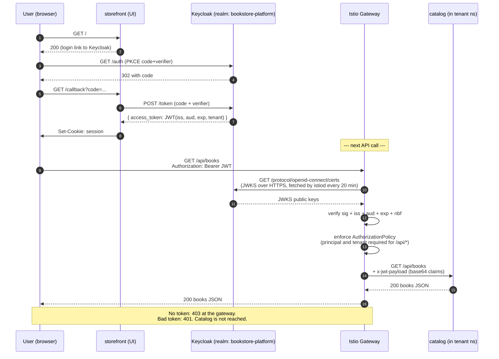
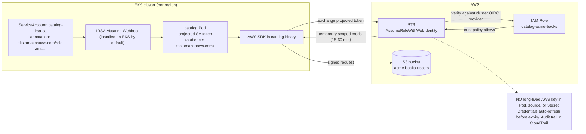

# 13.04 — Real auth: Keycloak OIDC + IRSA + Istio JWT

> Replace the toy JWT in v1 with Keycloak; humans use OIDC, workloads use
> IRSA, the mesh validates JWTs.

**Estimated time:** ~60 min read · half-day hands-on
**Prerequisites:** [Part 10 ch.03](../10-cloud-and-managed-kubernetes/03-cloud-identity.md) — IRSA for workload identity · [Part 11 ch.04](../11-advanced-production-patterns/04-service-mesh.md) — Istio mesh that enforces JWT · [Part 13 ch.02](02-tenancy-and-crossplane-onboarding.md) — tenant boundary that scopes realms
**You'll know after this:** • install Keycloak as the OIDC IdP for humans (with realm-per-tenant or shared-realm) · • wire workload-to-cloud identity via IRSA so workloads carry no static keys · • configure Istio `RequestAuthentication` + `AuthorizationPolicy` to validate JWTs at the mesh, with default deny · • replace the v1 shared-HMAC JWT with rotating Keycloak-issued tokens · • diagnose audience / issuer / JWKS-cache mismatch failures

<!-- tags: bookstore-v2, security, oidc, irsa, istio, multi-tenancy -->

## Why this exists

The v1 Bookstore "auth" was a single shared HMAC secret signing a JWT.
Every service knew the same secret; the storefront minted a token; the
catalog and orders services trusted any token signed with the same secret.
That is **fine for a tutorial** — it teaches the JWT lifecycle without
dragging in an identity provider — and **wrong for production** in three
specific ways:

1. **Shared secrets do not rotate.** A leaked HMAC compromises every
   service simultaneously. Production needs **asymmetric** signing (the
   IdP holds the private key; services verify with the public JWKS) and
   **rotation** of those keys without service downtime.
2. **No identity provider means no human concept.** A real customer signs
   up, logs in, resets a password, has groups assigned to their account.
   None of that lives in a shared HMAC. Production needs an **OpenID
   Connect** provider — Keycloak, Auth0, Okta, AWS Cognito, etc. — that
   owns the human-identity surface.
3. **Workload identity is a different problem entirely.** A `catalog`
   Pod calling AWS S3 must not use a JWT meant for a customer; it must
   use **cloud-native ServiceAccount -> IAM federation** (IRSA on AWS,
   Workload Identity on GCP, Azure AD Workload Identity on Azure). The
   v1 hand-waved this; v2 makes it real.

This chapter does **three things**: installs **Keycloak** as the
production OIDC provider, configures **Istio** at the gateway to verify
JWTs before downstream services see a request, and lays out the
**IRSA / Workload Identity** workload-identity pattern that
[Part 10 ch.03](../10-cloud-and-managed-kubernetes/03-cloud-identity.md)
introduced — applied to a platform-v2 catalog Pod.

> **In production:** The split below — "humans use OIDC, workloads use
> IAM federation, the mesh verifies humans" — is the production shape
> across every cloud vendor's reference architecture. Each piece is
> incrementally adoptable; you do not have to wait until all three are
> wired to start.

## Mental model

**Two identity planes; the mesh validates the human plane at the edge,
the cloud validates the workload plane in-flight.**

- **Human identity — Keycloak OIDC, realm-per-tenant.** A customer (or
  admin, or developer) signs in via the OIDC authorization-code + PKCE
  flow. Keycloak issues a **JWT** with:
  - `iss` = the realm URL, `https://keycloak.bookstore-platform.example.com/realms/bookstore-platform`
  - `aud` = the client's audience, which the realm's audience mapper sets
    to the client ID (`storefront-web` or `admin-portal`)
  - `tenant` = the user's tenant, read from a user attribute the realm
    sets on the account
  - `groups` = group membership, which the platform roles in 13.01 read
  - `exp`, `iat`, `nbf` — standard time bounds
  Each region runs its own Keycloak instance; the realm is replicated
  via the Keycloak HA pattern (Infinispan distributed cache + a shared
  DB; on CNPG, the realm DB itself is multi-region per
  [13.03](03-multi-region-active-active.md)).
- **Workload identity — ServiceAccount -> IAM, no static keys in Pods.**
  The catalog Pod runs as a ServiceAccount whose annotation declares the
  IAM role it should assume:
  - **AWS:** `eks.amazonaws.com/role-arn` annotation; the IRSA mutating
    webhook injects a projected SA token whose audience is `sts.
    amazonaws.com`; the AWS SDK auto-exchanges the token for STS
    credentials via `AssumeRoleWithWebIdentity`. (Or the newer **Pod
    Identity** model: an association, no annotation.)
  - **GKE:** `iam.gke.io/gcp-service-account` annotation; the GKE
    metadata server intercepts and exchanges.
  - **AKS:** `azure.workload.identity/client-id` annotation; AKS does
    the same exchange against Entra ID.
  No long-lived AWS / GCP / Azure key in the Pod, in source, or in a
  Secret. [Part 10 ch.03](../10-cloud-and-managed-kubernetes/03-cloud-identity.md)
  walks the cloud-side wiring in detail; this chapter shows how the
  platform v2 catalog SA carries the annotation.
- **The mesh validates the human JWT at the gateway.** Istio
  `RequestAuthentication` **verifies**: the signature against the Keycloak
  JWKS, `iss`, `aud`, and the `exp` and `nbf` bounds. A request without a
  token passes it. Istio `AuthorizationPolicy` **enforces**: require a
  verified principal and a `tenant` claim for `/api/*`; allow `/static/*`
  public; deny everything else by default. The downstream catalog service
  never sees an unauthenticated request. The gateway is the trust
  boundary. The verified claims are surfaced to downstream services via a
  base64-encoded `x-jwt-payload` header (no need to re-validate; trust
  what the gateway already verified).
- **Verification != enforcement.** Two separate Istio CRDs do these two
  things. Collapsing them is the #1 footgun: `RequestAuthentication`
  alone does NOT reject a request without a JWT — it only validates the
  JWT IF present. Without a paired `AuthorizationPolicy` that says
  "require a JWT for `/api/*`", a missing-token request slides through
  unchallenged. The chapter's `auth/authorization-policy.yaml` ships the
  pair correctly.

The trap to keep in view: **OIDC + IRSA + Istio JWT is a lot of moving
parts**. It is worth the cost; it is also a real cost. The chapter walks
each one; the Production notes section flags the cross-cutting failure
modes (clock skew, JWKS unreachable, audience mismatch, key rotation gap).

## Threats and controls

| Threat | Control in this chapter | Goes deeper |
|---|---|---|
| A token signed with a key the attacker chose, through a plain-HTTP JWKS answer | Asymmetric signing; JWKS fetched over HTTPS from the issuer's name | [13.07](07-edge-gateway-waf-rate-limiting.md) for the edge certificate |
| A token minted for another realm or client | Issuer pinned byte for byte; one audience per client | [13.02](02-tenancy-and-crossplane-onboarding.md) for realm-per-tenant |
| A request with no token reaching `/api/*` | ALLOW-only policy: a request that matches no ALLOW is denied | [13.02](02-tenancy-and-crossplane-onboarding.md) for the tenant default deny; the platform namespaces have none yet |
| A stolen access token that stays usable for hours | 15-minute access tokens; refresh tokens rotate and cannot be reused | [13.09](09-observability-otel-tempo-loki-prometheus-grafana.md) for issuance audit |
| Client secrets or admin passwords in a workload file | Secrets created outside source; External Secrets in production | [13.06](06-payments-and-event-sourcing.md) |
| Static cloud keys in a workload | IRSA-annotated ServiceAccount, no key in the Pod | [Part 10 ch.03](../10-cloud-and-managed-kubernetes/03-cloud-identity.md) |

The mesh's own identity (ztunnel certificates, SPIFFE IDs and the node
agents that enforce them) is the subject of
[Part 11 ch.04](../11-advanced-production-patterns/04-service-mesh.md).
This chapter only adds the JWT layer on top of it.

## Diagrams

### Diagram A — human request: OIDC + JWT verify at the gateway (Mermaid)



### Diagram B — workload identity: ServiceAccount -> STS -> scoped creds (Mermaid)



### Diagram C — humans vs workloads claim table (ASCII)

```text
DIMENSION                 HUMANS (Keycloak OIDC)         WORKLOADS (IRSA / WI)
─────────────────────     ────────────────────────────   ──────────────────────────────────
Issuer                    Keycloak realm URL             EKS cluster OIDC provider URL
Token type                JWT (RS256/ES256)              JWT (projected SA token)
Signing algorithm         Asymmetric (RSA / EC)          Asymmetric (RSA)
Audience                  client ID (storefront-web/...)  sts.amazonaws.com
Issued by                 Keycloak                       Kubernetes (kubelet via TokenRequest)
Lifetime                  15 min (refreshable)           ~1 hour (auto-rotated by kubelet)
Identity claim            sub = user UUID                sub = system:serviceaccount:<NS>:<NAME>
Tenant claim              tenant = <TENANT>              N/A (workload owns its own scope)
Verified by               Istio Gateway                  AWS STS (server-side validation)
Result                    request reaches /api/*         IAM role's scoped credentials
Rotation                  Refresh token, JWKS rotation   Projected token auto-rotated by kubelet
Auth code flow            authorization code + PKCE      assume-role-with-web-identity
Failure on no token       403 no token; 401 bad token    AWS STS rejects the exchange
```

## Hands-on with the Bookstore Platform

Assumes the three regions from
[13.01](01-bookstore-2-from-toy-to-platform.md) are up, the platform-base
is applied in each (13.01), and the multi-region ApplicationSet is wired
(13.03). We work in the us-east cluster for the Keycloak + Istio
install; the Argo CD ApplicationSet replicates the auth CRs into the
other two regions.

Every namespace below gets its Pod Security label before anything installs
into it. The lab output in this section was captured on a lab cluster with a
different name; its namespaces were `p13-04-keycloak`, `p13-04-istio-system`
and `p13-04-istio-node`, and the transcript header records the substitution.

### 1. Install Istio ambient (pinned-Helm; cross-ref Part 11 ch.04)

The full Istio ambient + waypoint install pattern is in
[Part 11 ch.04](../11-advanced-production-patterns/04-service-mesh.md).
This chapter does not repeat that material; it pins the versions and
sets the namespace layout that the policy needs.

The node agents, `istio-cni` and `ztunnel`, need privileges that the
restricted profile forbids, so they run in their own namespace,
`istio-node`, labelled `privileged`. OpenShift requires both to run in
`kube-system`, which is the upstream precedent for node agents outside
`istio-system` ([Istio platform prerequisites](https://istio.io/latest/docs/ambient/install/platform-prerequisites/)).
`istiod` and the gateway stay in `istio-system`, which is `restricted`. The
1.30.7 chart sets no seccomp profile for `istiod`, so the install sets
`pilot.seccompProfile.type=RuntimeDefault`. It also sets
`trustedZtunnelNamespace=istio-node`, because ztunnel runs in its own
namespace. Without that value istiod assumes `istio-system/ztunnel` is the
trusted node account, and it refuses the certificate requests that ztunnel
sends from `istio-node`. The gateway sets seccomp itself and admits at
`restricted`.

```sh
kubectl config use-context kind-bookstore-platform-us-east

ISTIO_VERSION="1.30.7"

kubectl create namespace istio-system
kubectl label namespace istio-system \
  pod-security.kubernetes.io/enforce=restricted \
  pod-security.kubernetes.io/warn=restricted \
  pod-security.kubernetes.io/audit=restricted
kubectl create namespace istio-node
kubectl label namespace istio-node \
  pod-security.kubernetes.io/enforce=privileged \
  pod-security.kubernetes.io/warn=restricted \
  pod-security.kubernetes.io/audit=restricted

helm repo add istio https://istio-release.storage.googleapis.com/charts
helm install istio-base istio/base \
  --version "$ISTIO_VERSION" -n istio-system --wait
helm install istiod istio/istiod \
  --version "$ISTIO_VERSION" -n istio-system \
  --set profile=ambient \
  --set trustedZtunnelNamespace=istio-node \
  --set pilot.seccompProfile.type=RuntimeDefault --wait
helm install istio-cni istio/cni \
  --version "$ISTIO_VERSION" -n istio-node \
  --set profile=ambient --wait
helm install ztunnel istio/ztunnel \
  --version "$ISTIO_VERSION" -n istio-node --wait
helm install istio-ingressgateway istio/gateway \
  --version "$ISTIO_VERSION" -n istio-system --wait \
  --set-json 'containerSecurityContext={"allowPrivilegeEscalation":false,"capabilities":{"drop":["ALL"]},"privileged":false,"readOnlyRootFilesystem":true,"runAsNonRoot":true,"seccompProfile":{"type":"RuntimeDefault"}}'
```

The gateway's `--set-json` replaces the chart's container context, so it
restates every field; the chart's own defaults would otherwise be lost.
The `istio-cni` and `ztunnel` pods reach `istiod` through its service name
in `istio-system`, which the charts set.

Before the install, dry-run the gateway and `istiod` under those labels. The
`istiod` Deployment is rendered with the two values above and sent to the
server in the labelled namespace:

```sh
helm template istiod istio/istiod --version "$ISTIO_VERSION" -n istio-system \
  --set profile=ambient --set trustedZtunnelNamespace=istio-node \
  --set pilot.seccompProfile.type=RuntimeDefault \
  --show-only templates/deployment.yaml | kubectl apply --dry-run=server -f -
```

Both admit with no warning. The lab run did the `istiod` check in a stand-in
namespace, `p13-04-istio-check`, labelled `restricted`, and the transcript
records that. The
RequestAuthentication and AuthorizationPolicy manifests need the Istio CRDs,
so they are dry-run only after the install.

<!-- gate: output -->
```text
serviceaccount/istio-ingressgateway created (server dry run)
# ...
service/istio-ingressgateway created (server dry run)
deployment.apps/istio-ingressgateway created (server dry run)
horizontalpodautoscaler.autoscaling/istio-ingressgateway created (server dry run)
```

<!-- gate: output -->
```text
deployment.apps/istiod created (server dry run)
```

### 2. Install Keycloak (pinned chart, secrets from outside the source)

Create the namespace with its label, then the three Secrets the chart reads.
The values are generated here and never written to a file.

```sh
kubectl create namespace keycloak
kubectl label namespace keycloak \
  pod-security.kubernetes.io/enforce=restricted \
  pod-security.kubernetes.io/warn=restricted \
  pod-security.kubernetes.io/audit=restricted

kubectl -n keycloak create secret generic keycloak-admin \
  --from-literal=admin-password="$(openssl rand -base64 32)"
kubectl -n keycloak create secret generic keycloak-db \
  --from-literal=password="$(openssl rand -hex 24)" \
  --from-literal=postgres-password="$(openssl rand -hex 24)"
kubectl -n keycloak create secret generic keycloak-realm-secrets \
  --from-literal=ADMIN_PORTAL_CLIENT_SECRET="$(openssl rand -hex 32)"
```

Before the first sync, render the chart from the Application's values and
dry-run the result under the `restricted` label. Save the Application's
`values:` block, de-indented, as `values.yaml`.

```sh
helm repo add bitnami https://charts.bitnami.com/bitnami
helm template keycloak bitnami/keycloak --version 25.2.0 -n keycloak \
  -f values.yaml | kubectl apply --dry-run=server -f -
```

<!-- gate: output -->
```text
networkpolicy.networking.k8s.io/keycloak-postgresql created (server dry run)
# ...
poddisruptionbudget.policy/keycloak created (server dry run)
# ...
statefulset.apps/keycloak-postgresql created (server dry run)
statefulset.apps/keycloak created (server dry run)
```

The dry run prints no PodSecurity warning, so both StatefulSets admit under
`restricted`.

Apply the realm and the Argo CD Application that installs the chart:

```sh
kubectl apply -f examples/bookstore-platform/auth/keycloak-realm-import.cm.yaml
kubectl apply -f examples/bookstore-platform/argocd/application-keycloak.yaml
```

The Application pins chart `25.2.0`, which ships Keycloak 26.3.3 (the
earlier `21.4.4` shipped 24.0.5). Its values do four things worth
knowing:

- **The admin password is a Secret.** `auth.existingSecret` names
  `keycloak-admin`. The literal `admin` password this chapter used before
  is gone.
- **The issuer is pinned.** `KC_HOSTNAME` is a full URL, so Keycloak
  builds every `iss` from it, whatever address it is reached on.
- **The root filesystem stays read-only.** The chart's
  `prepare-write-dirs` init container copies the directories Keycloak
  writes into `emptyDir` volumes.
- **No service account token is mounted.** Keycloak calls no Kubernetes
  API.

The chart's default image repository had no copy of the pinned tags when
this chapter was written, so the values pin the legacy `bitnamilegacy`
copies by digest. That copy is frozen. Before production, move both
images to a maintained source; the values file shows where.

Check that the realm imported and that the issuer is the pinned name:

```sh
kubectl -n keycloak port-forward svc/keycloak 8090:80 >/dev/null 2>&1 &
sleep 3
curl -s http://localhost:8090/realms/bookstore-platform/.well-known/openid-configuration | jq -r .issuer
```

Illustrative output, not captured:

```text
https://keycloak.bookstore-platform.example.com/realms/bookstore-platform
```

The request reached `localhost`, yet the issuer names the public host. That
is `KC_HOSTNAME` at work, and it is the string the policies below name.

### 3. Get a token for the smoke test (client credentials)

Humans sign in through `storefront-web` with the authorization-code and PKCE
flow, in a browser. A command-line test needs a token without a browser, and
the realm disables direct grants, so no password passes through `curl`. The
`admin-portal` service account uses the client-credentials grant. Its
`tenant` attribute comes from the realm, so the gateway sees the same claims
it checks for a human. The test identity is a machine, which the chapter
says plainly: the gateway cannot tell the difference, and it checks the same
fields.

```sh
SECRET=$(kubectl -n keycloak get secret keycloak-realm-secrets \
  -o jsonpath='{.data.ADMIN_PORTAL_CLIENT_SECRET}' | base64 -d)
TOKEN=$(curl -s -u "admin-portal:${SECRET}" \
  -d grant_type=client_credentials \
  http://localhost:8090/realms/bookstore-platform/protocol/openid-connect/token \
  | jq -r .access_token)
unset SECRET

# Inspect the claims (for the lesson only; do not parse JWTs by hand in code).
echo "$TOKEN" | cut -d. -f2 | base64 -d 2>/dev/null | jq '{iss, aud, tenant, exp, iat}'
```

Illustrative output, not captured:

```text
{
  "iss": "https://keycloak.bookstore-platform.example.com/realms/bookstore-platform",
  "aud": "admin-portal",
  "tenant": "acme-books",
  "exp": 1767225600,
  "iat": 1767224700
}
```

`exp` minus `iat` is the realm's `accessTokenLifespan`, 900 seconds. The
`aud` is `admin-portal` because the realm's audience mapper names it.

### 4. Apply the Istio RequestAuthentication and AuthorizationPolicies

```sh
kubectl apply -f examples/bookstore-platform/auth/request-authentication.yaml
kubectl apply -f examples/bookstore-platform/auth/authorization-policy.yaml
kubectl -n istio-system get authorizationpolicy
```

Illustrative output, not captured:

```text
NAME                  ACTION   AGE
allow-public-static   ALLOW    10s
require-jwt-api       ALLOW    10s
```

There is no DENY policy. The two ALLOW policies are the whole policy; the
header of `authorization-policy.yaml` explains why.

### 5. The gateway test: 403, 401, and a pass

The gateway's certificate comes from the edge CA that
[13.07](07-edge-gateway-waf-rate-limiting.md) exports. Pass that CA with
`--cacert`, and resolve the public name to the port-forward, so the
certificate is checked and nothing is skipped with `-k`.

```sh
kubectl -n istio-system port-forward svc/istio-ingressgateway 8443:443 >/dev/null 2>&1 &
sleep 3

API=https://bookstore-platform.example.com:8443/api/books
RESOLVE=bookstore-platform.example.com:8443:127.0.0.1
EDGE_CA=edge-ca.crt   # exported in 13.07

# No token: require-jwt-api requires a principal.
curl -s -o /dev/null -w "%{http_code}\n" --cacert "$EDGE_CA" \
  --resolve "$RESOLVE" "$API"

# A token that does not verify: RequestAuthentication rejects it.
curl -s -o /dev/null -w "%{http_code}\n" --cacert "$EDGE_CA" \
  --resolve "$RESOLVE" -H "Authorization: Bearer not-a-jwt" "$API"

# The token from step 3: the policy passes it. What the request gets after
# that comes from routing, which 13.07 adds.
curl -s -o /dev/null -w "%{http_code}\n" --cacert "$EDGE_CA" \
  --resolve "$RESOLVE" -H "Authorization: Bearer ${TOKEN}" "$API"
```

Illustrative output, not captured:

```text
403
401
```

The third call prints a status other than 401 or 403. Until 13.07 gives
`/api/*` a route, that status is the gateway's own not-found, and the
policy has still let the request through.

The 403 is the default-deny behaviour. Istio's JWT authorization task shows
`403` for a request without a JWT on a path an `AuthorizationPolicy`
protects, and `401` for an invalid token
([Istio: authorization with JWT](https://istio.io/latest/docs/tasks/security/authorization/authz-jwt/)).
The chapter does not show a 403 for an expired token, because the same
verification step rejects it as 401.

### 6. The IRSA-annotated ServiceAccount (kind-illustrative)

```sh
kubectl create namespace bookstore-platform-acme-books
kubectl label namespace bookstore-platform-acme-books \
  pod-security.kubernetes.io/enforce=restricted \
  pod-security.kubernetes.io/warn=restricted \
  pod-security.kubernetes.io/audit=restricted
kubectl apply -f examples/bookstore-platform/auth/sample-serviceaccount-irsa.yaml

kubectl -n bookstore-platform-acme-books get sa catalog-irsa-sa \
  -o jsonpath='{.metadata.annotations}'
```

Illustrative output, not captured. The annotation carries the file's placeholder
account ID:

```text
{"eks.amazonaws.com/audience":"sts.amazonaws.com",
 "eks.amazonaws.com/role-arn":"arn:aws:iam::<ACCOUNT-ID>:role/bookstore-platform-catalog-acme-books"}
```

On EKS with the IRSA webhook installed, a Pod running as
`catalog-irsa-sa` would automatically:

1. Have a projected SA token mounted at
   `/var/run/secrets/eks.amazonaws.com/serviceaccount/token` (audience
   `sts.amazonaws.com`).
2. Have `AWS_ROLE_ARN` + `AWS_WEB_IDENTITY_TOKEN_FILE` env vars injected.
3. The AWS SDK in the container reads them; calls STS
   AssumeRoleWithWebIdentity; gets scoped temporary credentials.

On kind, none of that wiring is real. The annotation is the production-
shape source-of-truth; the cloud-side wiring ([Part 10 ch.03](../10-cloud-and-managed-kubernetes/03-cloud-identity.md))
makes it actually do the federated identity exchange.

### 7. JWKS rotation — what happens, what to do

When you rotate Keycloak's signing key, the new key is published in JWKS
and signs new tokens. The old key stays published, so tokens it signed still
verify, until the rotation window closes.

Istiod resolves the JWKS and refreshes it every 20 minutes by default
(`PILOT_JWT_PUB_KEY_REFRESH_INTERVAL`, default `20m0s`; the
[pilot-discovery reference](https://istio.io/latest/docs/reference/commands/pilot-discovery/)
gives it). The gateway takes its keys from istiod, so a new key reaches
the gateway within about 20 minutes. The rotation window has to outlast the
longest token plus that refresh: 15 minutes plus 20 is 35 minutes, and the
production notes below set a day.

If the window is shorter than that, tokens signed with the old key fail while
the cache still holds it. Quiz 4 at the end of the chapter works through it.

## How it works under the hood

**OIDC flows — authorization-code + PKCE.** The browser-side flow has
**five steps**: (1) storefront redirects to Keycloak with a PKCE
`code_challenge`; (2) user authenticates at Keycloak; (3) Keycloak
redirects back to storefront with a `code`; (4) storefront POSTs the
`code` + the PKCE `code_verifier` to Keycloak's `/token` endpoint;
(5) Keycloak returns the access JWT + refresh token. The PKCE pair
prevents a malicious app from intercepting the code (which would otherwise
exchange to a token). The deprecated **implicit flow** sent the token in
the URL fragment; do not use it for new code. The **password grant** is
deprecated for the same reason it is off in this realm: a user types a
password into the client. This chapter does not use it.

**JWT validation: the checks.** The verifier (Envoy, inside Istio) performs:

1. **Signature check** — verify the JWT against the public key in JWKS
   that matches the `kid` header.
2. **`iss` check**: the issuer matches the configured issuer.
3. **`aud` check**: the audience is one of the configured audiences.
4. **`exp`/`nbf` check** — the token is not expired and is past its
   not-before time. Envoy allows 60 seconds of clock skew on both by
   default, and RequestAuthentication has no field to change that.

Envoy's documentation lists no `iat` check, so this chapter does not claim
one. A failed check returns 401 at the gateway, and downstream never sees
the request. A missing token is not a failed check: RequestAuthentication
passes it through, and the AuthorizationPolicy answers 403.

**JWKS refresh.** Istiod fetches the JWKS from the issuer every 20 minutes by
default (`PILOT_JWT_PUB_KEY_REFRESH_INTERVAL`). Envoy fetches it itself only in
the `envoy` or `hybrid` modes (`PILOT_JWT_ENABLE_REMOTE_JWKS`). The `timeout`
field on a JWT rule limits how long one fetch may take. The lever you control
is the rotation window described above.

**IRSA in detail.** The projected SA token has an `aud` claim of
`sts.amazonaws.com` (or whatever the workload's audience annotation
declares). The AWS SDK reads `AWS_WEB_IDENTITY_TOKEN_FILE`, opens the file
(which kubelet re-projects before the token expires), and sends the token and
the `AWS_ROLE_ARN` to STS via `AssumeRoleWithWebIdentity`. STS verifies the
token signature against the cluster's **OIDC provider**, which was
registered with AWS when the EKS cluster was created, and the IAM role's
**trust policy** allows assumption only by tokens with specific `sub` and
`aud` claims (the standard `system:serviceaccount:<NS>:<SA>` +
`sts.amazonaws.com`). STS returns temporary credentials with a fixed
lifetime; the SDK caches them and refreshes them before they expire. No
long-lived key.

**Pod Identity — the newer EKS alternative.** AWS added Pod Identity as
a simpler model: an **association** (`aws eks create-pod-identity-
association`) ties a ServiceAccount to a role; the Pod Identity Agent
DaemonSet on each node intercepts the standard IMDSv2 path and returns
the right role's credentials. No annotation on the SA; no projected
token; no OIDC trust dance. Pod Identity is the newer / preferred path
for greenfield EKS; IRSA stays widely deployed and still works.
[Part 10 ch.03](../10-cloud-and-managed-kubernetes/03-cloud-identity.md) walks both.

**GKE Workload Identity / Azure WI — the equivalent shape.** GKE
intercepts the metadata server inside Pods and substitutes the
SA-mapped Google service account's credentials. Azure WI federates an
Entra ID identity to the projected SA token via a federated credential.
Different mechanisms, identical contract: no static key in Pod / source /
Secret.

## Production notes

> **In production:** **Realm-per-tenant vs single-realm-with-groups —
> pick realm-per-tenant.** Single-realm-with-groups means a misconfigured
> group could cross tenants; isolation is "discipline + group naming".
> Realm-per-tenant gives **hard isolation** (each realm has its own
> users, clients, keys, and admin), at the cost of per-realm management
> overhead (realm provisioning becomes part of the BookstoreTenant
> Composition — 13.02 hooks Keycloak Admin API via a Workflow Template).
> The platform v2 picks realm-per-tenant; the seed realm
> `bookstore-platform` is the platform-team realm. A real onboarding
> creates a new realm per tenant. The lab realm has no human users.

> **In production:** **Keycloak HA = Infinispan cluster + a real DB.**
> The chart's bundled Postgres is fine for the demo and wrong for
> production. Production wires Keycloak to the platform's CNPG cluster
> (13.03) via `externalDatabase.*` values. Two+ Keycloak replicas with
> Infinispan distributed cache means realm + session state survives a
> Keycloak pod restart. Three replicas + cross-region CNPG means a
> region-loss does not lose sessions.

> **In production:** **Secrets come from External Secrets, not from a
> command.** The three Secrets in step 2 are generated locally, which is
> fine for a lab and wrong as a standing practice. Production creates them
> with External Secrets from the platform's vault (13.06). A change to a
> `${NAME}` placeholder does not change a realm that already exists: the
> import is skipped. Rotate the client secret in Keycloak, then in the
> Secret, and keep the two in step.

> **In production:** **JWKS rotation cadence — 90 days, two-key window.**
> Rotate Keycloak's signing key on a fixed cadence (90 days is a common
> choice; put yours in the runbook). Keep the old key published for at
> least the access-token lifetime plus the 20-minute JWKS refresh, and in
> practice a day, so a slow refresh never misses. Less than the token
> lifetime plus the cache and existing tokens fail mid-flight. Much more than
> a month and a stolen key keeps working too long. Review the cadence
> quarterly.

> **In production:** **Never embed customer JWTs in URL parameters.**
> URL fragments and query strings are logged everywhere — proxy access
> logs, browser history, error reporting, analytics, dashboards.
> Embedding a JWT in a URL leaks it to every one of those. Tokens go in
> **`Authorization: Bearer <TOKEN>`** headers or **cookies with
> `HttpOnly + Secure + SameSite=Lax/Strict`**. The implicit OIDC flow
> ships the token in the URL fragment and is deprecated for exactly this
> reason; use code+PKCE.

> **In production:** **Audit token issuance + token revocation.**
> Keycloak's event-listener SPI logs every login + token issue + token
> exchange + admin action; ship that log to Loki / SIEM (13.09) so the
> "who signed in from where" trail is queryable. **Revocation** — for
> the case where a token is suspected stolen — is a real production
> need; the standard answer is short access-token lifetime (15 min) +
> refresh-token rotation + Keycloak's `revoke` endpoint that
> invalidates a session. Long-lived (8-hour, 24-hour) access tokens
> are easier to deploy and **harder to revoke**; budget the tradeoff.

> **In production:** **JWT propagation between services.** Once a JWT
> reaches catalog, should catalog forward it when calling orders?
> Three patterns:
>
> 1. *Forward the original JWT* — every downstream re-validates. Simple;
>    every service knows the user. Expensive (every hop validates).
> 2. *Replace with a service-to-service token* — catalog exchanges the
>    user JWT for a service JWT scoped to the call. More setup; cleaner
>    audit.
> 3. *Trust the gateway* — downstream services trust the
>    `x-jwt-payload` header the gateway injected. Fastest; relies on
>    mesh isolation (Part 11 ch.04 ambient + ztunnel mTLS) so nothing
>    *outside* the mesh can inject the header.
>
> The platform v2 ships pattern (3); the `forwardOriginalToken: true`
> on `storefront-keycloak` preserves option (1) for any service that
> wants to re-validate (e.g. payments-gateway in 13.06 will re-validate
> for defence in depth).

## Quick Reference

```sh
# Namespaces first, each with its Pod Security label (step 1 and step 2)
kubectl create namespace istio-system
kubectl label namespace istio-system pod-security.kubernetes.io/enforce=restricted
kubectl create namespace istio-node
kubectl label namespace istio-node pod-security.kubernetes.io/enforce=privileged
kubectl create namespace keycloak
kubectl label namespace keycloak pod-security.kubernetes.io/enforce=restricted

# Istio ambient, pinned
ISTIO_VERSION="1.30.7"
helm repo add istio https://istio-release.storage.googleapis.com/charts
helm install istio-base istio/base --version "$ISTIO_VERSION" -n istio-system --wait
helm install istiod istio/istiod --version "$ISTIO_VERSION" -n istio-system --set profile=ambient --set trustedZtunnelNamespace=istio-node --set pilot.seccompProfile.type=RuntimeDefault --wait
helm install istio-cni istio/cni --version "$ISTIO_VERSION" -n istio-node --set profile=ambient --wait
helm install ztunnel istio/ztunnel --version "$ISTIO_VERSION" -n istio-node --wait
helm install istio-ingressgateway istio/gateway --version "$ISTIO_VERSION" -n istio-system --wait \
  --set-json 'containerSecurityContext={"allowPrivilegeEscalation":false,"capabilities":{"drop":["ALL"]},"privileged":false,"readOnlyRootFilesystem":true,"runAsNonRoot":true,"seccompProfile":{"type":"RuntimeDefault"}}'

# Keycloak: generated Secrets, then the realm and the pinned Application
kubectl -n keycloak create secret generic keycloak-admin --from-literal=admin-password="$(openssl rand -base64 32)"
kubectl -n keycloak create secret generic keycloak-db --from-literal=password="$(openssl rand -hex 24)" --from-literal=postgres-password="$(openssl rand -hex 24)"
kubectl -n keycloak create secret generic keycloak-realm-secrets --from-literal=ADMIN_PORTAL_CLIENT_SECRET="$(openssl rand -hex 32)"
kubectl apply -f examples/bookstore-platform/auth/keycloak-realm-import.cm.yaml
kubectl apply -f examples/bookstore-platform/argocd/application-keycloak.yaml

# Policies: verify, then enforce (no DENY policy)
kubectl apply -f examples/bookstore-platform/auth/request-authentication.yaml
kubectl apply -f examples/bookstore-platform/auth/authorization-policy.yaml

# Smoke test: client credentials, then the gateway (edge CA from 13.07)
SECRET=$(kubectl -n keycloak get secret keycloak-realm-secrets -o jsonpath='{.data.ADMIN_PORTAL_CLIENT_SECRET}' | base64 -d)
TOKEN=$(curl -s -u "admin-portal:${SECRET}" -d grant_type=client_credentials \
  http://localhost:8090/realms/bookstore-platform/protocol/openid-connect/token | jq -r .access_token)
curl -s -o /dev/null -w "%{http_code}\n" --cacert edge-ca.crt --resolve bookstore-platform.example.com:8443:127.0.0.1 \
  https://bookstore-platform.example.com:8443/api/books                                  # 403: no token
curl -s -o /dev/null -w "%{http_code}\n" --cacert edge-ca.crt --resolve bookstore-platform.example.com:8443:127.0.0.1 \
  -H "Authorization: Bearer ${TOKEN}" https://bookstore-platform.example.com:8443/api/books   # not 401/403
```

Minimal skeletons:

```yaml
# RequestAuthentication (verify a JWT IF present)
apiVersion: security.istio.io/v1
kind: RequestAuthentication
metadata: { name: <NAME>, namespace: istio-system }
spec:
  selector:
    matchLabels: { istio: ingressgateway }
  jwtRules:
    - issuer: "https://keycloak.bookstore-platform.example.com/realms/<REALM>"
      jwksUri: "https://keycloak.bookstore-platform.example.com/realms/<REALM>/protocol/openid-connect/certs"
      audiences: ["<CLIENT-ID>"]
      forwardOriginalToken: true
      outputPayloadToHeader: x-jwt-payload
```

```yaml
# AuthorizationPolicy (REQUIRE a verified principal for /api/*; the ALLOW set is the default deny)
apiVersion: security.istio.io/v1
kind: AuthorizationPolicy
metadata: { name: require-jwt-api, namespace: istio-system }
spec:
  selector:
    matchLabels: { istio: ingressgateway }
  action: ALLOW
  rules:
    - from:
        - source: { requestPrincipals: ["*"] }
      to:
        - operation: { paths: ["/api/*"] }
      when:
        - key: request.auth.claims[tenant]
          values: ["*"]
```

```yaml
# IRSA-annotated ServiceAccount (EKS)
apiVersion: v1
kind: ServiceAccount
metadata:
  name: <NAME>
  namespace: <TENANT-NS>
  annotations:
    eks.amazonaws.com/role-arn: "arn:aws:iam::<ACCOUNT-ID>:role/<IAM-ROLE>"
    eks.amazonaws.com/audience: "sts.amazonaws.com"
automountServiceAccountToken: true
```

Checklist (auth is wired correctly when all six are yes):

- [ ] `iss` claim in the issued JWT matches the
      `RequestAuthentication.spec.jwtRules[0].issuer` byte-for-byte.
- [ ] `aud` claim matches one of the `audiences` listed.
- [ ] The JWKS URL is HTTPS and reachable from istiod.
- [ ] The rotation window covers the access-token lifetime plus the 20-minute
      JWKS refresh that istiod runs by default.
- [ ] A request to `/api/*` with no token returns 403, not 200.
- [ ] IRSA role's trust policy specifies the `sub` and `aud` conditions
      for the cluster OIDC provider ([Part 10 ch.03](../10-cloud-and-managed-kubernetes/03-cloud-identity.md));
      a wildcard trust policy is the most common misconfiguration.

## Test your understanding

> Try each before opening the answer drawer. The act of trying is the exercise; the answer is the check.

1. **Why use Keycloak realms (per-tenant) when one realm-with-groups would also work?**
   <details><summary>Show answer</summary>

   Realm-per-tenant gives strict isolation: separate signing keys (so token leakage in tenant A doesn't compromise tenant B), separate user databases (no shared password store), separate admin scope (tenant-A admins can't see tenant-B users), separate identity-provider integrations (tenant A federates with Okta, tenant B with Azure AD). One realm with groups is simpler but loses these properties. The trade: realm-per-tenant scales operationally to a few hundred tenants; for thousands, shared-realm-with-strong-attribute-scoping is the answer. Bookstore v2 picks per-tenant realms because tenants are sub-100 and isolation is the contract.

   </details>

2. **A workload Pod with IRSA can't read S3. The error is `Could not load credentials from any provider`. The SA annotation is set. Walk through the diagnosis.**
   <details><summary>Show answer</summary>

   (1) Is the EKS Pod Identity webhook running and not excluding the tenant namespace? Without it, no `AWS_*` env vars are injected. (2) Is the projected token volume mounted? `kubectl exec -- ls /var/run/secrets/eks.amazonaws.com/serviceaccount/token` should show the file. (3) Does the IAM role trust policy's `sub` condition match `system:serviceaccount:bookstore-platform-<tenant>:<sa>`? A wildcard trust policy is the most common misconfiguration: it works in dev and fails security review. (4) Is the audience `sts.amazonaws.com`? (5) Is the OIDC provider registered for *this* cluster's issuer URL on the AWS side? Most common: (3). The trust policy was copied from another cluster.

   </details>

3. **Your `RequestAuthentication` is applied, and a request with no token to `/api/books` returns 200. What is missing?**
   <details><summary>Show answer</summary>

   `RequestAuthentication` validates a token only if one is present, so it passes a request without one. Istio allows a request when no ALLOW policy selects the workload. The fix is the `require-jwt-api` AuthorizationPolicy: once an ALLOW policy selects the gateway, a request that matches no ALLOW is denied, and a request with no token gets 403. Do not add a DENY policy with an empty rule to "force" the default: an empty rule matches every request, and a DENY is evaluated first, so it denies the allowed paths too.

   </details>

4. **You rotate the Keycloak signing key. For 30 minutes, about 5% of requests fail with "invalid signature." Why, and what's the fix?**
   <details><summary>Show answer</summary>

   Istiod refreshes the JWKS every 20 minutes by default, and the gateway takes its keys from istiod. Tokens signed with the new key fail until that refresh reaches the gateway. The fix is in the rotation window: keep the old key published for at least the access-token lifetime plus the refresh, which is 35 minutes at the 15-minute lifetime used here. The production notes set a day. A shorter window, or a rotation that removes the old key at once, produces exactly this failure for every token signed before the rotation.

   </details>

5. **Hands-on: configure the gateway to validate JWTs from Keycloak. Test with no token, an invalid token, and a valid token. What status codes do you see?**
   <details><summary>What you should see</summary>

   No token on `/api/*`: 403, because the AuthorizationPolicy requires a principal. An invalid token: 401, because RequestAuthentication rejects it. A valid token from the realm: not 401 or 403, because the policy lets it through and routing decides the rest. An expired token gets 401 through the same verification step. A token whose `iss` or `aud` is not configured also gets 401. The lesson: each failure mode has a distinct status, so an incident separates a missing token from a rejected one. Log the verified subject from `x-jwt-payload` so you can trace who presented a token that was rejected.

   </details>

## Further reading

- **Rosso et al., _Production Kubernetes_, ch.10 — "Security"** — the
  identity + JWT + cloud-IAM patterns this chapter expresses across the
  human + workload planes.
- **Ibryam & Huß, _Kubernetes Patterns_ 2e — *Service Mesh* (ch.17)** —
  the mesh-as-policy-enforcement-layer pattern Istio's
  RequestAuthentication + AuthorizationPolicy specialise.
- Official: **Keycloak Server Admin Guide**
  <https://www.keycloak.org/docs/latest/server_admin/>; **Keycloak hostname
  configuration** <https://www.keycloak.org/server/hostname>; **Istio
  RequestAuthentication** <https://istio.io/latest/docs/reference/config/security/request_authentication/>;
  **Istio AuthorizationPolicy** <https://istio.io/latest/docs/reference/config/security/authorization-policy/>;
  **Istio JWT authorization task** <https://istio.io/latest/docs/tasks/security/authorization/authz-jwt/>;
  **Envoy JWT authentication filter** <https://www.envoyproxy.io/docs/envoy/latest/api-v3/extensions/filters/http/jwt_authn/v3/jwt_authn.proto>;
  **AWS IRSA + Pod Identity reference**
  <https://docs.aws.amazon.com/eks/latest/userguide/iam-roles-for-service-accounts.html>;
  **OpenID Connect Core 1.0 spec**
  <https://openid.net/specs/openid-connect-core-1_0.html>.
