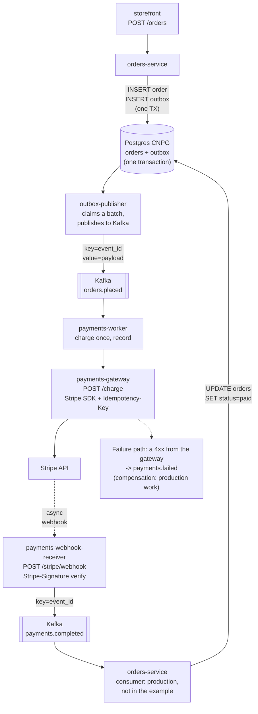

# 13.06 — Payments and event sourcing

> Stripe sandbox + the outbox pattern + Kafka over TLS with one identity per
> workload + an idempotent payments-worker + signed webhook verification.

**Estimated time:** ~60 min read · half-day hands-on
**Prerequisites:** [Part 09 ch.01](../09-end-to-end-bookstore/01-bookstore-end-to-end.md): v1 Bookstore (incl. its payment flow) this chapter rebuilds · [Part 03 ch.05](../03-config-and-storage/05-stateful-data-patterns.md): stateful patterns for Kafka topics · [Part 11 ch.05](../11-advanced-production-patterns/05-secrets-at-scale.md): Vault-issued Stripe API keys
**You'll know after this:** • author the transactional outbox pattern in
Postgres, publishing to Kafka · • give each payments workload its own Kafka
identity and topic ACLs · • build an idempotent payments-worker that survives
a crash mid-charge and a replay · • verify Stripe webhook signatures before
the body is parsed · • name what must never reach a log or an event

<!-- tags: bookstore-v2, stateful, kafka, debezium, security -->

## Why this exists

The v1 `payments-worker` ([`bookstore/app/payments-worker/main.go`](../examples/bookstore/app/payments-worker/main.go))
reads messages off a RabbitMQ queue and "processes" a payment for each
one. It is the right shape for the v1 lesson (KEDA-scaled worker; one
queue; one consumer). It is the **wrong shape for real money** in four
specific ways:

1. **RabbitMQ is dequeue-once.** A delivered message is removed from the
   queue; if the worker crashes mid-processing, the message is gone.
   Real payments need a **durable event log** the system can replay.
2. **No idempotency.** v1's worker increments a Prometheus counter and
   acks the message. Re-delivering the same message charges the
   customer twice. Real payments need **idempotent processing**
   (the second attempt is a no-op).
3. **No compensation.** If the order succeeded but the payment failed,
   v1 has no path to roll back the order. Real payments need **saga
   compensation**: explicit reverse-direction actions for the failure
   case.
4. **No webhook closure.** Real payment processors (Stripe, Adyen,
   Braintree) close the loop **asynchronously**. They POST a webhook
   when the charge actually completes (some charges take seconds, some
   take days for ACH). v1 has no path to receive that callback.

v2 fixes all four. The wiring is **the outbox pattern + Kafka + Stripe +
signed webhooks + a saga state machine**. Each piece is a known pattern
(Debezium calls outbox "the outbox pattern"; Stripe calls signed
webhooks "the standard"; sagas are textbook microservices); the chapter
walks each, applied to the Bookstore.

> **In production:** Payments code is the place a platform team gets
> woken up at 3am if it breaks. The pages that follow are the *minimum*
> discipline. Every shortcut you take here (skipping idempotency keys,
> accepting unverified webhooks, dual-writing to Kafka + Postgres) is
> paid back by an on-call incident at a time the team cannot afford one.

## Mental model

**Payments = (the API call to Stripe) + (the durable record of "we
attempted X") + (the asynchronous reconciliation when Stripe finalizes).
Each of the three pieces is durable, idempotent, and traceable.**

- **The outbox pattern: atomic writes via Postgres, async fan-out via
  Kafka.** The orders-service writes a new order. It needs to publish
  an `OrderPlaced` event to Kafka. It cannot do both in one transaction
  (Postgres and Kafka are different systems, and 2PC is real, slow and
  fragile). The outbox pattern solves this with **one transaction**
  that writes the order row AND a row into an `outbox` table. A
  **separate publisher process** reads the outbox, publishes to Kafka,
  and marks the row published. The Postgres transaction guarantees the
  outbox row is durable if and only if the order row is. The publisher
  then guarantees at-least-once delivery to Kafka. The result is a
  durable event log of every order, replayable.
- **Idempotency keys: Stripe's, plus a table of your own.** The gateway
  passes the order's `event_id` as Stripe's `Idempotency-Key` header.
  Stripe keeps the first response for that key for at least 24 hours
  and returns the **same** response to any repeat call, so a repeat
  inside that window creates no second charge. The worker keeps a
  record of its own: after the gateway answers, it writes `event_id`
  and the payment intent into the `payments` table, and only then
  publishes and commits the Kafka offset. A redelivered message finds
  the row and makes no call at all. The table does not expire, so it
  also covers a replay that comes weeks after the first charge.
- **Signed webhooks: verify before processing.** Stripe POSTs a webhook
  with a `Stripe-Signature` header: an HMAC-SHA256 of the raw body and a
  timestamp, signed with the **webhook secret** Stripe shares with us.
  The receiver MUST verify the signature **before** parsing the body.
  An unverified webhook is a remote-code-execution-grade vulnerability:
  an attacker can POST a fake `payment_intent.succeeded` and trick the
  system into marking an order paid. The signature check is the trust
  boundary.
- **Saga compensation: explicit reverse paths.** If the payment fails
  (a declined card, a 4xx from the gateway), the order must roll back:
  cancel it, release the inventory, notify the customer. The worker
  publishes the failure to `payments.failed`. The consumer that runs
  the compensation is production work; the example stops at the topic.
  The compensation is an event too, so it is traceable.
- **Two-phase commit is the path NOT taken.** 2PC across Kafka and
  Postgres would in theory give atomic dual-write. In practice it
  requires both systems to join a transaction manager, both to be up at
  commit time, and both to support XA. Kafka does not. The outbox is the
  engineering-tractable alternative, and the walkthrough under "How it
  works" shows the rejected path so the trade stays explicit.

The trap to keep in view: **at-least-once plus an idempotent consumer is
the shape; exactly-once is a marketing term.** Kafka offers
"exactly-once semantics" (EOS): a producer-side transaction that ties
publish and offset commit into one atomic Kafka operation. EOS is real,
but it does not extend across Stripe, Postgres and Kafka. v2 chooses the
simpler at-least-once pattern with dedupe, because the end-to-end
contract still gives "Stripe charged exactly once": Stripe's own
idempotency key, backed by the worker's table.

## Threats and controls

| Threat | Control taught here | Goes deeper |
|---|---|---|
| A forged webhook marks an order paid | The `Stripe-Signature` check runs before the body is parsed. The webhook secret comes from Vault through ESO | [13.04](../13-grand-capstone-bookstore-platform/04-real-auth-keycloak-irsa-istio-jwt.md) for workload identity, [11.05](../11-advanced-production-patterns/05-secrets-at-scale.md) for secret delivery |
| A captured webhook is replayed | The only control here is the signed timestamp's five-minute tolerance. A replay inside that window passes the signature check and publishes again. This chapter does not dedupe on `event.id` (see Production notes) | [Stripe's webhook guide](https://docs.stripe.com/webhooks) |
| A retry or a replay charges the customer twice | Stripe's `Idempotency-Key` from `event_id` for at least 24 hours, then the `payments` table, which has no expiry | [How it works](#how-it-works-under-the-hood) |
| Card data, keys or customer details reach a log or an event | Events carry ids and amounts only. The gateway holds the Stripe key and logs ids and status, never a body | [13.09](../13-grand-capstone-bookstore-platform/09-observability-otel-tempo-loki-prometheus-grafana.md) for telemetry |
| A workload writes a topic it does not own | One `KafkaUser` per workload, a TLS client certificate and simple ACLs | [13.05](../13-grand-capstone-bookstore-platform/05-search-and-product-discovery.md) for the listener |
| A workload reads rows its role should not | One DSN per database role, and grants in `outbox-ddl.sql` | [03.05](../03-config-and-storage/05-stateful-data-patterns.md) |
| Any Pod in the namespace can call `/charge` | `payments/networkpolicy.yaml` admits only `payments-worker` to the gateway, and default-deny covers the rest of the namespace. A lab probe on stand-in pods showed the worker admitted and another pod refused (step 4). The lab's webhook probe is admitted for the walk-through only | [02.06](../02-networking/06-network-policies.md) |

## Diagrams

### Diagram A: the outbox, Kafka, Stripe and webhook loop (Mermaid)



### Diagram B: outbox vs alternatives (ASCII)

```text
PATTERN                       DURABILITY    ATOMICITY        OPERATIONAL COST    WHEN IT WINS
────────────────────────      ───────────   ──────────────   ────────────────    ────────────────────────
Application dual-write        weak          NONE (two sys)   low                 NEVER
2PC (XA)                      strong        full             very high           legacy J2EE; not on K8s
Application-emits-event       medium        broken on crash  medium              when you control all consumers
Outbox pattern                strong        Postgres-atomic  low-medium          THIS (the chapter)
CDC-as-outbox (Debezium)      strong        Postgres-atomic  medium              when the schema is the contract
Event sourcing (full)         strongest     event log = SoT  high                when audit + replay are first-class
```

## Hands-on with the Bookstore Platform

Assumes ch.13.05 ran: Strimzi, the Kafka cluster with its TLS listener and
simple authorization, and the topics are live. CNPG from ch.13.03 is the
Postgres backend. Every workload in this chapter carries the
[security baseline](../01-core-workloads/01-pods.md#baseline).

Two kinds of step need more than a single kind cluster. The order walk-through
in step 5 needs Strimzi, CNPG and ESO, so its output is illustrative. Steps 6
and 7 need only the gateway, the webhook receiver, stripe-mock and a probe Pod,
so the lab run captured them. The captured output came from a lab cluster
named differently from this chapter's example. The lab used the namespace
`p13-06-payments` in place of `bookstore-platform-payments`, and the
transcript header records both substitutions. The lab built only the gateway
image; the events image was checked with `go vet`.

The example's orders-service is v1 and writes no outbox row, and the example
has no consumer for `payments.completed`. Step 5 sets those rows by hand.

### 1. Apply the outbox schema

```sh
kubectl config use-context kind-bookstore-platform-us-east

# DB_DSN comes from the outbox-publisher-db Secret (ESO). The DDL creates the
# outbox and payments tables and grants each role its own rows.
psql "$DB_DSN" -f examples/bookstore-platform/payments/outbox-ddl.sql
```

Verify the outbox table:

```sh
psql "$DB_DSN" -c '\d bookstore_platform.outbox'
```

Illustrative output, not captured:

```text
#                                  Table "bookstore_platform.outbox"
#     Column     |           Type           | ...
# ---------------+--------------------------+----
#  event_id      | uuid                     | not null
#  aggregate     | text                     | not null
#  aggregate_id  | text                     | not null
#  event_type    | text                     | not null
#  payload       | jsonb                    | not null
#  tenant_id     | text                     | not null
#  created_at    | timestamptz              | not null default now()
#  published_at  | timestamptz              |
```

### 2. Build the events and payments-gateway images

```sh
# events (outbox publisher + payments-worker + drift-relay; ch.13.06 + 13.08)
cd examples/bookstore-platform/app/events
docker build -t bookstore-platform/events:dev .
kind load docker-image bookstore-platform/events:dev --name bookstore-platform-us-east

# payments-gateway (Stripe SDK + webhook receiver)
cd ../payments-gateway
docker build -t bookstore-platform/payments-gateway:dev .
kind load docker-image bookstore-platform/payments-gateway:dev --name bookstore-platform-us-east
```

### 3. Stripe key handling: sandbox or mock

Either way, keep the credential out of the command line. A value passed with
`--from-literal` sits in your shell history and in the process list.

**(a) Real Stripe sandbox.** Sign up at <https://dashboard.stripe.com/>, create
a sandbox account, and copy the `sk_test_...` key and the `whsec_...` webhook
secret. In production, ESO fills these Secrets from Vault
(`payments/stripe-eso-externalsecret.yaml`). On a cluster without Vault, type
each value at the prompt:

```sh
read -rs STRIPE_KEY
printf '%s' "$STRIPE_KEY" | kubectl -n bookstore-platform-payments \
  create secret generic stripe-api-key --from-file=api-key=/dev/stdin
unset STRIPE_KEY

read -rs WEBHOOK_SECRET
printf '%s' "$WEBHOOK_SECRET" | kubectl -n bookstore-platform-payments \
  create secret generic stripe-webhook-secret --from-file=webhook-secret=/dev/stdin
unset WEBHOOK_SECRET
```

Delete these two Secrets before ESO starts managing the same names.

**(b) Mock Stripe.** `stripe-mock` answers the Stripe API without an account.
Its image is pinned by digest (tag `v0.206.0`). It refused our first key,
`sk_test_lab_only_not_a_key`, with a 401, and accepted `sk_test_labonly123`.
Keep the part after `sk_test_` to letters and digits. Apply it, point the
gateway at it, and create `stripe-api-key`
with a test-shaped value through the same `read -rs` form as (a):

```sh
kubectl apply -f examples/bookstore-platform/payments/stripe-mock.yaml
kubectl -n bookstore-platform-payments set env deployment/payments-gateway \
  STRIPE_API_BASE="http://stripe-mock:12111"
```

`stripe-mock` returns its own status for a charge and does not model card
outcomes. Never set `STRIPE_API_BASE` in production.

### 4. Apply the payments stack

```sh
kubectl apply -f examples/bookstore-platform/payments/stripe-eso-externalsecret.yaml
kubectl apply -f examples/bookstore-platform/payments/kafka-users.yaml
kubectl apply -f examples/bookstore-platform/payments/outbox-publisher.yaml
kubectl apply -f examples/bookstore-platform/payments/payments-worker.yaml
kubectl apply -f examples/bookstore-platform/payments/payments-webhook-receiver.yaml
kubectl apply -f examples/bookstore-platform/payments/payments-webhook-authz.yaml
kubectl apply -f examples/bookstore-platform/app/payments-gateway/deployment.yaml
kubectl apply -f examples/bookstore-platform/app/payments-gateway/service.yaml
kubectl apply -f examples/bookstore-platform/payments/networkpolicy.yaml

kubectl -n bookstore-platform-payments rollout status deployment/outbox-publisher
kubectl -n bookstore-platform-payments rollout status deployment/payments-worker
kubectl -n bookstore-platform-payments rollout status deployment/payments-webhook-receiver
kubectl -n bookstore-platform-payments rollout status deployment/payments-gateway
```

A Pod that mounts a Secret waits in `ContainerCreating` until ESO or Strimzi
writes it. Each Kafka client's Secret is named after its KafkaUser, and the
ESO SecretStore reads those three Secrets from `kafka-system` through the Role
in `kafka-users.yaml`. Skip `payments-webhook-authz.yaml` on a cluster without
Istio. Its CRD does not exist there.

The default deny in `networkpolicy.yaml` covers egress as well as ingress, so a
call from the worker to the gateway needs two allows: the gateway admits the
worker, and the worker may reach the gateway. An earlier version of the file
had only the first, and the lab probe below showed the worker blocked. The
captured probe applied the file to stand-in pods on kind, in a throwaway
namespace named `p13-finish-pay`. The CNI there, kindnet, enforced the
policies. A gateway pod served port 8080, and one `payments-worker` pod and one
unrelated pod each made a request to it:

```sh
GW_IP=$(kubectl -n bookstore-platform-payments get pod -l app=payments-gateway \
  -o jsonpath='{.items[0].status.podIP}')
kubectl -n bookstore-platform-payments exec deploy/payments-worker -- \
  wget -q -T 4 -O /dev/null "http://${GW_IP}:8080/"
```

<!-- gate: output -->
```text
reached
# ...
wget: download timed out
blocked
```

The first line is the worker, which the policies admit. The last two lines are
the unrelated pod, which they refuse. The lab used `busybox` stand-ins rather
than the chapter's workloads, which need Strimzi, CNPG and ESO, so this shows
the two policies work on the pod labels and port they select. It does not
exercise the Kafka, Postgres or webhook allows in the same file, which were
checked by reading, not by traffic.

### 5. Walk an order through the full loop

Illustrative output, not captured. These steps need Strimzi, CNPG, ESO and
the consumers, which the lab did not install.

```sh
# 1. Insert an order and its outbox row in ONE transaction. customer_id is a
#    Stripe customer ID (cus_...) on real Stripe. stripe-mock accepts any value.
psql "$DB_DSN" <<'SQL'
BEGIN;
INSERT INTO orders (id, tenant_id, total_cents, currency, status)
VALUES ('order-001', 'acme-books', 4999, 'usd', 'pending');

INSERT INTO bookstore_platform.outbox
  (event_id, aggregate, aggregate_id, event_type, payload, tenant_id)
VALUES
  ('11111111-1111-1111-1111-111111111111', 'orders', 'order-001',
   'OrderPlaced',
   '{"event_id":"11111111-1111-1111-1111-111111111111","order_id":"order-001","amount_cents":4999,"currency":"usd","customer_id":"cus_demo"}'::jsonb,
   'acme-books');
COMMIT;
SQL

# 2. Wait for the outbox publisher to publish it to Kafka
sleep 5

# 3. Confirm the outbox row was marked published
psql "$DB_DSN" -c "SELECT event_id, published_at FROM bookstore_platform.outbox WHERE event_id = '11111111-1111-1111-1111-111111111111';"
```

```text
#               event_id                |          published_at
# --------------------------------------+-------------------------------
#  11111111-1111-1111-1111-111111111111 | 2026-05-20 14:23:01.234+00
```

```sh
# 4. Tail the payments-worker log for the charge
kubectl -n bookstore-platform-payments logs -l app=payments-worker --tail=20
```

```text
{"level":"INFO","msg":"processed payment","event_id":"11111111-...","status":"succeeded"}
```

```sh
# 5. Send a signed payment_intent.succeeded (Stripe CLI, sandbox), then set the
#    order paid by hand: the consumer of payments.completed is production work.
psql "$DB_DSN" -c "UPDATE orders SET status = 'paid' WHERE id = 'order-001';"
psql "$DB_DSN" -c "SELECT id, status FROM orders WHERE id = 'order-001';"
```

```text
    id     | status
-----------+--------
 order-001 | paid
```

### 6. Refuse a forged webhook and charge through the gateway

The lab captured this step and the next. Each output block below is copied
from the lab transcript. The probe Pod runs inside the namespace, so the tests
reach the receiver's Service the way Stripe's traffic reaches it, with no
port-forward.

```sh
kubectl apply -f examples/bookstore-platform/payments/webhook-probe.yaml
kubectl -n bookstore-platform-payments wait --for=condition=Ready pod/webhook-probe --timeout=180s
```

**An unsigned POST.** The receiver refuses a request without the header before
it reads the body as an event.

```sh
kubectl -n bookstore-platform-payments exec webhook-probe -- \
  curl -s -w ' status=%{http_code}\n' -X POST -H 'Content-Type: application/json' \
  -d '{"id":"evt_fake","type":"payment_intent.succeeded","data":{"object":{"id":"pi_fake"}}}' \
  http://payments-webhook-receiver:8080/stripe/webhook
```

<!-- gate: output -->

```text
{"error":"missing stripe-signature header"}
 status=400
```

**A forged signature.** The HMAC does not match the body, so the receiver
refuses it. Every verification failure answers `invalid signature`. The log
says why, as step 6 shows below.

```sh
kubectl -n bookstore-platform-payments exec webhook-probe -- \
  curl -s -w ' status=%{http_code}\n' -X POST -H 'Content-Type: application/json' \
  -H "Stripe-Signature: t=$(date +%s),v1=deadbeef" \
  -d '{"id":"evt_fake","type":"payment_intent.succeeded","data":{"object":{"id":"pi_fake"}}}' \
  http://payments-webhook-receiver:8080/stripe/webhook
```

<!-- gate: output -->

```text
{"error":"invalid signature"}
 status=401
```

**A correctly signed event.** The signature is an HMAC over the timestamp and
the body, keyed by the webhook secret from step 3. The body carries
`api_version`, which the SDK checks (see the note after the logs).

```sh
read -rs WEBHOOK_SECRET
BODY='{"id":"evt_lab_1","object":"event","api_version":"2023-10-16","type":"payment_intent.succeeded","data":{"object":{"id":"pi_lab_1","metadata":{"order_id":"order-001"}}}}'
TS=$(date +%s)
# The secret reaches Python on stdin, so it never appears in the process list.
SIG=$(printf '%s\n%s.%s' "$WEBHOOK_SECRET" "$TS" "$BODY" | python3 -c '
import hashlib, hmac, sys
key, msg = sys.stdin.read().split("\n", 1)
print(hmac.new(key.encode(), msg.encode(), hashlib.sha256).hexdigest())')
unset WEBHOOK_SECRET
kubectl -n bookstore-platform-payments exec webhook-probe -- \
  curl -s -w ' status=%{http_code}\n' -X POST -H 'Content-Type: application/json' \
  -H "Stripe-Signature: t=$TS,v1=$SIG" -d "$BODY" \
  http://payments-webhook-receiver:8080/stripe/webhook
```

<!-- gate: output -->

```text
{"error":"kafka publish failed"}
 status=500
```

The signature verified, so the event reached the publish step. The lab has no
Kafka broker, so the publish failed and the receiver answered 500, which tells
Stripe to retry. On a cluster with Kafka, the event lands on
`payments.completed`.

**The logs.** The receiver logs the event id and the type. It never logs the
body.

```sh
kubectl -n bookstore-platform-payments logs -l app=payments-webhook-receiver \
  -c payments-gateway --tail=3 --prefix
```

<!-- gate: output -->

```text
[pod/payments-webhook-receiver-584bcdfc46-ntdxv/payments-gateway] {"time":"2026-10-31T03:47:15.549465425Z","level":"INFO","msg":"payments-gateway listening","addr":":8080","mode":"webhook-receiver"}
[pod/payments-webhook-receiver-584bcdfc46-ntdxv/payments-gateway] {"time":"2026-10-31T03:49:13.850806248Z","level":"WARN","msg":"webhook signature verification failed","err":"webhook had no valid signature"}
[pod/payments-webhook-receiver-584bcdfc46-ntdxv/payments-gateway] {"time":"2026-10-31T03:50:21.93393479Z","level":"ERROR","msg":"kafka publish failed","err":"dial tcp: lookup bookstore-platform-kafka-kafka-bootstrap.kafka-system.svc.cluster.local on 10.96.0.10:53: no such host","event_id":"evt_lab_1","type":"payment_intent.succeeded"}
```

The SDK refuses an event whose `api_version` differs from the version it pins.
Here it pins `2023-10-16`, and the first try without `api_version` failed for
that reason, as this log line from the same run shows:

<!-- gate: output -->

```text
{"time":"2026-10-31T03:49:14.305605847Z","level":"WARN","msg":"webhook signature verification failed","err":"Received event with API version , but stripe-go 76.25.0 expects API version 2023-10-16. We recommend that you create a WebhookEndpoint with this API version. Otherwise, you can disable this error by using `ConstructEventWithOptions(..., ConstructEventOptions{..., ignoreAPIVersionMismatch: true})`  but be wary that objects may be incorrectly deserialized."}
```

Set the webhook endpoint's API version to the SDK's version. The SDK's own
warning says that ignoring the mismatch can deserialize objects incorrectly.

**A charge through the gateway.** The gateway reads the outbox payload's
snake_case keys. Go's JSON decoder does not match `event_id` to a field named
`EventID`, so the struct carries JSON tags.

```sh
kubectl -n bookstore-platform-payments exec webhook-probe -- \
  curl -s -w ' status=%{http_code}\n' -X POST -H 'Content-Type: application/json' \
  -d '{"event_id":"11111111-1111-1111-1111-111111111111","order_id":"order-001","amount_cents":4999,"currency":"usd","customer_id":"cus_demo"}' \
  http://payments-gateway:8080/charge
```

<!-- gate: output -->

```text
{"payment_intent_id":"pi_Rcm0BCFQUxtqMF2","status":"requires_payment_method"}
 status=200
```

### 7. Check the workloads under the restricted profile

The awk in the first command drops the Namespace document at the top of
`outbox-publisher.yaml`, so the dry run does not touch the namespace's labels.
`payments-worker.yaml` has no Namespace, so the second command dry-runs the
whole file. The API server applies the restricted profile to each Pod in the
dry run.

```sh
awk '/^---/{n++} n>=2' examples/bookstore-platform/payments/outbox-publisher.yaml \
  | kubectl apply --dry-run=server -f -
kubectl apply --dry-run=server -f examples/bookstore-platform/payments/payments-worker.yaml
```

<!-- gate: output -->

```text
serviceaccount/outbox-publisher created (server dry run)
deployment.apps/outbox-publisher created (server dry run)
```

<!-- gate: output -->

```text
serviceaccount/payments-worker created (server dry run)
deployment.apps/payments-worker created (server dry run)
```

The lab created each Deployment in the restricted namespace for real in
step 6 (the gateway, the receiver, stripe-mock and the probe), so those Pods
ran under the profile. The Kafka users, the ExternalSecrets and the
AuthorizationPolicy have CRDs this lab does not install, so they were not
dry-run here.

Delete the probe when you are done:

```sh
kubectl -n bookstore-platform-payments delete pod webhook-probe
```


## How it works under the hood

**The outbox publisher loop.** Every two seconds the publisher runs one
transaction. It selects up to 100 unpublished rows, ordered by
`created_at`, with `FOR UPDATE SKIP LOCKED`. Each row is published with
`Key = event_id`, its `published_at` is set, and the transaction commits.
Replicas that poll together claim disjoint batches: a row another replica
holds is skipped, not waited on, so no row is claimed twice. If a replica
crashes before it commits, its rows are still unpublished and go out
again, and consumers dedupe on `event_id`. The partial index on
`WHERE published_at IS NULL` keeps the scan fast after years of history.

**The payments-worker loop.** A Kafka consumer in group `payments-worker`
reads `orders.placed`. For each message the worker does the following,
and commits the offset only at the end.

1. Looks up `event_id` in `payments`. A row means an earlier attempt
   already charged. The worker reuses the stored payment intent and
   skips Stripe.
2. Otherwise it POSTs the message to `payments-gateway:8080/charge`.
3. On a 2xx answer, it inserts `(event_id, payment_intent_id, status)`
   into `payments` with `ON CONFLICT DO NOTHING`, publishes the outcome
   to `payments.completed`, and commits.
4. On a 4xx answer, the outcome is final. A declined card returns 402.
   The worker publishes to `payments.failed` and commits. Retrying a
   declined card would only repeat the decline.
5. On a 5xx, a transport error, or a failed database write or publish,
   nothing is committed. The same message is retried with a pause that
   doubles from one second up to 30 seconds. The partition waits. A
   charge is never skipped, and a stuck gateway stops the partition, which
   is the failure you want for money.

**Stripe's idempotency contract.** Every charge the gateway makes passes
`IdempotencyKey = event_id`. The key comes from the outbox row, which was
committed to Postgres before the message existed. The consumer reads it
from the message. It is never generated in the process: a key minted on
each attempt would give every retry its own charge. Stripe keeps the
first response for at least 24 hours, so a retry inside that window
creates no second charge. After that window, the `payments` table answers.

**Webhook signature verification.** The `Stripe-Signature` header has the
form `t=<TIMESTAMP>,v1=<SIGNATURE>`. The signature is HMAC-SHA256 of
`<TIMESTAMP>.<RAW_BODY>`, keyed by the webhook secret. The verifier checks
the timestamp against a tolerance window, recomputes the HMAC, and compares
in constant time. The `stripe-go/v76` SDK's `webhook.ConstructEvent` does
all three. The gateway calls it on the raw body before it parses anything,
and a body that fails returns 401 without being decoded.

**Kafka identity and ACLs.** Each client connects to the TLS listener on
port 9093 with the certificate in its own KafkaUser secret. The listener
checks that certificate against the cluster CA. The simple authorizer then
checks each produce and each fetch against that user's ACLs. The outbox
publisher may write `orders.placed`. The worker may read it and write the
two payment topics. The webhook receiver may write the two payment topics.
The orders-service that consumes `payments.completed` in production gets
its own KafkaUser. It is not in the example.

**The compensation path.** On a 4xx the worker publishes to
`payments.failed`. The compensating consumer is an event like any other.
Production runs it as a separate step, in the orders-service, in one local
transaction:

```text
on payments.failed(event_id, order_id, reason):
  begin TX
    UPDATE orders SET status = 'cancelled', cancel_reason = $reason WHERE id = $order_id
    UPDATE inventory SET reserved = reserved - 1 WHERE order_id = $order_id
    INSERT INTO outbox (...) VALUES ('OrderCancelled', ...)   -- another event
  commit
  -- The OrderCancelled event triggers email-notification + refund-Stripe
```

The compensation is itself an event in the outbox, so it is fully traceable.

**Two-phase commit (the rejected path).** XA and 2PC need a transaction
manager that both Postgres and Kafka talk to. Postgres supports XA through
`PREPARE TRANSACTION`. Kafka has no XA broker. Projects such as Apache
Aries and Atomikos synthesize XA with non-XA participants, but they are
operationally heavy and add a single point of failure. The outbox pattern
is simpler: one durable system (Postgres), and a publisher that is a
stateless reconciler. Pick the outbox.

**Cross-region: Stripe is global; the outbox is regional.** Stripe runs
once, globally. There is no regional Stripe. The outbox and Kafka are
regional: writes go to the writer region's CNPG primary, and the publisher
in that region fans out to that region's Kafka. On a writer-region failover
(ch.13.03), the old region's outbox stays in its CNPG as a reader, and the
new writer's outbox continues. Stripe webhooks point at the platform's edge
DNS, which the ch.13.03 DR drill flips to the new writer.

## Production notes

> **In production:** **Replay is the catastrophic-recovery path, and it
> goes through the table.** Suppose a worker bug charged the wrong amounts
> for an hour and you must replay `orders.placed` from an earlier offset.
> Every message then passes through the check in step 1 above. Rows
> already in `payments` are skipped. Without that table, a replay weeks
> later would reach Stripe after its key window closed and charge again.
> Kafka keeps `orders.placed` for 7 days (`kafka/topics.yaml`). An older
> replay starts from the outbox table, so drill that path in staging before
> you need it.

> **In production:** **Dedupe the webhook receiver too.** Stripe redelivers
> a webhook when the receiver is down or slow. This chapter's receiver does
> not dedupe on `event.id`. Production adds a table keyed on `event.id`
> and answers a duplicate with 200. Stripe stops retrying on any 2xx, so 200
> is the right reply to an event already seen.

> **In production:** **Do NOT 2PC across Postgres and Kafka.** The outbox
> gives the same durability guarantee at a fraction of the operational cost.
> The walkthrough above records the rejected path, so an engineer who is
> tempted to "fix" the outbox with 2PC has the documented answer.

> **In production:** **Shadow the gateway before the cutover.** Before you
> move production traffic from v1 to v2 (the ch.13.01 migration table), run
> the gateway in shadow mode. It calls Stripe, logs the outcome, and compares
> it with v1's, and it never answers the customer. Shadow for a week, and cut
> over only at 100 % parity. This chapter does not ship the switch. Production
> adds it with the parity dashboard in ch.13.09.

## Quick Reference

```sh
# Schema: the outbox, the payments table and the per-role grants
psql "$DB_DSN" -f examples/bookstore-platform/payments/outbox-ddl.sql

# Build images
cd examples/bookstore-platform/app/events && docker build -t bookstore-platform/events:dev .
cd examples/bookstore-platform/app/payments-gateway && docker build -t bookstore-platform/payments-gateway:dev .
kind load docker-image bookstore-platform/events:dev --name bookstore-platform-us-east
kind load docker-image bookstore-platform/payments-gateway:dev --name bookstore-platform-us-east

# Sandbox keys: typed at the prompt, never on the command line
read -rs STRIPE_KEY
printf '%s' "$STRIPE_KEY" | kubectl -n bookstore-platform-payments \
  create secret generic stripe-api-key --from-file=api-key=/dev/stdin
unset STRIPE_KEY
read -rs WEBHOOK_SECRET
printf '%s' "$WEBHOOK_SECRET" | kubectl -n bookstore-platform-payments \
  create secret generic stripe-webhook-secret --from-file=webhook-secret=/dev/stdin
unset WEBHOOK_SECRET

# Production: ESO fills every credential from Vault, and Strimzi the Kafka users
kubectl apply -f examples/bookstore-platform/payments/stripe-eso-externalsecret.yaml
kubectl apply -f examples/bookstore-platform/payments/kafka-users.yaml

# Apply the stack (the authorization policy needs Istio)
kubectl apply -f examples/bookstore-platform/payments/outbox-publisher.yaml
kubectl apply -f examples/bookstore-platform/payments/payments-worker.yaml
kubectl apply -f examples/bookstore-platform/payments/payments-webhook-receiver.yaml
kubectl apply -f examples/bookstore-platform/payments/payments-webhook-authz.yaml
kubectl apply -f examples/bookstore-platform/app/payments-gateway/deployment.yaml
kubectl apply -f examples/bookstore-platform/app/payments-gateway/service.yaml
```

Minimal skeletons:

```yaml
# Config fragment for a Strimzi KafkaConnector running the Debezium outbox
# EventRouter. It is an alternative to the Go publisher. The connector's
# database user, its password and its KafkaUser are set in their own
# secrets and are not shown here.
spec:
  class: io.debezium.connector.postgresql.PostgresConnector
  tasksMax: 1
  config:
    database.hostname: <CNPG-RW>
    database.dbname: <DB>
    table.include.list: bookstore_platform.outbox
    transforms: outbox
    transforms.outbox.type: io.debezium.transforms.outbox.EventRouter
    transforms.outbox.route.by.field: aggregate
```

```go
// Stripe call with idempotency-key (extract; full source at
// examples/bookstore-platform/app/payments-gateway/main.go)
params := &stripe.PaymentIntentParams{
    Amount:   stripe.Int64(amountCents),
    Currency: stripe.String("usd"),
    Confirm:  stripe.Bool(true),
}
params.IdempotencyKey = stripe.String(eventID)  // <-- the critical line
pi, err := paymentintent.New(params)
```

Checklist (payments wired correctly when all seven are yes):

- [ ] The `outbox` and `payments` tables exist. The outbox has the partial
      index on `WHERE published_at IS NULL`, and each role holds only the
      grants in `outbox-ddl.sql`.
- [ ] `outbox-publisher` runs 3 replicas, and its logs show batches from
      more than one Pod.
- [ ] Stripe `Idempotency-Key` is set from the outbox `event_id` on every
      call (grep `payments-gateway` source for it).
- [ ] The webhook receiver refuses a missing and a forged `Stripe-Signature`
      header (§6, steps 1 and 2).
- [ ] Each KafkaUser holds only the ACLs in `kafka-users.yaml`, and the Kafka
      CR runs the simple authorizer.
- [ ] A declined card (402) is published to `payments.failed` and committed,
      and is not retried.
- [ ] Replay: a new consumer group reading `orders.placed` from the earliest
      offset charges no order twice. Drill it in staging. The Stripe key
      alone does not cover it after 24 hours.

## Test your understanding

> Try each before opening the answer drawer. The act of trying is the
> exercise; the answer is the check.

1. **What does the transactional outbox pattern solve that "write to DB then
   publish to Kafka" does not?**
   <details><summary>Show answer</summary>

   The dual-write problem: if the app commits the DB write and then crashes
   before publishing to Kafka, the event is lost, and DB and Kafka are out of
   sync. With the outbox, the app commits *both* the business state and the
   outbox row in one Postgres transaction. A separate process (Debezium
   reading the WAL, or a poller that uses `SELECT ... FOR UPDATE SKIP LOCKED`)
   reads the outbox table and publishes to Kafka. Even if the publisher
   crashes, the row stays in the outbox and gets published on restart. The
   atomicity is on the Postgres side; Kafka is downstream and at-least-once.
   Idempotent consumers handle the duplicates.

   </details>

2. **Your payments-worker processes order X, calls Stripe, charges the
   customer, then crashes before writing "paid" to the DB. On restart, it
   processes order X again. What stops the customer being charged twice?**
   <details><summary>Show answer</summary>

   Two things, one for each window. Within 24 hours, the Stripe
   `Idempotency-Key` (the outbox `event_id`) makes Stripe return the original
   response. The retry gets the same charge, and no second one is created.
   Beyond that window, the `payments` table answers: a row for the event means
   the worker reuses the stored payment intent and makes no call. The
   discipline is the same in both cases: every external side effect carries a
   key derived from the originating event, and the key is stable across
   retries. Without it, every retry is a new charge.

   </details>

3. **A teammate proposes verifying Stripe webhooks by checking the source IP.
   Why is this insufficient?**
   <details><summary>Show answer</summary>

   IPs can be spoofed in some attack models, IPs change without notice (Stripe
   doesn't commit to a fixed IP range), and a NAT or proxy in your network may
   rewrite the source IP. The right verification is the `Stripe-Signature`
   header: HMAC-SHA256 of the request body with the webhook signing secret.
   The receiver recomputes the HMAC and constant-time-compares. This proves
   the message came from Stripe and wasn't tampered with in flight. The
   signing secret comes from Vault through ESO and rotates independently. IP
   allowlists are defense in depth at the network layer (an Istio
   AuthorizationPolicy), not a substitute for signature verification.

   </details>

4. **The saga: order placed, then payment declined, then compensation. Walk
   through the events.**
   <details><summary>Show answer</summary>

   (1) The outbox row for `OrderPlaced` commits with the order, and the
   publisher sends it to `orders.placed`. (2) `payments-worker` consumes it
   and asks the gateway to charge with the order's `event_id` as the key. (3)
   Stripe declines the card, and the gateway answers 402. (4) The worker
   treats 402 as final and publishes the outcome to `payments.failed`, then
   commits. (5) In production, the orders-service consumes `payments.failed`
   and cancels the order in one local transaction, writing an `OrderCancelled`
   outbox row. (6) The inventory service consumes `OrderCancelled` and
   releases the held stock. Each step is local state plus a local event. The
   saga is the sequence, not a distributed transaction. Compensation means
   "did partial work, now undo it with another event", because there is no
   distributed transaction to roll back.

   </details>

5. **Hands-on: stop the `payments-worker` Pod mid-charge, after Stripe has
   charged but before the `payments` row is written. Restart the Pod. What
   happens?**
   <details><summary>Expected behaviour, from the code in
   payments.go</summary>

   This chapter's lab does not run the worker, so this is the expected
   behaviour, read from `payments.go`. The consumer group redelivers the
   in-flight message, because it was never committed. `chargeOnce` finds no
   `payments` row, since the crash came before the insert, and calls the
   gateway with the same `event_id`. Inside the 24-hour window, Stripe returns
   the first charge, so no second charge is made. The worker inserts the row,
   publishes the outcome, and commits. The customer is charged once. If the
   crash came after the insert, the row exists, and the worker makes no call
   at all. Either way the outcome is one charge and one completion event.

   </details>

## Further reading

- **Stripe: Webhooks docs (signature verification + best practices)**
  <https://docs.stripe.com/webhooks>.
- **Stripe: Idempotent requests (the key window)**
  <https://docs.stripe.com/api/idempotent_requests>.
- **Debezium: Outbox Event Router**
  <https://debezium.io/documentation/reference/stable/transformations/outbox-event-router.html>;
  the canonical "outbox pattern via CDC" reference.
- **Strimzi KafkaConnect** (Connect cluster + connectors)
  <https://strimzi.io/docs/operators/latest/configuring.html>.
- **Ibryam & Huß, _Kubernetes Patterns_ 2e, *Event Sourcing* (ch.7)**:
  the durable-event-log pattern this chapter applies to payments.
- **Microsoft Docs: Saga design pattern**
  <https://learn.microsoft.com/en-us/azure/architecture/reference-architectures/saga/saga>.
