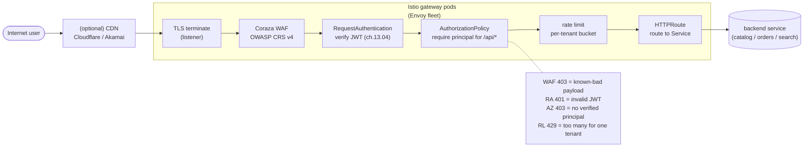

# 13.07 — Edge: Istio Gateway + Coraza WAF + per-tenant rate limiting

> Gateway API at the edge, Coraza WAF (ModSecurity-compatible OWASP CRS),
> per-tenant rate limiting via Envoy's local rate limiter.

**Estimated time:** ~45 min read · half-day hands-on
**Prerequisites:** [Part 02 ch.05](../02-networking/05-gateway-api.md) — Gateway API at the north-south edge · [Part 11 ch.04](../11-advanced-production-patterns/04-service-mesh.md) — Istio data plane behind the edge · [Part 13 ch.02](02-tenancy-and-crossplane-onboarding.md) — tenant identity rate-limits key off
**You'll know after this:** • author an Istio `Gateway` + `HTTPRoute` set at the edge with TLS termination · • deploy Coraza WAF with the OWASP Core Rule Set and verify it blocks SQLi / XSS · • configure Envoy local rate limiter scoped per tenant via headers/JWT claims · • compare local vs global rate limiting and choose for a traffic profile · • plan staged rollout of WAF rules to avoid false-positives killing traffic

<!-- tags: bookstore-v2, security, networking, istio, coraza, multi-tenancy -->

## Why this exists

The v1 Bookstore ran behind an Ingress controller, ingress-nginx, which is
[retired upstream](https://github.com/kubernetes/ingress-nginx) (best-effort
maintenance ended in March 2026). That is the right shape for the v1 lesson
(Part 02 ch.04 Ingress; Part 09's end-to-end capstone wiring). It is the
**wrong shape for real e-commerce** in three specific ways:

1. **No WAF.** A vanilla Ingress passes whatever the attacker sends.
   Common attacks — SQL injection (`?q=1' OR '1'='1`), XSS
   (`?q=<script>alert(1)</script>`), command injection (`?id=$(rm -rf /)`),
   path traversal (`/static/../../../etc/passwd`) — all reach the
   application unfiltered. Real e-commerce platforms run a Web
   Application Firewall (WAF) at the edge.
2. **No rate limiting.** A bot scraping the catalog at 10,000 req/s
   consumes pod resources meant for paying customers; a leaked API
   token is the difference between "we lost a thousand dollars" and
   "we lost a million" depending on whether per-tenant limits kick in.
3. **No bot detection.** A botnet hammering `/api/orders` from 10,000
   distinct IPs is functionally identical to a real flash sale unless
   the edge can tell them apart. Real edges do CAPTCHA challenges +
   IP reputation scoring at the WAF layer.

v2 fixes the first two (WAF + rate limit). Bot detection (the third)
is sketched in Production notes; the production answer is usually a
managed bot-detection vendor (Cloudflare, Akamai, hCaptcha) rather
than a self-hosted stack.

The chapter ships:

- **Gateway API** at the entry — the standardised replacement for
  Ingress, GA since Gateway API v1.0 (October 2023); it ships as CRDs
  you install separately, not tied to a Kubernetes minor. Replaces the
  `kubernetes.io/ingress.class: nginx` annotation soup with a typed
  `Gateway` + `HTTPRoute` resource pair.
- **Coraza**: the Go-native ModSecurity-compatible WAF, loaded as an
  Envoy WASM filter (an Istio `WasmPlugin`) on the gateway. Runs OWASP
  Core Rule Set v4 (sql-injection, xss, command-injection, path-traversal,
  file-upload, http-protocol-violation rules).
- **Envoy local rate limiter** — in-process token-bucket per worker,
  keyed per-tenant on the verified JWT claim, which ch.13.04 copies to a
  header.

> **In production:** Teams put WAF behind their CDN's WAF (Cloudflare,
> AWS WAF, Akamai), not behind a self-hosted stack. That is the right
> call when the CDN's WAF is acceptable; the v2 platform ships the
> self-hosted variant because (a) some platforms are CDN-less by
> regulatory regime, (b) the OWASP CRS rules + Coraza shape is the
> same whether you run it self-hosted or buy it; the teaching
> artifact is the rule set.

## Mental model

**The edge does three jobs: terminate-TLS-and-route, defend (WAF +
rate limit + bot), authenticate (Part 13.04). v2 wires all three at
the Istio gateway; the request passes through five filters before
the application sees it.**

- **Gateway API at the edge — the v2 standard.** Three primitives:
  - `GatewayClass` — which controller implements `Gateway` (Istio,
    Envoy Gateway, Contour, Cilium). The platform v2 picks Istio
    because the mesh + the edge are the same Envoy fleet — one set
    of EnvoyFilters covers both layers.
  - `Gateway` — a logical load-balancer. Carries listeners (port +
    protocol + TLS), addresses, and `allowedRoutes`. One per
    cluster usually; per-tenant `Gateway`s are possible but operate
    at higher overhead. Istio provisions a Deployment and a Service
    named `<gateway>-<gatewayclass>` for each one, labelled
    `gateway.networking.k8s.io/gateway-name`; the policies here select
    pods by that label.
  - `HTTPRoute` — how requests reaching the `Gateway` map to
    backend Services. Matches by path, header, method; routes to
    one or more backends with optional weighted split.
  Gateway API is **the** replacement for Ingress: Ingress will
  exist for backwards compatibility but no new features are being
  added. Greenfield uses Gateway API.
- **WAF, Coraza + OWASP CRS as a WASM filter.** Coraza uses the same
  rule format as ModSecurity (`SecRule`) and is maintained upstream. The
  OWASP **Core Rule Set** is the canonical attack-pattern bundle:
  - 920000-929999 — protocol enforcement.
  - 930000-933999 — local file inclusion + path traversal.
  - 941000-941999 — XSS.
  - 942000-942999 — SQL injection.
  - 943000-943999 — session fixation.
  - 944000-944999 — Java-specific attacks.
  Each rule has an anomaly score; the request's total score is
  evaluated against a threshold (default: deny on anomaly >= 5).
  Coraza runs as an Envoy WASM filter — INSIDE the gateway Envoy
  process, no extra Pods, no extra hop.
- **Rate limiting — local in-Envoy, keyed per-tenant via the JWT
  claim.** Two flavours of rate-limiter Envoy supports:
  - **Local** — each Envoy worker maintains its own token-bucket;
    sum across N workers is approximate. Fast (no extra hop).
  - **Global** — Envoy calls a separate rate-limit-service (RLS) via
    gRPC; the RLS keeps a Redis-backed exact counter. Slower
    (extra hop per request).
  The platform v2 picks **local** because the per-tenant budget is
  per-edge-replica and the approximation is fine at the e-commerce
  shape. This chapter builds only the local variant. An exact
  cluster-wide budget needs a global service, which is not built here.
- **Filter ordering matters.** The request passes these stages:
  1. TLS termination (the listener does this).
  2. **WAF (Coraza)**: block known-bad payloads. The `WasmPlugin` runs
     in phase `AUTHN`, before the JWT filter.
  3. **JWT authn (RequestAuthentication, `edge/jwt-policies.yaml`)**: verify
     the bearer token and copy its tenant claim to `x-tenant`. It is a copy
     of ch.13.04's policy, selecting the Gateway API pods.
  4. **AuthZ (AuthorizationPolicy, same file)**: require a verified
     principal for `/api/*`.
  5. **Rate limit**: the filter is inserted before the router, which
     places it after the authentication and authorization filters.
  WAF before JWT so an attack payload never reaches the verifier. The
  rate limit comes after authentication, so only verified tenants spend
  a budget. A botnet without a token still reaches the JWT verifier, which
  is the cost of this order.

The trap to keep in view: **WAF is noisy out of the box.** CRS v4
trips on legitimate book titles that contain quotes, on URLs with
plus signs in the query, on POST bodies with HTML in them. The
chapter ships the production tuning loop: start in `DetectionOnly`
mode, watch the audit log, build a whitelist, flip to `On`.

## Threats and controls

| Threat | Control in this chapter | Goes deeper in |
|---|---|---|
| Hostile payloads (SQL injection, XSS, path traversal) reach the app | Coraza WAF, OWASP CRS v4, blocks on anomaly score 5 | Steps 5 and 7 here |
| Abuse volume: one tenant or a bot exhausts shared capacity | Token bucket per tenant on the verified claim; a shared default bucket for the rest | Step 6 here; quotas in 13.02 |
| Forged tokens at the edge | JWT verification and AuthZ on the Gateway API pods (`edge/jwt-policies.yaml`, a copy of 13.04's policies) | Step 2 here; the issuer is set up in 13.04 |
| The edge CA key: whoever holds it can mint certificates clients trust | The CA is a namespaced Issuer, so only Certificates in `bookstore-platform` can use it. Clients trust only the exported `edge-ca.crt`. Reads of the `edge-ca` Secret remain a limit, enforced with RBAC | Step 2 here; RBAC in Part 05 ch.04 |
| Bots that look like buyers (no token, many IPs) | Not built here: a bot-management vendor | Production notes |

## Diagrams

### Diagram A — request flow through the edge (Mermaid)



### Diagram B — WAF rules matrix (ASCII)

```text
ATTACK CLASS              SAMPLE PAYLOAD                 CRS RULE   COMMON FP
─────────────────────     ──────────────────────────     ────────   ──────────────────────────
SQL injection             ?q=1' OR '1'='1                942100     book title with quote
SQL injection (union)     ?q=1 UNION SELECT 1            942101     query containing "union"
XSS (script tag)          ?q=<script>alert(1)</script>   941100     embedded HTML preview
XSS (event handler)                 941160     legitimate img tag
Command injection         ?id=$(rm -rf /)                932100     shell-like search term
Path traversal            /static/../../../etc/passwd    930100     legitimate ../ in PATH_INFO
Local file inclusion      ?file=../../etc/passwd         930120     same as above
HTTP smuggling            Transfer-Encoding: chunked     921110     none — block
Bad user-agent            User-Agent: sqlmap             913100     none — block
```

### Diagram C — local vs global rate-limit (ASCII)

```text
DIMENSION              LOCAL RATE LIMITER           GLOBAL RATE LIMITER (RLS)
─────────────────────  ───────────────────────────  ────────────────────────────
Where                  in Envoy worker (in-process) external gRPC service
Accuracy               approximate (per-worker)     exact (Redis-backed)
Latency cost           in-process, no extra hop     one extra hop per request
Operational            zero extra component         RLS Deployment + Redis
Per-tenant key         x-tenant from verified claim same
When it wins           per-gateway-replica fine     need exact cluster-wide budget
```

## Hands-on with the Bookstore Platform

Assumes ch.13.04 ran (Istio installed); ch.13.05 and
13.06 are useful but not strictly required to run this chapter. Every
output shown in this section is illustrative, not captured: this
chapter's lab run did not install Istio.

### 1. Install the Gateway API CRDs

```sh
kubectl config use-context kind-bookstore-platform-us-east

# Standard channel (graduated APIs only). v1.6.0 is the bundle istio.io's
# Gateway API task installs; use the one your Istio release documents.
kubectl apply -f https://github.com/kubernetes-sigs/gateway-api/releases/download/v1.6.0/standard-install.yaml

# Verify the CRDs
kubectl get crd | grep gateway.networking.k8s.io
# gatewayclasses.gateway.networking.k8s.io
# gateways.gateway.networking.k8s.io
# httproutes.gateway.networking.k8s.io
# referencegrants.gateway.networking.k8s.io
```

The Istio controller from ch.13.04 reconciles these resources.

### 2. Issue the edge certificate and apply the Gateway

The HTTPS listener needs a certificate that clients can check. cert-manager
signs it with an edge CA that this chapter creates, so no key sits in a
manifest. Label the namespace first, at `restricted`:

```sh
kubectl apply -f - <<'EOF'
apiVersion: v1
kind: Namespace
metadata:
  name: cert-manager
  labels:
    pod-security.kubernetes.io/enforce: restricted
    pod-security.kubernetes.io/enforce-version: latest
    pod-security.kubernetes.io/audit: restricted
    pod-security.kubernetes.io/audit-version: latest
    pod-security.kubernetes.io/warn: restricted
    pod-security.kubernetes.io/warn-version: latest
EOF

helm repo add jetstack https://charts.jetstack.io
helm install cert-manager jetstack/cert-manager --version v1.21.3 \
  --namespace cert-manager --set crds.enabled=true --wait
```

On chart v1.21.3 the defaults already meet `restricted`: the pods run
non-root with the `RuntimeDefault` seccomp profile, and each container
drops all capabilities and has a read-only root filesystem.

```sh
kubectl apply -f examples/bookstore-platform/edge/edge-ca.yaml
kubectl apply -f examples/bookstore-platform/edge/gateway.yaml
kubectl apply -f examples/bookstore-platform/edge/jwt-policies.yaml

kubectl -n bookstore-platform wait --for=condition=Ready certificate/edge-ca --timeout=120s
kubectl -n bookstore-platform wait --for=condition=Ready certificate/bookstore-platform-edge --timeout=120s

# Export the CA once. Every later chapter uses --cacert edge-ca.crt.
kubectl -n bookstore-platform get secret edge-ca -o jsonpath='{.data.ca\.crt}' \
  | base64 -d > edge-ca.crt

kubectl -n bookstore-platform get gateway,httproute
# NAME                                                        CLASS   ADDRESS   PROGRAMMED   AGE
# gateway.gateway.networking.k8s.io/bookstore-platform-edge   istio             True         10s
#
# NAME                                                              HOSTNAMES   AGE
# httproute.gateway.networking.k8s.io/bookstore-platform-public                 10s
# httproute.gateway.networking.k8s.io/bookstore-platform-api                    10s
# httproute.gateway.networking.k8s.io/bookstore-platform-stripe-webhook         10s
# httproute.gateway.networking.k8s.io/bookstore-platform-redirect               10s
```

The `Gateway` has two listeners (HTTPS on 443, HTTP on 80). The HTTP
listener serves only the redirect route. The HTTPS certificate is issued
by the edge CA, and `allowedRoutes` admits only routes in this namespace.

### 3. Apply the Coraza WAF WasmPlugin

```sh
kubectl apply -f examples/bookstore-platform/edge/coraza-wasmplugin.yaml

kubectl -n bookstore-platform get wasmplugin coraza-waf
# NAME         AGE
# coraza-waf   5s

# The gateway pod loads the module at startup
kubectl -n bookstore-platform logs -l gateway.networking.k8s.io/gateway-name=bookstore-platform-edge --tail=20 | grep -i coraza
# ... wasm log: Coraza initialised; CRS rules loaded ...
```

### 4. Apply the per-tenant rate-limit EnvoyFilter

```sh
kubectl apply -f examples/bookstore-platform/edge/rate-limit-envoy-filter.yaml

kubectl -n bookstore-platform get envoyfilter
# NAME                       AGE
# per-tenant-rate-limit      5s
```

### 5. Test the WAF (port-forward; production uses the cloud LB)

```sh
kubectl -n bookstore-platform port-forward svc/bookstore-platform-edge-istio 8443:443 >/dev/null 2>&1 &
sleep 3

# 5a — legitimate request (200)
curl -s --cacert edge-ca.crt -o /dev/null -w "%{http_code}\n" https://localhost:8443/static/index.html
# 200

# 5b — SQL injection (403, rule 942100)
curl -s --cacert edge-ca.crt -o /dev/null -w "%{http_code}\n" "https://localhost:8443/api/v2/search?q=1' OR '1'='1"
# 403

# 5c — XSS (403, rule 941100)
curl -s --cacert edge-ca.crt -o /dev/null -w "%{http_code}\n" "https://localhost:8443/api/v2/search?q=<script>alert(1)</script>"
# 403

# 5d: path traversal (403, rule 930100). --path-as-is keeps the ../ segments;
# without it curl squashes them and the WAF never sees the traversal.
curl -s --path-as-is --cacert edge-ca.crt -o /dev/null -w "%{http_code}\n" "https://localhost:8443/static/../../../etc/passwd"
# 403

# 5e — known-bad user-agent (sqlmap; 403, rule 913100)
curl -s --cacert edge-ca.crt -o /dev/null -w "%{http_code}\n" -H "User-Agent: sqlmap/1.7" https://localhost:8443/api/v2/search?q=test
# 403
```

Sample WAF audit log entry (from the Coraza filter):

```sh
kubectl -n bookstore-platform logs -l gateway.networking.k8s.io/gateway-name=bookstore-platform-edge --tail=5 | grep -i transaction
# {"transaction":{"id":"...","client_ip":"127.0.0.1","request":{"uri":"/api/v2/search?q=1%27%20OR%20%271%27%3D%271","method":"GET"},
#  "messages":[{"actionset":"deny","data":"Matched Data: \" OR \" found within ARGS:q","rule":{"id":"942100","msg":"SQL Injection Attack Detected via libinjection","severity":2}}]}
```

### 6. Test per-tenant rate limit

```sh
# First, get a JWT for tenant acme-books (from ch.13.04 step 3)
# ... assume $JWT is set ...

# Hammer the API: 105 requests in <10s. The local rate limiter is
# 100 / 10s / tenant; the 101st onward should return 429.
for i in $(seq 1 105); do
  curl -s --cacert edge-ca.crt -o /dev/null -w "%{http_code}\n" \
    -H "Authorization: Bearer $JWT" \
    "https://localhost:8443/api/v2/search?q=test"
done | sort | uniq -c
# 100 200
#   5 429
```

The 429 response carries `Retry-After: 10` and the `x-rate-limit:
per-tenant` header — the client knows when to retry and the operator
sees which budget the request hit.

### 7. Tune CRS: exclude one rule on one path

A real catalog has book titles like *"Don't Make Me Think"*, and the
apostrophe trips rule 942100 on any path that takes text. Tune in this
order, and do not block on the first day:

1. Set `SecRuleEngine DetectionOnly` in `pluginConfig.directives_map.default`
   of `coraza-wasmplugin.yaml`, then apply it. Rules log but do not block.
2. Read the audit log for about two weeks. For each rule that fires on
   legitimate input, add an exclusion.
3. Scope each exclusion to its path. This line removes rule 942100 for the
   catalog routes only, and nothing else:

```text
SecRule REQUEST_URI "@beginsWith /api/v1/" "id:1000001,phase:1,pass,nolog,ctl:ruleRemoveById=942100"
```

4. Set `SecRuleEngine On` again, apply, and confirm the 403 in step 5b
   still returns.

## How it works under the hood

**Gateway API vs Ingress — the semantic differences.**

- **Roles.** Ingress collapsed everything into one resource; Gateway API
  splits **infra-team** concerns (the `Gateway` + listeners + TLS) from
  **app-team** concerns (the `HTTPRoute` + paths). A feature team can
  add an `HTTPRoute` referencing the platform's `Gateway` without
  needing rights to modify the gateway itself.
- **Typed routing.** Ingress had `kubernetes.io/ingress.class` +
  controller-specific annotations for header-based routing, weighted
  splits, retries, timeouts. Gateway API has typed fields for all of
  these (`spec.rules[].matches[].headers`, `spec.rules[].backendRefs[].weight`,
  `spec.rules[].timeouts`).
- **Cross-namespace routes.** A `Gateway` admits routes from the
  namespaces its `allowedRoutes` names. This chapter uses `Same`, so only
  routes in `bookstore-platform` attach. The other direction needs a
  `ReferenceGrant` in the target namespace: each backend namespace in
  `gateway.yaml` grants the named Services to the edge routes, and no more.

**Filter insertion.** An EnvoyFilter `INSERT_BEFORE` places a filter
relative to a named anchor. The WasmPlugin uses `phase: AUTHN`, which
places the WAF before Istio's authn filters, so it runs before the JWT
verifier from ch.13.04. The Lua filter sits before
`envoy.filters.http.jwt_authn`, so it strips the client's `x-tenant`
before the verifier can set it. The rate limit sits before
`envoy.filters.http.router`, the last stop.

**The WASM binary is OCI-distributed.** The WasmPlugin `url` names an OCI
image. Pin it by digest (`oci://...@sha256:<DIGEST>`), so a new push to a
tag cannot change the behaviour that was reviewed. The example pins the
digest of tag 0.5.0, and the tag stays in a comment.

**Token-bucket vs leaky-bucket.** Envoy's local rate limiter is a
**token bucket**: a bucket holds N tokens; each request consumes one;
the bucket refills `tokens_per_fill` every `fill_interval`. When the
bucket is empty, requests get 429 + `Retry-After`. The alternative —
**leaky bucket** — accumulates incoming requests and drains them at a
fixed rate. Production picks token-bucket for the edge because the
operator-visible cost ("X req / Y seconds / tenant") is familiar.

**The tenant key comes from the token, not from parsing it.**
`edge/jwt-policies.yaml`'s RequestAuthentication copies a verified token's
`tenant` claim to the `x-tenant` header (`outputClaimToHeaders`). A route
action reads that header
as the descriptor key. A request with no token has no `x-tenant` and uses
the default bucket. The Lua filter exists for one reason: a client can send
its own `x-tenant`, and only the verified token may set it.

**Filter performance.** Measure the WAF and the TLS handshake on your own
traffic before you set a latency budget. This chapter does not benchmark
them. Real-time paths with a tight budget may need a smaller rule set.

## Production notes

> **In production:** **Rate-limit "thundering herd" on reset.** The
> token bucket refills at the `fill_interval` boundary; if 10,000
> clients hit the limit at second 5 and the bucket resets at second
> 10, all 10,000 retry simultaneously at second 10. Jitter the
> `Retry-After` value on the client side (some clients respect it as
> "wait random(0, N)"). This chapter sends a fixed `10`, and it does
> not build a global limiter that would smooth the curve.

> **In production:** **WAF blocked but the attacker was legitimate**
> — the highest-friction misconfiguration. A legitimate customer
> types a book title with a quote; CRS 942100 fires; the request gets
> 403; the customer's checkout breaks. Two defences: (a) the path-scoped
> exclusion in step 7; (b) a **trust list** for known-good clients (large
> customers' IP ranges, the platform team's own offices) that skips the
> WAF. This chapter does not build the trust list.

> **In production:** **Bot detection — punt to a vendor.** Self-hosted
> bot detection is a deep rabbit hole (IP reputation, browser
> fingerprinting, behavioural scoring, CAPTCHA challenges). Real
> platforms buy this from a vendor — Cloudflare Bot Management,
> Akamai Bot Manager, hCaptcha Enterprise. The integration is
> usually "the vendor sets a cookie; the WAF checks the cookie". This
> chapter builds none of it.

> **In production:** **The CDN's WAF and yours run in series.** If
> you have a CDN with a WAF (most do), it runs **before** your
> origin's WAF. The CDN catches the volumetric attacks (DDoS,
> obvious scrapers); your origin's WAF catches the targeted ones
> (SQL-injection on a specific endpoint). They should overlap on
> the OWASP CRS rules to give defence in depth — the CDN's CRS may
> be a different version than yours, and *that* is the value of
> running both.

> **In production:** **Audit the audit log.** Coraza's audit log
> (`SecAuditLog /tmp/coraza-audit.log` in the chapter's config) is
> the forensic record of every blocked request. Ship it to Loki
> (ch.13.09); set Grafana queries for "top blocked rules over 24h",
> "top blocked tenants", "blocked-but-then-the-IP-also-succeeded-on-
> a-different-rule" (a sign of a tuning false positive). The
> chapter cross-refs the dashboard.

## Quick Reference

```sh
# Gateway API CRDs
kubectl apply -f https://github.com/kubernetes-sigs/gateway-api/releases/download/v1.6.0/standard-install.yaml

# Edge CA, Gateway + Routes (cert-manager installed first, step 2)
kubectl apply -f examples/bookstore-platform/edge/edge-ca.yaml
kubectl apply -f examples/bookstore-platform/edge/gateway.yaml
kubectl apply -f examples/bookstore-platform/edge/jwt-policies.yaml
kubectl -n bookstore-platform get secret edge-ca -o jsonpath='{.data.ca\.crt}' | base64 -d > edge-ca.crt

# WAF + rate limit
kubectl apply -f examples/bookstore-platform/edge/coraza-wasmplugin.yaml
kubectl apply -f examples/bookstore-platform/edge/rate-limit-envoy-filter.yaml

# Verify
kubectl get gateway,httproute -A
kubectl -n bookstore-platform get wasmplugin,envoyfilter

# Test (port-forward)
kubectl -n bookstore-platform port-forward svc/bookstore-platform-edge-istio 8443:443 >/dev/null 2>&1 &
curl -s --cacert edge-ca.crt "https://localhost:8443/api/v2/search?q=1' OR '1'='1"   # 403 from WAF
```

Minimal fragments (the full files are in `edge/`):

```yaml
# Gateway fragment: the TLS listener and the namespace policy
spec:
  gatewayClassName: istio
  listeners:
    - name: https
      protocol: HTTPS
      port: 443
      tls:
        mode: Terminate
        certificateRefs:
          - kind: Secret
            name: <TLS-SECRET>
      allowedRoutes:
        namespaces:
          from: Same
```

```yaml
# HTTPRoute fragment: one path prefix to one Service
spec:
  parentRefs:
    - name: <GATEWAY-NAME>
      sectionName: https
  rules:
    - matches:
        - path: { type: PathPrefix, value: /api/v2 }
      backendRefs:
        - { name: <SVC>, port: 8080 }
```

```yaml
# Coraza WAF WasmPlugin (fragment; the full file is edge/coraza-wasmplugin.yaml)
spec:
  selector:
    matchLabels: { gateway.networking.k8s.io/gateway-name: <GATEWAY-NAME> }
  url: oci://ghcr.io/corazawaf/coraza-proxy-wasm@sha256:<DIGEST>
  phase: AUTHN
  pluginConfig:
    default_directives: default
    directives_map: { default: ["Include @owasp_crs/*.conf", "SecRuleEngine On"] }
```

WAF rule tuning checklist:

- [ ] Start in `DetectionOnly` mode.
- [ ] Watch audit log for 14 days; daily review.
- [ ] Build path-specific exclusion list for legitimate-but-noisy rules.
- [ ] Flip to `On` after FP rate is < 1 / 1000 requests.

Checklist (edge wired correctly when all six are yes):

- [ ] Gateway API CRDs installed; `kubectl get gateway,httproute` shows
      the platform's `Gateway` is `PROGRAMMED: True`.
- [ ] Coraza WASM loaded; SQL-injection curl returns 403.
- [ ] Rate-limit fires after 100 req / 10 s / tenant; 429 includes
      `Retry-After: 10`.
- [ ] JWT verify (ch.13.04) still works: a bad token gets 401, and no
      token on `/api/*` gets 403.
- [ ] WAF audit log is shipped to Loki (cross-ref 13.09).
- [ ] CRS exclusion list documented per noisy rule, scoped to a path.

## Test your understanding

> Try each before opening the answer drawer. The act of trying is the exercise; the answer is the check.

1. **Why is the WAF at the edge gateway and not in each app?**
   <details><summary>Show answer</summary>

   (1) **Single point of policy** — one CRS ruleset protects all services; otherwise every team reimplements input validation differently. (2) **No code change** — security can deploy a rule without an app release. (3) **Performance** — Envoy's WASM filter at the edge runs once per request; in-app middleware runs N times across services. (4) **Audit** — one WAF log to ship to Loki, not N. (5) **Defense-in-depth** — apps still validate inputs, but the WAF catches mass-exploit patterns (SQLi, XSS, command injection) before they reach the app. The trade is the false-positive risk: a WAF rule blocks a legitimate request from one customer, and now you're paging at 2am.

   </details>

2. **You enable OWASP CRS in "blocking" mode and the storefront's `/checkout` endpoint starts returning 403 for ~3% of customers. What's the staged-rollout discipline?**
   <details><summary>Show answer</summary>

   The CRS in blocking mode is rule-set-too-strict for most apps day-one. Discipline: (1) **Detection-only mode** for 1-2 weeks: CRS logs would-be-blocks but doesn't enforce; you collect false-positives. (2) **Per-path exclusions**: `/checkout` may legitimately POST JSON that triggers SQL keyword rules; add `SecRuleRemoveTargetById` for those exact rules on that path. (3) **Threshold tuning**: CRS uses an anomaly score; raise the threshold for low-criticality paths. (4) **Per-tenant overrides** when a tenant's specific API legitimately triggers a rule. (5) **Then enable blocking** with the false-positive rate as a metric: alert when the block rate in the audit log rises above its pre-deploy baseline. Never go straight to blocking mode in production.

   </details>

3. **Compare local rate limiting (per-Envoy) vs global rate limiting (shared service) — when do you choose each?**
   <details><summary>Show answer</summary>

   **Local** (Envoy's `local_ratelimit`): each replica counts independently. If you have 10 storefront pods and a 100 req/s/tenant limit, each pod allows 100, total 1000. Simple, no coordination, no latency added. Good when (a) load is roughly balanced across pods, (b) you accept ~10x the limit at peak, (c) you don't have a shared store. **Global** (`global_ratelimit` + Redis or Envoy's RLS): all pods share a counter, hard 100 req/s/tenant total. Adds one network hop per request for the lookup, requires Redis, scales differently. Choose global for hard contractual limits ("tenant X gets exactly 1000 req/min"), local for noisy-neighbor protection where approximations are fine.

   </details>

4. **A tenant complains "we're getting rate-limited but our traffic spike is legitimate." What's the conversation and what's the technical answer?**
   <details><summary>Show answer</summary>

   First, validate: pull OpenCost + observability for that tenant: is the spike actually 10x baseline? If yes, the limit was set too conservatively. If no, it might be a buggy retry loop on their side. Technical: (a) add a descriptor entry for that tenant with a higher `max_tokens`, as a reviewed change to the EnvoyFilter; (b) move them to a higher tier with a documented higher cap; (c) set `max_tokens` above `tokens_per_fill` so a legitimate spike spends stored tokens. The conversation matters: rate limits are a *product feature*, not a technical guardrail. Customers should know their limits, see usage dashboards, and have a path to increase them. Surprising customers with 429s is a churn risk.

   </details>

5. **Hands-on: send a SQL injection (`?id=1' OR '1'='1`) and a normal request through the gateway. Check the WAF audit log in Loki. What fields prove the block was correct?**
   <details><summary>What you should see</summary>

   The audit log entry shows `rule_id`, `severity`, `category` (e.g. `942100` SQL Injection), the `matched_data` (the offending substring), the `request_uri`, the `tenant` header. The 403 response includes a request ID that ties back to the log line. The normal request is logged at info level with `rule_id: 0` (no match). The fields together prove (a) which rule fired, (b) what input triggered it, (c) which tenant/request. This is what you give the customer when they complain about a false positive — "rule X fired on input Y because Z." Without rich audit logs, every WAF complaint becomes a black box.

   </details>

## Further reading

- **Coraza docs** <https://coraza.io/docs/>; the canonical OWASP
  CRS-compatible Go-native WAF.
- **OWASP Core Rule Set** <https://coreruleset.org/docs/>; the
  rule bundle Coraza ships.
- **Envoy local rate limiter docs**
  <https://www.envoyproxy.io/docs/envoy/latest/configuration/http/http_filters/local_rate_limit_filter>;
  the token-bucket reference.
- **Kubernetes Gateway API** <https://gateway-api.sigs.k8s.io/>; the
  v1 specification this chapter applies.
- **Istio Gateway API support**
  <https://istio.io/latest/docs/tasks/traffic-management/ingress/gateway-api/>.
- **Istio WasmPlugin** <https://istio.io/latest/docs/reference/config/proxy_extensions/wasm-plugin/>;
  the phases and the `@sha256:` digest form.
- **Istio RequestAuthentication**
  <https://istio.io/latest/docs/reference/config/security/request_authentication/>;
  `outputClaimToHeaders`, which step 4's tenant header depends on.
- **cert-manager CA issuer** <https://cert-manager.io/docs/configuration/ca/>.
- **Ibryam & Huß, _Kubernetes Patterns_ 2e — *Stateless Service*
  (ch.5)** — the request-response shape WAF + rate-limit specialise.
