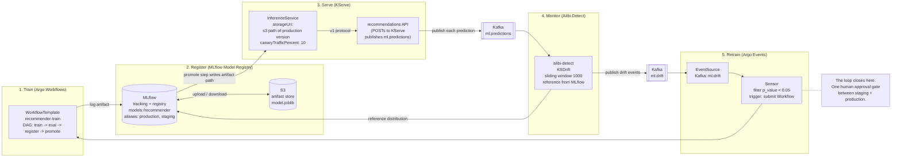

# 13.08 — Real ML loop: training -> registry -> serving -> drift -> retrain

> MLflow tracking + Model Registry; KServe serving with model canary;
> Alibi-Detect drift; Argo Events drift-triggered retrain. The full
> MLOps loop, closed.

**Estimated time:** ~60 min read · half-day hands-on
**Prerequisites:** [Part 12 ch.06](../12-kubernetes-for-machine-learning/06-model-serving-and-inference.md) — KServe serving baseline · [Part 12 ch.07](../12-kubernetes-for-machine-learning/07-ml-pipelines-and-workflows.md) — Argo Workflows + Events the loop closes · [Part 12 ch.08](../12-kubernetes-for-machine-learning/08-ml-platform-cost-and-mlops.md) — MLOps maturity frame
**You'll know after this:** • wire MLflow tracking + Model Registry as the canonical model store · • serve a KServe InferenceService with model canary against the production version · • configure Alibi-Detect (or similar) for input + prediction drift detection · • author Argo Events Sensor that triggers a retrain Workflow on drift · • close the full MLOps loop train → register → serve → monitor → retrain

<!-- tags: bookstore-v2, ml, mlops, kserve, mlflow, argo-workflows -->

## Why this exists

[Part 12 ch.06](../12-kubernetes-for-machine-learning/06-model-serving-and-inference.md)
served the recommender as a KServe `InferenceService`.
[Part 12 ch.07](../12-kubernetes-for-machine-learning/07-ml-pipelines-and-workflows.md)
trained it via an Argo `WorkflowTemplate` (train -> eval -> register ->
promote). [Part 12 ch.08](../12-kubernetes-for-machine-learning/08-ml-platform-cost-and-mlops.md)
closed Part 12 with the MLOps shape. Each chapter built one **piece**.
None of them wired the **full loop** with real components.

The v1 Bookstore's "register" step is the X3c-era ConfigMap stamp
([`bookstore/ml/pipeline/register-cm-template.yaml`](../examples/bookstore/ml/pipeline/register-cm-template.yaml))
— a small kubectl command that writes the model URI + score + timestamp
into a `ConfigMap recommender-model-registry-<WORKFLOW>`. It is the
right teaching artifact (no extra system to install) and the wrong
production artifact:

1. **A ConfigMap is not a registry.** It has no version stages
   (Staging / Production / Archived), no approval gates, no signed
   metadata, no UI, no API the rest of the stack can query.
2. **No drift detection.** A model in production today does not know
   if the input distribution it sees this Tuesday is the one it was
   trained on last Tuesday. Without drift detection, model staleness
   silently degrades predictions.
3. **No event-driven retraining.** v1's pipeline runs nightly via
   `CronWorkflow`. Real loops retrain **on signal** — when drift trips
   a threshold, when a new training-data batch lands, when a feature
   schema changes.

v2 wires the full loop with the production-shape components:

- **MLflow** — the model registry. Stages (None / Staging / Production
  / Archived), aliases (the v2 way: `models:/recommender@production`),
  full run + metric + artifact tracking, OpenAPI surface.
- **Argo Workflows** — the training engine (Part 12 ch.07 — re-used,
  not re-taught).
- **KServe** — the predictor with traffic split + canary (Part 12
  ch.06, re-used; the chapter adds the promote step that writes the
  production artifact path into `storageUri`, and the canary gate).
- **Alibi-Detect** — the drift detector. Kolmogorov-Smirnov over a
  sliding window of predictions.
- **Argo Events** — the EventSource + Sensor that watches the drift
  topic and triggers retraining.

> **In production:** The full loop matters even if you do not yet have
> drift. The reason is **the auditability of "which model is serving
> which traffic"**. MLflow's Model Registry answers it; the ConfigMap
> registry does not. The chapter ships the loop because the registry
> is the foundation; drift and retrain are the pay-off.

## Mental model

**The MLOps loop has five stations connected by typed artifacts: a
training run produces a model; the registry assigns it a version + a
stage; the predictor serves the production-stage version; the drift
detector watches the predictor's output; the retrain trigger closes
the loop on drift. Every station is a Kubernetes resource; every
typed artifact is queryable.**

- **Station 1: Train (Argo Workflows).** A `WorkflowTemplate`
  (`recommender-train` in `examples/bookstore-platform/ml/training-
  workflow.yaml`) runs the DAG. Each step is a Pod. The train.py
  inside the `bookstore-platform/recommender-train` image
  `mlflow.start_run()`s, logs metrics + the `model.joblib` artifact,
  writes the run-id to a file Argo lifts as an output parameter.
- **Station 2: Register (MLflow Model Registry).** The `register`
  step calls `mlflow.register_model(runs:/<RUN_ID>/model,
  "recommender")` which creates a new version under
  `models:/recommender`. The next step `promote_to_alias` sets the
  `staging` alias on the new version. Production promotion is a
  **separate** Workflow that requires a human approval (the
  GitHub-PR-as-approval pattern).
- **Station 3: Serve (KServe).** A KServe `InferenceService` carries a
  plain `s3://` `storageUri`. KServe does not resolve MLflow aliases, so
  the promote step asks MLflow for the production version's artifact path
  and writes it into `storageUri`. KServe downloads the artifact and the
  predictor loads `model.joblib`.
  Traffic split: 90 % `production` / 10 % `staging` on subsequent rolls
  via the `canaryTrafficPercent` field.
- **Station 4: Monitor (Alibi-Detect).** A Deployment running the
  Alibi-Detect KSDrift detector consumes `ml.predictions` (each
  prediction the recommendations API produces is published here),
  maintains a sliding window of N records, runs Kolmogorov-Smirnov
  against a **reference window** (a snapshot of the training data
  feature distribution, fetched from MLflow at startup). On a
  threshold breach, publishes a `ml.drift` event with the feature
  name + the KS statistic + the p-value.
- **Station 5: Retrain (Argo Events).** An `EventSource` watches
  Kafka `ml.drift`; a `Sensor` filters for `p_value < threshold` and
  submits the `recommender-train` Workflow again. The loop closes.

The trap to keep in view: **the drift detector can trip on seasonal
data** that is not really "drift" in the model-quality sense — the
distribution legitimately shifts in December (holiday shoppers buy
different books). Reference window must be **per-season** or per-
"context"; a single static reference distribution from "the training
data" will cause runaway retraining. The chapter walks the seasonal
reference pattern.

## Threats and controls

A `model.joblib` is a Python pickle. Loading it runs code its author chose,
so a model artifact is code, not data. Part 12 ch.06 covers the serving
path that loads it; the loading risk is stated here because that chapter
does not state it.

| Threat | Control in this chapter | Goes deeper in |
|---|---|---|
| A tampered `model.joblib` runs code when the predictor loads it | Restricted predictor pod with no token; write access to the artifact bucket granted to the training identity only | Part 12 ch.06 (serving) |
| Unreviewed promotion to production | Training moves the `staging` alias only. This guide does not ship the reviewed change that moves `production`; the lab's hands-on move is unreviewed (step 5) | Production notes |
| Forged or flooding drift events trigger retrains | Per-principal KafkaUser ACLs on the TLS listener; the Sensor filters on `p_value`, allows one retrain an hour, and holds a Role for Workflows only | 13.05 (Kafka ACLs), 13.12 (runbook) |
| Anyone who reaches MLflow rewrites the registry | MLflow basic auth on; both credentials synced from Vault by ESO | 13.06 (ESO), 13.04 (identity) |

This chapter does not sign artifacts. Check that the predictor cannot write
the bucket, and that only the training identity can.

## Diagrams

### Diagram A — the 5-station loop (Mermaid)



### Diagram B — Part 12 vs Part 13 contribution (ASCII)

```text
STATION       PART 12 TAUGHT                  PART 13.08 ADDS
────────────  ──────────────────────────────  ─────────────────────────────────────
1. Train      Argo WorkflowTemplate (12.07)   MLflow log_artifact + register call
2. Register   ConfigMap stamp (12.07 X3c)     MLflow Model Registry + alias
3. Serve      KServe InferenceService (12.06) s3 storageUri set by promote + canary
4. Monitor    (none)                          Alibi-Detect KSDrift Deployment
5. Retrain    CronWorkflow nightly (12.07)    Argo Events EventSource + Sensor
Honest        rule-based recommender          real loop, drift-triggered retrain
```

## Hands-on with the Bookstore Platform

Assumes ch.13.05 ran (Strimzi + Kafka topics exist); the two ML topics
(`ml.predictions` and `ml.drift`) are declared in `kafka/topics.yaml`
and reconciled by Strimzi's Topic Operator.

Output blocks are illustrative unless the text says they were captured.
The two version checks below were captured on a lab cluster whose name
differs from this chapter's; the transcript records the substitutions.

### 1. Install Argo Workflows + Argo Events (pinned-Helm)

```sh
kubectl config use-context kind-bookstore-platform-us-east

ARGO_WORKFLOWS_VERSION="0.42.0"   # Argo Workflows v3.5.10
ARGO_EVENTS_VERSION="2.4.0"       # Argo Events v1.8.0
ML=examples/bookstore-platform/ml

helm repo add argo https://argoproj.github.io/argo-helm
helm show chart argo/argo-workflows --version "$ARGO_WORKFLOWS_VERSION" | grep -E '^(appVersion|version):'
helm show chart argo/argo-events --version "$ARGO_EVENTS_VERSION" | grep -E '^(appVersion|version):'
```

<!-- gate: output -->

```text
appVersion: v3.5.10
version: 0.42.0
appVersion: v1.8.0
version: 2.4.0
```

Each namespace is labelled `restricted` before its install, so the chart's
pods are admitted only when they comply. The values files move the workflows
into `bookstore-platform-ml` and turn the Argo server off (the `argo` CLI
talks to the API directly). `training-rbac.yaml` then binds the chart's
executor Role to the `recommender-train` ServiceAccount, in that namespace
only. That ServiceAccount needs its
token: the executor reports each step's result through a
`WorkflowTaskResult`.

```sh
kubectl create namespace argo
kubectl label namespace argo pod-security.kubernetes.io/enforce=restricted
kubectl create namespace argo-events
kubectl label namespace argo-events pod-security.kubernetes.io/enforce=restricted

helm install argo-workflows argo/argo-workflows \
  --version "$ARGO_WORKFLOWS_VERSION" \
  -n argo -f "$ML/argo-workflows-values.yaml" --wait
helm install argo-events argo/argo-events \
  --version "$ARGO_EVENTS_VERSION" \
  -n argo-events -f "$ML/argo-events-values.yaml" --wait
```

(KServe and Knative are assumed installed from the Part 12 ch.06 hands-on.
cert-manager comes from ch.13.07 step 2, at v1.21.3 in the `cert-manager`
namespace. Part 12 ch.06 installs cert-manager under the same release name at
another version, so skip that install when 13.07 has run. A second `helm
install` under that name fails with "cannot re-use a name that is still in
use".)

### 2. Install MLflow

```sh
MLFLOW_CHART_VERSION="0.10.0"   # community-charts/mlflow, MLflow 2.19.0
ML=examples/bookstore-platform/ml

helm repo add community-charts https://community-charts.github.io/helm-charts
helm show chart community-charts/mlflow --version "$MLFLOW_CHART_VERSION" | grep -E '^(appVersion|version):'
```

<!-- gate: output -->

```text
appVersion: 2.19.0
version: 0.10.0
```

The two credentials come from the ESO-managed `mlflow-credentials` Secret.
The chart needs both as values and copies them into Secrets it owns, so
they reach the cluster, but neither Git nor the values file holds them. A
`--set-string` argument would put a password in the process list, so the
commands below write each value to a private file and pass the file with
`--set-file`. The directory is deleted after the install.

```sh
kubectl create namespace mlflow
kubectl label namespace mlflow pod-security.kubernetes.io/enforce=restricted
kubectl apply -f "$ML/mlflow-credentials.yaml"
kubectl -n mlflow wait --for=condition=Ready externalsecret/mlflow-credentials --timeout=120s

MLFLOW_VALUES="$(mktemp -d)"
chmod 700 "$MLFLOW_VALUES"
kubectl -n mlflow get secret mlflow-credentials -o jsonpath='{.data.postgres-password}' | base64 -d > "$MLFLOW_VALUES/postgres-password"
kubectl -n mlflow get secret mlflow-credentials -o jsonpath='{.data.admin-password}' | base64 -d > "$MLFLOW_VALUES/admin-password"
chmod 600 "$MLFLOW_VALUES"/*

helm install mlflow community-charts/mlflow \
  --version "$MLFLOW_CHART_VERSION" \
  -n mlflow -f "$ML/mlflow-values.yaml" --wait \
  --set-file "backendStore.postgres.password=$MLFLOW_VALUES/postgres-password" \
  --set-file "auth.adminPassword=$MLFLOW_VALUES/admin-password"

rm -rf "$MLFLOW_VALUES"
```

`mlflow-application.yaml` is the GitOps shape of the same install. It leaves
both credentials empty, so a secret-aware Argo CD plugin has to supply them.

Why community-charts/mlflow (not bitnami/mlflow): community-charts is
upstream-aligned + actively maintained; bitnami packages add the
Bitnami conventions which are great if you standardise on Bitnami
cluster-wide. Pick one; the platform v2 picks community-charts.

Verify:

```sh
# The admin credential goes in a 0600 curl config file, not in the argument list.
MLFLOW_AUTH="$(mktemp)"
chmod 600 "$MLFLOW_AUTH"
printf 'user = "mlflow-admin:%s"\n' "$(kubectl -n mlflow get secret mlflow-credentials -o jsonpath='{.data.admin-password}' | base64 -d)" > "$MLFLOW_AUTH"
kubectl -n mlflow port-forward svc/mlflow 5000:5000 >/dev/null 2>&1 &
sleep 3
curl -s -K "$MLFLOW_AUTH" http://localhost:5000/api/2.0/mlflow/registered-models/list | jq .
# Illustrative output, not captured:
# {"registered_models":[]}

# Deliberate denial: the same call without the credential is refused. Expect a
# status other than 200.
curl -s -o /dev/null -w '%{http_code}\n' http://localhost:5000/api/2.0/mlflow/registered-models/list
```

### 3. Apply the training Workflow + serving InferenceService + drift detector + retrain trigger

```sh
kubectl apply -f examples/bookstore-platform/ml/networkpolicy.yaml
kubectl apply -f examples/bookstore-platform/ml/eventbus.yaml
kubectl apply -f examples/bookstore-platform/ml/kafka-users.yaml
kubectl apply -f examples/bookstore-platform/ml/training-rbac.yaml
kubectl apply -f examples/bookstore-platform/ml/training-workflow.yaml
kubectl apply -f examples/bookstore-platform/ml/inferenceservice.yaml
kubectl apply -f examples/bookstore-platform/ml/alibi-detect-drift.yaml
kubectl apply -f examples/bookstore-platform/ml/argo-events-drift-trigger.yaml
```

The lab checked two of these files without running anything from them. The API
server accepted all six policies in `networkpolicy.yaml` in a server dry run.
It refused `eventbus.yaml` for want of the `EventBus` CRD, which the lab does
not have, so the object was checked a different way: a script compared its
field names with the json tags in the Argo Events v1.8.0 Go types, and every
name was found. Neither file was applied to a running workload. The EventBus
never started, so no EventSource or Sensor ran, the drift loop is untested, and
the policy allows are unproven by traffic (transcript `13-08.txt`, section 6).

`kafka-users.yaml` comes first: the drift detector and the EventSource mount
the certificates it issues. The InferenceService's `storageUri` is a
placeholder until step 5 writes the real path.

What landed (illustrative output, not captured):

```sh
kubectl -n bookstore-platform-ml get workflowtemplate,inferenceservice,deploy,eventsource,sensor
# NAME                                                AGE
# workflowtemplate.argoproj.io/recommender-train      30s
#
# NAME                                                URL  READY                                          AGE
# inferenceservice.serving.kserve.io/recommender                                                          30s
#
# NAME                            READY   UP-TO-DATE   AVAILABLE   AGE
# deployment.apps/alibi-detect    1/1     1            1           30s
#
# NAME                                                AGE
# eventsource.argoproj.io/ml-drift-eventsource        30s
#
# NAME                                                AGE
# sensor.argoproj.io/ml-drift-sensor                  30s
```

### 4. Submit a manual training run

```sh
argo submit --from workflowtemplate/recommender-train -n bookstore-platform-ml
# Name:                recommender-train-abc12
# Namespace:           bookstore-platform-ml
# ServiceAccount:      recommender-train
# Status:              Pending
# Created:             ...

# Watch:
kubectl -n bookstore-platform-ml get wf -w
```

After the run completes:

```sh
# MLflow logged the run + registered the new model version
curl -s -K "$MLFLOW_AUTH" http://localhost:5000/api/2.0/mlflow/registered-models/get?name=recommender | jq .
# {
#   "registered_model": {
#     "name": "recommender",
#     "latest_versions": [
#       { "version": "1", "current_stage": "Staging", ... }
#     ]
#   }
# }
```

### 5. Promote the new version to Production (the human-approval gate)

Production promotion is INTENTIONALLY not automatic. The chapter's
recommended pattern: a GitHub PR that updates a `models.yaml` file
under `examples/bookstore-platform/ml/`; the merge of the PR triggers
an Argo CD sync that runs a small Workflow `promote-production.yaml`.

The lab version runs the same calls by hand, with the admin credential:

```sh
# Lab only. In production these calls run in a reviewed Workflow under its
# own identity (see Production notes).
curl -s -K "$MLFLOW_AUTH" -X POST \
  "http://localhost:5000/api/2.0/mlflow/registered-models/alias" \
  -H "Content-Type: application/json" \
  -d '{"name":"recommender","alias":"production","version":"1"}'

# Write the production version's artifact path into the InferenceService.
# Moving the alias alone changes nothing in serving.
ARTIFACT_URI="$(curl -s -K "$MLFLOW_AUTH" \
  "http://localhost:5000/api/2.0/mlflow/model-versions/get-download-uri?name=recommender&version=1" | jq -r .artifact_uri)"
kubectl -n bookstore-platform-ml patch inferenceservice recommender --type merge \
  -p "{\"spec\":{\"predictor\":{\"model\":{\"storageUri\":\"$ARTIFACT_URI\"}}}}"
```

### 6. Generate predictions (to feed the drift detector)

`edge-ca.crt` is the edge CA that 13.07 exports once. The loop checks the
edge's certificate against that CA; it does not skip the check with `-k`.
The tenant token stays out of the argument list: it goes in a 0600 curl
config file.

```sh
JWT_AUTH="$(mktemp)"
chmod 600 "$JWT_AUTH"
printf 'header = "Authorization: Bearer %s"\n' "$JWT" > "$JWT_AUTH"

# Recommendations API (assumes ch.13.08's app/recommendations/ is deployed)
for i in $(seq 1 1100); do
  curl -s --cacert edge-ca.crt -K "$JWT_AUTH" \
    -X POST \
    -H "Content-Type: application/json" \
    -d "{\"user_id\":\"u-$i\",\"features\":[0.5,0.3,0.2]}" \
    https://localhost:8443/api/v2/recommendations >/dev/null
done

# 1100 records hit ml.predictions; the drift detector has its sliding
# window full now.
```

### 7. Inject drift (synthetic) to fire the loop

```sh
# Send 200 predictions with shifted features (drift the distribution)
for i in $(seq 1 200); do
  curl -s --cacert edge-ca.crt -K "$JWT_AUTH" \
    -X POST \
    -H "Content-Type: application/json" \
    -d "{\"user_id\":\"u-d-$i\",\"features\":[5.0,3.0,2.0]}" \
    https://localhost:8443/api/v2/recommendations >/dev/null
done

# Watch the drift detector log (illustrative output, not captured)
kubectl -n bookstore-platform-ml logs -l app=alibi-detect --tail=20
# {"level":"INFO","msg":"drift detected","feature":"price","ks":0.41,"p_value":0.003}

# The Sensor fires; a new Workflow is submitted
kubectl -n bookstore-platform-ml get wf
# NAME                                         STATUS      AGE
# recommender-train-abc12                      Succeeded   10m
# recommender-train-on-drift-xyz34             Running     30s
```

The loop closed: prediction -> drift detection -> retrain Workflow.

## How it works under the hood

**MLflow Model Registry API.** Four key endpoints:

- `POST /api/2.0/mlflow/runs/create` — start a run.
- `POST /api/2.0/mlflow/runs/log-artifact` — upload `model.joblib` to
  S3, link to run.
- `POST /api/2.0/mlflow/registered-models/create-version` — register
  a run's artifact as a new version under the named model.
- `POST /api/2.0/mlflow/registered-models/alias` — point an alias
  (`production`, `staging`) at a specific version.

The pre-2.0 API used **stages** (`None`/`Staging`/`Production`/
`Archived`); MLflow 2.0+ recommends **aliases** because aliases are
multi-valued (you can have two `canary` versions) and stages are
single-valued + capitalised + named-from-a-fixed-set. v2 uses aliases.

**KServe storage initializer.** KServe downloads `storageUri` into
`/mnt/models` before the predictor starts. Its built-in sources are S3,
GCS, Azure Blob, HTTP(S), Git, PVC, Hugging Face and OCI images; it does
not read MLflow aliases. The promote step does that resolution (Station
3), so the predictor never holds MLflow credentials.

**Canary at the InferenceService level.** KServe's
`canaryTrafficPercent: 10` field is meaningful **only on subsequent
rolls** — changing the `storageUri` after the first apply. On first
apply the InferenceService has a single revision and serves 100 % of
traffic from it; the canary field is read when the next storageUri
update lands. The flow: after the first deploy, change the
`storageUri` to point at the `staging` alias; KServe creates a second
revision and `canaryTrafficPercent: 10` routes 10 % to it (90 % stays
on the previous revision). The two slots are distinct Knative
Revisions (each a Deployment under the hood). A promote operation
writes the new artifact path into `storageUri`; KServe rolls out a new
revision for it. Moving the MLflow alias alone changes nothing in serving.

**Alibi-Detect — the KS test.** Kolmogorov-Smirnov is a non-parametric
two-sample test: given two empirical distributions (reference window
+ current window), it computes a statistic `D = sup |F_ref(x) -
F_cur(x)|` (the maximum distance between the empirical CDFs).
Under the null hypothesis (same distribution), `D * sqrt(n)` follows
a known distribution; a p-value < 0.05 rejects the null (drift
detected). KSDrift is univariate — applied per feature. For
multivariate drift, **MMDDrift** (Maximum Mean Discrepancy) is the
standard alternative; the chapter walks both.

**Argo Events EventSource -> Sensor flow.** The `EventSource` is a
Pod that subscribes to Kafka (or HTTP webhook, or SQS, or...) and
republishes events on Argo Events's internal NATS bus. The `Sensor`
is a Pod that subscribes to that bus, filters events by
`dependencies[].filters`, and on a match issues a trigger — in our
case, a Kubernetes `Workflow` resource via the `argoWorkflow`
trigger type. The end-to-end latency is sub-second; the loop closes
within seconds of drift detection.

**Promotion gates — the GitHub-PR-as-approval pattern.** Production
promotion is intentionally a human gate. Three patterns:

1. **Manual `kubectl`**: an engineer runs the `mlflow alias` API call
   when satisfied. Simple; no audit trail.
2. **GitHub PR** (the chapter's recommendation): a file
   (`models.yaml`) under the repo declares the active version per
   alias; a PR changes the version; merge triggers Argo CD sync
   which runs a small Workflow that calls MLflow. **Full audit
   trail via Git history.**
3. **Backstage TechDoc approval**: a Backstage form in the
   developer portal kicks off the same Workflow with a documented
   approver chain. **Most user-friendly; most overhead.**

This guide ships none of the three as a reviewed path. Step 5 moves the
alias by hand with the admin credential, which is the unreviewed path that
pattern 2 replaces. Pattern 3 is not wired to model promotion in ch.13.11.

## Production notes

> **In production:** **Model promotion gates — don't auto-promote.**
> The training Workflow only promotes to **Staging**. Production
> promotion is the human gate. The cost of auto-promotion is the day
> the new model is worse than the old one and there is no one to say
> stop. The cost of a human gate is hours of latency between "the
> model is ready" and "it is serving"; budget for it.

> **In production:** **Shadow vs canary vs A/B — when which.** KServe
> supports both shadow (mirror traffic to a candidate without using
> the response) and canary (split a percentage of traffic to the
> candidate and use the response). Shadow is non-blocking — perfect
> for "is the new model materially different from the old?" Canary
> is blocking — perfect for "is the new model better?" A/B is
> canary with random user assignment + a metric over a long window
> — the right shape for "is the new model worth the risk of a 1 %
> regression?" The chapter sketches all three; production uses
> shadow for model-quality safety and canary for the real promote.

> **In production:** **The "drift detector triggered retrain but the
> new data is just seasonal" footgun.** This is the most common
> retrain-loop runaway. Three mitigations: (1) **seasonal reference
> windows** — store a reference distribution per month or per
> business-event-context; the drift test compares against the
> matching context window. (2) **Rate-limit the retrain** — the
> Sensor's trigger allows one Workflow an hour (`rateLimit`). (3)
> **Two-stage drift**: only retrain when KS drift persists for more
> than 24 hours, not on a single window. The chapter's Sensor ships
> (2). Seasonal reference windows (1) and two-stage drift (3) are not
> built in this chapter.

> **In production:** **Model rollback when canary fails.** A KServe
> canary that fails its metric gate must roll back fast. The flow:
> Prometheus alert on `recommender_p99_latency` > threshold for 5
> min -> a small Argo Workflow that resets `canaryTrafficPercent: 0`
> and rolls back the `production` alias to the previous version (a
> separate `previous` alias the promote Workflow maintains). Drill
> this in staging; the rollback runbook lives in ch.13.12.

> **In production:** **MLflow HA — the artifact store is S3, the
> tracking store is a real DB.** MLflow's default (SQLite in a
> volume) is a kind-runnable shortcut. Production wires
> `backendStore` to the CNPG cluster + `artifactRoot` to a per-region
> S3 bucket. Two MLflow replicas in front of the shared DB +
> bucket gives HA; the chart supports `replicaCount: 2` + a
> PodDisruptionBudget. Cross-region: per-region MLflow with
> cross-region S3 replication on the bucket; the registry metadata
> follows CNPG replication.

> **In production:** **Reference window staleness.** The reference
> window is "what the model thinks the world looks like" — usually
> the training data's feature distribution. After 6 months it is
> stale; the production distribution has legitimately moved and the
> drift test fires constantly. Solution: re-snapshot the reference
> window when a new model is promoted to Production. The promote
> Workflow stamps a fresh reference window into MLflow; the drift
> detector reloads it on the next iteration.

## Quick Reference

```sh
# Install (pinned; label each namespace restricted first, see Hands-on)
ARGO_WORKFLOWS_VERSION="0.42.0"
ARGO_EVENTS_VERSION="2.4.0"
MLFLOW_CHART_VERSION="0.10.0"
ML=examples/bookstore-platform/ml

helm repo add argo https://argoproj.github.io/argo-helm
helm install argo-workflows argo/argo-workflows --version "$ARGO_WORKFLOWS_VERSION" -n argo -f "$ML/argo-workflows-values.yaml" --wait
helm install argo-events argo/argo-events --version "$ARGO_EVENTS_VERSION" -n argo-events -f "$ML/argo-events-values.yaml" --wait

helm repo add community-charts https://community-charts.github.io/helm-charts
helm install mlflow community-charts/mlflow --version "$MLFLOW_CHART_VERSION" -n mlflow -f "$ML/mlflow-values.yaml" --wait   # credentials: Hands-on step 2

# Apply the loop
kubectl apply -f examples/bookstore-platform/ml/kafka-users.yaml
kubectl apply -f examples/bookstore-platform/ml/training-rbac.yaml
kubectl apply -f examples/bookstore-platform/ml/training-workflow.yaml
kubectl apply -f examples/bookstore-platform/ml/inferenceservice.yaml
kubectl apply -f examples/bookstore-platform/ml/alibi-detect-drift.yaml
kubectl apply -f examples/bookstore-platform/ml/argo-events-drift-trigger.yaml

# Submit a training run
argo submit --from workflowtemplate/recommender-train -n bookstore-platform-ml

# Promote staging -> production: lab only, Hands-on step 5. A reviewed change is not shipped here.
```

The full manifests, with the baseline, are in
`examples/bookstore-platform/ml/`. The sketches are not repeated here.

Checklist (the ML loop closed when all seven are yes):

- [ ] MLflow tracking + registry installed; `registered-models/list`
      returns the recommender.
- [ ] `recommender-train` WorkflowTemplate submits cleanly; produces a
      Staging version in MLflow.
- [ ] KServe `InferenceService` `storageUri` points at the production
      artifact and serves at /v1/models/recommender:predict.
- [ ] `canaryTrafficPercent` set; a fraction of traffic hits the staging
      slot.
- [ ] `alibi-detect` Pod is Running; reference window loaded from MLflow.
- [ ] Synthetic drift fires the Sensor; a new Workflow is submitted.
- [ ] Production promotion is the human-gated path (PR or Backstage);
      not automatic.

## Test your understanding

> Try each before opening the answer drawer. The act of trying is the exercise; the answer is the check.

1. **What does "drift detection" actually detect, and what does it not?**
   <details><summary>Show answer</summary>

   It detects statistical change in the *input distribution* (data drift) or the *prediction distribution* (concept drift / output drift) compared to a reference window — e.g. KS test on numeric features, chi-squared on categorical, MMD/MMD-bootstrap for high-dimensional. It does **not** detect: degraded prediction *quality* (you need ground truth labels for that, which arrive late), business-metric regression (accept rate drop), or model bugs (NaN outputs). Drift is an *early warning* that the world has changed under the model; you still need labels eventually to confirm quality. The trigger pattern: drift detected → run retrain pipeline → eval against held-out labelled set → promote if better.

   </details>

2. **Your recommender's drift detector fires every 4 hours, but the retrain job takes 6 hours. What goes wrong and how do you fix the loop?**
   <details><summary>Show answer</summary>

   You build a queue of un-acted drift events. Worse, retrains kick off while previous ones are running, GPU contention, MLflow writes collide. Fix: (a) **debounce** — Argo Events Sensor with a deduplication window (e.g. ignore drift events while a retrain is in flight). (b) **prioritize** — drift detector emits severity; minor drift waits, major drift fires immediately. (c) **shorten the retrain** — fewer epochs on the drifted slice (online/incremental learning), or fine-tune from the last production checkpoint instead of training from scratch. (d) **uncouple detection from retrain** — drift dashboard for humans to read, automated retrain only if severity > threshold AND no retrain in last 24h. The loop's *period* and *latency* both matter; design them with the same care as a control system.

   </details>

3. **You promote a new recommender model v2 to KServe with `canaryTrafficPercent: 5`. Latency p99 jumps from 80ms to 400ms on v2. What do you check and what do you do?**
   <details><summary>Show answer</summary>

   (1) **Inference latency split** — Prometheus `kserve_request_duration_seconds{model="recommender",revision="v2"}` — is v2's predictor itself slow, or is the transformer/explainer the culprit? (2) **Model size** — v2 may be 3x larger; check `storageUri` and the predictor's memory usage. Cold start with a big model takes longer; first requests are slow. (3) **Hardware mismatch** — v2 needs more memory and is OOM-killed-then-restarted, looking like high latency. (4) **Roll back** — set `canaryTrafficPercent: 0`, traffic returns to v1, file a quality bug. The AnalysisTemplate gate should have caught this; if it didn't, tighten the gate's thresholds. The promotion path is reversible by design.

   </details>

4. **Why is "promote to production" a GitOps PR rather than `mlflow promote --to=Production`?**
   <details><summary>Show answer</summary>

   The PR is auditable, reviewable, and tied to a commit. `mlflow promote` is a side-effect with no git trail; you can't easily rollback the cluster's state to "what was production at 14:30 yesterday." The PR's diff shows the `storageUri` changing from one artifact path to another, with the eval-results, drift-baseline, and a checklist (security review, perf test, rollback plan). Argo CD picks it up on merge. The same GitOps discipline applied to app code (Part 07 ch.04) applies to model versions. Human-gated, audit-trailed, reversible; three properties the MLflow CLI doesn't give you.

   </details>

5. **Hands-on: simulate drift by injecting biased features into the production traffic for 1 hour. Watch the alibi-detect Pod. What latency does it have, and what does it surface?**
   <details><summary>What you should see</summary>

   alibi-detect computes a drift score per window (sliding window of N requests). After ~the window length, the score crosses threshold and the detector emits an event (Prometheus metric `alibi_drift_score`, a Kubernetes Event, or a webhook). Detection latency depends on (a) window size — too small = noisy false positives, too large = slow detection, (b) detector algorithm — KS is fast, MMD bootstrap is slow, (c) feature dimensionality. Typical: 5-30 min detection latency for moderate drift. The metric appears on the recommender dashboard; the Sensor triggers a retrain Workflow; the loop closes within hours, not days.

   </details>

6. **Why must a model artifact be treated as code, and which decision
   gates production?**
   <details><summary>Show answer</summary>

   `model.joblib` is a pickle, and loading one runs the code inside it.
   Whoever can write the artifact bucket can ship code into the predictor,
   so write access to that bucket is the control that matters, and only the
   training identity should hold it. The predictor pod stays restricted and
   tokenless, which limits what injected code can reach, but it does not stop
   it. The training run moves only the `staging` alias. In this guide the
   `production` alias moves by hand (step 5), and the reviewed change that
   would approve the version and the `storageUri` diff together is not
   shipped.

   </details>

## Further reading

- **MLflow Model Registry docs**
  <https://mlflow.org/docs/latest/model-registry.html>; the
  alias + stage + version model this chapter applies.
- **KServe InferenceService canary docs**
  <https://kserve.github.io/website/latest/modelserving/v1beta1/rollout/canary/>;
  the canary semantics this chapter wires.
- **Alibi-Detect drift detectors**
  <https://docs.seldon.io/projects/alibi-detect/en/stable/od/methods/ksdrift.html>;
  the KS test + alternatives.
- **Argo Events docs**
  <https://argoproj.github.io/argo-events/>; the EventSource +
  Sensor reference.
- **Google Cloud — MLOps: continuous delivery and automation
  pipelines in machine learning**
  <https://cloud.google.com/architecture/mlops-continuous-delivery-and-automation-pipelines-in-machine-learning>;
  the canonical "MLOps levels 0/1/2" framing.
- **Ibryam & Huß, _Kubernetes Patterns_ 2e — *Periodic Job*
  (ch.7)** — the scheduled-trigger -> event-driven-trigger shift
  this chapter completes.
