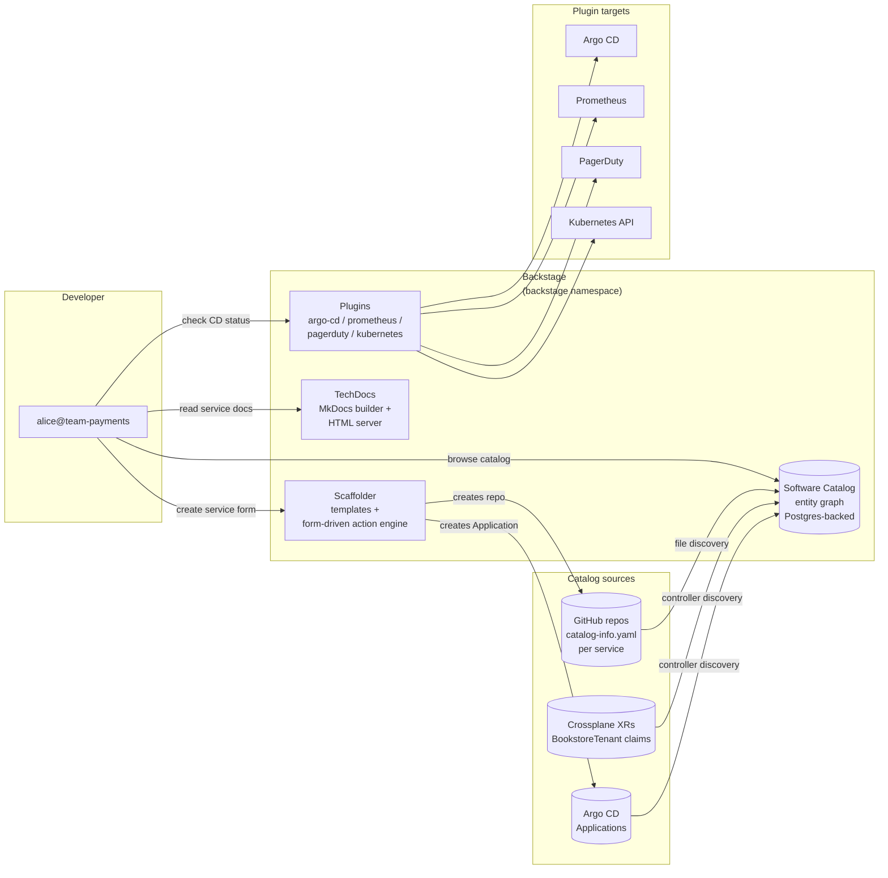
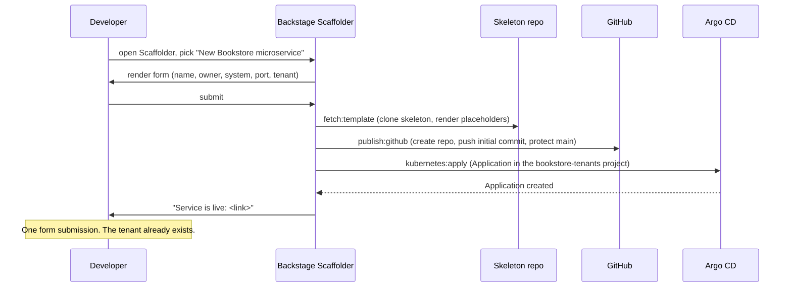

# 13.11 — Developer portal: Backstage scaffolder + software catalog + tech docs

> Backstage as the developer's entry point — the scaffolder template
> that creates a new microservice from a golden path; the software
> catalog seeded from Argo CD + Crossplane; the tech docs from the
> bookstore-platform repo; the plugins that surface CD + dashboards +
> on-call in one pane.

**Estimated time:** ~45 min read · half-day hands-on
**Prerequisites:** [Part 11 ch.10](../11-advanced-production-patterns/10-platform-engineering.md) — Backstage as the IDP front · [Part 13 ch.02](02-tenancy-and-crossplane-onboarding.md) — Crossplane catalog feed · [Part 13 ch.09](09-observability-otel-tempo-loki-prometheus-grafana.md) — dashboards Backstage surfaces
**You'll know after this:** • install Backstage with a software catalog seeded by Argo CD + Crossplane · • author a scaffolder template that creates a new microservice from a golden path · • publish TechDocs from the bookstore-platform repo · • surface CD status + dashboards + on-call rota in a single Backstage view · • measure portal adoption via DORA + cognitive-load metrics

<!-- tags: bookstore-v2, platform-engineering, backstage, gitops, multi-tenancy -->

## Why this exists

The v1 Bookstore had **four services** — a developer could navigate
them by file path. The v2 platform has **nine services** (catalog,
orders, payments-gateway, search, events, recommendations, storefront,
the v1 four + the v2 five), running across **three regions**, with
**N tenants**, each producing **N namespaces**, each with their own
Grafana dashboards + Argo CD application + PagerDuty schedule + tech
docs. A new engineer's first day looks like:

- *"What services exist?"* — open Argo CD, count Applications, ignore
  the ones owned by the platform team, hope nobody renamed anything.
- *"Who owns `payments-gateway`?"* — git blame, ask in #platform-help.
- *"How do I create a new microservice?"* — clone the closest existing
  one, find/replace its name, commit, push, wait, debug.

That is the **discovery problem** every multi-team platform faces, and
the [Backstage](https://backstage.io/) project (Spotify, donated to the
CNCF) is the most-adopted solution. Backstage is **four things at
once**:

1. **Software Catalog** — the source of truth for "what services exist
   and who owns them." Seeded from `catalog-info.yaml` files in each
   service repo.
2. **Scaffolder** — the "create a new microservice in 5 minutes" UX. A
   form-driven template that clones a skeleton repo, parametrises it,
   and opens a PR.
3. **TechDocs** — the "where are the docs for this service?" UX. Each
   service repo carries a `docs/` directory + `mkdocs.yml`; Backstage
   renders the site in-place.
4. **Plugins** — the "where is my CD status / Grafana dashboard /
   PagerDuty schedule?" UX. The Argo CD plugin, the Prometheus plugin,
   the PagerDuty plugin — each surfaces the third-party tool's data in
   the service's Backstage page.

[Part 11 ch.10](../11-advanced-production-patterns/10-platform-engineering.md)
introduced Backstage **as a concept** — the developer-facing surface of
the Crossplane-shaped platform. It did not ship the install + the
scaffolder template + the catalog seeding + the plugin wiring. This
chapter does, and ties it back to the v2 platform: the scaffolder
template creates a new microservice **plus** an Argo CD Application in an
existing tenant (ch.13.02 onboards tenants) **plus** a Helm chart **plus**
a `catalog-info.yaml`, all in one form submission.

> **In production:** The single biggest reason internal platforms
> stall is **the developer experience tax**. A platform with seven CRDs,
> three GitOps repos, two dashboards, and a Slack channel for help is
> *technically powerful* and *adoption-zero*. Backstage is the unifying
> surface; the scaffolder is the path of least resistance; the catalog
> is the rumor-killer. v1 punted on this; v2 cannot.

## Mental model

**Backstage = Software Catalog + Scaffolder + TechDocs + Plugins. The
catalog is the source of truth (entity-graph in Backstage's DB; seeded
from `catalog-info.yaml` in each repo). The scaffolder is the
self-service interface (templates that clone + parameterise + PR). The
tech docs are the discoverable knowledge (MkDocs rendered from each
repo). The plugins are the third-party surface (Argo CD / Prometheus /
PagerDuty all visible per service).**

- **Software Catalog — the entity graph.** Backstage stores a graph of
  `Component` (a service), `API` (a service's API surface), `System`
  (a logical group of components), `Domain` (a higher group), `Group`
  (an owning team), `User` (a person), `Resource` (a database, a
  bucket, a Crossplane XR). The catalog is queried via GraphQL; the UI
  renders the entity-detail pages. Sources: file-based
  (`catalog-info.yaml` in each repo, discovered via GitHub) +
  controller-based (a Backstage Crossplane plugin reads
  `BookstoreTenant` claims and materialises Components).
- **Scaffolder — the parameterised templating engine.** A `Template`
  YAML defines: a form (Backstage renders), parameters (the form
  fills), and steps (each step is an action like `fetch:template`,
  `publish:github`, `catalog:register`). The scaffolder runs the
  template; the new service exists with one form submission.
- **TechDocs — MkDocs-as-a-service.** Each repo declares
  `mkdocs.yml` + a `docs/` directory. The TechDocs builder (a
  Backstage action; can run inline or as a sidecar) renders the docs
  into HTML; Backstage serves them at `/docs/<NAMESPACE>/<KIND>/<NAME>`.
- **Plugins — third-party surface.** The Backstage frontend imports
  plugin packages; each plugin adds a tab to the entity page. The
  Argo CD plugin renders the sync status; the Prometheus plugin
  renders alert panels; the PagerDuty plugin renders the on-call
  rotation. The backend proxies the third-party API calls (so a user
  who can see Backstage can see ArgoCD/Prom/PD data without a direct
  account).
- **Permission framework — who can do what.** Backstage's permission
  framework lets you say "only team-payments can scaffold a new
  service in the payments domain". Plugged into Keycloak via OIDC
  (ch.13.04); group claims map to Backstage Groups; permission rules
  match Groups to actions. Backstage ships an allow-all policy, so the
  policy module must replace it before any rule applies. The threats
  below name what it must deny.

The trap to keep in view: **the catalog is only as good as its
updates**. A service that ships without a `catalog-info.yaml` is
**invisible to Backstage**. The platform's defence: a
**pre-commit hook in the scaffolder skeleton** that fails if
`catalog-info.yaml` is missing or invalid; a **CI check** in every
service repo with the same assertion; the scaffolder generates it
correctly the first time so the developer never sees the hook fire.

## Threats and controls

Backstage holds the catalog, the templates and the credentials of the tools
it proxies, so its threats are about what it can reach.

| Threat | Control in this chapter | Deeper |
|---|---|---|
| A repo claims another team's Component, or defines a Group, User or Template that the policy trusts | Repos add only Components, APIs and Resources. Groups, Users, Systems and Templates come from the platform location. `catalog-info.yaml` falls under the owning team's CODEOWNERS | [Part 13 ch.04](04-real-auth-keycloak-irsa-istio-jwt.md) |
| Template runs use the backend's identity, not the submitter's | Not yet enforced. A permission policy that denies by default must ship before the form is open to developers (see Permission framework below). The `backstage` ServiceAccount may create and read Applications in `argocd`. RBAC cannot pin `spec.project`, so the `bookstore-tenants` project binds only the Applications that name it. An admission policy that pins the project is required and is not shipped here. The form cannot create a tenant | [Part 13 ch.02](02-tenancy-and-crossplane-onboarding.md); break-glass in [ch.01](01-bookstore-2-from-toy-to-platform.md) and [ch.12](12-day-2-runbook-on-call-dr-chaos.md) |
| Backstage tokens reach more than a viewer needs | The Argo CD account is read-only in its policy (the fragment in the prerequisites). The PagerDuty key is read-only. The GitHub App holds only the permissions it needs. Credentials come from External Secrets | [Part 13 ch.06](06-payments-and-event-sourcing.md) |
| The backend's cluster identity reads Secrets or writes workloads | The kubernetes plugin reads pods, services, Deployments and ReplicaSets, and nothing else. Hands-on section 7 checks the grants | [Part 13 ch.01](01-bookstore-2-from-toy-to-platform.md) |

## Diagrams

### Diagram A — the four surfaces of Backstage (Mermaid)



### Diagram B — the scaffolder flow (Mermaid)



### Diagram C — build-vs-buy matrix (ASCII)

```text
TOOL              FOSS?    SCAFFOLDER?  CATALOG?  PLUGINS?    NOTES
────────────────  ─────    ───────────  ────────  ──────────  ──────────────────────────────────
Backstage         yes      yes          yes       many        the CNCF reference, biggest comm.
Compass           no       yes          yes       limited     Atlassian; tight with Jira/Bitbucket
Cortex            no       yes          yes       moderate    commercial; SOC2-friendly out of box
Port              no       yes          yes       moderate    commercial; ETL-driven catalog model
internal tool     yes(*)   maybe        maybe     org-specific the "we built one in React" story
────────────────  ─────    ───────────  ────────  ──────────  ──────────────────────────────────
WHEN WHICH:
  Backstage   — you have a platform team that can host a JS app.
                The default for the CNCF stack.
  Compass     — you live in the Atlassian suite; Jira is your
                source of truth.
  Cortex      — enterprise compliance is non-negotiable.
  Port        — your catalog is an ETL job from many sources;
                you care less about scaffolder templating.
  internal    — you have a strong frontend team + a clear, narrow
                use case; do not build Backstage from scratch.
```

## Hands-on with the Bookstore Platform

### 0. Prerequisites

- ch.13.04 ran — Keycloak is up; the `backstage` client is registered.
- ch.13.03 ran: Argo CD is up. ch.13.03 creates no Backstage account, so
  add the one below first.
- Crossplane is up; `BookstoreTenant` XRD + Composition exist (ch.13.02),
  and at least one tenant is onboarded.
- A GitHub App installed on the org, with only the repository permissions
  Backstage needs (see Tokens, below).

**The Argo CD account for Backstage.** Add the account and its read-only
policy to the Argo CD Helm values from ch.13.03, then sync Argo CD. The
fragment:

```yaml
configs:
  cm:
    accounts.backstage: apiKey
  rbac:
    policy.csv: |
      g, backstage, role:backstage-reader
      p, role:backstage-reader, applications, get, */*, allow
      p, role:backstage-reader, projects, get, *, allow
```

Create the token once, logged in to Argo CD as an admin, and store it in Vault
(the External Secret in step 2 reads it):

```sh
argocd account generate-token --account backstage
```

Check the grant with the Argo CD CLI. The commands and their output are
illustrative: this lab does not run Argo CD.

```sh
argocd account can-i get applications '*/*'           # yes
argocd account can-i delete applications '*/*'        # no
argocd account can-i get clusters '*'                 # no
```

### 1. Install Backstage through Argo CD

The Application pins chart 2.6.0. The file's first document is the namespace,
labelled `restricted`, so the pods Argo CD creates are admitted only if they
meet the baseline. Install with the Application, not with a separate
`helm install`, so that one tool owns the release.

```sh
helm repo add backstage https://backstage.github.io/charts
helm repo update
helm search repo backstage/backstage --version 2.6.0

kubectl apply -f examples/bookstore-platform/backstage/backstage-application.yaml
kubectl -n argocd get application backstage
```

> The Backstage Helm chart wraps a **container image you build** — the
> Backstage app is a JS project that bundles plugins; the recommended
> shape is a per-org image (`ghcr.io/your-org/bookstore-platform-backstage`)
> built from the Backstage `app-cli` template. The chart deploys the
> image; the image carries the plugins (the v2 platform: ArgoCD,
> Prometheus, PagerDuty, Kubernetes, Crossplane).

The values set the baseline on the pod. The ServiceAccount is dedicated, and
its token is mounted because the kubernetes plugin lists workloads. The pod
runs as UID 1000, the `node` user that the scaffold's Dockerfile switches to,
with a read-only root filesystem and `/tmp` as an emptyDir. The bundled
Postgres is for kind and dev only. The chart's default image tag is not
published under `docker.io/bitnami`, so the Application pins the older tag
under `bitnamilegacy` by digest. Production points at the CNPG cluster from
ch.13.06 instead.

The Postgres container also has a read-only root filesystem. The Application
mounts emptyDirs at `/tmp`, `/var/run/postgresql`,
`/opt/bitnami/postgresql/conf` and `/opt/bitnami/postgresql/tmp`. The last two
are the paths the current Bitnami chart (18.12.16) mounts when its read-only
root is on; the lab confirmed that by rendering that chart. The pinned image is
older than the chart, and the lab never started it: the dry run in section 7
checks admission only. So whether Postgres starts on these four mounts is
untested. If the pod crashes, read its log, add the path it names as one more
emptyDir, or use the CNPG cluster instead.

### 2. Apply the rest of the Backstage manifests

Apply them in this order. Each file says what it is for. The Application in
step 1 is already running, so its pods wait in `CreateContainerConfigError`
until the ConfigMap and the Secrets below exist.

```sh
# Credentials from Vault, through the platform ClusterSecretStore
# vault-bookstore-platform (not shipped in this tree; see ch.13.05 step 3)
kubectl apply -f examples/bookstore-platform/backstage/external-secrets.yaml

# What the ServiceAccount may do (section 7 checks it)
kubectl apply -f examples/bookstore-platform/backstage/rbac.yaml

# Ingress closed by default; the gateway and Postgres are allowed in
kubectl apply -f examples/bookstore-platform/backstage/networkpolicy.yaml

# The Argo CD project that the scaffolder's Applications run in
kubectl apply -f examples/bookstore-platform/backstage/argocd-appproject.yaml

# The app config, mounted by the chart
kubectl apply -f examples/bookstore-platform/backstage/app-config.yaml

# The MkDocs base config, kept in the namespace as a copy
kubectl apply -f examples/bookstore-platform/backstage/tech-docs-config.yaml
```

The scaffolder template and the catalog-info template are not applied. Backstage
registers the template from the platform location in `catalog.locations`, and
each service repo gets its own `catalog-info.yaml` from the skeleton.

Verify after step 2. Illustrative output, not captured (the lab has no Backstage image):

```sh
kubectl -n backstage get pod,svc
# NAME                             READY   STATUS    RESTARTS   AGE
# pod/backstage-7c8d9-abc12        1/1     Running   0          30s
# pod/backstage-postgresql-0       1/1     Running   0          30s
#
# NAME                                 TYPE        CLUSTER-IP        PORT(S)
# service/backstage                    ClusterIP   10.96.123.45      7007/TCP
# service/backstage-postgresql         ClusterIP   10.96.123.46      5432/TCP

kubectl -n backstage port-forward svc/backstage 7007:7007
# Open http://localhost:7007 and sign in via Keycloak.
```

### 3. Seed the catalog from existing services

Each v2 service ships a `catalog-info.yaml` (the template in
`backstage/catalog-info-template.yaml` is the canonical form). Backstage
discovers them via the `github-discovery` integration: scan the
`bookstore-platform` GitHub org for any repo with a
`catalog-info.yaml` at root. Discovery accepts only Components, APIs and
Resources from those repos (`catalog.rules` in the app config), so a repo
cannot define the groups or templates the policy relies on.

```yaml
# Example catalog-info.yaml — one per service
apiVersion: backstage.io/v1alpha1
kind: Component
metadata:
  name: payments-gateway
  description: "v2 payments gateway — Stripe + outbox + saga"
  annotations:
    github.com/project-slug: your-org/bookstore-platform
    backstage.io/techdocs-ref: dir:.
    argocd/app-name: bookstore-payments-gateway-us-east
    prometheus.io/rule: "bookstore-platform-payments"
    pagerduty.com/service-id: PXXXXX
spec:
  type: service
  lifecycle: production
  owner: team-payments
  system: bookstore-platform
  providesApis:
    - payments-gateway-api
  dependsOn:
    - resource:cnpg-postgres
    - resource:kafka
```

The annotations are **the magic**: each plugin reads the annotation
that names it; the plugin's tab in the entity page populates.

### 4. Use the scaffolder — create a new microservice

```sh
# Open Backstage -> Create -> "New Bookstore microservice"
# Fill the form:
#   - name: notifications
#   - owner: team-notifications
#   - system: bookstore-platform
#   - port: 8080
#   - tenant: acme-books   (an existing tenant, onboarded per ch.13.02)
# Submit.
#
# Behind the scenes:
#   1. Scaffolder clones the skeleton repo (a Go service template).
#   2. Renders placeholders ({{name}} -> notifications, etc.).
#   3. Creates a new GitHub repo `bookstore-platform-notifications`.
#   4. Pushes the initial commit with:
#      - main.go (skeleton service)
#      - Dockerfile
#      - helm chart (skeleton)
#      - catalog-info.yaml
#      - .github/workflows/ci.yaml
#      - docs/index.md
#      - mkdocs.yml
#   5. Protects main, so a later change needs a code-owner review.
#   6. Applies an Argo CD Application in the bookstore-tenants project,
#      pointing at the new repo and deploying into
#      bookstore-platform-acme-books.
#   7. Registers the repo in the catalog and returns the links.
#
# Nothing here creates a tenant or a namespace. If acme-books does not exist,
# the Application fails to sync; it does not create an unlabelled namespace.
```

### 5. Browse the catalog

```sh
# Backstage UI -> Catalog -> "Components"
# Filter: kind=Component, type=service, owner=team-payments
# Click payments-gateway -> see:
#   - Overview tab: description, owner, system, annotations
#   - CI/CD tab:   Argo CD sync status, last deploy
#   - Monitoring tab: Prometheus alert panels (active alerts + history)
#   - On-Call tab: PagerDuty schedule, who is on now
#   - Docs tab:   the service's mkdocs site, in-frame
#   - API tab:    the OpenAPI spec, rendered as Swagger UI
#   - Dependencies tab: the graph of dependsOn / providesApis
```

### 6. The TechDocs flow

Each service's `docs/` directory:

```text
docs/
├── index.md
├── architecture.md
├── runbook.md
└── api.md
mkdocs.yml
```

```sh
# Backstage builds the docs:
#   - on-demand: when a user opens the Docs tab, the techdocs-cli builds
#     the site on the backend and caches it. The first load is slow.
#   - pre-built: a GitHub Action on push runs `techdocs-cli generate +
#     publish` to S3; Backstage reads from S3. The production-shape.
#
# v2 ships the pre-built path; production-grade builds run in CI.
```

### 7. Check what the Backstage identity can do

The backend acts with one ServiceAccount, `backstage`, not with the rights of
the person who signed in. `rbac.yaml` grants it two things: read on workloads
across the cluster, and create and get on Applications in `argocd`.
List what it may do in a namespace, as the ServiceAccount sees it:

```sh
kubectl auth can-i --list -n backstage --as=system:serviceaccount:backstage:backstage
```

<!-- gate: output -->
```text
Resources                                       Non-Resource URLs                      Resource Names   Verbs
selfsubjectreviews.authentication.k8s.io        []                                     []               [create]
selfsubjectaccessreviews.authorization.k8s.io   []                                     []               [create]
selfsubjectrulesreviews.authorization.k8s.io    []                                     []               [create]
pods                                            []                                     []               [get list watch]
services                                        []                                     []               [get list watch]
deployments.apps                                []                                     []               [get list watch]
# ...
```

Reads only, and no line for Secrets. Two writes must be refused, and they are
the deliberate checks:

```sh
kubectl auth can-i get secrets -n backstage --as=system:serviceaccount:backstage:backstage
kubectl auth can-i create deployments.apps -n backstage --as=system:serviceaccount:backstage:backstage
```

<!-- gate: output -->
```text
no
```

<!-- gate: output -->
```text
no
```

The `argocd` grant is the only write, and it has no delete verb:

```sh
kubectl auth can-i --list -n argocd --as=system:serviceaccount:backstage:backstage
```

<!-- gate: output -->
```text
Resources                                       Non-Resource URLs                      Resource Names   Verbs
applications.argoproj.io                        []                                     []               [create get]
# ...
```

The lab also rendered the chart at 2.6.0 with the Application's values and
dry-ran the Backstage and Postgres pod templates in a `restricted` namespace.
A dry run creates nothing. Both pods were admitted:

<!-- gate: output -->
```text
pod/backstage-check created (server dry run)
```

<!-- gate: output -->
```text
pod/postgresql-check created (server dry run)
```

This output came from a lab cluster with a different name. The lab used the
namespaces `p13-11-backstage` and `p13-11-argocd` for `backstage` and `argocd`,
and the transcript header records that substitution. The full transcript is
`full-guide/examples/security-lab/evidence/13-11.txt`.

## How it works under the hood

**The Backstage entity graph.** A directed graph: `Component -[ownedBy]->
Group`, `Component -[providesApi]-> API`, `Component -[dependsOn]->
Component`. Storage is Postgres (the Backstage backend manages
schema). Each entity has a UID + a fully-qualified ref
(`<kind>:<namespace>/<name>`). The catalog API returns the graph; the
UI renders it. Lifecycle: `entityProvider` reads sources (file +
controller); `entityProcessor` validates + resolves references;
`entityStore` persists.

**The Scaffolder action plugin model.** Backstage ships a built-in
set of actions:

- `fetch:template` — clone a repo, render Jinja2/Handlebars
  placeholders against the form params.
- `publish:github` — create a GitHub repo, push the rendered
  content.
- `publish:github:pull-request` — open a PR.
- `catalog:register` — add the new entity to the catalog.
- `kubernetes:apply` — apply a manifest (v2 uses this for the Argo CD
  Application). It is not built in: the custom image must bundle the
  Kubernetes scaffolder module that provides it.
- `fs:rename`, `fs:delete`, `roadiehq:utils:*`: small file ops. The
  `roadiehq:utils` actions come from a separate module, which the image must
  also bundle.

Plugins can add custom actions. The template in this chapter uses only the
built-in ones.

**TechDocs integration — `techdocs-cli`.** The CLI builds an MkDocs
site to static HTML; uploads to S3 (or the local filesystem).
Backstage's TechDocs backend reads the site from S3 and proxies it
to the frontend. Two builder modes: **local** (Backstage backend
runs `techdocs-cli` inline; slow; OK for small docs) and
**external** (a CI job runs the build; Backstage just reads). v2
uses external for production speed.

**The Argo CD plugin — the server-side proxy.** The frontend plugin
calls `/api/proxy/argocd/api/v1/applications/<NAME>`; the Backstage
backend's proxy forwards to the Argo CD API with the read-only account's
token. The end-user does not need a personal Argo CD account; the proxy
is the trust boundary, so that account's role limits what every
signed-in user can read. Same shape for the Prometheus plugin
(proxies to `/api/v1/alerts`) and PagerDuty (proxies to
`/services/<ID>/oncalls`).

**Permission framework: who may run what.** Backstage's permission
framework decides each request in a `permissionPolicy`, a backend module
that the platform team writes and reviews like code. Backstage's default is an
allow-all policy. This chapter does not replace it: `permission.enabled: true`
turns the framework on and changes nothing else. The module that must deny by
default, and allow a template run only when the submitter's group is the owner
the form names, is the next piece of work. Until it ships, the form is for the
platform team only. Groups come
from the Keycloak claims over OIDC (ch.13.04).

**The catalog-info.yaml discovery flow.** Backstage's
`github-discovery` config scans GitHub for repos with
`catalog-info.yaml`; each catalog file declares one or more
entities. Reconciliation: a Backstage worker processes the
discovered entities on the provider's schedule; new entities appear in the
catalog; deleted entities disappear; modified entities update.

### Tokens and template execution

Backstage holds four credentials: the GitHub App key, the Keycloak client
secret, the Argo CD token and the PagerDuty key. Each arrives as an
environment variable from External Secrets (`external-secrets.yaml`). The app
config holds only `${VARIABLE}` references, so the file names the credentials
and holds no values.

Prefer a GitHub App to a personal access token. Installation tokens expire
after an hour and carry only the permissions the App was granted. A PAT
belongs to one person, does not expire on its own, and carries that person's
reach. Have CI refuse any app-config change that brings a PAT back.

Running a template is privilege. The backend creates the repo and the
Application with its own identity, not the submitter's. The policy, when it
ships, decides who may run the template; RBAC and the AppProject limit what
the run can touch, subject to the project gap named in the threat table. Change a template only through a reviewed pull request, because one
edit changes what the backend does on every later run.

## Production notes

> **In production:** **The catalog is only as good as its updates.**
> A service without a `catalog-info.yaml` is invisible. The
> defence: (1) the scaffolder generates it correctly (v2 does);
> (2) a pre-commit hook in the skeleton fails if the file is
> missing or invalid; (3) a CI check in every service repo
> validates the file against the Backstage entity schema. v2
> ships all three.

> **In production:** **The Scaffolder template is brittle on
> first apply.** New templates ship with broken parameter
> handling, wrong file paths, undefined Jinja2 variables. The
> remedy: **test the template like CI tests** — the Backstage
> `e2e-test` plugin runs the template against a sandbox GitHub
> org and asserts the output is valid. v2 wires the e2e test
> for the `new-bookstore-service` template into a nightly
> GitHub Action; the template is exercised every night against
> the fresh skeleton.

> **In production:** **MkDocs failures = tech docs page silently
> empty.** The TechDocs builder fails on a bad markdown link,
> a missing image, an unsupported plugin. The user sees an
> empty page. Mitigation: alert on `techdocs_build_failures_
> total` (Prometheus counter exposed by the TechDocs backend);
> the alert routes to the **service owner** (not the platform
> team); the owner fixes the markdown.

> **In production:** **Backstage is a stateful app; back it up.**
> Postgres (the catalog graph + the scaffolder task history) is
> the state. CNPG-backed (ch.13.06) with cross-region
> replication + a daily logical dump to S3. The state is small,
> but losing it loses the catalog history + every
> running scaffolder task.

## Quick Reference

```sh
# Install through Argo CD (chart 2.6.0), then the rest of the manifests
helm repo add backstage https://backstage.github.io/charts
helm search repo backstage/backstage --version 2.6.0
kubectl apply -f examples/bookstore-platform/backstage/backstage-application.yaml
kubectl apply -f examples/bookstore-platform/backstage/external-secrets.yaml
kubectl apply -f examples/bookstore-platform/backstage/rbac.yaml
kubectl apply -f examples/bookstore-platform/backstage/networkpolicy.yaml
kubectl apply -f examples/bookstore-platform/backstage/argocd-appproject.yaml
kubectl apply -f examples/bookstore-platform/backstage/app-config.yaml
kubectl apply -f examples/bookstore-platform/backstage/tech-docs-config.yaml
```

Minimal skeletons:

```yaml
# Fragment: the publish and Application steps of new-bookstore-service. The
# whole template is in examples/bookstore-platform/backstage/scaffolder-template-new-service.yaml
steps:
  - id: publish
    action: publish:github
    input:
      repoUrl: github.com?owner=your-org&repo=bookstore-platform-${{ parameters.name }}
      protectDefaultBranch: true
      repoVisibility: private
      requireCodeOwnerReviews: true
  - id: argocd
    action: kubernetes:apply
    input:
      clusterRef: bookstore-platform-us-east
      # manifest: an Application with project: bookstore-tenants
```

```yaml
# catalog-info.yaml (Component)
apiVersion: backstage.io/v1alpha1
kind: Component
metadata:
  name: <NAME>
  annotations:
    github.com/project-slug: your-org/<REPO>
    backstage.io/techdocs-ref: dir:.
    argocd/app-name: <ARGOCD-APP>
spec:
  type: service
  lifecycle: production
  owner: <TEAM>
  system: bookstore-platform
```

Checklist (the developer portal closed when all seven are yes):

- [ ] Backstage is installed; admin can sign in via Keycloak.
- [ ] Software catalog seeded; every v2 service appears as a Component.
- [ ] Scaffolder template `new-bookstore-service` exists; submitting it
      creates a new repo and an ArgoCD Application in an existing tenant.
- [ ] TechDocs renders for at least one service.
- [ ] Argo CD plugin shows sync status on the Component's CI/CD tab.
- [ ] Not done in this chapter: a deny-by-default permission policy. The
      form stays with the platform team until it exists.
- [ ] `kubectl auth can-i --list` (section 7) shows reads only in
      `backstage`, and create and get on Applications in `argocd`.

## Test your understanding

> Try each before opening the answer drawer. The act of trying is the exercise; the answer is the check.

1. **What problem does Backstage solve that "a wiki page with links" does not?**
   <details><summary>Show answer</summary>

   (1) **Software catalog as a queryable, automated entity** — services, owners, dependencies, lifecycle are data, not prose. Backstage can answer "all services owned by team X with no on-call rota" in one query. (2) **Scaffolder templates** that codify the golden path — a developer fills a form, the template renders a new repo + manifests + dashboard + on-call rotation in one action. (3) **Unified UX** — Argo CD status, dashboards, on-call, TechDocs, security scans all under one URL with one auth. (4) **Discoverability** — new engineers find services without asking. The wiki replaces only the documentation surface; Backstage is "the platform's UI."

   </details>

2. **A developer scaffolds a new service from the template. What downstream side-effects should the template trigger to make the service "platform-compliant" out of the box?**
   <details><summary>Show answer</summary>

   The template should: (1) Create a new git repo with `main.go` + Dockerfile + Makefile + restricted-PSA Deployment/Service. (2) Register the new service's Argo CD `Application` in the `bookstore-tenants` project. (3) Join the service to an existing tenant. The platform team onboards tenants (ch.13.02); the template does not create them. (4) Register the service in the Backstage catalog (`catalog-info.yaml`). (5) Wire OpenTelemetry instrumentation, Prometheus ServiceMonitor, Grafana dashboard from a per-service template. (6) Add the team's on-call rotation. Anything not automated by the template becomes a manual chore that gets skipped — and a service skipping any of these is the "ghost service" with no dashboard, no alerts, no owner. The template is the golden path because it removes the alternatives.

   </details>

3. **A submitter runs the template with a tenant owned by another team. Which control stops the Application, and what is left if that control is missing?**
   <details><summary>Show answer</summary>

   The permission policy is what stops the run, and this chapter does not
   ship it. The policy must deny by default and check that the submitter's
   group owns the tenant. Backstage's default is allow-all, so as built, nothing
   stops the run. Behind the policy, the `backstage` ServiceAccount can create
   an Application in any project, because RBAC cannot pin `spec.project`. The
   `bookstore-tenants` project binds only the Applications that name it. Two
   gaps therefore remain, the policy and the admission check on the project,
   and neither RBAC nor the project decides ownership.

   </details>

4. **How do you measure whether the developer portal is "successful" — what metrics do you watch?**
   <details><summary>Show answer</summary>

   (1) **Adoption**: number of services scaffolded via the template vs the total number of new services (the rest came from `kubectl apply -f` or manual repos). Goal: >80% from the template. (2) **DORA**: deployment frequency, lead time, change-failure rate, MTTR. Did the portal make these better? (3) **Cognitive load survey**: developer survey rating "I can find what I need to operate my service." (4) **Time to first deploy** for a new engineer's first service — before vs after. (5) **Support ticket volume** asking "where do I find X" — a falling number = the portal is working. Adoption alone can be misleading (people use it because they have to); pair with cognitive-load metrics for the honest picture.

   </details>

5. **Hands-on: scaffold a new service via the `new-bookstore-service` template. Watch what happens in (a) the new git repo, (b) Argo CD, (c) the tenant's namespace, (d) the Backstage catalog. How long is the end-to-end "developer to running pod" time?**
   <details><summary>What you should see</summary>

   Illustrative estimates, not measured on the lab. Form submission → ~30s for
   the template to create the git repo and push the initial commit. Argo CD sync → ~30s for the new Application to reconcile. Pod schedule + start → 30-60s. The tenant must already exist; its onboarding (ch.13.02) is a separate run. Compare this to the "ticket to platform team, wait two weeks" old shape — that's the value the portal delivers, measured in days saved per service per quarter.

   </details>

## Further reading

- **Backstage Software Catalog docs**
  <https://backstage.io/docs/features/software-catalog/>; the
  entity model + discovery integrations.
- **Backstage Scaffolder docs**
  <https://backstage.io/docs/features/software-templates/>; the
  template action engine + the publish flow.
- **Backstage TechDocs docs**
  <https://backstage.io/docs/features/techdocs/>; the MkDocs
  integration + builders.
- **Backstage permission framework docs**
  <https://backstage.io/docs/permissions/overview>; the
  permission-policy-as-code model.
- **Spotify Backstage Adoption Lessons**
  <https://backstage.spotify.com/blog>; the canonical case study.
- **Rosso et al., *Production Kubernetes* ch.16 — Platform
  Abstractions**; the IDP discipline this chapter ships.
- **Skelton & Pais, *Team Topologies*** — the team-organisation
  framing behind "paved road" and the platform-as-product idea.
