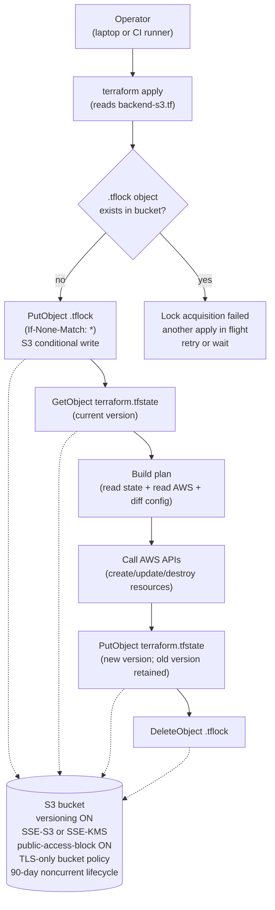

# 14.01 — Production-grade Terraform state

> Why local Terraform state is a one-laptop fiction and every team running
> EKS hits the wall the moment a second human or a CI runner shows up; the
> S3 backend with **`use_lockfile = true`** (native S3 locking, GA in
> Terraform 1.11, introduced in 1.10, **no DynamoDB**); bucket bootstrap via
> `bootstrap-state.sh`; the `terraform state` commands every operator needs;
> and the
> blast-radius rule that decides how many state files you actually want.

**Estimated time:** ~30 min read · ~60 min hands-on
**Prerequisites:** [Part 13 ch.01](../13-grand-capstone-bookstore-platform/01-bookstore-2-from-toy-to-platform.md) — Bookstore Platform Terraform tree you'll move to remote state · [Part 10 ch.01](../10-cloud-and-managed-kubernetes/01-managed-kubernetes-model.md) — why cloud K8s requires shared state from day one

**You'll know after this:** • understand why local Terraform state breaks the moment a second operator or CI runner appears · • configure an S3 backend with `use_lockfile = true` (GA in Terraform 1.11, no DynamoDB) · • bootstrap the state bucket with `bootstrap-state.sh` without a chicken-and-egg loop · • run the core `terraform state` commands (`list`, `show`, `mv`, `rm`) safely · • choose blast-radius boundaries that decide how many state files your tree actually wants

<!-- tags: terraform, cloud, day-2, finops, foundations -->

## Why this exists

The Bookstore Platform Terraform tree at
[`../examples/bookstore-platform/terraform/`](../examples/bookstore-platform/terraform/)
spent twelve previous chapters proving it can stand up a working EKS
cluster, Karpenter, the LB controller, and a Helm-chart's worth of
controllers. Every one of those `terraform apply` invocations wrote
state to `./terraform.tfstate` on a single laptop. That works exactly
once, on one machine, by one person, with no audit trail. The moment any
of the four conditions below is true, local state becomes the production
incident waiting to happen.

1. **Laptop loss.** The state file is the only canonical record of which
   AWS resources Terraform manages. If the laptop is lost, stolen, wiped,
   or the disk fails, every resource the state described is now
   **unmanaged**: Terraform on a fresh machine sees an empty state, plans
   to create everything from scratch, and either collides with the
   existing AWS resources (EKS cluster name already taken, IAM role
   already exists) or silently builds a parallel duplicate. Recovery is
   a manual `terraform import` per resource — for the bookstore-platform
   tree that's 100+ imports, each one a careful read of AWS console + a
   precisely-shaped `import` block.
2. **Two-laptop drift.** A second engineer joins. They `git clone` the
   tree, run `terraform plan`, and Terraform — with no state to read
   from — plans to create the cluster *again*. Or worse: they pull a
   stale state from a Slack DM and apply on top of someone else's
   half-applied change, racing two `apply`s into mutual-corruption land.
3. **CI runners.** The first CI job that runs `terraform apply` has the
   same problem the second laptop has, plus it's not even a human who
   can read the error message. Either CI mints a fresh state on every
   run (and corrupts whatever exists), or the team hand-rolls a state
   handoff (a shared S3 bucket, but without locking, two concurrent
   pipelines race the same file).
4. **Audit.** Six months later, an auditor asks "who changed the EKS
   cluster's KMS key on 2026-03-14?" The answer requires (a) the state
   file's history (versioned), (b) the AWS CloudTrail entry, (c) the
   IAM principal that ran the apply. Local state has none of (a) or (c).

Each of these failures has the same shape: **state is a singleton, and
local state has none of (durability, concurrency, history, access
control)**. The fix we recommend is an S3 backend with versioning +
native locking + encryption + IAM-scoped access — every dimension
addressed at the storage layer, transparent to `terraform plan`/`apply`/`destroy`.

> **In production:** State migration is a one-time, irreversible
> decision per Terraform root module. Doing it early — before the tree
> hits production — is a 30-minute task. Doing it after the tree owns
> dozens of resources is the same 30 minutes plus a multi-hour audit
> that no resource was created concurrently with the migration. Migrate
> on day one.

In this chapter we cover the discipline that turns the
bookstore-platform tree from "one laptop's Terraform" into "a team's
Terraform". The Bookstore
Platform itself was introduced in
[Part 13 ch.01](../13-grand-capstone-bookstore-platform/01-bookstore-2-from-toy-to-platform.md);
its single-region EKS substrate sits under
[`../examples/bookstore-platform/terraform/`](../examples/bookstore-platform/terraform/).
The example tree ships `bootstrap-state.sh` and `backend-s3.tf.example`
as artifacts; this chapter walks through them.

## Mental model

**A Terraform state backend is the product of four dimensions —
durability, concurrency, history, access control — and "local"
delivers zero of them. The S3 backend with `use_lockfile = true`
delivers all four with one bucket, no DynamoDB, no companion services.**

The four dimensions and how the S3-with-lockfile backend addresses each:

- **Durability.** State must survive any single machine loss. S3 is
  designed to exceed 99.999999999% (11 nines) durability and stores each
  object across at least three Availability Zones by default
  ([S3 storage classes](https://aws.amazon.com/s3/storage-classes/)). A
  laptop disk carries no such design target.
- **Concurrency.** Two `terraform apply` invocations against the same
  state simultaneously is undefined behavior — both reading the same
  pre-apply state, both writing back their own post-apply states, the
  second clobbering the first. Locking serializes them: the first apply
  takes the lock, and the second fails with a lock error (or retries for as
  long as `-lock-timeout` allows). Terraform 1.10+ writes a `.tflock` object
  to the state bucket with S3's `If-None-Match` conditional write
  ([S3 conditional writes](https://docs.aws.amazon.com/AmazonS3/latest/userguide/conditional-writes.html)).
  If the object already exists, S3 returns `412 Precondition Failed` and the
  second writer is rejected. When the apply
  completes the lock object is deleted.
- **History.** S3 versioning keeps every prior state file. A bad apply
  that corrupted state, a `terraform state rm` that removed the wrong
  resource, a typo that resource-graphed a destroy — all recoverable by
  restoring a prior version (see the production notes). The bootstrap
  script's lifecycle rule expires noncurrent versions after 90 days, which
  bounds storage and how far back recovery reaches.
- **Access control.** IAM policies on the S3 bucket scope who can read
  state (read = "can see every resource Terraform manages, including
  any secrets stored inline — the IAM access keys in
  `aws_iam_access_key.foo.secret`, [written to state in plaintext](https://registry.terraform.io/providers/hashicorp/aws/latest/docs/resources/iam_access_key)") and who can write (write = "can
  break production"). The bootstrap script turns on all four
  public-access-block settings, so an ACL or bucket policy cannot make the
  bucket public.

Terraform 1.10 ([changelog](https://github.com/hashicorp/terraform/blob/v1.10/CHANGELOG.md),
November 2024) introduced `use_lockfile = true` on the S3 backend, and
Terraform 1.11 ([changelog](https://github.com/hashicorp/terraform/blob/v1.11/CHANGELOG.md),
February 2025) made it generally available.
The backend docs now mark **`dynamodb_table` as deprecated**.
The legacy pattern needed a separate DynamoDB table (one more resource,
one more IAM policy, one more capacity-mode decision); the new pattern
needs only the S3 bucket itself. Teams that still have
`dynamodb_table = "tf-locks"` in their backend block are running
legacy infrastructure: a second table, its IAM policy and a capacity
setting, for no benefit. **Migrate.**

The trap to keep in view: **the state file is not just metadata about
your resources; it is the canonical authority on what exists**. If the
state says "the EKS cluster exists at this ARN", Terraform believes
that — even if AWS no longer agrees. If the state says "the EKS
cluster does not exist", Terraform will plan to create it again, even
if the real cluster is sitting there serving traffic. Treat state with
the same care as production database backups: versioned, encrypted,
access-controlled, recoverable.

## Threats and controls

| Threat | Control in this chapter | Deeper |
|---|---|---|
| Someone who should not see state reads it. It holds every attribute in plaintext | Private bucket, TLS-only policy, IAM read scope, SSE-KMS with a key policy | [14.07](07-infrastructure-cicd-and-drift.md) |
| A bad or hostile apply rewrites or deletes state | Versioning, IAM write scope, the restore runbook | [14.07](07-infrastructure-cicd-and-drift.md) |
| Concurrent applies corrupt state, or a live lock is cleared | `use_lockfile` conditional write; `force-unlock` only after checking | None beyond this chapter |
| The bucket or its versions are deleted | Object Lock or MFA Delete (step 10) | [14.17](17-cross-region-dr-account-baseline-90-day-runbook.md) |

## Diagrams

### Diagram A — terraform apply with S3 backend and native locking (Mermaid)



### Diagram B — backend choice matrix (ASCII)

```text
BACKEND               LOCKING                HISTORY        VENDOR LOCK-IN   COST DRIVER    WHEN TO USE
────────────────────  ─────────────────────  ─────────────  ───────────────  ─────────────  ───────────────────────────
local                 none                   none           none             none           single-laptop dev only
S3 + use_lockfile     native (S3 lockfile)   versioning     low (HCL std)    S3 requests    default for AWS teams
S3 + DynamoDB lock    DynamoDB (legacy)      versioning     low              S3 + table     legacy; migrate to use_lockfile
Terraform Cloud       built-in               built-in       high (HashiCorp) vendor plan    small teams; UI matters
GitLab managed state  built-in (HTTP)        on GitLab      medium           GitLab plan    already on GitLab CI
Spacelift             built-in               built-in       high             vendor plan    large platform teams
────────────────────  ─────────────────────  ─────────────  ───────────────  ─────────────  ───────────────────────────
THE BOOKSTORE PLATFORM CHOICE: S3 + use_lockfile.
  Reasons: AWS-native (one less vendor relationship), low cost at our scale,
  HCL-standard backend block (no proprietary syntax), Terraform 1.11+
  native locking removes the last reason to add DynamoDB.
```

## Hands-on with the Bookstore Platform

### 0. Prerequisites

- AWS CLI v2 configured: `aws sts get-caller-identity` returns the
  account you expect to own the state bucket.
- Terraform `>= 1.11` (verifiable via `terraform version`), where
  `use_lockfile` is GA. Terraform 1.10 introduced it; earlier versions do
  not support it.
- The bookstore-platform Terraform tree applied or partially-applied
  to local state. If you've never run `terraform apply` against it,
  the migration step below is a no-op (Terraform just writes an empty
  state to S3 on the first init).

### 1. Read what already exists

The example tree ships two artifacts:

- [`../examples/bookstore-platform/terraform/bootstrap-state.sh`](../examples/bookstore-platform/terraform/bootstrap-state.sh)
  — idempotent script that creates the bucket with versioning, default
  encryption (SSE-S3, or SSE-KMS with the customer-managed key you pass
  as its third argument), public-access-block, a bucket policy that
  denies any request not made over TLS, and a 90-day noncurrent-version
  lifecycle.
- [`../examples/bookstore-platform/terraform/backend-s3.tf.example`](../examples/bookstore-platform/terraform/backend-s3.tf.example)
  — the backend block to copy + edit.

Open both files and read them end-to-end before running anything.
Comments document the **why** of every setting; the script is
deliberately small so you can audit it before granting it your AWS
credentials.

### 2. Pick a globally-unique bucket name

S3 bucket names share a global namespace. Pick something distinctive:

```bash
# Replace <INITIALS> with your real initials or org slug.
export TFSTATE_BUCKET="tfstate-bookstore-<INITIALS>"
export TFSTATE_REGION="ap-south-1"
```

If your initials are already taken, append a digit. Keep the name
under 63 chars (S3 limit).

### 3. Create a KMS key and run the bootstrap script

State holds every attribute in plaintext: IAM policies, subnet and key IDs,
and any secret a resource returns. This tree holds no cluster token, but its
state is still an account map ([platform
README](../examples/bookstore-platform/terraform/README.md), "What is in
state"). Encrypt it with a customer-managed key. Terraform needs
`kms:Encrypt`, `kms:Decrypt` and `kms:GenerateDataKey` on the key ([S3 backend
docs](https://developer.hashicorp.com/terraform/language/backend/s3)), so
grant them only to the roles that run Terraform. The default key policy hands
key use to IAM for the whole account, so any identity with a matching IAM
policy could decrypt state. The key policy below names only the key administrator and the
Terraform roles. The key costs $1 a month, and symmetric requests cost $0.03 per
10,000 ([AWS KMS pricing](https://aws.amazon.com/kms/pricing/)).

From the repo root:

```bash
ACCOUNT_ID="$(aws sts get-caller-identity --query Account --output text)"
cat > tfstate-key-policy.json <<EOF
{
  "Version": "2012-10-17",
  "Statement": [
    {
      "Sid": "StateKeyAdministration",
      "Effect": "Allow",
      "Principal": {"AWS": "arn:aws:iam::${ACCOUNT_ID}:role/<KEY-ADMIN-ROLE>"},
      "Action": [
        "kms:Create*", "kms:Describe*", "kms:Enable*", "kms:List*",
        "kms:Put*", "kms:Update*", "kms:Revoke*", "kms:Disable*",
        "kms:Get*", "kms:Delete*", "kms:ScheduleKeyDeletion",
        "kms:CancelKeyDeletion", "kms:TagResource", "kms:UntagResource"
      ],
      "Resource": "*"
    },
    {
      "Sid": "StateReadersAndWriters",
      "Effect": "Allow",
      "Principal": {"AWS": [
        "arn:aws:iam::${ACCOUNT_ID}:role/<PLAN-ROLE>",
        "arn:aws:iam::${ACCOUNT_ID}:role/<APPLY-ROLE>"
      ]},
      "Action": ["kms:Decrypt", "kms:Encrypt", "kms:GenerateDataKey"],
      "Resource": "*"
    }
  ]
}
EOF

export TFSTATE_KMS_ARN="$(aws kms create-key \
  --region "$TFSTATE_REGION" \
  --description "Terraform state" \
  --policy file://tfstate-key-policy.json \
  --query KeyMetadata.Arn --output text)"
aws kms enable-key-rotation --region "$TFSTATE_REGION" \
  --key-id "$TFSTATE_KMS_ARN"

cd examples/bookstore-platform/terraform
./bootstrap-state.sh "$TFSTATE_BUCKET" "$TFSTATE_REGION" "$TFSTATE_KMS_ARN"
```

Illustrative output (truncated):

```text
Bootstrap S3 state backend
  bucket: tfstate-bookstore-<INITIALS>
  region: ap-south-1

[..] Creating bucket: tfstate-bookstore-<INITIALS>
[ok] Bucket created
[..] Enabling versioning
[ok] Versioning enabled
[..] Enabling default encryption (SSE-KMS, arn:aws:kms:ap-south-1:<ACCOUNT-ID>:key/<KEY-ID>)
[ok] SSE-KMS enabled. Set kms_key_id in backend-s3.tf to the same ARN.
[..] Blocking public access
[ok] Public access blocked
[..] Applying TLS-only bucket policy
[ok] TLS-only policy applied
[..] Setting lifecycle rule (expire noncurrent versions @ 90 days)
[ok] Lifecycle rule set
```

Replace the three role placeholders with roles from your account. Run these
commands as the key administrator role, since the policy grants key
administration to that role alone.

Re-run the script with the same key ARN only. Without the third argument it
sets the bucket default back to SSE-S3.

The script is idempotent: re-running it with the same arguments verifies and
re-applies the same settings. Use this when you're unsure whether someone
hand-edited the bucket in the console.

### 3a. Check the controls fail closed

This step fails on purpose. The TLS-only policy should refuse a plain-HTTP
request, and the public-access block should report all four settings on.

```bash
aws s3api head-object --bucket "$TFSTATE_BUCKET" \
  --key bookstore-platform/terraform.tfstate \
  --endpoint-url "http://s3.${TFSTATE_REGION}.amazonaws.com"

aws s3api get-public-access-block --bucket "$TFSTATE_BUCKET"
```

Illustrative result: the first command fails with a 403 Forbidden error, and
the second prints all four settings as `true`.

### 4. Copy and edit the backend block

```bash
cp backend-s3.tf.example backend-s3.tf
```

Edit `backend-s3.tf` and set:

```hcl
backend "s3" {
  bucket       = "tfstate-bookstore-<INITIALS>"  # YOUR bucket
  key          = "bookstore-platform/terraform.tfstate"
  region       = "ap-south-1"                    # YOUR region
  encrypt      = true
  kms_key_id   = "<KMS-KEY-ARN>"                 # the ARN from step 3
  use_lockfile = true
}
```

`encrypt = true` asks S3 to encrypt each state and lock write. Without
`kms_key_id`, Terraform sends `AES256` (SSE-S3), and that request header
overrides the bucket's KMS default, so set both
([Terraform source](https://github.com/hashicorp/terraform/blob/main/internal/backend/remote-state/s3/client.go)).

The example file ships `kms_key_id` uncommented, so an edit that replaces only
the bucket and region still writes KMS-encrypted state. Replace its placeholder
with the key from step 3.

The single most important line is `use_lockfile = true`. Without it,
two concurrent applies race; with it, S3's conditional-write atomicity
serializes them.

### 5. Migrate local state to S3

```bash
terraform init -migrate-state
```

Terraform detects the local `terraform.tfstate`, sees the new S3
backend, and prompts (illustrative):

```text
Do you want to copy existing state to the new backend?
  Pre-existing state was found while migrating the previous "local"
  backend to the newly configured "s3" backend. No existing state was
  found in the newly configured "s3" backend. Do you want to copy this
  state to the new "s3" backend?

  Enter "yes" to copy and "no" to start with an empty state.
```

Answer `yes`. Terraform uploads the local state to S3, switches the
backend, and confirms:

Illustrative output (not captured):

```text
Successfully configured the backend "s3"! Terraform will automatically
use this backend unless the backend configuration changes.
```

### 6. Verify the lock object lifecycle

Run a no-op apply to watch locking in action. It is a no-op only on a tree that
is already applied. On a tree that was never applied, `apply` would build the
whole stack, so save a plan first and read it:

```bash
terraform plan -out=lock-check.tfplan
terraform apply lock-check.tfplan
```

If the saved plan lists changes, stop and find out why before you apply it.

In a second terminal, while the apply is mid-flight:

```bash
aws s3 ls "s3://${TFSTATE_BUCKET}/bookstore-platform/" --recursive
```

The output looks like this (illustrative):

```text
# Mid-apply (lock held):
2026-05-21 14:23:01      234 bookstore-platform/terraform.tfstate
2026-05-21 14:23:01       42 bookstore-platform/terraform.tfstate.tflock

# Post-apply (lock released):
2026-05-21 14:23:15      298 bookstore-platform/terraform.tfstate
```

The `.tflock` object appears just before plan, disappears immediately
after apply. If apply crashes mid-flight, the lock object stays — see
the troubleshooting section.

### 7. Verify state history works

```bash
aws s3api list-object-versions \
  --bucket "$TFSTATE_BUCKET" \
  --prefix "bookstore-platform/terraform.tfstate" \
  --query 'Versions[*].[VersionId,LastModified,Size]' \
  --output table
```

You should see two or three versions: one from the initial migrate,
one from the no-op apply, possibly one from a prior partial apply.
This is your insurance. If a future apply damages state, restore a prior
version with the runbook in the production notes, and only while no apply
is running.

### 8. Clean up local state

Once the S3 backend works:

```bash
rm terraform.tfstate terraform.tfstate.backup
```

This is the point of no return. Local state files are now strictly
out-of-date. Every plan/apply hits S3. Local copies hold the same secrets,
so delete any others too, including editor backups and synced folders.

### 9. Troubleshoot — lock stuck after a crash

If `terraform apply` was killed (SIGKILL, lost SSH, network drop)
while holding the lock, the `.tflock` object remains. Subsequent
applies fail with (illustrative):

```text
Error: Error acquiring the state lock
  Lock Info:
    ID:        <UUID>
    Path:      tfstate-bookstore-XX/bookstore-platform/terraform.tfstate
    Operation: OperationTypeApply
    Created:   2026-05-21 14:23:01.123 +0000 UTC
```

Verify nobody else is actively applying (Slack-ask the team), then
force-unlock:

```bash
terraform force-unlock <UUID>
```

The UUID is in the error message. Force-unlock removes the `.tflock`
object. **Do this only after confirming no apply is in flight** —
force-unlocking a live apply is the path to state corruption.

### 10. Guard against deletion

The policy from step 3 blocks plain HTTP and public access. It does not stop
a principal that holds `s3:DeleteObjectVersion`. Deleting a bucket needs every
version gone first, so the guard must block version deletes, not only the
bucket delete. This step uses Object Lock. It keeps each object version until
its retention ends. In governance mode, users with
`s3:BypassGovernanceRetention` can override it. It needs versioning, which
S3 turns on when the bucket is created with Object Lock. Locked versions stay
past the 90-day cleanup rule until their retention ends
([Object Lock](https://docs.aws.amazon.com/AmazonS3/latest/userguide/object-lock.html)).

Object Lock is set when the bucket is created. Create the state bucket with it
before you run `bootstrap-state.sh`, which then finds the bucket and re-applies
its settings. In `us-east-1`, leave out the `--create-bucket-configuration`
line:

```bash
aws s3api create-bucket --bucket "$TFSTATE_BUCKET" --region "$TFSTATE_REGION" \
  --create-bucket-configuration LocationConstraint="$TFSTATE_REGION" \
  --object-lock-enabled-for-bucket
aws s3api put-object-lock-configuration --bucket "$TFSTATE_BUCKET" \
  --object-lock-configuration \
  '{"ObjectLockEnabled":"Enabled","Rule":{"DefaultRetention":{"Mode":"GOVERNANCE","Days":90}}}'
```

Then try a delete of the current state version. This is a deliberate action on
a bucket you own, and it should fail:

```bash
VERSION_ID="$(aws s3api list-object-versions --bucket "$TFSTATE_BUCKET" \
  --prefix bookstore-platform/terraform.tfstate \
  --query 'Versions[?IsLatest].VersionId' --output text)"
aws s3api delete-object --bucket "$TFSTATE_BUCKET" \
  --key bookstore-platform/terraform.tfstate --version-id "$VERSION_ID"
```

Illustrative result (not captured): the delete fails with an access error that
names Object Lock, and the version stays in the bucket. A principal that holds
`s3:BypassGovernanceRetention` and passes `--bypass-governance-retention` can
still remove it, which is why governance mode is the choice for a lab.
Compliance mode cannot be shortened by anyone, root included.

MFA Delete is the other option. It needs an MFA device and the root account,
so this step does not use it.

- **MFA Delete** requires an MFA code to delete a version permanently or to
  change the bucket's versioning. Only the bucket owner's root account can
  enable it, and only with the CLI or API
  ([MFA Delete](https://docs.aws.amazon.com/AmazonS3/latest/userguide/MultiFactorAuthenticationDelete.html)).
  It cannot be combined with a lifecycle configuration, so enabling it means
  dropping the 90-day rule.

Keep an offline copy of state as well. Run `terraform state pull >
backup.tfstate` on a schedule, and store the copy outside the state bucket,
encrypted. Record the choice in the account baseline
([14.17](17-cross-region-dr-account-baseline-90-day-runbook.md)).

## How it works under the hood

**The `use_lockfile = true` mechanism.** Terraform 1.10+'s S3 backend
writes a small JSON `.tflock` object to the state bucket using S3's
`PutObject` API with an `If-None-Match: *` header. S3 honors that
header as a conditional write: the put succeeds only if no object
exists at that key, otherwise S3 returns `412 Precondition Failed`.
The first apply wins the race. The second sees the `412`, reports a lock
error, and retries for as long as `-lock-timeout` allows. When the apply
completes, Terraform issues `DeleteObject` on the lock key.

**Why DynamoDB used to be needed.** Before S3 offered conditional writes
with `If-None-Match`, the backend had no atomic create-if-absent on S3.
The workaround
was a DynamoDB table with a single primary-key item per state file:
take the lock by `PutItem` with `ConditionExpression: attribute_not_exists(LockID)`;
release by `DeleteItem`. DynamoDB exposed the same atomicity that S3
now does natively. Migration is a backend-config edit (remove
`dynamodb_table`, add `use_lockfile = true`) plus a `terraform init`
to register the change.

**Versioning vs lifecycle.** S3 versioning keeps every PUT as a new
version; the latest is "current", prior ones are "noncurrent". Without
a lifecycle rule, noncurrent versions accumulate forever. A state file is
small, so each version costs little, but a busy team with hundreds of
applies a week keeps versions for years.
The bootstrap script's 90-day noncurrent expiration is a balance:
90 days of state history is enough to recover from any humanly-
detectable mistake; older history is rarely actionable (the resources
the state described are usually long-gone).

**The `terraform state` commands every operator must know.**

| Command | Purpose | When you reach for it |
|---|---|---|
| `terraform state list` | List every resource Terraform manages | First thing in any state forensic investigation |
| `terraform state mv` | Rename a resource address without recreating it | After a refactor that renamed a module path |
| `terraform state rm` | Remove a resource from state without destroying it | When a resource is now managed by a different Terraform tree (or by hand) |
| `terraform import` | Pull an existing AWS resource into state | When something exists in AWS but Terraform doesn't know about it |
| `terraform state replace-provider <SOURCE-ADDRESS> <TARGET-ADDRESS>` | Re-source a provider in state when migrating from a legacy provider address | When moving from `registry.terraform.io/hashicorp/aws` to a community fork, or after a provider namespace change |

These are the difference between "Terraform fights you" and
"Terraform serves you". Memorize the syntax; rehearse them on a
throwaway resource before you need them in anger.

**Workspaces vs Terragrunt vs separate root modules.** Three patterns
exist for splitting state; the right answer depends on what you're
splitting:

- **Terraform workspaces** (`terraform workspace new staging`) — One
  root module, N state files. **Usually wrong for environment
  separation** — the same code with a different state means a
  staging-only variable still has to gate every `count`/`for_each`,
  and the wrong workspace selected at apply-time is a production
  outage waiting to happen. **Right** for things like "one cluster,
  multiple ephemeral PR-review environments inside it".
- **Terragrunt** — Wrapper around Terraform that DRYs up backend
  config, provider config, and shared variables across many similar
  root modules. **Right** when you have 5+ structurally-identical
  trees (one per environment, one per region) and the duplication
  of `backend "s3" { ... }` everywhere is real pain. **Wrong** for
  a single root module (it adds a tool to learn for zero gain).
- **Separate root modules** — One directory per blast-radius unit;
  each has its own state. **Right** for most production teams: the
  bookstore-platform tree is one root module (one state); the
  separate `terraform-account-baseline/` tree is another root
  module (a separate state); a future per-tenant Crossplane stack
  could be a third. **Wrong** when you find yourself duplicating
  ten root modules with one variable difference — that's Terragrunt
  territory.

The Bookstore Platform tree uses **one root module per blast-radius
unit**. The main tree at
[`../examples/bookstore-platform/terraform/`](../examples/bookstore-platform/terraform/)
is one state; the account baseline at
[`../examples/bookstore-platform/terraform-account-baseline/`](../examples/bookstore-platform/terraform-account-baseline/)
is another. The two never share state because a destroy of one must
never be able to take down the other.

## Production notes

> **In production:** Never edit state by hand. A `terraform state pull`
> + `jq` + `terraform state push` workflow exists, and there are
> emergencies where it's the only path — but every such edit must be
> documented in an incident ticket, reviewed by a second engineer
> before the push, and verified by a follow-up `terraform plan` that
> shows zero diff. State edits are the equivalent of `UPDATE` against
> the production database without a `WHERE` clause: powerful, fast,
> dangerous.

> **In production:** The `terraform import` for an out-of-band-created
> resource is a routine operation, not an emergency. Someone clicked
> through the AWS console to create a security group; six months later
> you want Terraform to manage it. Write the `resource` block matching
> the existing configuration, run `terraform import <ADDRESS> <ID>`,
> then run `terraform plan` and reconcile any drift the plan surfaces.
> Repeat until plan is zero-diff. The 1.5+ `import` *block* (as
> opposed to the CLI command) lets you commit imports as code, which
> is the production-clean way.

> **In production:** The "someone deleted the state file OBJECT (not
> the bucket)" scenario is recoverable via S3 versioning. The runbook:
> run `aws s3api list-object-versions --bucket "$TFSTATE_BUCKET"
> --prefix "bookstore-platform/terraform.tfstate"` to find the most
> recent prior version, then `aws s3api copy-object --copy-source
> "$TFSTATE_BUCKET/bookstore-platform/terraform.tfstate?versionId=<ID>"
> --bucket "$TFSTATE_BUCKET" --key "bookstore-platform/terraform.tfstate"`
> to promote it back to the current version, with no apply running.
> Run `terraform init`
> against the restored backend, then `terraform plan` to verify zero
> diff.
>
> **Bucket deletion** is a separate failure, and versioning does not stop it.
> Step 10 covers the deletion guard and an offline copy of state.
> Document this runbook in your team wiki *before* you need it.

> **In production:** Your state file is your blast radius. One root
> module that manages 500 resources is one apply that can destroy 500
> resources. Split state by blast-radius unit: cluster-substrate
> (VPC + EKS + node groups) in one state; platform addons (Argo CD,
> Crossplane) in another; per-tenant infrastructure in a third. The
> bookstore-platform tree is on the conservative end (one state for
> the whole substrate), which is fine at its scale; a real platform
> team running 20+ clusters would split further.

> **In production:** State files over 100 MB are a symptom, not a
> problem. The symptom: a root module that manages thousands of
> resources, all interconnected. The problem: every `plan` reads the
> whole state, refreshes every resource against AWS, and takes
> minutes. The fix: split the root module along natural blast-radius
> boundaries — the same answer as "your file is too big". 10 MB is
> comfortable; 100 MB is a re-architect signal.

## Quick Reference

```bash
# Bootstrap the state bucket (once per bucket and region; same key on re-runs).
./bootstrap-state.sh tfstate-bookstore-<INITIALS> ap-south-1 <KMS-KEY-ARN>

# Copy + edit the backend file.
cp backend-s3.tf.example backend-s3.tf
# (edit bucket, region and kms_key_id to match)

# Migrate local state to S3 (one-time).
terraform init -migrate-state

# After migration: remove local state files.
rm terraform.tfstate terraform.tfstate.backup

# Verify state lives in S3.
aws s3 ls "s3://tfstate-bookstore-<INITIALS>/bookstore-platform/"

# Confirm the state object is SSE-KMS, not the SSE-S3 default.
aws s3api head-object --bucket tfstate-bookstore-<INITIALS> \
  --key bookstore-platform/terraform.tfstate \
  --query ServerSideEncryption --output text

# Force-unlock if a crashed apply left a stuck lock.
terraform force-unlock <UUID>

# State commands every operator must know.
terraform state list
terraform state mv <SRC-ADDRESS> <DST-ADDRESS>
terraform state rm <ADDRESS>
terraform import <ADDRESS> <RESOURCE-ID>
terraform state replace-provider <SOURCE-PROVIDER-ADDRESS> <TARGET-PROVIDER-ADDRESS>
```

Minimal `backend-s3.tf` skeleton:

```hcl
terraform {
  backend "s3" {
    bucket       = "<UNIQUE-BUCKET-NAME>"
    key          = "<PROJECT>/terraform.tfstate"
    region       = "<REGION>"
    encrypt      = true
    kms_key_id   = "<KMS-KEY-ARN>"
    use_lockfile = true
  }
}
```

State-backend checklist (the migration is done when all eight are yes):

- [ ] Bucket versioning is ON (`aws s3api get-bucket-versioning`).
- [ ] Bucket default encryption is SSE-KMS with the key from step 3, and
      `kms_key_id` in the backend matches it (`get-bucket-encryption`). The
      state object itself reads back as `aws:kms`, not `AES256`, because
      Terraform sends its own header (`head-object`, Quick Reference).
- [ ] The state key's policy names the Terraform roles, with no
      account-wide delegation, and rotation is on
      (`aws kms get-key-rotation-status --key-id <KEY-ARN>`).
- [ ] Public-access-block is ON on all four dimensions
      (`get-public-access-block`).
- [ ] Lifecycle expires noncurrent versions
      (`get-bucket-lifecycle-configuration`); 90 days, unless you chose MFA
      Delete (step 10).
- [ ] Object Lock is on with a default retention (step 10):
      `aws s3api get-object-lock-configuration --bucket <BUCKET>`.
- [ ] `use_lockfile = true` is in the backend block; **NO**
      `dynamodb_table = "..."` line.
- [ ] State file is under ~10 MB (`aws s3 ls --summarize`); anything
      over 100 MB is a re-architect signal.

## Test your understanding

> Try each before opening the answer drawer. The act of trying is the exercise; the answer is the check.

1. **Why does the chapter say `use_lockfile = true` replaces the DynamoDB lock table, and what changed in S3 that made this possible?**
   <details><summary>Show answer</summary>

   S3 added conditional writes. A `PutObject` with `If-None-Match: *` succeeds only when no object exists at that key, and otherwise fails with `412 Precondition Failed`. Terraform 1.10+ creates the `<key>.tflock` object that way and deletes it when the run ends. That atomic create-if-absent is what lets the backend drop the DynamoDB table that used to provide it.

   </details>

2. **A teammate runs `terraform apply`, their laptop crashes mid-apply, and now every subsequent `terraform plan` errors with `Error acquiring the state lock`. What do you actually do?**
   <details><summary>Show answer</summary>

   Confirm nothing is genuinely running (no GitHub Actions apply job in flight, the teammate's laptop is not somehow still running), then run `terraform force-unlock <UUID>` with the UUID printed in the error. The `.tflock` object in S3 is just stale metadata after a crashed apply; force-unlock deletes it. Running force-unlock while an apply is genuinely in flight is the dangerous case — it lets a second apply race the first.

   </details>

3. **Your state holds an `aws_iam_access_key` secret in plaintext. Which controls limit who can read it, and why is SSE-S3 alone not enough?**
   <details><summary>Show answer</summary>

   The public-access block and the TLS-only policy keep the bucket private and
   force HTTPS. IAM decides who holds `s3:GetObject`, and with SSE-S3 every
   one of those principals reads the secret in plaintext. SSE-KMS adds a
   second gate: reading state also needs `kms:Decrypt` under a key policy, and CloudTrail logs the KMS calls. With a Bucket Key, S3 makes one KMS call per requester per key period, not one per read. The
   stronger fix is upstream: avoid long-lived access keys in Terraform, or
   pass a `pgp_key`, which keeps the secret out of plaintext state at the cost
   of automation.

   </details>

4. **Hands-on extension — point the bookstore-platform tree at a brand-new S3 bucket without running `bootstrap-state.sh` first; run `terraform init`.**
   <details><summary>What you should see</summary>

   `terraform init` errors with an S3 `NoSuchBucket` / `AccessDenied` because the backend can't write the state object to a bucket that doesn't yet exist. That's the chicken-and-egg this chapter resolves: the bootstrap script creates the bucket (with versioning + encryption + public-access-block + lifecycle) using the AWS CLI, and only then does `init -migrate-state` move the tree's real state in. A bucket created by hand skips these settings unless someone checks each one, so run the script.

   </details>

## Further reading

- **Terraform official S3 backend docs**
  <https://developer.hashicorp.com/terraform/language/backend/s3>; the
  authoritative reference for every backend setting this chapter
  touches, including `use_lockfile` semantics.
- **Terraform CHANGELOG, 1.10.0 and 1.11.0**
  <https://github.com/hashicorp/terraform/blob/v1.11/CHANGELOG.md>; the
  release entries for native S3 locking (1.10.0, November 2024) and its
  general availability (1.11.0, February 2025).
- **AWS S3 conditional writes documentation**
  <https://docs.aws.amazon.com/AmazonS3/latest/userguide/conditional-writes.html>;
  the `If-None-Match` semantics `use_lockfile` relies on.
- **AWS S3 Object Lock**
  <https://docs.aws.amazon.com/AmazonS3/latest/userguide/object-lock.html>;
  the retention modes behind step 10.
- **AWS S3 MFA Delete**
  <https://docs.aws.amazon.com/AmazonS3/latest/userguide/MultiFactorAuthenticationDelete.html>;
  who can enable it and what it blocks.
- **AWS Well-Architected Framework — Operational Excellence pillar**
  <https://docs.aws.amazon.com/wellarchitected/latest/operational-excellence-pillar/welcome.html>;
  the design principles this chapter's "state as canonical source of
  truth" reflects.
