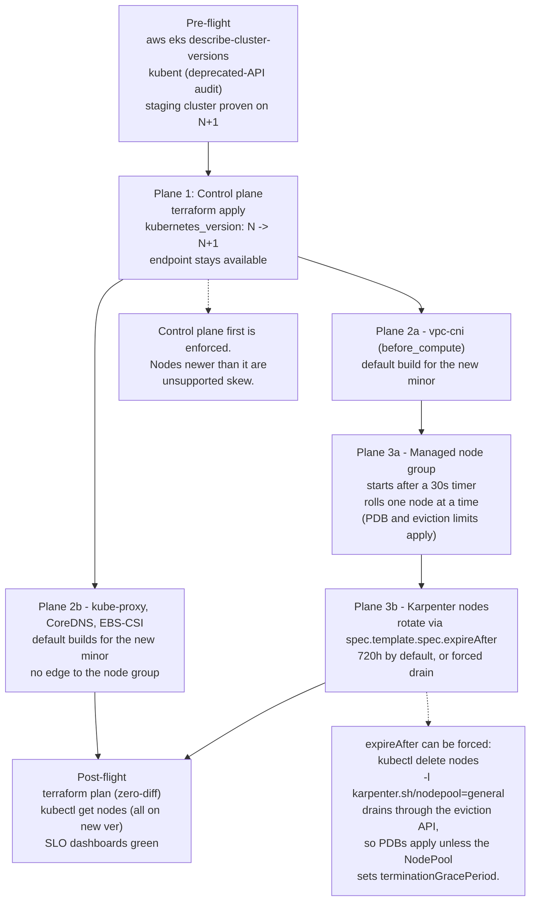

# 14.02 — EKS cluster lifecycle

> The 14-month standard-support window, the 12-month extended-support
> window with its **$0.50/cluster-hour** (~$365/month surcharge), and the
> three-plane upgrade (control plane, then nodes and add-ons) every team
> running EKS must rehearse before a version deadline
> bites; the in-place version bump runbook against the Bookstore
> Platform tree; deprecated-API hunting with `kubent`; blue-green
> clusters for the multi-version-skip case.

**Estimated time:** ~30 min read · ~90 min hands-on
**Prerequisites:** [Part 14 ch.01](./01-terraform-state-in-production.md): remote state required before a version bump · [Part 08 ch.01](../08-day-2-operations/01-cluster-lifecycle.md): kind cluster upgrade dance you'll now adapt for EKS · [Part 10 ch.02](../10-cloud-and-managed-kubernetes/02-provisioning-and-iac.md): the bookstore EKS module you'll upgrade

**You'll know after this:** • understand the 14-month standard vs 12-month extended-support windows and the $0.50/cluster-hour surcharge · • execute the three-plane upgrade (control plane, then nodes and add-ons) in the order the tree enforces · • run `kubent` to hunt deprecated APIs before the upgrade · • choose between in-place version bumps and blue-green clusters for multi-version skips · • rehearse the EKS upgrade against the Bookstore Platform tree before a version deadline

<!-- tags: eks, terraform, cloud, day-2, platform-engineering -->

## Why this exists

The bookstore-platform tree at
[`../examples/bookstore-platform/terraform/`](../examples/bookstore-platform/terraform/)
declares `kubernetes_version = "1.37"` in `variables.tf`. That number
isn't a fixed label — it's a deadline. AWS marks each Kubernetes minor
version with two date stamps:

1. **End of standard support**: when the version moves into extended
   support and its surcharge starts.
   For 1.37, this is **2027-12-01** (14 months from its EKS release on
   2026-10-01). Up to this date, the EKS control-plane fee is
   $0.10/cluster-hour (~$73/month) — the same rate as every other
   supported version.
2. **End of extended support** — 12 months after standard ends. For
   1.37, this is **2028-12-01**. During extended support, AWS charges
   an **additional $0.50/cluster-hour** on top of the base rate —
   ~$365/month surcharge per cluster (730h × $0.50), on top of the
   normal ~$73. A team running 10 clusters in extended support pays an
   extra ~$3,650/month for the privilege.

Past the end of extended support, AWS **auto-upgrades the control
plane** without your consent, at a time it picks and with no notice. For
a team that hasn't tested 1.37→1.38 in staging, this is the production
incident. Every team running EKS hits this deadline, every cluster:
upgrade at least every 14 months to stay out of extended-support fees,
and no later than 26 months (14 standard + 12 extended), when EKS
upgrades the control plane for you.

The version bump itself isn't dangerous. The shape of it is:

- **Control plane upgrade** — Terraform changes one variable; AWS does
  the work; the API endpoint stays available while EKS rolls its API
  server instances.
- **Addons upgrade** — EKS does not update an addon after a cluster
  upgrade; Terraform does. The tree looks up kube-proxy, CoreDNS and
  EBS-CSI with the `aws_eks_addon_version` data source for the cluster's
  version, and the EKS module does the same for vpc-cni, so the same
  apply moves any addon whose default build for the new minor differs.
- **Node pool upgrade** — Managed node groups roll new EC2 instances
  with the AMI for the new K8s version; Karpenter-provisioned nodes
  auto-rotate via the NodePool's `expireAfter` setting.

What makes this a chapter rather than a bullet point: the **order
matters**, the **version-skew tolerance** matters, the **deprecated-API
hunt** matters, and the **what-if-we-skipped-a-version** decision
matters. This chapter is the runbook against the bookstore-platform
tree.

[Part 08 ch.01](../08-day-2-operations/01-cluster-lifecycle.md)
introduced cluster lifecycle for the self-managed case (kubeadm-style
upgrades); [Part 10 ch.01](../10-cloud-and-managed-kubernetes/01-managed-kubernetes-model.md)
drew the managed-vs-self-managed line. This chapter is the EKS-specific
production-grade upgrade story those two pointed at.

> **In production:** A staging EKS cluster running one version ahead of
> production is the cheapest insurance you can buy. At $73/month for
> the control plane plus minimal node-hours, a staging cluster running
> 1.37 while production runs 1.36 catches the deprecated-API breakage,
> the addon-version surprises, and the upgrade-order mistakes — all
> before the prod deadline forces your hand. A team that skips staging
> learns the lessons in production.

## Mental model

**Upgrade the control plane first, then nodes and add-ons, with the
Kubernetes version-skew policy governing what's tolerated mid-flight.
Nodes must never run newer than the control plane. Reverse that and the
cluster runs in an unsupported skew configuration.**

The three planes:

- **Plane 1 — the EKS control plane.** kube-apiserver, kube-scheduler,
  kube-controller-manager, etcd. Operated by AWS, but the *version*
  is your decision (set via `kubernetes_version` in the EKS module).
  Upgrade first because nodes can run versions older than the control
  plane (per the Kubernetes version-skew policy), but **never newer**.
- **Plane 2 — EKS-managed addons.** vpc-cni, kube-proxy, CoreDNS,
  EBS-CSI. Each addon has its own compatibility window with K8s
  minor versions; an addon version that worked on 1.36 may not exist
  for 1.37. The tree sets each `addon_version` from an
  `aws_eks_addon_version` lookup (the EKS module runs the one for
  vpc-cni), which returns EKS's default build for the current K8s
  minor.
- **Plane 3 — nodes.** Managed node groups (the small "system" pool
  in [`../examples/bookstore-platform/terraform/eks.tf`](../examples/bookstore-platform/terraform/eks.tf)
  with its `t3.medium` instances) plus Karpenter-provisioned nodes
  (from
  [`../examples/bookstore-platform/terraform/karpenter-pools.tf`](../examples/bookstore-platform/terraform/karpenter-pools.tf)).
  Managed node groups move to the new version in the same apply, after
  the control plane bump and a short timer (see the order below).
  Karpenter nodes auto-rotate as each node's `expireAfter` window (720h,
  about 30 days, by default) elapses.

The control plane is the one step everything else waits for. AWS's
update procedure then lists nodes before add-ons. The bookstore-platform
tree does not follow that list. The code shows what one apply does:

```text
one terraform apply
  aws_eks_cluster (control plane)
    |-- vpc-cni (before_compute addon)                  no edge to nodes
    |-- time_sleep (30s) --> system managed node group
    |-- kube-proxy, CoreDNS, EBS-CSI (standalone)       no edge to nodes
karpenter nodes: not in the apply; rotate via expireAfter or a forced drain
```

The node group waits on a 30-second `time_sleep` after the control plane is
active, and no edge makes it wait for vpc-cni.
[14.03](03-eks-addon-management.md) explains the timer and how to check it.
The skew policy makes the parallel update acceptable: kube-proxy and CoreDNS
need only the new API server, which the control plane update has already
reached. Step 7 checks the result. If your change process needs AWS's order,
split the change into two applies; this chapter does not.

Reverse the control plane and nodes and a kubelet runs ahead of its API
server, which the skew policy does not allow. Bump add-ons before the
control plane and some builds need an API the old server does not serve
yet (for example, a CRD version).

**Kubernetes version-skew policy** (upstream, as of K8s 1.28+):
kubelet can be up to **3 minor versions older** than kube-apiserver
(N-3). kube-controller-manager and kube-scheduler must not be newer than
kube-apiserver and may be up to 1 minor older. kubectl stays within ±1 of
kube-apiserver. kube-proxy has its own rule, which is tied to the add-on
build it runs ([14.03](03-eks-addon-management.md)). Diagram B below
summarizes this policy for EKS.

**Standard support vs extended support** — the cost math (730 hours/month):

| Phase | Duration | Cluster fee | Surcharge | Total |
|---|---|---|---|---|
| Standard support | 14 months from EKS release | $0.10/hr × 730h | $0 | ~$73/month |
| Extended support | 12 months after standard ends | $0.10/hr × 730h | $0.50/hr × 730h | ~$438/month |
| End of extended | — | AWS auto-upgrades | — | — |

For a single dev cluster, an extra ~$365/month surcharge is annoying.
For 50 clusters in extended support for 6 months, the surcharge is
about $109,500 (50 × $365 × 6), real budget money the FinOps team will
want explained.

**Blue-green clusters for major skips.** EKS updates one minor version
at a time. If your cluster is on 1.33 (already in extended
support) and the newest standard-support version is 1.37, you cannot
upgrade in place — you must walk through 1.33 → 1.34 → 1.35 → 1.36 →
1.37, four separate apply cycles. The alternative: stand up a fresh
1.37 cluster (blue-green), migrate workloads via Argo CD's
multi-cluster ApplicationSet
([Part 11 ch.06](../11-advanced-production-patterns/06-multi-cluster-and-fleet.md)),
flip DNS, retire the old cluster. Blue-green dodges the version-skip
restriction at the cost of running two clusters during the migration.

The trap to keep in view: **the deprecated-API removal trap**. A
Kubernetes minor can remove an API that was deprecated earlier. The
latest GA or beta removal in the upstream deprecation guide is
`flowcontrol.apiserver.k8s.io/v1beta3`, which stopped being served in
1.32. Alpha APIs are removed too: 1.37 drops
`scheduling.k8s.io/v1alpha2` (Workload, PodGroup).
If a CRD, a Deployment, or a Helm chart in your cluster still
references a removed API, the upgrade succeeds on the control plane
but every subsequent `kubectl apply` of that object fails. `kubent`
(kube-no-trouble) is the tool that catches this BEFORE the bump.

## Threats and controls

| Threat | Control in this chapter | Deeper |
|---|---|---|
| Unannounced auto-upgrade after extended support, or a cluster left on an unpatched version | Explicit bumps on a quarterly cadence, with a calendar entry 60 days before each standard-support end date | [08.01](../08-day-2-operations/01-cluster-lifecycle.md) |
| A removed API breaks the next apply | kubent before the bump, upgrade insights, and the manual checks in step 3 | [08.01](../08-day-2-operations/01-cluster-lifecycle.md) |
| Control plane and nodes out of skew | Control plane first, and the skew limits above | [08.01](../08-day-2-operations/01-cluster-lifecycle.md) |
| Add-on builds left on the old minor | `aws_eks_addon_version` lookup per cluster version, checked after apply | [14.03](03-eks-addon-management.md) |
| Nodes kept on an old AMI | `expireAfter` rotation, or a forced drain | [14.07](07-infrastructure-cicd-and-drift.md) |

The extended-support surcharge is spend, not a security threat;
[14.06](06-cost-guardrails.md) covers it.

## Diagrams

### Diagram A — the three-plane upgrade order (Mermaid)



### Diagram B — version-skew tolerance matrix (ASCII)

```text
COMPONENT           SKEW VS APISERVER         WHO ENFORCES        EXAMPLE (apiserver=1.37)
──────────────────  ────────────────────────  ──────────────────  ───────────────────────────────
kube-apiserver      n/a (the reference)       —                   1.37 itself
kube-controller-mgr same minor as apiserver   EKS (managed)       1.37
kube-scheduler      same minor as apiserver   EKS (managed)       1.37
kubelet (nodes)     up to 3 minors BEHIND     kubelet/EKS         1.34-1.37 OK, 1.33 unsupported
kube-proxy          up to 3 minors BEHIND     EKS addon mgr       1.34-1.37; kubelet +/-3 minors
kubectl (client)    +/- 1 minor               you                 1.36-1.38
CRDs (your code)    use deprecated-API audit  you (kubent)        no objects on removed APIs
──────────────────  ────────────────────────  ──────────────────  ───────────────────────────────
EKS practical:
  - AWS recommends the same minor on the control plane and the nodes.
  - Beyond 3 minors behind, the pair is outside the supported skew.
  - The "auto-upgrade at end of extended support" is AWS's safety net,
    not yours. Plan for explicit upgrades.
```

## Hands-on with the Bookstore Platform

### 0. Prerequisites

- The bookstore-platform tree applied; cluster reachable via `kubectl`.
- State backend on S3 (per
  [ch.01](01-terraform-state-in-production.md)) — the upgrade writes
  to state, and a single-laptop apply is the wrong place for that.
- `kubectl` within ±1 minor of the current cluster version.
- `kubent` installed (`brew install kubent` on
  macOS, or download a binary from
  <https://github.com/doitintl/kube-no-trouble/releases>).

The scenario below walks through bumping the bookstore-platform tree
from K8s 1.36 to 1.37, the tree's default (EKS has offered 1.37 in
standard support since 2026-10-01). To rehearse it on a fresh cluster,
apply the tree with `-var kubernetes_version=1.36` first. A cluster
still on 1.35 must go to 1.36 before it can go to 1.37: EKS upgrades
one minor at a time, so run this runbook twice (1.35 → 1.36, then
1.36 → 1.37).

### 1. Read the AWS-side support calendar

```bash
aws eks describe-cluster-versions \
  --query "clusterVersions[].{ver:clusterVersion,status:status,standardEnd:endOfStandardSupportDate,extendedEnd:endOfExtendedSupportDate}" \
  --output table
```

Illustrative output, not captured. Its dates match AWS's release
calendar; the CLI prints full timestamps and sorts columns by name:

```text
--------------------------------------------------------
|               DescribeClusterVersions                |
+-------+------------------+-------------+-------------+
|  ver  |      status      | standardEnd | extendedEnd |
+-------+------------------+-------------+-------------+
| 1.37  | STANDARD_SUPPORT | 2027-12-01  | 2028-12-01  |
| 1.36  | STANDARD_SUPPORT | 2027-08-02  | 2028-08-02  |
| 1.35  | STANDARD_SUPPORT | 2027-03-27  | 2028-03-27  |
| 1.34  | STANDARD_SUPPORT | 2026-12-02  | 2027-12-02  |
| 1.33  | EXTENDED_SUPPORT | 2026-07-29  | 2027-07-29  |
| 1.32  | EXTENDED_SUPPORT | 2026-03-23  | 2027-03-23  |
| 1.31  | EXTENDED_SUPPORT | 2025-11-26  | 2026-11-26  |
+-------+------------------+-------------+-------------+
```

Confirm:

- Target version (1.37) is `STANDARD_SUPPORT` (not yet in extended
  support).
- Source version (1.36) is in standard support until 2027-08-02. A
  control-plane rollback is possible only within 7 days of the upgrade
  (see step 6), so treat the bump as forward-only.

### 2. Check current cluster + upgrade history

```bash
CLUSTER="$(terraform output -raw cluster_name)"
REGION="$(terraform output -raw region)"

aws eks describe-cluster \
  --name "$CLUSTER" \
  --region "$REGION" \
  --query 'cluster.{version:version,status:status,platformVer:platformVersion}'

aws eks list-updates \
  --name "$CLUSTER" \
  --region "$REGION" \
  --query 'updateIds[*]'

# For each updateId, drill in:
aws eks describe-update --name "$CLUSTER" --region "$REGION" --update-id <ID>
```

Confirm:

- Status is `ACTIVE` (no in-flight update).
- No previous failed `VersionUpdate` lurking.

### 3. Hunt for deprecated APIs with `kubent`

```bash
kubent --cluster --target-version 1.37
```

`kubent` walks every resource in the cluster, every Helm release's
manifests (it reads Helm v3 release Secrets by default, so run it with
an identity you are willing to let read them), and any local YAML you
point it at with `-f`. It flags anything using an API removed in the
target version.

If `kubent` finds anything, fix it (replace the manifest, bump the
Helm chart) **before** Step 4. A cluster upgraded with deprecated APIs
in flight upgrades fine — but the next `kubectl apply` of any object
on a removed API fails, often in an unrelated CI job hours later.

A clean `kubent` run is necessary, not sufficient. Its newest
version-specific rule file is `deprecated-1-32.rego`, so do not read a
clean run as coverage of later removals. The upstream deprecation guide
lists no GA or beta removal after 1.32, and it does not list the 1.37
changes below. Check those by hand before the bump. EKS upgrade insights
also flag deprecated API use, over a rolling 30-day window, so an
insight can stay open for up to 30 days after you fix a manifest:

- **`scheduling.k8s.io/v1alpha2` objects.** 1.37 drops the API, and
  upstream says to remove all v1alpha2 objects before upgrading from
  1.36 (CHANGELOG-1.37, Urgent Upgrade Notes). AWS does not support
  alpha features, so expect to find none.
- **SELinux mounts.** `SELinuxMount` is on by default in 1.37. On
  SELinux-enabled nodes, a Pod can stick in `ContainerCreating` when
  it shares a volume (from a CSI driver with `seLinuxMount: true`)
  with a Pod that uses a different SELinux label,
  `seLinuxChangePolicy` or privilege level. Nodes without SELinux are
  not affected. List the drivers with `seLinuxMount: true` using
  `kubectl get csidriver -o custom-columns=NAME:.metadata.name,SELINUXMOUNT:.spec.seLinuxMount`.
- **Custom AMIs and extra kubelet arguments.** The 1.37 kubelet will
  not start with a deprecated cAdvisor flag set (except
  `--housekeeping-interval`), and `eventRecordQPS: 0` now means no
  limit (AWS says to set `5` to keep the old one). EKS-optimized AMIs
  set neither.
- **Dashboards and alerts.** The kubelet no longer exports
  `container_cpu_load_average_10s`, `container_cpu_load_d_average_10s`
  or `container_tasks_state`.
- **Node-log access.** The 1.37 kubelet logs its full configuration at
  startup, so restrict who can read node logs.

The full list is the Kubernetes 1.37 section of AWS's "Kubernetes
versions standard support" release notes, linked from the versions
page under Further reading.

### 4. Edit the version variable

```bash
cd examples/bookstore-platform/terraform
```

Open `variables.tf` and bump:

```hcl
variable "kubernetes_version" {
  description = "EKS Kubernetes minor version. ..."
  type        = string
  default     = "1.37"  # bumped from "1.36"
}
```

Commit the change (one-line diff) and push for review. Treat the
version bump as the code change it is — a PR, a reviewer, a CI
plan check. (If you are rehearsing on a cluster you applied with
`-var kubernetes_version=1.36`, the default already reads `"1.37"`;
drop the `-var` in the next step instead.)

### 5. Plan + review

```bash
terraform plan -out=upgrade-1.37.tfplan
```

Illustrative plan excerpt, not captured from a run (addresses follow
module 20.37.2; versions are placeholders):

```text
Terraform will perform the following actions:

  # module.eks.aws_eks_cluster.this[0] will be updated in-place
  ~ resource "aws_eks_cluster" "this" {
        id      = "bookstore-platform"
      ~ version = "1.36" -> "1.37"
        # (many unchanged attributes)
    }

  # module.eks.time_sleep.this[0] must be replaced
-/+ resource "time_sleep" "this" {
      ~ triggers = { # forces replacement
          ~ "cluster_version" = "1.36" -> "1.37"
            # (4 unchanged elements hidden)
        }
        # (other attributes not shown)
    }

  # aws_eks_addon.kube_proxy will be updated in-place
  ~ resource "aws_eks_addon" "kube_proxy" {
      ~ addon_version = "v1.36.x-eksbuild.N" -> "v1.37.x-eksbuild.N"
        # (many unchanged attributes)
    }

  # module.eks.aws_eks_addon.before_compute["vpc-cni"] will be updated in-place
  ~ resource "aws_eks_addon" "before_compute" {
      ~ addon_version = "v1.x.y-eksbuild.N" -> "v1.x.y-eksbuild.M"
        # (many unchanged attributes)
    }

  # aws_eks_addon.coredns and aws_eks_addon.aws_ebs_csi_driver get the
  # same addon_version update as kube_proxy only if EKS's default build
  # for 1.37 differs from the one for 1.36.
  # ... and the system node group: ~ version = "1.36" -> "1.37"

Plan: 1 to add, N to change, 1 to destroy.
```

The add-on versions come from `data.aws_eks_addon_version.default` in
`addons.tf`, keyed on `module.eks.cluster_version`, and from the EKS
module's lookup for vpc-cni. Each asks for EKS's default build for the
new version, so an add-on shows an in-place `addon_version` change only
when that default differs from the build installed. Check the plan for
each add-on rather than assume a change.

The one replacement is `module.eks.time_sleep.this[0]`, the timer the node
groups wait on ([14.03](03-eks-addon-management.md) covers what it does and
does not order). Its `triggers` include the cluster version, so every version
bump re-creates it. It is harmless: replacing it touches no AWS resource and
costs a 30-second wait.

If the plan destroys anything else, **stop and investigate**. Apart
from that timer, a version bump should show in-place updates only. The
EKS API supports in-place version upgrades.

### 6. Apply — control plane first

```bash
terraform apply upgrade-1.37.tfplan
```

The update runs until `aws eks describe-update` reports `Successful`.
While it runs:

- The API endpoint stays available. EKS rolls its API server instances,
  and current `kubectl` and official client libraries reconnect on their
  own.
- Running applications are not affected, per AWS.
- Once started, the upgrade cannot be paused or stopped. If a health
  check fails, EKS reverts the control plane to the prior version.

An in-place upgrade can be rolled back to the previous minor within 7
days of completing. Clusters that EKS auto-upgraded at the end of
extended support cannot be rolled back.

Monitor in another terminal:

```bash
watch -n 5 'aws eks describe-cluster \
  --name $CLUSTER --region $REGION \
  --query "cluster.{version:version,status:status,update:status}"'
```

Status moves `ACTIVE` → `UPDATING` → `ACTIVE`. Version updates to
`1.37` when complete.

### 7. Verify addons followed

```bash
kubectl get pods -n kube-system -o wide
aws eks list-addons --cluster-name "$CLUSTER" --region "$REGION"

for addon in vpc-cni kube-proxy coredns aws-ebs-csi-driver; do
  echo "=== $addon ==="
  aws eks describe-addon \
    --cluster-name "$CLUSTER" --region "$REGION" \
    --addon-name "$addon" \
    --query 'addon.{ver:addonVersion,status:status}'
done
```

Each addon should be `ACTIVE` with a version compatible with 1.37.
The bookstore tree resolves every `addon_version` to EKS's default
build for the cluster's version (the `aws_eks_addon_version` lookups
above), so each one should now report the default for 1.37.

### 8. Verify managed node group bumped

```bash
kubectl get nodes -o custom-columns=NAME:.metadata.name,VER:.status.nodeInfo.kubeletVersion,AGE:.metadata.creationTimestamp

aws eks describe-nodegroup \
  --cluster-name "$CLUSTER" --region "$REGION" \
  --nodegroup-name "system" \
  --query 'nodegroup.{status:status,ver:version,releaseVer:releaseVersion}'
```

The system pool's nodes should be running kubelet 1.37 with a fresh
AMI. The default update strategy replaces one node at a time, creating
each new node before it terminates the old one. If pods do not leave a
node within 15 minutes and the update is not forced, the update fails
with `PodEvictionFailure`.

### 9. Let Karpenter nodes drain organically (or force)

Karpenter-provisioned nodes still run on the 1.36 AMI immediately
after apply. They rotate as `expireAfter` elapses (720h = 30 days by
default). To force the rotation:

```bash
# Force-rotate ALL Karpenter nodes. Deleting a Node drains it through the
# eviction API, so PDBs apply unless the NodePool sets terminationGracePeriod.
kubectl delete nodes -l karpenter.sh/nodepool=general
kubectl delete nodes -l karpenter.sh/nodepool=spot
```

Or, less aggressive, drain one at a time:

```bash
NODE=$(kubectl get nodes -l karpenter.sh/nodepool=general -o name | head -1)
kubectl drain "$NODE" --ignore-daemonsets --delete-emptydir-data
kubectl delete "$NODE"
# Karpenter provisions a replacement; confirm its kubelet reports 1.37.
```

### 10. Post-flight verification

```bash
# Zero-diff plan.
terraform plan -detailed-exitcode
# Exit code 0 = no drift, 1 = error, 2 = drift detected.

# All nodes on the new version.
kubectl get nodes -o custom-columns=NAME:.metadata.name,VER:.status.nodeInfo.kubeletVersion

# SLO dashboards green (whatever your team uses — Prometheus/Grafana
# from Part 13 ch.09).
```

Done. The cluster is now on 1.37. Repeat the runbook for 1.38 once
`aws eks describe-cluster-versions` lists it as `STANDARD_SUPPORT`.

## How it works under the hood

**The EKS control-plane upgrade.** AWS runs the control plane; you see
the API endpoint. When Terraform applies the new `kubernetes_version`,
EKS launches API server instances at the new version to replace the old
ones, runs infrastructure and readiness checks on them, and reverts if a
check fails. AWS also backs up managed clusters. This is the discipline a
self-managed kubeadm cluster needs
([Part 08 ch.01](../08-day-2-operations/01-cluster-lifecycle.md)),
except that you watch the status field instead of the steps.

**Why addons need bumping.** EKS does not update an add-on when the
cluster updates, so you start each add-on update yourself. An addon
built for 1.36 may not understand a 1.37 API, or may use an API that
1.37 removed. `aws eks describe-addon-versions --addon-name vpc-cni
--kubernetes-version 1.37` lists the builds for a version and marks the
default. The `aws_eks_addon_version` data source, with `most_recent =
false`, returns that default, and the tree reads it on every plan against
the cluster's version. The tree does not leave `addon_version` unset;
the comment in `addons.tf` explains why.

**Managed node group updates.** When you bump `kubernetes_version`, the
EKS module passes the new version to the node group. The tree sets no
AMI ID or release version, so the group moves to the AMI release for
that version. The default update strategy creates each new node before it
drains an old one, and `updateConfig` allows one unavailable node by
default. Each new node must bootstrap and join within 15 minutes. Each
drain gets 15 minutes for pods to leave, after which the update fails
with `PodEvictionFailure` unless it is forced. A PodDisruptionBudget that
blocks eviction therefore stops the roll.

**Karpenter's `expireAfter`.** The NodePool sets it at
`spec.template.spec.expireAfter`, with a default of `720h` (about 30
days). Expiration is a forceful disruption: a node past that age is
drained, and NodePool disruption budgets do not stop it. The drain still
goes through the eviction API, so PDBs apply unless the NodePool sets
`terminationGracePeriod`. The tree's EC2NodeClass uses the
`al2023@latest` alias, and Karpenter documents that with `latest`, a new
AMI release drifts out-of-date nodes and replaces them. Step 9 checks
which Kubernetes version the replacements run, so do not assume it.

**Blue-green cluster pattern.** For multi-version skips (1.33 →
1.37), the runbook is:

1. Stand up a fresh 1.37 cluster (a new Terraform tree, a new state,
   a new VPC ideally — though peering or shared VPC is OK if your
   discipline is high).
2. Replicate workloads via Argo CD ApplicationSet
   ([Part 11 ch.06](../11-advanced-production-patterns/06-multi-cluster-and-fleet.md))
   — same Application, two cluster targets.
3. Migrate stateful data — CNPG replica clusters, S3 cross-region
   replication, etc. ([Part 13 ch.03](../13-grand-capstone-bookstore-platform/03-multi-region-active-active.md)
   built the cross-region pattern; cross-cluster-same-region is the
   same shape).
4. Validate workloads on the new cluster (canary traffic, smoke
   tests).
5. Cut DNS or service-mesh traffic over to the new cluster.
6. Drain + delete the old cluster.

Blue-green dodges the N→N+1 restriction and de-risks the upgrade
(rollback = flip DNS back), at the cost of running two clusters
during the migration window.

**Auto-upgrade at end of extended support.** Extended support is on by
default. AWS sends a notice through the AWS Health Dashboard about 12
months after a version is released, with at least 60 days' notice of
the end-of-standard-support date. After extended support ends, EKS
upgrades the control plane to the earliest version it still supports,
at a time it picks, with no notice first. Node groups stay on the old
version and need your update. For example, a cluster still on 1.31 when
its extended support ends on 2026-11-26 moves to 1.32, the earliest
version supported on that date. You can't avoid the upgrade by staying
put; you can only beat AWS to it with an explicit upgrade. The control
is a calendar entry 60 days before each cluster's standard-support end
date. The bookstore-platform README's §3 Version policy is the template.

## Production notes

> **In production:** Bump cadence is quarterly. New K8s minors land
> roughly every 4 months; AWS ships its EKS variant about 5-6 weeks
> later (1.37: 2026-08-26 upstream, 2026-10-01 on EKS; 1.36:
> 2026-04-22, then 2026-06-02); standard support is 14 months. A
> quarterly bump cadence keeps you on a version with 6+ months of
> standard support left and never drifts into extended-support fees.
> Faster (bumping the day a new version lands) invites
> untested-API-change bugs; slower invites the surcharge.

> **In production:** Always test in staging first. A staging EKS
> cluster running one version ahead of production catches the
> deprecated-API removal trap, the addon-version incompatibilities,
> and the workload-specific surprises (an Operator that depends on
> a removed API; a Helm chart that hard-codes a `v1beta1` reference).
> The staging cluster's control plane fee is $73/month — round-off
> error against the cost of a botched production upgrade.

> **In production:** Turn on the AWS Budgets alarm for the surcharge.
> The tree's `cost-budgets.tf` creates the budget alarm only when
> `enable_budget_alarm` is true (default false). Its alarms fire at 80%
> of forecast spend and at 100% of actual spend. Size `monthly_budget_usd`
> so that a ~$365/month surcharge crosses the forecast alarm.
> [Part 14 ch.06](06-cost-guardrails.md) covers the FinOps discipline.

> **In production:** Skip-version upgrades don't exist. You walk
> through every intermediate minor or you go blue-green. The trap is
> the team that lets a cluster sit on 1.33 for two years, then tries
> to "just bump to 1.37" — they're committed to four separate apply
> cycles, each one a chance for a workload incompatibility. Stay
> current; the operational cost of frequent small bumps is far less
> than the cost of one giant catch-up.

> **In production:** `kubent` runs in CI, not just before upgrades.
> Add `kubent --target-version <next minor>` to your nightly
> drift-detection job
> ([14.07](07-infrastructure-cicd-and-drift.md)). The day someone commits a
> manifest that uses a soon-to-be-removed API, CI fails and you fix it months
> before the deadline.

> **In production:** PodDisruptionBudgets matter during node-pool
> rolls. Without a PDB, a node drain can take a service below quorum. A
> PDB that blocks eviction stops the node-group roll after 15 minutes with
> `PodEvictionFailure`, unless the update is forced. The bookstore-platform's
> stateful workloads (CNPG primary, Kafka brokers) should have PDBs of
> `minAvailable: <quorum>` set in their Helm charts.

## Quick Reference

```bash
# Check AWS-side support calendar.
aws eks describe-cluster-versions \
  --query "clusterVersions[].{ver:clusterVersion,status:status,standardEnd:endOfStandardSupportDate}" \
  --output table

# Check current cluster.
aws eks describe-cluster --name "$CLUSTER" --region "$REGION" \
  --query 'cluster.{version:version,status:status}'

# Deprecated-API hunt.
kubent --cluster --target-version 1.37

# The actual upgrade — edit variables.tf, then:
terraform plan -out=upgrade.tfplan
terraform apply upgrade.tfplan

# Force-rotate Karpenter nodes (drains through the eviction API).
kubectl delete nodes -l karpenter.sh/nodepool=general

# Post-flight verification.
terraform plan -detailed-exitcode  # exit 0 = no drift
kubectl get nodes -o custom-columns=NAME:.metadata.name,VER:.status.nodeInfo.kubeletVersion
```

Version-bump 6-step runbook:

1. Read `aws eks describe-cluster-versions`; confirm target is standard.
2. Run `kubent --target-version <N+1>`; resolve all findings.
3. Edit `variables.tf` → `kubernetes_version = "<N+1>"`.
4. `terraform plan` → verify in-place changes only, apart from the
   module's `time_sleep` timer.
5. `terraform apply` → wait for the update to report `Successful`, then for the node group roll.
6. Force-rotate Karpenter nodes (`kubectl delete nodes -l ...`) or let
   `expireAfter` do it organically.

Pre-upgrade checklist (the bump is safe when all five are yes):

- [ ] Aware of the extended-support fee math — your AWS budget covers
      it if you slip.
- [ ] Staging cluster on N+1 ran for 2+ weeks without incident.
- [ ] `kubent --target-version <N+1>` returns zero findings against
      the production cluster + the GitOps repo.
- [ ] AMI bump for the managed node group is planned and PDBs are in
      place for stateful workloads.
- [ ] Karpenter NodePool `expireAfter` is set; you've decided whether
      to force-rotate or let it happen organically.

## Test your understanding

> Try each before opening the answer drawer. The act of trying is the exercise; the answer is the check.

1. **Why does the control plane move first, and why does AWS list add-ons after nodes when this tree updates some add-ons alongside the node roll?**
   <details><summary>Show answer</summary>

   The skew policy allows kubelet to be **older** than apiserver (up to 3
   minors behind) but **never newer**, so nodes cannot move ahead of the
   control plane. AWS's update procedure lists nodes before add-ons. The tree
   enforces the control plane first. It updates vpc-cni, kube-proxy, CoreDNS
   and EBS-CSI in the same apply as the node roll, and the only ordering for
   vpc-cni is a 30-second timer; [14.03](03-eks-addon-management.md) explains
   why. The skew policy allows that parallel update. Check the add-on versions
   after the apply (step 7).

   </details>

2. **You inherit a cluster on EKS 1.33, whose standard support ended on 2026-07-29. Finance says the budget alarm has doubled since then. What's happening, and what do you do?**
   <details><summary>Show answer</summary>

   The cluster slipped into extended support on 2026-07-29, so AWS is billing the $0.50/cluster-hour surcharge (~$365/month per cluster) on top of the normal $0.10/hr. The fix is an explicit upgrade chain through every intermediate minor (1.33 → 1.34 → 1.35 → 1.36 → 1.37), or stand up a fresh blue-green cluster on 1.37 and migrate with Argo CD ApplicationSet, then retire the old one. Skipping minors is not supported; the discipline going forward is a quarterly bump cadence so you never slip into extended support again.

   </details>

3. **A team pins `addon_version = "v1.20.0-eksbuild.1"` in Terraform to "avoid surprises." Six months later they move the control plane to 1.37. What happens to that add-on, and why is it a problem?**
   <details><summary>Show answer</summary>

   The pin bypasses the tree's `aws_eks_addon_version` lookup, and EKS does
   not update an add-on when the cluster updates. With the pin unchanged, the
   plan shows no change for that add-on, so it stays on a build chosen for an
   older minor and not checked against 1.37. AWS asks you to verify add-on
   compatibility with the cluster before an update. The chapter's pattern,
   `addon_version` from an `aws_eks_addon_version` lookup for the cluster's
   version, moves the add-on with each bump. Hold a build only as a reviewed
   exception: the PR names the reason, and the next upgrade PR removes the pin
   ([14.03](03-eks-addon-management.md)).

   </details>

4. **What does `kubent --target-version 1.37` actually catch that `terraform plan` won't, and why is it the load-bearing pre-flight step?**
   <details><summary>Show answer</summary>

   `kubent` walks every resource in the cluster + every Helm release's manifests + any local YAML, and flags anything using an API removed in the target version. Terraform plan only sees what Terraform manages — Helm charts deployed by Argo CD, hand-applied CRDs, and Operator-installed resources are invisible to it. A cluster with deprecated APIs upgrades fine but the next `kubectl apply` of any object on a removed API fails — often hours later in an unrelated CI job, which makes the root cause hard to find.

   </details>

5. **Hands-on extension — in a staging cluster, set the managed node group's `force_update_version = false` and try a control-plane bump while a Pod with no PDB has `terminationGracePeriodSeconds: 3600`. Observe.**
   <details><summary>What you should see</summary>

   The control-plane bump succeeds. The node-group roll stops at the node that holds the pod. Its drain waits for the pod to leave, and if pods remain after 15 minutes the update fails with `PodEvictionFailure`, because `force_update_version` is false. Setting it to true makes the update delete those pods. The lesson: each node's drain has a 15-minute budget, so set grace periods and PDBs with that budget in mind, and give stateful workloads (CNPG primary, Kafka brokers) PDBs of `minAvailable: <quorum>` set in their Helm charts before any upgrade runbook.

   </details>

6. **AWS says the Kubernetes community stops releasing CVE patches for unsupported versions. What does a cluster that is never upgraded face, and which control in this chapter stops it?**
   <details><summary>Show answer</summary>

   Past end of extended support, the control plane gets no upstream CVE fixes, and a vulnerability in that version may never be reported. AWS does not let a control plane stay there: it auto-upgrades the cluster at a time it picks, with no notice. The control is a scheduled bump, not AWS's: the calendar entry 60 days before each standard-support end date, the quarterly cadence, and the pre-flight checks, so the change lands on your schedule.

   </details>

## Further reading

- **AWS EKS — Kubernetes versions on EKS**
  <https://docs.aws.amazon.com/eks/latest/userguide/kubernetes-versions.html>;
  the authoritative source for the standard/extended support calendar,
  versioning policy, and AWS's upgrade-related guarantees.
- **AWS EKS — Update a cluster**
  <https://docs.aws.amazon.com/eks/latest/userguide/update-cluster.html>;
  the official upgrade runbook, including AWS console + CLI walkthroughs.
- **AWS EKS: Update an Amazon EKS add-on**
  <https://docs.aws.amazon.com/eks/latest/userguide/updating-an-add-on.html>;
  states that EKS does not update an add-on after a cluster upgrade,
  which is why the tree looks each add-on version up per cluster
  version.
- **AWS EKS extended support pricing**
  <https://aws.amazon.com/eks/pricing/>; the $0.50/cluster-hour
  surcharge math this chapter cites.
- **kubent (kube-no-trouble)**
  <https://github.com/doitintl/kube-no-trouble>; the deprecated-API
  detector this chapter's pre-flight depends on.
- **Kubernetes version-skew policy**
  <https://kubernetes.io/releases/version-skew-policy/>; the upstream
  policy that bounds what's safe during the upgrade window.
- **AWS EKS Best Practices Guide: Cluster upgrades**
  <https://docs.aws.amazon.com/eks/latest/best-practices/cluster-upgrades.html>;
  the AWS team's upgrade guidance, linked from the update-cluster page.
- **AWS EKS: Kubernetes versions standard support**
  <https://docs.aws.amazon.com/eks/latest/userguide/kubernetes-versions-standard.html>;
  the 1.37 section lists the action-required changes in Step 3.
- **Kubernetes deprecation guide**
  <https://kubernetes.io/docs/reference/using-api/deprecation-guide/>;
  the removal list the deprecated-API section cites.
- **Kubernetes 1.37 changelog**
  <https://github.com/kubernetes/kubernetes/blob/master/CHANGELOG/CHANGELOG-1.37.md>;
  the `scheduling.k8s.io/v1alpha2` removal note.
- **Karpenter disruption**
  <https://karpenter.sh/docs/concepts/disruption/>;
  the `expireAfter` and eviction behaviour cited above.
- **terraform-aws-modules/eks**
  <https://github.com/terraform-aws-modules/terraform-aws-eks>;
  the module whose `time_sleep` and `before_compute` add-on handling Step 5 describes.
