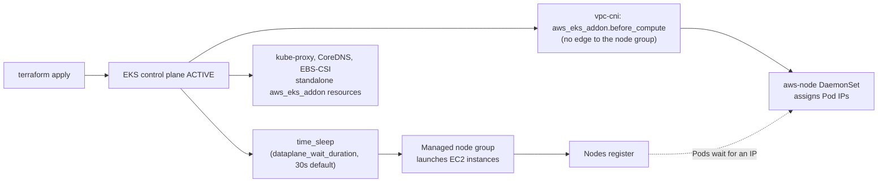

# 14.03 — EKS add-on management discipline

> Every EKS cluster needs **four cluster-critical addons** (vpc-cni,
> kube-proxy, CoreDNS, EBS-CSI) to boot at all. Getting their lifecycle
> right means choosing EKS-managed or self-managed for each, knowing what
> `before_compute = true` does and does not order, wiring IRSA for the
> addons that call AWS, and setting `resolve_conflicts_on_update` on
> purpose, so an upgrade does not overwrite a hand edit by surprise.

**Estimated time:** ~30 min read · ~60 min hands-on
**Prerequisites:** [Part 14 ch.02](./02-eks-cluster-lifecycle.md) — addon upgrade is the second leg of the upgrade dance · [Part 10 ch.02](../10-cloud-and-managed-kubernetes/02-provisioning-and-iac.md) — the EKS module that already manages the four addons · [Part 13 ch.01](../13-grand-capstone-bookstore-platform/01-bookstore-2-from-toy-to-platform.md) — the IRSA + bookstore-platform terraform context

**You'll know after this:** • identify the four cluster-critical addons (vpc-cni, kube-proxy, CoreDNS, EBS-CSI) and why each must boot before workloads · • configure `before_compute = true` and say what it does and does not order · • choose between EKS-managed vs self-managed addons for each one · • wire IRSA for addons that need cloud credentials (EBS-CSI, vpc-cni) · • set `resolve_conflicts_on_update` correctly so upgrades don't clobber operator-applied patches

<!-- tags: eks, terraform, cloud, platform-engineering, irsa -->

## Why this exists

The bookstore-platform tree at
[`../examples/bookstore-platform/terraform/`](../examples/bookstore-platform/terraform/)
installs a Helm chart's worth of controllers on the cluster (Karpenter,
the AWS Load Balancer Controller, metrics-server, the EBS-CSI driver,
CoreDNS). Four of those are different from the rest:

1. **vpc-cni (Amazon VPC CNI plugin)** — assigns Pod IPs from VPC
   subnets. Without it, a Pod cannot get an IP, cannot be `Ready`,
   and cannot serve traffic.
2. **kube-proxy** — implements `Service` IP routing on each node
   (iptables or nftables rules; the ipvs mode has been deprecated
   since Kubernetes v1.35, per the
   [upstream docs](https://kubernetes.io/docs/reference/networking/virtual-ips/)).
   Without it, ClusterIP Services don't work and the cluster's
   internal east-west networking is broken.
3. **CoreDNS** — the cluster DNS server. Without it, Pod-to-Pod
   service discovery via DNS names fails, breaking everything that
   resolves `my-service.my-namespace.svc.cluster.local`.
4. **EBS-CSI driver** — provisions and mounts EBS volumes for any
   PersistentVolumeClaim. Without it, every StatefulSet (CNPG, Strimzi,
   Loki, anything stateful in the bookstore platform) stays in
   `Pending`.

These four are not "applications you might install on the cluster";
they are part of what makes the cluster a usable Kubernetes cluster
at all. Their lifecycle is structurally different from everything
else in the platform, and AWS exposes that difference via the
**EKS-managed addon** API. The other dozen controllers in the tree —
Karpenter, the LB Controller, Velero, Argo CD, Cilium — are not
EKS-managed addons; they're plain Helm releases. The line between the
two paradigms is what this chapter is about.

A fresh EKS cluster can hit the **first-boot CNI race**: the EKS control
plane comes up, the managed node group starts launching EC2 instances,
nodes register before vpc-cni is installed, and scheduled Pods wait for
an IP. The bookstore tree sets `before_compute = true` on vpc-cni in
[`../examples/bookstore-platform/terraform/eks.tf`](../examples/bookstore-platform/terraform/eks.tf),
but that flag does not order the node group after the add-on. Terraform
records no edge between them, and the only gap is a timer (30 seconds by
default). This chapter explains what the flag does and how to check it.

[Part 10 ch.01](../10-cloud-and-managed-kubernetes/01-managed-kubernetes-model.md)
introduced the managed-cluster ownership boundary; this chapter
operationalizes one slice of it (the addons AWS builds and certifies).
[Part 02 ch.01](../02-networking/01-networking-model.md) covered
CNI plugins in the abstract; this chapter is the EKS-specific
production discipline for the four addons every cluster needs.

> **In production:** EKS-managed add-ons are the right default for the
> four essentials. AWS certifies builds against each Kubernetes minor and
> marks one build per minor as the default. An `aws_eks_addon_version`
> lookup with `most_recent = false` returns that default. A bare
> `addon_version = null` gets it once, at create time. EKS does not update
> an add-on when a new build ships or after a cluster upgrade; you start
> each update ([EKS add-on update guide](https://docs.aws.amazon.com/eks/latest/userguide/updating-an-add-on.html)).
> Self-managing vpc-cni (`helm install aws-vpc-cni`) is possible, but you
> then track its CVEs and version compatibility yourself.

## Mental model

**Two paradigms — EKS-managed addons and self-managed releases — split
the platform stack along the "what AWS builds and certifies" line. For the
four essentials (vpc-cni, kube-proxy, CoreDNS, EBS-CSI), EKS-managed
is the default; for everything else, self-managed (Helm/Argo CD)
wins. The `before_compute = true` flag on the vpc-cni addon takes it out
of the module's ordering after the node groups, which leaves the order
before them to a timer. IRSA roles wire addons to AWS APIs without
storing credentials in the cluster.**

The two paradigms:

- **EKS-managed addons** are first-class AWS resources. The addon's
  identity is `(cluster, addon-name)`; AWS knows which K8s versions
  it's compatible with, which container images to pull, what IRSA
  service account it expects. Terraform's `aws_eks_addon` resource
  (or the `terraform-aws-modules/eks/aws` module's `cluster_addons`
  map) is the only thing you write; AWS does the install, and each
  upgrade or patch once you change `addon_version` (it does not move
  an add-on by itself). The catalog (`aws eks describe-addon-versions`)
  is authoritative.
- **Self-managed releases** are plain Helm or Kustomize. You own the
  chart version, the image tag, the security patches, the
  compatibility-with-K8s-version checks. Karpenter is self-managed
  in the bookstore tree (`karpenter.tf` is a `helm_release` against
  `oci://public.ecr.aws/karpenter/karpenter`). So is the LB
  Controller. So is metrics-server. So is everything that isn't
  vpc-cni/kube-proxy/CoreDNS/EBS-CSI.

When to pick which:

- **EKS-managed wins when:**
  - The addon is one of the four AWS-managed essentials.
  - You want AWS to track CVEs against the addon for you.
  - The addon needs cloud-API credentials (EBS-CSI talks to EC2 for
    volume operations) and AWS's IRSA wiring is the simplest path.
- **Self-managed wins when:**
  - The addon isn't in the EKS catalog (most things).
  - You need a custom build, custom values, custom controllers (the
    LB Controller's IAM policy is vendored from the upstream repo at
    a pinned tag and reviewed as a diff — that's per-team customization
    beyond what the EKS catalog supports).
  - You want lockstep with the upstream release calendar (a new
    Karpenter release ships and you want it in production the same
    week; you don't want to wait for AWS to certify it as an EKS
    add-on). This Part pins Karpenter 1.15.1.

**The `before_compute = true` flag.** The EKS module's `cluster_addons`
map (in `eks.tf`, the block currently holding vpc-cni) supports a
`before_compute` field. In `terraform-aws-modules/eks` 20.37.2, the
version the tree's `~> 20.31` constraint resolved to when we ran
`terraform init`, the field decides which resource creates the add-on:

- Without it, the entry becomes `aws_eks_addon.this`, which has
  `depends_on` on the managed and self-managed node groups and the
  Fargate profiles. The add-on is created after the compute.
- With it, the entry becomes `aws_eks_addon.before_compute`, which has
  no `depends_on`. Nothing in the module makes a node group wait for it.

So the flag removes the add-on's wait for the compute. It adds no wait in the
other direction. The node groups depend on `time_sleep.this`, which waits
`dataplane_wait_duration` (30 seconds by default) after the control plane is
active. The module's comment on that timer says it exists to give add-ons that
must be configured before compute time to come up. That is a timing gap, not
an ordering. A node that registers before vpc-cni is ACTIVE has no IP for its
Pods until the add-on arrives. The other three add-ons need no ordering
against the nodes: kube-proxy runs as a DaemonSet and affects Service routing,
not Pod IPs, and CoreDNS and the EBS-CSI controller are Deployments whose Pods
wait for an IP and start when one is available. The EBS-CSI node plugin is a
DaemonSet ([14.04](04-storage-classes-and-ebs.md)).

Standalone `aws_eks_addon.vpc_cni` (a separate resource block, not inside
the module's `cluster_addons` map) has no edge to the node group either.
The bookstore-platform tree's choice, putting vpc-cni inside
`module.eks.cluster_addons` and the other three as standalone
`aws_eks_addon` resources in `addons.tf`, keeps vpc-cni out of the
module's post-compute wait. It does not order vpc-cni before the nodes.

**IRSA for addons.** Two of the four essentials need to call AWS APIs:

- **EBS-CSI** calls EC2's `CreateVolume`, `AttachVolume`,
  `DetachVolume`, `DeleteVolume`, `CreateSnapshot` — every PVC bind
  is an EC2 API call.
- **vpc-cni** calls EC2's `AssignPrivateIpAddresses`,
  `DescribeInstances` — when a Pod is scheduled, vpc-cni assigns one
  of the node's secondary ENI IPs to the Pod.

The clean way to give a Pod (or here, an addon's controller) AWS
credentials is **IRSA** (IAM Roles for Service Accounts), introduced
in [Part 10 ch.03](../10-cloud-and-managed-kubernetes/03-cloud-identity.md).
The addon resource's `service_account_role_arn` field binds the IAM
role to the addon's service account. The bookstore-platform's
[`iam.tf`](../examples/bookstore-platform/terraform/iam.tf) creates
the two roles (`aws_iam_role.vpc_cni`, `aws_iam_role.ebs_csi`); the
EKS module + addons.tf wire them in.

**`resolve_conflicts_on_create` and `resolve_conflicts_on_update`
policy.** EKS addon installs and upgrades can collide with cluster
state that already exists — a ConfigMap with the same name, a CRD
already there, a configuration your team patched by hand. Two
separate fields govern this, and they fire at different moments:

- **`resolve_conflicts_on_create`** — controls behavior when the addon
  resource *pre-exists* in the cluster at install time (e.g., the
  addon was installed manually before Terraform took over, or a prior
  Terraform apply left residue).
  - `OVERWRITE` — Terraform claims the existing resource; the addon's
    Terraform-managed configuration wins. Use this when taking over a
    previously-manual install.
  - `NONE` — Terraform errors out if the resource already exists.
    Safer for green-field installs where a pre-existing resource is
    unexpected.
- **`resolve_conflicts_on_update`** — applies when EKS updates the add-on.
  Terraform sends an update only when `addon_version`,
  `configuration_values` or the service account role changes. A plain
  `terraform apply` with no such change sends no update and leaves hand
  edits in place. When an update runs, this setting decides what happens
  to fields edited by hand.
  - `OVERWRITE`: changed values go back to Amazon EKS defaults during
    the update. The declared state wins at the next update.
  - `PRESERVE`: hand edits stay through the update. Use it when an ops
    engineer has patched the add-on in an incident and the Terraform PR to
    codify the change has not landed yet.
  - `NONE`: EKS changes nothing, and the update can fail on a conflict.

The bookstore-platform tree uses `OVERWRITE` on both. An add-on that someone
has patched by hand should be set to `PRESERVE` until the patch is in
`configuration_values`, and then it stays there.

**Pod Identity Agent — IRSA's replacement.** **EKS Pod Identity** is a
simpler alternative to IRSA. IRSA requires an OIDC provider, a trust
policy with a Kubernetes service-account subject, and the cluster's OIDC
issuer URL in the role. Pod Identity runs an agent pod on each node (the
Pod Identity Agent add-on) and an EKS Auth API that returns credentials
for a service account through a Pod Identity association, and the role's
trust policy names the Pod Identity principal rather than an OIDC
provider. For a fresh cluster Pod Identity is simpler; for an existing
IRSA-wired cluster the migration is non-trivial (re-wire every role's
trust policy). The bookstore-platform tree uses IRSA throughout; a
green-field cluster could pick either.

The trap to keep in view: **the conformance window**. Each addon
version supports a *range* of K8s minors (e.g., vpc-cni
v1.23.2-eksbuild.8 supports K8s 1.31-1.37). When you bump K8s, the
next-default addon version may differ; when you pin `addon_version`,
you're responsible for tracking the window. The bookstore tree's
`aws_eks_addon_version` lookup (keyed on `module.eks.cluster_version`,
`most_recent = false`) returns EKS's default build for the current
minor, which is always inside that minor's window. A bare
`addon_version = null` on a standalone `aws_eks_addon` is not the
same: EKS installs its default at create time, Terraform then plans
no change, and after a control-plane upgrade the add-on stays on the
build it got for the old minor (AWS documents that EKS does not
update an add-on after a cluster upgrade). kube-proxy shows it most
plainly: EKS versions its kube-proxy builds per minor
(`v1.<minor>`), and upstream's skew policy lets kube-proxy trail
kube-apiserver by at most three minors, so after three upgrades a
frozen one has to move before the control plane can go any further.

## Threats and controls

| Threat | Control in this chapter | Goes deeper in |
|---|---|---|
| An add-on with no role of its own uses the node IAM role's permissions | One IRSA role per add-on that calls AWS, bound with `service_account_role_arn`; add-ons that make no AWS calls get none; the system node group drops its copy of the CNI grant (`iam_role_attach_cni_policy = false`) | [Part 10 ch.03](../10-cloud-and-managed-kubernetes/03-cloud-identity.md) |
| An add-on build moves without review, for example when a default changes during an unrelated upgrade | Every add-on build change is a line in a plan that someone reviews before apply, and a cluster upgrade is its own reviewed plan | [14.02](02-eks-cluster-lifecycle.md) |
| A hand edit that Terraform cannot see, or that a later update silently reverts | Declare changes in `configuration_values`; set `resolve_conflicts_on_update` on purpose | [14.07](07-infrastructure-cicd-and-drift.md) |

## Diagrams

### Diagram A — addon lifecycle on cluster bootstrap (Mermaid)



The arrows are Terraform edges in the module, plus the timer. The vpc-cni
branch and the node group branch have no edge between them.

### Diagram B — the four essential addons and their IRSA needs (ASCII)

```text
ADDON                NEEDS AWS API?   IRSA ROLE                    NOTES
───────────────────  ──────────────   ──────────────────────────   ──────────────────────────────────
vpc-cni              yes              aws_iam_role.vpc_cni         Assigns Pod IPs from VPC subnets.
                                      (AmazonEKS_CNI_Policy)        Lives in module.eks.cluster_addons
                                                                    with before_compute=true.
kube-proxy           no               (none — runs as DaemonSet     Implements Service IP routing on
                                       with no cloud calls)         each node. Standalone aws_eks_addon.
CoreDNS              no               (none — cluster-internal DNS) Cluster DNS server. Standalone
                                                                    aws_eks_addon. Patched via
                                                                    configuration_values for nodeSelector.
aws-ebs-csi-driver   yes              aws_iam_role.ebs_csi          Provisions/attaches EBS volumes.
                                      (AmazonEBSCSIDriverPolicy)    Standalone aws_eks_addon. Patched
                                                                    via configuration_values to land on
                                                                    the system node group.
───────────────────  ──────────────   ──────────────────────────   ──────────────────────────────────
SELF-MANAGED (NOT EKS ADDONS):
  Karpenter, LB controller, metrics-server, Argo CD, Crossplane,
  Velero, Falco, Kyverno, OpenCost, Loki, Tempo, Prometheus...
  These are Helm charts with their own IRSA roles where needed.
```

## Hands-on with the Bookstore Platform

### 0. Prerequisites

- The bookstore-platform tree applied (so the four addons exist).
- `kubectl` configured for the cluster.
- `aws` CLI with describe-addon permissions.

The Terraform that ships these is in three files; read them in this
order:

- [`../examples/bookstore-platform/terraform/eks.tf`](../examples/bookstore-platform/terraform/eks.tf)
  — the `cluster_addons.vpc-cni` block with `before_compute = true`.
- [`../examples/bookstore-platform/terraform/addons.tf`](../examples/bookstore-platform/terraform/addons.tf)
  — the standalone `aws_eks_addon` resources for kube-proxy, CoreDNS,
  EBS-CSI.
- [`../examples/bookstore-platform/terraform/iam.tf`](../examples/bookstore-platform/terraform/iam.tf)
  — the IRSA roles for vpc-cni and EBS-CSI.

### 1. Inspect the cluster's addons

```bash
CLUSTER="$(terraform output -raw cluster_name)"
REGION="$(terraform output -raw region)"

aws eks list-addons --cluster-name "$CLUSTER" --region "$REGION"
```

Illustrative output (not captured):

```text
{
  "addons": [
    "aws-ebs-csi-driver",
    "coredns",
    "kube-proxy",
    "vpc-cni"
  ]
}
```

The four essentials, all EKS-managed. Drill into one:

```bash
aws eks describe-addon \
  --cluster-name "$CLUSTER" --region "$REGION" \
  --addon-name vpc-cni \
  --query 'addon.{name:addonName,ver:addonVersion,status:status,role:serviceAccountRoleArn}'
```

Illustrative output (not captured):

```text
{
  "name": "vpc-cni",
  "ver": "v1.23.2-eksbuild.8",
  "status": "ACTIVE",
  "role": "arn:aws:iam::<ACCOUNT-ID>:role/bookstore-platform-vpc-cni"
}
```

The `role` field is the IRSA wiring — the vpc-cni service account
(`kube-system/aws-node`) assumes this IAM role via the cluster's OIDC
provider.

### 2. Inspect a pod that uses an addon

```bash
# vpc-cni runs as a DaemonSet — one Pod per node.
kubectl -n kube-system get pods -l k8s-app=aws-node -o wide

# Check the service account binding.
kubectl -n kube-system get sa aws-node -o yaml | grep -A1 annotations
```

The service account has the `eks.amazonaws.com/role-arn` annotation
pointing at the IAM role; the kubelet projects an OIDC token into
the Pod; the AWS SDK in vpc-cni uses that token to assume the role.

### 3. Query the addon catalog

```bash
aws eks describe-addon-versions \
  --addon-name vpc-cni \
  --query 'addons[0].addonVersions[*].{ver:addonVersion,default:compatibilities[?defaultVersion==`true`].clusterVersion | [0],status:compatibilities[*].clusterVersion}' \
  --output table
```

The upstream [vpc-cni page](https://docs.aws.amazon.com/eks/latest/userguide/managing-vpc-cni.html)
lists `v1.23.2-eksbuild.8` as the latest build for Kubernetes 1.31 through
1.37. That range is the **conformance window**: each build is offered for a
set of minors. The `default` column marks the build EKS installs when an
add-on is created with `addon_version = null`, and the build that an
`aws_eks_addon_version` lookup with `most_recent = false` returns. The
default is not always the newest build, so read the column for your
cluster's minor rather than trusting a number from this page. Adding
`--kubernetes-version 1.37` lists only the builds offered on 1.37.

### 4. Hold one add-on on a named build (an exception to the lookup)

The lookup is the rule. Hold an add-on only for a stated reason, such as a
regression in the default build. The hold is one reviewed change in its own
PR, and the PR that moves the add-on on removes it. In `addons.tf`, the hold
replaces the lookup for that one add-on:

```hcl
resource "aws_eks_addon" "coredns" {
  cluster_name                = module.eks.cluster_name
  addon_name                  = "coredns"
  addon_version               = "<build from describe-addon-versions>"  # held: <reason>
  # ...
}
```

Run:

```bash
terraform plan -target=aws_eks_addon.coredns
terraform apply -target=aws_eks_addon.coredns
```

Use `-target` only for surgical addon-version changes; never for
ongoing operations. Read the held add-on's line in the plan like any other.
The plan shows the build the hold keeps, and the PR that drops the hold shows
the lookup's build as the change.

### 5. Check what Terraform orders

The graph needs only `terraform init -backend=false` and makes no AWS
calls. An edge `"A" -> "B"` means A waits for B. Dump the apply graph and
list the lines that mention the vpc-cni resource:

```bash
terraform init -backend=false
terraform graph -type=apply > apply-graph.dot
grep -F 'aws_eks_addon.before_compute' apply-graph.dot
```

The grep prints six lines. One is the node's own declaration, three are its
outgoing edges (to its version lookup, to locals and to the add-on timeouts),
and two point at it: the module's `cluster_addons` output and the provider's
close step. None comes from a node group, so the grep alone shows that no
node group names the add-on. It cannot show what waits on what through other
resources, so check reachability from the node group. The script below
follows the edges from the node group and reports what it reaches. The vertex
names are those of module 20.37.2; if yours differ, grep for
`aws_eks_node_group.this` and copy the name:

```bash
python3 - apply-graph.dot <<'PY'
import re
import sys

NODE_GROUP = "[root] module.eks.module.eks_managed_node_group.aws_eks_node_group.this (expand)"
TIMER = "[root] module.eks.time_sleep.this (expand)"
ADDON = "[root] module.eks.aws_eks_addon.before_compute (expand)"

edges = {}
for line in open(sys.argv[1]):
    match = re.match(r'\s*"([^"]+)" -> "([^"]+)"', line)
    if match:
        edges.setdefault(match.group(1), set()).add(match.group(2))

seen, todo = set(), [NODE_GROUP]
while todo:
    for nxt in edges.get(todo.pop(), ()):
        if nxt not in seen:
            seen.add(nxt)
            todo.append(nxt)

print("node group reaches the timer:", TIMER in seen)
print("node group reaches vpc-cni:", ADDON in seen)
PY
```

On a clean copy of the example tree (Terraform 1.14.8, module 20.37.2, no
AWS calls), the script prints:

```text
node group reaches the timer: True
node group reaches vpc-cni: False
```

The node group reaches the timer, and the check shows it does not reach the
add-on. That is the gap `before_compute` leaves open.

### 6. See what a hand edit does to add-on state

This is a deliberate action on a cluster you own, to show what Terraform
cannot see. Edit the CoreDNS ConfigMap by hand and change a cosmetic value:

```bash
kubectl -n kube-system edit configmap coredns
```

Run `terraform plan -target=aws_eks_addon.coredns`. Terraform reports no
change. The provider reads the add-on through the add-on API, so the
ConfigMap is outside what a plan sees.

The hand edit stays until an update call runs. Terraform sends one when
`addon_version`, `configuration_values`, the service account role or the
Pod Identity block changes. Then `resolve_conflicts_on_update` decides the
outcome: under `OVERWRITE` the changed values go back to Amazon EKS
defaults, and under `PRESERVE` they stay. Revert the test edit with
`kubectl edit` when you are done.

The durable way to change CoreDNS is `configuration_values` in Terraform,
with Corefile changes under its `corefile` key. A direct ConfigMap edit is
overwritten at the next add-on update
([CoreDNS add-on docs](https://docs.aws.amazon.com/eks/latest/userguide/managing-coredns.html)).

### 7. Add a new EKS-managed addon (not one of the four)

EKS's catalog has additional addons beyond the four essentials —
ADOT collector, CloudWatch Container Insights, Pod Identity Agent.
To add Pod Identity Agent, give it the same default-build lookup as
the other standalone add-ons (a bare `null` would install today's
default and then never follow a cluster upgrade):

```hcl
# addons.tf: the existing lookup, with one more name in its set
data "aws_eks_addon_version" "default" {
  for_each = toset([
    "kube-proxy", "coredns", "aws-ebs-csi-driver", "eks-pod-identity-agent",
  ])

  addon_name         = each.key
  kubernetes_version = module.eks.cluster_version
  most_recent        = false
}

# addons.tf — add this block
resource "aws_eks_addon" "pod_identity_agent" {
  cluster_name                = module.eks.cluster_name
  addon_name                  = "eks-pod-identity-agent"
  addon_version               = data.aws_eks_addon_version.default["eks-pod-identity-agent"].version
  resolve_conflicts_on_update = "OVERWRITE"
  resolve_conflicts_on_create = "OVERWRITE"
  preserve                    = false

  tags = local.common_tags
}
```

`terraform plan` shows the new addon; `terraform apply` installs it.
The agent runs one Pod per node in `kube-system`. Then create Pod Identity
associations that map each service account to an IAM role. The agent does
not read `service_account_role_arn`. It needs `eks-auth:AssumeRoleForPodIdentity`
on the node role, which the managed `AmazonEKSWorkerNodePolicy` grants, and
that action can be limited by tags
([agent setup](https://docs.aws.amazon.com/eks/latest/userguide/pod-id-agent-setup.html)).

## How it works under the hood

**The EKS add-on API.** Create and update are asynchronous. `UpdateAddon`
returns an update ID, the add-on moves from `UPDATING` back to `ACTIVE`,
and the Terraform provider waits for that update to finish. The request
takes `addonVersion`, `configurationValues`, `serviceAccountRoleArn` and
`resolveConflicts`, and the version must be one that `DescribeAddonVersions`
returns for the cluster ([API reference](https://docs.aws.amazon.com/eks/latest/APIReference/API_UpdateAddon.html)).

**What `service_account_role_arn` does.** It binds an existing IAM role to
the add-on's service account. The API reference requires an IAM OIDC
provider on the cluster for this, which `enable_irsa = true` creates in the
EKS module. The role's trust policy must name that provider and the
add-on's service account. The Pod then gets short-lived credentials through
a projected token, as in
[Part 10 ch.03](../10-cloud-and-managed-kubernetes/03-cloud-identity.md).
Left unset, the add-on uses the node IAM role's permissions instead.

**The node role's copy of the grant.** The EKS module attaches
`AmazonEKS_CNI_Policy` to each managed node group role by default, so the
node role holds the grant that vpc-cni now gets through its own IRSA role.
The system node group sets `iam_role_attach_cni_policy = false` in `eks.tf`
to drop that copy. Apply it once `aws-node` runs on its IRSA role: on a
running cluster, let the vpc-cni role change land first. The module's
default IMDS hop limit is 2, which lets a Pod reach the node role's
credentials. The hop limit is the subject of
[14.08](08-vpc-endpoints-and-egress.md), and this tree keeps the module
default until then.

**`before_compute = true` mechanics.** In `terraform-aws-modules/eks`
20.37.2, the flag moves the entry from `aws_eks_addon.this` to
`aws_eks_addon.before_compute` (see `main.tf`). The `this` resources carry
`depends_on` on the compute, so the flag removes that edge. No resource in
the module depends on `aws_eks_addon.before_compute`. We checked this on the
example tree: `terraform graph -type=apply` shows the node group reaching
`time_sleep.this` and no path to the add-on, while the regular `this`
add-ons reach the node group. The only ordering the module provides for the
compute is the timer in `node_groups.tf`. If the order must hold, declare
the node group in your own code with a `depends_on` on the add-on.

**Why `kube-proxy` doesn't need `before_compute`.** kube-proxy runs as a
DaemonSet, one Pod per node, started after the node joins. A node without
it has no Service routing until it starts, and Pods that call a Service by
ClusterIP retry in the meantime. The API server is reached through its
endpoint, not a ClusterIP, so kubelet keeps working. vpc-cni's absence is
different: a Pod without an IP cannot start its network sandbox and stays
in `ContainerCreating` until a CNI answers.

**The conformance window's data structure.** Each addon version is
described by a `compatibilities` list — pairs of `(clusterVersion,
defaultVersion: bool)`. EKS uses this to answer two questions: "which
addon versions can I install on this K8s minor?" (filter by minor in
the list) and "which one is the default?" (find the entry where
`defaultVersion` is true). When Terraform creates an add-on with
`addon_version = null`, EKS installs the default for the cluster's
minor at that moment, and a standalone `aws_eks_addon` keeps that
build from then on; the `aws_eks_addon_version` data source asks the
"which one is the default?" question again on every plan, which is
how the tree's add-ons follow upgrades. The API accepts only a version
that `DescribeAddonVersions` returns for the cluster's minor.

**Pod Identity Agent vs IRSA — the migration.** IRSA's trust policy
references the cluster's OIDC issuer URL, a string like
`oidc.eks.<region>.amazonaws.com/id/<HASH>`. Each cluster has its own
issuer, so every IRSA role trusts one cluster's issuer, and multi-cluster
teams repeat that trust setup for each cluster. A Pod Identity association
maps (cluster, namespace, service account) to a role, and the trust policy
names the Pod Identity principal instead. The migration: install the Pod
Identity Agent add-on, create Pod Identity associations, move the
application's wiring from the `eks.amazonaws.com/role-arn` annotation to
the association, then remove the IRSA trust statement from the role. For an
existing cluster the migration is significant; for a new cluster, Pod
Identity is the simpler default.

## Production notes

> **In production:** Read the add-on lines of every plan. When
> `addon_version` tracks the default (an `aws_eks_addon_version` lookup, or
> `null` inside the EKS module's `cluster_addons`), a control-plane upgrade
> through Terraform also moves every addon whose default build differs on the
> new minor, in the same plan and with no commit of its own. Both lookups read
> the Kubernetes version that the same configuration sets, so the plan shows
> the new builds before anything applies. Make the cluster bump its own
> reviewed PR, and review the add-on lines in it. (A bare `null` on a
> standalone `aws_eks_addon` is not tracking: the provider keeps the installed
> build, see [ch.02](02-eks-cluster-lifecycle.md).)

> **In production:** `resolve_conflicts_on_update = "PRESERVE"` is the
> right choice for an add-on whose live objects get edited outside
> Terraform. The bookstore-platform's CoreDNS and EBS-CSI are patched for
> `nodeSelector` and `tolerations` through `configuration_values`, so those
> settings are declared in Terraform and sent on each update. A hand edit is
> a different case: it survives only a `PRESERVE` update. That is the bridge
> an ops engineer needs during an incident, before the Terraform PR merges.

> **In production:** audit each add-on. If its controllers call AWS APIs,
> give it its own role (IRSA or Pod Identity). If it does not, leave the
> field empty: an unset role falls back to the node IAM role, a broader
> grant than most add-ons need.

> **In production:** Conformance windows matter at upgrade time, not
> install time. A tracked `addon_version` (the tree's lookup, or
> `null` inside the module's `cluster_addons`) is always within the
> window for the current K8s minor, because it is EKS's default for
> that minor. A bare `null` on a standalone `aws_eks_addon` is only
> guaranteed to be inside it for the minor the cluster ran at create
> time. The risk is the *next* K8s upgrade — the addon version
> compatible with K8s 1.36 may not exist for 1.37. The pre-flight in
> [ch.02](02-eks-cluster-lifecycle.md) §3 is the discipline that
> catches this: `aws eks describe-addon-versions --kubernetes-version
> <N+1>` returns what's available for the target.

> **In production:** `before_compute = true` on vpc-cni is not an
> ordering guarantee. The timer is the only gap before the nodes (see the
> mechanics under How it works). If a node must never register before the
> CNI is ACTIVE, declare that node group in your own code with a
> `depends_on` on the add-on, and check the first nodes of each new cluster.

> **In production:** Pod Identity for new clusters; IRSA for
> existing. Don't churn a working IRSA wiring just because Pod
> Identity is newer. Migration is real work for a cluster with many
> IRSA roles; the gain (no per-cluster OIDC trust to maintain) is modest.
> New green-field clusters should default to Pod Identity Agent
> from day one.

> **In production:** Custom CoreDNS config (a `forward` plugin pointing at
> corporate DNS, a tuned `cache` plugin) belongs under the `corefile` key of
> `configuration_values`, not in a hand-patched ConfigMap. EKS manages that
> ConfigMap, and a direct edit is overwritten at the next add-on update
> ([CoreDNS add-on docs](https://docs.aws.amazon.com/eks/latest/userguide/managing-coredns.html)).

## Quick Reference

```bash
# List all EKS-managed addons on a cluster.
aws eks list-addons --cluster-name "$CLUSTER" --region "$REGION"

# Describe one addon (version, status, IRSA role).
aws eks describe-addon --cluster-name "$CLUSTER" --region "$REGION" \
  --addon-name vpc-cni

# Query the catalog — which versions are compatible with K8s 1.37?
aws eks describe-addon-versions \
  --addon-name vpc-cni --kubernetes-version 1.37

# Pin a version (in addons.tf).
addon_version = "v1.23.2-eksbuild.8"

# Track EKS's default build for the cluster's K8s minor (addons.tf does
# this; a bare null on a standalone aws_eks_addon never moves after create).
addon_version = data.aws_eks_addon_version.default["coredns"].version

# IRSA wire-up on an addon.
service_account_role_arn = aws_iam_role.vpc_cni.arn

# Patch addon config (nodeSelector, tolerations, replica count).
configuration_values = jsonencode({
  nodeSelector = { "bookstore-platform.example.com/pool" = "system" }
  replicaCount = 2
})
```

Minimal `cluster_addons` skeleton (inside the EKS module call, where a
`null` falls through to the module's own default-build lookup and so
follows cluster upgrades):

```hcl
cluster_addons = {
  vpc-cni = {
    addon_version               = null # module looks up EKS's default
    resolve_conflicts_on_create = "OVERWRITE"
    resolve_conflicts_on_update = "OVERWRITE"
    service_account_role_arn    = aws_iam_role.vpc_cni.arn
    before_compute              = true
    preserve                    = false
  }
}
```

Minimal standalone `aws_eks_addon` skeleton (no module lookup here, so
the data source does that job; a bare `null` would freeze the add-on
on its create-time default):

```hcl
data "aws_eks_addon_version" "default" {
  for_each = toset(["kube-proxy"])

  addon_name         = each.key
  kubernetes_version = module.eks.cluster_version
  most_recent        = false
}

resource "aws_eks_addon" "kube_proxy" {
  cluster_name                = module.eks.cluster_name
  addon_name                  = "kube-proxy"
  addon_version               = data.aws_eks_addon_version.default["kube-proxy"].version
  resolve_conflicts_on_create = "OVERWRITE"
  resolve_conflicts_on_update = "OVERWRITE"
  preserve                    = false
}
```

Addon-management checklist (the cluster is healthy when all five are yes):

- [ ] vpc-cni has `before_compute = true` in the EKS module's
      `cluster_addons` map, and you know that the order it gives is a
      timer, not a dependency.
- [ ] Every addon that needs AWS APIs (vpc-cni, EBS-CSI) has an IRSA
      role wired via `service_account_role_arn`.
- [ ] Conformance window verified for the cluster's K8s minor
      (`aws eks describe-addon-versions --kubernetes-version <CURRENT>`
      lists all four essentials).
- [ ] `resolve_conflicts_on_update` set on purpose: OVERWRITE for an
      add-on whose configuration Terraform owns, PRESERVE while a hand
      patch waits for its PR.
- [ ] Every apply's plan was read for add-on build changes, and the
      cluster bump was its own reviewed plan.

## Test your understanding

> Try each before opening the answer drawer. The act of trying is the exercise; the answer is the check.

1. **What exactly does `before_compute = true` do for the vpc-cni addon, and why don't the other three essentials need it?**
   <details><summary>Show answer</summary>

   In `terraform-aws-modules/eks` 20.37.2 it moves the add-on from `aws_eks_addon.this` to `aws_eks_addon.before_compute`. `this` add-ons depend on the node groups, and `before_compute` add-ons do not. No resource makes a node group wait for vpc-cni. The node groups wait on a 30-second timer, which is a timing gap, not an ordering. The other three need no ordering against the nodes: kube-proxy runs as a DaemonSet and affects Service routing, not Pod IPs, and CoreDNS and EBS-CSI Pods wait for an IP and start when one is available.

   </details>

2. **You run `terraform apply` to bump K8s from 1.36 to 1.37 with every addon tracking EKS's default build (as the bookstore tree does). Mid-apply, the LB Controller starts crashlooping. What's happening and how do you avoid this in prod?**
   <details><summary>Show answer</summary>

   Tracking the default (`addon_version` from an `aws_eks_addon_version`
   lookup keyed on the cluster's version) moves kube-proxy, and every other
   managed addon whose default build differs on the new minor, in the same
   plan as the cluster upgrade. One of those default bumps changed an API the
   LB Controller (a self-managed Helm release) depended on. The control is the
   plan review: the add-on lines name each build that changes, so read them
   against the release notes before apply, and make the cluster bump and any
   add-on bump separate reviewed PRs, each with its own apply.

   </details>

3. **An ops engineer hand-edits an add-on-managed setting during an incident. Days later, a scheduled `terraform apply` shows no change, and then an add-on version bump removes the edit. Why, and what should the team have done?**
   <details><summary>Show answer</summary>

   Terraform never saw the edit. The provider reads the add-on through the add-on API, so the apply that changed nothing left the hand edit in place. The version bump is an update call, and under `OVERWRITE` EKS sets changed values back to its defaults during that update, so the edit disappears with no Terraform diff. The missing control is review: the change belongs in a PR to `configuration_values`, and drift detection ([14.07](07-infrastructure-cicd-and-drift.md)) should flag edits nobody reviewed. While a hotfix waits for its PR, `PRESERVE` on that add-on keeps it through updates.

   </details>

4. **Hands-on extension — create a fresh cluster with vpc-cni declared as a standalone `aws_eks_addon` resource (not inside `cluster_addons`) and note the timestamps of node registration and vpc-cni ACTIVE.**
   <details><summary>What you should see</summary>

   Neither form orders vpc-cni before the node group. The standalone resource has no `before_compute` field, and the module's form has no edge to the node group either. The bootstrap order therefore depends on timing. A node that registers first has no Pod IPs until vpc-cni is ACTIVE, and Pods scheduled to it stay in `ContainerCreating` until then. Your timestamps show the gap on your cluster. The example tree does not close it; an explicit dependency does (see the mechanics under How it works).

   </details>

## Further reading

- **AWS EKS — Amazon EKS add-ons**
  <https://docs.aws.amazon.com/eks/latest/userguide/eks-add-ons.html>;
  the authoritative reference for the addon API, the catalog, and
  what counts as an EKS-managed addon.
- **terraform-aws-modules/eks/aws 20.37.2 — `main.tf` and `node_groups.tf`**
  <https://github.com/terraform-aws-modules/terraform-aws-eks/blob/v20.37.2/main.tf>;
  the `aws_eks_addon.this` and `aws_eks_addon.before_compute` resources, and
  the `time_sleep` that the node groups wait on.
- **EKS UpdateAddon API reference**
  <https://docs.aws.amazon.com/eks/latest/APIReference/API_UpdateAddon.html>;
  the `resolveConflicts` values and the rule that a version comes from
  `DescribeAddonVersions`.
- **Kubernetes virtual IPs and version skew**
  <https://kubernetes.io/docs/reference/networking/virtual-ips/> (the ipvs
  deprecation) and <https://kubernetes.io/releases/version-skew-policy/>
  (the kube-proxy rule used above).
- **AWS EKS Pod Identity migration guide**
  <https://docs.aws.amazon.com/eks/latest/userguide/pod-identities.html>;
  the canonical reference for migrating from IRSA to Pod Identity.
- **vpc-cni — Amazon VPC CNI plugin docs**
  <https://github.com/aws/amazon-vpc-cni-k8s>; the upstream repository
  for the CNI plugin, including the IRSA permission set this chapter
  depends on.
- **AWS EBS CSI driver docs**
  <https://github.com/kubernetes-sigs/aws-ebs-csi-driver>; the
  upstream repo and the IAM policy template for the EBS-CSI addon's
  IRSA role.
- **Rosso et al., *Production Kubernetes*, the networking and storage chapters**;
  the broader CNI + CSI discipline this chapter's addon management
  enforces at the EKS layer.
