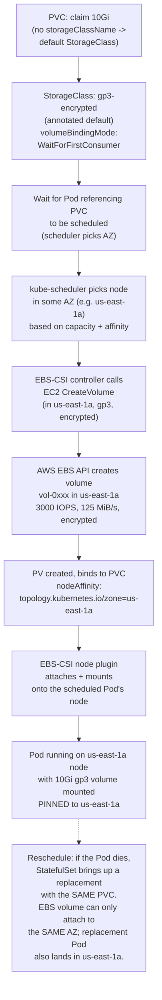

# 14.04 — Storage classes & EBS in production

> Every EKS cluster ships with **gp2** as the default StorageClass and
> every production team should replace it with **gp3** the day the
> cluster lands: 20% cheaper per GiB, tunable IOPS and throughput, no
> burst-credit footgun. The full discipline is bigger than the
> StorageClass swap: encryption with a customer-managed KMS key, a
> reclaim policy that keeps data, control over who can snapshot it, the
> always-AZ-local reality of EBS volumes, and the `WaitForFirstConsumer`
> binding mode that keeps Pods and their volumes in the same AZ.

**Estimated time:** ~30 min read · ~60 min hands-on
**Prerequisites:** [Part 14 ch.03](./03-eks-addon-management.md): EBS-CSI addon required first · [Part 10 ch.05](../10-cloud-and-managed-kubernetes/05-cloud-storage-and-data.md): kind→cloud storage transition · [Part 03 ch.05](../03-config-and-storage/05-stateful-data-patterns.md): StatefulSet binding semantics on EBS

**You'll know after this:** • understand why gp2 (default) should be replaced with gp3 on day one: 20% cheaper, tunable IOPS, no burst-credit footgun · • encrypt every volume the default StorageClass provisions with a customer-managed KMS key · • use `WaitForFirstConsumer` to keep Pods and volumes in the same AZ · • design a snapshot lifecycle for production EBS volumes · • debug the AZ-local reality of EBS when a Pod can't reschedule across zones

<!-- tags: storage, ebs-csi, eks, cloud, day-2 -->

## Why this exists

The bookstore-platform tree at
[`../examples/bookstore-platform/terraform/`](../examples/bookstore-platform/terraform/)
runs CNPG, Strimzi, Loki, Tempo, Prometheus, and Velero — every one
of them claims a PersistentVolume. Without a StorageClass tuned for
production, every PVC binds to a gp2 EBS volume at default settings:
3 IOPS per GiB baseline, a burst-credit ceiling that runs out under
sustained load, and encryption only if the account turns on encryption
by default. Every one of those
defaults is a missed optimization, and we address all of them in this
chapter.

gp3, released by AWS in late 2020, is structurally better than gp2 on
every dimension a Kubernetes team cares about:

- **Price.** gp3 is 20% cheaper per GiB than gp2. The EBS pricing page
  lists **$0.08/GB-month** against **$0.10/GB-month** for gp2, in its
  example Region.
- **Baseline performance.** gp3 starts at **3000 IOPS** and **125
  MiB/s** *regardless of volume size*. gp2 starts at **3 IOPS per GiB**
  with a floor of 100. A gp2 volume under 1 TiB can burst to 3000 IOPS
  on an I/O credit bucket, which empties under sustained load.
- **Tunability.** gp3 lets you provision additional IOPS (up to
  80,000) and throughput (up to 2,000 MiB/s) **independently of
  size**. gp2 ties IOPS to size; the only way to get more IOPS is to
  buy a larger volume you don't need.

For a Kubernetes cluster with 30+ PVs (a normal mid-size cluster
with Prometheus + Loki + Tempo + a CNPG primary + replicas + some
app state), the cost difference is real money: at 30 PVs averaging
50 GB, gp2 is $150/month, gp3 is $120/month. Multiply by years and
clusters and the gp3 switch is the highest-ROI two-file Terraform
change you can make.

But the change is more than the StorageClass swap. EBS is **always
AZ-local**: a volume in us-east-1a cannot attach to an instance in
us-east-1b. A StatefulSet's CNPG primary, scheduled to us-east-1a
when its PVC binds, is *pinned* to us-east-1a until the volume is
either snapshotted-and-restored cross-AZ or the PVC is destroyed. The
`volumeBindingMode: WaitForFirstConsumer` setting on the StorageClass
is what keeps Pod and volume in the same AZ — it defers volume
creation until the scheduler picks an AZ for the Pod, then creates
the volume there. Without it (`Immediate` binding), the volume is
provisioned at PVC-creation time, in an arbitrary AZ, and the Pod is
then *forced* to that AZ — losing the scheduler's awareness of node
capacity, taints, affinities.

Beyond that, encryption is a key decision (and the compliance team's
first audit question), snapshots are a second copy of the data that
needs its own access rules, and cross-AZ data transfer for replicated
stateful workloads is the budget item teams most often fail to
forecast.

[Part 03 ch.04](../03-config-and-storage/04-persistent-storage.md)
introduced StorageClass, PVC, PV, the CSI architecture, and binding
modes. [Part 03 ch.05](../03-config-and-storage/05-stateful-data-patterns.md)
covered VolumeSnapshots in the abstract. This chapter is the
EKS+EBS-specific production overlay: which StorageClass parameters
matter, how to demote the default gp2, where the snapshot-bill
surprises hide.

> **In production:** Every EKS cluster should run a Terraform that
> creates a tuned gp3 StorageClass with encryption forced on under a
> customer-managed key, `WaitForFirstConsumer` binding,
> `allowVolumeExpansion: true` and `reclaimPolicy: Retain`, and demotes
> the bundled gp2 so new PVCs default to gp3. The bookstore-platform
> tree ships this in
> [`../examples/bookstore-platform/terraform/gp3-storageclass.tf`](../examples/bookstore-platform/terraform/gp3-storageclass.tf).

## Mental model

**Three layers compose EBS-backed storage on Kubernetes: the
StorageClass (the K8s abstraction), the EBS volume parameters
(gp2/gp3/io2/encryption/IOPS/throughput), and the AZ pinning (every
EBS volume is single-AZ). Tuning the StorageClass is the dev-grade
move; tuning the snapshot lifecycle and cross-AZ data-transfer is the
ops-grade follow-up.**

The three layers:

- **Layer 1 — StorageClass.** Kubernetes' interface for "what kind of
  storage do I want?" A cluster can have multiple StorageClasses;
  exactly one is the default (marked with the
  `storageclass.kubernetes.io/is-default-class: "true"` annotation).
  PVCs that omit `storageClassName` use the default. The bookstore
  tree's `gp3-encrypted` SC is the new default; the bundled `gp2` is
  demoted.
- **Layer 2 — EBS volume parameters.** The StorageClass's `parameters`
  block passes these to the EBS-CSI driver:
  - `type`: `gp2`, `gp3`, `io1`, `io2`, `st1`, `sc1` — gp3 is the
    default for everything that isn't a database hot-path; io2 is
    for sustained > 16k IOPS sub-millisecond workloads.
  - `encrypted`: `"true"` to force encryption. The driver defaults to
    `"false"`, so set it on the class.
  - `iops`: 3000 to 80000 for gp3. The 3000 baseline is included; more
    is billed per provisioned IOPS.
  - `throughput`: 125 to 2000 MiB/s for gp3. The 125 baseline is
    included; more is billed per provisioned MiB/s.
  - `kmsKeyId`: ARN of a customer-managed KMS key. If omitted, EBS
    uses the AWS-managed `aws/ebs` key. The next section explains why
    this chapter sets it.
- **Layer 3 — AZ pinning.** Every EBS volume lives in exactly one
  AZ. A Pod claiming an EBS-backed PVC is forced to schedule onto a
  node in the same AZ as the volume. `WaitForFirstConsumer` defers
  volume creation until the Pod is scheduled, so the AZ is the
  scheduler's choice (matching node taints, capacity, anti-affinity);
  `Immediate` reverses the dependency and forces the Pod to the
  volume's AZ.

**Why a customer-managed key.** `aws/ebs` is an AWS-managed key, which
AWS rotates every year on a schedule you cannot change. A
customer-managed key (CMK) lets you write the key policy, turn on
rotation, disable the key or schedule its deletion, and share snapshots
with another account. AWS does not allow sharing snapshots encrypted
with `aws/ebs`, and a shared encrypted snapshot needs its key shared as
well. Disabling a key stops new attachments; a volume that is already
attached keeps working until it detaches. Encrypted snapshots cannot be
public. Block public access for snapshots is a Regional account setting, and
this tree does not set it. Turn it on per Region with `aws ec2
enable-snapshot-block-public-access --state block-all-sharing`. The key of an
existing volume or snapshot cannot be changed, so
to move data under the CMK, copy the snapshot with the new key and
restore it. A key costs $1 a month, plus $0.03 per 10,000 requests.

**gp2 vs gp3 vs io1/io2**: the trade-off matrix:

| Type | Baseline | Max IOPS | Max throughput | Use case |
|---|---|---|---|---|
| gp2 | 3 IOPS per GiB, min 100 | 16,000 | 250 MiB/s | legacy; AWS default; **avoid** |
| gp3 | 3,000 IOPS, 125 MiB/s | 80,000 | 2,000 MiB/s | **default for everything** |
| io1, io2 | provisioned | 64,000 (io1); 256,000 (io2 Block Express) | 1,000 MiB/s (io1); 4,000 MiB/s (io2 Block Express) | sustained above 16,000 IOPS, or sub-millisecond latency on io2 Block Express |
| st1 | throughput only | 500 | 500 MiB/s | large sequential streams |

The limits come from the [EBS volume types page](https://docs.aws.amazon.com/ebs/latest/userguide/ebs-volume-types.html).
Check it before you size a volume, because AWS changes them.

For the bookstore platform's needs — Postgres data (CNPG), Kafka
logs (Strimzi), Prometheus TSDB, Loki chunks, Tempo blocks — **gp3
covers everything**. None of these workloads needs io2's sub-
millisecond latency at production scale; they all happily run on
gp3 at 3000 IOPS / 125 MiB/s.

**`WaitForFirstConsumer` is essential.** Set on the StorageClass via
`volumeBindingMode: WaitForFirstConsumer`. Without it:

1. PVC is created.
2. CSI driver provisions a volume in an AZ the controller picks.
3. PV binds to PVC.
4. Pod referencing the PVC enters scheduling.
5. Scheduler is *forced* to pick a node in the volume's AZ —
   regardless of node capacity, anti-affinity, taints, etc.

With `WaitForFirstConsumer`:

1. PVC is created. **PV does not exist yet.**
2. Pod referencing the PVC enters scheduling.
3. Scheduler picks a node based on capacity + affinity + taints +
   topology constraints.
4. CSI driver provisions a volume **in the node's AZ**.
5. PV binds to PVC; Pod's container starts.

The second flow gives the scheduler full freedom; the first hijacks
it. The bookstore's `gp3-encrypted` StorageClass uses
`WaitForFirstConsumer` precisely because this matters every time the
cluster reschedules a stateful Pod.

**Snapshots are Regional; a restore picks the AZ.** AWS says snapshots
"are constrained to the Region in which they were created". Restoring
one creates a new volume *in an AZ you specify*. So
cross-AZ migration is: snapshot in source AZ → restore to a new
volume in destination AZ → attach to a Pod in the destination AZ.
The original volume + the original Pod stay where they were.

**Reclaim policy — Delete vs Retain.** The StorageClass's
`reclaimPolicy` decides what happens to the underlying EBS volume
when the PVC is deleted:

- `Delete` — Kubernetes deletes the volume. Convenient for dev and
  ephemeral CI clusters; dangerous in production (a `kubectl delete
  pvc` is now an unrecoverable data-loss event).
- `Retain` — Kubernetes releases the PVC binding but keeps the
  volume. The volume becomes `Released` (orphaned); an operator
  must manually `aws ec2 delete-volume` after confirming the data
  is no longer needed. The production-safe default for any PVC
  holding real data.

The bookstore-platform tree's `gp3-encrypted` class sets `Retain`.
Kubernetes uses `Delete` when the field is omitted, so the field is set
explicitly. The reclaim policy is copied onto each PV when the PV is
provisioned, so a class change does not reach existing volumes. Patch
those PVs with `kubectl patch pv <NAME> -p
'{"spec":{"persistentVolumeReclaimPolicy":"Retain"}}'`.

The trap to keep in view: **the cross-AZ data-transfer surprise**.
AWS bills traffic between AZs in a Region. A CNPG primary streaming WAL
to a standby in another AZ pays that rate for every byte it sends.
Price it from the EC2 pricing page for your Region before you add
replicas. Cost guardrails are in [14.06](./06-cost-guardrails.md).

## Threats and controls

| Threat | Control in this chapter | Deeper |
|---|---|---|
| Volume data read with a key the team does not control | Encrypt every volume the default class provisions with a customer-managed KMS key whose key policy names only the EBS-CSI controller role for volume use | Envelope encryption: [05.04](../05-security/04-secrets-and-cluster-hardening.md) |
| A snapshot shared or exposed outside the account | Snapshots of CMK volumes are encrypted, so they cannot be made public, and sharing one needs its key shared too; the Regional block public access setting is in the mental model | [08.02](../08-day-2-operations/02-backup-and-dr.md) |
| A deleted claim takes its data with it | `reclaimPolicy: Retain` keeps the volume until someone removes it on purpose | [14.14](./14-backup-and-restore-velero.md) |
| A restored snapshot gives read access the original claim did not | Snapshot verbs go only to the team that owns the data; no tenant role holds `volumesnapshotcontents` | [05.01](../05-security/01-authn-authz-rbac.md) |

## Diagrams

### Diagram A — PVC -> StorageClass -> EBS -> AZ-local Pod (Mermaid)



## Hands-on with the Bookstore Platform

### 0. Prerequisites

- The bookstore-platform tree applied, so `gp3-storageclass.tf` is in
  effect and the `gp3-encrypted` class uses the CMK.
- `kubectl` configured for the cluster, and a `bookstore` namespace. The
  steps pass `-n bookstore` to kubectl; set it as your context namespace
  if you prefer.
- `aws` CLI with `ec2:DescribeVolumes` permission.
- On a cluster that already has the old class, its parameters cannot
  change in place. Delete `gp3-encrypted` and apply the Terraform again;
  bound volumes are not affected. Volumes created before the change keep
  their old key, and existing PVs keep their old reclaim policy until you
  patch them (see the reclaim policy section above).

The Terraform shipping this is in
[`../examples/bookstore-platform/terraform/gp3-storageclass.tf`](../examples/bookstore-platform/terraform/gp3-storageclass.tf).
Read it end-to-end before running anything.

### 1. Confirm the StorageClass swap landed

```bash
kubectl get storageclass
```

Illustrative output (not captured):

```text
NAME                       PROVISIONER             RECLAIMPOLICY   VOLUMEBINDINGMODE      ALLOWVOLUMEEXPANSION   AGE
gp2                        kubernetes.io/aws-ebs   Delete          WaitForFirstConsumer   false                  3d
gp3-encrypted (default)    ebs.csi.aws.com         Retain          WaitForFirstConsumer   true                   3d
```

Confirm:

- `gp3-encrypted` has the `(default)` marker.
- `gp2` does **not** have the `(default)` marker.

Demoting gp2 changes only the default. A claim that names `gp2` still gets a
volume with the class's parameters, which do not include the team's key, and
its reclaim policy is `Delete`. This tree leaves the class in place. Delete it
to remove it (volumes already bound are not affected), or deny it with an
admission policy.

If both have `(default)`, Kubernetes is holding two defaults, which its
documentation advises against. The Terraform's
`kubectl_manifest.gp2_demote` is what flips gp2's annotation; verify
it ran:

```bash
kubectl get sc gp2 -o jsonpath='{.metadata.annotations.storageclass\.kubernetes\.io/is-default-class}'
# expected: false
```

### 2. Inspect the gp3 StorageClass

```bash
kubectl get sc gp3-encrypted -o yaml
```

Key fields, as the class should look (illustrative, not captured):

```yaml
metadata:
  name: gp3-encrypted
  annotations:
    storageclass.kubernetes.io/is-default-class: "true"
provisioner: ebs.csi.aws.com
parameters:
  type: gp3
  encrypted: "true"
  kmsKeyId: arn:aws:kms:us-east-1:111122223333:key/<KEY-ID>
  iops: "3000"
  throughput: "125"
volumeBindingMode: WaitForFirstConsumer
allowVolumeExpansion: true
reclaimPolicy: Retain
```

Seven things to confirm:

- `provisioner: ebs.csi.aws.com` — the EBS-CSI driver, not the
  legacy `kubernetes.io/aws-ebs`.
- `type: gp3` — not gp2.
- `encrypted: "true"` — always-on, no per-PVC opt-in.
- `kmsKeyId`: your customer-managed key, not the `aws/ebs` default.
- `volumeBindingMode: WaitForFirstConsumer` — Pod-scheduling drives
  volume placement.
- `allowVolumeExpansion: true` — online resize works.
- `reclaimPolicy: Retain`: a deleted claim keeps its volume.

### 3. Create a test PVC

Save as `/tmp/pvc-test.yaml`:

```yaml
apiVersion: v1
kind: PersistentVolumeClaim
metadata:
  name: pvc-test
  namespace: bookstore
spec:
  accessModes: [ReadWriteOnce]
  resources:
    requests:
      storage: 5Gi
  # storageClassName omitted -> uses the default
```

Apply:

```bash
kubectl apply -f /tmp/pvc-test.yaml
kubectl describe pvc pvc-test -n bookstore
```

With `WaitForFirstConsumer`, the PVC's status will be `Pending` and
the events will say `waiting for first consumer to be created`. No
EBS volume has been provisioned yet.

### 4. Schedule a Pod that consumes the PVC

Save as `/tmp/pod-test.yaml`. The baseline fields are explained in
[01.01](../01-core-workloads/01-pods.md#baseline). Busybox declares no
user, so the Pod runs as `nobody` (65534); `fsGroup` lets that user write
the claim. It makes no API calls, so it mounts no ServiceAccount token.

```yaml
apiVersion: v1
kind: Pod
metadata:
  name: pod-test
  namespace: bookstore
spec:
  automountServiceAccountToken: false
  securityContext:
    runAsNonRoot: true
    runAsUser: 65534
    runAsGroup: 65534
    fsGroup: 65534
    seccompProfile:
      type: RuntimeDefault
  containers:
    - name: shell
      # busybox:1.36 index digest, pinned at first appearance
      image: public.ecr.aws/docker/library/busybox@sha256:73aaf090f3d85aa34ee199857f03fa3a95c8ede2ffd4cc2cdb5b94e566b11662
      command: [sh, -c, "sleep 3600"]
      securityContext:
        allowPrivilegeEscalation: false
        readOnlyRootFilesystem: true
        capabilities:
          drop: ["ALL"]
      resources:
        requests:
          cpu: 10m
          memory: 16Mi
        limits:
          memory: 32Mi
      volumeMounts:
        - { mountPath: /data, name: data }
        - { mountPath: /tmp, name: tmp }
  volumes:
    - name: data
      persistentVolumeClaim:
        claimName: pvc-test
    - name: tmp
      emptyDir: {}
```

Apply:

```bash
kubectl apply -f /tmp/pod-test.yaml
kubectl get pvc pvc-test -n bookstore
# Now Bound — the volume was provisioned the moment the Pod scheduled.
```

### 5. Inspect the underlying EBS volume

```bash
PV=$(kubectl get pvc pvc-test -n bookstore -o jsonpath='{.spec.volumeName}')
VOLUME_ID=$(kubectl get pv "$PV" -o jsonpath='{.spec.csi.volumeHandle}')

aws ec2 describe-volumes \
  --volume-ids "$VOLUME_ID" \
  --query 'Volumes[0].[VolumeType,Encrypted,KmsKeyId,Iops,Throughput,AvailabilityZone,Size]' \
  --output text
```

Illustrative output (not captured). The key ARN is a placeholder:

```text
gp3	True	arn:aws:kms:us-east-1:111122223333:key/<KEY-ID>	3000	125	us-east-1a	5
```

The volume is gp3, encrypted under your CMK rather than `aws/ebs`, with
3000 IOPS and 125 MiB/s, in whichever AZ the scheduler picked for the Pod.

### 6. Verify Pod-AZ pinning

```bash
kubectl get pod pod-test -n bookstore -o jsonpath='{.spec.nodeName}'
# e.g., ip-10-0-1-23.ec2.internal
kubectl get node $(kubectl get pod pod-test -n bookstore -o jsonpath='{.spec.nodeName}') \
  -o jsonpath='{.metadata.labels.topology\.kubernetes\.io/zone}'
# e.g., ap-south-1a
```

The Pod's node AZ matches the volume's AZ, so `WaitForFirstConsumer` is
working as intended.

### 7. Test online volume expansion

The StorageClass has `allowVolumeExpansion: true`. Bump the PVC
request from 5Gi to 10Gi. Each resize is one EBS volume modification,
and AWS allows four in a rolling 24 hours, so set the size once:

```bash
kubectl patch pvc pvc-test -n bookstore --type=merge \
  -p '{"spec":{"resources":{"requests":{"storage":"10Gi"}}}}'
```

Watch the resize:

```bash
kubectl get pvc pvc-test -n bookstore -w
# Status moves from FileSystemResizePending -> Bound 10Gi
```

The expansion is online — no Pod restart, no downtime. The EBS API
grows the volume; the EBS-CSI node plugin runs `resize2fs` (or `xfs_growfs`
on XFS) inside the Pod's mount namespace.

### 8. Clean up

```bash
kubectl delete -f /tmp/pod-test.yaml
kubectl delete -f /tmp/pvc-test.yaml
kubectl get pv "$PV"
aws ec2 describe-volumes --volume-ids "$VOLUME_ID" --query 'Volumes[*].State' --output text
```

The class uses `reclaimPolicy: Retain`, so the PV shows `Released` and
the EBS volume stays `available`. Deleting the claim did not delete the
data. That is the control working. Once you have confirmed the data is
not needed, remove both objects by hand:

```bash
aws ec2 delete-volume --volume-id "$VOLUME_ID"
kubectl delete pv "$PV"
```

### 9. (Optional) Take a VolumeSnapshot

Run this before the cleanup in step 8, while `pvc-test` still exists.
Snapshots need the CSI snapshot controller, which is installed separately
from the EBS-CSI add-on. [Enable it first](https://docs.aws.amazon.com/eks/latest/userguide/csi-snapshot-controller.html).
Then apply a class that keeps the EBS snapshot when the VolumeSnapshot
is deleted:

```yaml
apiVersion: snapshot.storage.k8s.io/v1
kind: VolumeSnapshotClass
metadata:
  name: ebs-csi-retain
driver: ebs.csi.aws.com
deletionPolicy: Retain
```

```yaml
apiVersion: snapshot.storage.k8s.io/v1
kind: VolumeSnapshot
metadata:
  name: pvc-test-snap
  namespace: bookstore
spec:
  volumeSnapshotClassName: ebs-csi-retain
  source:
    persistentVolumeClaimName: pvc-test
```

The snapshot keeps the volume's key, so it is encrypted with the CMK.
A snapshot is a copy of the claim's data. Anyone who can create a
VolumeSnapshot and a claim in a namespace can read that data through a
Pod, so grant those verbs only to the team that owns the data. Deleting
the VolumeSnapshot leaves the EBS snapshot in place and billed until you
run `aws ec2 delete-snapshot`.

Snapshot storage is billed per GB-month for unique blocks. The EBS
pricing page lists $0.05 per GB-month in its example Region. The first
snapshot of a 10 GB volume is full size; later snapshots bill only for
blocks that changed.

## How it works under the hood

**The CSI driver protocol.** Provisioning a PVC walks through the
CSI spec's RPC sequence: `CreateVolume` (provision the EBS volume),
`ControllerPublishVolume` (the AWS equivalent is `AttachVolume` —
attach the EBS volume to the EC2 instance), `NodeStageVolume`
(format + mount on a global path on the node), `NodePublishVolume`
(bind-mount into the Pod's mount namespace). The EBS-CSI driver has
two halves: the **controller plugin** (a Deployment in `kube-system`)
that handles cluster-wide operations (create/delete/attach/detach),
and the **node plugin** (a DaemonSet on every node) that handles
node-local operations (stage/publish/unstage/unpublish). Both halves
talk to the cluster's apiserver via Kubernetes APIs and to AWS via
the EC2 API (using the IRSA role in `iam.tf`).

**`WaitForFirstConsumer` mechanism.** The binding mode delays binding
and provisioning until a Pod that uses the claim exists. The scheduler
places that Pod using the usual constraints (affinity, taints, capacity,
anti-affinity). It then passes the chosen node's topology to the
external provisioner, which calls `CreateVolume` in that node's AZ. The
PV is created with a `nodeAffinity` for that zone, so the Pod attaches
to a volume in its own AZ.

**`allowVolumeExpansion: true`.** When a PVC's `spec.resources.requests.storage`
increases, the CSI external-resizer sidecar (running with the
controller) calls `ControllerExpandVolume` (which calls AWS's
`ModifyVolume`). AWS resizes the EBS volume in place (online); the
volume's `State` transitions through `modifying`. The CSI node plugin
sees the volume's new size on its next reconcile, calls
`NodeExpandVolume`, which runs the in-container filesystem resize
(`resize2fs` for ext4, `xfs_growfs` for XFS). The Pod sees the new
size without restart. EBS allows up to four volume modifications in a
rolling 24 hours, and each must complete before the next one starts.

**VolumeSnapshot lifecycle.** A `VolumeSnapshot` CR triggers the
external-snapshotter sidecar (on the EBS-CSI controller) to call
`CreateSnapshot` against AWS EC2. AWS allocates a snapshot ID and copies the
changed blocks to its own storage in the background. The snapshot is
**point-in-time consistent at the EBS level** (crash-consistent, not
application-consistent: in-flight database writes may or may not be in the
snapshot). For application-consistent snapshots, the workload must quiesce (a
CNPG `Backup` CR, a Postgres `pg_start_backup()` / `pg_stop_backup()`).

A `VolumeSnapshot` is the namespaced claim object (like a PVC for
snapshots); the CSI driver creates a `VolumeSnapshotContent`
(cluster-scoped, like a PV) that holds the EBS snapshot ID and
binding metadata. Kubernetes documents creating one by hand as an
administrator task, so keep that verb out of tenant roles.
`kubectl get volumesnapshotcontent` shows binding
status and the underlying AWS snapshot ID; the `readyToUse` field on
the `VolumeSnapshot` reflects the underlying AWS snapshot status
(populated once AWS finishes copying changed blocks to S3).

**Cross-AZ migration via snapshot.** To move a PVC from us-east-1a to
us-east-1b:

1. Quiesce the workload (Pod down, or filesystem-frozen).
2. `kubectl apply` a VolumeSnapshot — wait `readyToUse: true`.
3. `kubectl apply` a new PVC with `spec.dataSource:` pointing at the
   VolumeSnapshot, *and* a topology constraint forcing it to
   us-east-1b (via `WaitForFirstConsumer` + a Pod with
   `nodeAffinity` for the target AZ).
4. New volume is created in us-east-1b from the snapshot.
5. New Pod attaches the new volume; old Pod and volume are
   destroyed.

The original Pod was *in* us-east-1a until the snapshot existed; it
doesn't move with the volume. This is fundamental to EBS — a volume
cannot change AZs.

## Production notes

> **In production:** Snapshot retention with Amazon Data Lifecycle
> Manager (DLM). A daily snapshot
> + 7-day retention keeps the storage bill bounded; a CNPG
> `ScheduledBackup` to S3 covers the application-consistent case.
> Bookstore-platform's stateful workloads should run both: DLM for
> crash-consistent disk snapshots (cheap insurance) + CNPG backups
> for PITR (the production-grade restore).

> **In production:** Snapshot storage math. The EBS pricing page lists
> $0.05/GB-month for *unique* blocks in the snapshot chain. The first
> snapshot of a 100 GB volume is 100 GB (everything is unique);
> subsequent daily snapshots typically grow ~10% (the daily change
> rate). For a 100 GB volume with 7-day retention, expect ~150 GB
> of snapshot storage = $7.50/month. Scaling to dozens of volumes
> is real money; budgeting for it is part of the production setup.

> **In production:** Volume expansion is online, but AWS allows four
> modifications per volume in a rolling 24 hours, and a volume cannot
> shrink. A wrong size costs a modification slot and space you cannot
> take back, so plan capacity bumps deliberately.

## Quick Reference

```bash
# List StorageClasses; the default is marked.
kubectl get storageclass

# Verify the gp3 default is in effect.
kubectl get sc gp3-encrypted -o jsonpath='{.metadata.annotations.storageclass\.kubernetes\.io/is-default-class}'

# Demote gp2 if it ever re-takes the default annotation.
kubectl annotate sc gp2 \
  storageclass.kubernetes.io/is-default-class=false --overwrite

# Inspect underlying EBS volume (gp3, encrypted under the CMK, IOPS, AZ).
VOLUME_ID=$(kubectl get pv "$PV" -o jsonpath='{.spec.csi.volumeHandle}')
aws ec2 describe-volumes --volume-ids "$VOLUME_ID" \
  --query 'Volumes[0].[VolumeType,Encrypted,KmsKeyId,Iops,Throughput,AvailabilityZone]'

# Online expansion (allowVolumeExpansion: true required).
kubectl patch pvc <NAME> --type=merge \
  -p '{"spec":{"resources":{"requests":{"storage":"<NEW-SIZE>"}}}}'
```

Minimal gp3 StorageClass skeleton:

```yaml
apiVersion: storage.k8s.io/v1
kind: StorageClass
metadata:
  name: gp3-encrypted
  annotations:
    storageclass.kubernetes.io/is-default-class: "true"
provisioner: ebs.csi.aws.com
parameters:
  type: gp3
  encrypted: "true"
  kmsKeyId: arn:aws:kms:us-east-1:111122223333:key/EXAMPLE-KEY-ID
  iops: "3000"
  throughput: "125"
volumeBindingMode: WaitForFirstConsumer
allowVolumeExpansion: true
reclaimPolicy: Retain
```

Storage-class checklist (the production setup is right when all six are yes):

- [ ] `gp3-encrypted` is the cluster's default StorageClass; `gp2`
      is not.
- [ ] `encrypted: "true"` and a customer-managed `kmsKeyId` are on the
      default class (and any other SC that holds real data).
- [ ] `volumeBindingMode: WaitForFirstConsumer` on every EBS-backed
      SC (otherwise the scheduler loses AZ awareness).
- [ ] `allowVolumeExpansion: true` on every SC (online resize is the
      production baseline).
- [ ] Amazon Data Lifecycle Manager configured for daily snapshots
      with bounded retention (or an equivalent app-level backup
      tool like CNPG's `ScheduledBackup` / Velero).
- [ ] `reclaimPolicy: Retain` on every SC that holds data; `Delete`
      only for ephemeral volumes. Kubernetes uses `Delete` when omitted.

## Test your understanding

> Try each before opening the answer drawer. The act of trying is the exercise; the answer is the check.

1. **Why is gp3 ~20% cheaper than gp2 at the same performance, and what's the cost trap if you don't swap the default?**
   <details><summary>Show answer</summary>

   gp2's IOPS scales with size (3 IOPS per GiB, minimum 100). To get 3000 sustained IOPS you have to provision about 1 TiB even if you only need 100 GiB of space. gp3 decouples IOPS from size and gives a flat 3000 IOPS / 125 MiB/s baseline, and AWS prices it 20% lower per GiB than gp2. The cost trap: every fresh EKS cluster ships gp2 as the default, so PVCs created without explicit `storageClassName` (the bookstore's Loki, Tempo, Prometheus, CNPG, Strimzi all start this way) end up on gp2 unless you flip the default to gp3 on day one. A 10-cluster fleet running 5 TB of EBS without the swap pays ~$100/month more than necessary for identical performance.

   </details>

2. **You set `volumeBindingMode: Immediate` on the StorageClass and now your StatefulSet's pods are stuck `Pending` with `0/3 nodes available: 1 node(s) had volume node affinity conflict`. What's happening?**
   <details><summary>Show answer</summary>

   With `Immediate`, the CSI driver provisions the EBS volume in an AZ it picks (a zone the provisioner chooses) **before** the Pod is scheduled. The PV's `nodeAffinity` is then pinned to that AZ. If the scheduler can't find a node in that AZ with the required capacity/taints/anti-affinity, the Pod stays Pending forever. `WaitForFirstConsumer` defers volume creation until the scheduler picks a node, so the volume is provisioned in the node's AZ instead; the scheduler keeps its freedom. Switching the SC back to `WaitForFirstConsumer` fixes this; existing PVs already pinned wrong need to be recreated.

   </details>

3. **A team says their CNPG primary-to-standby WAL replication is generating an unexplained AWS data-transfer charge. The replicas sync fine. What's going on and what would you do?**
   <details><summary>Show answer</summary>

   It's cross-AZ data-transfer charges. AWS bills traffic between AZs in a Region, and a CNPG primary in 1a streaming WAL to standbys in 1b and 1c pays that rate for every byte it sends. Price it from the EC2 pricing page for your Region. The fix is not "stop replicating": the answer is to accept the cost as the price of HA, OR rearchitect to fewer replicas, OR colocate the primary + standbys in the same AZ (kills your AZ-failure-tolerance). The chapter's lesson: forecast cross-AZ transfer before HA-ing stateful workloads; the FinOps team needs to know.

   </details>

4. **A former contractor could restore snapshots of a volume they can no longer reach. Which controls in this chapter limit what they can read, and what does disabling the volume's KMS key do to a volume that is attached right now?**
   <details><summary>Show answer</summary>

   The key policy names only the EBS-CSI controller role for volume use. Anyone else can decrypt only through an IAM policy that grants key use, so review those policies too. Disabling the key cuts off new attachments. A volume that is already attached keeps working until it detaches, because the data key stays in the Nitro hardware, and its next attach fails until the key is usable again. A snapshot keeps the volume's key, so it is protected the same way. Encrypted snapshots cannot be public, and sharing one means sharing its key too, so review the key policy and unshare any snapshots. Who may create a VolumeSnapshot is an RBAC question, covered in [05.01](../05-security/01-authn-authz-rbac.md).

   </details>

## Further reading

- **AWS EBS — gp2 to gp3 migration blog**
  <https://aws.amazon.com/blogs/storage/migrate-your-amazon-ebs-volumes-from-gp2-to-gp3-and-save-up-to-20-on-costs/>;
  the canonical AWS-team blog covering the gp3 cost/perf math this
  chapter cites.
- **Kubernetes CSI spec**
  <https://kubernetes-csi.github.io/docs/>; the upstream CSI
  documentation, including the RPC sequence (`CreateVolume`,
  `ControllerPublishVolume`, etc.) this chapter walks.
- **AWS EBS-CSI driver docs**
  <https://github.com/kubernetes-sigs/aws-ebs-csi-driver>; the
  upstream EBS-CSI repo, including the StorageClass parameter
  reference (<https://github.com/kubernetes-sigs/aws-ebs-csi-driver/blob/master/docs/parameters.md>).
- **Amazon EBS encryption**
  <https://docs.aws.amazon.com/ebs/latest/userguide/EBSEncryption.html>;
  the key choices, snapshot sharing and key-disable behaviour this
  chapter relies on.
- **Amazon EBS block public access for snapshots**
  <https://docs.aws.amazon.com/ebs/latest/userguide/block-public-access-snapshots.html>;
  the Regional setting that stops public sharing.
- **Amazon EBS CSI driver on EKS**
  <https://docs.aws.amazon.com/eks/latest/userguide/ebs-csi.html>; the
  KMS statements for a customer-managed key and the snapshot controller
  requirement.
- **Amazon Data Lifecycle Manager (DLM)**
  <https://docs.aws.amazon.com/ebs/latest/userguide/snapshot-lifecycle.html>;
  the documentation for the snapshot-retention automation this
  chapter's production notes recommend.
- **Ibryam & Huß, *Kubernetes Patterns* 2e — *Stateful Service***;
  the broader stateful-workload pattern this chapter's storage
  discipline supports.
