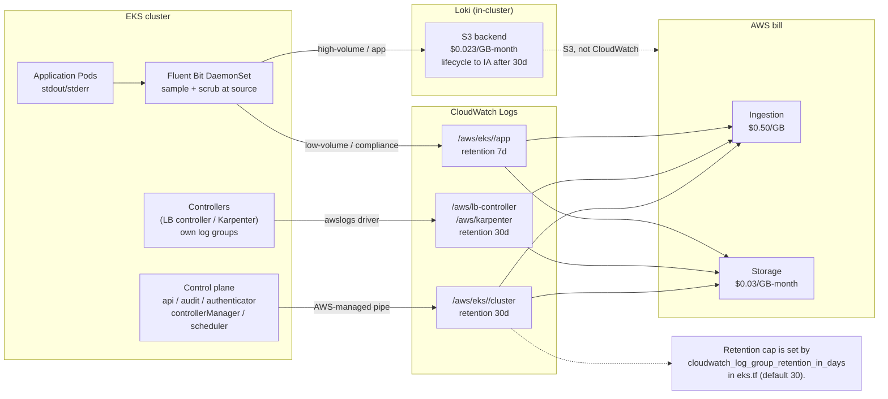

# 14.05 — Logging & metrics cost discipline

> CloudWatch Logs charges **$0.50/GB ingested** plus **$0.03/GB-month
> stored** (US East (N. Virginia) rates), and a single chatty controller
> emitting debug logs into a log group with **no retention cap** is how
> a cluster ends up costing more than its application. The discipline
> is retention caps, cardinality control, Loki-vs-CloudWatch trade-offs,
> and the three cost levers (sample, scrub, retain). The control-plane
> audit log is the exception: it is security evidence, so its retention
> follows your investigation window and it is never sampled.

**Estimated time:** ~30 min read · ~60 min hands-on
**Prerequisites:** [Part 14 ch.02](./02-eks-cluster-lifecycle.md): EKS control-plane log streams enabled on the cluster · [Part 06 ch.01](../06-production-readiness/01-observability-metrics.md) and [Part 06 ch.02](../06-production-readiness/02-logging.md): the metrics and logging wiring you now must cost-tune · [Part 06 ch.06](../06-production-readiness/06-capacity-and-cost.md): generic observability cost framing

**You'll know after this:** • understand CloudWatch Logs pricing ($0.50/GB ingest + $0.03/GB-month store) and where the runaway-cost incident lives · • set retention on every log group, with the audit window chosen as evidence, not cost · • choose between CloudWatch vs Loki for app logs based on access pattern · • apply the three cost levers (sample, scrub, retain) before the bill arrives · • debug metrics-cardinality blowups (label explosions, Prometheus series spikes) in production

<!-- tags: observability, cost, finops, cloud, day-2, security, audit -->

## Why this exists

The bookstore-platform tree at
[`../examples/bookstore-platform/terraform/`](../examples/bookstore-platform/terraform/)
turns on **five** EKS control-plane log streams in
[`eks.tf`](../examples/bookstore-platform/terraform/eks.tf) (`api`,
`audit`, `authenticator`, `controllerManager`, `scheduler`). EKS writes
them to one log group, `/aws/eks/<CLUSTER>/cluster`. Controllers such as
the AWS Load Balancer Controller and Karpenter log to stdout, so their
volume reaches CloudWatch only through a log agent
([Part 06 ch.02](../06-production-readiness/02-logging.md)). A quiet
cluster produces modest volume; a controller in a hot reconcile loop can
multiply it. The volumes in this chapter are illustrative. Step 3
measures yours.

Run that for a year with no retention cap and the math is unforgiving:

- Illustrative 5 GB/day ingestion at $0.50/GB = $2.50/day = **$913/year**
  in ingestion charges *per log group*.
- Stored forever at $0.03/GB-month with 5 GB/day accumulation = 1.8
  TB after one year = **$54/month and rising** in storage charges
  *per log group*.

Multiply that by every log group the platform creates (control plane,
add-ons and application namespaces shipped to CloudWatch through Fluent
Bit) and "CloudWatch ate my budget" stops being a meme. It is a common
AWS bill surprise between cluster-up and the first finance review.

The example closes the obvious gap. `eks.tf` passes
`var.cloudwatch_log_group_retention_in_days` (default 30 days, in
`variables.tf`) to the EKS module, which applies it to
`/aws/eks/<CLUSTER>/cluster`. At 30 days the storage line stops growing
after a month and stabilizes at the illustrative
`5 GB/day x 30 days x $0.03/GB-month = $4.50/month` per log group.
That one group also holds the audit stream, so the same 30 days applies
to audit evidence. That is an operational default, not an audit
decision. See Threats and controls below.

But retention is only the first lever. The other two — **sampling**
(drop high-volume low-value logs at the source) and **scrubbing**
(strip PII before it crosses an ingestion boundary) — are what
turn a $1000/month observability bill into a $200/month one. This
chapter is the lever-by-lever playbook against the bookstore-platform
tree.

[Part 06 ch.02](../06-production-readiness/02-logging.md)
introduced Prometheus + Grafana + Loki as the in-cluster observability
stack; the lesson there was **architecture** (the three pillars,
recording rules, label discipline). This chapter is the EKS-specific
**cost** overlay: which logs are worth keeping, which metrics are
worth scraping, and where the bill explodes if you don't watch the
cardinality.

> **In production:** Set a retention value on every log group an EKS
> cluster creates within the first 24 hours of the cluster's life. A
> log group with no `retention_in_days` on the AWS side defaults to
> **Never expire**, and nothing expires it later. A team that leaves
> ten groups unbounded in January can find in December that it has paid
> for logs nobody has read since February (illustrative). The example's
> `cloudwatch_log_group_retention_in_days = 30` is an operational
> default: tighten it to 7 for dev clusters, and set the audit window
> from your evidence requirement, which may be longer.

## Mental model

**Observability cost = (ingestion volume x ingestion price) +
(retained volume x storage price) + (metrics cardinality x storage
price). Three levers reduce each term: sample at the source, scrub
at the boundary, cap retention at the sink. Choose the right tool
per workload class — CloudWatch for the control plane, Loki/Mimir
for the application plane, Prometheus for metrics with disciplined
cardinality.** Control-plane audit logs are the exception: they are not
sampled, and their retention is a security decision.

The four dimensions of observability cost on EKS:

- **CloudWatch Logs — the EKS default, the bill default.**
  AWS-managed, no operational burden, but priced for managed
  convenience: $0.50/GB ingested + $0.03/GB-month stored. EKS sends
  control-plane logs here once you enable each type (they are off by
  default). On a busy cluster the `audit` stream can be a large share
  of that volume. Use for: control plane, audit evidence, occasional
  debug. Don't use for: every Pod's stdout (too expensive at scale).
- **Loki — the in-cluster cost-efficient alternative.** Self-hosted,
  S3-backed object store, index-on-label (not on log content),
  cheaper at scale (S3 storage is priced per GB-month below
  CloudWatch's storage rate), but operationally heavier (you run the
  Loki Helm release; you manage compaction; you set up Grafana
  dashboards). Break-even depends on volume and on the operating time
  Loki costs you, so the table below is a starting point, not a
  measured break-even.
- **Prometheus + cardinality.** Metrics are cheap per scrape, but
  **cardinality** (the number of unique label combinations) is the
  cost trap. A metric `http_requests_total` with three labels (5
  methods x 100 paths x 10 status codes) has 5,000 series; adding a
  `user_id` label with 10,000 unique users makes it **50 million
  series** — a single chart-level metric that fills a Prometheus
  instance's TSDB in minutes. The discipline: low-cardinality labels
  on every metric (request method, response status, route template —
  not user IDs, request IDs, full URL paths).
- **The three cost levers.** In rough order of leverage:
  1. **Sample at the source.** Drop debug logs in production; emit
     INFO and above. For metrics, scrape at 30s not 5s for non-SLO
     metrics. For traces, sample 1% of traffic + 100% of errors.
     Reduces ingestion by a large multiple, depending on what the app emits.
  2. **Scrub at the boundary.** Strip PII, drop high-cardinality
     fields, redact secrets. A Fluent Bit filter that drops the
     `authorization` header out of every request log costs nothing
     and cuts the compliance-audit-scope drastically.
  3. **Cap retention at the sink.** Operational groups get a short
     window (the example uses 30 days). Audit evidence gets the window
     your investigations and compliance owner require, which can be
     longer. The retention setting is one Terraform variable, and it
     does not reduce ingestion cost.

**CloudWatch vs Loki.** A starting point for the application logging
pipeline, not a measured break-even:

| Volume | Pick | Why |
|---|---|---|
| < 10 GB/month | CloudWatch | Managed; the ops time saved exceeds the cost differential. |
| 10-100 GB/month | Either | Decision is operational maturity, not cost. |
| > 100 GB/month | Loki on S3 | Cost differential exceeds Loki operational overhead. |
| Control-plane audit logs | CloudWatch | EKS writes them there; keep a longer copy elsewhere (Production notes). |
| Bursty application stdout | Loki | The cost-spike is bounded by your S3 storage class. |

The trap to keep in view: **the audit log is evidence, so the question
is not only what it costs.** The EKS `audit` stream records API requests:
developer `kubectl` calls, controller list-watches, Argo CD syncs. A 30-day
group cap is an operational default that can expire events before an
investigation starts. Sampling or excluding audit events hides exactly
the activity you would later need. Cost is handled by fixing the noisy
caller and by keeping a tiered copy of the audit window, not by dropping
events.

## Threats and controls

The control-plane audit log is a security source. These are the threats
this chapter covers and where each control lives.

| Threat | Control in this chapter | Deeper |
|---|---|---|
| An identity with log-admin rights shortens retention or deletes the group, erasing evidence | Set retention in Terraform, so the apply role owns it. A service control policy (below the table) denies `logs:PutRetentionPolicy`, `logs:DeleteLogGroup` and `logs:DeleteLogStream` to every principal except that role. Keep a copy in an Object Lock bucket (Production notes). | [Part 14 ch.03](03-eks-addon-management.md), [Part 14 ch.07](07-infrastructure-cicd-and-drift.md) |
| The audit stream stops. Delivery is best effort, so the gap goes unseen | Alarm on missing ingestion as well as high volume (step 5) | [Part 05 ch.08](../05-security/08-audit-detection-and-incident-response.md) |
| A broad audit-policy exclusion hides a compromised identity's reads | Do not exclude audit events. Cut volume at the noisy caller (step 4). | [Part 05 ch.08](../05-security/08-audit-detection-and-incident-response.md) |
| Logs carry secrets or personal data, and everyone with console access reads them | Scrub at the boundary, and limit who can read the groups | [Part 06 ch.02](../06-production-readiness/02-logging.md) |
| Loki with `auth_enabled: false` lets any pod that reaches the gateway read every app log | A NetworkPolicy that admits only Fluent Bit and Grafana (step 6) | [Part 02 ch.06](../02-networking/06-network-policies.md) |

The retention deny is a service control policy in the AWS Organizations
management account, attached to the OUs that hold the workload accounts.
It names one exempt principal, the apply role from
[Part 14 ch.07](07-infrastructure-cicd-and-drift.md), which is the only
role that sets retention in Terraform. The policy does not reach the
management account, and an SCP does not grant anything, so it only
narrows what the other principals can do
([SCP examples](https://docs.aws.amazon.com/organizations/latest/userguide/orgs_manage_policies_scps_examples.html)).

```json
{
  "Version": "2012-10-17",
  "Statement": [
    {
      "Sid": "DenyLogRetentionChangesExceptApplyRole",
      "Effect": "Deny",
      "Action": [
        "logs:PutRetentionPolicy",
        "logs:DeleteLogGroup",
        "logs:DeleteLogStream"
      ],
      "Resource": "*",
      "Condition": {
        "ArnNotLike": {
          "aws:PrincipalArn": "arn:aws:iam::<AWS_ACCOUNT_ID>:role/github-actions-terraform-apply"
        }
      }
    }
  ]
}
```

Because of this deny, no other role can call `put-retention-policy`,
including the log agent. Step 6 therefore creates its group in Terraform
with retention set, rather than letting the agent create it.

## Diagrams

### Diagram A — the cost flow from controller stdout to AWS bill (Mermaid)



### Diagram B — cost-lever leverage table (ASCII)

The ranges are illustrative, from the three-lever model. They are not
measurements.

```text
LEVER             COST IMPACT       LATENCY TO SAVINGS    OPS OVERHEAD     EXAMPLE
────────────────  ────────────────  ────────────────────  ───────────────  ──────────────────────────────
Retention cap     20-90% of stored  Stabilises after the  1 var, 1 apply   30d cap on /aws/eks/.../cluster
                  data after cap    cap window elapses                     turns infinite -> 30 day footprint
Sampling          90-99% of         Immediate             Fluent Bit cfg   Drop debug logs in prod;
                  ingested vol                            or app logger    100% errors + 1% info
Scrubbing         5-20% (small      Immediate             Fluent Bit cfg   Drop authorization header;
                  unless PII)                                              redact account numbers
CloudWatch -> Loki 70-90% of       Migration              Heavy initial    Apps to Loki; audit stays in
                  vol > 100GB/mo    project (1-2 weeks)   then steady      CloudWatch for compliance
Cardinality drop  100x metrics     Immediate              App-side label   Remove user_id label from
                  storage                                  scrubbing       http_requests_total
────────────────  ────────────────  ────────────────────  ───────────────  ──────────────────────────────
Order of attack:
  1. Cap operational retention (not the audit window; see Threats and controls)
  2. Drop debug logs in production (often most of stdout volume)
  3. Drop high-cardinality labels in metrics (Prometheus survives, you save TBs)
  4. Migrate apps to Loki if you're > 100 GB/month
```

## Hands-on with the Bookstore Platform

### 0. Prerequisites

- The bookstore-platform tree applied; cluster reachable via `kubectl`.
- AWS CLI v2 configured with permissions to read CloudWatch + Cost
  Explorer. The steps that change retention or delete groups need the
  logging owner's role, not a reader's.
- A baseline: at least 48 hours of cluster activity so the log
  groups have some volume to inspect.

### 1. Inspect the log groups the cluster created

```bash
CLUSTER="$(terraform output -raw cluster_name)"
REGION="$(terraform output -raw region)"

# Every log group whose name starts with /aws/eks/<CLUSTER>.
aws logs describe-log-groups \
  --region "$REGION" \
  --log-group-name-prefix "/aws/eks/$CLUSTER" \
  --query 'logGroups[].{name:logGroupName,retention:retentionInDays,bytes:storedBytes}' \
  --output table
```

Illustrative output (not captured in a lab run):

```text
-------------------------------------------------------------------------
|                         DescribeLogGroups                             |
+-----------------------------------------+-----------+-----------------+
|                  name                   | retention |     bytes       |
+-----------------------------------------+-----------+-----------------+
| /aws/eks/bookstore-platform/cluster     |   30      |   2147483648    |
+-----------------------------------------+-----------+-----------------+
```

Confirm `retention = 30`. The 30 is the example default. This group
also holds the audit stream, so set the value your audit window requires
(see Production notes for keeping a longer copy). If `retention = null`,
the log group is **never-expire**, and the cluster was deployed without
the retention variable set. Fix it through Terraform: set
`cloudwatch_log_group_retention_in_days` and apply the change with the
apply role. The SCP above denies `put-retention-policy` to every other
principal, so a manual call from a reader's session fails with
`AccessDenied`, which is the intended result.

### 2. Discover the unbounded log groups Terraform didn't create

```bash
# Log groups that your log agent and add-ons create, outside Terraform.
# They often default to never-expire.
aws logs describe-log-groups \
  --region "$REGION" \
  --query 'logGroups[?retentionInDays==null].logGroupName' \
  --output table
```

Each group in this list has no expiry. Decide each one before you cap it:
a group that holds audit evidence needs its own window, not 30 days. The
name filter below is a guard, not a classification, so read the list
first.

The query selects `[logGroupName]` as a one-element list per group, so
`--output text` prints one name per line. A plain `logGroupName` list
would print every name on one tab-separated line, and a `grep` over that
line would drop every group at once.

```bash
# Print the cap commands for unmanaged groups to 30 days, skipping
# audit-named groups. Review the output, then run it under the apply role.
aws logs describe-log-groups \
  --region "$REGION" \
  --query 'logGroups[?retentionInDays==null].[logGroupName]' \
  --output text | \
grep -v -E 'audit|evidence' | \
while read -r LG; do
  echo aws logs put-retention-policy --region "$REGION" \
    --log-group-name "$LG" --retention-in-days 30
done
```

Production note: the cap is a one-shot. The *durable* fix is either a
Terraform resource per log group (verbose but explicit) or an
`aws_cloudwatch_log_group` resource with a wildcard + `for_each` that
the addon discovers. A weekly read-only job can run the describe query
above and report groups with no retention. It cannot cap them, because the
plan role in [Part 14 ch.07](07-infrastructure-cicd-and-drift.md) has no
`logs:PutRetentionPolicy`. Only the apply role may change retention, because
the SCP in Threats and controls exempts that role alone.

### 3. Measure ingestion volume per log group

```bash
# CloudWatch Metrics — IncomingBytes is the ingestion-cost metric.
# Sum over the last 7 days, grouped by log group.
END_TS="$(date -u +%Y-%m-%dT%H:%M:%S)"
START_TS="$(date -u -d '7 days ago' +%Y-%m-%dT%H:%M:%S)"

aws cloudwatch get-metric-statistics \
  --region "$REGION" \
  --namespace AWS/Logs \
  --metric-name IncomingBytes \
  --dimensions Name=LogGroupName,Value="/aws/eks/$CLUSTER/cluster" \
  --start-time "$START_TS" \
  --end-time "$END_TS" \
  --period 86400 \
  --statistics Sum \
  --query 'Datapoints[].{day:Timestamp,gb:Sum}' \
  --output table
```

Each `Sum` is bytes ingested that day; divide by `1024^3` for GB.
Multiply by $0.50/GB to estimate the daily ingestion line on the bill.
Record a 7-day baseline per log group. A sustained step above that
baseline is the signal to investigate, usually a controller in a hot
reconcile loop.

### 4. Find the chatty controller

```bash
# List the most recently active streams in the cluster log group. CloudWatch
# no longer reports stored bytes per stream, so volume is measured in the
# tail below, not here.
aws logs describe-log-streams \
  --region "$REGION" \
  --log-group-name "/aws/eks/$CLUSTER/cluster" \
  --order-by LastEventTime \
  --descending \
  --max-items 10 \
  --query 'logStreams[].{name:logStreamName,lastEvent:lastEventTimestamp}' \
  --output table

# Tail the audit stream for one minute to spot the chatty caller.
# --format short prints the message after a timestamp; sed strips that
# prefix, and jq skips any line that is not JSON.
aws logs tail "/aws/eks/$CLUSTER/cluster" \
  --region "$REGION" \
  --since 1m \
  --log-stream-name-prefix kube-apiserver-audit \
  --filter-pattern '{ $.user.username = "*" }' \
  --format short | \
  sed 's/^[^{]*//' | \
  jq -R -r 'fromjson? | .user.username // empty' | \
  sort | uniq -c | sort -rn | head
```

Illustrative output (not captured in a lab run):

```text
   8421 system:serviceaccount:karpenter:karpenter
   3104 system:serviceaccount:kube-system:aws-node
    421 system:serviceaccount:argocd:argocd-application-controller
     12 arn:aws:iam::<ACCOUNT_ID>:user/<USER>
```

A normal Karpenter list-watch is frequent but steady. A sudden rise in
one caller's events points to a reconcile loop, and the usual causes are
a misconfigured `NodePool` or a CRD version mismatch. Check the caller's
identity before you assume the cause is benign: a caller you do not
recognise is a security question, not a tuning one.
[Part 10 ch.06](../10-cloud-and-managed-kubernetes/06-node-autoscaling-cost-multicloud.md)
covers `NodePool` configuration.

### 5. Set a CloudWatch alarm on ingestion volume

```bash
# Alarm when daily ingestion exceeds 5 GB on the audit log.
aws cloudwatch put-metric-alarm \
  --region "$REGION" \
  --alarm-name "${CLUSTER}-cluster-log-volume-high" \
  --alarm-description "EKS cluster log ingestion above 5 GB/day" \
  --metric-name IncomingBytes \
  --namespace AWS/Logs \
  --statistic Sum \
  --period 86400 \
  --evaluation-periods 1 \
  --threshold 5368709120 \
  --comparison-operator GreaterThanThreshold \
  --treat-missing-data breaching \
  --dimensions Name=LogGroupName,Value="/aws/eks/$CLUSTER/cluster" \
  --alarm-actions "$(terraform output -raw budget_alarm_sns_topic_arn)"
```

`--treat-missing-data breaching` makes a day with no ingestion alarm
too. A silent audit pipeline is a gap in evidence, and a volume threshold
alone never sees it. The alarm reuses the SNS topic that `cost-budgets.tf`
provisions when `enable_budget_alarm = true`. The output is null until
you enable it. Either enable it ([Part 14 ch.06](06-cost-guardrails.md))
or create an SNS topic for log-volume alerts.

### 6. Migrate application logs to Loki

The application namespaces in the bookstore-platform tree currently
ship to CloudWatch through the Fluent Bit DaemonSet from
[Part 06 ch.02](../06-production-readiness/02-logging.md). For high-volume
application logs, route them to Loki instead:

Install Loki first. Create its namespace with the Pod Security label
before the install. `--create-namespace` cannot set labels, and the
chart's pods must be admitted under `restricted`. Save this as
`logging-namespace.yaml`:

```yaml
apiVersion: v1
kind: Namespace
metadata:
  name: logging
  labels:
    pod-security.kubernetes.io/enforce: restricted
    pod-security.kubernetes.io/enforce-version: v1.37
    pod-security.kubernetes.io/audit: restricted
    pod-security.kubernetes.io/warn: restricted
```

Save the values below as `loki-values.yaml`. Replace the placeholders
with your two bucket names, the region and the IAM role ARN for the
`loki` ServiceAccount.

```yaml
deploymentMode: SingleBinary
singleBinary:
  replicas: 1
read:
  replicas: 0
write:
  replicas: 0
backend:
  replicas: 0
minio:
  enabled: false
chunksCache:
  enabled: false
resultsCache:
  enabled: false
lokiCanary:
  enabled: false
test:
  enabled: false
sidecar:
  rules:
    enabled: false
loki:
  auth_enabled: false
  commonConfig:
    replication_factor: 1
  image:
    # Tag 3.6.7 is the chart's appVersion for 6.55.0. The digest pins it.
    tag: 3.6.7
    digest: sha256:3c8fd3570dd9219951a60d3f919c7f31923d10baee578b77bc26c4a0b32d092d
  podSecurityContext:
    seccompProfile:
      type: RuntimeDefault
  schemaConfig:
    configs:
      - from: "2024-04-01"
        store: tsdb
        object_store: s3
        schema: v13
        index:
          prefix: index_
          period: 24h
  storage:
    type: s3
    bucketNames:
      chunks: <LOKI_CHUNKS_BUCKET>
      ruler: <LOKI_RULER_BUCKET>
    s3:
      region: <REGION>
gateway:
  image:
    tag: 1.29-alpine
    digest: sha256:0c79d56aee561a1d81c63f00eee5fb5fe29279560cdc55e91425133104c7fbe6
  podSecurityContext:
    seccompProfile:
      type: RuntimeDefault
serviceAccount:
  automountServiceAccountToken: false
  annotations:
    eks.amazonaws.com/role-arn: <LOKI_ROLE_ARN>
```

The values follow the baseline where the chart exposes a field. The Pods
run as non-root with a `RuntimeDefault` seccomp profile, which
`restricted` requires. The rules sidecar is off because this install
does not use Loki rules, and that sidecar needs API access. The `loki`
ServiceAccount does not mount an API token. The IRSA annotation gives
Loki S3 access through a role from [Part 14 ch.03](03-eks-addon-management.md),
and that role should reach only these two buckets. `auth_enabled: false`
turns off tenant headers, not authentication. Any pod that reaches
`loki-gateway` can read every stream, so the NetworkPolicy in step 6
below admits only the Fluent Bit and Grafana pods
([Part 02 ch.06](../02-networking/06-network-policies.md) covers the
policy model).

`replication_factor: 1` is required with one replica. The chart defaults
to 3, and with one replica every write fails with "at least 2 live
replicas required, could only find 1". The
[Grafana monolithic install guide](https://grafana.com/docs/loki/latest/setup/install/helm/install-monolithic/)
states the same requirement. The dry-run below cannot catch this, because
it checks only the manifests. The digests pin the Loki and gateway images,
and the tags stay beside them so a reader can see the version.

Render the chart against the namespace before you install. A
`restricted` violation appears as a PodSecurity warning in this dry-run:

```sh
kubectl apply -f logging-namespace.yaml
helm repo add grafana https://grafana.github.io/helm-charts
helm repo update

# Chart 6.55.0 (Loki app 3.6.7), the newest 6.x chart in the Grafana repo
# index on 2026-10-31. The 7.x line is described as Grafana Enterprise Logs,
# so this guide stays on 6.x. Run helm search repo grafana/loki --versions.
LOKI_VERSION="6.55.0"
helm template loki grafana/loki --version "$LOKI_VERSION" -n logging \
  -f loki-values.yaml | kubectl apply --dry-run=server -n logging -f -

helm install loki grafana/loki \
  --version "$LOKI_VERSION" \
  -n logging --wait \
  -f loki-values.yaml

# Readiness check: push one line through the gateway, then read it back.
# A 204 response means the write was accepted. Without replication_factor: 1
# the push returns a 500 that says at least 2 live replicas are required.
TS="$(date +%s)000000000"
PUSH="{\"streams\":[{\"stream\":{\"job\":\"readiness\"},\"values\":[[\"$TS\",\"readiness check\"]]}]}"
kubectl -n logging exec deploy/loki-gateway -- wget -S -O- \
  --header='Content-Type: application/json' --post-data="$PUSH" \
  http://localhost:8080/loki/api/v1/push
kubectl -n logging exec deploy/loki-gateway -- wget -O- -q \
  'http://localhost:8080/loki/api/v1/query_range?query=%7Bjob%3D%22readiness%22%7D&limit=5'

# Route app namespaces to Loki and kube-system pod logs to CloudWatch.
# Excerpt to add to your existing fluent-bit.conf:
cat <<EOF
[OUTPUT]
    Name        loki
    Match       kube.var.log.containers.*_bookstore-platform-*_*.log
    host        loki-gateway.logging.svc.cluster.local
    port        80
    labels      job=fluent-bit,cluster=$CLUSTER

[OUTPUT]
    Name        cloudwatch_logs
    Match       kube.var.log.containers.*_kube-system_*.log
    region      $REGION
    log_group_name /aws/eks/$CLUSTER/system
    log_stream_prefix fluentbit-
    auto_create_group false
EOF
```

This split sends apps to Loki and kube-system pod logs to CloudWatch. Apps
usually generate most of the volume and have shorter retention needs. The
control-plane audit stream stays in its EKS group, outside this split.

The agent does not create the `system` group. A group the agent creates has
no retention, and the agent's `log_retention_days` option would call
`PutRetentionPolicy` from the agent's role, which the SCP denies. Terraform
creates the group with retention first, and the agent writes into it:

```hcl
resource "aws_cloudwatch_log_group" "system" {
  name              = "/aws/eks/<CLUSTER_NAME>/system"
  retention_in_days = 30
}
```

Apply the NetworkPolicy before Loki takes traffic. The tree's `logging`
namespace has no default-deny, so this step adds one. The labels match the
`fluent/fluent-bit` and `kube-prometheus-stack` chart defaults. Match them to
your agent and Grafana.

```yaml
apiVersion: networking.k8s.io/v1
kind: NetworkPolicy
metadata:
  name: default-deny-ingress
  namespace: logging
spec:
  podSelector: {}
  policyTypes:
    - Ingress
---
apiVersion: networking.k8s.io/v1
kind: NetworkPolicy
metadata:
  name: loki-gateway-from-clients
  namespace: logging
spec:
  podSelector:
    matchLabels:
      app.kubernetes.io/name: loki
      app.kubernetes.io/component: gateway
  policyTypes:
    - Ingress
  ingress:
    - from:
        - podSelector:
            matchLabels:
              app.kubernetes.io/name: fluent-bit
        - namespaceSelector:
            matchLabels:
              kubernetes.io/metadata.name: prometheus-system
          podSelector:
            matchLabels:
              app.kubernetes.io/name: grafana
      ports:
        - protocol: TCP
          port: 8080
---
apiVersion: networking.k8s.io/v1
kind: NetworkPolicy
metadata:
  name: loki-from-gateway
  namespace: logging
spec:
  podSelector:
    matchLabels:
      app.kubernetes.io/name: loki
      app.kubernetes.io/component: single-binary
  policyTypes:
    - Ingress
  ingress:
    - from:
        - podSelector:
            matchLabels:
              app.kubernetes.io/name: loki
              app.kubernetes.io/component: gateway
      ports:
        - protocol: TCP
          port: 3100
```

Check the objects with a server-side dry run before you apply them, with
`kubectl apply --dry-run=server -f <file>`. Enforcement depends on the
cluster's network plugin, so confirm it with a request from a pod that the
policy should block. The rules follow the
[NetworkPolicy](https://kubernetes.io/docs/concepts/services-networking/network-policies/)
semantics: once a pod is selected by an ingress policy, only the listed
peers and ports reach it. The policies in this step have not been applied
in a lab run.

### 7. Audit the metrics cardinality before it explodes

```bash
# In a Prometheus-equipped cluster (Part 06 ch.01), find the top-N
# highest-cardinality metrics.
# In a second terminal, keep this port-forward running:
kubectl -n prometheus-system port-forward svc/kube-prometheus-stack-prometheus 9090:9090

# topk(10, count by (__name__)({__name__=~".+"}))
curl -s 'http://localhost:9090/api/v1/query' \
  --data-urlencode 'query=topk(10, count by (__name__)({__name__=~".+"}))' | \
  jq -r '.data.result[] | "\(.value[1]) series  \(.metric.__name__)"' | sort -rn | head
```

Illustrative output (not captured in a lab run):

```text
 1842000 series  http_requests_total
  421000 series  container_network_receive_bytes_total
  315000 series  apiserver_request_duration_seconds_bucket
   52000 series  kube_pod_status_phase
```

A metric with 1.8 million series is almost certainly carrying a
high-cardinality label (user_id, request_id, full URL path). Find
the offending label:

```bash
curl -s 'http://localhost:9090/api/v1/query' \
  --data-urlencode 'query=count(http_requests_total) by (__name__, route)' | \
  jq '.data.result | length'
```

A `route` label whose value count keeps rising with traffic is the
smoking gun. The
application is exporting one series per *exact URL path* instead of
per *route template* (`/users/123` vs `/users/{id}`). The fix lives
in the app's metrics exporter; Prometheus cannot fix this at scrape
time.

## How it works under the hood

**CloudWatch Logs pricing — the per-byte math.** AWS charges in two
dimensions. The rates are those in the US East (N. Virginia) worked
examples on the [CloudWatch pricing page](https://aws.amazon.com/cloudwatch/pricing/),
checked on 2026-10-31. Other regions differ, so check yours.

- **Ingestion:** $0.50/GB. Each log event is billed when it is
  ingested, so a verbose line costs when it is written, before any
  retention applies.
- **Storage:** $0.03/GB-month for as long as the retention window keeps
  the data. The pricing page does not say whether storage is billed on
  compressed or uncompressed size, so this chapter does not model a
  compression ratio.

The cost formula for a single log group, simplified:

```
month_cost = ingest_GB * 0.50         # one-shot ingestion
           + stored_GB * 0.03         # per month, for the retention window
```

For an illustrative audit stream of 2 GB/day, with no compression assumed:

```
ingest = 60 GB/month * 0.50 = $30/month
stored = 60 GB * 0.03       = $1.80/month    (30-day window)
stored = 730 GB * 0.03      = $21.90/month   (365-day window)
```

At 30 days the ingestion line dominates. A 365-day window changes that,
because the stored line grows with the window. The audit window is a
cost decision too, and it should be set on evidence grounds first.
Sampling and scrubbing reduce application volume. They never cut audit
events.

**The "Never expire" default explained.** CloudWatch log groups are
created with `retentionInDays = null` unless explicitly set. AWS does
not impose a global retention; you pay storage forever. This is by
design (some workloads need 7-year retention), but it is also the
common cost trap. The `retentionInDays` API field is the one knob;
setting it to a number (`1`, `7`, `30`, `90`, `365`, etc.) sets how long
events are kept.

**Loki's cost shape — S3 economics.** Loki stores log "chunks"
(compressed batches of N MB of logs from M streams) and an index
that maps `{labels}` to chunk references. Both go to S3 by default:

- **S3 storage classes.** Storage is billed per GB-month and by class.
  Standard-IA has a 30-day minimum storage duration and a retrieval fee.
  Archive classes need a restore before the objects can be read
  ([S3 storage classes](https://docs.aws.amazon.com/AmazonS3/latest/userguide/storage-class-intro.html)).
  Check the [S3 pricing page](https://aws.amazon.com/s3/pricing/) for
  your region's rates.
- **S3 Intelligent-Tiering** — automatic; recommended for unknown
  access patterns.

The Loki bill has three parts: stored GB times the class rate, requests,
and the in-cluster compute Loki adds. At 100 GB/month ingested, CloudWatch
ingestion alone is `100 * 0.50 = $50/month` before storage. Put Loki's S3
and compute costs next to that number before you choose.

**Prometheus cardinality — why one label can break everything.**
Prometheus's TSDB stores one *series* per unique label-combination.
Each series carries: a 16-byte hash, a label-name+value-pair-set, and
a chunk-pointer array. Memory and disk grow with the number of
series, so a label that multiplies series multiplies both. Size
Prometheus from your own `prometheus_tsdb_head_series` value, not from a
per-series rule of thumb.

The cardinality killers in order:

1. `user_id`, `customer_id`, `account_id` — unbounded; never on a
   per-request metric.
2. `request_id`, `trace_id` — unbounded; never on any metric (these
   belong on logs/traces).
3. Full URL paths — unbounded if the app exports `/users/123` not
   `/users/{id}`.
4. IP addresses — bounded but huge (billions of v4 addresses).
5. Free-form `error_message` labels — unbounded.

The discipline lives in the application's metrics exporter, not in
Prometheus. Use `route` templates not exact paths; use `error_code`
classifications not message strings; never put user/request IDs on
metrics.

**Sampling vs scrubbing vs retention — the three levers' mechanics.**

- **Sampling at the source** (the app emits less): the application
  configures its logger to drop DEBUG in production; an OpenTelemetry
  SDK samples at 1% via the `TracesSampler` config. Cost reduction
  multiplicative on every line that doesn't get emitted.
- **Sampling at the pipe** (Fluent Bit drops): a `[FILTER]` block
  that does `Regex` match-and-exclude on common-uninteresting log
  shapes. Less common — usually the source is easier to control.
- **Scrubbing** (the same volume, but smaller per line): Fluent Bit
  `modify` filter strips PII fields; the line still ships but is
  10-50% smaller. Tiny dollar impact unless lines were enormous;
  less sensitive data in the group, so a privacy review of that
  group has less to cover.
- **Retention** at the sink: the log/storage lifecycle policy.
  Doesn't reduce ingestion (which is paid before retention applies);
  reduces stored cost only.

## Production notes

> **In production:** Set retention on every log group within 24 hours
> of the cluster's first apply, including groups an agent creates for
> add-on logs. The
> `aws logs describe-log-groups --query 'logGroups[?retentionInDays==null]'`
> query is the drift check. Run it weekly from a read-only job, such as the
> drift workflow in [14.07](07-infrastructure-cicd-and-drift.md) extended with
> this query. The plan role can describe groups but cannot change retention.
> Alert on any group that never expires, audit groups included.

> **In production:** Drop debug logs in production at the application
> level, not at the Fluent Bit level. The example workloads set
> `LOG_LEVEL` to `info` per manifest (see
> `examples/bookstore-platform/payments/payments-worker.yaml`), so a
> production policy should enforce it. A
> developer setting `LOG_LEVEL=debug` to chase a bug in production
> burns money for every second they forget to revert; a CI policy that
> rejects PRs setting debug in production manifests is the durable
> defense.

> **In production:** Watch out for the "trace-id label on metrics"
> antipattern. New developers, accustomed to logs-and-traces having
> a trace ID, often add `trace_id` as a metric label "for correlation."
> This is the cardinality bomb. Prometheus's TSDB will not fit a
> per-request label; the metric goes to several million series within
> hours and the Pod OOMs. The fix is the code review — `trace_id`
> belongs on logs (Fluent Bit sends it to Loki + CloudWatch) and
> traces (Tempo), never on metrics.

> **In production:** Do not fix audit volume by excluding a controller's
> reads. Karpenter list-watches `Node`, `NodeClaim` and `Pod`, so its
> reads appear as frequent audit events. Those same reads are what you
> would need if its credentials were abused, so an exclusion trades the
> noise for a blind spot. Fix the reconcile loop first (see
> [Part 10 ch.06](../10-cloud-and-managed-kubernetes/06-node-autoscaling-cost-multicloud.md)).
> The EKS control-plane logging page documents no setting for the audit
> policy, so this chapter does not assume one
> ([EKS control plane logs](https://docs.aws.amazon.com/eks/latest/userguide/control-plane-logs.html)).

> **In production:** Put a lifecycle rule on the Loki bucket. Without one,
> every chunk stays in S3 Standard until someone deletes it. A rule that
> moves chunks to Standard-IA after 30 days and expires them after your
> retention window is a sensible start. Do not move Loki chunks to a
> Glacier class: Loki reads them directly, and archived objects must be
> restored before they can be read
> ([S3 storage classes](https://docs.aws.amazon.com/AmazonS3/latest/userguide/storage-class-intro.html)).
> The example tree has no Loki Terraform. If you manage the bucket with
> Terraform, add the `aws_s3_bucket_lifecycle_configuration` resource
> yourself, and keep the bucket private and encrypted.

> **In production:** Cardinality alerting beats post-hoc forensics.
> Prometheus exposes the head series count as `prometheus_tsdb_head_series`.
> Alert on a sustained rate of increase, with the threshold taken from
> your own baseline, and you catch a new label rollout before the TSDB
> fills. The example's `opencost-tenant-aggregations.yaml` has cost
> alerts but no cardinality alert, so write one.

> **In production:** Evidence that an auditor asks for later is a
> separate copy from the logs you read this week. Keep the group at its
> operational window, and send a copy of the audit events elsewhere with
> a subscription filter to Kinesis Data Firehose, which writes to an S3
> bucket. Turn on S3 Object Lock in compliance mode on that bucket, so no
> principal, root included, can delete a version before its retain-until
> date. Test the retention period in governance mode first, because
> compliance mode cannot be undone. Don't use `create-export-task` as a
> daily archive. AWS recommends subscriptions for continuous archive, and
> an export is one asynchronous batch
> ([CreateExportTask](https://docs.aws.amazon.com/AmazonCloudWatchLogs/latest/APIReference/API_CreateExportTask.html);
> [S3 Object Lock](https://docs.aws.amazon.com/AmazonS3/latest/userguide/object-lock.html)).
> Choose the retention with your compliance owner, and write it down.

## Quick Reference

```bash
# Print the cap commands for unmanaged groups, skipping audit-named groups.
# Review them, then run them under the apply role.
aws logs describe-log-groups \
  --region "$REGION" \
  --query 'logGroups[?retentionInDays==null].[logGroupName]' \
  --output text | \
grep -v -E 'audit|evidence' | \
while read -r LG; do
  echo aws logs put-retention-policy --region "$REGION" \
    --log-group-name "$LG" --retention-in-days 30
done

# Daily ingestion volume per log group (the cost-driver metric).
aws cloudwatch get-metric-statistics --region "$REGION" \
  --namespace AWS/Logs --metric-name IncomingBytes \
  --dimensions Name=LogGroupName,Value="/aws/eks/$CLUSTER/cluster" \
  --start-time "$(date -u -d '7 days ago' +%Y-%m-%dT%H:%M:%S)" \
  --end-time "$(date -u +%Y-%m-%dT%H:%M:%S)" \
  --period 86400 --statistics Sum

# Top-cardinality metrics in Prometheus.
curl -s 'http://localhost:9090/api/v1/query' \
  --data-urlencode 'query=topk(10, count by (__name__)({__name__=~".+"}))'

# Alarm on log-volume spike, or on no ingestion (the same alarm as step 5).
aws cloudwatch put-metric-alarm --region "$REGION" \
  --alarm-name "${CLUSTER}-cluster-log-volume-high" \
  --alarm-description "EKS cluster log ingestion above 5 GB/day" \
  --metric-name IncomingBytes --namespace AWS/Logs --statistic Sum \
  --period 86400 --evaluation-periods 1 --threshold 5368709120 \
  --comparison-operator GreaterThanThreshold \
  --treat-missing-data breaching \
  --dimensions Name=LogGroupName,Value="/aws/eks/$CLUSTER/cluster" \
  --alarm-actions "<SNS_TOPIC_ARN>"
```

Minimal skeleton: the OUTPUT fragment that splits apps to Loki and
kube-system pod logs to CloudWatch. It is a fragment, not a manifest. Add
it to your existing `fluent-bit.conf` rather than applying it on its own:

```text
[OUTPUT]
    Name        loki
    Match       kube.var.log.containers.*_bookstore-platform-*_*.log
    host        loki-gateway.logging.svc.cluster.local
    port        80
    labels      cluster=<CLUSTER_NAME>,job=fluent-bit

[OUTPUT]
    Name        cloudwatch_logs
    Match       kube.var.log.containers.*_kube-system_*.log
    region      <REGION>
    log_group_name /aws/eks/<CLUSTER>/system
    log_stream_prefix fluentbit-
    auto_create_group false
```

Create the `system` group in Terraform with `retention_in_days = 30` before
the agent starts (step 6 shows the resource).

Cost-and-evidence checklist (the bill and the evidence are both bounded
when all seven are yes):

- [ ] Every log group has `retentionInDays` set on purpose (no never-expire).
- [ ] The audit window is written down with the security owner, and the
      group's retention is at least that long.
- [ ] The audit stream is never sampled or excluded, and an alarm fires on
      a volume jump or on no ingestion.
- [ ] High-volume application logs route to Loki, not CloudWatch.
- [ ] No metric carries `user_id`, `request_id`, or `trace_id` labels.
- [ ] Production app log level is INFO (never DEBUG outside dev).
- [ ] Audit copies go to an Object Lock bucket, not only to a separate bucket.

## Test your understanding

> Try each before opening the answer drawer. The act of trying is the exercise; the answer is the check.

1. **What are the three cost levers (sample, scrub, retain) and in what order do they have the most leverage?**
   <details><summary>Show answer</summary>

   **Sample at the source** has the highest ingestion-cost leverage: dropping DEBUG logs in prod or scraping at 30s instead of 5s can cut ingestion by a large multiple, depending on what the app emits. Audit events are the exception: sample nothing there. **Scrub at the boundary** strips PII / high-cardinality fields before they cross an ingestion boundary; bounded cost saving but huge compliance-scope reduction. **Cap retention at the sink** is the cheapest lever (one Terraform variable) and the highest dollar-impact for *storage* costs but doesn't reduce ingestion. Order matters: sample first (kills volume), scrub second (kills compliance scope), retain third (caps the accumulator).

   </details>

2. **Finance flags a CloudWatch bill of $400/month for one cluster. You inherit it, run `aws logs describe-log-groups`, and see 12 log groups with `retentionInDays: null`. What do you do first, and what's the trap with rushing the fix?**
   <details><summary>Show answer</summary>

   The unbounded log groups have been accumulating since cluster creation; storage cost dominates ingestion at this point. The fix is to set `retention_in_days` (via Terraform if managed, `aws logs put-retention-policy` if not) for each group; AWS will then begin expiring logs older than the cap on the next cycle. The trap: if any of those logs are compliance-bound (audit logs for SOC2/HIPAA), you can't just slap 7-day retention on them ; coordinate with the compliance team, set the audit log to 90/365 days, and subscribe a copy of the events to Kinesis Data Firehose, which writes to an S3 bucket with Object Lock (Production notes explain why not a daily export). The bill falls as old data expires; the compliance posture stays intact.

   </details>

3. **A developer adds `user_id` as a label on `http_requests_total` so the Grafana dashboard can break down latency by user. Two weeks later, Prometheus is OOMKilling. Why?**
   <details><summary>Show answer</summary>

   Cardinality explosion. Prometheus stores one series per unique label-combination; adding a `user_id` label with 10,000 distinct users multiplies the existing series count by 10,000. A metric that was 5,000 series becomes 50,000,000 series — TSDB head series counts in the millions cause the WAL to grow unbounded and the head-block memory blows the Pod's `requests.memory`. The fix is removing the `user_id` label (use traces / exemplars / logs for per-user investigation), or moving the high-cardinality dimension to a sampled trace path. The chapter's discipline: never put user_id, request_id, trace_id, full URL paths on a Prometheus label.

   </details>

4. **An attacker with `logs:PutRetentionPolicy` sets the audit group's retention to one day. What evidence is lost, and which controls stop it?**
   <details><summary>Show answer</summary>

   Events older than the new one-day window become eligible for deletion,
   so the evidence from earlier investigations goes on the next expiry.
   The change is itself an API call, which CloudTrail records as a
   management event if your trail covers CloudWatch Logs. The controls
   are preventive first: deny the retention and delete actions to every
   principal except the apply role, which sets retention in Terraform. The SCP in Threats and controls is that deny.
   Second, keep a copy in an S3 bucket with Object Lock, which the
   attacker's retention change cannot reach. The first control is in
   Threats and controls, and the copy is in Production notes.

   </details>

## Further reading

- **AWS CloudWatch Logs pricing**
  <https://aws.amazon.com/cloudwatch/pricing/>; the canonical source
  for the $0.50/GB ingestion + $0.03/GB-month storage rates this
  chapter cites; region-specific variants live in the same doc.
- **Grafana Loki TCO**
  <https://grafana.com/blog/2024/03/12/the-concise-guide-to-loki-the-cost-saving-techniques/>;
  the canonical Grafana blog covering the S3-backed economics this
  chapter quotes.
- **AWS — CloudWatch Logs retention policy API**
  <https://docs.aws.amazon.com/AmazonCloudWatch/latest/logs/Working-with-log-groups-and-streams.html>;
  the `put-retention-policy` reference, including the "Never expire"
  default this chapter warns about.
- **Prometheus — high cardinality counters**
  <https://prometheus.io/docs/practices/naming/>; the upstream label-
  cardinality discipline that prevents the TSDB-OOM failure mode.
- **Beyer et al., *Site Reliability Engineering* ch.6 — Monitoring**;
  the four golden signals + the cardinality-budget mental model this
  chapter operationalizes for EKS.
- **Fluent Bit — modify and grep filters**
  <https://docs.fluentbit.io/manual/pipeline/filters>; the scrubbing
  + sampling primitives the Fluent Bit DaemonSet implements at the
  Pod-to-sink boundary.
- **AWS blog — Optimizing Amazon CloudWatch Logs costs**
  <https://aws.amazon.com/blogs/mt/optimizing-amazon-cloudwatch-logs-costs/>;
  the AWS-team-authored complement to this chapter's "three levers"
  framing.
- **AWS: EKS control plane logging**
  <https://docs.aws.amazon.com/eks/latest/userguide/control-plane-logs.html>;
  the log types, the default-off setting and best-effort delivery.
- **AWS: S3 Object Lock**
  <https://docs.aws.amazon.com/AmazonS3/latest/userguide/object-lock.html>;
  write-once retention for the audit copy.
- **AWS: CloudWatch Logs CreateExportTask**
  <https://docs.aws.amazon.com/AmazonCloudWatchLogs/latest/APIReference/API_CreateExportTask.html>;
  why an export is not a continuous archive.
