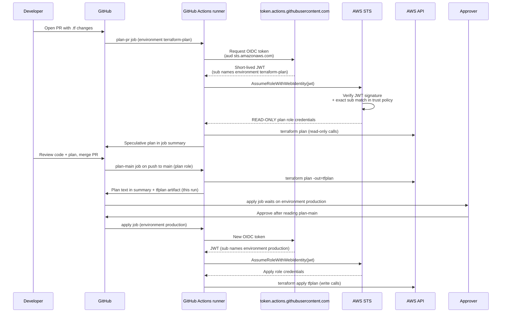

# 14.07 — Infrastructure CI/CD + drift detection

> **Plan-on-PR, apply-on-merge** via GitHub Actions with **OIDC trust**
> (no long-lived AWS access keys) is the production CI/CD shape every
> EKS Terraform tree should reach within its first month; the nightly
> `terraform plan -refresh-only -detailed-exitcode` drift check + the "someone
> changed it in the console" reconciliation runbook are what keep
> the state in code matching the state in cloud.

**Estimated time:** ~30 min read · ~90 min hands-on
**Prerequisites:** [Part 14 ch.01](./01-terraform-state-in-production.md) — remote state with locking required for CI · [Part 14 ch.02](./02-eks-cluster-lifecycle.md) — upgrade flow that CI must drive · [Part 12 ch.01](../07-delivery/04-gitops-argocd.md) — plan-on-PR pattern from app delivery

**You'll know after this:** • configure GitHub Actions with OIDC trust to AWS (no long-lived access keys) · • implement the plan-on-PR, apply-on-merge shape every EKS Terraform tree should reach within its first month · • run nightly `terraform plan -refresh-only -detailed-exitcode` drift checks and act on exit code 2 · • follow the reconciliation runbook when "someone changed it in the console" · • debug a stuck CI apply by inspecting the S3 lock and recovering safely

<!-- tags: terraform, ci-cd, gitops, drift, cloud -->

## Why this exists

The bookstore-platform tree at
[`../examples/bookstore-platform/terraform/`](../examples/bookstore-platform/terraform/)
gets applied two ways during development: `make plan` then `make up`
on a laptop, or the same flow via a CI workflow against a remote
state backend. Both work for "I am alone and learning"; neither
works once a team is involved. The laptop apply has at least five
durable failures:

1. **No audit trail.** Who applied what when? The state file changes
   record the *resource* changes, not the *human* who initiated the
   apply.
2. **Concurrent apply collisions.** Two engineers apply simultaneously;
   one of them wins, the other gets stale plans. The S3 backend's
   `use_lockfile = true` (Part 14 ch.01) prevents corruption but
   does not arbitrate intent.
3. **No review.** A `terraform plan` is the most consequential
   document a platform engineer produces — the actual list of cloud
   changes about to occur — and a laptop apply hides it from
   reviewers entirely.
4. **AWS credentials on the laptop.** Long-lived IAM access keys in
   `~/.aws/credentials` on N engineers' machines is the canonical
   blast-radius problem: any one of those machines lost or
   compromised compromises the account.
5. **No drift detection.** Whatever the team applied two months ago
   is what's *in the .tf*; whatever someone hand-edited in the
   console last Tuesday is what's *in AWS*. They drift apart
   silently until the next apply blows up.

Phase 14-R shipped the production shape:
[`.github/workflows/terraform.yml`](../examples/bookstore-platform/terraform/.github/workflows/terraform.yml)
runs a speculative `terraform plan` on every PR (plan text in the
job summary, for code review). On every merge to `main` it plans
again, waits for a human to approve the `production` environment,
and applies **that saved plan**. The
workflow uses [GitHub OIDC trust](../examples/bookstore-platform/terraform/.github/workflows/terraform.yml)
to assume one of two IAM roles, a read-only plan role or an apply
role, each trusted only from its own GitHub environment. No AWS
access keys are ever stored in GitHub Secrets. Drift detection ships under
[`drift-check/`](../examples/bookstore-platform/terraform/drift-check/):
a nightly workflow runs `terraform plan -refresh-only -detailed-exitcode`
with the read-only role and opens a deduplicated GitHub issue listing
the drifted resource addresses (never the plan output).

This chapter walks the **why and the wiring**: why OIDC instead of
long-lived keys, the five-pattern landscape (laptop / Jenkins /
GitHub Actions / Atlantis / Spacelift), where each wins, what a
"console emergency" looks like, and how to reconcile drift
without making it worse.

[Part 07 ch.03](../07-delivery/03-cicd-pipeline.md) introduced
application-level CI/CD (build, test, push, deploy a microservice).
[Part 14 ch.01](01-terraform-state-in-production.md) (Phase 14a)
established the remote-state backend that infrastructure CI/CD
depends on. This chapter is the **infrastructure** CI/CD layer:
how Terraform itself flows through PR → review → merge → apply,
and how drift is policed.

> **In production:** Long-lived AWS access keys in any CI system
> are the number-one preventable security incident. The fix is
> not rotation (still leaks; rotation is post-hoc). The fix is
> OIDC trust: GitHub/GitLab/CircleCI mint a short-lived (10-15
> minute) JWT per workflow run; STS exchanges it for credentials
> that exist only for that run. No secrets to rotate, no keys to
> leak. The bookstore-platform's `.github/workflows/terraform.yml`
> uses this in every job (the `aws-actions/configure-aws-credentials`
> steps, SHA-pinned), each job assuming the role trusted for its own
> environment.

## Mental model

**Infrastructure CI/CD is the application of the same merge-driven
discipline that already governs application code to the Terraform
tree: plan-on-PR (human review), apply-on-merge (automation), with
OIDC for credentials (no long-lived secrets) and nightly drift
detection (closing the console-edit loophole). The five-pattern
landscape — laptop, Jenkins, GitHub Actions, Atlantis, Spacelift —
maps to team size + control-plane preference.**

The five-pattern landscape:

- **Pattern 1 — Laptop apply.** One human, one tree, one laptop.
  Fine for the learning phase; fine for the "I am the platform"
  one-person team. Fails on every dimension once two humans share
  the tree. Use only for: bootstrap (Part 14 ch.01's `bootstrap-
  state.sh`), demos, throwaway experiments.
- **Pattern 2 — Shared Jenkins / GitLab CI.** Jenkins-server-on-EC2
  with Terraform jobs. Was the dominant 2015-2020 pattern; still
  in many shops. Issues: Jenkins itself needs auth, scaling, and
  upgrade — it becomes another piece of infrastructure to maintain.
  AWS credentials typically live as Jenkins credentials (better
  than laptops, worse than OIDC). Use for: teams already running
  Jenkins for app CI/CD where adding Terraform jobs is incremental.
- **Pattern 3 — GitHub Actions / GitLab CI with OIDC.** Workflows
  in the same repo as the Terraform; runs on managed runners (or
  self-hosted GitHub-Actions runners on EC2 if regulatory).
  Credentials via OIDC (no static secrets). **The default
  recommendation for greenfield**; the Bookstore Platform ships
  this. Issues: GitHub Actions UI is not optimized for Terraform
  plan output (the plan-output-as-PR-comment trick mitigates).
- **Pattern 4 — Atlantis.** Self-hosted Terraform-aware webhook
  server. The flow is comment-driven (`atlantis plan`, `atlantis
  apply` posted in the PR). The killer feature: per-project workflow
  configuration via `atlantis.yaml` — different terraform versions,
  different roles, different require-approval policies per
  subdirectory. Use for: monorepos with N Terraform projects each
  needing different governance.
- **Pattern 5 — Spacelift / Env0 / Terraform Cloud.** Managed
  Terraform-as-a-Service. Policy-as-code, drift detection, run
  history, state management — all included. **Most polished** but
  also **most expensive** ($120-300/user/month at production
  scale). Use for: orgs that want to outsource Terraform
  infrastructure entirely; orgs with strict compliance that need
  the audit features the SaaS vendors provide.

The selection algorithm is roughly:

| Team size | Pick | Why |
|---|---|---|
| 1 dev | Laptop + remote state | Pattern overhead exceeds value at scale 1. |
| 2-5 devs | GitHub Actions + OIDC | Free, native to GitHub, OIDC closes the secret-leak risk. |
| 5-20 devs, one tree | GitHub Actions + Atlantis (optional) | Atlantis adds per-PR comment-driven discipline. |
| 5-20 devs, many trees | Atlantis or Spacelift | Per-project workflow becomes the value. |
| 20+ devs, regulated | Spacelift / Terraform Cloud | Audit + policy-as-code at scale. |

**OIDC trust — the cryptographic exchange.** A workflow runs in
GitHub Actions; GitHub Actions mints a short-lived JWT carrying
claims `{repository: <ORG>/<REPO>, ref: refs/heads/main, ...}`.
The workflow calls `sts:AssumeRoleWithWebIdentity` against an IAM
role; the role's trust policy validates the JWT's signature
(against GitHub's published JWKS endpoint) and checks the claims
against `StringEquals` conditions. If the claims match, STS
returns temporary credentials (default 1 hour). The credentials
exist only inside the workflow's environment; no human ever sees
them; nothing is stored.

**Which `sub` claim a run presents is the whole game.** The `sub`
claim is what a trust policy pins, and it depends on the trigger:

| Run | `sub` claim |
|---|---|
| push to `main`, job without `environment:` | `repo:<ORG>/<REPO>:ref:refs/heads/main` |
| `pull_request` run, job without `environment:` | `repo:<ORG>/<REPO>:pull_request` |
| any job with `environment: production` | `repo:<ORG>/<REPO>:environment:production` |

A role whose trust pins `ref:refs/heads/main` therefore **cannot** be
assumed by a PR plan. The usual "fix" is to loosen the trust to
`repo:<ORG>/<REPO>:*`, which hands the role to every branch. The
right fix is **two roles**. A PR plan runs the PR's code: provider
plugins, `external` and `http` data sources, module code, all with
the job's credentials. So the plan role must be one you are willing to
give anyone who can push a branch, which means read-only. Fork PRs get
no OIDC token at all. (Repositories created, renamed or transferred
after 2026-07-15 present an immutable form,
`repo:<OWNER>@<OWNER_ID>/<REPO>@<REPO_ID>:...`. Pin whatever your
token actually carries.)

**Drift detection — the three patterns:**

| Pattern | Tool | When |
|---|---|---|
| Scheduled `terraform plan -refresh-only -detailed-exitcode` | GitHub Actions cron / Jenkins | The simplest and most universal; the Bookstore Platform's `drift-check/nightly-drift.yml` ships this. |
| `driftctl` | OSS CLI, ex-CloudSkiff | Stronger because it scans the cloud for resources Terraform doesn't manage at all — catches the "someone created a resource by hand" case. |
| AWS Config + custom rules | AWS Config service | Cloud-native; useful when the org already uses Config for compliance; aligns drift with the compliance posture. |

Each catches a different drift class: `plan -refresh-only`
catches *attribute drift on managed resources*; `driftctl` catches
*unmanaged resources*; AWS Config catches *compliance violations
on either*. A mature platform runs all three.

The trap to keep in view: **applying through a drift fix without
understanding the cause makes things worse**. The DRIFT.md
runbook's Step 3a-3d (Phase 14-R) covers this; the canonical
mistake is: drift detected → engineer panics → `terraform apply`
without reading → Terraform "fixes" the drift by *reverting* a
hand-edit that was actually intentional (the SG rule someone
opened to fix an outage). Three minutes of investigation before
apply prevents three hours of incident recovery.

## Diagrams

### Diagram A — the PR-to-apply flow with OIDC (Mermaid)



### Diagram B — drift sources + detection (ASCII)

```text
DRIFT SOURCE                    EXAMPLES                                   CAUGHT BY
──────────────────────────────  ─────────────────────────────────────────  ──────────────────────────────
Console edit (human)            SG rule opened to "fix prod"               plan -refresh-only (next run)
                                                                            CloudTrail (who + when)
AWS auto-update                 EKS addon auto-upgrade                     plan -refresh-only
                                                                            (lifecycle ignore_changes is the fix)
Tool side-effect                Karpenter desired_capacity on ASG          plan -refresh-only
                                                                            (lifecycle ignore_changes)
Unmanaged resource              IAM user created by an old script          driftctl scan
                                                                            (terraform won't see it)
Compliance violation            S3 bucket made public via console          AWS Config custom rule
                                                                            (alerts immediately)
Out-of-band Terraform apply     Someone applies from a different branch    State lock + nightly plan
──────────────────────────────  ─────────────────────────────────────────  ──────────────────────────────
Order of defense:
  1. Lock state (Part 14 ch.01) — prevents simultaneous out-of-band applies.
  2. plan -refresh-only nightly — catches attribute drift in 24h.
  3. driftctl weekly — catches unmanaged-resource drift in 7d.
  4. AWS Config rules continuously — catches compliance drift immediately.
```

## Hands-on with the Bookstore Platform

### 0. Prerequisites

- A GitHub repository containing the bookstore-platform tree (or a
  fork).
- AWS account access; you can create an IAM identity provider and two roles.
- Repository admin permissions to create environments and variables.

### 1. Create the OIDC identity provider in AWS

```bash
# One-time per AWS account. Creates the IAM identity provider that
# trusts GitHub's OIDC issuer.
aws iam create-open-id-connect-provider \
  --url https://token.actions.githubusercontent.com \
  --client-id-list sts.amazonaws.com \
  --thumbprint-list 6938fd4d98bab03faadb97b34396831e3780aea1

# Verify it landed.
aws iam list-open-id-connect-providers
```

The thumbprint is the SHA-1 of GitHub's TLS CA certificate. AWS used
to require it; modern AWS regions skip the validation if the issuer
URL is known. The value above is the documented one (rotates
infrequently); if AWS errors out, fetch the current thumbprint from
the AWS GitHub OIDC docs.

### 2. Create the two IAM roles

Two roles, because a PR plan runs the PR's code (see *Mental model*):

- **`github-actions-terraform-plan`**: read-only, trusted only from the
  `terraform-plan` GitHub environment. Both the PR plan and the
  post-merge plan use it.
- **`github-actions-terraform-apply`**: can change the account, trusted
  only from the `production` environment, which has required reviewers.

```bash
# One trust policy per role, each pinned to ONE environment with
# StringEquals. A job that declares `environment: X` presents
# sub = repo:<ORG>/<REPO>:environment:X. Check what your repo's token
# actually carries: repos created/renamed/transferred after 2026-07-15
# use repo:<OWNER>@<OWNER_ID>/<REPO>@<REPO_ID>:environment:X.
for env in terraform-plan production; do
cat <<EOF > "trust-${env}.json"
{
  "Version": "2012-10-17",
  "Statement": [{
    "Effect": "Allow",
    "Principal": {
      "Federated": "arn:aws:iam::<AWS_ACCOUNT_ID>:oidc-provider/token.actions.githubusercontent.com"
    },
    "Action": "sts:AssumeRoleWithWebIdentity",
    "Condition": {
      "StringEquals": {
        "token.actions.githubusercontent.com:aud": "sts.amazonaws.com",
        "token.actions.githubusercontent.com:sub": "repo:<GITHUB_ORG>/<GITHUB_REPO>:environment:${env}"
      }
    }
  }]
}
EOF
done

aws iam create-role --role-name github-actions-terraform-plan \
  --assume-role-policy-document file://trust-terraform-plan.json
aws iam create-role --role-name github-actions-terraform-apply \
  --assume-role-policy-document file://trust-production.json

# Plan role: read-only. Also give it s3:GetObject/ListBucket on the state
# bucket (plans run with -lock=false, so no lock-file writes), and pass
# its ARN as terraform_plan_role_arn so eks.tf grants it a view-only EKS
# access entry (Helm refresh reads release Secrets).
aws iam attach-role-policy --role-name github-actions-terraform-plan \
  --policy-arn arn:aws:iam::aws:policy/ReadOnlyAccess

# Apply role: in a THROWAWAY SANDBOX ACCOUNT ONLY, AdministratorAccess
# gets the lab running. Before anything real, replace it with what this
# tree creates (EKS, EC2/VPC, IAM roles+policies, KMS, S3, SQS, Logs, plus
# state read/write and .tflock put/delete). IAM Access Analyzer can
# generate that policy from the CloudTrail of a sandbox apply.
aws iam attach-role-policy --role-name github-actions-terraform-apply \
  --policy-arn arn:aws:iam::aws:policy/AdministratorAccess
```

Two things make the apply role worth this ceremony. First, this tree
installs Helm charts and CRDs, so the identity that applies it is
necessarily cluster-admin. `enable_cluster_creator_admin_permissions`
in `eks.tf` makes the *creator* (under CI, the apply role) a permanent
cluster-admin access entry. Second, an AWS-admin role that is also
cluster-admin is the most valuable credential in the account. Its only
protections are the exact `sub` pin and the environment's reviewers.
**Avoid** `StringLike "repo:ORG/REPO:*"` on either role: it lets any
branch, PR or environment assume it.

### 3. Configure the GitHub repo

Create two environments in **Settings → Environments**:

| Environment | Protection rules | Variable `AWS_ROLE_ARN` |
|---|---|---|
| `terraform-plan` | optional required reviewers (add them if people outside your team can push branches) | the plan role's ARN |
| `production` | **required reviewers**, deployment branches = `main` only, prevent self-review | the apply role's ARN |

```bash
# Environment-scoped variables: the apply role's ARN is only visible to the
# job that runs in `production`. Role ARNs are not secrets.
gh variable set AWS_ROLE_ARN --env terraform-plan \
  -b "arn:aws:iam::<AWS_ACCOUNT_ID>:role/github-actions-terraform-plan"
gh variable set AWS_ROLE_ARN --env production \
  -b "arn:aws:iam::<AWS_ACCOUNT_ID>:role/github-actions-terraform-apply"
gh variable set AWS_REGION -b "<REGION>"
```

The workflow also refuses to run against local state: its "Require a
remote backend" step fails unless a `backend "s3"` block is committed
(Part 14 ch.01; `backend-s3.tf.example` + `bootstrap-state.sh`). Without
that guard, a CI apply would write `terraform.tfstate` to a throwaway
runner and lose it, and the next run would try to create the whole
stack again.

### 4. Trigger the PR plan

```bash
# Make a trivial change to the Terraform tree.
cd examples/bookstore-platform/terraform
git checkout -b test/cicd-wiring

# Bump a tag, for example, in locals.tf.
# (use your editor; this is just to produce a non-trivial diff)

git commit -am "test: trigger plan workflow"
git push origin test/cicd-wiring

# Open a PR via gh:
gh pr create --title "test cicd wiring" --body "smoke test"
```

In the GitHub Actions tab, the `plan-pr` job runs in the
`terraform-plan` environment. Inside the job:

- `Configure AWS credentials (read-only plan role)` exchanges the OIDC
  token, which carries `sub=...:environment:terraform-plan`, for STS
  credentials on the plan role.
- `terraform init -lockfile=readonly` installs exactly the committed
  provider versions and hashes.
- `terraform plan -lock=false` runs against the actual cloud, and the
  plan text lands in the job summary.

This plan is **speculative**. **A reviewer reads it before approving
the PR**; that is the point of it. It is never applied: it was computed
against the PR's base as it was when the PR ran.

### 5. Merge the PR, approve, watch the apply

After approval and merge:

```bash
# plan-main runs on the push to main, then apply waits for approval.
gh run watch
```

1. **`plan-main`** (read-only role) plans the merged `main`, writes the
   plan text to the job summary and uploads the binary `tfplan` as an
   artifact of *this run* (1-day retention; a saved plan holds
   cleartext values, so keep this workflow in a private repo or encrypt
   the artifact). With no changes, the run stops here.
2. **`apply`** declares `environment: production`, so it pauses until
   a required reviewer approves. The approver reads `plan-main`'s
   summary: what they read is what will be applied.
3. After approval, `apply` assumes the apply role, downloads the
   artifact from the same run, and runs `terraform apply tfplan`. A
   saved plan applies without a prompt, so there is no
   `-auto-approve`; the environment approval is the prompt.

The key safety invariant: **what is applied is what was approved**.
If anything moved state between `plan-main` and `apply`, Terraform
rejects the saved plan as stale and the job fails. Nothing re-plans
behind your back. Re-run the workflow to plan again.

> An earlier version of this template applied on push with
> `-auto-approve`, tried to download the PR's plan using
> `github.event.workflow_run.id`, and fell back to re-planning when
> the artifact was missing. That ID is empty on a `push` event, so the
> artifact was *always* missing and every apply silently re-planned. Its
> `environment: production` line was commented out, so no human
> approved anything. The comment above it said "apply the reviewed
> plan". Treat a comment that claims a safety property as a claim to
> verify, not a fact.

### 6. Configure the nightly drift check

The drift-check workflow at
[`drift-check/nightly-drift.yml`](../examples/bookstore-platform/terraform/drift-check/nightly-drift.yml)
is shipped under the drift-check/ subdirectory because it's a
template — copy it to your repo's `.github/workflows/` directory:

```bash
# In YOUR repo (not the bookstore-platform sample):
cp examples/bookstore-platform/terraform/drift-check/nightly-drift.yml \
   .github/workflows/

# Adjust the WORKING_DIR env to point at your tree.
# Commit + push.
```

The workflow runs at **03:00 UTC daily** (configurable cron); the
trigger logic:

- `terraform plan -refresh-only -detailed-exitcode` (read-only plan
  role, through a `terraform-drift` environment restricted to `main`)
  returns:
  - `0` — no drift; the workflow exits cleanly.
  - `1` — plan errored (auth, syntax, network) — different problem;
    workflow fails so on-call notices.
  - `2` — drift detected; the workflow proceeds.

On exit code 2, a second job, which holds `issues: write` and no
cloud credentials, uses `actions/github-script` to either:

- **Open** a new GitHub issue labeled `drift-detected`, OR
- **Append** a dated comment to an existing open issue with that
  label (deduplication — keeps the issue list signal-to-noise high).

The issue body lists the drifted resource **addresses** and their
change types, the run link, and a pointer to
[`drift-check/DRIFT.md`](../examples/bookstore-platform/terraform/drift-check/DRIFT.md)
— the runbook for what to do next. It deliberately does **not** include
plan output. Plan text carries attribute values (IPs, ARNs, tags,
policy documents), and an issue on a public repository is
world-readable. For the same reason the workflow writes the plan to a
file rather than the job log. The on-call engineer reproduces the
detail locally with the same command.

### 7. Simulate drift and walk the runbook

```bash
# In the AWS console: tag a resource that Terraform manages with a
# tag Terraform doesn't know about. Easiest target: the cluster
# Security Group, in EC2 -> Security Groups.
# Add tag: Drift = test
# (or any tag the Terraform doesn't set)

# Next morning, the nightly-drift workflow runs and creates an issue:
# Title: "Drift detected on 2026-05-22"
# Body: lists the drifted address (the cluster security group).

# Investigate per DRIFT.md Step 1-2.
cd examples/bookstore-platform/terraform
terraform plan -refresh-only -detailed-exitcode
# Exit code: 2 (drift)

# Look at the diff. The tag change is in the plan output.
# Step 2: CloudTrail — who added the tag?
aws cloudtrail lookup-events \
  --lookup-attributes AttributeKey=ResourceName,AttributeValue=<SECURITY_GROUP_ID> \
  --max-results 5 --start-time "$(date -u -d '1 day ago' +%Y-%m-%dT%H:%M:%SZ)"

# Step 3a: the change is good (it's a benign tag). Roll forward.
# Edit vpc.tf to add the tag to the security_group_tags block.
# terraform plan now shows zero diff.
# Commit + open PR + merge through CI as normal.
# Then `terraform apply -refresh-only` (apply role) so state records the
# accepted tag; otherwise tomorrow's -refresh-only check reports it again.
```

The runbook's full Step 1-4 (the four flavors of reconciliation) is
in DRIFT.md; this section is the smoke test that the workflow + the
runbook + the team are wired together.

### 8. (Optional) Add an Atlantis variant

The bookstore-platform ships an
[`atlantis.yaml.example`](../examples/bookstore-platform/terraform/drift-check/atlantis.yaml.example)
showing the same drift pattern via Atlantis. The two workflows are
mutually exclusive in practice — pick one. The reasons to add
Atlantis:

- Multiple Terraform projects in one monorepo, each needing different
  governance (different terraform versions, different roles, different
  approval policies).
- Comment-driven workflow (`atlantis plan`, `atlantis apply` posted
  as PR comments) feels more natural to the team than the
  GitHub-Actions-status-check pattern.
- You already run Atlantis for application Terraform; adding the
  bookstore tree is incremental.

If GitHub Actions + OIDC is meeting your needs, **don't add
Atlantis**. The extra moving piece (you now run Atlantis itself —
it's a webhook server on a Kubernetes Deployment, probably on the
cluster it manages) earns its keep only at scale.

### 9. (Optional) Run `driftctl` weekly

`driftctl` catches a class `plan -refresh-only` misses:
*resources in the cloud that Terraform doesn't manage at all*. The
classic example: an IAM user created by an old console script, an
S3 bucket spun up "temporarily" two years ago. Terraform's plan
ignores anything not in its state; `driftctl` scans the cloud and
reports.

```bash
# Install driftctl
brew install driftctl
# Or: curl -L https://github.com/snyk/driftctl/releases/latest/download/driftctl_darwin_amd64 -o driftctl && chmod +x driftctl

# Scan against the bookstore-platform state.
driftctl scan \
  --from tfstate+s3://<TFSTATE_BUCKET_NAME>/bookstore-platform/terraform.tfstate \
  --output 'json://drift.json' \
  --quiet

# Result: a JSON report with three categories — managed/in-sync,
# managed/drifted, unmanaged. The "unmanaged" list is the audit.
jq '.summary' drift.json
# {
#   "total_resources": 124,
#   "total_changed": 0,
#   "total_unmanaged": 7,    # <-- what driftctl finds, plan misses
#   "total_missing": 0
# }
```

A weekly CI job that runs `driftctl scan` and posts the unmanaged
list to a Slack channel is the durable defense. The `drift-check/`
subdirectory ships a stub for this; uncomment and configure for
your repo.

## How it works under the hood

**OIDC — the cryptographic exchange in detail.** Three trust steps:

1. **GitHub mints a JWT**. The token's payload carries claims:
   ```json
   {
     "iss": "https://token.actions.githubusercontent.com",
     "aud": "sts.amazonaws.com",
     "sub": "repo:<GITHUB_ORG>/<GITHUB_REPO>:ref:refs/heads/main",
     "repository": "<GITHUB_ORG>/<GITHUB_REPO>",
     "ref": "refs/heads/main",
     "sha": "abc123...",
     "actor": "<USERNAME>",
     "iat": 1684567890,
     "exp": 1684568790
   }
   ```
   The JWT is signed with GitHub's private key; the public key is
   published at `https://token.actions.githubusercontent.com/.well-known/jwks.json`.

2. **STS validates the JWT**. The IAM role's trust policy declares
   GitHub's OIDC provider as a trusted federation source. STS:
   - Fetches GitHub's JWKS endpoint.
   - Verifies the JWT signature against the JWKS public keys.
   - Checks the JWT's `aud` claim against the role's allowed audience.
   - Checks the JWT's `sub` claim against the role's `StringEquals`
     condition.
   - If all checks pass, calls `AssumeRoleWithWebIdentity` internally.

3. **STS returns short-lived credentials**. Default lifetime: 1 hour.
   The credentials are temporary — `AccessKeyId` + `SecretAccessKey`
   + `SessionToken`. The workflow uses them via the standard AWS
   SDK env-var mechanism (the `configure-aws-credentials` action
   sets `AWS_ACCESS_KEY_ID`, `AWS_SECRET_ACCESS_KEY`, `AWS_SESSION_TOKEN`,
   plus `AWS_DEFAULT_REGION`).

The "no static secret" win: at no point does an access key live
outside the workflow's in-memory environment. The runner is
ephemeral; the credentials expire in an hour; if a workflow is
compromised, the damage is bounded to that workflow's session.

**The plan-artifact handoff between jobs.** `plan-main` serializes
the binary plan (`terraform plan -out=tfplan`) and uploads it as an
artifact of the *same workflow run*. The `apply` job, after the
environment approval, downloads it with no `run-id` (same run, so no
lookup can miss) and runs `terraform apply -input=false tfplan`. This
gives **exact-plan-as-approved** semantics. A saved plan also records
the state serial it was computed against, so if anything changed state
in between, `apply` refuses it as stale instead of applying something
nobody read.

Why not apply the *PR's* plan? Because there is no reliable way to get
it, and it would be the wrong plan anyway:

- On a `push` event, `github.event.workflow_run.id` is empty, so a
  "download the PR run's artifact" step finds nothing. Looking the run
  up by PR number breaks on squash-merges, whose merge commit is not
  linked to the PR's runs.
- Even when you can find it, the PR plan was computed against the PR's
  base and the state as they were when the PR last ran. Other merges
  and applies since then make it stale.

Hence the split: the PR plan is for *code review*; the plan computed
on `main` is the one a human *approves* and the apply job applies.

**A saved plan is a secret.** `tfplan` contains every attribute
value in cleartext, including ones marked `sensitive` (that flag only
redacts CLI output). Anyone who can read the repository can download
Actions artifacts, and on a public repo that is everyone. Keep this
workflow in a private repository or encrypt the artifact, and keep
retention short (the template uses 1 day).

**`-detailed-exitcode` semantics, and why the drift check adds
`-refresh-only`.** Three exit codes:

- `0` — no changes.
- `1` — error (auth failure, syntax error, network issue).
- `2` — changes present.

For a *normal* plan, "changes present" is the union of two very
different things:

- Changes you intended (code merged to `main` but not applied yet,
  usually because an apply failed or is awaiting approval).
- Drift from the cloud side (someone edited via console).

A drift alarm that fires on the first is noise, and noise gets muted.
`terraform plan -refresh-only` compares state with the real cloud and
ignores the configuration, so its exit code 2 means only the second:
real drift. Unapplied code is the apply workflow's business. The
price: `-refresh-only` cannot see resources that were never in state
(that is `driftctl`), and accepting drift into code also needs a
`terraform apply -refresh-only` to update state (DRIFT.md Step 3a).

**Atlantis vs GitHub Actions — the architectural difference.**
Atlantis is a **stateful** webhook server — it maintains its own
workspace per project per branch, lock-contention coordination,
and `atlantis.yaml`-driven workflow definitions. GitHub Actions is
**stateless** — each workflow run starts fresh, builds its working
directory from the checkout. Atlantis's stateful approach offers
better incremental performance (cached `.terraform/` directory)
and richer per-project workflow customization; GitHub Actions's
statelessness is simpler and free.

For teams running 1-5 Terraform projects: GitHub Actions wins on
ops simplicity. For 20+ projects: Atlantis's per-project workflow
customization pays for itself.

**Spacelift / Terraform Cloud — the SaaS variant.** Both are
"Terraform as a managed service": you push code, they run the plan,
they offer a UI to review and approve, they apply on approval. The
appeal: drift detection, run history, policy-as-code (Sentinel /
OPA), state encryption, audit logs — all included. The cost: $10-50
per user/month for Terraform Cloud's "Standard" tier; $30-100+ for
Spacelift's commercial tiers. At 20+ engineers, the per-user fee
becomes material; at 5 engineers, it's noise compared to
engineering time saved.

## Production notes

> **In production:** Pin each role's trust-policy `sub` claim to
> exactly one environment with `StringEquals`, never `StringLike`
> wildcards on a role with cluster-admin reach. The header comments in
> [`.github/workflows/terraform.yml`](../examples/bookstore-platform/terraform/.github/workflows/terraform.yml)
> spell out both trust policies. A `StringLike "repo:ORG/REPO:*"` lets
> any branch, including a PR branch a contributor opens against your
> repo, assume the role. The blast radius is the role's IAM
> permissions; for an Administrator-level role, the radius is
> the entire account.

> **In production:** The `production` environment *is* the approval
> gate, so configure it: required reviewers, deployment branches =
> `main` only, prevent self-review. Until those rules exist in repo
> settings, `environment: production` in the workflow gates nothing.
> It still matters for trust, because the apply role's `sub` pins
> the environment name.

> **In production:** Give the plan role read and nothing else, and
> treat it as shared with everyone who can push a branch. A PR plan
> executes the PR's provider plugins, `external`/`http` data sources
> and module code with the job's credentials. For this tree that
> means read-only AWS plus a view-only EKS access entry (Helm reads
> release Secrets during refresh, so "view" here includes Secrets).
> If people outside your team can push branches, add required
> reviewers to the `terraform-plan` environment too. Credentials are
> then minted for PR code only after a maintainer approves.

> **In production:** Don't put long-lived credentials in GitHub
> Secrets, period. The number of leaks where a `AWS_ACCESS_KEY_ID`
> was logged via `echo` in a workflow step, posted to the workflow
> log (which is sometimes public for OSS repos), and exfiltrated
> in minutes is not small. OIDC removes this entire class of
> incident. If your repo doesn't support OIDC (older GitHub
> Enterprise, weird forks), use the lowest-permission
> service-account-pattern: a per-environment IAM user with
> resource-tag-scoped policies, rotated weekly via a cron.

> **In production:** Drift detection runs against a *production*
> Terraform state, not a *dev* one. A staging-cluster drift is
> usually fine to ignore for a day; a production-cluster drift
> isn't. Configure the drift workflow to fail loudly (Slack
> + page + on-call ack) only when drift is on the production
> tree; the dev workflow can file the issue without paging.

> **In production:** The `lifecycle.ignore_changes` knob is a
> double-edged sword. It silences known false-positive drift
> (EKS auto-updating addon versions, Karpenter manipulating ASG
> capacity), but it also silences *real* drift on the same
> attributes. The
> [`drift-check/DRIFT.md`](../examples/bookstore-platform/terraform/drift-check/DRIFT.md)
> runbook's "Common ignore_changes patterns" section lists the
> canonical ones; resist adding more without a real drift
> example justifying it. An over-applied `ignore_changes` is
> how teams discover their CMK rotation was hand-disabled
> three months ago.

> **In production:** State backups before destructive applies.
> The S3 backend's versioning (Part 14 ch.01) is automatic, but
> for a high-risk apply (a migration that touches the EKS cluster
> resource itself, for example), explicitly snapshot:
> `terraform state pull > tfstate.<DATE>.json` before running
> the apply. The cost is 30 seconds; the recovery time from
> a botched state file is measured in hours-to-days.

## Quick Reference

```bash
# OIDC provider + role setup (one-time per account).
aws iam create-open-id-connect-provider \
  --url https://token.actions.githubusercontent.com \
  --client-id-list sts.amazonaws.com \
  --thumbprint-list 6938fd4d98bab03faadb97b34396831e3780aea1

# Two roles, each trusting ONE environment (sub = ...:environment:<NAME>).
aws iam create-role --role-name github-actions-terraform-plan \
  --assume-role-policy-document file://trust-terraform-plan.json
aws iam attach-role-policy --role-name github-actions-terraform-plan \
  --policy-arn arn:aws:iam::aws:policy/ReadOnlyAccess
aws iam create-role --role-name github-actions-terraform-apply \
  --assume-role-policy-document file://trust-production.json
# (sandbox: AdministratorAccess; real accounts: a policy scoped to what the tree creates)

# Environment-scoped variables (create the environments in Settings first;
# `production` needs required reviewers + main-only deployment branches).
gh variable set AWS_ROLE_ARN --env terraform-plan -b "arn:aws:iam::<AWS_ACCOUNT_ID>:role/github-actions-terraform-plan"
gh variable set AWS_ROLE_ARN --env production     -b "arn:aws:iam::<AWS_ACCOUNT_ID>:role/github-actions-terraform-apply"
gh variable set AWS_REGION -b "<REGION>"

# Trigger the drift check manually.
gh workflow run terraform-drift-check

# Run terraform plan locally with the drift exit codes.
terraform plan -refresh-only -detailed-exitcode
# Exit 0=no drift, 1=error, 2=drift detected.

# driftctl scan against remote state.
driftctl scan \
  --from tfstate+s3://<TFSTATE_BUCKET_NAME>/bookstore-platform/terraform.tfstate
```

Minimal skeleton: the approval-gated apply half of the workflow
(action SHAs abbreviated here; the template pins full SHAs):

```yaml
# .github/workflows/terraform.yml — excerpt
permissions: {}                      # nothing at workflow level

jobs:
  plan-main:                         # read-only role, saved plan
    if: github.event_name == 'push' && github.ref == 'refs/heads/main'
    environment: terraform-plan      # sub = ...:environment:terraform-plan
    permissions: { contents: read, id-token: write }
    outputs: { has_changes: '${{ steps.plan.outputs.has_changes }}' }
    steps:
      # checkout, setup-terraform, configure-aws-credentials
      #   (role-to-assume: ${{ vars.AWS_ROLE_ARN }}), init -lockfile=readonly
      - id: plan
        run: |                      # exit 2 = changes; plan text -> job summary
          terraform plan -lock=false -detailed-exitcode -out=tfplan ...
      - uses: actions/upload-artifact@<SHA>   # this run only, retention 1 day

  apply:
    needs: plan-main
    if: needs.plan-main.outputs.has_changes == 'true'
    environment: production          # required reviewers = the approval
    permissions: { contents: read, id-token: write }
    steps:
      - uses: actions/download-artifact@<SHA>  # same run: no lookup to miss
      # configure-aws-credentials with the APPLY role, init
      - run: terraform apply -input=false tfplan   # no -auto-approve, no re-plan
```

CI/CD-readiness checklist (production-shape when all seven are yes):

- [ ] AWS OIDC identity provider created; two roles (read-only plan,
      apply), each trust policy pinned with `StringEquals` to exactly
      one environment; no `StringLike` wildcards.
- [ ] A remote backend is committed, and CI refuses to run without
      one; `.terraform.lock.hcl` is committed and CI inits with
      `-lockfile=readonly`.
- [ ] PR plans run with the read-only role and their output is
      readable by reviewers before they approve.
- [ ] Apply uses the saved plan from the same run's `plan-main` (never
      a re-plan, never `-auto-approve`), behind a `production`
      environment with required reviewers.
- [ ] Nightly drift workflow runs `terraform plan -refresh-only
      -detailed-exitcode` with the read-only role and opens/dedups a
      GitHub issue listing addresses (no plan output) on exit code 2.
- [ ] Weekly `driftctl` scan catches unmanaged-resource drift.
- [ ] DRIFT.md runbook linked from the drift issue body; on-call has
      practiced the four reconciliation flavors.

## Test your understanding

> Try each before opening the answer drawer. The act of trying is the exercise; the answer is the check.

1. **Why does the chapter argue OIDC trust replaces (rather than improves) long-lived AWS access keys in CI?**
   <details><summary>Show answer</summary>

   Long-lived access keys are a credential that exists *outside the run* — stored in GitHub Secrets, copied to dev laptops, sometimes screenshot accidentally. Rotation is post-hoc: by the time you rotate, the leaked key might already have been used. OIDC trust mints a short-lived JWT *per workflow run*, exchanged for STS credentials that live ~1 hour and only inside the runner's environment. There's nothing static to rotate, nothing to leak. The IAM role's trust policy uses `StringEquals` against the GitHub `sub` claim (repo + environment, or repo + branch), so a token minted for any other repo, branch or environment is rejected; fork PRs do not get an OIDC token at all.

   </details>

2. **A nightly drift check fires: 2 resources have drifted. The issue lists the drifted addresses, and CloudTrail shows that someone widened the EKS API server CIDR in the AWS console at 14:30 yesterday. What are the four reconciliation flavors the chapter teaches and which do you pick here?**
   <details><summary>Show answer</summary>

   The four flavors: (1) **Revert in cloud** — undo the console change to match code; (2) **Codify in Terraform** — accept the change and PR it into `.tf`; (3) **Document the exception** — accept the divergence with explicit reasoning (rare); (4) **Both/neither** — case-by-case. For this incident: ask why it happened. If it was an emergency response to a P0 (the operator widened CIDR to debug from a new IP), codify it in a PR with the runbook reference. If it was someone exploring the console without context, revert immediately and rotate the IAM role's permissions to remove console-write where it's not needed.

   </details>

3. **You inherit a Terraform tree where `apply` runs from a Jenkins server that holds AWS access keys in Jenkins credentials. The org wants to migrate to GitHub Actions + OIDC. What's the safe migration order?**
   <details><summary>Show answer</summary>

   (1) Create the OIDC identity provider and the roles in AWS, each trust policy pinned to one environment (a read-only plan role and an apply role); (2) Add the new GitHub Actions plan workflow running alongside Jenkins (plan only, no apply); (3) Validate the plan output matches Jenkins's plan for a few PRs; (4) Cutover apply: disable Jenkins apply, enable GHA apply on merge; (5) Wait a week of stable applies; (6) Delete the IAM user holding Jenkins access keys + delete the keys themselves. Skipping step 5 is how teams discover edge cases (a workflow that needs a permission the Jenkins user had but the OIDC role doesn't); keeping Jenkins's keys around "just in case" defeats the migration's security gain.

   </details>

4. **Hands-on extension — manually create an S3 bucket in the AWS console outside Terraform, then run `terraform plan -refresh-only -detailed-exitcode` vs `driftctl scan`. Compare what each finds.**
   <details><summary>What you should see</summary>

   `terraform plan -refresh-only -detailed-exitcode` returns 0 (no drift) — it only checks resources Terraform *manages*; an unmanaged bucket is invisible. `driftctl scan` returns a list including the unmanaged bucket because it scans the cloud for everything in scope and compares to state. This is why the chapter recommends both: plan catches attribute drift on managed resources, driftctl catches unmanaged-resource drift. Either alone leaves a class of "someone made it in the console" hidden.

   </details>

## Further reading

- **GitHub OIDC for AWS — official docs**
  <https://docs.github.com/en/actions/deployment/security-hardening-your-deployments/configuring-openid-connect-in-amazon-web-services>;
  the canonical guide to the trust-policy pattern this chapter
  implements.
- **`aws-actions/configure-aws-credentials`**
  <https://github.com/aws-actions/configure-aws-credentials>;
  the GitHub Action that performs the STS exchange; supports IAM
  roles via OIDC, SAML, and the legacy static-key path.
- **Atlantis docs**
  <https://www.runatlantis.io/docs/>; the per-project workflow + the
  comment-driven plan/apply pattern; the canonical alternative to
  Pattern 3 for teams with N Terraform projects.
- **driftctl**
  <https://github.com/snyk/driftctl>; the unmanaged-resource scanner;
  the complement to `terraform plan -refresh-only` that catches
  drift the plan can't see.
- **HashiCorp — Terraform Cloud**
  <https://developer.hashicorp.com/terraform/cloud-docs>; the SaaS
  variant of Pattern 5, including the run-history + policy-as-code
  features.
- **Spacelift docs**
  <https://docs.spacelift.io/>; the commercial SaaS variant covering
  drift detection, OPA policy enforcement, and per-stack workflow.
- **AWS — IAM roles for service accounts vs OIDC for CI**
  <https://docs.aws.amazon.com/IAM/latest/UserGuide/id_roles_providers_oidc.html>;
  the underlying IAM federation mechanism that OIDC builds on.
