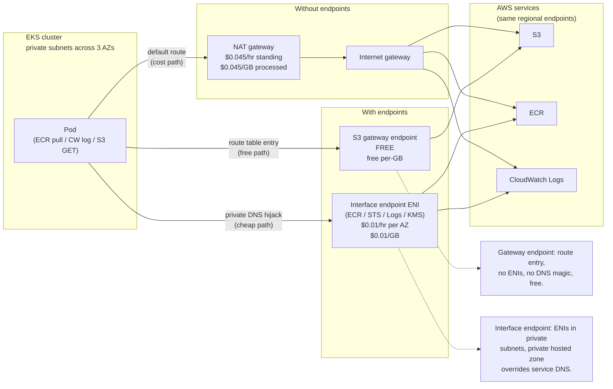

# 14.08 — VPC endpoints & egress economics

> **NAT gateways cost $0.045/hr plus $0.045/GB processed** (AWS VPC
> pricing, US East Ohio rates; check your Region). At 1 TB/month through
> NAT, a busy EKS cluster pulling ECR images, shipping CloudWatch logs
> and calling S3 pays **about $45/month in data charges alone**, before
> the standing fee. **Gateway endpoints** for S3 and DynamoDB are
> **free** and skip NAT entirely. **Interface endpoints** for
> ECR/STS/EC2/CloudWatch-Logs/KMS cost **$0.01/hr per AZ + $0.01/GB**
> processed, so each one pays for itself only above about 625 GB/month
> of traffic moved off NAT in a 3-AZ cluster.

**Estimated time:** ~30 min read · ~60 min hands-on
**Prerequisites:** [Part 14 ch.06](./06-cost-guardrails.md) — egress cost is the #1 surprise line · [Part 10 ch.04](../10-cloud-and-managed-kubernetes/04-cloud-networking-and-load-balancing.md) — VPC + NAT topology the bookstore tree already has · [Part 13 ch.01](../13-grand-capstone-bookstore-platform/01-bookstore-2-from-toy-to-platform.md) — bookstore VPC you'll add endpoints to

**You'll know after this:** • understand NAT gateway pricing ($0.045/hr + $0.045/GB) and where it dominates the cluster bill · • configure gateway endpoints (free) for S3 and DynamoDB · • configure interface endpoints for ECR, STS, EC2, CloudWatch Logs, KMS and compute their per-cluster break-even · • design private subnets that skip NAT entirely for AWS-API traffic · • debug a Pod that suddenly can't pull from ECR after an endpoint policy change

<!-- tags: vpc-endpoints, cost, cloud, networking, finops -->

## Why this exists

The bookstore-platform tree at
[`../examples/bookstore-platform/terraform/`](../examples/bookstore-platform/terraform/)
provisions, by default, **one NAT gateway** rather than one per AZ
(`single_nat_gateway` defaults to true) to give private-subnet
workloads internet egress. Every Pod that pulls an image from ECR,
pushes a CloudWatch log event, calls the STS endpoint for IRSA (IAM
roles for service accounts), or downloads an S3 object
*goes through that NAT gateway*. AWS charges for the privilege on
two dimensions:

- **Per-hour standing fee** — $0.045/hr per NAT gateway. One NAT
  per cluster = ~$33/month standing. Three NATs (one per AZ for
  high availability) = ~$99/month standing. The HA configuration is
  the production-shape default; the single-NAT layout the
  bookstore-platform tree ships is a cost-trimmed sandbox shape.
- **Per-GB data-processing fee** — $0.045/GB processed in either
  direction through NAT. A 5-GB ECR image pull through NAT costs $0.23
  each time; twenty Pods restarting and re-pulling on a cluster bounce costs
  ~$4.50; an idle production cluster shipping 50 GB/month of
  CloudWatch logs costs $2.25/month in data alone.

The math gets ugly at scale. A platform running 50 clusters across
3 AZs, each pulling 200 GB/month of ECR images + 100 GB/month of
CloudWatch logs + 50 GB/month of S3 data:

```
NAT data: 50 clusters x 350 GB x $0.045/GB = $787.50/month
NAT standing: 50 clusters x 3 AZs x $0.045/hr x 730 hr = $4,927.50/month
Total NAT: $5,715/month
```

VPC endpoints close most of this:

- **Gateway endpoint for S3** — Free. The `s3.<REGION>` service routes
  through the endpoint instead of NAT. For a cluster that pulls
  Loki chunks, Velero backups, or ML model artifacts from S3, this
  is the single highest-ROI change in the entire Terraform tree.
- **Gateway endpoint for DynamoDB** — Free. Same shape. Relevant only
  when a workload calls DynamoDB.
- **Interface endpoints** for ECR-API, ECR-DKR, STS, EC2, CloudWatch-Logs,
  KMS, Secrets Manager, etc. — $0.01/hr per AZ per endpoint
  ($7.30/month per AZ for the standing fee at 730 hours) + $0.01/GB
  processed. For a 3-AZ cluster with the six interface endpoints the
  bookstore-platform tree provisions, the standing fee is ~$131/month.
  The data savings cover it only at multi-TB volume (see the break-even
  below).

Phase 14-R ships
[`vpc-endpoints.tf`](../examples/bookstore-platform/terraform/vpc-endpoints.tf)
with `var.enable_vpc_endpoints = false` as the default — it costs
real money. Flip it to `true` only after you have measured the NAT data volume,
against the break-even in the Mental model.

[Part 02 ch.01](../02-networking/01-networking-model.md) introduced
the cluster networking model abstractly. [Part 10 ch.04](../10-cloud-and-managed-kubernetes/04-cloud-networking-and-load-balancing.md)
walked through the AWS VPC + NAT default. This chapter is the
**EKS-specific egress-cost** layer: which traffic hits NAT, which
endpoints save money, and the policy that locks endpoints down to
specific resources.

> **In production:** Enable the S3 gateway endpoint now, since it is
> free. Enable the interface endpoints only after measuring the NAT
> volume each one would move: a 3-AZ cluster needs about 625 GB/month
> per endpoint before its data savings cover its standing fee. The
> bookstore-platform tree's `vpc-endpoints.tf` bundles the S3 gateway
> endpoint and six interface endpoints under `enable_vpc_endpoints`.
> Set it to `true` and run `terraform apply` once VPC Flow Logs show
> the volume.

## Mental model

**Every byte leaving a private subnet travels via NAT by default,
and NAT bills on both standing time and bytes processed; VPC
endpoints divert AWS-service traffic off NAT entirely, with a
hierarchy of cost: gateway endpoints (free, S3/DynamoDB only) and
interface endpoints ($0.01/hr per AZ + $0.01/GB, all other AWS
services). Break-even depends on your NAT traffic profile: an
interface endpoint saves $0.035/GB, so it has to move enough data to
cover its standing fee.**

The two endpoint types:

- **Gateway endpoints** — Free per-hour, free per-GB. Available
  for **S3 and DynamoDB only**. Implemented as VPC-level route-
  table entries: the route `S3-prefix-list -> vpce-<...>` shows up
  in your private + intra route tables, and SDK calls to S3 follow
  it instead of the default-route to NAT. No ENIs, no DNS hijack,
  no private-DNS toggle. Just a route-table prefix.
- **Interface endpoints** — $0.01/hr per AZ + $0.01/GB processed.
  Available for **most AWS services** (ECR, STS, EC2, KMS,
  CloudWatch-Logs, Secrets Manager, SQS, SNS, the list grows
  monthly). Implemented as **ENIs in your private subnets** plus a
  **private DNS hijack**: AWS injects a Route 53 private hosted
  zone that overrides the public-DNS name of the service (e.g.,
  `ecr.<REGION>.amazonaws.com`) to resolve to the endpoint's ENI
  IPs. The SDK doesn't know it's hitting an endpoint vs the public
  service.

**The break-even math.** For a single AWS service, an interface
endpoint pays off when:

```
data_GB * (NAT_processing_fee - endpoint_processing_fee) > endpoint_hours * endpoint_hourly_fee
data_GB * ($0.045 - $0.010) > 730 hr/month * $0.010/hr * <NUM_AZS>
data_GB * $0.035 > 730 * $0.010 * <NUM_AZS>
data_GB > 208 * <NUM_AZS>
```

For a 3-AZ cluster, that's **~625 GB/month** for each endpoint to pay
off in data savings. Each endpoint has its own threshold, so a set
needs its combined shifted traffic to cover the combined standing fee.
You usually provision several in one go (ECR-API + ECR-DKR + STS +
EC2 + CloudWatch-Logs + KMS are the canonical six on EKS).

A more useful framing: at **3 AZs and six interface endpoints**, the
standing fee is `3 x 6 x $7.30 = $131/month`. Moving 1 TB/month off
NAT saves `1024 GB x $0.035 = $36/month`, still a net cost. At 10
TB/month it saves `10240 x $0.035 = $358/month`, about `$227/month` net
after the standing fee. The real ROI shows up at **terabyte-scale**
clusters; below that, only the **gateway endpoints** (free) are
unambiguous wins.

**Where the data volume actually comes from on EKS.** Top sources,
in rough order:

1. **ECR image pulls**, repeated whenever a node pulls an image it has
   not cached.
2. **CloudWatch Logs ingestion**, which grows with log volume. Goes via
   the `logs` interface endpoint.
3. **S3 traffic** — Loki chunks, Velero backups, ML artifacts. Goes
   via the S3 *gateway* endpoint (free).
4. **STS IRSA traffic** — Small per-call but every Pod assuming an
   IAM role calls STS. Aggregate volume is modest.
5. **EC2 API calls** — Karpenter list-watching instance types,
   describing volumes. Modest aggregate volume.
6. **KMS calls** for envelope encryption of encrypted resources. Many
   calls, each small.
7. **Cross-AZ data transfer** — *Not* NAT but the same shape: AWS
   bills $0.01/GB between AZs. A misbehaving service mesh or a
   replicated stateful workload can rack up large lines.

**Endpoint policy — locking down what can leave.** An endpoint can
be opened to your VPC but restricted via an *endpoint policy* (a
JSON document attached to the endpoint) to specific AWS resources.
Example: the S3 gateway endpoint can be policy-bound to allow requests
only on buckets owned by your AWS account, blocking copies to
attacker-owned buckets. The default policy is "allow everything via
this endpoint"; production policy is "allow specific account ARNs
and specific actions."

The trap to keep in view: **enabling endpoints without measuring
NAT traffic first is the cargo-cult mistake**. The six interface
endpoints the bookstore-platform tree provisions cost ~$131/month
in standing fees on a 3-AZ cluster. If your cluster only pushes
20 GB/month of NAT data, you've added $131/month to save about $0.70.
*Measure first* (VPC Flow Logs, Cost Explorer's NAT line),
*then enable*.

## Threats and controls

| Threat | Control in this chapter | Deeper |
|---|---|---|
| A Pod copies data to a bucket in an attacker's account through the S3 endpoint | S3 endpoint policy limited to this account's buckets and the ECR layer bucket (Step 6) | this chapter |
| A Pod sends data to an internet host over the NAT path | Network ACLs on the subnets, plus an egress firewall or proxy | [02.06](../02-networking/06-network-policies.md) covers in-cluster egress policy |
| A Pod reads the node's instance credentials from IMDS | IMDSv2 required, hop limit 1 (node metadata, under How it works) | [10.03](../10-cloud-and-managed-kubernetes/03-cloud-identity.md) |

Exfiltration can leave by any path, so each path needs its own control.
The endpoint policy only sees traffic that uses the endpoint. Egress
rules in a NetworkPolicy are enforced by the network plugin, not by the
API server ([Kubernetes docs](https://kubernetes.io/docs/concepts/services-networking/network-policies/)).

## Diagrams

### Diagram A — traffic flows with and without endpoints (Mermaid)



### Diagram B — cost-per-GB by traffic path (ASCII)

```text
PATH                            PER-HOUR     PER-GB       ACCESS PATTERN
──────────────────────────────  ───────────  ───────────  ─────────────────────────────
NAT gateway (per AZ)            $0.045       $0.045       Default; all egress unless rerouted
Gateway endpoint (S3 or DDB)    free         free         Routed via private VPC route table
Interface endpoint (per AZ)     $0.01        $0.01        Private DNS hijack onto ENIs
Cross-AZ data transfer          n/a          $0.01        Charged on each side of the transfer
──────────────────────────────  ───────────  ───────────  ─────────────────────────────
The cheapest path for AWS service traffic is, in order:
  1. Gateway endpoint (free; S3 / DDB only)
  2. Interface endpoint ($0.01/GB; everything else)
  3. NAT gateway ($0.045/GB; the default fallback)
```

## Hands-on with the Bookstore Platform

### 0. Prerequisites

- The bookstore-platform tree applied; cluster reachable via `kubectl`.
- AWS CLI v2 configured with permissions on EC2 / VPC + CloudWatch.
- A baseline: at least 7 days of cluster activity so NAT volume is
  measurable.

### 1. Measure current NAT traffic volume

```bash
CLUSTER="$(terraform output -raw cluster_name)"
REGION="$(terraform output -raw region)"

# Find the NAT gateway IDs the bookstore-platform tree created.
NAT_IDS="$(aws ec2 describe-nat-gateways \
  --region "$REGION" \
  --filter "Name=tag:Cluster,Values=$CLUSTER" \
  --query 'NatGateways[].NatGatewayId' --output text)"
echo "NAT gateways: $NAT_IDS"

# Bytes processed (in + out) per NAT gateway over the last 30 days.
END_TS="$(date -u +%Y-%m-%dT%H:%M:%S)"
START_TS="$(date -u -d '30 days ago' +%Y-%m-%dT%H:%M:%S)"

for NAT in $NAT_IDS; do
  BYTES_OUT="$(aws cloudwatch get-metric-statistics --region "$REGION" \
    --namespace AWS/NATGateway --metric-name BytesOutToDestination \
    --dimensions Name=NatGatewayId,Value="$NAT" \
    --start-time "$START_TS" --end-time "$END_TS" \
    --period 2592000 --statistics Sum \
    --query 'Datapoints[0].Sum' --output text)"
  BYTES_IN="$(aws cloudwatch get-metric-statistics --region "$REGION" \
    --namespace AWS/NATGateway --metric-name BytesInFromDestination \
    --dimensions Name=NatGatewayId,Value="$NAT" \
    --start-time "$START_TS" --end-time "$END_TS" \
    --period 2592000 --statistics Sum \
    --query 'Datapoints[0].Sum' --output text)"
  TOTAL_GB="$(awk "BEGIN { print ($BYTES_OUT + $BYTES_IN) / (1024^3) }")"
  COST="$(awk "BEGIN { print $TOTAL_GB * 0.045 }")"
  echo "$NAT: $TOTAL_GB GB processed = \$${COST}/month data"
done
```

Illustrative output:

```text
NAT gateways: nat-0abc123def456
nat-0abc123def456: 287.3 GB processed = $12.93/month data
```

At 287 GB/month, the data cost is $13/month. Standing cost for 1 NAT
is ~$32/month. Total NAT line item: ~$45/month. Whether endpoints
pay off depends on what services consume that 287 GB.

### 2. Identify what's flowing through NAT — VPC Flow Logs

The crude method: VPC Flow Logs on the NAT-attached ENI, aggregated
by destination IP and reverse-DNS'd to identify the AWS service.

```bash
# Enable Flow Logs to CloudWatch (if not already on).
VPC_ID="$(aws ec2 describe-vpcs --region "$REGION" \
  --filters "Name=tag:Cluster,Values=$CLUSTER" \
  --query 'Vpcs[0].VpcId' --output text)"

# (One-time setup. The example tree does not enable Flow Logs, because
# CloudWatch Logs bills ingestion per GB. Enable them for this
# measurement, then disable them.)
aws ec2 create-flow-logs --region "$REGION" \
  --resource-type VPC --resource-ids "$VPC_ID" \
  --traffic-type ACCEPT \
  --log-destination-type cloud-watch-logs \
  --log-group-name "/aws/vpc/$CLUSTER/flow-logs" \
  --deliver-logs-permission-arn "<FLOW_LOGS_IAM_ROLE_ARN>"

# Wait 30 minutes to accumulate Flow Logs, then query CloudWatch
# Logs Insights for top-N destinations.
aws logs start-query --region "$REGION" \
  --log-group-name "/aws/vpc/$CLUSTER/flow-logs" \
  --start-time "$(date -u -d '30 minutes ago' +%s)" \
  --end-time "$(date -u +%s)" \
  --query-string 'fields dstaddr, bytes | filter action="ACCEPT" | stats sum(bytes) as total_bytes by dstaddr | sort total_bytes desc | limit 20'

# Reverse-DNS the top IPs.
# (Most ECR/S3/STS endpoints will resolve to *.s3.*.amazonaws.com,
# *.ecr.*.amazonaws.com, sts.*.amazonaws.com.)
```

Illustrative top-N output (reverse-DNS'd):

```text
DESTINATION_HOST                        GB/30min    %
prod-<REGION>-starport-layer-bucket.s3.<REGION>.amazonaws.com     1.2     45%
api.ecr.<REGION>.amazonaws.com                                    0.6     22%
logs.<REGION>.amazonaws.com                                       0.4     15%
sts.<REGION>.amazonaws.com                                        0.05     2%
... (other)
```

Reading this:

- **45% S3** — this is ECR's blob backend; would route through the
  S3 gateway endpoint (free) if enabled.
- **22% ECR-API + 15% Logs** — these would route through interface
  endpoints (saving $0.035/GB).
- **2% STS** — modest; STS interface endpoint pays off only at
  cluster-fleet scale.

In this hypothetical, enabling the **S3 gateway endpoint alone**
saves `0.45 x 287 GB x $0.045 = $5.81/month` for **zero cost**.
Enabling the ECR/Logs interface endpoints saves
`(0.22 + 0.15) x 287 GB x $0.035 = $3.72/month` at a standing cost
of `2 endpoints x 3 AZs x $7.30 = $43.80/month` — net cost. For
this cluster, only the gateway endpoints make sense.

### 3. Enable the gateway endpoints first (the unambiguous win)

The Phase 14-R `vpc-endpoints.tf` ships **all seven endpoints** (the S3
gateway and six interface endpoints) under one flag. To enable *only*
the S3 gateway, a minimal local override:

```bash
cd examples/bookstore-platform/terraform

# Option A — enable the full set (when data volume justifies it):
cat <<EOF >> example.tfvars
enable_vpc_endpoints = true
EOF

# Option B — for the "gateway only" case (no interface endpoints,
# zero standing fees), edit the vpc-endpoints.tf locally to comment
# out the interface endpoints block. Production teams who only need
# gateway endpoints typically fork or extend the module rather than
# patching the example tree.

terraform plan -var-file=example.tfvars -out=endpoints.tfplan
terraform apply endpoints.tfplan
```

Verify the endpoint landed:

```bash
aws ec2 describe-vpc-endpoints --region "$REGION" \
  --filters "Name=tag:Cluster,Values=$CLUSTER" \
  --query 'VpcEndpoints[].{type:VpcEndpointType,service:ServiceName,state:State}' \
  --output table
```

Illustrative output:

```text
-----------------------------------------------------------------------
|                       DescribeVpcEndpoints                          |
+----------+------------------------------------------+----------------+
|   type   |                  service                 |     state      |
+----------+------------------------------------------+----------------+
|  Gateway |  com.amazonaws.<REGION>.s3               |  available     |
+----------+------------------------------------------+----------------+
```

The route tables now carry the S3 prefix list:

```bash
# Verify the S3 routes appear in private subnet route tables.
PRIVATE_RT="$(aws ec2 describe-route-tables --region "$REGION" \
  --filters "Name=vpc-id,Values=$VPC_ID" "Name=tag:Tier,Values=private" \
  --query 'RouteTables[].RouteTableId' --output text)"

for RT in $PRIVATE_RT; do
  aws ec2 describe-route-tables --region "$REGION" --route-table-ids "$RT" \
    --query 'RouteTables[].Routes[?DestinationPrefixListId].{prefix:DestinationPrefixListId,target:VpcEndpointId}' \
    --output table
done
```

After this, traffic from Pods to S3 bypasses NAT entirely. The NAT
gateway's `BytesOutToDestination` metric should drop by ~45% in the
hypothetical from Step 2.

### 4. Verify Pod traffic is hitting the endpoint

```bash
# Use a Pod in your application namespace whose image ships nslookup and curl.
POD="<POD>"

# An interface endpoint name resolves to a private address in your subnets.
kubectl exec -n <APP_NAMESPACE> "$POD" -- nslookup api.ecr.<REGION>.amazonaws.com

# The S3 gateway endpoint keeps the public name; the route table sends the
# traffic to the endpoint instead.
kubectl exec -n <APP_NAMESPACE> "$POD" -- nslookup s3.<REGION>.amazonaws.com

# Check that an S3 request succeeds from the Pod.
kubectl exec -n <APP_NAMESPACE> "$POD" -- curl -s -o /dev/null -w '%{http_code}\n' \
  https://s3.<REGION>.amazonaws.com/ -I
```

A successful request shows the path works. The route table entry from
the previous step shows that traffic is sent to the endpoint.

### 5. Enable interface endpoints when data volume justifies

After confirming gateway endpoints work and re-measuring NAT
volume:

```bash
# If the NAT traffic that remains is still above the per-endpoint
# break-even (about 625 GB/month per endpoint in a 3-AZ cluster) and
# most of it goes to ECR, Logs or STS, enable the full set:
cat <<EOF >> example.tfvars
enable_vpc_endpoints = true
EOF

terraform plan -var-file=example.tfvars -out=endpoints-full.tfplan
terraform apply endpoints-full.tfplan
```

The full set adds the six interface endpoints. The S3 gateway endpoint
is already in place, so Terraform leaves it unchanged. The ENIs and
private DNS take time to become ready.

### 6. Endpoint policy — restrict what can leave

By default, the endpoint lets every IAM principal in the VPC reach any
S3 bucket. The policy below allows only buckets owned by your account,
plus the bucket that ECR stores image layers in. It is a fragment: add
the data source and the `policy` line to `aws_vpc_endpoint.s3` in
`vpc-endpoints.tf`. This guide does not apply it to AWS, so test it in
a non-production account first.

```hcl
data "aws_caller_identity" "current" {}

data "aws_iam_policy_document" "s3_endpoint" {
  count = var.enable_vpc_endpoints ? 1 : 0

  # Buckets owned by this account.
  statement {
    sid       = "AccountBucketsOnly"
    effect    = "Allow"
    actions   = ["s3:*"]
    resources = ["*"]
    principals {
      type        = "*"
      identifiers = ["*"]
    }
    condition {
      test     = "StringEquals"
      variable = "s3:ResourceAccount"
      values   = [data.aws_caller_identity.current.account_id]
    }
  }

  # ECR stores image layers in an AWS-owned bucket. Without this
  # statement, image pulls through the endpoint fail.
  statement {
    sid       = "EcrLayerBucket"
    effect    = "Allow"
    actions   = ["s3:GetObject"]
    resources = ["arn:aws:s3:::prod-${var.region}-starport-layer-bucket/*"]
    principals {
      type        = "*"
      identifiers = ["*"]
    }
  }
}

# In aws_vpc_endpoint.s3, add:
#   policy = data.aws_iam_policy_document.s3_endpoint[0].json
```

The endpoint policy only lets requests through; the caller's IAM policy
still applies. The two statements allow account buckets and the ECR
layer bucket, so a compromised Pod cannot copy data to an attacker-owned
bucket through the endpoint. The ECR statement is required: the
[ECR endpoint docs](https://docs.aws.amazon.com/AmazonECR/latest/userguide/vpc-endpoints.html)
list that bucket for the S3 gateway endpoint. Other AWS-owned buckets
your workloads read need their own statements.

The endpoint policy does not cover traffic that leaves through NAT.
NAT gateways cannot take security groups ([NAT gateway basics](https://docs.aws.amazon.com/vpc/latest/userguide/nat-gateway-basics.html)),
so control that path with network ACLs on the subnets, an egress
firewall or a proxy. Pod-level egress rules belong to
[02.06](../02-networking/06-network-policies.md).

### 7. Measure savings after enabling endpoints

Run Step 1's measurement again after 30 days. An illustrative before and after:

```text
BEFORE                             AFTER
NAT processed: 287 GB/month        NAT processed: 158 GB/month
NAT data cost: $12.93              NAT data cost: $7.11
                                   Gateway endpoint cost: $0
                                   Interface endpoint cost (3 AZs x 6 endpoints): $131.40
                                   Interface endpoint data: ~5 GB x $0.01 = $0.05
                                   Net change: +$125.63 (cost)
```

Whoops — in this illustrative run, the interface endpoints cost more
than they saved. The gateway endpoint did the saving, for free. **This
is the cluster size where you don't enable interface endpoints.** The
six-endpoint set breaks even near 3,750 GB/month moved off NAT
(`$131.40 / $0.035`). At 2 TB/month, moving all of it would save about
$72/month against $131/month of standing fees, still a net cost.

The discipline: **measure, decide per-cluster, document the
decision**. The gateway endpoint stays on always (free, no downside).
Interface endpoints are a conscious cluster-by-cluster decision.

## How it works under the hood

**Gateway endpoint mechanics.** A gateway endpoint is implemented as
a **route-table entry**, not an ENI. When you create
`aws_vpc_endpoint.s3 (type=Gateway)`, AWS:

1. Creates a managed prefix list for the S3 service in your region
   (or reuses the existing one — there's one per region per service).
2. Adds an entry to each route table you list in `route_table_ids`:
   `<S3-prefix-list> -> <VPCE-ID>`.
3. The VPCE is a managed entity (no ENI, no IP). Traffic matching
   the prefix list routes via AWS's internal backbone directly to
   the S3 service.

Cost: zero. AWS bills nothing for the gateway endpoint itself, the
prefix list, or the bytes that flow over it. The only catch: S3
traffic only — not arbitrary HTTPS, just the S3 API endpoints.

**Interface endpoint mechanics.** Interface endpoints are more
involved:

1. AWS provisions **ENIs in your private subnets** — one per subnet
   per endpoint. Each ENI gets a private IP from the subnet's
   CIDR.
2. AWS creates a **private hosted zone in Route 53** that overrides
   the service's public DNS name. For ECR the overridden names are
   `api.ecr.<REGION>.amazonaws.com` and `*.dkr.ecr.<REGION>.amazonaws.com`
   ([ECR endpoint docs](https://docs.aws.amazon.com/AmazonECR/latest/userguide/vpc-endpoints.html)).
   Inside your VPC they resolve to the ENI's private IP.
3. The security group attached to the ENIs controls who can reach
   the endpoint. It must allow TCP 443 from the private subnets. The
   bookstore-platform's `vpc-endpoints.tf` allows the VPC CIDR.
4. **Private DNS toggle.** When `private_dns_enabled = true` (the
   bookstore platform's example sets it), Route 53 hijacks the service DNS.
   When `false`, the SDK has to be configured explicitly with the
   endpoint URL — almost never what you want.

Cost: $0.01/hr per ENI per AZ + $0.01/GB processed through the ENI.
The standing fee is on the *endpoint* (which has an ENI per AZ);
3 AZs = 3 ENIs = $0.01 x 3 = $0.03/hr per endpoint = ~$21.90/month
per endpoint at 730 hours. Six interface endpoints x 3 AZs = $131/month
standing.

**The "private DNS hijack" subtlety.** When you call
`s3.<REGION>.amazonaws.com` from inside the VPC, the gateway endpoint
catches it via the route table — no DNS hijack needed; the IP
resolves to the public AWS endpoint, but the *packet* gets routed
internally. When you call `ecr.<REGION>.amazonaws.com` from inside
the VPC, the interface endpoint hijacks the DNS — the IP resolves
to the ENI's private IP. The SDK sees no difference; the routing
mechanism is fundamentally different under the hood.

Edge case: applications that hardcode the public endpoint IP
addresses bypass the gateway endpoint (the IP-based route doesn't
match the prefix list). Always hit services by DNS name.

**Endpoint policy evaluation.** The endpoint policy is a separate check
on top of the caller's IAM policy and the resource policy. It does not
replace them ([ECR endpoint docs](https://docs.aws.amazon.com/AmazonECR/latest/userguide/vpc-endpoints.html)
say the same of endpoint policies), so a request through the endpoint
succeeds only when all of them allow it. A Deny in the endpoint policy
blocks a request even when IAM allows it, which makes it a good place
for "never through this endpoint" rules.

The bookstore-platform's
[`vpc-endpoints.tf`](../examples/bookstore-platform/terraform/vpc-endpoints.tf)
ships with no endpoint policies (default-allow); add restrictive
policies as a follow-up once you've decided which buckets/services
are allowed.

**Data-transfer cost mechanics.** Where the bytes go sets the price:

1. **Same AZ, same VPC**: free for traffic on private IPs.
2. **Cross-AZ, same VPC**: $0.01/GB charged on each side of the
   transfer, so $0.02/GB in total ([AWS blog](https://aws.amazon.com/blogs/networking-and-content-delivery/optimizing-data-transfer-costs-when-using-aws-network-load-balancer/)).
   A 1 TB cross-AZ transfer costs about $20.
3. **Peering, cross-region and internet egress**: billed per GB at rates
   that vary by Region and volume. Internet data transfer out includes
   100 GB a month free ([EC2 pricing](https://aws.amazon.com/ec2/pricing/on-demand/)).

Cross-AZ traffic from a CNPG primary in us-east-1a to a CNPG replica
in us-east-1b at 100 GB/day = ~3 TB/month = **$30/month on each side =
$60/month cross-AZ** for the replication. Endpoints don't reduce
this (the traffic isn't going to AWS services, it's pod-to-pod);
the only mitigation is keeping replicas in the same AZ (which
defeats the cross-AZ HA story).

**Transit Gateway — when it makes sense.** Transit Gateway (TGW) bills
per attachment and per GB processed (check the pricing page for your
Region). For a single VPC, TGW
is pure overhead. For 10+ VPCs that need to talk to each other +
share a NAT gateway, TGW saves on N x N peering complexity. The
bookstore-platform tree does not use TGW; it's a one-VPC pattern.
Multi-VPC platforms (one VPC per environment, shared services
VPC) typically need TGW.

**Node instance metadata.** Each node serves instance metadata at
`169.254.169.254`, including temporary credentials for the node role.
A Pod that can reach that address can use the node's permissions, so
close the path on each node. Karpenter's `EC2NodeClass` takes these
settings under `spec`:

```yaml
spec:
  metadataOptions:
    httpEndpoint: enabled
    httpProtocolIPv6: disabled
    httpPutResponseHopLimit: 1
    httpTokens: required
```

`httpTokens: required` makes IMDSv1 requests fail, so only requests
with a session token get through ([EC2 docs](https://docs.aws.amazon.com/AWSEC2/latest/UserGuide/configuring-IMDS-existing-instances.html)).
A hop limit of 1 keeps the token response from reaching a Pod, which
is the setting EKS best practices recommend to block Pod access to the
node role ([EKS best practices](https://aws.github.io/aws-eks-best-practices/security/docs/iam/)).
Karpenter applies these same values when `metadataOptions` is omitted
([Karpenter NodeClass docs](https://karpenter.sh/docs/concepts/nodeclasses/)).
Set them anyway so a later edit cannot drop them silently. The
bookstore-platform tree's EC2NodeClass relies on the default.

## Production notes

> **In production:** Always enable the S3 (and DynamoDB if you use
> it) gateway endpoint. It is free, and ECR stores image layers in S3
> ([ECR endpoint docs](https://docs.aws.amazon.com/AmazonECR/latest/userguide/vpc-endpoints.html)),
> so image pulls leave NAT too. The bookstore-platform's
> [`vpc-endpoints.tf`](../examples/bookstore-platform/terraform/vpc-endpoints.tf)
> bundles the S3 gateway and six interface endpoints under one flag.
> For "gateway-only" clusters, fork the file and drop the interface
> endpoint resources.

> **In production:** Measure NAT data before enabling interface
> endpoints. Sum the CloudWatch metrics `AWS/NATGateway
> BytesOutToDestination` and `BytesInFromDestination` over 30 days,
> multiply by $0.045, and compare the result with each endpoint's
> break-even above. Interface endpoints also keep AWS API traffic on
> the Amazon network ([ECR endpoint docs](https://docs.aws.amazon.com/AmazonECR/latest/userguide/vpc-endpoints.html)).
> That is a security reason to enable them, separate from the cost case.

> **In production:** Multi-AZ NAT is the production default, but
> the bookstore-platform tree ships single-AZ NAT for cost reasons.
> The trade is about $33/month (one NAT) against about $99/month
> (three NATs) in standing fees. A NAT gateway lives in one AZ, so if
> that AZ fails, resources in the other AZs lose internet access
> ([NAT gateway basics](https://docs.aws.amazon.com/vpc/latest/userguide/nat-gateway-basics.html)).
> Interface endpoints keep AWS-service calls working through that
> failure, but calls to public internet endpoints still fail. Set
> `single_nat_gateway = false` in your tfvars for production.

> **In production:** Cross-AZ data transfer is the silent
> budget-killer. Mesh overhead adds bytes to every request. At 1,000
> requests a second, each extra kilobyte per request is about 2.6 TB a
> month, which costs about $26 a month on each side of a cross-AZ hop.
> Istio's locality-aware routing sends traffic to the same AZ first
> when it can. The bookstore-platform tree leaves locality routing as a
> follow-up, since it needs Istio configuration rather than Terraform.
> For now, monitor cross-AZ traffic via VPC Flow Logs.

> **In production:** Watch the interface endpoint quota. The default
> is 50 interface and Gateway Load Balancer endpoints combined per VPC,
> and it is adjustable ([PrivateLink quotas](https://docs.aws.amazon.com/vpc/latest/privatelink/vpc-limits-endpoints.html)).
> The six interface endpoints here sit well under it. Teams running
> 30+ endpoints (for example, per-namespace isolation patterns) should
> plan ahead.

## Quick Reference

```bash
# Measure current NAT data volume (last 30 days).
aws cloudwatch get-metric-statistics \
  --namespace AWS/NATGateway --metric-name BytesOutToDestination \
  --dimensions Name=NatGatewayId,Value="$NAT_ID" \
  --start-time "$(date -u -d '30 days ago' +%Y-%m-%dT%H:%M:%S)" \
  --end-time "$(date -u +%Y-%m-%dT%H:%M:%S)" \
  --period 2592000 --statistics Sum

# Enable VPC endpoints (Phase 14-R tfvars).
echo 'enable_vpc_endpoints = true' >> example.tfvars
make plan
make up

# List configured endpoints.
aws ec2 describe-vpc-endpoints --region "$REGION" \
  --filters "Name=tag:Cluster,Values=$CLUSTER"

# Interface endpoint names resolve to private addresses in your subnets.
kubectl exec -n <APP_NAMESPACE> <POD> -- nslookup api.ecr.<REGION>.amazonaws.com

# Cost-aware planning.
make plan-cost
```

Minimal Terraform skeleton — the S3 gateway endpoint (the free
no-brainer):

```hcl
# vpc-endpoints.tf — excerpt
resource "aws_vpc_endpoint" "s3" {
  count = var.enable_vpc_endpoints ? 1 : 0

  vpc_id            = module.vpc.vpc_id
  service_name      = "com.amazonaws.${var.region}.s3"
  vpc_endpoint_type = "Gateway"
  route_table_ids   = concat(module.vpc.private_route_table_ids,
                             module.vpc.intra_route_table_ids)
  policy            = data.aws_iam_policy_document.s3_endpoint[0].json

  tags = merge(local.common_tags, {
    Name = "<NAME_PREFIX>-s3-gw"
  })
}

data "aws_caller_identity" "current" {}

data "aws_iam_policy_document" "s3_endpoint" {
  count = var.enable_vpc_endpoints ? 1 : 0

  statement {
    sid       = "AccountBucketsOnly"
    effect    = "Allow"
    actions   = ["s3:*"]
    resources = ["*"]
    principals {
      type        = "*"
      identifiers = ["*"]
    }
    condition {
      test     = "StringEquals"
      variable = "s3:ResourceAccount"
      values   = [data.aws_caller_identity.current.account_id]
    }
  }

  statement {
    sid       = "EcrLayerBucket"
    effect    = "Allow"
    actions   = ["s3:GetObject"]
    resources = ["arn:aws:s3:::prod-${var.region}-starport-layer-bucket/*"]
    principals {
      type        = "*"
      identifiers = ["*"]
    }
  }
}
```

Egress-discipline checklist (the egress cost is bounded when all seven
are yes):

- [ ] NAT data volume measured (`BytesOutToDestination` over 30 days).
- [ ] S3 gateway endpoint enabled (always; free).
- [ ] Interface endpoints enabled only when each endpoint's measured
      volume justifies it (about 625 GB/month per endpoint in a 3-AZ
      cluster).
- [ ] S3 endpoint policy limits buckets to this account and the ECR
      layer bucket.
- [ ] Internet-bound traffic from private subnets filtered (network
      ACLs, an egress firewall or a proxy).
- [ ] VPC Flow Logs run periodically to identify the top NAT
      destinations.
- [ ] Cross-AZ traffic monitored (the silent budget-killer most
      teams miss).

## Test your understanding

> Try each before opening the answer drawer. The act of trying is the exercise; the answer is the check.

1. **Why is the S3 gateway endpoint "always-enable" while interface endpoints are conditional?**
   <details><summary>Show answer</summary>

   The S3 gateway endpoint is **free** — no hourly fee, no per-GB processing fee, just a route-table entry that diverts S3 traffic off NAT. There's no downside. Interface endpoints cost $0.01/hr per AZ + $0.01/GB processed; at 3 AZs that's ~$22/month standing per endpoint, and each one breaks even only once it moves about 625 GB/month off NAT in a 3-AZ cluster. Below that, its standing fee exceeds its data savings.

   </details>

2. **Your AWS bill shows a $200/month NAT data-processing line, and the cluster has been "idle." Where's the data going and how do you find out?**
   <details><summary>Show answer</summary>

   "Idle" clusters still ship CloudWatch logs, pull ECR image updates, hit STS for IRSA token refreshes, and watch the EC2 API (Karpenter). Enable VPC Flow Logs for 24 hours, query the top destinations: most likely you'll see ECR endpoints (image pulls), CloudWatch endpoints (log shipping), STS (every Pod's IRSA refresh). The fix is enabling the interface endpoints for those services — that traffic now uses the endpoint instead of NAT, dropping the per-GB processing fee from $0.045 (NAT) to $0.01 (endpoint).

   </details>

3. **A team enables 7 interface endpoints in a single-AZ dev cluster and the AWS bill goes UP by $50/month. What happened and what's the lesson?**
   <details><summary>Show answer</summary>

   Each interface endpoint costs ~$7.30/month per AZ in standing fees; 7 × 1 AZ = $51/month standing. In a single-AZ cluster with low NAT data volume, the dev cluster doesn't shift enough GB through the endpoints to recover the standing cost — the data-savings line is small, the standing-fee line is large, net cost up. The lesson: enable interface endpoints **after** measuring NAT volume (the break-even is about 208 GB/month per endpoint in one AZ, and about 625 GB/month in three); for dev clusters with low traffic, the free S3 gateway endpoint alone is the right answer.

   </details>

4. **Hands-on extension — turn on VPC Flow Logs at the subnet level, let the cluster run for 24 hours, then query Athena: which destination prefix consumed the most bytes through NAT?**
   <details><summary>What you should see</summary>

   Expect the S3 line to lead after a deploy that re-pulls images. ECR stores image layers in S3 and the client downloads them from S3, so most pulled bytes go through the free S3 gateway endpoint ([ECR endpoint docs](https://docs.aws.amazon.com/AmazonECR/latest/userguide/vpc-endpoints.html)). CloudWatch Logs (`logs.<region>.amazonaws.com`) comes next, and STS is high count, low byte volume. The ECR-API and ECR-DKR interface endpoints carry only API and manifest calls, so their savings are small. Your own measurement decides which interface endpoints to enable.

   </details>

5. **A Pod with a permissive IAM role starts copying data to a bucket in an attacker's account. The S3 endpoint policy is in place. Does it stop the copy, and does it stop the same bytes going to an internet host over NAT?**
   <details><summary>Show answer</summary>

   The endpoint policy stops the S3 copy. The request goes through the endpoint, and the policy allows only buckets in your account and the ECR layer bucket. It does not stop the same bytes sent over HTTPS to an internet host, because that traffic takes the NAT path and never reaches the endpoint policy. Stop that path with network ACLs on the subnets, an egress firewall or a proxy, and with Pod-level egress rules ([02.06](../02-networking/06-network-policies.md)). A NAT gateway cannot take security groups.

   </details>

## Further reading

- **AWS VPC endpoints — official docs**
  <https://docs.aws.amazon.com/vpc/latest/privatelink/concepts.html>;
  the canonical reference for gateway vs interface, private DNS,
  endpoint policies, and the service-availability matrix.
- **AWS NAT gateway pricing**
  <https://aws.amazon.com/vpc/pricing/>; the $0.045/hr standing +
  $0.045/GB processed rates this chapter cites.
- **AWS data-transfer pricing**
  <https://aws.amazon.com/ec2/pricing/on-demand/#Data_Transfer>;
  the full $/GB matrix for intra-AZ, cross-AZ, cross-region, and
  Internet egress.
- **AWS — ECR interface and gateway endpoints**
  <https://docs.aws.amazon.com/AmazonECR/latest/userguide/vpc-endpoints.html>;
  the starport layer bucket, the S3 gateway requirement and the
  endpoint policy example used in Step 6.
- **AWS — S3 gateway endpoint policies**
  <https://docs.aws.amazon.com/vpc/latest/privatelink/vpc-endpoints-s3.html>;
  the `s3:ResourceAccount` pattern and the free-of-charge statement.
- **AWS — NAT gateway basics**
  <https://docs.aws.amazon.com/vpc/latest/userguide/nat-gateway-basics.html>;
  no security groups on NAT gateways, and network ACLs for its subnet.
- **AWS — Interface endpoint policies**
  <https://docs.aws.amazon.com/vpc/latest/privatelink/vpc-endpoints-access.html>;
  the endpoint policy reference.
- **AWS — PrivateLink quotas**
  <https://docs.aws.amazon.com/vpc/latest/privatelink/vpc-limits-endpoints.html>;
  the interface endpoint quota and its default.
- **AWS — EC2 instance metadata options**
  <https://docs.aws.amazon.com/AWSEC2/latest/UserGuide/configuring-IMDS-existing-instances.html>;
  `httpTokens` and the hop limit.
- **Karpenter — EC2NodeClass**
  <https://karpenter.sh/docs/concepts/nodeclasses/>; the
  `metadataOptions` defaults this chapter cites.
- **AWS VPC Flow Logs**
  <https://docs.aws.amazon.com/vpc/latest/userguide/flow-logs.html>;
  the canonical traffic-attribution tool, including the
  CloudWatch Logs Insights query patterns this chapter uses.
