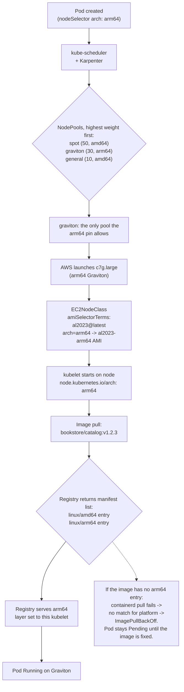

# 14.09 — ARM/Graviton on EKS

> **AWS states that Graviton (its ARM-based EC2 line) costs up to 20%
> less than comparable x86 instances, and a c7g/m7g/r7g node looks
> identical to a c7i/m7i/r7i node from a Kubernetes perspective**, until
> you schedule a Pod whose image has no arm64 entry. The pull then fails
> with `ImagePullBackOff`. The Graviton move is a discount with one
> requirement: every container image you run must be **multi-arch** (or
> arm64-only), and each platform entry must be built, scanned and signed.
> This chapter walks the Terraform NodePool, the `docker buildx`
> discipline, the mixed-arch cluster pattern, and the workloads where ARM
> is still the wrong call.

**Estimated time:** ~30 min read · ~90 min hands-on
**Prerequisites:** [Part 14 ch.06](./06-cost-guardrails.md): cost guardrails · [Part 13 ch.01](../13-grand-capstone-bookstore-platform/01-bookstore-2-from-toy-to-platform.md): bookstore tree where Karpenter manages NodePools · [Part 06 ch.06](../06-production-readiness/06-capacity-and-cost.md): when discounts justify discipline-debt

**You'll know after this:** • explain the up-to-20% Graviton (arm64) cost difference from x86 · • configure a Karpenter NodePool that mixes arm64 + amd64 with arch-aware requirements · • build multi-arch images with `docker buildx --platform linux/amd64,linux/arm64`, sign each platform, and pin the index digest · • debug an `ImagePullBackOff` caused by a missing arm64 entry, and fix it with a multi-arch manifest · • choose between full-Graviton migration and mixed-arch fleet based on workload constraints (GPU, vendor binaries)

<!-- tags: graviton, cost, eks, finops, cloud -->

## Why this exists

The bookstore-platform tree at
[`../examples/bookstore-platform/terraform/`](../examples/bookstore-platform/terraform/)
defaults to x86 (Karpenter's `general` NodePool selects `amd64`).
The bookstore tree ships an **opt-in** Graviton NodePool at
[`../examples/bookstore-platform/terraform/karpenter-graviton.tf`](../examples/bookstore-platform/terraform/karpenter-graviton.tf)
gated by `var.enable_graviton_pool = false` — off by default precisely
because flipping it on without first verifying every workload's image
is multi-arch is the failure mode that wastes an afternoon for any
team that didn't do the homework.

The economics are simple. AWS states that Graviton-based instances cost
up to 20% less than comparable x86-based instances, such as `c7g` against
`c7i` ([AWS Graviton](https://aws.amazon.com/ec2/graviton/)). The saving
depends on size and region, so price your own fleet before you plan a
budget.

The mainstream language runtimes (Go, Java, Python, Node, Rust, .NET)
ship native arm64 builds. Check each EKS add-on's arm64 support before
you run it on the pool; [14.03](./03-eks-addon-management.md) owns the
add-ons. Benchmarks vary by workload: some compute-heavy code favors x86
SIMD, and some memory-bound code favors ARM. Benchmark your own service
before you assume parity.

The catch is **image discipline**. A container image is a manifest
that names one or more architecture-specific layers. A single-arch
`amd64`-only image cannot run on an arm64 node: the pull fails, the Pod
shows `ImagePullBackOff`, and containerd reports `no match for platform`.
The fix is to build images as **multi-arch manifests** using
`docker buildx`: one image reference (`my-service:v1.2.3`) backed by
both `amd64` and `arm64` layer sets, the registry serving whichever
matches the pulling node's architecture. For the bookstore Go
services this is a one-line CI change; for an organization with a
fleet of older images, it can be a multi-quarter project.

[Part 04 ch.02](../04-scheduling/02-affinity-taints-topology.md)
covered node selectors and affinity in the abstract; this chapter is
the EKS-specific overlay for routing Pods to the right architecture.
[Part 10 ch.06](../10-cloud-and-managed-kubernetes/06-node-autoscaling-cost-multicloud.md)
covered Karpenter NodePool authoring on managed Kubernetes; this
chapter shows the Graviton-flavoured NodePool the bookstore tree
ships.

> **In production:** Graviton is the right default for any new
> greenfield Kubernetes cluster running stateless services on
> mainstream runtimes. The 20% discount is the highest-ROI single
> Terraform flag you can flip — but only after a one-time `docker
> buildx --platform linux/amd64,linux/arm64` audit of every image in
> the fleet. The audit is cheap; the discount compounds.

## Mental model

**Three layers compose ARM-on-EKS: the NodePool (Karpenter selecting
arm64 instances and the al2023-arm64 AMI), the image (a multi-arch
manifest serving both layer sets), and the Pod (default-scheduled by
NodePool weight, optionally pinned by `nodeSelector`). The
disciplinary surface is the image — get multi-arch right and the rest
is plumbing.**

The three layers:

- **Layer 1 — NodePool & AMI.** Karpenter's `arm64` NodePool selects
  on `kubernetes.io/arch: arm64` (the requirement that triggers AWS
  to launch a c7g/m7g/r7g instance) and references an
  `EC2NodeClass` whose `amiSelectorTerms` resolves to the
  EKS-optimized `al2023@latest` AMI — which, *because* the NodePool
  pins arch=arm64, resolves to the **arm64 variant** of the same AMI
  family. One NodePool, one EC2NodeClass, the AL2023 AMI alias does
  the right thing. The bookstore tree's Graviton NodePool is at
  [`karpenter-graviton.tf`](../examples/bookstore-platform/terraform/karpenter-graviton.tf).
- **Layer 2 — Multi-arch container image.** A container image is a
  manifest. A **single-arch** manifest contains one entry pointing
  at one layer set: `linux/amd64`. A **multi-arch (multi-platform)
  manifest** is a *manifest list* (or OCI image index) with multiple
  entries, one per platform: `linux/amd64`, `linux/arm64`,
  potentially others (`linux/arm/v7`, `linux/s390x`, ...). When a node
  pulls the image, containerd asks the registry for the entry matching the
  node's architecture. `docker buildx build
  --platform linux/amd64,linux/arm64 --push` builds and pushes a
  manifest list in one step.
- **Layer 3 — Pod scheduling.** A Pod with no `nodeSelector` on
  arch gets scheduled wherever the scheduler + Karpenter decide is
  cheapest/fittest. In the bookstore tree the `spot` NodePool (weight 50)
  is amd64, so it outranks `graviton` (weight 30, arm64) for a Pod with no
  arch constraint. That Pod lands on amd64 spot capacity first. Pin it with
  `nodeSelector: kubernetes.io/arch: arm64` to reach Graviton.

**`docker buildx` is the only sane build path.** Building two
images and tagging them separately (`my-service:v1.2.3-amd64`,
`my-service:v1.2.3-arm64`) breaks Kubernetes' architecture-aware
pull — the kubelet pulls `my-service:v1.2.3` and the registry has to
know which to serve. The manifest list does this; two separately-
tagged images do not. The `docker buildx` toolchain handles the
manifest list automatically: one build invocation produces both
architectures and pushes a single multi-arch tag.

A minimal Dockerfile change for Go services — typically nothing. Go
cross-compiles cleanly; `GOOS=linux GOARCH=arm64 go build` produces a
working arm64 binary on an amd64 build machine. For multi-arch
builds, `docker buildx` uses **QEMU emulation** under the hood for
the arch the build machine doesn't natively support (or
**multi-platform builders** that run on real arm64 hardware). Native
builds are much faster than emulated ones, so for serious CI volume, run
native.

**When ARM doesn't make sense — the honest list.**

1. **NVIDIA CUDA workloads.** Graviton GPU instances are narrow: AWS
   documents G5g as Graviton2 hosts with NVIDIA T4G GPUs
   ([G5g](https://aws.amazon.com/ec2/instance-types/g5g/)). Most CUDA work
   (training, large GPU inference) runs on x86 GPU instances such as
   `g6.*` or `p5.*`. Check the GPU model and your CUDA build before you
   choose an arch. (AWS Trainium and Inferentia use the Neuron SDK, a
   different programming model from CUDA.)
2. **Legacy x86-only binaries.** Anything that bundles a closed-
   source vendor library compiled for `linux/amd64` (some database
   client libraries, some financial-modeling toolkits, some legacy
   commercial software) won't run on arm64. Open-source language
   runtimes (Go, Java, Python, Node, Rust) ship arm64 builds; the
   long tail of vendor-binary-bundling images doesn't.
3. **JNI libraries without ARM builds.** A Java image that bundles
   a native shared library (`.so`) compiled for `linux/amd64`
   crashes on arm64 with `UnsatisfiedLinkError`. The fix is to ship
   the arm64 variant of the library — sometimes available, sometimes
   not.
4. **Some compute-heavy benchmarks favor x86 SIMD.** AVX-512 (Intel
   advanced vector extensions) accelerates certain workloads (some
   crypto, some scientific compute) that ARM's NEON doesn't match.
   For mainstream web/API services this is irrelevant; for
   specialized compute, benchmark first.
5. **Anything that depends on Intel ME or specific x86 firmware
   features.** Rare in containers, but exists.

For everything else — the entire bookstore-platform stack, every
mainstream microservice, every modern Go/Java/Python web service —
Graviton works.

**Mixed-arch cluster pattern.** The right pattern for a real fleet is
**both architectures**: the existing amd64 pools stay for legacy and
single-arch images, and the `graviton` (arm64) pool takes the multi-arch
workloads that pin it. Weight sets preference, not eligibility. In the
bookstore tree `spot` (50) outranks `graviton` (30), so raising Graviton's
weight above 50 would send unpinned Pods to arm64 first. Do that only after
the audit passes, or an amd64-only image fails to pull. You migrate
workloads one by one.

The trap to keep in view: **a Pod that lands on arm64 with an
amd64-only image fails only at pull time**. Karpenter
launches the node, containerd attempts the pull, and the pull fails
with `no match for platform`. The Pod shows `ImagePullBackOff` and stays
Pending. Without an alert on `ImagePullBackOff`, someone hunts for the
cause by hand. Either fix the image (multi-arch) or fix the schedule
(pin to amd64 with `nodeSelector`). Don't leave it dangling.

## Threats and controls

| Threat | Control in this chapter | Goes deeper |
|---|---|---|
| A tag is moved to new content after review, so the arm64 layers change under a name you already trust | Pin the index digest in every manifest (`image: <REGISTRY>/...@sha256:<INDEX-DIGEST>`), not the tag | [05.03](../05-security/03-supply-chain.md), [14.12](./12-supply-chain-security.md) |
| The arm64 entry is a separate build, so a scan or signature of the amd64 image says nothing about it | Scan each platform entry in CI, and sign the index and each platform with `cosign sign --recursive` | [14.12](./12-supply-chain-security.md), [15.03](../15-day-to-day-production-ops/03-image-signing-and-provenance.md) |

These are the only threats this chapter owns. An arch mismatch is an
availability fault, so it stays in the troubleshooting text.

## Diagrams

### Diagram A — Pod -> NodePool -> Graviton instance -> multi-arch image pull (Mermaid)



### Diagram B — Single-arch vs multi-arch manifest (ASCII)

```text
SINGLE-ARCH IMAGE (legacy):
  bookstore/catalog:v1.0.0
    -> registry returns:
       Manifest (single)
         architecture: amd64
         os: linux
         layers: [sha256:abc..., sha256:def..., ...]

  Pull from arm64 node:
    containerd asks the index for its linux/arm64 entry.
    registry: "I only have linux/amd64."
    containerd: no match for platform in manifest sha256:<DIGEST>: not found
    kubelet: the Pod shows ImagePullBackOff

MULTI-ARCH MANIFEST LIST (the goal):
  bookstore/catalog:v1.2.3
    -> registry returns:
       Manifest List (OCI Image Index)
         entries:
           {os: linux, arch: amd64} -> Manifest(amd64) -> layers [sha256:xyz..., ...]
           {os: linux, arch: arm64} -> Manifest(arm64) -> layers [sha256:uvw..., ...]

  Pull from arm64 node: containerd gets the arm64 entry, pulls those layers.
  Pull from amd64 node: containerd gets the amd64 entry, pulls those layers.
  ONE TAG, BOTH ARCHITECTURES, automatic.

BUILD COMMAND:
  docker buildx build \
    --platform linux/amd64,linux/arm64 \
    --tag <REGISTRY>/<REPO>:<TAG> \
    --push .
  -> builds both, pushes one manifest list.

INSPECT:
  docker buildx imagetools inspect <REGISTRY>/<REPO>:<TAG>
  -> prints the manifest list entries; verifies arm64 is present.
```

## Hands-on with the Bookstore Platform

### 0. Prerequisites

- The bookstore-platform tree applied with `enable_graviton_pool = true`
  in `terraform.tfvars` (the
  [`karpenter-graviton.tf`](../examples/bookstore-platform/terraform/karpenter-graviton.tf)
  resource creates the NodePool).
- `kubectl` configured against the cluster.
- `docker` with `buildx` (Docker Desktop ships it; for CLI installs see
  [docs.docker.com/buildx/working-with-buildx](https://docs.docker.com/buildx/working-with-buildx/)).
- An OCI registry the cluster can pull from (ECR, GHCR, Docker Hub).
- `cosign` (Sigstore), used in step 2 to sign the image.

The Graviton NodePool definition is in
[`../examples/bookstore-platform/terraform/karpenter-graviton.tf`](../examples/bookstore-platform/terraform/karpenter-graviton.tf).
Read it before running anything; the `kubernetes.io/arch: arm64`
requirement is the load-bearing constraint.

### 1. Enable the Graviton NodePool

In your `terraform.tfvars`:

```hcl
enable_graviton_pool          = true
karpenter_general_cpu_limit   = "200"
karpenter_general_memory_limit = "800Gi"
```

Apply:

```bash
cd examples/bookstore-platform/terraform
terraform plan -out=tfplan
terraform apply tfplan
```

Verify the NodePool exists. The output is illustrative, not captured:

```bash
kubectl get nodepool
# NAME       NODECLASS   NODES   READY   AGE
# general    default     2       True    7d
# spot       default     1       True    7d
# graviton   default     0       True    1m
```

`graviton` has zero nodes — that's normal. Karpenter only provisions
nodes when a Pod requires them.

### 2. Build a multi-arch image

For one of the bookstore Go services (catalog, orders, ...):

```bash
cd examples/bookstore/app/catalog

# Create a builder that supports multi-platform builds (one-time).
docker buildx create --name multiarch --use --bootstrap

# Build and push the multi-arch image.
docker buildx build \
  --platform linux/amd64,linux/arm64 \
  --tag <REGISTRY>/bookstore-catalog:v1.2.3 \
  --push .
```

The build runs both architectures concurrently — amd64 on the native
host CPU, arm64 via QEMU emulation if the host is amd64. On a
native arm64 builder (a hosted arm64 runner in your CI provider, or a
self-hosted Graviton machine), arm64 builds run natively.

> **In production:** Build arm64 on native arm64 builders once CI volume
> grows. QEMU-emulated builds are fine for occasional one-offs.

Once the push finishes, sign each platform, then pin the index digest.
`--recursive` signs the index and each platform image it lists. Without
the flag, cosign signs only the reference you name
([cosign CLI](https://github.com/sigstore/cosign/blob/main/doc/cosign_sign.md)).
Signing identity and the admission check belong to
[14.12](./12-supply-chain-security.md).

```bash
cosign sign --recursive <REGISTRY>/bookstore-catalog@sha256:<INDEX-DIGEST>
```

Use the index digest from the top-level `Digest:` line in step 3, not a
platform entry.

### 3. Verify the manifest is multi-arch

```bash
docker buildx imagetools inspect <REGISTRY>/bookstore-catalog:v1.2.3
```

Illustrative output, not captured (digests are placeholders):

```text
Name:      <REGISTRY>/bookstore-catalog:v1.2.3
MediaType: application/vnd.oci.image.index.v1+json
Digest:    sha256:<DIGEST>

Manifests:
  Name:      <REGISTRY>/bookstore-catalog:v1.2.3@sha256:<AMD64-DIGEST>
  MediaType: application/vnd.oci.image.manifest.v1+json
  Platform:  linux/amd64

  Name:      <REGISTRY>/bookstore-catalog:v1.2.3@sha256:<ARM64-DIGEST>
  MediaType: application/vnd.oci.image.manifest.v1+json
  Platform:  linux/arm64
```

Two `Manifests:` entries, one per platform. If you see only `linux/amd64`,
the build failed to produce arm64 — check the build logs.

### 4. Deploy a Pod that lands on Graviton

The baseline fields below are explained in
[Part 01 ch.01](../01-core-workloads/01-pods.md#baseline); this manifest
carries them unchanged. Save as `catalog-graviton.yaml`:

```yaml
apiVersion: v1
kind: Pod
metadata:
  name: catalog-graviton-test
  namespace: bookstore
  labels:
    arch-test: graviton
spec:
  automountServiceAccountToken: false
  # Pin to arm64 so the scheduler MUST place on the Graviton NodePool.
  nodeSelector:
    kubernetes.io/arch: arm64
  securityContext:
    runAsNonRoot: true
    runAsUser: 65532          # the UID the catalog image declares
    runAsGroup: 65532
    seccompProfile:
      type: RuntimeDefault
  containers:
    - name: catalog
      # v1.2.3 index digest: it pins every platform entry.
      image: <REGISTRY>/bookstore-catalog@sha256:<INDEX-DIGEST>
      securityContext:
        allowPrivilegeEscalation: false
        readOnlyRootFilesystem: true
        capabilities:
          drop: ["ALL"]
      ports:
        - containerPort: 8080
      resources:
        requests: { cpu: 100m, memory: 128Mi }
        limits:   { cpu: 500m, memory: 256Mi }
      volumeMounts:
        - name: tmp
          mountPath: /tmp
  volumes:
    - name: tmp
      emptyDir: {}
```

Apply:

```bash
kubectl apply -f catalog-graviton.yaml
kubectl get pod catalog-graviton-test -n bookstore -w
# Illustrative status: Pending (Karpenter provisioning) -> ContainerCreating -> Running
```

Karpenter notices the unschedulable Pod and launches a Graviton 3
instance, such as `c7g.large`. containerd then pulls the arm64 entry, and
the Pod runs.

Verify the node arch:

```bash
NODE=$(kubectl get pod catalog-graviton-test -n bookstore -o jsonpath='{.spec.nodeName}')
kubectl get node "$NODE" -o jsonpath='{.metadata.labels.kubernetes\.io/arch}'
# Illustrative output: arm64

kubectl get node "$NODE" -o jsonpath='{.metadata.labels.node\.kubernetes\.io/instance-type}'
# Illustrative output: c7g.large
```

### 5. Deliberate failure: a single-arch image on Graviton

This step fails on purpose, to show the failure mode. Deploy a Pod whose
image is amd64-only onto the Graviton NodePool:

```yaml
apiVersion: v1
kind: Pod
metadata:
  name: legacy-amd64-on-arm64
  namespace: bookstore
spec:
  automountServiceAccountToken: false
  nodeSelector:
    kubernetes.io/arch: arm64
  securityContext:
    runAsNonRoot: true
    runAsUser: 65532          # set to the UID your image declares
    runAsGroup: 65532
    seccompProfile:
      type: RuntimeDefault
  containers:
    - name: shell
      # Any single-arch amd64 image you control. It is never meant to start.
      image: <REGISTRY>/<AMD64-ONLY-IMAGE>:<TAG>
      command: [sh, -c, "sleep 3600"]
      securityContext:
        allowPrivilegeEscalation: false
        readOnlyRootFilesystem: true
        capabilities:
          drop: ["ALL"]
      resources:
        requests: { cpu: 100m, memory: 128Mi }
        limits:   { cpu: 500m, memory: 256Mi }
      volumeMounts:
        - name: tmp
          mountPath: /tmp
  volumes:
    - name: tmp
      emptyDir: {}
```

Apply and watch:

```bash
kubectl apply -f legacy-amd64-on-arm64.yaml
kubectl describe pod legacy-amd64-on-arm64 -n bookstore | grep -A 3 Events
# Illustrative events, not captured:
#   Warning  Failed   kubelet  Failed to pull image: no match for platform in
#     manifest sha256:<DIGEST>: not found
#   Warning  Failed   kubelet  Error: ErrImagePull
```

This is the failure mode you'd hit in production if you flip
`enable_graviton_pool` on without verifying every image is
multi-arch. The fix is either to multi-arch the image (preferred)
or to pin its Pod to amd64.

```bash
kubectl delete pod legacy-amd64-on-arm64 -n bookstore
```

### 6. Mixed-arch cluster: a Deployment with no arch pin

A service whose image has both arm64 and amd64 entries can run on either
arch. Drop the `nodeSelector` and let Karpenter pick by pool weight:

```yaml
apiVersion: apps/v1
kind: Deployment
metadata:
  name: catalog
  namespace: bookstore
spec:
  replicas: 3
  selector:
    matchLabels: { app: catalog }
  template:
    metadata:
      labels: { app: catalog }
    spec:
      automountServiceAccountToken: false
      # No arch nodeSelector: Karpenter picks by pool weight. In the bookstore
      # tree that order is spot (50), graviton (30), then general (10).
      securityContext:
        runAsNonRoot: true
        runAsUser: 65532              # the UID the catalog image declares
        runAsGroup: 65532
        seccompProfile:
          type: RuntimeDefault
      containers:
        - name: catalog
          # v1.2.3 index digest: it pins every platform entry.
          image: <REGISTRY>/bookstore-catalog@sha256:<INDEX-DIGEST>
          securityContext:
            allowPrivilegeEscalation: false
            readOnlyRootFilesystem: true
            capabilities:
              drop: ["ALL"]
          resources:
            requests: { cpu: 100m, memory: 128Mi }
            limits:   { cpu: 500m, memory: 256Mi }
          volumeMounts:
            - name: tmp
              mountPath: /tmp
      volumes:
        - name: tmp
          emptyDir: {}
```

After apply:

```bash
kubectl get pods -n bookstore -l app=catalog -o wide
# Check the node arch each Pod landed on:
for pod in $(kubectl get pods -n bookstore -l app=catalog -o name); do
  node=$(kubectl get -n bookstore $pod -o jsonpath='{.spec.nodeName}')
  arch=$(kubectl get node $node -o jsonpath='{.metadata.labels.kubernetes\.io/arch}')
  echo "$pod -> $node ($arch)"
done
```

Illustrative expectation, not captured: unpinned Pods go to the amd64
spot pool first, so expect amd64 nodes here. Pods reach the arm64 pool
only when they pin it, or when a higher-weight pool cannot take them.
Karpenter treats lower-weight pools as the fallback
([NodePools](https://karpenter.sh/docs/concepts/nodepools/)).

### 7. Inspect the cost saving

After a day of mixed workload, group cost by instance family:

```bash
# date -d is GNU date; macOS users: replace with date -v-7d +%Y-%m-%d
aws ce get-cost-and-usage \
  --time-period Start=$(date -d '7 days ago' +%Y-%m-%d),End=$(date +%Y-%m-%d) \
  --granularity DAILY \
  --metrics UnblendedCost \
  --group-by Type=DIMENSION,Key=INSTANCE_TYPE_FAMILY
```

Compare the `c7g`/`m7g`/`r7g` $/hour with `c7i`/`m7i`/`r7i` of the same
size. The gap varies by size and region.

### 8. (Optional) Tear down the demo

```bash
kubectl delete deployment catalog -n bookstore
kubectl delete pod catalog-graviton-test -n bookstore --ignore-not-found
```

After the last Pod leaves, Karpenter removes the empty node once the
`consolidateAfter` delay passes (30s in the bookstore tree).

## How it works under the hood

**Image manifest lists (OCI image index).** The OCI image index is an
optional top-level document that points to one image manifest per platform
([OCI image index](https://github.com/opencontainers/image-spec/blob/main/image-index.md)).
The registry returns the index. containerd selects the entry whose platform
matches the node, then pulls only that manifest's layers. The index digest
identifies every platform entry at once, which is why it is the digest to
pin.

**`docker buildx` and BuildKit.** Buildx is the Docker CLI plugin that
wraps **BuildKit** (Docker's modern build engine). BuildKit's `--platform`
flag triggers multi-platform mode: for each platform in the list, BuildKit
either uses a builder node matching that arch (native) or runs the build
inside QEMU emulation. BuildKit then writes an index that points at the
per-platform images. The client sees one tag (`bookstore-catalog:v1.2.3`)
backed by both per-arch images.

**QEMU emulation cost.** `binfmt_misc` (the Linux kernel's binary-format
dispatch) routes arm64 ELF binaries to QEMU's `qemu-aarch64-static` on an
amd64 host. Each instruction is interpreted by QEMU, so I/O-bound work (file
I/O, network calls) suffers less than CPU-bound work (compilation, image
build). Measure your own build before you size CI for arm64.

**Native arm64 CI builders.** A native arm64 builder runs arm64 builds at
full speed, whether it is a hosted arm64 runner in your CI provider or a
self-hosted Graviton machine. A typical CI matrix builds each arch natively
in its own job, then a final job combines them into a manifest list with
`docker buildx imagetools create`.

**Karpenter's NodePool weight semantics.** When several NodePools can
satisfy a Pod, Karpenter uses the **highest weight** first. A lower-weight
pool is the fallback when the top pool cannot be used, for example at its
limits ([NodePools](https://karpenter.sh/docs/concepts/nodepools/)). A Pod
with no arch constraint matches all three bookstore pools, so the `spot`
pool (weight 50, amd64) wins. A Pod with `nodeSelector:
kubernetes.io/arch: arm64` matches only `graviton`, whatever the weights.

**EC2 AMI alias resolution.** The `EC2NodeClass.amiSelectorTerms` field
accepts both explicit AMI IDs and AWS Systems Manager Parameter Store aliases
like `al2023@latest`. When Karpenter resolves the alias to launch an
instance, it picks the AMI for the **instance type's architecture**. A c7g
(arm64) gets the arm64 AL2023 AMI, and a c7i (amd64) gets the amd64 one. One
alias, two resolutions, picked at launch. This is why the Graviton NodePool
can share the `default` EC2NodeClass with the amd64 NodePool: the alias does
the right thing.

**Pod scheduling: arch-aware affinity.** The kubelet on every node
sets a built-in label `kubernetes.io/arch=<ARCH>` (amd64 or arm64).
A Pod with `nodeSelector: kubernetes.io/arch: arm64` requires nodes
matching that label — only arm64 nodes qualify. Without the selector,
the scheduler tries any node; the NodePool weight determines
preference, but a Pod that *can't* run on arm64 (its image is amd64-
only) won't surface that as a scheduling error — it'll surface at
**image pull time**, after the node is provisioned and containerd
attempts the pull. That's the trap.

**Why `ImagePullBackOff` is the only visible signal.** The kubelet asks
containerd to pull the image over CRI. containerd matches the index's
platform entries against the node and fails with `no match for platform`
when none fits
([containerd source](https://github.com/containerd/containerd/blob/main/core/images/image.go)).
There's no admission-time check that "this Pod's image supports this
node's architecture" — admission runs before the Pod is scheduled,
before the node is even chosen. So a multi-arch image audit is **a
build-time discipline**, not an admission-time enforcement. Tools
like Trivy can list a manifest's platforms; integrate that into CI.

## Production notes

> **In production:** Audit every image in the fleet for multi-arch
> support **before** flipping `enable_graviton_pool = true`. A
> simple script: `for img in $(kubectl get pods --all-namespaces -o
> jsonpath='{..spec.containers[*].image}'); do docker buildx
> imagetools inspect "$img" 2>&1 | grep -q linux/arm64 || echo
> "MISSING: $img"; done`. The output is the work list — every image
> on the MISSING list either needs to multi-arch or its Pod needs to
> pin `kubernetes.io/arch: amd64`.

> **In production:** Keep each CNPG (CloudNativePG) cluster on one
> architecture, pinned with `nodeSelector`, until you have tested failover
> across architectures. Check each extension binary, such as `pgvector`, for
> arm64 support. Moving a database to arm64 is a deliberate migration, not a
> NodePool toggle.

> **In production:** Keep CUDA workloads off the Graviton pool unless the
> GPU model is one AWS documents for Graviton. AWS Trainium and Inferentia
> use the Neuron SDK, a different programming model from CUDA, so treat them
> as a separate decision.

> **In production:** Run the `kubectl describe pod` event check on any Pod
> in `Pending` for a few minutes. Two failure modes look alike in
> `kubectl get pods` but need different fixes: `Insufficient cpu/memory`
> (Karpenter needs more time to scale) and `no match for platform` (the image
> has no arm64 entry). Wire an alert on `ImagePullBackOff` in
> Prometheus/Alertmanager. The bookstore tree ships no such rule, so write
> one.

## Quick Reference

```bash
# Enable the Graviton NodePool.
terraform apply -var='enable_graviton_pool=true'

# Inspect the running NodePools.
kubectl get nodepool

# Build + push a multi-arch image.
docker buildx build \
  --platform linux/amd64,linux/arm64 \
  --tag <REGISTRY>/<IMAGE>:<TAG> \
  --push .

# Sign the index and each platform entry, then pin the index digest.
cosign sign --recursive <REGISTRY>/<IMAGE>@sha256:<INDEX-DIGEST>

# Verify a manifest is multi-arch (both platforms present).
docker buildx imagetools inspect <REGISTRY>/<IMAGE>:<TAG>

# Pin a Pod to Graviton.
kubectl patch deployment <NAME> --type=strategic \
  -p '{"spec":{"template":{"spec":{"nodeSelector":{"kubernetes.io/arch":"arm64"}}}}}'

# Find Pods that ImagePullBackOff (likely arch mismatch in a mixed-arch cluster).
kubectl get pods --all-namespaces \
  --field-selector=status.phase=Pending \
  -o wide | grep -E 'ImagePullBackOff|ErrImagePull'
```

Minimal arm64-only NodePool YAML skeleton (the Karpenter v1 shape):

```yaml
apiVersion: karpenter.sh/v1
kind: NodePool
metadata:
  name: graviton
spec:
  weight: 30
  template:
    spec:
      nodeClassRef:
        group: karpenter.k8s.aws
        kind: EC2NodeClass
        name: default
      requirements:
        - key: kubernetes.io/arch
          operator: In
          values: [arm64]
        - key: kubernetes.io/os
          operator: In
          values: [linux]
        - key: node.kubernetes.io/instance-type
          operator: In
          values: [c7g.large, c7g.xlarge, m7g.large, m7g.xlarge, r7g.large, r7g.xlarge]
        - key: karpenter.sh/capacity-type
          operator: In
          values: [spot, on-demand]
  disruption:
    consolidationPolicy: WhenEmptyOrUnderutilized
    consolidateAfter: 30s
```

Graviton-readiness checklist (the cluster is ready when all six are yes):

- [ ] Every container image in the fleet has a multi-arch manifest
      (verified with `docker buildx imagetools inspect`).
- [ ] CI builds multi-arch by default
      (`docker buildx build --platform linux/amd64,linux/arm64`).
- [ ] Karpenter NodePool with `kubernetes.io/arch: arm64` requirement
      is deployed, and its weight is set on purpose against the amd64
      pools (spot is 50 in the bookstore tree).
- [ ] Workloads that *cannot* run on arm64 (CUDA, vendor x86-only
      binaries) have explicit `nodeSelector: kubernetes.io/arch: amd64`.
- [ ] Alerting wired on `ImagePullBackOff` Pod events (catches arch
      mismatches within minutes, not hours).
- [ ] Each image's index and every platform entry are signed
      (`cosign sign --recursive`), and Deployments pin the index digest.

## Test your understanding

> Try each before opening the answer drawer. The act of trying is the exercise; the answer is the check.

1. **Why does the chapter insist on multi-arch manifests rather than separate `:tag-amd64` / `:tag-arm64` tags?**
   <details><summary>Show answer</summary>

   Kubernetes pulls images by their tag without knowing the node's architecture in the pull request, and the registry handles the arch resolution. A multi-arch manifest list lets one tag (`my-service:v1.2.3`) point to multiple per-architecture layer sets, and containerd picks whichever entry matches the node's `linux/amd64` or `linux/arm64` platform. Two separately-tagged images break this: the kubelet pulls `my-service:v1.2.3` and the registry has no way to choose. Then you have to put arch-specific tags in the Deployment, which means the same Deployment can't span architectures, which defeats the cost-arbitrage Karpenter could do.

   </details>

2. **You enable `var.enable_graviton_pool = true` on a Friday afternoon, and the platform's payments service goes into `ImagePullBackOff` with `no match for platform` on Monday morning. What's the diagnosis and immediate fix?**
   <details><summary>Show answer</summary>

   The payments image is single-arch amd64. The build pipeline didn't run `docker buildx --platform linux/amd64,linux/arm64`. The Pod landed on an arm64 node, because it pinned arm64 or the Graviton pool outweighed spot, and the pull failed. Immediate fix: add `nodeSelector: kubernetes.io/arch: amd64` to the payments Deployment to pin it back to x86 nodes while you fix the build. Then patch the CI workflow to use `docker buildx build --platform linux/amd64,linux/arm64 --push`, rebuild + push the multi-arch image, remove the nodeSelector. The chapter's discipline: audit every image with `docker manifest inspect <image> | jq '.manifests[].platform'` *before* flipping the Graviton flag in production.

   </details>

3. **A Java team reports their Spring Boot service crashes on arm64 with `UnsatisfiedLinkError` even though the Dockerfile uses `eclipse-temurin:21-jre` (multi-arch base). What's likely happening?**
   <details><summary>Show answer</summary>

   The service bundles a native JNI library (`.so`) compiled for `linux/amd64` only — the multi-arch base image carries the JVM for both archs, but the application's bundled native dependency is x86-only. Common offenders: image-processing libraries with native bindings, some cryptography accelerators, vendor-provided database clients. The fix is to ship the arm64 build of the library (sometimes available from the upstream project, sometimes you have to compile it). If the library has no arm64 build, the service stays pinned to amd64 with an explicit `nodeSelector`.

   </details>

4. **A team scans and signs only the `linux/amd64` entry of a base image, and its service also runs on arm64 nodes. What is the gap, and how does this chapter close it?**
   <details><summary>Show answer</summary>

   The arm64 entry is a separate build. Nothing scanned or signed it, so its layers are unreviewed even though the tag looks verified. The chapter closes the gap in two steps: scan each platform entry in CI, and sign the index and each platform with `cosign sign --recursive`. It then pins the index digest, so the tag cannot move to different layers under a name you reviewed. The admission check that enforces those signatures is covered in 14.12.

   </details>

## Further reading

- **AWS Graviton**
  <https://aws.amazon.com/ec2/graviton/>; AWS's overview and the source of
  the "up to 20% less" comparison this chapter cites.
- **Docker buildx multi-platform docs**
  <https://docs.docker.com/build/building/multi-platform/>; the
  upstream reference for the `--platform` flag, the OCI image-index
  output format, and the QEMU emulation path.
- **Karpenter NodePool requirements reference**
  <https://karpenter.sh/docs/concepts/nodepools/>; the upstream
  reference for the `requirements` block this chapter's NodePool
  uses, including the AWS-specific labels like `karpenter.sh/capacity-
  type` and `node.kubernetes.io/instance-type`.
- **OCI Image Index specification**
  <https://github.com/opencontainers/image-spec/blob/main/image-index.md>;
  the standard that defines the multi-arch manifest list this chapter
  relies on.
- **AWS Graviton getting-started + workload-compatibility guide**
  <https://github.com/aws/aws-graviton-getting-started>; AWS's
  open-source repository with per-language porting guides and
  performance-tuning notes, including the JNI / native-library cases
  this chapter flags.
- **cosign sign**
  <https://github.com/sigstore/cosign/blob/main/doc/cosign_sign.md>; the
  `--recursive` flag used in Hands-on step 2.
- **containerd image platform matching**
  <https://github.com/containerd/containerd/blob/main/core/images/image.go>;
  the `no match for platform` error this chapter quotes.
