# 14.12 — Supply chain security in production

> [Part 05 ch.03](../05-security/03-supply-chain.md) introduced the
> four-stage trust chain — **scan, SBOM, sign, admit** — for the kind-
> local Bookstore. This chapter is the **cloud-deployed path**: AWS
> **ECR enhanced scanning** (billed by Amazon Inspector, not ECR),
> **`syft`** for the SBOM-as-build-artifact discipline,
> **cosign keyless signing in GitHub Actions** (OIDC trust → Fulcio
> short-lived cert → Rekor transparency-log entry — no long-lived
> signing keys to rotate), and **Kyverno `ClusterPolicy.verifyImages`**
> enforcing the signature at admission. The pipeline that signs is
> built in [07.03](../07-delivery/03-cicd-pipeline.md); this chapter is
> the EKS side that verifies it. The **SLSA Build levels** in SLSA v1.2
> run from L0 to L3, and most teams realistically land at L2.

**Estimated time:** ~30 min read · ~90 min hands-on
**Prerequisites:** [Part 05 ch.03](../05-security/03-supply-chain.md): four-stage trust chain (scan/SBOM/sign/admit) on kind · [07.03](../07-delivery/03-cicd-pipeline.md): the pipeline that signs and attests the images this chapter verifies · [Part 11 ch.10](../11-advanced-production-patterns/10-platform-engineering.md): admission policy rollout pattern

**You'll know after this:** • configure ECR enhanced scanning for continuous CVE tracking, and price it · • lock tags with ECR immutability and pin deployments by digest · • generate SBOMs with `syft` and bind them to image digests as a build artifact · • implement cosign keyless signing in GitHub Actions (OIDC → Fulcio → Rekor) with no long-lived keys · • enforce signatures at admission with Kyverno `ClusterPolicy.verifyImages` in Audit→Enforce rollout · • choose a realistic SLSA Build level (SLSA v1.2 defines L0 to L3)

<!-- tags: supply-chain, security, cosign, ci-cd, cloud -->

## Why this exists

The bookstore-platform tree at
[`../examples/bookstore-platform/terraform/`](../examples/bookstore-platform/terraform/)
ships an opt-in supply-chain stack. It creates no ECR repositories and no
ECR scan settings, so ECR scanning stays off until Step 1 turns it on. The
[`kyverno-image-signing.tf`](../examples/bookstore-platform/terraform/kyverno-image-signing.tf)
resource installs Kyverno + a `verifyImages` ClusterPolicy when
`var.enable_image_signing = true`. The policy ships in **Audit mode**
deliberately — flipping to Enforce without first verifying the CI
signs every image will reject the cluster's own workloads on day
one (the canonical anti-pattern Part 05 ch.03 named). Production
operationalizes this as **Audit for 2-4 weeks → triage findings →
flip to Enforce**.

Supply-chain attacks reach a cluster in several ways. The ones this
chapter owns, and the control for each, are in
[Threats and controls](#threats-and-controls) below. Typosquatting,
compromised CI runners and build-time injection are covered in
[05.03](../05-security/03-supply-chain.md) and are not repeated here.

The **SLSA framework** (Supply-chain Levels for Software Artifacts,
pronounced "salsa") grades how far a build can be trusted. The Build
track in SLSA v1.2 has four levels, L0 (no guarantees) to L3
(hardened builds). L2 asks for signed provenance from a hosted build
platform, which GitHub Actions with OIDC provides. L3 asks for a
build platform that resists tampering by the build itself. The
older v0.1 spec used one track numbered 1 to 4; current versions
have no level 4.

[Part 05 ch.03](../05-security/03-supply-chain.md) walked the
four-stage trust chain on a kind cluster with Trivy + a Kyverno
policy in Audit mode. This chapter is the cloud overlay: ECR's
scanning instead of Trivy in CI; cosign keyless instead of the
optional Cosign sketch; Kyverno with `verifyImages` instead of the
pattern-matching policies; SLSA as the framing for "how mature is
our supply chain?".

> **In production:** Supply-chain security is **best built in layers,
> with each layer landing in Audit mode for 2-4 weeks before
> Enforce**. The single highest-impact control is **signing in CI +
> verifyImages at admission**. The runner-ups (ECR scanning, SBOM
> storage) are operationally cheap and inform incident response
> when the next critical CVE drops.

## Mental model

**Four pieces compose cloud supply-chain security: (1) ECR enhanced
scanning for continuous CVE tracking (billed by Inspector), (2) syft
SBOMs as build artifacts stored alongside the image, (3) cosign
keyless signing in GitHub Actions backed by OIDC → Fulcio → Rekor,
(4) Kyverno `verifyImages` ClusterPolicy enforcing the signature at
admission. The SLSA framework is the maturity rubric you grade
against.**

The four pieces:

- **Piece 1 — ECR enhanced scanning.** ECR has two scan modes:
  **Basic** (scans on push; no continuous re-scanning) and
  **Enhanced** (powered by Amazon Inspector; continuous re-scanning
  against the CVE database; findings cover OS and language
  packages). ECR charges nothing extra for enhanced scanning;
  Inspector bills it. That bill buys the knowledge that a deployed
  image has become vulnerable. The alternative is learning it from
  a CVE blog or a pentest report.
- **Piece 2 — SBOM generation with `syft`.** A **Software Bill Of
  Materials** is a structured inventory of every package in an
  image. The two canonical formats are **SPDX** (Linux Foundation)
  and **CycloneDX** (OWASP). 07.03 attests CycloneDX, and this
  chapter follows it. `syft <IMAGE> -o cyclonedx-json >
  sbom.cdx.json` reads the image from the registry. Attach the SBOM
  to the image digest with `cosign attest --type cyclonedx`. The
  attestation lives in the registry beside the image and is signed
  the same keyless way.
- **Piece 3 — Cosign keyless signing.** Cosign is the Sigstore
  project's tool for signing OCI artifacts. **Keyless signing**
  generates a short-lived (~10 minute) signing certificate from
  **Fulcio** (Sigstore's CA), tied to an **OIDC identity** (the
  GitHub Actions workflow that's running, or a GitLab job, or an
  AWS IAM identity). The signature is stored in **Rekor**
  (Sigstore's append-only transparency log) — anyone can audit
  the log to see "this image was signed by this workflow at this
  time". No long-lived signing keys; no key-rotation problem; the
  identity-to-signature binding is in the cert + the log.
- **Piece 4 — Kyverno `verifyImages` policy.** A Kyverno
  `ClusterPolicy` with a `verifyImages` rule checks at admission
  time that every image in a Pod spec has a valid cosign
  signature matching the configured OIDC issuer + subject (the
  expected workflow). The bookstore tree's
  [`kyverno-image-signing.tf`](../examples/bookstore-platform/terraform/kyverno-image-signing.tf)
  installs Kyverno + this policy in `Audit` mode by default —
  flipping to `Enforce` is a one-line edit once CI is reliably
  signing.

**Scanning cost.** Inspector bills $0.09 per image on its first scan
and $0.01 per rescan, at the US East (N. Virginia) rates on its
[pricing page](https://aws.amazon.com/inspector/pricing/), as checked
on 2026-10-31. Rescans scale with the images you keep, so prune old
tags and check your region's rates before you budget.

**Why CI is the right place to sign.** A developer's laptop with a
local signing key is the wrong place — the key is reusable, can be
stolen, has unclear identity. CI is the right place because:

- **The CI run has a verifiable identity** (the workflow's OIDC
  token, signed by GitHub/GitLab's OIDC issuer).
- **The signing cert is short-lived** (~10 min from Fulcio); even
  if extracted, it can't be reused after expiry.
- **The signing event is recorded** in Rekor with the CI identity;
  the audit trail is automatic.

The cosign step runs inside a GitHub Actions job, and the full job is
in the hands-on. Its one signing permission is `id-token: write`,
which grants the workflow an OIDC token GitHub mints for this run.
cosign reads it, exchanges it with Fulcio for a short-lived cert,
signs the image digest, attaches the signature to the image in the
registry as an OCI 1.1 referrer, and records the entry in Rekor.

**Multi-arch signing — sign the manifest list + every entry.** A
multi-arch image (from the [Graviton chapter](./09-arm-graviton-on-eks.md))
is a manifest list pointing at per-arch manifests. cosign signs
**the digest you point it at**. To verify across all arches:

- `cosign sign <IMAGE>:<TAG>@sha256:<MANIFEST-LIST-DIGEST>` signs the
  manifest list digest.
- `cosign sign --recursive <IMAGE>:<TAG>` signs the manifest list
  **and** each per-arch entry's digest.

Kyverno checks the digest the Pod names, and admission runs before the
scheduler picks a node. A Pod that pins the manifest list digest is
therefore checked against the signature on that digest, and the node's
architecture plays no part in the admission check. `--recursive` is
defense in depth: each platform entry also carries a signature, so a
tool that verifies one platform entry finds one too. 07.03 builds one
platform, so its plain `cosign sign` covers the only digest it pushes;
the ECR build in step 3 builds two, so it signs recursively.

**SLSA framework levels — what each means, what most teams reach.**

| Build level | Requirement (SLSA v1.2) | Bookstore platform |
|---|---|---|
| **L0** | No guarantees | Not a target |
| **L1** | Provenance exists, describing how the artifact was built | Yes: 07.03 attests provenance |
| **L2** | Signed provenance, generated by a hosted build platform | Yes: GitHub Actions, signed by the workflow's OIDC identity |
| **L3** | Hardened build platform with strong tamper protection | Not yet: step 8 shows the reusable generator |

Most production teams realistically land at **L2**:

- **L1** is "we have a Dockerfile in Git and a script that records how
  each image was built". It documents the build, and little else.
- **L2** is "we build on a hosted CI platform, and the platform signs
  a record of the build". The bookstore platform is here. **The
  biggest single ROI step** is L1 to L2.
- **L3** adds a hardened build, where the platform keeps the build's
  own steps from forging its provenance. The
  [`slsa-github-generator`](https://github.com/slsa-framework/slsa-github-generator)
  README says it targets L3 for GitHub Actions builds.

The bookstore platform's [CI workflow templates][gha-workflow-link] in
`examples/bookstore-platform/ci/` cosign-sign every image and attach an
SBOM and a provenance attestation. `slsa-github-generator` is not wired
into them; step 8 shows where it fits for L3.

[gha-workflow-link]: ../examples/bookstore-platform/ci/.github-workflows-catalog.yml

The trap to keep in view: **signing is provenance, NOT safety**. A
cosign signature proves "the image was signed by this CI identity";
it does NOT prove "the image is free of vulnerabilities" or "the
build is hermetic" or "the developer didn't commit malicious code".
A malicious commit by an authorized developer produces a
legitimately-signed malicious image. Defense in depth requires
**all four pieces** (scan + SBOM + sign + admit) — not just one.

## Threats and controls

| Threat | Control in this chapter | Deeper |
|---|---|---|
| A tag is re-pointed at a different image after the cluster has trusted it | ECR tag immutability, and deployments pinned by digest | [05.03](../05-security/03-supply-chain.md) |
| An image from another workflow, branch or repository runs in the cluster | Kyverno `verifyImages` checks the exact keyless subject | [15.03](../15-day-to-day-production-ops/03-image-signing-and-provenance.md) |
| An image that was clean when built gains a CVE later | ECR enhanced scanning, with `Inspector2 Finding` events | [05.03](../05-security/03-supply-chain.md) |
| An unsigned image runs from a namespace the policy skips | A reviewed exclusion list, and application images signed or mirrored | Production notes |

## Diagrams

### Diagram A — CI pipeline: build, scan, SBOM, sign, push, admit (Mermaid)

```mermaid
flowchart LR
    src["Developer pushes<br/>commit to main"]
    gha["GitHub Actions<br/>workflow triggers"]

    subgraph build["CI: build + scan"]
      build_img["docker buildx build<br/>linux/amd64 + linux/arm64"]
      ecr_push["docker push<br/>to ECR"]
      ecr_scan["ECR Enhanced Scanning<br/>(Amazon Inspector)<br/>billed per image and rescan"]
    end

    subgraph sign["CI: SBOM + sign"]
      syft["syft <IMAGE> -o cyclonedx-json<br/>-> sbom.cdx.json"]
      gha_oidc["GitHub mints OIDC token<br/>for this workflow run"]
      fulcio["Fulcio signs short-lived cert<br/>(~10 min validity)<br/>cert identity = workflow"]
      cosign_sign["cosign sign --recursive<br/><IMAGE>@<DIGEST>"]
      cosign_attest["cosign attest --type cyclonedx<br/>--predicate sbom.cdx.json"]
      rekor["Rekor transparency log<br/>(append-only, public)"]
    end

    subgraph admission["Cluster: admission policy"]
      api["kube-apiserver<br/>receives Pod create"]
      kyv["Kyverno<br/>verifyImages ClusterPolicy"]
      verify{"Signature valid?<br/>OIDC issuer matches?<br/>Subject matches?"}
      admit["Pod admitted -> kubelet pulls<br/>by digest"]
      reject["Pod REJECTED -> error in events:<br/>image verification failed"]
    end

    src --> gha --> build_img --> ecr_push --> ecr_scan
    ecr_push --> syft
    gha --> gha_oidc --> fulcio
    syft --> cosign_attest
    fulcio --> cosign_sign --> rekor
    cosign_attest --> rekor

    rekor -. "signature published" .-> api
    api --> kyv --> verify
    verify -- "yes (Enforce)" --> admit
    verify -- "no (Enforce)" --> reject
    verify -- "Audit mode" --> admit

    style sign fill:#e8f4f8
    style admission fill:#fef4e8
```



### Diagram B — Trust chain + SLSA level alignment (ASCII)

```text
TRUST CHAIN (the 4 questions, the 4 controls):

  Question                         Control                           Build level
  ─────────────────────────────    ────────────────────────────────  ──────────
  Q1. What's IN this image?        ECR Enhanced Scanning + SBOM      L1+
                                   (continuous CVE rescan; syft SBOM
                                    stored as artifact + attested)

  Q2. Is it EXACTLY what we        Pin by digest (sha256:...)        L1+
      built?                       in deployed manifests.

  Q3. WHO vouches for it?          cosign keyless sign in CI:        L2
                                   - OIDC issuer (GitHub Actions
                                     / GitLab / AWS IAM)
                                   - Fulcio short-lived cert
                                   - Rekor transparency log entry
                                   + optional slsa-github-generator
                                     for SLSA-3 provenance attestation

  Q4. Will the cluster REFUSE      Kyverno verifyImages              Operational
      the rest?                    ClusterPolicy (Audit -> Enforce). discipline

SLSA BUILD LEVELS (v1.2):

  Level   Defining feature              Bookstore platform position
  ─────   ───────────────────────────   ───────────────────────────────────────
  L1      Provenance exists             [yes] 07.03 attests provenance.
  L2      Signed provenance from a      [yes] GitHub Actions OIDC -> Fulcio ->
          hosted build platform         Rekor; cosign sign on every image.
  L3      Hardened build platform       [not yet] step 8: slsa-github-generator.

  The 80/20: getting to L2 captures most of the supply-chain win.
  L3 is the next step for orgs that handle regulated data.
```

## Hands-on with the Bookstore Platform

### 0. Prerequisites

- The bookstore-platform tree applied with `enable_image_signing = true`
  in `terraform.tfvars` (the
  [`kyverno-image-signing.tf`](../examples/bookstore-platform/terraform/kyverno-image-signing.tf)
  resource installs Kyverno + the ClusterPolicy).
- An ECR repository per service (the bookstore tree's
  `addons.tf` does not create ECR repos; assume one exists, e.g.
  `<ACCOUNT-ID>.dkr.ecr.<REGION>.amazonaws.com/bookstore-catalog`).
  Step 1 sets its tag mutability.
- A GitHub repository with the bookstore source and the pipeline
  workflow from [07.03](../07-delivery/03-cicd-pipeline.md).
- `cosign` CLI installed locally for verification: `brew install cosign`
  or download from <https://docs.sigstore.dev/cosign/system_config/installation/>.
- `syft` CLI installed: `brew install syft` or
  <https://github.com/anchore/syft/releases>.

### 1. Enable ECR enhanced scanning and immutable tags

Enhanced scanning is set per private registry, so this covers every
repository in the account and region:

```bash
aws ecr put-registry-scanning-configuration \
  --scan-type ENHANCED \
  --rules '[{
    "scanFrequency": "CONTINUOUS_SCAN",
    "repositoryFilters": [{"filter": "*", "filterType": "WILDCARD"}]
  }]'

aws ecr get-registry-scanning-configuration \
  --query 'scanningConfiguration.scanType'
```

Illustrative output (not captured from a run):

```text
"ENHANCED"
```

ECR charges nothing for this. Amazon Inspector bills it: $0.09 per
image on first scan and $0.01 per rescan, at US East (N. Virginia)
rates on its [pricing page](https://aws.amazon.com/inspector/pricing/),
as checked on 2026-10-31.

A tag that can be pushed again is a tag that can be re-pointed. Turn
on immutability so that a push to an existing tag fails:

```bash
aws ecr create-repository \
  --repository-name bookstore-catalog \
  --image-tag-mutability IMMUTABLE

# For a repository that already exists:
aws ecr put-image-tag-mutability \
  --repository-name bookstore-catalog \
  --image-tag-mutability IMMUTABLE
```

A second push to an existing tag now returns
`ImageTagAlreadyExistsException`. Deployments still name the digest,
because a digest is a content hash and cannot be re-pointed at all.

### 2. Audit existing images for vulnerabilities

```bash
# Enhanced findings for one image, CRITICAL and HIGH only.
aws ecr describe-image-scan-findings \
  --repository-name bookstore-catalog \
  --image-id imageTag=v1.2.3 \
  --query 'imageScanFindings.enhancedFindings[?severity==`CRITICAL` || severity==`HIGH`].[title,severity]' \
  --output table
```

Basic scanning reports under `imageScanFindings.findings` instead.
Enhanced findings are also in the Amazon Inspector console.

For alerts, create an EventBridge rule on source `aws.inspector2` and
detail-type `Inspector2 Finding`, with `"detail": {"severity":
["CRITICAL"]}` in its event pattern. Each new CRITICAL finding then
opens an incident ticket within minutes.

### 3. Sign and attest in CI

Run the signing job after the build, once the image is in ECR. Its
shape follows the sign job in [07.03](../07-delivery/03-cicd-pipeline.md).
It differs in three ways: it logs in to ECR, it builds two platforms (so
it signs recursively), and it names the ECR repository. 07.03 runs Syft in
its own job and passes the SBOM on as an artifact. This job installs Syft
in place with a pinned action, at the version 07.03's scanner runs. The
job takes only `id-token: write` for the signature. The
`attestations: write` permission is for the provenance statement.

```yaml
jobs:
  build-sign:
    runs-on: ubuntu-24.04
    permissions:
      contents: read
      id-token: write       # the keyless identity Fulcio binds to this run
      attestations: write   # the SLSA provenance attestation
    steps:
      - uses: actions/checkout@3d3c42e5aac5ba805825da76410c181273ba90b1 # v7.0.1
        with:
          persist-credentials: false
      - uses: aws-actions/configure-aws-credentials@e1253824e5c10ff9df46874f81ed3ec929e19cfd # v6.3.0
        with:
          role-to-assume: arn:aws:iam::<ACCOUNT-ID>:role/<GHA-OIDC-ROLE>
          aws-region: <REGION>
      - id: ecr
        uses: aws-actions/amazon-ecr-login@03f1aad4c6c7ffd436567f42f9384779290529bd # v2
      - id: build
        uses: docker/build-push-action@c3c9e263c25d99ce0380d002d59b67737d91b0dc # v7.4.0
        with:
          platforms: linux/amd64,linux/arm64
          push: true
          tags: ${{ steps.ecr.outputs.registry }}/bookstore-catalog:${{ github.sha }}
      - uses: sigstore/cosign-installer@6f9f17788090df1f26f669e9d70d6ae9567deba6 # v4.1.2
      - uses: anchore/sbom-action/download-syft@66cbf4bc1f1c0d2edc94016e65bc221b6bb0ad6c # v0.24.3
        with:
          syft-version: v1.55.0
      - name: SBOM, sign the digest, attest the SBOM
        env:
          REF: ${{ steps.ecr.outputs.registry }}/bookstore-catalog@${{ steps.build.outputs.digest }}
        run: |
          # syft comes from the download-syft step above.
          syft "$REF" -o cyclonedx-json > sbom.cdx.json
          cosign sign --yes --recursive "$REF"   # every per-arch entry
          cosign attest --yes --type cyclonedx --predicate sbom.cdx.json "$REF"
      - uses: actions/attest-build-provenance@4d101475d8b20a2381f78447822ac1eab6504dd8 # v4.2.2
        with:
          subject-name: ${{ steps.ecr.outputs.registry }}/bookstore-catalog
          subject-digest: ${{ steps.build.outputs.digest }}
          push-to-registry: true
```

The signature's subject is the workflow file that requests the token,
and the ref it ran on. 07.03 explains why it is the reusable workflow
file. In this guide that is `bookstore-pipeline.yml@refs/heads/main`,
and Step 5 names exactly that.

### 4. Verify the signature locally

```bash
cosign verify \
  --certificate-identity 'https://github.com/<ORG>/<REPO>/.github/workflows/bookstore-pipeline.yml@refs/heads/main' \
  --certificate-oidc-issuer https://token.actions.githubusercontent.com \
  <ACCOUNT-ID>.dkr.ecr.<REGION>.amazonaws.com/bookstore-catalog@sha256:<DIGEST>
```

The identity is matched exactly, branch included, as 07.03 shows.
Illustrative output (not captured from a run), truncated:

```text
Verification for <IMAGE> --
The following checks were performed on each of these signatures:
  - The cosign claims were validated
  - Existence of the claims in the transparency log was verified offline
  - The code-signing certificate was verified using trusted certificate authority certificates

[
  {
    "critical": {
      "identity": {"docker-reference": "<IMAGE>"},
      "image": {"docker-manifest-digest": "sha256:<DIGEST>"},
      "type": "cosign container image signature"
    },
    "optional": {
      "Bundle": {...},
      "Issuer": "https://token.actions.githubusercontent.com",
      "Subject": "https://github.com/<ORG>/<REPO>/.github/workflows/bookstore-pipeline.yml@refs/heads/main"
    }
  }
]
```

The `Subject` is the OIDC identity that signed. Kyverno's `subject`
field matches it literally, with `*` and `?` wildcards. It is not a
regex: `subjectRegExp` is the separate field for that. Without a
subject, the issuer check alone accepts a signature from *any* GitHub
Actions workflow in *any* repository, including one an attacker
controls. A wildcard such as `.../*` is no better, because it accepts
every branch, pull request branches included.

### 5. Enable + inspect the Kyverno verifyImages policy

The Terraform shipping this is in
[`../examples/bookstore-platform/terraform/kyverno-image-signing.tf`](../examples/bookstore-platform/terraform/kyverno-image-signing.tf).
Read it end-to-end before running anything.

In `terraform.tfvars`:

```hcl
enable_image_signing           = true
image_signing_keyless_issuer   = "https://token.actions.githubusercontent.com"
# Exact identity; not a regex. Required: validation fails without it.
image_signing_keyless_subject  = "https://github.com/<ORG>/<REPO>/.github/workflows/bookstore-pipeline.yml@refs/heads/main"
image_signing_image_references = ["<ACCOUNT-ID>.dkr.ecr.<REGION>.amazonaws.com/*"]   # images your CI signs
```

Apply:

```bash
terraform apply
```

This installs Kyverno (chart 3.3.4, which runs Kyverno 1.13.2) and the
`require-signed-images` ClusterPolicy in **Audit mode**. The failure
action sits on the `verifyImages` entry, because the spec-level
`validationFailureAction` field is deprecated in Kyverno 1.13. While the
action is Audit, the same entry sets `mutateDigest` to false: Kyverno 1.13
rejects `mutateDigest: true` with an Audit failure action, and the policy
create fails. The Terraform sets `mutateDigest` to true only when the
variable is `Enforce`, so Step 7 turns it on together with Enforce. Verify:

```bash
kubectl get clusterpolicy require-signed-images \
  -o jsonpath='{.spec.rules[0].verifyImages[0].failureAction}'
```

Illustrative output (not captured from a run): `Audit`

### 6. Watch the policy reports for unsigned images

In Audit mode, Kyverno doesn't block Pod creation — it writes
**PolicyReports** instead. Inspect:

```bash
# Cluster-wide PolicyReports (for cluster-scoped resources).
kubectl get clusterpolicyreport

# Per-namespace PolicyReports.
kubectl get policyreport --all-namespaces

# Inspect failures.
kubectl get policyreport --all-namespaces \
  -o jsonpath='{range .items[*]}{.metadata.namespace}{"\t"}{.summary.fail}{"\n"}{end}' \
  | grep -v '^.*\t0$'
```

For every Pod in scope (not in the excluded namespaces: `kube-system`,
`kube-public`, `kube-node-lease`, `kyverno`, `falco`, `velero`,
`argocd`, `bookstore-platform-system` — all 8 listed in
`kyverno-image-signing.tf`, which is the source of truth),
the policy verifies the image is cosign-signed by the expected
identity. **Failures** mean unsigned images deployed in your cluster —
flag them; require CI to sign before flipping to Enforce.

### 7. Flip the policy to Enforce mode

After 2-4 weeks of Audit mode with zero unaddressed failures, set the
variable and apply it:

```hcl
image_signing_validation_failure_action = "Enforce"
```

```bash
terraform apply
```

The same apply sets `mutateDigest` to true on the entry, so admitted Pods
pin the verified digest.

Do not patch the live ClusterPolicy. The next apply would revert the
patch, and a JSON merge patch on `spec.rules` replaces the whole
array rather than one field. From this point on, any Pod whose image
isn't validly cosign-signed fails admission. Illustrative message
(not captured from a run):

```text
Error from server: admission webhook "validate.kyverno.svc-fail" denied the
request:

policy require-signed-images/verify-image-signatures
failed: image verification failed for ...:
no matching signatures: ...
```

### 8. Add SLSA Build L3 provenance (optional)

07.03 already attaches a provenance statement to each pushed digest,
with `actions/attest-build-provenance`. That meets L2. L3 needs a
hardened build platform, and the upstream route is the reusable
[`slsa-github-generator`](https://github.com/slsa-framework/slsa-github-generator)
container workflow. This chapter checked release v2.1.0. Its README
covers the registry inputs, and its image input takes no tag. Teams at
L2 can skip this step.

Verify the generator's provenance with the identity its README pins:

```bash
cosign verify-attestation \
  --type slsaprovenance \
  --certificate-oidc-issuer https://token.actions.githubusercontent.com \
  --certificate-identity-regexp '^https://github.com/slsa-framework/slsa-github-generator/\.github/workflows/generator_container_slsa3\.yml@refs/tags/v[0-9]+\.[0-9]+\.[0-9]+$' \
  <ACCOUNT-ID>.dkr.ecr.<REGION>.amazonaws.com/bookstore-catalog@sha256:<DIGEST>
```

### 9. Demonstrate the rejection (deliberate failure)

This step fails on purpose. The Pod below meets the baseline, and its
only problem is that no signature from the pipeline identity covers
its image. The image is the locally built catalog image, pushed to your
ECR under a tag that CI never signs. The policy's `imageReferences` cover
your ECR registry, so Kyverno evaluates this image. An image from a public
registry, or one that only exists in a local cluster, is outside the
policy's scope (see the production notes).

Push the image under the demo tag first:

```bash
docker tag bookstore/catalog:dev \
  <ACCOUNT-ID>.dkr.ecr.<REGION>.amazonaws.com/bookstore-catalog:unsigned-demo
aws ecr get-login-password --region <REGION> \
  | docker login --username AWS --password-stdin \
    <ACCOUNT-ID>.dkr.ecr.<REGION>.amazonaws.com
docker push <ACCOUNT-ID>.dkr.ecr.<REGION>.amazonaws.com/bookstore-catalog:unsigned-demo
```

```yaml
apiVersion: v1
kind: Pod
metadata:
  name: unsigned-demo
  namespace: bookstore
spec:
  automountServiceAccountToken: false
  securityContext:
    runAsNonRoot: true
    runAsUser: 65532
    runAsGroup: 65532
    seccompProfile:
      type: RuntimeDefault
  containers:
    - name: app
      image: <ACCOUNT-ID>.dkr.ecr.<REGION>.amazonaws.com/bookstore-catalog:unsigned-demo   # never signed by CI
      imagePullPolicy: IfNotPresent
      securityContext:
        allowPrivilegeEscalation: false
        readOnlyRootFilesystem: true
        capabilities:
          drop: ["ALL"]
      resources:
        requests:
          cpu: 50m
          memory: 64Mi
        limits:
          memory: 128Mi
      volumeMounts:
        - name: tmp
          mountPath: /tmp
  volumes:
    - name: tmp
      emptyDir: {}
```

```bash
kubectl apply -f unsigned-demo.yaml
kubectl -n bookstore get policyreport
```

In Audit mode the Pod is admitted, and a PolicyReport records the
failure after a short delay. In Enforce mode the admission webhook refuses
the Pod, so no Pod is created. Illustrative message (not captured from a
run):

```text
Error from server: admission webhook "validate.kyverno.svc-fail" denied the
request: policy require-signed-images/verify-image-signatures failed
```

## How it works under the hood

**ECR Enhanced Scanning architecture.** Enhanced scanning is powered
by **Amazon Inspector** under the hood. Inspector scans each pushed
image for OS packages and language dependencies, looks each one up
in the CVE database, and writes findings to ECR's findings API.
**Continuous re-scan** repeats that as the CVE data changes, so new
findings appear for images already in the registry. Images outside
the configured scan duration get the status `SCAN_ELIGIBILITY_EXPIRED`.
Inspector also emits each new, updated or closed finding as an
`Inspector2 Finding` event on EventBridge.

**SBOM generation: what `syft` does internally.** `syft` reads the
image's layers and identifies:

- **OS packages** via `/var/lib/dpkg/status` (Debian/Ubuntu),
  `/var/lib/rpm/Packages` (RHEL/Fedora), `/lib/apk/db/installed`
  (Alpine).
- **Language packages** via `package.json` + `package-lock.json`
  (Node), `go.sum` (Go), `requirements.txt` + `Pipfile.lock`
  (Python), `pom.xml` + `gradle.lockfile` (Java), `Cargo.lock`
  (Rust), `composer.lock` (PHP), `Gemfile.lock` (Ruby).
- **Binaries** — `syft` runs a `binary` cataloger that fingerprints
  well-known binaries (Go, Node, Python interpreters embedded in
  scratch/distroless images).
- **Files of interest** — `LICENSE`, `Dockerfile`, etc.

The output is a structured document (SPDX or CycloneDX) listing
every package + version + license + relationships. Stored alongside
the image (via `cosign attest`), it's retrievable for the lifetime
of the image.

**Cosign keyless signing — Fulcio + Rekor.** The keyless flow:

1. The CI process has an **OIDC token** for its identity (GitHub
   Actions mints one when `id-token: write` is granted; GitLab CI
   mints one when configured; AWS IAM identities use STS).
2. `cosign sign` generates a **fresh ephemeral keypair** in memory.
3. cosign sends the OIDC token + the public key to **Fulcio**
   (Sigstore's CA, run by the Linux Foundation).
4. Fulcio verifies the OIDC token (calls back to the OIDC issuer),
   binds the public key to the OIDC identity, and issues a
   **short-lived (~10 minute) X.509 certificate**.
5. cosign signs the image digest with the private key, then bundles
   the signature + the cert + the OIDC identity into an OCI 1.1
   referrer attached to the image in the registry.
6. cosign submits the signature + cert to **Rekor** (Sigstore's
   transparency log) — an append-only Merkle tree of all signing
   events. Rekor returns a log entry index.
7. The private key is **discarded** — it never persists.

Verification reverses the flow: load the signature artifact, verify
the cert's chain to Fulcio's root, verify the cert's identity claim
matches the expected OIDC issuer + subject, verify the signature
against the image digest, optionally verify the Rekor log inclusion.
The "no long-lived keys" property is the central security advantage.

**Kyverno `verifyImages` admission flow.** When the kube-apiserver
receives a Pod create/update request, the validating-admission
webhook chain runs. Kyverno's admission webhook checks the request
against every `ClusterPolicy` with `verifyImages` rules. For each
image reference in the Pod's containers, Kyverno:

1. Resolves the image reference to a digest (via registry call).
2. Fetches the signature from the registry, where cosign attaches it
   to the image digest as an OCI 1.1 referrer.
3. Verifies the signature against the configured `keyless` entry: the
   issuer, and the exact subject (or `subjectRegExp`, if set).
4. Optionally verifies the Rekor log entry.
5. If `mutateDigest: true`, rewrites the Pod's image reference to
   include the verified digest (`<IMAGE>:<TAG>@sha256:<DIGEST>`).
6. Returns `allowed: true` or `allowed: false` to the apiserver.

In Audit mode, Kyverno returns `allowed: true` even on verification
failure but writes a PolicyReport. In Enforce mode, failure returns
`allowed: false` and the apiserver rejects the request.

**The transparency log's role.** Rekor is the public, append-only
log where every cosign signature is recorded. Anyone (you, a
security auditor, a regulator) can query Rekor for "every signing
event from this workflow" or "every signing event from this
identity". Rekor's append-only property means signatures can't be
silently removed — a compromised registry could remove the
signature OCI artifact, but the Rekor entry remains. cosign
checks the Rekor entry by default. `--insecure-ignore-tlog` turns
that check off, and then you trust the registry's own signature
storage, which is weaker.

**Why digest-pinning matters more than tag-pinning.** A tag is a
mutable pointer. `myorg/api:v1.2.3` today points at digest A;
tomorrow it could point at digest B (registry rewrites). Pulling
by `myorg/api:v1.2.3` after a registry compromise gets you whatever
the attacker pointed the tag at. **Pulling by digest**
(`myorg/api:v1.2.3@sha256:abc...`) gets you exactly the bytes whose
hash is `abc...` — content-addressed, cryptographically anchored.
With Enforce, the Kyverno policy's `mutateDigest: true` rewrites tag
references to digest references at admission time; once admitted, the
Pod's image reference is a digest, and the kubelet pulls that exact
content. In Audit, `mutateDigest` is false and the reference is left
as written (Step 5).

## Production notes

> **In production:** Land the Kyverno policy in Audit mode for
> **2-4 weeks** before flipping to Enforce. The PolicyReports
> surface every unsigned image — including the ones you didn't
> know were running (third-party charts, legacy workloads, pre-CI-
> signing artifacts). Triage every one: either CI starts signing
> the image, or the image's namespace gets added to the policy's
> `exclude` list, or the workload is replaced. Don't flip to
> Enforce with un-triaged failures — you'll block production
> changes.

> **In production:** Native arm64 runners for multi-arch builds.
> The [Graviton chapter](./09-arm-graviton-on-eks.md)'s point about
> emulation overhead applies to the build more than the signature:
> `cosign sign --recursive` signs each per-arch manifest digest, and
> that is small work. A QEMU-emulated arm64 build slows the whole
> pipeline (build, scan, SBOM, sign), and a native arm64 runner
> removes that cost.

> **In production:** ECR replication for multi-region. Cosign
> signatures are OCI artifacts stored in the same registry as the
> image. For a multi-region cluster pulling from a per-region ECR
> mirror, the signature artifact must also be replicated. ECR
> Replication (account-level + cross-region) handles this if
> configured. Without it, the replicated image has no replicated
> signature, and Kyverno's verifyImages fails in the non-source
> region. Check that replication copies the signature artifacts too,
> and verify in the replica region before you rely on it.

> **In production:** L3 provenance is a one-time CI investment with a
> continuous compliance payoff. The
> [`slsa-github-generator`](https://github.com/slsa-framework/slsa-github-generator)
> workflow produces a verifiable provenance attestation from a
> hardened build (step 8). The right time to add it: when you have
> external auditors asking for the build process, not at the initial
> CI bring-up. The bookstore platform is at L2.

> **In production:** Continuous SBOM querying. SBOMs are valuable
> in **incident response**: when CVE-2024-XXX drops against `libc`
> v2.34, you want to know which deployed images contain `libc`
> v2.34 within minutes. Tools: [`grype`](https://github.com/anchore/grype)
> queries SBOMs against the CVE database; AWS Inspector reports
> findings against ECR images directly. The pattern: emit SBOMs in
> CI, store them in S3, run a nightly `grype` scan against the
> latest CVE database, page when CRITICAL findings appear in
> deployed-image SBOMs.

> **In production:** Cosign verification needs **network access to
> Fulcio + Rekor**. Air-gapped clusters require **the offline
> verification path** — pre-pulling Fulcio root certs and Rekor
> log entries, and verifying from that offline bundle. Do not turn
> the Rekor check off to make it work. The bookstore platform assumes
> internet-connected clusters; air-gapped variants need the
> offline-verification setup, which Sigstore docs cover at
> <https://docs.sigstore.dev/cosign/system_config/airgapped/>.

> **In production:** Public-image scope. This policy's
> `imageReferences` cover only your ECR registry, so Kyverno never
> evaluates a Pod whose image comes from a public registry. Postgres,
> Redis, Kafka and the images in other charts are not signed by your
> CI, and this policy neither checks nor refuses them. The `exclude`
> list only keeps the platform namespaces out of the ECR check. Give
> public images their own decision: (a) mirror each image to your ECR
> and sign the mirror in CI, which brings it under this policy; (b) add
> a second `verifyImages` entry for the public registry, keyed to the
> publisher's signing identity where the publisher signs its images; or
> (c) leave them out of scope and say so in the threat model. Pattern (a)
> is the right answer for high-assurance; (c) is the honest choice for
> teaching environments.

## Quick Reference

```bash
# Enable ECR Enhanced Scanning (per private registry).
aws ecr put-registry-scanning-configuration \
  --scan-type ENHANCED \
  --rules '[{"scanFrequency":"CONTINUOUS_SCAN","repositoryFilters":[{"filter":"*","filterType":"WILDCARD"}]}]'

# Make tags immutable (a push to an existing tag fails).
aws ecr put-image-tag-mutability \
  --repository-name bookstore-catalog \
  --image-tag-mutability IMMUTABLE

# Generate a CycloneDX SBOM with syft.
syft <IMAGE>@sha256:<DIGEST> -o cyclonedx-json > sbom.cdx.json

# Sign the digest with cosign keyless (CI only; needs the OIDC token).
cosign sign --yes --recursive <IMAGE>@sha256:<DIGEST>

# Attach the signed SBOM attestation.
cosign attest --yes --type cyclonedx \
  --predicate sbom.cdx.json <IMAGE>@sha256:<DIGEST>

# Verify the signature against the exact identity, branch included.
cosign verify \
  --certificate-identity 'https://github.com/<ORG>/<REPO>/.github/workflows/bookstore-pipeline.yml@refs/heads/main' \
  --certificate-oidc-issuer https://token.actions.githubusercontent.com \
  <IMAGE>@sha256:<DIGEST>

# Check the Kyverno failure action (Audit or Enforce).
kubectl get clusterpolicy require-signed-images \
  -o jsonpath='{.spec.rules[0].verifyImages[0].failureAction}'

# Flip to Enforce: set image_signing_validation_failure_action to
# "Enforce" in tfvars, then run terraform apply.

# Inspect PolicyReports across the cluster.
kubectl get policyreport --all-namespaces \
  -o jsonpath='{range .items[*]}{.metadata.namespace}{"\t"}{.summary}{"\n"}{end}'
```

Minimal `verifyImages` ClusterPolicy skeleton (Kyverno 1.13, the version
chart 3.3.4 installs):

```yaml
apiVersion: kyverno.io/v1
kind: ClusterPolicy
metadata:
  name: require-signed-images
spec:
  background: true
  webhookTimeoutSeconds: 30
  rules:
    - name: verify-cosign-signatures
      match:
        any:
          - resources:
              kinds: [Pod]
      exclude:
        any:
          - resources:
              namespaces: [kube-system, kube-public, kube-node-lease, kyverno, falco, velero, argocd, bookstore-platform-system]
      verifyImages:
        - imageReferences: ["<ACCOUNT-ID>.dkr.ecr.<REGION>.amazonaws.com/*"]
          failureAction: Audit                 # Audit first; Enforce after triage
          attestors:
            - entries:
                - keyless:
                    issuer: "https://token.actions.githubusercontent.com"
                    # Exact signer: workflow file + ref. Not a regex.
                    subject: "https://github.com/<ORG>/<REPO>/.github/workflows/bookstore-pipeline.yml@refs/heads/main"
          mutateDigest: false                  # true only with Enforce (Kyverno 1.13)
          required: true
          verifyDigest: true
```

Supply-chain-security checklist (the production setup is right when all
eight are yes):

- [ ] ECR Enhanced Scanning enabled for the registry; `Inspector2
      Finding` events reach incident response.
- [ ] Repositories use `IMMUTABLE` tags, and deployments name digests.
- [ ] CI signs every image with `cosign sign` (`--recursive` when it
      builds more than one platform) using keyless OIDC trust, and
      attests the SBOM. No long-lived keys.
- [ ] `cosign verify` and the Kyverno subject name the exact workflow
      file and branch that 07.03 uses.
- [ ] Kyverno `verifyImages` is installed in Audit mode and has been
      observed for >= 2 weeks with zero unaddressed failures.
- [ ] Policy is now in **Enforce mode** (`failureAction`, set through
      Terraform rather than patched live); unsigned images are rejected
      at admission.
- [ ] The SLSA Build level is stated: L2 from 07.03, and L3 only if
      step 8 is in place.
- [ ] Public-image exclusions (kube-system, kyverno, etc.) are reviewed
      quarterly; long exclusion lists are technical debt.

## Test your understanding

> Try each before opening the answer drawer. The act of trying is the exercise; the answer is the check.

1. **Why does the chapter call cosign keyless signing the "right default" over key-managed signing?**
   <details><summary>Show answer</summary>

   Keyless signing eliminates the long-lived signing key. The signing cert is short-lived (~10 minutes), generated by Fulcio at sign-time, and bound to the OIDC identity of the runner (the workflow file and ref in its subject, such as `bookstore-pipeline.yml@refs/heads/main`). Key-managed signing requires you to store + rotate a private key somewhere, which has the same blast-radius problem as long-lived AWS access keys. Keyless also publishes the signature to Rekor (the public transparency log), so independent auditors can verify "this image was signed by this workflow at this time." The chapter calls this "best-in-class" because there's literally nothing to rotate.

   </details>

2. **After a CI rewrite, the signing job fails with cosign unable to get an OIDC identity token. What's a likely cause?**
   <details><summary>Show answer</summary>

   The CI workflow lost its OIDC token permissions — the most common cause is removing `id-token: write` from the workflow's `permissions:` block, or the workflow's job doesn't request the `id-token` permission at all. Without `id-token: write`, GitHub Actions doesn't mint a JWT, Fulcio refuses to issue a cert, cosign fails. The second cause: the Fulcio/Rekor service is briefly unavailable (network or upstream outage); cosign will fail closed. Both are diagnosable from the failed step's logs. The chapter's CI pattern is to make signing a required CI check so this never silently degrades — an unsigned image at admission is rejected by Kyverno in production, surfacing the broken-signing issue immediately.

   </details>

3. **A team flips Kyverno's `verifyImages` ClusterPolicy to Enforce on a Friday afternoon. By Monday morning, Deployments in an ECR-backed namespace have no running Pods, and their ReplicaSets report admission errors. What was missed?**
   <details><summary>Show answer</summary>

   The 2-4 week Audit observation window. The PolicyReports would have listed every ECR image without a signature from the pipeline identity: images pushed before CI signed, and images pushed by hand. Enforce rejects those Pods at creation, so the controllers report `FailedCreate` admission errors rather than `ImagePullBackOff`. The team should have triaged each Audit finding into "fix the signing" or "narrow the scope" before flipping. Note what the policy does not do: its `imageReferences` cover only the ECR registry, so public-registry images in Helm charts are never checked, and an Enforce flip does not refuse them.

   </details>

4. **Hands-on extension: build a multi-arch image with `docker buildx --platform linux/amd64,linux/arm64`, sign only the manifest list with `cosign sign <image>@sha256:<LIST-DIGEST>` (no `--recursive`), then create a Pod that pins that list digest and run it with the policy in Enforce.**
   <details><summary>What you should see (expected, not run)</summary>

   The Pod is admitted, and it can start on an arm64 or an amd64 node. Admission checks the digest the Pod names, and it runs before the scheduler picks a node, so the node's architecture is not part of the check. The signature on the list digest verifies. The per-architecture signatures from `cosign sign --recursive` are defense in depth: they matter to a tool that verifies one platform entry, and this admission check does not need them. Whether a Pod that pins a per-architecture digest is checked against that entry's own signature is worth testing on your Kyverno version before you rely on it.

   </details>

## Further reading

- **Sigstore documentation**
  <https://docs.sigstore.dev/>; the canonical source for cosign,
  Fulcio, Rekor — the entire keyless signing toolchain this
  chapter relies on.
- **Kyverno `verifyImages` rules**
  <https://kyverno.io/docs/policy-types/cluster-policy/verify-images/>;
  the upstream documentation for the policy shape the bookstore tree
  ships.
- **AWS ECR Enhanced Scanning + Amazon Inspector**
  <https://docs.aws.amazon.com/AmazonECR/latest/userguide/image-scanning-enhanced.html>;
  the AWS-side documentation for the scanning mode this chapter
  recommends.
- **AWS ECR tag immutability**
  <https://docs.aws.amazon.com/AmazonECR/latest/userguide/image-tag-mutability.html>;
  the setting step 1 turns on.
- **Amazon Inspector EventBridge events**
  <https://docs.aws.amazon.com/inspector/latest/user/eventbridge-integration.html>;
  the `Inspector2 Finding` schema that the alert rule matches.
- **`syft` SBOM generator**
  <https://github.com/anchore/syft>; the upstream tool, including
  the format reference (SPDX, CycloneDX) and the per-language
  cataloger list.
- **SLSA Build track, v1.2**
  <https://slsa.dev/spec/v1.2/build-track-basics>; the L0 to L3
  requirements this chapter grades against.
- **`slsa-github-generator`**
  <https://github.com/slsa-framework/slsa-github-generator>; the
  GitHub Actions reusable workflow that targets SLSA Build L3.
- **CNCF TAG-Security supply-chain whitepaper**
  <https://github.com/cncf/tag-security/blob/main/supply-chain-security/supply-chain-security-paper/CNCF_SSCP_v1.pdf>;
  the cloud-native industry consensus on the supply-chain threat
  model + the controls this chapter implements.
