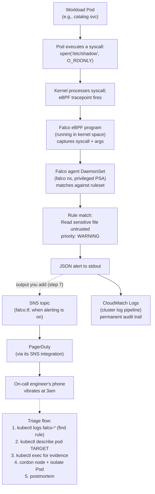

# 14.13 — Runtime defense & container security

> **Admission control stops bad images. PSA stops bad Pod specs. Image signing
> proves provenance. None of those mechanisms can see what happens *inside* a
> running container at 3am: a process being spawned, a sensitive file being
> read, an unexpected outbound TCP connection.** Runtime defense is the layer
> that watches the kernel itself: **Falco** + **Tetragon** for syscall-level
> rules, **GuardDuty** for AWS-side detections, and the alerting glue (SNS →
> PagerDuty → human) that closes the loop from "syscall fired" to "engineer
> triaging on their laptop." Falco's namespace is one of the **two**
> privileged PSA namespaces in the bookstore-platform Terraform tree
> (kube-system, for Cilium, is the other), because its eBPF driver mounts host
> paths that `restricted` does not allow.

**Estimated time:** ~30 min read · ~90 min hands-on
**Prerequisites:** [Part 05 ch.02](../05-security/02-pod-security.md): PSA stops bad Pod specs but not syscalls · [Part 14 ch.12](./12-supply-chain-security.md): admission stops bad images but not behavior · [Part 05 ch.03](../05-security/03-supply-chain.md): image signing and SBOMs

**You'll know after this:** • understand why admission + PSA + signing leave runtime as the unwatched layer · • deploy Falco and know why its namespace must run at privileged PSA · • know what GuardDuty EKS Protection covers and what it costs after the trial · • configure SNS → PagerDuty alerting so a syscall trigger ends with an engineer on their laptop · • triage a Falco alert end-to-end (rule match → Pod → workload → owner → containment decision)

<!-- tags: runtime-defense, falco, security, day-2, cloud -->

## Why this exists

[Part 05 ch.02](../05-security/02-pod-security.md) shipped Pod
Security Admission. [Part 05 ch.03](../05-security/03-supply-chain.md)
shipped image signing + SBOMs + Trivy. The bookstore-platform tree
deepened both with its `kyverno-image-signing.tf` ClusterPolicy
([14.12](./12-supply-chain-security.md)). Those three layers, admission +
image provenance + signing, answer the question *"what can land in my
cluster?"* with high confidence.

They cannot answer the question *"what is my cluster doing *right now*?"*

A signed, scanned, admission-passed image can still:

- **Get exploited at runtime.** Log4Shell, the Spring4Shell variants,
  the steady drip of CVE-of-the-week in popular base images — none of
  these CVEs were knowable at scan time. The CVE database catches up
  *after* an exploit is in the wild; runtime defense catches what the
  scanner missed.
- **Be hijacked into mining cryptocurrency.** A compromised CI token
  pushes a poisoned image to ECR; the image passes signature
  verification (signed by the attacker's key, registered as a
  legitimate identity); the image runs in production and spawns
  `xmrig` against a mining pool. Static scanning misses it; runtime
  defense sees the unfamiliar process exec.
- **Reach for credentials it shouldn't.** A confused-deputy bug in a
  Go service makes it read
  `/var/run/secrets/eks.amazonaws.com/serviceaccount/token` (the IRSA
  projected token) when no legitimate code path should. Falco sees the
  file open, but its default rules do not name that path, so catching
  this takes a custom rule.
- **Spawn a shell.** Web shells (a malicious request that causes the
  application to `exec /bin/sh`) are still one of the top attack
  patterns in 2026. The image is correct; the running process is
  doing the wrong thing. The hands-on shows what the default rules
  catch, and the threats table says what they do not.

The threat model post-admission is **container escape, privilege
escalation, lateral movement, cryptojacking, credential theft, web
shells**. The bookstore-platform tree ships [`falco.tf`](../examples/bookstore-platform/terraform/falco.tf)
gated by `var.enable_falco = false`. It is off by default because runtime
defense adds a per-node eBPF agent that needs serious privilege, a
privileged-PSA namespace, and an alert pipeline you actually intend to
read. The tree therefore ships Falco off (`enable_falco = false`). Set it
to `true` once an alert destination and a triage owner exist; step 7 wires
the alert output.

The complementary layer is **GuardDuty**, AWS's managed threat-detection
service. GuardDuty analyses CloudTrail management events, VPC flow logs
and Route 53 Resolver DNS logs without extra setup. EKS Protection adds
the EKS audit log, and Runtime Monitoring adds an agent on the nodes;
both are paid after a 30-day free trial. It can't replace Falco's
syscall-level depth, but it catches AWS-side patterns Falco can't see:
a node IP talking to a known malicious address, a DNS lookup for a
domain on its threat-intel list, or unusual AWS API calls in CloudTrail,
including calls made from outside the cluster with a stolen token.

[Part 11 ch.05](../11-advanced-production-patterns/05-secrets-at-scale.md)
discussed credential theft prevention from the secrets-storage side.
This chapter is the **runtime-detection** complement: even if a
credential leaks, what does the cluster *do* about a process
attempting to use it suspiciously?

> **In production:** Runtime defense is the layer most teams skip and
> regret. The half-day setup (Falco + an alert email + a triage
> runbook) prevents the multi-week incident retrospective that ends
> with "we had no visibility into the cluster at runtime." Turn Falco on
> with `enable_falco = true` only together with the alert destination and
> the triage runbook; the tree does not ship a second, "production" form.

## Mental model

**Three runtime-defense layers compose on EKS: kernel-level syscall
visibility (Falco / Tetragon eBPF agents), cluster-level audit log
analysis (GuardDuty's EKS Audit Log Monitoring, plus Falco's audit
source where you wire one), and AWS-network-level anomaly detection
(GuardDuty's flow log and DNS analysis). Each catches a different class
of attack; together they answer "what is happening at runtime" from
three angles.**

The three layers:

- **Layer 1: Kernel syscall visibility (Falco / Tetragon).** A
  per-node DaemonSet running an eBPF program attached to syscall
  tracepoints. Every `execve`, `openat`, `connect`, `mount`,
  `setuid` flows past the eBPF probe; the agent matches the syscall
  + arguments against a ruleset and emits an alert on match.
  `falco.tf` sets `driver.kind = "modern_ebpf"`, a driver that loads no
  kernel module and needs kernel 5.8 or later (see the driver comment in
  `falco.tf`).
- **Layer 2: Cluster audit log analysis (GuardDuty + Falco's audit
  source).** The Kubernetes API server's audit log records every
  authenticated API call: who, what, when, what resource. Falco reads
  those events through its `k8saudit` plugin, which expects audit events
  delivered to a webhook. `falco.tf` does not wire that (its header
  leaves it as a TODO), and EKS writes its audit log to CloudWatch Logs
  when control plane logging is on. On these clusters the audit-log layer
  is therefore GuardDuty's EKS Audit Log Monitoring, which runs AWS-managed
  detections over the audit stream.
- **Layer 3: AWS-network-level anomaly detection (GuardDuty + VPC Flow +
  DNS).** Falco doesn't see VPC flow logs, DNS query logs, or AWS API
  calls that originate from outside the cluster's Pods (e.g., a stolen
  IRSA token used from an attacker laptop). GuardDuty does, for the EC2
  instances behind your nodes. Its optional Runtime Monitoring tier runs
  an AWS-managed agent on the nodes and reports runtime events to
  GuardDuty.

**Falco vs Tetragon vs GuardDuty Runtime Monitoring: the trade-off matrix:**

| Tool | Source | Strength | When to use |
|---|---|---|---|
| **Falco** | CNCF (open-source, Sysdig origin) | Large rule set, JSON output for any SIEM, rules you own | Default starting point; works on any K8s |
| **Tetragon** | Cilium project (CNCF) | Filters in the kernel with `TracingPolicy` objects | If you already run Cilium (see [14.15](./15-cilium-ebpf-on-eks.md)) |
| **GuardDuty Runtime Monitoring** | AWS (managed) | AWS-managed detections, findings in GuardDuty and Security Hub | When Falco tuning costs more than the per-vCPU charge |

Falco costs the node CPU and memory in its resource requests. GuardDuty
bills per unit after its 30-day trial; the rates are on the
[GuardDuty pricing page](https://aws.amazon.com/guardduty/pricing/).
A practical order: Falco first, GuardDuty EKS Audit Log Monitoring from
day one, and Runtime Monitoring only if Falco tuning becomes the
bottleneck.

**The Falco rules engine.** A Falco rule has four parts:

- **Macro:** a reusable expression (e.g., `container` = `container.id != "host"`).
- **List:** a reusable set of values (e.g., `shell_binaries` = `[bash, sh, zsh, ash]`).
- **Rule:** a `condition` (boolean expression over syscall events) +
  an `output` (the alert message format) + `priority` (debug, info,
  notice, warning, error, critical, alert, emergency).
- **Override:** the upstream Falco rules ship a large set of canonical
  detections; an override lets you tune a specific rule's priority,
  output, or condition for your environment without forking the
  ruleset.

`falco.tf` sets `falco.priority = "warning"`. The chart documents this
setting as a minimum: rules at that level or more severe load, and the
rest do not ([chart values](https://github.com/falcosecurity/charts/blob/master/charts/falco/values.yaml)
in `helm show values falcosecurity/falco --version 4.13.0`). A NOTICE
rule such as *Terminal shell in container* therefore does not run.
`notice` is verbose (you'll see warnings on legitimate ops); `info` is
firehose territory (every `execve` in every container).

**Privileged-PSA exception.** Falco's eBPF driver loads a kernel eBPF program.
The chart's default runs the container privileged. `falco.tf` sets the chart's
least-privileged option instead, `driver.modernEbpf.leastPrivileged`, which
replaces privileged with four capabilities: `CAP_BPF`, `CAP_PERFMON`,
`CAP_SYS_RESOURCE` and `CAP_SYS_PTRACE`. The DaemonSet also mounts host paths,
among them `/etc`, `/usr`, `/lib/modules` and the container runtime sockets.
The PSA `restricted` profile forbids privileged containers, allows no
capability beyond `NET_BIND_SERVICE`, and forbids hostPath volumes. `baseline`
forbids the hostPath volumes too ([Pod Security
Standards](https://kubernetes.io/docs/concepts/security/pod-security-standards/)).
The namespace therefore needs the `privileged` level even with the
least-privileged option. It is labelled
`pod-security.kubernetes.io/enforce=privileged`. It is one of two privileged
namespaces in the bookstore-platform Terraform tree; kube-system, for Cilium,
is the other. `security/namespace-exceptions.yaml` records it with its reason
and expiry.

**The alert pipeline.** A Falco rule firing produces:

1. **JSON to stdout.** `falco.tf` sets `json_output`, so each Falco
   Pod's container log is JSON. The cluster's log pipeline carries it to
   CloudWatch Logs ([14.05](./05-logging-and-metrics-cost.md)).
2. **HTTP output** (optional). Falco can POST alerts to an HTTP endpoint
   through `http_output`. `falco.tf` does not set it.
3. **SNS topic.** When `falco_alert_email` is set, `falco.tf` creates the
   topic, an email subscription and an IRSA role that can only
   `sns:Publish` to that topic. The role alone does not make Falco publish;
   you add the output that does (step 7 of the hands-on).

The bookstore-platform tree's default is **stdout-only**. Production
forks should wire SNS → PagerDuty via the AWS Events Source for
PagerDuty (covered in [Part 13 ch.12](../13-grand-capstone-bookstore-platform/12-day-2-runbook-on-call-dr-chaos.md)
patterns).

The trap to keep in view: **Falco's default rules are noisy on
day 1**. A fresh install fires on legitimate ops: `kubectl exec`
into Pods is common during debugging; package managers in a build
container trip the package-management rules; CronJobs in `kube-system`
trip several rules per minute. **The first
production-grade Falco operation is rule tuning** — adding
`exception` clauses (or `override` rules) for the noise sources,
not silencing the rule entirely. A team that doesn't tune for a
week ends up disabling alerts; a team that tunes for a week ends
up with a high-signal alert stream.

## Threats and controls

| Threat | Control in this chapter | Deeper |
|---|---|---|
| Unexpected binary or reverse shell in a container | Falco rules at warning and above (drop-and-execute is critical, a netcat reverse shell is warning), routed to an alert pipeline (hands-on steps 3, 7) | 05.08 <!-- link-later: 05.08 -->, [15.10](../15-day-to-day-production-ops/10-incident-response-and-on-call.md) |
| Credential read from a file (IRSA token, mounted secret) | Falco sensitive-file rule, and a custom rule for paths the defaults miss (steps 3, 6) | [14.03](./03-eks-addon-management.md) for IRSA scoping |
| Container escape or activity directly on the node | Triage order: evidence first, then node replacement (Triage section) | [15.10](../15-day-to-day-production-ops/10-incident-response-and-on-call.md) |
| Control-plane misuse, such as `kubectl exec` into kube-system | GuardDuty EKS Audit Log Monitoring (step 8) | [14.05](./05-logging-and-metrics-cost.md) for audit log retention |

The table above does not list web shells. The default terminal-shell rule is
notice-level and needs a tty, and a web shell usually has none, so the tree at
`warning` does not alert on one. Closing that gap needs a rule written for
your server processes, which this chapter does not ship.

Image provenance is the earlier layer: see [14.12](./12-supply-chain-security.md)
and [05.03](../05-security/03-supply-chain.md). This chapter starts after
admission has passed.

## Diagrams

### Diagram A — Falco runtime alert flow (Mermaid)



## Hands-on with the Bookstore Platform

Output blocks in this section are illustrative. They show what to look
for; this chapter's run did not capture them. The commands match chart
4.13.0, the version `falco.tf` pins.

### 0. Prerequisites

- The bookstore-platform tree applied with `enable_falco = true`.
- `kubectl` configured for the cluster.
- (Optional, but recommended) `falco_alert_email` set so SNS has a
  subscriber once you add the output in step 7.

The Terraform shipping this is in
[`../examples/bookstore-platform/terraform/falco.tf`](../examples/bookstore-platform/terraform/falco.tf).
Read it end-to-end before running anything — it documents the
PSA-privileged exception and the IRSA scoping.

### 1. Confirm Falco landed

```bash
kubectl -n falco get pods -l app.kubernetes.io/name=falco
```

Illustrative output:

```text
NAME                READY   STATUS    RESTARTS   AGE
falco-abcde         2/2     Running   0          3m
falco-fghij         2/2     Running   0          3m
falco-klmno         2/2     Running   0          3m
```

One Pod per node (DaemonSet). Verify the namespace is PSA-`privileged`:

```bash
kubectl get ns falco -o jsonpath='{.metadata.labels.pod-security\.kubernetes\.io/enforce}'
# expected: privileged
```

If that returns `restricted` or empty, the Falco Pods are refused:
`restricted` forbids the privileged container and host paths the
DaemonSet needs. The exception is documented in `falco.tf`'s file header.

The container itself is not privileged. Its security context carries the
least-privileged capability list:

```bash
kubectl -n falco get ds falco -o jsonpath='{.spec.template.spec.containers[0].securityContext}'
```

Illustrative output, not captured:

```text
{"capabilities":{"add":["BPF","SYS_RESOURCE","PERFMON","SYS_PTRACE"]},"runAsUser":0}
```

### 2. Inspect the loaded ruleset

```bash
FALCO_POD=$(kubectl -n falco get pod -l app.kubernetes.io/name=falco -o jsonpath='{.items[0].metadata.name}')
kubectl -n falco exec "$FALCO_POD" -c falco -- falco -L | grep -i 'sensitive\|shell'
```

`falco -L` prints the name and description of every loaded rule
([CLI source](https://github.com/falcosecurity/falco/blob/master/userspace/falco/app/options.cpp)).
`falco -l '<RULE>'` prints one rule's description, but not its condition.
The condition lives in the rules file, so read it there:

```bash
kubectl -n falco exec "$FALCO_POD" -c falco -- \
  grep -n -A12 'rule: Terminal shell in container' /etc/falco/falco_rules.yaml
```

### 3. Trigger a sensitive-file read (secure form)

The rule `Read sensitive file untrusted` matches a read that succeeds.
A non-root Pod may not be able to open the real `/etc/shadow`, so this
step mounts a decoy ConfigMap over that path. The Pod runs under
`restricted`. The Pod carries the [baseline](../01-core-workloads/01-pods.md#baseline)
in full. The one addition is the `decoy` volume, which mounts the
ConfigMap key `shadow` read-only over `/etc/shadow` with `subPath`, so the
non-root process reads a harmless file at the path the rule watches.
The Pod names UID 65534 (`nobody`), so `runAsNonRoot` has a number to check.

```yaml
apiVersion: v1
kind: Namespace
metadata:
  name: runtime-test
  labels:
    pod-security.kubernetes.io/enforce: restricted
    pod-security.kubernetes.io/audit: restricted
    pod-security.kubernetes.io/warn: restricted
```

```yaml
apiVersion: v1
kind: ConfigMap
metadata:
  name: decoy-shadow
  namespace: runtime-test
data:
  shadow: "decoy file for the Falco lab, not a credential\n"
```

```yaml
apiVersion: v1
kind: Pod
metadata:
  name: sensitive-read
  namespace: runtime-test
spec:
  automountServiceAccountToken: false
  securityContext:
    runAsNonRoot: true
    runAsUser: 65534
    runAsGroup: 65534
    seccompProfile:
      type: RuntimeDefault
  containers:
    - name: app
      image: public.ecr.aws/docker/library/busybox@sha256:73aaf090f3d85aa34ee199857f03fa3a95c8ede2ffd4cc2cdb5b94e566b11662 # busybox:1.36
      command: ["sh", "-c", "cat /etc/shadow; sleep 3600"]
      securityContext:
        allowPrivilegeEscalation: false
        readOnlyRootFilesystem: true
        capabilities:
          drop: ["ALL"]
      resources:
        requests:
          cpu: 10m
          memory: 16Mi
        limits:
          memory: 64Mi
      volumeMounts:
        - name: tmp
          mountPath: /tmp
        - name: decoy
          mountPath: /etc/shadow
          subPath: shadow
          readOnly: true
  volumes:
    - name: tmp
      emptyDir: {}
    - name: decoy
      configMap:
        name: decoy-shadow
```

Save the three objects in one file, separated by `---`, then apply it and
check that the read succeeded:

```bash
kubectl apply -f runtime-test.yaml
kubectl -n runtime-test wait pod/sensitive-read --for=condition=Ready --timeout=60s
kubectl -n runtime-test logs sensitive-read
```

The logs print the decoy line, which shows the read succeeded.

### 4. Read the Falco alert

```bash
for p in $(kubectl -n falco get pod -l app.kubernetes.io/name=falco -o name); do
  echo "==== $p ===="
  kubectl -n falco logs "$p" -c falco --tail=200 | grep -i "shadow" || true
done
```

Illustrative output (one JSON line per alert):

```text
{"output":"... Read sensitive file untrusted (file=/etc/shadow ...)","priority":"Warning","rule":"Read sensitive file untrusted","time":"...","output_fields":{"container.id":"<HEX>","container.image.repository":"public.ecr.aws/docker/library/busybox","fd.name":"/etc/shadow","proc.name":"cat","user.uid":65534}}
```

Five facts the alert tells you:

- **rule** — *Read sensitive file untrusted* (the matched rule name).
- **priority** — `Warning` (matches Falco's configured priority floor).
- **container.image.repository** — `public.ecr.aws/docker/library/busybox` (which image).
- **proc.name** — `cat` (which process inside the container).
- **fd.name** — `/etc/shadow` (which file).

Falco writes the alert to stdout. Email arrives only after you add the
output in step 7.

### 5. Trigger a shell in a container

The other canonical rule, *Terminal shell in container*, fires on
`kubectl exec` into a Pod when an interactive shell is the target. The
rule is NOTICE, so with `falco.tf` as written (priority `warning`) it does
not run and this step shows nothing:

```bash
kubectl -n runtime-test exec -it sensitive-read -- sh
# type exit to leave the shell
```

To see the alert, set `falco.priority = "notice"` in a test copy of
`falco.tf`, apply it, repeat the command, and set the value back.

This is the alert that fires in production when an attacker (or a
human operator) `exec`s into a workload Pod. The production runbook
is *every alert is investigated* — even the legitimate operator
shells, because absence of false-positives in the runbook *is the
runbook's contract*. (Quietly tuning the rule to allow your SREs
without recording who/when/why is how Falco gets ignored.)

### 6. Inspect a rule and add an exception

The legitimate-shell case is *team-sre exec'ing into kube-system
debug Pods* — happens daily, fires on every exec, drowns the
signal. The right fix is an **exception**, not deletion.

The rule's condition includes `not user_expected_terminal_shell_in_container_conditions`.
The upstream rules define that macro as `(never_true)`, so the exception
list is empty by default. Populate it in a custom rules file. The chart
mounts `customRules` into `/etc/falco/rules.d`, which loads after the
default rules file. `falco.tf` does not set `customRules` yet, so add this
to the `helm_release` values and apply:

```yaml
customRules:
  sre-exceptions.yaml: |-
    - list: kubectl_debug_images
      items: ["nicolaka/netshoot", "registry.k8s.io/e2e-test-images/agnhost"]
    - macro: user_expected_terminal_shell_in_container_conditions
      condition: or (k8s.ns.name = "kube-system" and container.image.repository in (kubectl_debug_images))
      override:
        condition: append
```

`override: condition: append` adds the clause to the macro's default. The
leading `or` is required, and the [Falco overriding docs](https://falco.org/docs/concepts/rules/overriding/)
use the same form.

After applying, an exec into a workload Pod still fires. An exec into a
kube-system Pod whose image is on the list does not.

### 7. Wire the SNS → PagerDuty bridge

`falco.tf` creates the alerts topic, the email subscription and the IRSA
role when `falco_alert_email` is set. It does not configure Falco to publish
to the topic. The output that does is yours to add: an `http_output`
pointed at an endpoint you control that forwards to SNS, or the CloudWatch
Logs path. Once alerts reach the topic, subscribe the endpoint PagerDuty
gives you when you add its Amazon SNS integration to the service. Then a
Falco alert becomes a PagerDuty incident.

### 8. Enable GuardDuty EKS Protection

GuardDuty is account-scoped, so the account controls live in the account
baseline ([14.17](./17-cross-region-dr-account-baseline-90-day-runbook.md)).
For a quick try in one Region:

```bash
aws guardduty create-detector --enable   # skip if a detector already exists
DETECTOR_ID=$(aws guardduty list-detectors --query 'DetectorIds[0]' --output text)
aws guardduty update-detector \
  --detector-id "$DETECTOR_ID" \
  --features Name=EKS_AUDIT_LOGS,Status=ENABLED
```

EKS Protection reads its own copy of the audit log, so control plane
logging is not needed for detection. Turn control plane logging on only if
you want the events in your account. The first 30 days are a free trial;
after that, GuardDuty bills for the audit events it analyses. Runtime
Monitoring is a separate, paid choice.

### 9. Clean up

```bash
kubectl delete namespace runtime-test
```

Deleting the namespace removes the Pod and the decoy ConfigMap. To remove
Falco, set `enable_falco = false` and apply; Terraform removes the Helm
release and the resources it created.

## Triage a runtime alert

The on-call's first move is **capture before the Pod dies**. Evidence
comes first because containment destroys it. The order:

1. **Identify the Pod and workload** from the alert's fields
   (`k8s.ns.name`, `k8s.pod.name`).
2. **Find the owner**: the GitOps repo's CODEOWNERS or the workload's
   `team` label.
3. **Capture evidence**, then contain. Capture the Pod's state, its
   previous logs, its processes and its connections:

   ```bash
   kubectl get pod <TARGET> -n <NS> -o yaml > /tmp/pod-state.yaml
   kubectl logs <TARGET> -n <NS> --previous --tail=1000 > /tmp/pod-logs.txt
   kubectl exec <TARGET> -n <NS> -- ps -ef > /tmp/pod-ps.txt
   kubectl exec <TARGET> -n <NS> -- ss -anptu > /tmp/pod-net.txt
   ```

   The `exec` lines need `ps` and `ss` in the image. Then isolate the Pod
   with a deny-all NetworkPolicy that selects its labels. Deleting it
   evicts the process, and the controller starts a replacement.
4. **Escalate on recurrence.** If the alert fires again on the
   replacement Pod, the image is suspect, not one instance. Roll back
   ([15.07](../15-day-to-day-production-ops/07-rollback-playbook.md)).
5. **Close with a postmortem** that has a named owner.

The default rules' `container` macro is `container.id != host`, so most
rules fire only for in-container activity. Activity on the node itself
needs host-scope rules. Treat a node-level alert as the "drop everything"
case: page everyone, cordon the node, snapshot its volume, and take it out
of service. The recovery is **node replacement**, not Pod restart.

## How it works under the hood

**The event path.** The Falco driver captures the syscalls the rules need
and hands them to Falco's userspace engine. The engine adds the container
and Kubernetes metadata it can resolve, evaluates the rules, and writes
each match as an alert. Because the rules run in userspace, a condition is
ordinary text in the rules file.

**The rules engine.** Falco is a streaming event processor. A rule's
condition is a boolean expression over an event's fields, such as
`proc.name`, `fd.name`, `container.image.repository` and `k8s.ns.name`.
Falco watches the Kubernetes API for Pod and Namespace metadata to fill the
`k8s.*` fields. Broad conditions match almost everything, so tuning starts
there.

**The Tetragon approach.** Tetragon attaches to kernel events in a similar
way but filters them inside the kernel with `TracingPolicy` objects, so its
userspace agent receives fewer events. Its filters are less expressive than
Falco's rule language. For clusters on Cilium ([14.15](./15-cilium-ebpf-on-eks.md)),
it is the natural sibling; for standalone runtime defense, Falco is the more
established choice.

**GuardDuty's detections.** GuardDuty runs AWS-managed detections over the
audit log and the other sources it reads. Audit-log analysis needs no agent.
Runtime Monitoring adds an AWS-managed agent on the nodes. The finding types
are listed on the
[EKS Protection page](https://docs.aws.amazon.com/guardduty/latest/ug/kubernetes-protection.html).

**When to pay for Runtime Monitoring.** When Falco's rule tuning costs more
engineering time than the per-vCPU charge. Stay with Falco when you want full
control of the ruleset and no per-vCPU bill.

## Operating notes

> **In production:** Falco's default ruleset is a *starting point*,
> not a steady-state config. The first month is heavy rule-tuning:
> exception clauses for your shells (which images, which users),
> your build patterns (which containers run `apt-get install`),
> your CronJobs (which jobs read `/etc/passwd` as part of legitimate
> work). Allocate a 4-hour weekly review for the first month; the
> rate drops after that. Skip this and the alert stream becomes
> noise; the team disables alerts; the cluster has no runtime
> defense.

> **In production:** Falco's alerts should drive **incidents**, not
> tickets. A genuinely-fired Falco rule is, by construction, a
> potential security event — a shell that shouldn't exist, a file
> read that shouldn't happen, a binary that shouldn't be on the
> filesystem. Route to PagerDuty (or your equivalent), severity
> "WARNING" for `priority=warning` rules + "CRITICAL" for
> `priority=critical/alert/emergency` rules. The on-call rotation
> investigates each one within 30 minutes; closes with a 1-line
> postmortem (false-positive → tune rule; true-positive → escalate).

> **In production:** Falco's alert JSON is the forensic record.
> Forward it to CloudWatch Logs and keep it for the retention your audit
> requires ([14.05](./05-logging-and-metrics-cost.md)). It is the source for the
> post-incident question *"when did this start happening?"* and *"how many
> other Pods exhibited the same pattern in the prior week?"* CloudWatch
> Logs Insights queries the JSON natively:
>
> ```text
> fields @timestamp, output_fields.container.image.repository, rule
> | filter rule = "Read sensitive file untrusted"
> | stats count() by output_fields.container.image.repository
> ```

> **In production:** GuardDuty's 30-day trial costs nothing. After it,
> EKS Protection keeps billing for the audit events it analyses, so decide
> that on purpose and name the cost owner in the runbook. Runtime
> Monitoring is a second, paid decision.

> **In production:** `falco.tf` requests 100m CPU and 512Mi memory, with
> limits of 1 CPU and 1Gi. Measure the real use on your node sizes, then
> adjust these values.

## Quick Reference

```bash
# Confirm Falco is running.
kubectl -n falco get pods -l app.kubernetes.io/name=falco

# Tail the alert stream from all Falco Pods.
kubectl -n falco logs -l app.kubernetes.io/name=falco -c falco -f --tail=10

# List loaded rules, then read one rule's condition from the rules file.
FALCO_POD=$(kubectl -n falco get pod -l app.kubernetes.io/name=falco -o jsonpath='{.items[0].metadata.name}')
kubectl -n falco exec "$FALCO_POD" -c falco -- falco -L
kubectl -n falco exec "$FALCO_POD" -c falco -- grep -n -A12 'rule: <RULE-NAME>' /etc/falco/falco_rules.yaml

# Search alerts by rule name (CloudWatch Logs Insights query).
fields @timestamp, output_fields.container.image.repository, rule
| filter rule = "<RULE-NAME>"
| stats count() by output_fields.container.image.repository

# Exercise the sensitive-file rule with the secure test Pod.
kubectl -n runtime-test exec sensitive-read -- cat /etc/shadow

# Enable GuardDuty EKS Audit Log Monitoring (30-day trial, then billed).
aws guardduty create-detector --enable   # skip if a detector exists
DET=$(aws guardduty list-detectors --query 'DetectorIds[0]' --output text)
aws guardduty update-detector --detector-id "$DET" \
  --features Name=EKS_AUDIT_LOGS,Status=ENABLED

# List GuardDuty findings updated in the last day.
aws guardduty list-findings --detector-id "$DET" \
  --finding-criteria '{"Criterion":{"updatedAt":{"GreaterThan":'$(($(date +%s%3N) - 86400000))'}}}'

# Forensic evidence capture (incident response).
kubectl get pod <TARGET> -n <NS> -o yaml > /tmp/pod-state.yaml
kubectl logs <TARGET> -n <NS> --previous --tail=1000 > /tmp/pod-logs.txt
kubectl exec <TARGET> -n <NS> -- ps -ef > /tmp/pod-ps.txt
kubectl exec <TARGET> -n <NS> -- ss -anptu > /tmp/pod-net.txt
```

Runtime-defense checklist (the production setup is right when all six are yes):

- [ ] Falco DaemonSet running on every node (`enable_falco = true`).
- [ ] `falco` namespace labelled PSA `enforce=privileged`, registered in
      `security/namespace-exceptions.yaml`. The other privileged namespace in
      the Terraform tree is `kube-system` (Cilium), registered the same way.
- [ ] Falco's IRSA role has `sns:Publish` to the alerts topic and *only*
      that topic, and the output that uses it is wired (step 7).
- [ ] The alerts reach on-call: a tested page from PagerDuty, not just an
      email.
- [ ] Falco alert logs are kept for the retention your audit requires.
- [ ] GuardDuty EKS Protection is enabled, and someone owns its bill after
      the trial.

## Test your understanding

> Try each before opening the answer drawer. The act of trying is the exercise; the answer is the check.

1. **Admission control, PSA, and image signing are all in place. What class of attacks does runtime defense (Falco) catch that none of those layers can?**
   <details><summary>Show answer</summary>

   Anything that goes wrong **after** a Pod has been admitted and started. The pre-admission layers prove the image is signed, the Pod spec is sane, the container won't run privileged — but a CVE in libssl exploited at runtime, a confused-deputy read of the IRSA token, a web shell, a cryptojacker spawned from a compromised dependency, lateral movement attempts — these all happen at runtime inside the kernel. Falco's eBPF probes attach to syscall tracepoints (`execve`, `openat`, `connect`, `setuid`) and match patterns; the kernel sees what the process is actually doing, regardless of how the image got to the cluster.

   </details>

2. **Falco fires *Read sensitive file untrusted* on a web Pod at 03:14. PagerDuty pages you. Walk through the triage section.**
   <details><summary>Show answer</summary>

   (1) Identify the Pod and workload from the alert's fields (`k8s.pod.name`, `k8s.ns.name`); (2) find the owner from the GitOps repo's CODEOWNERS or the workload's `team` label; (3) capture evidence first (Pod state, previous logs, `ps`, `ss`), then isolate the Pod or delete it, since a replacement comes up without the attacker's process; (4) if the alert fires again on the replacement, the image is suspect, so roll back ([15.07](../15-day-to-day-production-ops/07-rollback-playbook.md)); (5) the runbook ends with a postmortem that has a named owner.

   </details>

3. **You install Falco and the cluster starts running a noticeably hotter on CPU. The team wants to disable it. What's the better answer and why?**
   <details><summary>Show answer</summary>

   Measure first, then tune. Falco's cost is the node CPU and memory in its resource requests, and that cost grows with how many rules match common syscalls. If the cluster is hotter, the noise is usually in the ruleset, not the eBPF probe itself. Audit the rule list and mute the rules that are not actionable for your environment, for example by adding an exception for a tenant whose images intentionally include shells, or by tightening the rule. The chapter's discipline: every Falco rule has a runbook anchor and an owner; rules that don't are tech debt, not runtime defense. Disabling Falco trades observability for CPU, which is the wrong trade.

   </details>

4. **Hands-on extension: `kubectl exec` into a test Pod and run `cat` on the IRSA token path. What does Falco do?**
   <details><summary>What you should see</summary>

   Nothing, with the default rules. The upstream sensitive-file list is `/etc/shadow`, `/etc/sudoers`, `/etc/pam.conf` and `/etc/security/pwquality.conf`, plus the `/etc/sudoers.d` and `/etc/pam.d` directories, and the IRSA token path is not among them. To catch it, add a custom rule for that path, in the same `customRules` form as step 6. Run the test only in a throwaway namespace, not against a bookstore workload.

   </details>

## Further reading

- **Falco official documentation**
  <https://falco.org/docs/>; the canonical Falco reference,
  including the rule language, the eBPF driver options, and the
  alert output formats this chapter walks.
- **Falco overriding rules**
  <https://falco.org/docs/concepts/rules/overriding/>; the `override`
  and `append` syntax used in step 6.
- **Falco kernel event sources**
  <https://falco.org/docs/concepts/event-sources/kernel/>; the driver
  options, including the least-privileged mode for modern eBPF.
- **Falco rules repository**
  <https://github.com/falcosecurity/rules>; the upstream rule
  packs (default `falco_rules.yaml` + the `application_rules.yaml`
  + the K8s-audit ruleset). Source of every rule mentioned here.
- **Cilium Tetragon documentation**
  <https://tetragon.io/docs/>; the upstream Tetragon docs,
  including the TracingPolicy syntax and the kernel-event filtering
  story this chapter contrasts with Falco.
- **AWS GuardDuty for EKS Protection**
  <https://docs.aws.amazon.com/guardduty/latest/ug/kubernetes-protection.html>;
  the AWS-side documentation for EKS Audit Log Monitoring and EKS Runtime
  Monitoring, including the 30-day trial and the finding types.
- **AWS GuardDuty foundational data sources**
  <https://docs.aws.amazon.com/guardduty/latest/ug/guardduty_data-sources.html>;
  CloudTrail management events, VPC flow logs and DNS logs, which
  GuardDuty analyses without extra setup.
- **AWS GuardDuty pricing**
  <https://aws.amazon.com/guardduty/pricing/>; the billing units for each
  protection plan.
- **Kubernetes Pod Security Standards**
  <https://kubernetes.io/docs/concepts/security/pod-security-standards/>;
  what `restricted` and `privileged` allow.
- **NIST SP 800-190 — Application Container Security Guide**
  <https://csrc.nist.gov/publications/detail/sp/800-190/final>; the
  US government guidance on container security including runtime
  defense; the threat-model framing in this chapter aligns with
  the SP 800-190 categorization.
