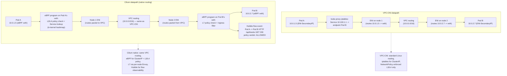

# 14.15 — Cilium / eBPF on EKS

> **EKS clusters come with VPC-CNI by default — AWS's CNI plugin
> that assigns Pods real VPC IPs via ENI secondary addresses.
> VPC-CNI is solid, AWS-native, and the right call for many
> clusters. But it has a ceiling: NetworkPolicy is L3/L4-only
> (port + IP), service routing goes through `kube-proxy` (iptables,
> nftables, or the deprecated IPVS; iptables mode has scaling
> ceilings on large clusters), and
> there's no flow-level observability beyond VPC Flow Logs (which
> see ENI traffic but lose the Pod-level identity once Pods are
> behind a Service).** Cilium is the eBPF-native CNI that breaks
> through all three: L7 NetworkPolicy (HTTP methods, gRPC services,
> Kafka topics), `kube-proxy`-replacement (faster service routing
> in-kernel), and Hubble (real-time flow visibility with Pod
> identity). This chapter walks the trade-offs, the migration
> reality (it's **not** a `kubectl apply` — VPC-CNI must be removed
> before Cilium takes over), and the production cases where
> staying on VPC-CNI is the right call.

**Estimated time:** ~45 min read · ~half-day hands-on
**Prerequisites:** [Part 14 ch.03](./03-eks-addon-management.md): vpc-cni is the addon Cilium replaces · [Part 02 ch.06](../02-networking/06-network-policies.md): NetworkPolicy fundamentals you'll extend to L7 · [Part 11 ch.04](../11-advanced-production-patterns/04-service-mesh.md): mesh-vs-CNI trade-off

**You'll know after this:** • compare VPC-CNI and Cilium across NetworkPolicy (L3/L4 vs L7), service routing (kube-proxy vs eBPF), and observability (VPC Flow Logs vs Hubble) · • migrate from VPC-CNI to Cilium safely (it's not a `kubectl apply` — VPC-CNI must be removed first) · • author L7 NetworkPolicy that matches HTTP methods, gRPC services, or Kafka topics · • read Hubble flow data to debug a Pod-to-Pod connectivity issue · • choose when staying on VPC-CNI is the right call (small clusters, AWS-only feature parity needs)

<!-- tags: cilium, networking, eks, observability, cloud -->

## Why this exists

The bookstore-platform tree at
[`../examples/bookstore-platform/terraform/`](../examples/bookstore-platform/terraform/)
ships with **VPC-CNI** as the managed addon. Phase 14-R deliberately
kept Cilium out of the main tree — it's a major operational change
that requires draining the cluster + reconfiguring the CNI, not a
flag flip. Instead, Cilium lives in
[`cilium-installation.tf.example`](../examples/bookstore-platform/terraform/cilium-installation.tf.example)
as a documented opt-in: rename the file, follow the migration
runbook, accept the risk.

VPC-CNI's strengths are real and worth preserving on most clusters:

- **Pods get real VPC IPs.** Every Pod has an IP from the VPC's CIDR,
  routable from anywhere in the VPC. Services external to the
  cluster — RDS, ElastiCache, on-prem connections via TGW — can
  reach Pods directly with no NAT in between. Security groups can
  reference Pod IPs.
- **AWS-native everything.** Security groups for Pods (a feature
  that gives a Pod its own SG), prefix delegation (more Pods per
  ENI), IPv6-only mode, custom networking with secondary CIDRs —
  all VPC-CNI features. AWS support owns the bugs.
- **Simple ops.** No CRDs to learn, no Helm chart to upgrade, no
  per-cluster Cilium config tuning. The vpc-cni addon updates with
  `terraform apply` (Phase 14-R's `before_compute = true` makes
  first-boot stable); kube-proxy is the standard kube-proxy.

VPC-CNI's ceilings are also real:

- **NetworkPolicy is L4-only.** `NetworkPolicy` CRDs against VPC-CNI
  enforce L3/L4 — *which Pod can reach which Pod on which port*. That
  prevents lateral movement at the network level. It does **not**
  let you say *"frontend can only reach catalog's `/api/books` GET
  endpoint"* — that's L7, and stock NetworkPolicy can't express it.
  A service mesh (Istio, Linkerd) can; so can Cilium's L7
  NetworkPolicy.
- **kube-proxy's iptables mode slows as Services grow.** Each Service
  change updates rules on every node. The
  [Kubernetes docs](https://kubernetes.io/docs/reference/networking/virtual-ips/)
  compare the modes at scale. The `nftables` mode is GA from 1.33, and
  the `ipvs` mode is deprecated. Cilium's kube-proxy replacement does
  service lookup in eBPF maps and creates no iptables rules.
- **Observability gap.** "What just happened between Pod A and
  Pod B?" is hard to answer from VPC Flow Logs (which see ENI
  traffic but lose Pod identity behind Services) and harder still
  from kube-proxy itself (no observability). Cilium's Hubble
  exports flow events with **Pod identity**, **Service identity**,
  **L4 + L7 protocols** all in one stream.

[Part 02 ch.06](../02-networking/06-network-policies.md) covered
NetworkPolicy in the abstract — but ran on Calico (a different CNI)
to get policy enforcement at all (kind's default CNI doesn't enforce
NetworkPolicy). That chapter is the prerequisite; this is the
EKS-specific story: when does it make sense to swap VPC-CNI for
Cilium, what does the swap look like operationally, and what does
the trade-off look like in production?

> **In production:** Cilium is the right call when (a) you need L7
> NetworkPolicy without a service mesh, (b) you're operating
> clusters at >1000 Services where kube-proxy's iptables behavior
> hurts, or (c) you want Hubble's flow visibility. It is the
> wrong call when (a) you depend on VPC-CNI-specific features
> (Pod security groups, secondary CIDR via custom networking,
> Pod IPv6 from the VPC pool), or (b) you have AWS-side network
> patterns (Transit Gateway routes, on-prem direct connect)
> that assume Pod IPs are VPC-routable — Cilium's `routingMode:
> native` preserves this on EKS, but tunnel mode (`vxlan`)
> hides Pod IPs behind node IPs.

## Mental model

**Three operational axes distinguish a Cilium-on-EKS cluster from
a VPC-CNI cluster: the *datapath* (how packets flow between Pods —
VPC-CNI uses standard Linux routing + ENI hardware; Cilium uses
eBPF programs attached to the network stack), the *policy
enforcement layer* (VPC-CNI hands L4 NetworkPolicy to iptables;
Cilium evaluates L3/L4/L7 policy in eBPF), and the *observability
layer* (VPC-CNI offers VPC Flow Logs; Cilium offers Hubble's flow
stream).**

The three axes:

- **Axis 1 — Datapath.** Where do packets go between Pods?
  - **VPC-CNI:** Pod has a VPC IP from an ENI secondary address.
    Pod-to-Pod traffic on the same node loops through the kernel
    bridge (or veth pair → loopback for ENI-attached Pods). Pod-to-
    Pod across nodes goes through the underlying ENI hardware
    routing. Service-to-Pod (ClusterIP) goes through kube-proxy
    iptables.
  - **Cilium (native routing mode, recommended on EKS):** Pod has
    a secondary private IP from a VPC subnet, but only with ENI IPAM
    (`ipam.mode=eni`). The chart default is cluster-pool, which hands out
    IPs from a separate pod CIDR. Pod-to-Pod traffic
    goes through eBPF programs attached to each Pod's veth +
    network namespace. Service-to-Pod routing is done by eBPF
    programs replacing kube-proxy entirely (`kubeProxyReplacement:
    true`). The packets traverse the *same physical network* as
    VPC-CNI; the difference is the in-kernel logic.
  - **Cilium (tunnel mode, vxlan):** Pod IPs are private to the
    cluster; Pod-to-Pod across nodes is wrapped in VXLAN with the
    node IPs as outer headers. **Avoid on EKS** — it breaks the
    AWS-native "Pod IPs are VPC-routable" property + adds tunnel
    overhead with no benefit.

- **Axis 2 — Policy enforcement.** What policies can the CNI
  evaluate?
  - **VPC-CNI + NetworkPolicy:** L3/L4 only. CIDR + port + protocol.
    Enforced by the VPC CNI network policy engine
    ([eBPF-based](https://docs.aws.amazon.com/eks/latest/userguide/cni-network-policy-configure.html),
    off on new clusters until enabled) or by a third-party engine such as
    Calico. The CRD is stock `networking.k8s.io/NetworkPolicy`.
  - **Cilium NetworkPolicy:** L3/L4 + L7. Adds CRDs
    `CiliumNetworkPolicy` and `CiliumClusterwideNetworkPolicy` with
    a richer DSL: HTTP method/path matching, gRPC method filtering,
    Kafka topic + role filtering, DNS-based selection. L3/L4 enforced in
    eBPF. L7 rules go to a per-node Envoy proxy.

- **Axis 3 — Observability.** What can you see about cluster
  networking?
  - **VPC-CNI:** VPC Flow Logs (per-ENI, capture src/dst IP + port
    + protocol + action). Cluster-side: nothing structured beyond
    `kubectl exec netshoot` debugging.
  - **Cilium:** Hubble exports flow events with Pod identity,
    Service identity, namespace, L4 protocol, L7 headers (HTTP
    method/path), policy verdict (allowed/denied + which policy
    matched). Hubble Relay aggregates across nodes; Hubble UI
    renders a real-time service-map; Hubble CLI streams flows.

**Cilium NetworkPolicy DSL examples.** The expressiveness gap is the
selling point:

Section 3 applies this policy in full: it selects the catalog Pods and
admits the storefront Pods on port 8080, but only for GET requests to
`/api/books` paths.

Stock NetworkPolicy can't express the HTTP-level part. To get the same
enforcement on VPC-CNI, you'd need a service mesh (Istio AuthorizationPolicy
at L7); Cilium expresses it at the CNI level, with its per-node proxy applying
the HTTP rule.

```yaml
# DNS-based egress allowlist.
spec:
  endpointSelector:
    matchLabels:
      app: catalog
  egress:
    - toEndpoints:
        - matchLabels:
            "k8s:io.kubernetes.pod.namespace": kube-system
            "k8s:k8s-app": kube-dns
      toPorts:
        - ports:
            - port: "53"
              protocol: ANY
          rules:
            dns:
              - matchPattern: "*"
    - toFQDNs:
        - matchName: "api.stripe.com"
      toPorts:
        - ports: [{port: "443", protocol: "TCP"}]
```

The kube-dns rule lets lookups through Cilium's DNS proxy, which tracks
the answers. Egress is allowed to `api.stripe.com` only (resolved at DNS-lookup
time; Cilium hooks DNS responses to maintain the IP allowlist).
Stock NetworkPolicy uses CIDR-based egress only — no FQDNs.

**The migration story (the part everyone underestimates).** Moving
from VPC-CNI to Cilium on a running cluster is NOT `kubectl apply`:

1. **VPC-CNI is the active CNI**, plumbing every Pod's network ns.
   You can't just install Cilium alongside it — the kernel can't
   have two CNI plugins managing the same node.
2. **The migration sequence is drain + reconfigure:**
   - Remove `vpc-cni` from `module.eks.cluster_addons` (or set
     `preserve = false`).
   - Apply, which causes EKS to remove the vpc-cni daemonset.
     *Existing nodes still have CNI plugin files in
     `/etc/cni/net.d/` — they don't lose network until restarted.*
   - Install Cilium via Helm. Cilium's Agent DaemonSet schedules
     onto every node, but **only takes over Pods that restart**.
     Existing Pods keep their VPC-CNI-managed network until they
     restart; new Pods get Cilium.
   - **Drain every node** (`kubectl drain`). Karpenter (or the
     managed node group) replaces them. New nodes have Cilium as
     the only CNI from boot. Cilium-shaped Pods get scheduled.
   - At the end, every Pod is Cilium-managed.
3. **The data-plane downtime risk** is the cluster-wide drain
   sequence. Workloads with proper PDBs survive (Karpenter respects
   PDBs); workloads without PDBs may see brief Pod-restart
   downtime. For stateful workloads, the drain is per-AZ to
   preserve replicas.
4. **The "in-flight" period** is the trickiest part. Mid-migration,
   some Pods are VPC-CNI-shaped (old IPs, old policy enforcement)
   and some are Cilium-shaped (new IPs, Cilium-policy-enforced).
   Cross-Pod traffic between them works (both use the underlying
   VPC routing) — but policy enforcement is **inconsistent**: a
   Cilium-shaped Pod evaluates CiliumNetworkPolicy, a VPC-CNI-shaped
   Pod evaluates stock NetworkPolicy. Production migrations do this
   off-hours with full smoke testing post-migration.

Size the window of a running-cluster migration from a rehearsal in
staging. A greenfield cluster (Cilium from boot) skips the drain.
**The greenfield path is the right one for any new EKS cluster
where Cilium is desired.**

**Cluster Mesh (cross-cluster connectivity without a service mesh).**
Cilium's Cluster Mesh feature lets two Cilium clusters share a
service namespace: a Service in cluster A is reachable from a Pod
in cluster B via the Service's name, with traffic going across the
network underneath (same VPC, peered VPCs, or via TGW). This is
**not** a service mesh — there's no sidecar, no L7 traffic
management, no per-call mTLS by default — but it's the simplest
way to make Pods in cluster B reach Services in cluster A. The
trade-off vs Istio multi-cluster: Cluster Mesh is lighter (no
sidecar tax) but offers fewer features (no canary across clusters,
Cilium mutual authentication does not run across a mesh). All clusters in a
mesh form one trust domain, so connect only clusters with equivalent security.

The trap to keep in view: **`kubeProxyReplacement: true` removes
kube-proxy entirely.** Cilium provides Service routing, and the
kube-proxy DaemonSet is uninstalled. Workloads that *depended* on
kube-proxy's iptables rules (a `hostNetwork: true` Pod that
talked to a ClusterIP, expecting iptables NAT) may need adjustment.
The Phase 14-R `cilium-installation.tf.example` sets
`kubeProxyReplacement: true` because the kube-proxy-replacement is
the headline feature; but if a workload depends on the old
iptables-based path, configure `kubeProxyReplacement: false` (or
the `partial` middle mode) and accept the kube-proxy DaemonSet
staying around.

## Threats and controls

| Threat | Control in this chapter | Goes deeper |
|---|---|---|
| A pod reaches an HTTP method or path its caller should not use | CiliumNetworkPolicy with HTTP rules (section 3) | [02.06](../02-networking/06-network-policies.md) for L3/L4 policy |
| A workload calls a host it should never reach, named by DNS | `toFQDNs` egress allowlist, with the kube-dns exception | [14.08](08-vpc-endpoints-and-egress.md) for VPC egress |
| The CNI agent is a host-level process with extra capabilities | `kube-system` labelled privileged and registered as an exception | Runtime detection, Part 05 [chapter 05.08](../05-security/08-audit-detection-and-incident-response.md); [14.13](13-runtime-defense-and-container-security.md) |
| A running-cluster migration leaves two CNIs and mixed policy | Drain in sequence, with a Velero backup first | [14.14](14-backup-and-restore-velero.md) |
| Hubble flow data (pod names, HTTP paths) reaches someone outside the cluster | The Hubble relay and UI stay `ClusterIP`, the chart default, and are reached by port-forward or `cilium hubble ui` (section 4); no LoadBalancer or Ingress in front of them | [Hubble setup](https://docs.cilium.io/en/stable/observability/hubble/setup/), [14.05](05-logging-and-metrics-cost.md) for log retention |

## Diagrams

### Diagram A — VPC-CNI vs Cilium datapath (Mermaid)



### Diagram B — Capability matrix (ASCII)

```text
CAPABILITY                          VPC-CNI    VPC-CNI+         CILIUM     CILIUM + ISTIO
                                    only       AWS Network      native     (deep mesh)
                                               Policy
─────────────────────────────────  ────────  ────────────────  ─────────  ─────────────────
L3/L4 NetworkPolicy                 NO        YES               YES        YES
L7 HTTP method/path policy          NO        NO                YES        YES
L7 gRPC method policy               NO        NO                YES        YES
L7 Kafka topic policy               NO        NO                YES        partial
DNS-based egress allowlist (FQDN)   NO        NO                YES        YES
mTLS between Pods                   NO        NO                NO¹        YES
Per-Pod security groups (AWS SG)    YES       YES               NO         NO
Pod IPv6 from VPC pool              YES       YES               NO         NO
Custom networking (secondary CIDR)  YES       YES               YES²       YES²
kube-proxy replacement              NO        NO                YES        YES (via Cilium)
Flow observability (Pod identity)   limited   limited           Hubble     Hubble + Kiali
Cross-cluster service routing       NO        NO                Cluster    Istio
                                                                 Mesh
─────────────────────────────────  ────────  ────────────────  ─────────  ─────────────────
Operational complexity              LOW       LOW (managed)     MEDIUM     HIGH
AWS support owns the bugs           YES       YES               NO         NO
─────────────────────────────────  ────────  ────────────────  ─────────  ─────────────────
RECOMMENDATION FOR BOOKSTORE-PLATFORM:
  Default (Phase 14-R):     VPC-CNI, with its network policy engine off until enabled.
  L7 needed, no mesh:       Cilium native (this chapter).
  Service-mesh + L7:        Cilium + Istio (Part 11 ch.04 + Cilium chapter).

¹ Cilium offers WireGuard + IPsec node-to-node encryption (not Pod-to-Pod mTLS by default). Its opt-in mutual authentication is beta, SPIRE-only, and off by default.
² Cilium supports VPC secondary CIDR but with different config than VPC-CNI's IPv4PoolName.
```

## Hands-on with the Bookstore Platform

### 0. Prerequisites

This chapter's hands-on is **opt-in and destructive** — it migrates
the cluster from VPC-CNI to Cilium. **Do not run on a production
cluster without a full Velero backup (ch.14.14) and an off-hours
maintenance window.**

For a learning-only run, the recommendation is **greenfield** — boot
a fresh cluster from `eks.tf` without the `vpc-cni` addon, then
install Cilium from boot. The hands-on below documents both paths.

- A test cluster (either fresh or expendable) running EKS 1.37 (the
  bookstore tree's default) on AL2023-based nodes (Cilium's system
  requirements ask for kernel 5.10 or later). Cilium 1.20, installed below, is
  e2e-tested on Kubernetes 1.33-1.36. No stable Cilium release lists 1.37 yet
  (main and the latest v1.21 pre-releases do), so on 1.37 you are relying on
  Kubernetes' backward compatibility.
- `kubectl` configured.
- `helm` 3.x.
- `cilium` CLI installed (`brew install cilium-cli` or grab a release
  from <https://github.com/cilium/cilium-cli/releases>).
- A Velero backup of the cluster taken in the last hour (for the
  migration path).

The Terraform shipping the Cilium config skeleton is in
[`../examples/bookstore-platform/terraform/cilium-installation.tf.example`](../examples/bookstore-platform/terraform/cilium-installation.tf.example).
Read its file header — it documents the migration steps and the PSA
exception for Cilium's agents.

### 1. Greenfield path — fresh cluster with Cilium from boot

In `eks.tf`, comment out (or remove) the `vpc-cni` entry from
`cluster_addons`. In `addons.tf`, remove the `aws_eks_addon.kube_proxy`
resource. The EKS add-on is a standalone resource there, not an entry in
`cluster_addons`. Leaving it in place would keep the EKS-managed kube-proxy
and its DaemonSet running alongside Cilium's replacement.

```hcl
# eks.tf
cluster_addons = {
  # vpc-cni = { ... }   # REMOVED for Cilium clusters
}

# addons.tf: delete the aws_eks_addon.kube_proxy resource
```

Apply (or create the cluster fresh):

```bash
terraform apply
```

The new cluster boots with no CNI. **Workloads will be stuck in
Pending** until Cilium is installed (this is expected).

Label `kube-system` first. The Cilium agent needs the privileged level,
and the namespace registry records this exception:

```bash
kubectl label namespace kube-system pod-security.kubernetes.io/enforce=privileged
```

Then rename `cilium-installation.tf.example` to `cilium-installation.tf`, fill
in the `k8sServiceHost` (the cluster API endpoint hostname, without the
`https://` prefix; get it from `terraform output cluster_endpoint`),
uncomment the variable declaration, then `terraform apply` again. Cilium
installs. Once Terraform has removed the kube-proxy add-on, its DaemonSet
should be gone. If one is still present, delete it, as the [kube-proxy-free
guide](https://docs.cilium.io/en/stable/network/kubernetes/kubeproxy-free/)
shows:

```bash
kubectl -n kube-system delete ds kube-proxy --ignore-not-found
```

### 2. Migration path — running cluster

For an existing cluster, the sequence is:

1. **Take a Velero backup:**

   ```bash
   velero backup create pre-cilium-migration-$(date +%Y%m%d-%H%M) \
     --include-namespaces='*' --snapshot-volumes --wait
   ```

2. **Remove VPC-CNI and kube-proxy** by commenting out the `vpc-cni` entry
   in `cluster_addons` in `eks.tf`, and deleting the `aws_eks_addon.kube_proxy`
   resource in `addons.tf` (the add-on is standalone there). Then:

   ```bash
   terraform apply
   ```

   The vpc-cni DaemonSet is deleted; **existing Pods keep their IPs
   until restart**.

3. **Install Cilium** (still in the migration window). Label `kube-system`
   first, as in section 1:

   ```bash
   kubectl label namespace kube-system pod-security.kubernetes.io/enforce=privileged
   ```

   Then install:

   ```bash
   # Get the cluster API endpoint hostname:
   K8S_HOST=$(aws eks describe-cluster --name <CLUSTER-NAME> \
     --query 'cluster.endpoint' --output text | sed 's|https://||')

   helm install cilium cilium/cilium --version 1.20.4 \
     --namespace kube-system \
     --set kubeProxyReplacement=true \
     --set k8sServiceHost="$K8S_HOST" \
     --set k8sServicePort=443 \
     --set routingMode=native \
     --set eni.enabled=true \
     --set ipam.mode=eni \
     --set egressMasqueradeInterfaces=eth0 \
     --set endpointRoutes.enabled=true \
     --set bpf.masquerade=true \
     --set hubble.enabled=true \
     --set hubble.relay.enabled=true \
     --set hubble.ui.enabled=true
   ```

   In ENI mode the operator, not the agent, makes the EC2 calls that create
   and attach ENIs ([ENI IPAM](https://docs.cilium.io/en/stable/network/concepts/ipam/eni/)).
   Grant those permissions to the operator's service account through IRSA
   ([14.03](03-eks-addon-management.md)), not to the node role.

   Watch:

   ```bash
   cilium status --wait
   ```

   Illustrative output, not captured (all green):

   ```text
   Cluster Pods:    N/N managed by Cilium
   Cilium:          OK
   Operator:        OK
   Hubble:          OK
   ```

4. **Drain every node** — Karpenter (or the MNG) replaces them; new
   nodes get Cilium-only networking:

   `kubectl drain` respects PodDisruptionBudgets, so a blocked drain stops
   the loop (`|| break`):

   ```bash
   for n in $(kubectl get node -o name); do
     kubectl drain "$n" --ignore-daemonsets --delete-emptydir-data || break
     # Check for Pods that are not Running or Completed:
     kubectl get pods -A --no-headers | grep -vE ' (Running|Completed) ' || true
   done
   ```

   By the end, every Pod is Cilium-managed.

5. **Smoke-test:**

   ```bash
   cilium connectivity test
   ```

   Expected: all tests pass. The test suite covers pod-to-pod,
   pod-to-service, pod-to-egress, NodePort, LoadBalancer, NetworkPolicy
   enforcement — a thorough validation.

### 3. Apply a CiliumNetworkPolicy (L7 HTTP)

Save as `/tmp/storefront-policy.yaml`:

```yaml
apiVersion: cilium.io/v2
kind: CiliumNetworkPolicy
metadata:
  name: storefront-to-catalog-readonly
  namespace: bookstore
spec:
  endpointSelector:
    matchLabels:
      app: catalog
  ingress:
    - fromEndpoints:
        - matchLabels:
            app: storefront
      toPorts:
        - ports:
            - port: "8080"
              protocol: TCP
          rules:
            http:
              - method: "GET"
                path: "/api/books"
              - method: "GET"
                path: "/api/books/.*"
```

Apply:

```bash
kubectl apply -f /tmp/storefront-policy.yaml
```

Verify the policy is enforced with a probe that carries its own label. The
`storefront` Service selects `app: storefront`, so a probe with that label
would become a live storefront endpoint and take real traffic. The probe
below uses `app: l7-probe`, which no Service selects. A second, temporary
policy admits that label to the same HTTP rules, and you delete it when the
check is done.

```yaml
apiVersion: cilium.io/v2
kind: CiliumNetworkPolicy
metadata:
  name: l7-probe-allow
  namespace: bookstore
spec:
  endpointSelector:
    matchLabels:
      app: catalog
  ingress:
    - fromEndpoints:
        - matchLabels:
            app: l7-probe
      toPorts:
        - ports:
            - port: "8080"
              protocol: TCP
          rules:
            http:
              - method: "GET"
                path: "/api/books"
              - method: "GET"
                path: "/api/books/.*"
```

Apply it, then the probe. The probe carries the baseline. busybox runs as
root by default, so the Pod sets a non-root UID:

```bash
kubectl apply -f - <<'EOF'
apiVersion: v1
kind: Pod
metadata:
  name: l7-probe
  namespace: bookstore
  labels:
    app: l7-probe
spec:
  automountServiceAccountToken: false
  securityContext:
    runAsNonRoot: true
    runAsUser: 65534
    runAsGroup: 65534
    seccompProfile:
      type: RuntimeDefault
  containers:
    - name: app
      image: public.ecr.aws/docker/library/busybox@sha256:73aaf090f3d85aa34ee199857f03fa3a95c8ede2ffd4cc2cdb5b94e566b11662 # busybox:1.36
      command: ["sleep", "3600"]
      securityContext:
        allowPrivilegeEscalation: false
        readOnlyRootFilesystem: true
        capabilities:
          drop: ["ALL"]
      resources:
        requests:
          cpu: 10m
          memory: 16Mi
        limits:
          memory: 64Mi
      volumeMounts:
        - name: tmp
          mountPath: /tmp
  volumes:
    - name: tmp
      emptyDir: {}
EOF
kubectl -n bookstore wait --for=condition=Ready pod/l7-probe --timeout=120s
kubectl -n bookstore exec -it l7-probe -- sh
```

Inside the Pod, run the four requests. The catalog Service listens on port
80 and forwards to the Pod's port 8080, which is the port the policy names:

```bash
# Inside the Pod:
wget -O- http://catalog.bookstore/api/books         # ALLOWED
wget -O- http://catalog.bookstore/api/books/123     # ALLOWED
wget -O- http://catalog.bookstore/api/admin/users   # DENIED on purpose (path)
wget --post-data='...' http://catalog.bookstore/api/books  # DENIED on purpose (POST)
```

The first two succeed. The last two are deliberate denials: no rule allows
them, so Cilium's proxy answers HTTP 403, not a dropped connection. Hubble
records them:

```bash
hubble observe --namespace bookstore --verdict DROPPED --protocol http
```

Illustrative output, not captured:

```text
2026-05-21T... bookstore/l7-probe-xyz -> bookstore/catalog-abc:8080 \
  HTTP POST /api/books DROPPED (policy denied)
```

Delete the probe and the temporary policy when you are done:

```bash
kubectl -n bookstore delete pod l7-probe
kubectl -n bookstore delete ciliumnetworkpolicy l7-probe-allow
```

### 4. Hubble — real-time flow observability

Port-forward Hubble UI:

```bash
cilium hubble ui
```

This opens a browser to the Hubble UI showing a service map of the
current namespace. Filters: by namespace, by Pod label, by L4
protocol, by L7 protocol, by verdict (allowed/denied).

Or use the CLI:

```bash
# Stream all flows in the bookstore namespace:
hubble observe --namespace bookstore -f

# Filter to L7 HTTP only:
hubble observe --namespace bookstore --protocol http -f

# Filter to denied flows only (policy violations):
hubble observe --namespace bookstore --verdict DROPPED -f
```

The "denied flows" view is the security-incident-response tool —
during an incident, this stream tells you what an attacker tried
to reach.

The Hubble UI and relay must not be reachable from outside the cluster.
Both Services are `ClusterIP`, which is the chart default. Confirm it:

```bash
kubectl -n kube-system get svc hubble-relay hubble-ui
```

Illustrative output, not captured:

```text
NAME           TYPE        CLUSTER-IP      EXTERNAL-IP   PORT(S)   AGE
hubble-relay   ClusterIP   10.100.x.x      <none>        80/TCP    5m
hubble-ui      ClusterIP   10.100.x.x      <none>        80/TCP    5m
```

Reach them with `cilium hubble ui` or `kubectl port-forward`, as the
[Hubble setup guide](https://docs.cilium.io/en/stable/observability/hubble/setup/)
shows. Do not put a LoadBalancer or an Ingress in front of either Service.

### 5. Verify kube-proxy is gone

If `kubeProxyReplacement: true` was set:

```bash
kubectl -n kube-system get pods -l k8s-app=kube-proxy
```

Illustrative output, not captured: `No resources found in
kube-system namespace.` Cilium has
replaced kube-proxy entirely; the DaemonSet is gone.

Service routing happens in eBPF:

```bash
# Show Cilium's service map (what would have been iptables rules):
kubectl -n kube-system exec -it ds/cilium -- cilium-dbg service list | head -20
```

Output is a flat list: each ClusterIP, the Service's backends, the
load-balancing mode. No iptables.

### 6. Cluster Mesh (cross-cluster — sketch only)

Two Cilium clusters can share Services via Cluster Mesh. The full
setup is out-of-scope for the hands-on (requires two clusters), but
the sketch:

```bash
# On cluster A (primary):
cilium clustermesh enable

# Get cluster A's mesh credentials:
cilium clustermesh status

# On cluster B (peer):
cilium clustermesh enable --service-type LoadBalancer

# Connect:
cilium clustermesh connect --destination-context cluster-a

# Verify:
cilium clustermesh status --wait
```

Services marked with `io.cilium/global-service: "true"` become visible
across both clusters. A Pod in cluster B can resolve `catalog.bookstore`
to endpoints in cluster A and route there. The full pattern is in
the Cilium docs; ch.14.17 covers the cross-region applicability.

### 7. Roll back (the unhappy path)

The rollback works, with the same downtime. Velero restores Kubernetes
objects and volumes, not node networking, so the CNI change is reversed by
replacing nodes. The steps:

1. Re-enable `vpc-cni` in `cluster_addons` in `eks.tf`, restore the
   `aws_eks_addon.kube_proxy` resource in `addons.tf`, then apply.
2. `helm uninstall cilium -n kube-system`.
3. Drain every node; Karpenter brings them back with VPC-CNI.
4. Restore objects from the Velero backup only if workloads were lost.
5. Workloads resume.

The data plane is offline for the duration. Run only in a
maintenance window with the team aware.

### 8. (Optional) Tetragon alongside Cilium

Tetragon is the Cilium project's kernel-event tool. This chapter does not
install it, and this guide does not teach its `TracingPolicy` objects.
[14.13](13-runtime-defense-and-container-security.md) compares it with
Falco. Read the facts below before you install it anywhere.

Tetragon's chart runs the agent with `hostNetwork: true`, which the chart
says it needs for process visibility. It adds five capabilities
(`SYS_ADMIN`, `SYS_PTRACE`, `SYS_RESOURCE`, `DAC_OVERRIDE` and `SYSLOG`) and
sets its AppArmor profile to Unconfined. Pod Security `baseline` refuses all
three, so Tetragon needs the `privileged` level. Installing it means a second
privileged workload in the namespace it lands in. Register that namespace in
`security/namespace-exceptions.yaml` with its own reason first. The Cilium
entry in that registry covers only the Cilium agent and operator.

## How it works under the hood

**The eBPF datapath.** When a Pod with Cilium's CNI starts, the
Cilium agent (running as a DaemonSet on every node) attaches eBPF
programs to:

- **The Pod's veth pair** (the kernel-level network device that
  connects the Pod's network namespace to the host's). One eBPF
  program runs on egress (Pod → outside) and another on ingress
  (outside → Pod).
- **The node's main network device** (e.g., `eth0`). eBPF programs
  here handle service routing (replacing kube-proxy iptables),
  masquerade (replacing iptables NAT for outgoing traffic), and
  packet forwarding decisions.

When a Pod sends a packet to a Service ClusterIP, the egress eBPF
program intercepts it, looks up the Service in an in-kernel BPF
hashmap (populated by the Cilium agent from the Kubernetes API),
picks an endpoint Pod, and rewrites the destination IP to the
endpoint's Pod IP. The packet is forwarded directly to the
endpoint's Pod (on the same node, via the veth pair; on another
node, via the network device). No iptables NAT, no kube-proxy
DaemonSet, no per-rule lookup overhead.

**The L7 policy enforcement path.** L3/L4 rules are checked in eBPF. L7
rules (HTTP method and path, Kafka topic) need the protocol parsed, so
eBPF redirects matching traffic to a per-node Envoy proxy. That proxy runs
as a DaemonSet or inside the agent, depending on configuration; it is not
a sidecar in each Pod. Allowed requests pass. A request that breaks an
HTTP rule gets a [403 from Envoy](https://docs.cilium.io/en/stable/security/policy/layer7/).
Cilium cannot apply an HTTP rule to traffic it cannot read, such as an
encrypted connection it does not terminate.

**The kubeProxyReplacement mechanism.** Cilium implements every
Kubernetes Service type — ClusterIP, NodePort, LoadBalancer,
ExternalName, headless — via eBPF programs. When a Service is
created, the Cilium agent watches the apiserver, reads the Service
+ Endpoints, and updates the BPF service hashmap with a key (the
Service's ClusterIP + port) and a value (the list of backends +
weights). When a packet arrives for the Service IP, the eBPF
program looks up the hashmap (O(1) hash lookup), picks a backend
(round-robin or `Maglev` consistent hashing, configurable), and
forwards. No iptables, no per-service-update reload, no kube-proxy
DaemonSet.

**Hubble's flow export.** Every eBPF program in Cilium can emit a flow event
to the Hubble server that runs inside each node's Cilium agent Pod. The Hubble
Relay, a cluster-wide Deployment, connects to those per-node servers and
serves the merged stream. The flow event carries: source Pod identity,
destination Pod identity, L4 protocol, L7 protocol (if applicable), verdict
(allowed/denied + policy match), timestamp. The Relay aggregates flows across
nodes; the Hubble UI (a frontend in the `hubble-ui` Deployment) renders the
service map; the `hubble` CLI streams flows from the Relay over gRPC. The flow
storage is **in-memory only by default**: a sliding window of the last N
events per node. For persistent storage, configure the `hubble.export`
integration to ship flows to OTel or a log aggregator.

**Pod identity vs IP.** Cilium decouples policy enforcement from
IP addresses by introducing an **Identity** — a stable integer
assigned to a *set of labels*. Pods with the same labels share an
identity; the eBPF programs evaluate policy against identity
(integers in the hashmap), not IPs. Why this matters: when a Pod
restarts and gets a new IP, identity stays the same (same labels)
so the policy entry does not change.

**The Cluster Mesh internals.** Each cluster runs `clustermesh-apiserver`,
which exposes its local state to remote clusters over mTLS and pulls the
remote state in. Each agent reads the other cluster's Services and
Endpoints from that state. When a Pod in cluster B sends a request to a
global Service hosted in cluster A, Cluster B's eBPF program looks up the
Service in cluster A's endpoint list and forwards to the destination Pod's
IP over the network that joins the clusters (VPC peering or TGW).

**The Operator vs Agent.** Cilium has two components:

- **Cilium Agent** — DaemonSet on every node. Manages eBPF programs
  + reads from the local kernel. The chart's default render uses host
  networking, hostPath mounts, capabilities such as NET_ADMIN and
  SYS_ADMIN, and Unconfined seccomp and AppArmor profiles. It is not a
  `privileged: true` container, but the baseline forbids each of those
  settings, so it needs the privileged namespace level
  ([Pod Security Standards](https://kubernetes.io/docs/concepts/security/pod-security-standards/)).
  Lives in `kube-system`.
- **Cilium Operator** — Deployment (typically 2 replicas). Manages
  cluster-wide state: identity allocation, IP address management
  (IPAM), garbage collection. It does not load eBPF programs and drops
  all capabilities, but its chart default is `hostNetwork: true`, which
  restricted forbids. The `cilium-installation.tf.example` pins its
  container security context explicitly so the chart cannot promote it
  by accident.

**Cilium agents in kube-system + the PSA constraint.** Phase 14-R
keeps Cilium in `kube-system` (chart default). Both migration paths label
`kube-system` at the privileged level, because the **agent** needs it. The
operator shares the namespace; its chart default `hostNetwork` keeps it from
meeting restricted, so moving it to a restricted namespace would also change
its networking. The exception is registered in
`security/namespace-exceptions.yaml`.

## Production notes

> **In production:** **Sticking with VPC-CNI is right for most
> teams.** Cilium is powerful but introduces operational surface:
> Helm chart upgrades, Cilium-specific debugging, Hubble dashboards
> the team has to learn, and a CNI outside the EKS support boundary.
> For a 5-10 service cluster without specific L7 policy or
> kube-proxy-scale needs, VPC-CNI is the productive default.
> Reach for Cilium when the platform has matured to where the
> ceilings are felt.

> **In production:** **`routingMode: native` on EKS, always.** The
> alternative `routingMode: tunnel` (VXLAN encapsulation) breaks
> AWS-native properties: Pod IPs are no longer VPC-routable from
> outside the cluster (RDS Security Groups can't reference them,
> Transit Gateway can't route to them, on-prem connections can't
> reach them). Native mode with `ipam.mode=eni` preserves the
> "Pods have real VPC IPs"
> property that VPC-CNI established; the cluster gains Cilium's
> features without losing AWS integration.

> **In production:** **The migration window is the risk surface.**
> Greenfield Cilium clusters are easy; migration of a running
> cluster needs a window sized by a staging rehearsal, and careful drain
> sequencing. Production migrations: book a maintenance window,
> communicate to dependent teams, take a Velero backup, have a
> rollback runbook (section 7), and
> monitor SLOs during the drain.

> **In production:** **Hubble flow storage is in-memory.** The
> default Hubble setup keeps the last N flows per node in memory
> — a sliding window that loses old flows. For incident
> investigation further back, set `hubble.export.static.enabled=true`
> to write flows to a file on each node; `hubble.export.static.fileMaxSizeMb`
> caps its size.
> + ship to a log aggregator (Loki, CloudWatch Logs, S3 via OTel
> Collector). Without this, "what was happening yesterday" is
> answered from the application logs, not Hubble.

> **In production:** **The cost of L7 policy enforcement.** L7
> CiliumNetworkPolicy sends HTTP-rule traffic through the per-node Envoy.
> L7 rules add per-request latency and load on that proxy. For high-RPS
> services, measure both before committing to L7-everywhere.
> The typical pattern: L4 policy for most services + L7 policy
> for security-sensitive ones (the auth gateway, the payment
> service, the admin endpoints).

> **In production:** **Cluster Mesh joins trust domains.** Every cluster
> in a mesh forms one trust domain, so a compromised cluster can affect
> the others. Connect only clusters with equivalent security. Cilium
> mutual authentication does not run across a mesh. The cross-region
> applicability is in ch.14.17.

> **In production:** **Cilium is outside the EKS support boundary.** EKS
> manages the VPC CNI as an add-on; Cilium is a chart you install and
> upgrade. Plan the support path, community or a commercial vendor,
> before the migration.

## Quick Reference

```bash
# Install Cilium on a fresh cluster (kube-proxy-replacement).
helm install cilium cilium/cilium --version 1.20.4 \
  --namespace kube-system \
  --set kubeProxyReplacement=true \
  --set k8sServiceHost="<API-ENDPOINT>" \
  --set k8sServicePort=443 \
  --set routingMode=native \
  --set eni.enabled=true \
  --set ipam.mode=eni \
  --set egressMasqueradeInterfaces=eth0 \
  --set hubble.enabled=true \
  --set hubble.relay.enabled=true \
  --set hubble.ui.enabled=true

# Check cluster-wide Cilium status.
cilium status --wait

# Run the connectivity test suite (smoke-test post-install).
cilium connectivity test

# Open Hubble UI (browser).
cilium hubble ui

# Stream all flows in a namespace (CLI).
hubble observe --namespace <NS> -f

# Stream only denied flows (policy violations).
hubble observe --namespace <NS> --verdict DROPPED -f

# Stream only L7 HTTP flows.
hubble observe --namespace <NS> --protocol http -f

# List Cilium-managed Services (kube-proxy-replacement state).
kubectl -n kube-system exec ds/cilium -- cilium-dbg service list


# Apply a CiliumNetworkPolicy.
kubectl apply -f - <<EOF
apiVersion: cilium.io/v2
kind: CiliumNetworkPolicy
metadata:
  name: <NAME>
  namespace: <NS>
spec:
  endpointSelector:
    matchLabels: { app: <APP> }
  ingress:
    - fromEndpoints:
        - matchLabels: { app: <SOURCE-APP> }
EOF

# Migrate from VPC-CNI (DESTRUCTIVE — needs Velero backup first).
velero backup create pre-cilium-migration --wait
# 1. Edit eks.tf (vpc-cni in cluster_addons) and addons.tf (kube_proxy), then:
# 2. terraform apply
# 3. helm install cilium ...
# 4. for n in $(kubectl get node -o name); do kubectl drain "$n" ...; done
# 5. cilium connectivity test
```

Cilium-on-EKS checklist (the production setup is right when all six are yes):

- [ ] `routingMode: native` — Pod IPs are VPC-routable.
- [ ] `kubeProxyReplacement: true` — kube-proxy DaemonSet is gone;
      Service routing is in eBPF.
- [ ] Hubble installed (`hubble.enabled = true`) + Hubble UI
      reachable + Hubble Relay aggregating flows across nodes.
- [ ] CiliumNetworkPolicy CRs in place for the workloads that need
      L7 enforcement (auth gateway, payments, admin endpoints).
- [ ] `kube-system` is labelled privileged and registered as an exception, the
      second privileged namespace in the bookstore-platform tree after `falco`;
      the operator drops all capabilities.
- [ ] `cilium connectivity test` passes (run quarterly + after any
      Cilium version upgrade).

## Test your understanding

> Try each before opening the answer drawer. The act of trying is the exercise; the answer is the check.

1. **When does the chapter say Cilium is the right call on EKS, and when does VPC-CNI win?**
   <details><summary>Show answer</summary>

   Cilium wins when you need L7 NetworkPolicy without a full service mesh, you're at >1000 Services where kube-proxy iptables performance hurts, or you want Hubble's flow visibility. VPC-CNI wins when you need its AWS-specific features (Pod security groups, secondary CIDR via custom networking, native VPC IPv6 from the AWS pool), or you have AWS-side network patterns that assume Pod IPs are VPC-routable end-to-end. The "majority of clusters" sit on VPC-CNI happily; Cilium is for the workload-specific cases where its strengths matter.

   </details>

2. **A team decides to swap VPC-CNI for Cilium during a Monday-morning maintenance window. They run `helm install cilium` on a live cluster with VPC-CNI still installed. What happens?**
   <details><summary>Show answer</summary>

   Two active CNIs on one node is the failure mode: expect Pod networking to
   break during the overlap. The chapter's runbook never runs both. It takes a
   Velero backup, removes `vpc-cni` from `cluster_addons` and the kube-proxy
   add-on from `addons.tf`, applies, labels `kube-system` privileged, installs
   Cilium with ENI IPAM, and drains the nodes one at a time so Karpenter
   replaces them with Cilium-only nodes. Greenfield avoids the problem:
   install Cilium before the first node joins.

   </details>

3. **A workload owner asks for a NetworkPolicy that says "frontend can call catalog's `/api/books` GET but not POST." Why can't they do it with stock NetworkPolicy + VPC-CNI?**
   <details><summary>Show answer</summary>

   Stock `networking.k8s.io/NetworkPolicy` is L3/L4 only: it can express "frontend Pods can talk to catalog Pods on port 8080" but nothing about HTTP methods, paths, or headers. Path-level + method-level enforcement is L7, which requires either a service mesh (Istio AuthorizationPolicy) or Cilium's `CiliumNetworkPolicy` with the L7 HTTP rules block. The chapter's example shows the exact `CiliumNetworkPolicy` DSL: `toPorts.rules.http.method: "GET"`, `toPorts.rules.http.path: "/api/books"`. The method and path checks run in the per-node Envoy proxy that eBPF redirects matching traffic to; the port check stays in eBPF.

   </details>

4. **Hands-on extension : on a Cilium-enabled cluster, deploy two Pods (`A` and `B`), apply a default-deny CiliumNetworkPolicy, then watch Hubble (`hubble observe --pod A`) while curling B from A.**
   <details><summary>What you should see</summary>

   Hubble streams the dropped flow events in real time: source identity (the A Pod's labels), destination identity (the B Pod), L4 (TCP:80), and verdict (DROPPED by Cilium policy). Without Hubble, you'd see a connection timeout on the curl with no signal about who dropped it. Hubble's flow stream answers "what just happened between Pod A and Pod B?" in seconds; VPC Flow Logs record traffic at network interfaces and carry no Pod names.

   </details>

## Further reading

- **Cilium official documentation**
  <https://docs.cilium.io/>; the canonical Cilium reference,
  including the datapath docs, the NetworkPolicy DSL reference,
  and the kubeProxyReplacement configuration this chapter walks.
- **Hubble documentation**
  <https://docs.cilium.io/en/stable/observability/hubble/>; the
  upstream Hubble docs, including the flow CLI reference and the
  UI configuration.
- **Cluster Mesh documentation**
  <https://docs.cilium.io/en/stable/network/clustermesh/>; the
  upstream Cluster Mesh docs, including the two-cluster setup
  this chapter sketches.
- **Tetragon documentation**
  <https://tetragon.io/docs/>; the kernel-event runtime defense
  tool in the Cilium ecosystem (cross-ref ch.14.13).
- **Isovalent blog**
  <https://isovalent.com/blog/>; the company behind Cilium
  publishes deep technical posts on eBPF datapath details, BPF
  hashmap performance, and migration patterns.
- **eBPF.io**
  <https://ebpf.io/>; the canonical eBPF community site with
  introductory + advanced learning materials for the kernel-level
  technology Cilium is built on.
- **Cilium system requirements and ENI IPAM**
  <https://docs.cilium.io/en/stable/operations/system_requirements/>
  and <https://docs.cilium.io/en/stable/network/concepts/ipam/eni/>.
- **Cilium Layer 7 policy and mutual authentication**
  <https://docs.cilium.io/en/stable/security/policy/layer7/> and
  <https://docs.cilium.io/en/stable/network/servicemesh/mutual-authentication/mutual-authentication/>.
- **Kubernetes Pod Security Standards**
  <https://kubernetes.io/docs/concepts/security/pod-security-standards/>.
- **AWS VPC-CNI documentation**
  <https://docs.aws.amazon.com/eks/latest/userguide/pod-networking.html>;
  the AWS-side reference for what VPC-CNI is and the features
  (Pod security groups, prefix delegation, custom networking)
  that Cilium doesn't replicate.
