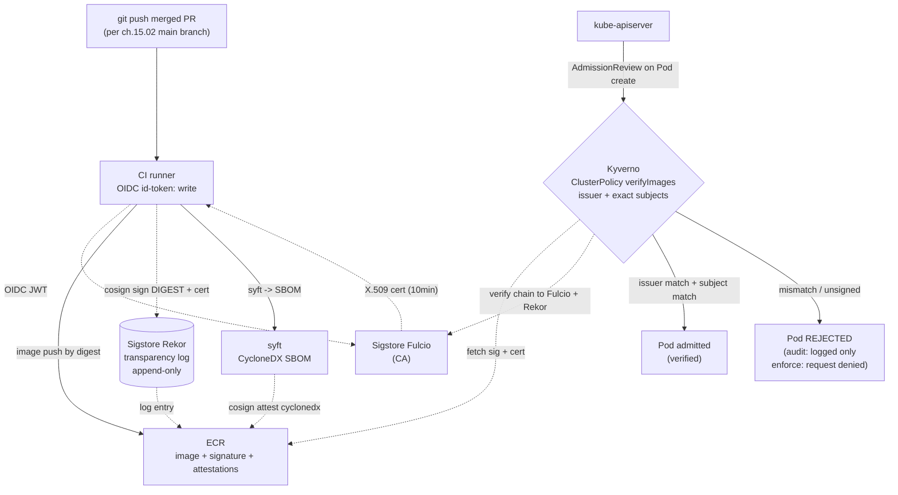

# 15.03 — Image signing and provenance in CI

> The CI-side of supply-chain trust for the Bookstore Platform — **cosign
> keyless** via GitHub Actions OIDC (`cosign sign --yes`); a **CycloneDX
> SBOM** attested to the image digest (`cosign attest --type cyclonedx`);
> **SLSA provenance** from `actions/attest-build-provenance`, checked with
> `gh attestation verify`; the **Kyverno `ClusterPolicy`** that verifies
> signatures at admission with `verifyImages`, pinned to the signing
> workflow's identity (issuer + subject); and the **audit → enforce
> migration**, which has to be gradual: audit first, enforce one namespace
> at a time, and enforce a rule only once every image it covers is signed.
> Deepens Part 05 ch.03 (the concepts) and Part 14 ch.12 (Kyverno on EKS) by
> showing the CI half, the pipeline that *produces* the signed digests
> Kyverno verifies. Its signing steps match the release run in
> [Part 07 ch.03](../07-delivery/03-cicd-pipeline.md).

**Estimated time:** ~30 min read · ~90 min hands-on
**Prerequisites:** [Part 15 ch.02](./02-application-cicd-pipelines.md) — the pipeline you're adding signing into · [Part 05 ch.03](../05-security/03-supply-chain.md) — conceptual supply-chain trust chain · [Part 14 ch.12](../14-eks-in-production-a-to-z/12-supply-chain-security.md) — Kyverno verification on EKS that consumes the signatures

**You'll know after this:** • sign images keyless via GitHub Actions OIDC with `cosign sign --yes` (no long-lived keys) · • attest a CycloneDX SBOM to a digest with `cosign attest --type cyclonedx` · • record SLSA provenance with `actions/attest-build-provenance` and check it with `gh attestation verify` · • configure a Kyverno `ClusterPolicy.verifyImages` pinned to the signing workflow's identity (issuer + exact subject) · • execute the audit → enforce migration safely (start audit on dev, expand by namespace, flip enforce only when every deployed image is signed)

<!-- tags: cosign, supply-chain, security, ci-cd, app-cicd -->

## Why this exists

Three chapters in this guide say "sign images with cosign keyless and verify
them with Kyverno". Each says it for a different reader:

- **Part 05 ch.03** introduces cosign keyless and Kyverno `verifyImages` as
  concepts.

- **Part 07 ch.03** runs the signing for real. Its release run signs the
  digest keylessly with the workflow's identity, attaches a CycloneDX SBOM
  and records provenance, all on GitHub Container Registry. Nothing in a
  cluster checks those signatures yet.

- **Part 14 ch.12** puts Kyverno on EKS, with a `verifyImages` policy and the
  cloud wiring around it.

This chapter is the bridge. Its policy pins the identities of the three
workflows in Part 15 ch.02 that sign the Bookstore images in ECR. Part 07 ch.03
signs its GHCR images with its own workflow, which this policy does not match.
The chapter shows how to move from audit to enforce without breaking workloads
that already run.

The chapter keeps two kinds of trust apart:

1. **Signature trust**: "this image was signed by our release workflow"
   (cosign sign plus a Kyverno rule). It catches "someone pushed
   `bookstore/catalog:latest` to ECR by hand and referenced it in a manifest".

2. **Provenance trust**: "this image was built by that workflow from these
   inputs" (the SLSA statement from `actions/attest-build-provenance`). It
   records which workflow, commit and ref built the image. It does not prove
   the build job was honest: a job that holds the workflow's token can attest
   anything under the same identity. The policy here requires only the
   signature; the verification commands in section 0 also check attestations.

## Mental model

**Image signing is a chain of three cryptographic facts: the image bytes
hash to a digest; the signature is over the digest; the signature's
certificate identity is the workflow you trust. Verify all three at
admission, or trust none.**

- **The chain in three statements.** Verification of an image is
  *checking three statements all hold*:
  1. **Bytes → digest.** The bytes I pulled hash to the digest I asked
     for. (`kubelet`'s default behaviour when you pin `<IMAGE>@sha256:HEX`.)
  2. **Digest → signature.** There exists a cosign signature whose
     payload covers this digest. (`cosign verify` checks this against
     the Rekor transparency log.)
  3. **Signature → identity.** The signature's certificate was issued
     to a subject I trust. For GitHub Actions, the subject is the
     workflow ref:
     `https://github.com/GITHUB_ORG/REPO/.github/workflows/<NAME>.yml@refs/heads/main`,
     and the issuer is `https://token.actions.githubusercontent.com`.
     (Kyverno's `verifyImages.attestors.entries.keyless.{issuer,subject}`
     fields encode this; `subjectRegExp` when you need a pattern.)
  Skipping any link makes the whole chain ornamental. **Verifying digest
  but not identity** lets an attacker who push-by-digest to ECR pass;
  verifying identity but trusting a match-anything subject lets *any* GitHub
  Actions workflow pass.

- **Keyless means "no long-lived signing key", not "no
  cryptography".** cosign gets a short-lived certificate for the workflow's
  identity and records the signature in a public transparency log. The
  mechanics, Fulcio and Rekor, are in *How it works under the hood*.

- **An SBOM is data; a *signed* SBOM is evidence.** `syft <IMAGE> -o
  cyclonedx-json` writes a CycloneDX inventory as a file. `cosign attest
  --type cyclonedx --predicate <FILE> <IMAGE>@<DIGEST>` turns that file into
  an attestation: signed with the same keyless flow, bound to the digest, and
  stored with the image. A verifier runs `cosign verify-attestation --type
  cyclonedx` and trusts the SBOM through the signature chain, not through the
  pipeline that made it. A bare SBOM file is unverifiable; an attested one is
  the auditable form.

- **Provenance is the same shape, with a build record as the payload.**
  The build-sign-push job in [Part 15 ch.02](02-application-cicd-pipelines.md)
  runs `actions/attest-build-provenance`, pinned by commit SHA, the same pin
  07.03 uses. It writes a SLSA provenance statement for the digest, signed
  with the workflow's identity, to GitHub's attestation store. The statement
  names the repository, the ref and the workflow that built the image, and
  `gh attestation verify` reads it. This chapter's Kyverno rule requires only
  the signature, so a provenance gap does not block admission.

- **Kyverno `verifyImages` is admission-time, not runtime.** The rule
  fires when a Pod is created/updated; it fetches the signature, verifies
  it and the identity, and admits or rejects. A pod that
  *was* admitted does **not** re-verify if Sigstore's root rotates or
  Rekor's log changes — admission is a moment-in-time gate. This
  matters for the audit-to-enforce migration: flipping enforce only
  affects *new* admissions; running pods are untouched.

- **The audit → enforce migration has three real stages.** Not "flip
  enforce one day"; rather: (a) **audit**: log violations but admit
  all images, and collect data. (b) **partial enforce**: enforce in the
  `bookstore` namespace, where the Bookstore workloads run and every image
  is signed by a 02 workflow, and keep the rule in audit in any other
  namespace where a Bookstore image might run. (c) **full enforce**: remove
  the namespace scope once every Bookstore image that any namespace can pull
  is signed. The rule matches only images under the Bookstore ECR path, so
  vendor images (Prometheus, KEDA, the Vault CSI provider) are outside it at
  every stage. Each needs its own rule with its vendor's identity, which this
  chapter does not cover. The chapter ships the audit-mode rule and the
  partial-enforce variant; full enforce is a per-cluster judgement call.

The trap to keep in view: **the rule is only as strict as its identities.**
A `subjectRegExp` of `.*` matches any cosign keyless signature from any
workflow, which makes the rule useless. A pattern scoped to your org but not
to a workflow lets another workflow in your org sign. A pattern scoped to the
workflow file but not to the branch lets a branch build sign. The rule below
pins the issuer to GitHub Actions and lists the exact subject of each of the
three 02 workflows, on `main`. Each sign job runs only on `main`, so only
`main`-signed images carry an identity this rule accepts.

## Threats and controls

| Threat | Control in this chapter | Deeper |
|---|---|---|
| An image signed by something other than the release workflow (a branch, a fork, a laptop, another workflow in the org) passes admission | Keyless signing bound to each 02 signing workflow file on `main`; a `verifyImages` rule with the issuer and one exact `subject` per workflow | [Part 05 ch.03](../05-security/03-supply-chain.md) for the concepts; [Part 14 ch.12](../14-eks-in-production-a-to-z/12-supply-chain-security.md) for EKS |
| A tag is moved to bytes nobody reviewed | `mutateDigest` and `verifyDigest` pin each reference to a digest that must verify; `required: true` | [Part 15 ch.04](04-multi-environment-promotion.md) for promotion by digest |
| A build job, or a step inside it, signs bytes its source did not produce | Not stopped by signing or provenance from the same workflow identity, because the attacker holds that identity. A public Rekor entry for every signature and a monitor (production notes) make such a signature visible | [Part 15 ch.10](10-incident-response-and-on-call.md) for the response |

## Diagrams

### The CI-to-admission signing + verification path (Mermaid)

The cryptographic chain from a `git push` to a Pod admitted (or
rejected) by Kyverno. The dashed line is the **Sigstore PKI** boundary.



### The audit → enforce migration ladder (ASCII)

```
 STAGE         POLICY               WHO IS AFFECTED              PRECONDITION
 ────────────────────────────────────────────────────────────────────────────────
 0. baseline   no policy            nobody                       none
 1. audit      failureAction:       log every violation;         install
               Audit                admit everything             kyverno
 2. partial    Enforce in           bookstore: REJECT if         every Bookstore
    enforce    bookstore; Audit     unsigned; other namespaces:  image signed by
               elsewhere            audit only                   a 02 workflow
 3. full       one Enforce rule,    every namespace REJECTS      every namespace has
    enforce    no namespace scope   if unsigned                  signed images
 ────────────────────────────────────────────────────────────────────────────────
 GO-NO-GO check before flipping a stage:
   audit -> partial: 0 audit-mode failures for bookstore images for >= 14 days
   partial -> full:  0 audit-mode failures cluster-wide for >= 14 days
                     AND vendor-image policy rules in place

 Stage 2 is two verifyImages rules in one ClusterPolicy; section 2 shows them.
```

## Hands-on with the Bookstore Platform

**Assumed working directory: the guide repo root (`full-guide/`).** Signing
happens in CI, never from a laptop: a signature made with your own login
carries your identity, and the rule below rejects it. The hands-on has three
parts: verify a signed image the way a consumer does, install Kyverno and run
its policy in audit, then walk the migration on a kind cluster you own. This
chapter captures no output of its own. The one real run it refers to is the
release in 07.03.

Install `cosign`, `syft` and the GitHub CLI first. On macOS:

```sh
brew install cosign syft gh
```

On Linux, the [cosign](https://docs.sigstore.dev/cosign/system_config/installation/)
and [syft](https://github.com/anchore/syft#installation) install guides cover
the binaries.

### 0. Verify the identity, as a consumer does

Set the identity to the exact name of the signing workflow, and the image to
the digest your pipeline pushed. Here that is the `catalog` workflow from
[Part 15 ch.02](02-application-cicd-pipelines.md), which pushes
`bookstore/catalog` to ECR. [Part 07 ch.03](../07-delivery/03-cicd-pipeline.md)
runs the same checks against a GHCR image that its own workflow,
`bookstore-pipeline.yml`, signed. Its captured transcript is
[`07-03.txt`](../examples/security-lab/evidence/07-03.txt), and this chapter
links to it rather than copying it.

```sh
ID="https://github.com/<OWNER>/<REPO>/.github/workflows/catalog.yml@refs/heads/main"
IMAGE='<REGISTRY>/bookstore/catalog@sha256:<DIGEST>'
cosign verify --certificate-identity "$ID" \
  --certificate-oidc-issuer https://token.actions.githubusercontent.com "$IMAGE" >/dev/null \
  && echo "signature: identity matches"
```

The identity is one string, matched exactly. The next command changes only
the branch, so it must fail. That failure is the control working:

```sh
# Deliberate failure: the certificate names @refs/heads/main.
cosign verify --certificate-identity "${ID%main}other" \
  --certificate-oidc-issuer https://token.actions.githubusercontent.com "$IMAGE"
```

Check the SBOM and the provenance the same way:

```sh
cosign verify-attestation --type cyclonedx --certificate-identity "$ID" \
  --certificate-oidc-issuer https://token.actions.githubusercontent.com "$IMAGE" 2>/dev/null \
  | jq -r .payload | base64 -d | jq '.predicate | {bomFormat, specVersion}'

gh attestation verify "oci://$IMAGE" --repo <OWNER>/<REPO> --cert-identity "$ID"
```

`gh attestation verify --repo` alone is looser: it accepts any workflow in the
repository. Pin `--cert-identity` as well, as 07.03 does.

### 1. Install Kyverno and run the policy in audit

Create the Kyverno namespace first and label it `restricted`. The chart 3.9.1
renders every container with the restricted fields (`runAsNonRoot`,
`allowPrivilegeEscalation: false`, all capabilities dropped, the
`RuntimeDefault` seccomp profile), so no security value needs overriding. That
render was checked with `helm template`; the install itself is not run in this
chapter.

Save this as `kyverno-namespace.yaml`:

```yaml
apiVersion: v1
kind: Namespace
metadata:
  name: kyverno
  labels:
    pod-security.kubernetes.io/enforce: restricted
    pod-security.kubernetes.io/audit: restricted
    pod-security.kubernetes.io/warn: restricted
```

The `restricted` label admits Kyverno's pods, but it does not restrict the
network. Save this as `kyverno-networkpolicy.yaml` and apply it before the
install. It sets a default deny in both directions and then opens the three
flows Kyverno needs: the API server calls the admission webhook on port 9443
(the chart 3.9.1 container port), and Kyverno calls the API server and reads
signatures, Rekor and TUF data over HTTPS. The `ipBlock` is a placeholder:
replace it with your node network. The 443 egress is broad on purpose for a
first install; tighten it to your registry and Sigstore addresses where your
platform allows. If Prometheus scrapes Kyverno, add an ingress rule for the
metrics port from the monitoring namespace.

```yaml
apiVersion: networking.k8s.io/v1
kind: NetworkPolicy
metadata:
  name: default-deny-all
  namespace: kyverno
spec:
  podSelector: {}
  policyTypes: ["Ingress", "Egress"]
---
apiVersion: networking.k8s.io/v1
kind: NetworkPolicy
metadata:
  name: kyverno-admission-webhook
  namespace: kyverno
spec:
  podSelector:
    matchLabels:
      app.kubernetes.io/component: admission-controller
  policyTypes: ["Ingress"]
  ingress:
    - from:
        - ipBlock:
            cidr: 10.0.0.0/8              # placeholder: your node network
      ports:
        - protocol: TCP
          port: 9443
---
apiVersion: networking.k8s.io/v1
kind: NetworkPolicy
metadata:
  name: kyverno-egress
  namespace: kyverno
spec:
  podSelector: {}
  policyTypes: ["Egress"]
  egress:
    - to:
        - namespaceSelector: {}
          podSelector:
            matchLabels:
              k8s-app: kube-dns
      ports:
        - protocol: UDP
          port: 53
        - protocol: TCP
          port: 53
    - ports:
        - protocol: TCP
          port: 443
        - protocol: TCP
          port: 6443
```

Apply the namespace, then the network policy, then the chart, in that order, so
the webhook's first calls are not blocked:

```sh
kubectl apply -f kyverno-namespace.yaml
kubectl apply -f kyverno-networkpolicy.yaml
helm repo add kyverno https://kyverno.github.io/kyverno/
helm install kyverno kyverno/kyverno --version 3.9.1 -n kyverno --wait
```

> **Currency.** The policy in this section uses the `ClusterPolicy` type.
> Kyverno's [policy-types overview](https://kyverno.io/docs/policy-types/overview/)
> marks that type deprecated in v1.19, which chart 3.9.1 installs (appVersion
> v1.19.1), and removed in v1.20, estimated for November 2026. The supported
> type for this check is `ImageValidatingPolicy`, stable since v1.18. The
> overview links the migration guide. This chapter keeps `ClusterPolicy` so
> the walk-through and its stage-2 manifest match the installed version. Plan
> the move before any upgrade to v1.20.

Save the policy below as `kyverno-verifyimages.yaml`. In production it lives in
Git, and Argo CD applies it
([Part 07 ch.04](../07-delivery/04-gitops-argocd.md)).

```yaml
apiVersion: kyverno.io/v1
kind: ClusterPolicy
metadata:
  name: verify-bookstore-images
  annotations:
    policies.kyverno.io/title: Verify Bookstore image signatures
    policies.kyverno.io/category: Supply Chain
    policies.kyverno.io/subject: Pod
spec:
  webhookConfiguration:
    failurePolicy: Ignore                # stage 1; Fail at stage 2
  rules:
    - name: verify-bookstore-keyless
      match:
        any:
          - resources:
              kinds: [Pod]
      verifyImages:
        - imageReferences:
            # The Bookstore ECR path. A bare '*' would make this rule check
            # every image in the cluster, vendor images included.
            - 'AWS_ACCOUNT_ID.dkr.ecr.AWS_REGION.amazonaws.com/bookstore/*'
          failureAction: Audit           # stage 1: report and admit
          mutateDigest: true             # a tag becomes the digest it resolves to
          verifyDigest: true             # the reference must carry a digest
          required: true
          attestors:
            - entries:
                # One entry per signing workflow from Part 15 ch.02, on main.
                # Entries are alternatives: a signature from any one matches.
                - keyless:
                    issuer: 'https://token.actions.githubusercontent.com'
                    subject: 'https://github.com/GITHUB_ORG/GITHUB_REPO/.github/workflows/catalog.yml@refs/heads/main'
                    rekor:
                      url: 'https://rekor.sigstore.dev'
                - keyless:
                    issuer: 'https://token.actions.githubusercontent.com'
                    subject: 'https://github.com/GITHUB_ORG/GITHUB_REPO/.github/workflows/orders.yml@refs/heads/main'
                    rekor:
                      url: 'https://rekor.sigstore.dev'
                - keyless:
                    issuer: 'https://token.actions.githubusercontent.com'
                    subject: 'https://github.com/GITHUB_ORG/GITHUB_REPO/.github/workflows/payments-worker.yml@refs/heads/main'
                    rekor:
                      url: 'https://rekor.sigstore.dev'
```

Read carefully:

- `issuer` is fixed. Each `subject` is an exact string that names one workflow
  file on `main`, the same identity that `--certificate-identity` pins in
  section 0. A pattern over the whole `.github/workflows/` directory would
  accept every other workflow in it, so the rule lists the files one by one.
- `mutateDigest: true` lets a Deployment reference a tag: the admitted Pod runs
  the digest the rule verified, not whatever the tag points at later.
- `failurePolicy: Ignore` is the stage-1 setting, so a Kyverno outage cannot
  block Pods while the policy only reports. Stage 2 changes it to `Fail`. The
  trade-off is explained under *How it works under the hood*.

### 2. Walk the migration on a kind cluster

Run this on a kind cluster you own, with the Bookstore from
[Part 09 ch.01](../09-end-to-end-bookstore/01-bookstore-end-to-end.md)
deployed. In production, each stage is one pull request to the GitOps
repository. The lab applies the files directly, and Git stays the only path to
the cluster ([Part 15 ch.01](01-pr-to-production-lifecycle.md)). Nothing in
this section was run in the chapter, so the results shown are illustrative.

Kyverno reads signatures and digests from the registry with its own pod
credentials. On EKS, give the Kyverno service account read access to the
Bookstore ECR repositories through IRSA or EKS Pod Identity. The kind lab has
no such access, so the walk-through below is illustrative: read the
PolicyReports as shown, or point the lab at a registry the cluster can reach.

Stage 1 is the policy above in audit. Apply it, then confirm the report CRD
exists, because audit results are written there:

```sh
kubectl apply -f kyverno-verifyimages.yaml
kubectl get crd policyreports.wgpolicyk8s.io
```

Next, a deliberately unsigned image in the `bookstore` namespace. The baseline
is there so that Pod Security admits the Pod and only the policy decides.
`65532` is the UID the catalog image declares (`USER 65532:65532`). Save this
as `unsigned-probe.yaml`:

```yaml
apiVersion: v1
kind: Pod
metadata:
  name: unsigned-probe
  namespace: bookstore
spec:
  automountServiceAccountToken: false
  securityContext:
    runAsNonRoot: true
    runAsUser: 65532
    runAsGroup: 65532
    seccompProfile:
      type: RuntimeDefault
  containers:
    - name: app
      image: AWS_ACCOUNT_ID.dkr.ecr.AWS_REGION.amazonaws.com/bookstore/catalog:dev
      securityContext:
        allowPrivilegeEscalation: false
        readOnlyRootFilesystem: true
        capabilities:
          drop: ["ALL"]
      resources:
        requests:
          cpu: 50m
          memory: 32Mi
        limits:
          memory: 64Mi
      volumeMounts:
        - name: tmp
          mountPath: /tmp
  volumes:
    - name: tmp
      emptyDir: {}
```

```sh
kubectl apply -f unsigned-probe.yaml
kubectl get policyreport -n bookstore -o json \
  | jq -r '.items[].results[] | select(.result=="fail") | .resources[0].name'
kubectl delete -f unsigned-probe.yaml --ignore-not-found
```

Illustrative output, not captured. In audit the Pod is admitted, and the report
names it:

```text
unsigned-probe
```

Stage 2 turns the one rule into two, in Git, and the manifest below replaces
the stage-1 file. The first rule matches only the `bookstore` namespace and
enforces. The second matches every namespace except `bookstore`, through
`exclude`, and only audits. It also sets `webhookConfiguration.failurePolicy`
to `Fail`. Change the file only when the go/no-go check in the diagram above
has passed. The attestors are the same in both rules, so an identity change
means editing both.

```yaml
apiVersion: kyverno.io/v1
kind: ClusterPolicy
metadata:
  name: verify-bookstore-images
  annotations:
    policies.kyverno.io/title: Verify Bookstore image signatures
    policies.kyverno.io/category: Supply Chain
    policies.kyverno.io/subject: Pod
spec:
  webhookConfiguration:
    failurePolicy: Fail                  # stage 2: Ignore -> Fail
  rules:
    - name: enforce-bookstore-keyless
      match:
        any:
          - resources:
              kinds: [Pod]
              namespaces: [bookstore]
      verifyImages:
        - imageReferences:
            - 'AWS_ACCOUNT_ID.dkr.ecr.AWS_REGION.amazonaws.com/bookstore/*'
          failureAction: Enforce
          mutateDigest: true
          verifyDigest: true
          required: true
          attestors:
            - entries:
                - keyless:
                    issuer: 'https://token.actions.githubusercontent.com'
                    subject: 'https://github.com/GITHUB_ORG/GITHUB_REPO/.github/workflows/catalog.yml@refs/heads/main'
                    rekor:
                      url: 'https://rekor.sigstore.dev'
                - keyless:
                    issuer: 'https://token.actions.githubusercontent.com'
                    subject: 'https://github.com/GITHUB_ORG/GITHUB_REPO/.github/workflows/orders.yml@refs/heads/main'
                    rekor:
                      url: 'https://rekor.sigstore.dev'
                - keyless:
                    issuer: 'https://token.actions.githubusercontent.com'
                    subject: 'https://github.com/GITHUB_ORG/GITHUB_REPO/.github/workflows/payments-worker.yml@refs/heads/main'
                    rekor:
                      url: 'https://rekor.sigstore.dev'
    - name: audit-bookstore-keyless
      match:
        any:
          - resources:
              kinds: [Pod]
      exclude:
        any:
          - resources:
              namespaces: [bookstore]
      verifyImages:
        - imageReferences:
            - 'AWS_ACCOUNT_ID.dkr.ecr.AWS_REGION.amazonaws.com/bookstore/*'
          failureAction: Audit
          mutateDigest: true
          verifyDigest: true
          required: true
          attestors:
            - entries:
                - keyless:
                    issuer: 'https://token.actions.githubusercontent.com'
                    subject: 'https://github.com/GITHUB_ORG/GITHUB_REPO/.github/workflows/catalog.yml@refs/heads/main'
                    rekor:
                      url: 'https://rekor.sigstore.dev'
                - keyless:
                    issuer: 'https://token.actions.githubusercontent.com'
                    subject: 'https://github.com/GITHUB_ORG/GITHUB_REPO/.github/workflows/orders.yml@refs/heads/main'
                    rekor:
                      url: 'https://rekor.sigstore.dev'
                - keyless:
                    issuer: 'https://token.actions.githubusercontent.com'
                    subject: 'https://github.com/GITHUB_ORG/GITHUB_REPO/.github/workflows/payments-worker.yml@refs/heads/main'
                    rekor:
                      url: 'https://rekor.sigstore.dev'
```

Stage-2 changes ship in Git, not as `kubectl patch`, so the rule and its
history stay in the same review trail.

Deliberate failure, illustrative output, not captured. Once the rule enforces,
the stage-1 probe is refused in `bookstore`:

```sh
kubectl apply -f unsigned-probe.yaml
```

```text
Error from server: error when creating "unsigned-probe.yaml": admission webhook ... denied the request: ...
```

The same Pod in any other namespace is admitted and reported, because the
audit rule still covers it.

Stage 3 removes the namespace scope from the Enforce rule, after the go/no-go
check has held cluster-wide for 14 days. It is the production endgame and a
per-cluster judgement call. The policy above covers only images under the
Bookstore path; a vendor image needs its own rule with that vendor's identity.

## How it works under the hood

- **The Sigstore PKI in one paragraph.** Sigstore is a public-good
  *root of trust* for code signing. Three components: **Fulcio** is a
  CA that issues short-lived (≤10 min) X.509 certs after verifying an
  OIDC token; **Rekor** is an append-only, Merkle-tree-backed
  transparency log of all signatures and certs; **cosign** is the
  client that drives the flow. Verifying a signature checks: (1) the
  signature cryptographically over the digest, (2) the signing cert
  chains to Fulcio's root, (3) a Rekor entry exists for this cert +
  signature pair at a time within the cert's validity window. Item (3)
  is what kills the "key was leaked yesterday" attack: a malicious
  signature post-dating the leak would have a Rekor inclusion proof
  *after* the cert expired, which verification rejects.

- **The OIDC subject is the workflow identity, not the user
  identity.** A `cosign sign` from a developer's laptop uses *their*
  OIDC (GitHub/Google login); the cert's SAN is the user's email or
  identity. CI uses the *workflow's* OIDC (the `id-token: write`
  permission mints a JWT whose `sub` claim is the workflow ref); the
  cert's SAN is the workflow URL. These are different subjects; a
  production Kyverno rule matches the workflow SAN and **rejects**
  developer-laptop signatures.

- **Signatures live in the registry, next to the image.** cosign pushes the
  signature and its certificate for a digest, and verification fetches them by
  that digest. The `cosignOCI11` field on a verifyImages entry switches to the
  experimental OCI 1.1 referrers path. Leave it at its default, `false`, unless
  you have tested the alternative.

- **Rekor entries are permanent and public.** Every cosign signature
  in this guide produces a Rekor entry visible to the whole world. The
  *image bytes* are private (in your private ECR); the *fact that you
  signed an image* and *the identity that signed it* are public. This
  is a deliberate design choice — transparency logs are how you detect
  rogue signatures. If an attacker compromised your CI and signed
  evil bits, the Rekor entry is the audit trail; a Rekor monitor such as [rekor-monitor](https://github.com/sigstore/rekor-monitor) catches it. For
  air-gapped environments, run a *private Sigstore* (private Fulcio +
  private Rekor) — same cryptography, private logs.

- **Kyverno's `verifyImages` is a *mutating* admission webhook by
  default.** With `mutateDigest: true`, the rule rewrites a Pod spec
  that says `image: bookstore/catalog:latest` to say `image:
  ...catalog@sha256:HEX`. The mutation runs before validation; the
  validation then verifies the pinned digest's signature. Pods that
  start are pinned to the verified digest. Without `mutateDigest`,
  Kyverno rejects tag-references outright — also defensible, but
  surprises developers who run `kubectl run --image=nginx:latest`.

- **`failurePolicy: Fail` vs `Ignore` is a real trade-off.** With `Fail`, if
  Kyverno's webhook is unreachable, every Pod create fails and admission stops
  cluster-wide. This is the *correct* setting for a security-critical webhook,
  but it requires Kyverno to be HA: multiple replicas across nodes, a stable CA
  cert, and fast pod scheduling for replacements. With `Ignore`, an unreachable
  webhook silently admits everything. Unsigned images can slip in during a
  brief outage, but there is no admission-side outage. This chapter's stage-1
  manifest starts at `Ignore`, and the change to `Fail` waits until Kyverno's
  availability is proven.
  [Part 11 ch.01](../11-advanced-production-patterns/01-admission-webhooks.md)
  covers the trade-off.

- **Audit results are PolicyReport objects, so check the CRD first.** Audit
  writes each violation to a **PolicyReport**. The chart 3.9.1 renders the
  `policyreports.wgpolicyk8s.io` and `clusterpolicyreports.wgpolicyk8s.io`
  CRDs. Without them there is nowhere to record a result, so a zero count
  proves nothing. Check `kubectl get crd policyreports.wgpolicyk8s.io` before
  you trust "no audit failures" as evidence for the GO-NO-GO check.

## Production notes

> **In production: pin each `subject` to one signing workflow file on
> `main`, never a pattern.** A `subjectRegExp` of `.*` accepts any workflow in
> any GitHub repository that signs through Sigstore. The issuer pin does not
> narrow that to your organization, so a backdoored image signed from another
> repository would pass and reach your ECR path. The rule above names three
> exact subjects, the same identities the verification commands in section 0
> pin. Keep them exact: a pattern over the directory accepts every workflow in
> it.

> **In production: run a Rekor monitor.** Subscribing to your Rekor
> namespace with a monitor catches rogue signatures within minutes. A
> simple version: an hourly job that lists Rekor entries with subject
> matching your repos and pages on-call if any entry came from an
> unexpected workflow file. [`rekor-monitor`](https://github.com/sigstore/rekor-monitor) is the Sigstore project's monitor for this shape. The point: transparency log + monitor = detect a CI
> compromise without trusting the CI to tell you about it.

> **In production: migrate audit → enforce by namespace, not by
> cluster flag.** Use one rule per mode with `failureAction`, as section 2
> shows: `Audit` for the rest, `Enforce` for the namespaces already proven.
> This makes the migration a *PR per namespace*,
> not a single high-stakes flip. The `bookstore` namespace is the
> first to flip (every image is yours); `monitoring`, `kube-system`,
> and `argocd` namespaces have vendor images and may need separate
> verifyImages rules (with the vendor's signing identity) before
> they're safe to flip.

> **In production: keep `mutateDigest: true` ON.** A developer who
> writes `image: <ECR>/bookstore/catalog:latest-main` in a manifest gets it pinned to the
> digest cosign verified, automatically. Without this, the manifest
> would be rejected for tag-use (or admitted with an unverified
> reference, depending on `verifyDigest`). The user experience is
> better with `mutateDigest: true`; the security property is the
> same.

> **In production: alert on `verifyImages` audit-mode failures *and*
> enforce-mode rejections.** A surge of audit failures means a service
> is being deployed with the wrong workflow (or via a non-CI path —
> Part 15 ch.09's breakglass territory). A surge of enforce
> rejections means a CD pipeline is broken or a malicious push
> attempted. Both are operational signals; wire them to the same
> dashboard the on-call rotation reads (Part 15 ch.10).

> **In production: cosign signatures don't expire; *trust* does.**
> The Fulcio cert was valid for 10 minutes when issued, but the Rekor
> log records the signature was made *during* that window. The
> signature stays verifiable forever. What changes is *what subjects
> you trust*: if your workflow file is renamed, signatures from the
> old name still verify but no longer match your Kyverno rule (the
> subject moved). Renaming a workflow file is a *coordinated*
> change: rename the file, update the policy's subjects, re-sign
> images. Part 15 ch.11 covers the day-to-day ops
> cadence of these coordinated changes.

## Quick Reference

```sh
# Verify the identity from outside the cluster: the production rule's check
ID="https://github.com/<OWNER>/<REPO>/.github/workflows/catalog.yml@refs/heads/main"
cosign verify --certificate-identity "$ID" \
  --certificate-oidc-issuer https://token.actions.githubusercontent.com \
  '<IMAGE>@sha256:<DIGEST>'

# SBOM, generated in CI and attested to the digest (07.03 attests it in step 8)
syft '<IMAGE>@sha256:<DIGEST>' -o cyclonedx-json > sbom.cdx.json
cosign attest --yes --type cyclonedx --predicate sbom.cdx.json '<IMAGE>@sha256:<DIGEST>'

# Provenance, from the GitHub CLI
gh attestation verify "oci://<IMAGE>@sha256:<DIGEST>" --repo <OWNER>/<REPO> --cert-identity "$ID"

# Audit results: the GO-NO-GO data
kubectl get crd policyreports.wgpolicyk8s.io
kubectl get policyreport -A -o json | \
  jq -r '.items[].results[] | select(.result=="fail") | .resources[0].name'
```

The stage-2 change is a Git change, not `kubectl patch`: split the rule by
namespace and set `webhookConfiguration.failurePolicy: Fail` in the same
change, as section 2 shows.

Checklist:

- [ ] CI signs every Bookstore image keyless via `cosign sign --yes` against the
      workflow's OIDC identity (15.02's `id-token: write` permission)
- [ ] CI attests a CycloneDX SBOM with `cosign attest --type cyclonedx`, and
      records provenance with `actions/attest-build-provenance`
- [ ] Kyverno `ClusterPolicy` matches `imageReferences:` to the Bookstore ECR
      path AND a `subject` for each 02 signing workflow, on `main`
- [ ] `mutateDigest: true` + `verifyDigest: true` + `required: true`: tag
      references get pinned and verified at admission
- [ ] Audit → enforce uses one rule per mode with `failureAction`, scoped by
      namespace; no single cluster-wide flip
- [ ] `webhookConfiguration.failurePolicy: Fail` once Kyverno's availability is
      proven (`Ignore` at stage 1)
- [ ] PolicyReport CRDs present (`kubectl get crd
      policyreports.wgpolicyk8s.io`); without them audit reports nothing
- [ ] Rekor monitor running (or a tool that does it) to catch out-of-band
      signatures

## Test your understanding

> Try each before opening the answer drawer. The act of trying is the exercise; the answer is the check.

1. **Verifying an image is a chain of three statements. Name them and explain what breaks if you check only the first two.**
   <details><summary>Show answer</summary>

   (1) bytes hash to the expected digest, (2) a cosign signature exists over that digest, (3) the signature's certificate identity matches the workflow you trust. Verifying only (1) and (2) — but trusting any signing identity — lets *any* GitHub Actions workflow pass. An attacker with a separate org and a public GitHub Actions runner can sign an image with their own OIDC identity, push it to ECR with a name like `bookstore/catalog:dev`, and pass admission because the policy didn't pin the subject to your repo + workflow. The third link is what restricts trust to your own CI; without it, "we use signed images" is theatre.

   </details>

2. **A team copies the rule with `imageReferences: ['*']`, sets it to Enforce and applies it cluster-wide on Monday. Vendor Pods (Prometheus, KEDA, the Vault CSI provider) are denied at create time. What was missed, what does the operator see, and what is the recovery?**
   <details><summary>Show answer</summary>

   Vendor images aren't signed by *your* workflows' OIDC identities. They are signed, if at all, with the vendor's own keys, so every one fails the subject check. The operator sees no `ImagePullBackOff`. The admission webhook refuses the Pod at create time, and the ReplicaSet or DaemonSet records a `FailedCreate` event that carries the webhook's message. The chapter's rule avoids this by matching only the Bookstore ECR path and by moving enforcement one namespace at a time. Recovery: remove the `*` reference, return the rule to Audit, and leave running Pods alone, since admission does not re-check them. Then add a separate rule with each vendor's identity before that vendor's namespace goes to Enforce.

   </details>

3. **What does a provenance statement from `actions/attest-build-provenance` prove that a plain `cosign sign` signature does not?**
   <details><summary>Show answer</summary>

   Plain `cosign sign` proves "this image was signed by *our* CI workflow's OIDC identity". That is useful, but it doesn't constrain *what* the workflow did. A provenance statement captures *who built it, with what source ref, on what builder, with what inputs*. Its predicate is a structured record of the build. Kyverno's `verifyImages` with `attestations:` requires both the signature and the named provenance, raising the bar from "signed by us" to "built by us with these inputs." It does not catch a compromised build job. An attacker who runs code inside the workflow holds the same identity, so can sign and attest arbitrary bytes with a plausible source ref. Provenance tells a reader which workflow and commit built an image. A reusable builder with its own identity would be a stronger record; this chapter does not build one.

   </details>

4. **Hands-on extension: in your CI, give an image the pipeline already signed a second tag (the same digest under a new name). Under the stage-1 rule, what happens to a Pod that references the new tag, and why?**
   <details><summary>What you should see</summary>

   Admission succeeds. The signature is bound to the *digest*, not the tag — re-tagging doesn't change the digest, so the existing signature still applies. This is why the chapter argues for **digest pinning** in Deployments rather than tags. A pod that references `bookstore/catalog:v1` resolves to a digest at admission time, then verifyImages checks the signature against that digest; a tag-overwrite attacker could push a different image to `v1`, but the signature for the new bytes wouldn't exist, and verification fails. Tags are unreliable identifiers; digests are the only thing the chain of three statements can verify against.

   </details>

## Further reading

- **SLSA specification**, the levels framework this chapter's provenance slots
  into: <https://slsa.dev/spec/v1.0/levels>.
- Project docs: cosign signing <https://docs.sigstore.dev/cosign/signing/overview/>
  and verifying <https://docs.sigstore.dev/cosign/verifying/verify/>; Sigstore
  <https://www.sigstore.dev/>; Rekor <https://docs.sigstore.dev/logging/overview/>;
  Kyverno verifyImages
  <https://kyverno.io/docs/policy-types/cluster-policy/verify-images/>; syft
  <https://github.com/anchore/syft>; CycloneDX <https://cyclonedx.org/>;
  `actions/attest-build-provenance`
  <https://github.com/actions/attest-build-provenance>; rekor-monitor
  <https://github.com/sigstore/rekor-monitor>.
- The GitHub Actions OIDC reference:
  <https://docs.github.com/en/actions/deployment/security-hardening-your-deployments/about-security-hardening-with-openid-connect>.
