# 15.04 — Multi-environment promotion

> The dev → staging → prod pipeline as Git mechanics, not a CI/CD product
> feature: one Argo CD `ApplicationSet` over a List generator, three
> Kustomize overlays that differ ONLY in image-digest + secret-source +
> scale, promotion = a Git PR that changes one digest line in the
> overlay's `images/` Component, environment parity as a
> hard invariant, and the two footguns this discipline kills: "image
> promoted but config diverged" and "we test in prod because staging is
> different".

**Estimated time:** ~30 min read · ~60 min hands-on
**Prerequisites:** [Part 07 ch.04](../07-delivery/04-gitops-argocd.md): Argo CD + ApplicationSet patterns · [Part 15 ch.02](./02-application-cicd-pipelines.md): pipeline that commits the image digest · [Part 11 ch.10](../11-advanced-production-patterns/10-platform-engineering.md): platform-engineering framing for promotion

**You'll know after this:** • design dev → staging → prod promotion as Git mechanics (one ApplicationSet, three Kustomize overlays) not a CI/CD product feature · • restrict overlay differences to image-digest + secret-source + scale only, everything else stays identical · • execute promotion as a Git PR that changes one digest line in `overlays/<ENV>/images/kustomization.yaml` · • enforce environment parity as a hard invariant via a render-diff check in CI · • debug the two killer footguns: "image promoted but config diverged" and "we test in prod because staging is different"

<!-- tags: multi-env, gitops, kustomize, argo-cd, pr-workflow -->

## Why this exists

The Bookstore Platform's CI ([Part 15 ch.02](02-application-cicd-pipelines.md))
ends with a commit that pins a signed image digest in a Kustomize
overlay's `images:` list. Argo CD ([Part 07 ch.04](../07-delivery/04-gitops-argocd.md))
syncs that overlay. **Where** that overlay lives — `overlays/dev/`,
`overlays/staging/`, or `overlays/prod/` — is what makes a commit a
deploy to one environment versus another. That mapping from "overlay
path" to "live cluster" is the **promotion
path**; this chapter is its hard mechanics.

The naive shape — one repo per environment, three Argo CD instances,
three sets of overlays — has three failure modes a team learns by
running into them:

1. **Drift between environments.** Three repos drift the moment one
   gets a fix the others don't. Staging diverges from prod;
   "works on staging" stops predicting "works in prod".
2. **N×M onboarding.** Three environments × ten services = thirty
   Application manifests to maintain. Adding a fourth environment
   (pre-prod, sandbox, …) is a thirty-line PR.
3. **The "promoted image" footgun.** A CI commits a new image digest
   to `staging/` but never to `prod/`. The image works on staging.
   On promotion day someone copy-pastes the staging overlay forgetting
   that staging had three additional configmap edits, an extra
   feature-flag, a different replica count. The "promotion" diverges
   the *config* the team thought was identical.

GitOps with Argo CD's **ApplicationSet** + a strict Kustomize **base + per-
environment overlay** discipline kills all three. One `ApplicationSet`
generates one `Application` per environment from one template; the
**overlays differ ONLY in image-digest, secret-source, and scale**;
promotion is a PR that **moves an already-built, already-signed image
tag** from `overlays/dev/kustomization.yaml` into `overlays/staging/`
then into `overlays/prod/`. Nothing in the *config* changes between
environments, only which digest they pin.

This chapter codifies that discipline on the Bookstore Platform's
existing Kustomize tree (Part 13 ch.03 already shipped per-region
overlays — this chapter adds the orthogonal per-environment dimension).

## Mental model

**Promotion is a Git move of an image digest. The overlay structure is the
contract that makes "same code, three environments" mean the same thing.**

- **Base + overlays = sameness + scoped variation.** The `base/` directory
  is the single source of truth for every deployable object — Deployments,
  Services, ConfigMaps, NetworkPolicies, PDBs. Overlays add **only**
  per-environment differences: the image digest (different code, same
  shape), the secret-source (where that environment's Secret comes from,
  [ch.05](05-production-secrets-vault-eso.md)), and scale (the replica
  count, where staging = prod minus scale, and the resource limits, where
  dev = cheap). Anything an overlay touches **beyond those three
  categories** is drift hiding as configuration.
- **Three environments, three overlays, one ApplicationSet.** The
  ApplicationSet's **List generator** enumerates `[dev, staging, prod]`;
  the template instantiates one `Application` per entry, each pointed at
  `overlays/<env>/`. Adding `pre-prod` is a one-line addition to the
  generator's list, not a new manifest. The same Cluster generator
  pattern Part 13 ch.03 used for **regions** layers cleanly with this
  per-environment List — one ApplicationSet per (env × region) pair, all
  template-driven.
- **Promotion is a PR.** No promotion API, no CI/CD product's "promote"
  button. To move the catalog from staging to prod a developer opens a
  PR that changes one line in `overlays/prod/images/kustomization.yaml`:
  the `digest:` of `bookstore/catalog`, set to the SAME digest the staging
  pin already names. The PR review IS the promotion gate. Argo CD syncs
  on merge.
- **Environment parity is the contract.** *Staging = prod minus scale*
  is the platform's hard rule. Staging runs the same Helm charts, the
  same NetworkPolicies, the same PSA mode, the same secret-management
  shape (Vault + ESO from [ch.05](05-production-secrets-vault-eso.md)),
  the same observability stack — at a fraction of the replica count.
  Dev is *staging minus seed-data*. The MOMENT staging adds an operator
  prod doesn't have, "passed in staging" loses its predictive power.
- **The digest is the pin; a tag is only a label.** The `images:` entry
  names a `digest:` (`@sha256:...`), which the release run takes from the
  registry ([ch.02](02-application-cicd-pipelines.md)) and promotion moves.
  A `newTag` may sit beside it for readers. Rendered with kubectl 1.37.2
  (kustomize v5.8.1), a tag plus a digest comes out as `name:tag@digest`,
  and a digest alone as `name@digest`. The runtime pulls by digest, so a
  tag re-pushed later changes nothing that runs. Argo CD applies the
  rendered Pod spec, so the digest in Git is the digest in the cluster.

The trap to keep in view: **"environment-specific" is contagious.** Once
the prod overlay has one config the staging overlay lacks, the team
will add another, then another, until "promote" means "manually
reconcile two divergent trees". The discipline is **every divergence
needs a PR comment justifying why** — and the answer is rarely
defensible. If staging needs a different rate-limit, that's the prod
rate-limit at half scale, not a different rate-limit.

## Threats and controls

| Threat | Control | Deeper |
|---|---|---|
| An overlay quietly weakens a control in one environment: a dropped `securityContext`, a PDB or a NetworkPolicy | Overlays change only the digest, the secret source and the scale. The render-diff check in step 4 flags any other difference | [01.01](../01-core-workloads/01-pods.md#baseline) for the controls that must stay in `base/` |
| An unreviewed or untested digest reaches prod | Promotion moves one signed digest through the overlays, one reviewed PR at a time. A check that the digest soaked in staging first is still missing (question 4) | [15.03](03-image-signing-and-provenance.md) for signing the digest, [05.03](../05-security/03-supply-chain.md) for the concept |
| A re-pointed tag changes what prod runs | The pin is a digest, and a tag is only a label beside it | [15.03](03-image-signing-and-provenance.md) |

## Diagrams

### Diagram A — Promotion flow: PR bumps one line, Argo CD reconciles (Mermaid)

```mermaid
flowchart LR
    dev_ci["CI (Part 15 ch.02)<br/>build → sign → push:<br/>registry/catalog@sha256:abc123"]
    pr1["PR-1: bump dev<br/>overlays/dev (image pin)<br/>digest: sha256:abc123"]
    dev_app["Application: bookstore-dev<br/>→ overlays/dev/<br/>(Argo CD syncs on merge)"]

    test_dev["Smoke + load on dev cluster<br/>(canary if [ch.06](06-progressive-delivery-in-production.md))"]

    pr2["PR-2: promote to staging<br/>overlays/staging (image pin)<br/>digest: sha256:abc123<br/>(SAME digest)"]
    stg_app["Application: bookstore-staging<br/>→ overlays/staging/<br/>(Argo CD syncs on merge)"]

    test_stg["Staging soak: 24h<br/>full prod-shaped traffic<br/>(staging = prod minus scale)"]

    pr3["PR-3: promote to prod<br/>overlays/prod/images<br/>digest: sha256:abc123<br/>(SAME digest)<br/>>= 2 reviewers, change-record"]
    prd_app["Application: bookstore-prod<br/>→ overlays/prod/<br/>(Argo CD canary deploy [ch.06](06-progressive-delivery-in-production.md))"]

    dev_ci --> pr1 --> dev_app --> test_dev --> pr2 --> stg_app --> test_stg --> pr3 --> prd_app
```



### Diagram B — Overlay structure: base + three overlays, what differs and what does not (ASCII)

```
 examples/bookstore/kustomize/ ────────────────────────────────────────────
  base/                 the numbered YAML files: Namespace, Deployments,
                        Services, NetworkPolicy, PDBs, HPA. The ONE truth.

  overlays/dev/           overlays/staging/        overlays/prod/
   ├── kustomization.yaml  ├── kustomization.yaml   ├── kustomization.yaml
   │   resources: base     │   resources: base      │   resources: base
   │   replicas, patches   │   replicas, patches    │   replicas, patches
   │   images: (inline)    │   images: (inline)     │   components: [images]
   │     digest or :dev ◄  │     digest or :dev ◄   │   images/            ◄
   └── (same shape)        └── (same shape)         └── kustomization.yaml
                                                        digest: sha256:abc123

 The contract: the overlays differ in exactly three things:
   1) image digest (a different digest is different code)
   2) secret source (each environment names its own Secret source)
   3) scale (replica count, resource limits)
 Everything else is in base/. That is environment parity. Step 4 shows
 where the example overlays in this repo fall short of this.
```

## Hands-on with the Bookstore Platform

**Assumed working directory: the guide repo root (`full-guide/`).** The
three per-environment overlays already exist in
[`examples/bookstore/kustomize/overlays/`](../examples/bookstore/kustomize/overlays/).
This chapter reads them, adds one ApplicationSet manifest, and walks the
promotion flow. The per-region tree in
[`examples/bookstore-platform/kustomize/regions/`](../examples/bookstore-platform/kustomize/regions/)
([Part 13 ch.03](../13-grand-capstone-bookstore-platform/03-multi-region-active-active.md))
is a separate axis. In a production layout the two compose: a prod overlay
and a region overlay together give the prod-in-one-region render.

We will: (0) check the prerequisites; (1) render the three overlays and
read the image pins; (2) commit a per-environment ApplicationSet; (3) walk
the promotion flow with `git` operations only (no `kubectl apply`, which is
what Argo CD is for); (4) run the config-diverged check.

### 0. Prerequisites — Argo CD installed, three cluster-tags

Argo CD installed on the management cluster
([Part 14 ch.10](../14-eks-in-production-a-to-z/10-gitops-bootstrap-fresh-cluster.md)
bootstraps it), and the three clusters registered with an env label:

```sh
argocd cluster add kind-bookstore-platform-dev \
  --label bookstore-platform.example.com/env=dev
argocd cluster add kind-bookstore-platform-staging \
  --label bookstore-platform.example.com/env=staging
argocd cluster add kind-bookstore-platform-prod \
  --label bookstore-platform.example.com/env=prod
```

The `env` label is the key the matrix generator in How it works matches
on. The ApplicationSet below hard-codes the cluster names instead, to keep
the walkthrough short.

### 1. Render the overlays and read the image pins

```sh
ls examples/bookstore/kustomize/overlays/{dev,staging,prod}
kubectl kustomize examples/bookstore/kustomize/overlays/prod | grep -n 'image:'
```

Each overlay changes only what its environment needs. Dev and staging keep
`images:` inline with `:dev` tags, because those images are loaded into a
local kind cluster. Prod moves its pins into a Component, and includes it:

```yaml
# examples/bookstore/kustomize/overlays/prod/kustomization.yaml (excerpt)
resources:
  - ../../base
components:
  - images
```

The Component is `overlays/prod/images/kustomization.yaml`. It holds only an
`images:` list, so the file a promotion edits is short. The split exists
because `kustomize edit` rewrites the whole file it touches. With the pins
inside the overlay, one promotion rewrote the overlay's patches and comments
too, and the reviewer could not read the diff. The release workflow in the
repo now edits only the Component. It fails the job if the edit touches any
other file or changes more than eight lines. [07.03](../07-delivery/03-cicd-pipeline.md)
records the first real signing and promotion run.

The platform tree does this differently. Its catalog pipeline runs
`kustomize edit set image` on the dev overlay's own `kustomization.yaml`,
in a separate GitOps repository. The step shown prints the diff for a
reviewer and does not check its size, so the edit can rewrite the whole
overlay. For a promotion, copy the guide's layout: the file a promotion
edits is small, and the job enforces the size.

### 2. The per-environment ApplicationSet

The ApplicationSet uses the **List generator** for the env axis. Each
generated `Application` is named `bookstore-<env>` and deploys to the
cluster registered under that name. The `goTemplate` lines in the manifest
turn on Go template mode and make a missing key fail the render instead of
printing an empty value.

The manifest is
[`examples/bookstore/argocd/02-applicationset-environments.yaml`](../examples/bookstore/argocd/02-applicationset-environments.yaml).
Apply it once to the management cluster, as
[Part 13 ch.03](../13-grand-capstone-bookstore-platform/03-multi-region-active-active.md)
does for its ApplicationSet. After that, Argo CD owns the three Applications.

```sh
kubectl apply -f examples/bookstore/argocd/02-applicationset-environments.yaml
kubectl get applications -n argocd
```

### 3. The promotion flow — three PRs, three Argo CD syncs

```sh
# The pipeline (ch.02) builds, signs and pushes. The digest it reports is the
# only input to a promotion. Each PR changes one digest line in the pin file
# of the environment it targets: the inline `images:` for dev and staging in
# this repo, the images/ Component for prod.
#
# Illustrative diffs, not captured output.
#
# PR 1, dev. Opened by the pipeline or a developer.
#   - digest: sha256:OLD
#   + digest: sha256:abc123def...
#
# PR 2, staging. Opened after the dev soak.
#   - digest: sha256:OLD
#   + digest: sha256:abc123def...      (the SAME digest as dev)
#
# PR 3, prod: overlays/prod/images/kustomization.yaml. Two reviewers, a
# change-record reference and a rollback link in the PR body.
#   - digest: sha256:OLD
#   + digest: sha256:abc123def...      (the SAME digest as staging)
#   Argo CD picks this up; the prod Rollout (ch.06) runs the canary.

git log --oneline -- examples/bookstore/kustomize/overlays/prod/images/
#  -> one commit per prod pin change.
```

### 4. The "config diverged" verification

Promotion's correctness rests on environment parity. Check it on every PR
that touches `overlays/`: render two overlays and fail the PR on any
rendered difference other than the image, replica and environment-label
lines. Without that check, parity is a guideline, not a rule. The check
belongs in the pipeline from [07.03](../07-delivery/03-cicd-pipeline.md) as
one more stage.

```sh
O=examples/bookstore/kustomize/overlays
drift="$(diff <(kubectl kustomize $O/staging) <(kubectl kustomize $O/prod) \
  | grep -E '^[<>]' \
  | grep -vE '^[<>] +(- )?(image|replicas|app\.kubernetes\.io/environment): ')"
[ -z "$drift" ] && echo "OK: only image, replica and label lines differ" || { echo "$drift"; false; }
```

Run against the example overlays in this repo, the check does not print OK.
It lists the resource ceilings, the HPA and PDB values, the ingress host, the
prod ResourceQuota, and the `db-credentials` Secret that prod removes. The
Secret is the secret-source axis the contract allows, but a render diff
cannot tell it apart from drift, so its PR comment carries the reason. The
rest the contract says belongs in `base/`. The example keeps those lines
because each teaches a knob, so read these overlays as a teaching tree, not
as a model of parity. Closing the gap is a per-line decision.

## How it works under the hood

**ApplicationSet List generator.** Argo CD's `ApplicationSet` controller
runs a watch on the `ApplicationSet` CR. On every reconcile it
**re-runs each generator** (cheap — a list is in-memory; clusters is a
Secret list) and **renders the template** once per generator output.
The result is N `Application` objects, each owned by the ApplicationSet
via `ownerReferences`. Deletion of the ApplicationSet cascades; a
template change re-renders every Application. The ApplicationSet itself
holds no per-environment state — the env IS the generator's output.

**The matrix generator (for env × region).** ApplicationSet supports a
`matrix` generator that takes the Cartesian product of two child
generators. The full pattern is `matrix(list, clusters)`:
List supplies env names; Clusters supplies the env-tagged clusters; the
template path becomes `overlays/<env>/<region>/`. The example tree has no
such path yet; its region overlays sit under
`bookstore-platform/kustomize/regions/`. Adding a region OR an
environment is a one-line change; adding a region for ONE environment is
a label change on a cluster Secret. The Application count is
`|envs| × |regions|` — for three envs × three regions = nine
Applications, all template-driven.

**Kustomize image transformer.** The `images:` field rewrites every
container image in the rendered output whose `name` matches. `name:
bookstore/catalog` matches that image under any tag; the transformer writes
`newName`, then `:newTag` if one is set, then `@digest` if one is set. Rendered
with kubectl 1.37.2 (kustomize v5.8.1), a tag plus a digest comes out as
`name:tag@digest`, and a digest alone as `name@digest`. Without a digest the
Pod spec names a tag, and a tag re-pushed later changes what new pods pull,
with no change in Git. The digest is what makes "what's running in prod"
answerable from Git alone.

**Why staging = prod minus scale, not prod minus features.** The
parity invariant exists because **staging predicts prod only to the
extent staging IS prod**. Operators behave differently at scale (HPA
kicks in differently, NetworkPolicy hits hot paths differently,
ConfigMap mounts vs env-var rotation timing differ); a staging cluster
without those operators provides no signal on whether they will fail in
prod. The replica count is the only dial moved, so every operator, every
policy and every secrets pattern is identical in both. The same idea appears
in the EKS cluster lifecycle chapter
([Part 14 ch.02](../14-eks-in-production-a-to-z/02-eks-cluster-lifecycle.md))
for *cluster versions*: a staging cluster one version ahead of prod. Here it
applies to *workload configuration*.

**The "image promoted, config diverged" footgun anatomy.** A team has
staging on Vault path `staging/`, prod on `prod/`. The catalog code on
staging references a new key (`STRIPE_WEBHOOK_SECRET`); a developer
adds it to the `staging/` Vault path and the staging ExternalSecret
template, deploys, tests, succeeds. The PR promoting the image to prod
**does not** add the same key in the `prod/` Vault path — because the
`prod/` ExternalSecret patch is "the same shape", the team forgets.
Prod deploys, catalog crashloops because `STRIPE_WEBHOOK_SECRET` is
empty. The fix: any change that adds a key to a tenant ExternalSecret
**lives in `base/`** (or in the *common* per-env patch shape, never in
one overlay alone); the per-env patch ONLY changes the *Vault path*,
never the *set of keys*. The check in step 4 shows the asymmetry as a
drift line.

**Testing in prod vs canary in prod.** The anti-pattern is releasing
to prod and watching dashboards: 100% of users see the new code from
moment-zero. The pattern is a **canary** ([ch.06](06-progressive-delivery-in-production.md))
that shifts 10% → 25% → 50% → 100% under SLO gates with auto-rollback.
The promotion flow described here ends at "Argo CD syncs the prod
overlay". In the setup from [ch.06](06-progressive-delivery-in-production.md)
the prod workload is a **Rollout**, not a Deployment, so the sync starts the
canary. The example prod overlay still renders Deployments. This composes
cleanly: the PR is the policy gate, the Rollout is the runtime gate.

## Production notes

> **In production:** Staging = prod minus scale, never staging = prod
> minus features. Adding a new component (an operator, a sidecar, a
> CRD) goes to `base/` so every overlay gets it on the same PR. Adding
> a per-env *parameter* (a tunable, a connection string) goes to a
> per-env patch in a category the platform's PR template explicitly
> allows. Adding a per-env *feature* — staging has X, prod doesn't —
> is the moment to stop and ask whether you are about to break the
> parity invariant.

> **In production:** The PR is the promotion gate. No promotion API,
> no CI/CD product's "deploy" button, no `kubectl apply` from a
> human. The PR review is who decides; the merge is when; Argo CD's
> reconcile is how. This replaces a chain of tickets and approvals with
> a PR every developer can review. The audit
> trail IS the git log of the overlay directory. The rollback (Part
> 15 ch.07) is `git revert`.

> **In production:** Keep `goTemplate: true` and `missingkey=error`, as
> the manifest in the examples tree does. Without them a missing key
> renders as an empty value or `<no value>`, and the mistake surfaces at
> first sync instead of at ApplicationSet reconcile time.

> **In production:** Promotion latency budgets matter. A team that
> takes a week to walk dev → staging → prod for a normal release
> spends weeks per hotfix. The platform's targets: dev → staging
> ≤ 24h (one soak overnight), staging → prod ≤ 24h (one prod-shaped
> soak), exceptions documented. Anything longer means a staging
> cluster that is no longer prod-shaped or a process that has accreted
> manual gates that should be automated. The Part 15 ch.09 hotfix
> workflow is the **explicit** break-glass for promotion-time
> exceptions; promotion latency for normal releases is in scope for
> the platform-engineering team's weekly review.

> **In production:** Promotion compounds with progressive delivery, it
> does not replace it. The PR moves the prod overlay to a new digest;
> Argo CD syncs; the prod `Rollout` ([ch.06](06-progressive-delivery-in-production.md))
> canaries the new digest with SLO gates. If the canary fails, Argo
> Rollouts auto-rolls back at runtime; the prod overlay still pins the
> new digest until a `git revert` PR backs it out. The two layers
> compose: PR = "what should be live"; Rollout = "what is shifting
> live".

## Quick Reference

```sh
# The overlay shape. Three things differ between environments; nothing else.
cat overlays/<env>/kustomization.yaml
#   resources: [ ../../base ]
#   components: [ images ]     # prod; dev and staging keep images: inline
#   replicas: [ ... ]
#   patches: [ ... ]           # secret source and scale only
cat overlays/<env>/images/kustomization.yaml   # the one file a promotion edits

# Pre-merge parity check. Any output is drift to review.
O=examples/bookstore/kustomize/overlays
drift="$(diff <(kubectl kustomize $O/staging) <(kubectl kustomize $O/prod) \
  | grep -E '^[<>]' | grep -vE '^[<>] +(- )?(image|replicas|app\.kubernetes\.io/environment): ')"
[ -z "$drift" ] || { echo "$drift"; false; }

# Promotion: one digest line in the prod pin file.
git checkout -b promote/catalog/abc123
(cd examples/bookstore/kustomize/overlays/prod/images && \
  kustomize edit set image "bookstore/catalog=ghcr.io/<ORG>/bookstore-catalog@sha256:abc123def...")
git diff --stat      # one file, a few lines
git commit -am "promote catalog abc123 → prod"
git push; gh pr create

# Argo CD picks the merge up automatically:
kubectl get application bookstore-prod -n argocd \
  -o jsonpath='{.status.sync.status}/{.status.health.status}'
#  -> Synced/Healthy after the canary completes

# Rollback = git revert (Part 15 ch.07 is the deep dive).
git revert <merge-sha>; git push; gh pr create
```

The promotion checklist (every PR touching `overlays/prod/` must
satisfy):

- [ ] PR diff is **one** digest line in `overlays/prod/images/`, never
      a config change in the same PR.
- [ ] Same digest is already live in `overlays/staging/` and has
      soaked for ≥ 24h.
- [ ] Pre-merge `kustomize build` parity check is green.
- [ ] Two reviewers approved (one from the owning service team, one
      from the platform team).
- [ ] Change-record reference in the PR body (links to Jira / ITSM).
- [ ] Rollback runbook reference in the PR body — the exact `git
      revert` command + the Argo CD app to watch.
- [ ] Argo CD `Rollout` ([ch.06](06-progressive-delivery-in-production.md))
      `AnalysisTemplate` references the current prod SLO thresholds —
      not stale thresholds.

## Test your understanding

> Try each before opening the answer drawer. The act of trying is the exercise; the answer is the check.

1. **The chapter's hard rule is "staging = prod minus scale, dev = staging minus seed-data." Why is this contract load-bearing for the entire promotion pattern?**
   <details><summary>Show answer</summary>

   Promotion's value comes from "if it works in staging, it'll work in prod", which is only true when staging and prod differ only in what doesn't affect behavior (replica count, resource limits, scale). The moment staging has an operator prod doesn't have, or prod has a NetworkPolicy staging doesn't, the predictive power vanishes, you can't infer "tested in staging" → "safe for prod." The chapter's discipline: overlays differ ONLY in image-digest, secret-source, and scale. Everything else is in the base. Divergence in any other category is "drift hiding as configuration", every PR justifying a divergence is a tax that signals the discipline is failing.

   </details>

2. **A team wants to promote a service from staging to prod, but the staging overlay has three ConfigMap edits, an extra feature flag, and a different replica count that aren't in prod. What does the chapter argue went wrong?**
   <details><summary>Show answer</summary>

   The "promoted image but config diverged" footgun. The staging overlay accumulated environment-specific config — each edit defensibly justified in isolation — until promote means "manually reconcile two divergent trees." The fix isn't "carefully re-apply staging's changes to prod"; it's recognizing the original violation. The ConfigMap edits and feature flag belong in the *base* if they apply to all environments, or in dedicated per-environment patches with PR justifications if they don't. The replica count is legitimate per-overlay difference (scale-only). The chapter's "every divergence needs a PR comment justifying why" is the audit trail that catches the next staging-only patch before it becomes the next promotion mystery.

   </details>

3. **Why does promotion pin on `digest` rather than on a tag, and what is a tag for in the overlay?**
   <details><summary>Show answer</summary>

   The digest (`@sha256:...`) is the **promotion key**. It names the same bytes wherever the image is copied, it is what the signature covers ([Part 15 ch.03](03-image-signing-and-provenance.md)), and the rendered Pod spec carries it. A tag is a mutable reference: the registry can re-point it, and a re-push changes what new pods pull without any change in Git. A tag beside the digest is a label for people reading `kubectl get pod -o yaml`. Kustomize renders `name:tag@digest`, and the runtime pulls by digest, so the label cannot change what runs.

   </details>

4. **Hands-on extension: open a PR that moves the prod digest without first moving staging's. Which checks pass, and which should fail?**
   <details><summary>What you should see</summary>

   The render check passes. The diff is one digest line in the prod pin
   file, and the check allows that line. Nothing in a render diff knows when
   a digest reached staging. The check that stops this is a promotion job
   that reads the staging pin and refuses a prod pin that differs from it.
   This repo's release workflow does not have that job yet, so review and
   the change record are the only gates today. Treat that as a gap to close
   before prod promotion is routine: the contract is that the same digest
   moves through dev, staging and prod, and skipping staging ships code that
   has never run in a prod-shaped environment.

   </details>

## Further reading

- **Argo CD documentation — ApplicationSets**
  <https://argo-cd.readthedocs.io/en/stable/operator-manual/applicationset/>;
  the authoritative reference for the List, Cluster, and Matrix
  generators, generator templates, and progressive sync.
- **Kustomize documentation — Image transformations**
  <https://kubectl.docs.kubernetes.io/references/kustomize/builtins/#_images_>;
  the `images[]` field's exact semantics for `newName`, `newTag`,
  `digest`.
- **Humble & Farley, _Continuous Delivery_**, on the deployment pipeline:
  a sequence of environments that gate on automated tests and review, and
  the idea that every build is a candidate for production.
- **Allspaw, *Web Operations*, on deployment**: "deploy != release", the
  discipline of separating what is in the cluster from what is serving
  traffic. [ch.06](06-progressive-delivery-in-production.md) does this with
  canaries, and [Part 15 ch.08](08-feature-flags-and-dark-launches.md) does it
  with feature flags and dark launches.
- Part 13 ch.03 — the per-region overlay; this chapter is the per-env
  axis that composes with it.
- Part 15 ch.06 — what runs *inside* the prod overlay when the sync
  completes.
- Part 15 ch.07 — how to roll back a promotion when the canary in ch.06
  doesn't catch the regression.
