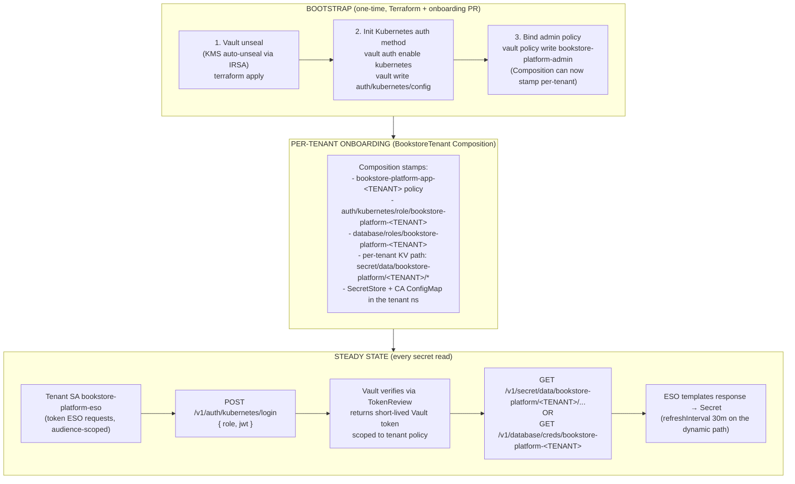

# 15.05 — Production secrets: Vault + ESO + rotation

> The production deepening of [Part 11 ch.05](../11-advanced-production-patterns/05-secrets-at-scale.md):
> a real HA Vault with **KMS auto-unseal**, the **three-step bootstrap**
> (unseal → init Kubernetes auth method → bind first policy), the
> **per-tenant SecretStore + ExternalSecret** pattern stamped by the Crossplane
> Composition ([Part 13 ch.02](../13-grand-capstone-bookstore-platform/02-tenancy-and-crossplane-onboarding.md)),
> Vault **token leasing** and **rotation cadence** as platform discipline,
> **dynamic Postgres credentials** as the strongest rotation form, and
> the production footguns Part 11 ch.05's dev-mode could not surface
> (auto-unseal failure, drift between auth-method audiences, "secret in
> CI logs", lease-storm during a Vault restart).

**Estimated time:** ~45 min read · ~half-day hands-on
**Prerequisites:** [Part 11 ch.05](../11-advanced-production-patterns/05-secrets-at-scale.md) — dev-mode Vault + ESO this chapter productionizes · [Part 05 ch.04](../05-security/04-secrets-and-cluster-hardening.md): the secrets concepts this chapter operates · [Part 14 ch.13](../14-eks-in-production-a-to-z/13-runtime-defense-and-container-security.md) — runtime defense that detects misuse · [Part 13 ch.02](../13-grand-capstone-bookstore-platform/02-tenancy-and-crossplane-onboarding.md) — Crossplane Composition that stamps per-tenant ExternalSecrets

**You'll know after this:** • explain the HA Vault with KMS auto-unseal that the reference Terraform describes · • execute the three-step bootstrap (unseal → init Kubernetes auth method → bind first policy) safely · • implement the per-tenant SecretStore + ExternalSecret pattern · • configure dynamic Postgres credentials as the strongest rotation form and own the rotation cadence as platform discipline · • debug the production footguns dev-mode hides (auto-unseal failure, audience drift, "secret in CI logs", lease-storm on Vault restart)

<!-- tags: vault, eso, secrets-rotation, security, day-2 -->

## Why this exists

[Part 11 ch.05](../11-advanced-production-patterns/05-secrets-at-scale.md)
shipped the dev-mode story: Vault on a single Pod, root token `root`,
ESO syncing one demo Secret, dynamic Postgres credentials demonstrated
end-to-end. It was honest about the gap — "production Vault is HA + KMS
auto-unseal + audit + TLS; this is the teaching substitute". This
chapter is the production half of that pair.

Three things change when Vault moves from dev-mode to production:

1. **The bootstrap is no longer "Vault is already unsealed".** Production
   Vault wakes up sealed (encrypted at rest, no encryption keys in
   memory). **Auto-unseal** with a cloud KMS key means no person has to
   enter unseal keys after each restart; manual unseal makes every restart
   wait on the people who hold the keys. The reference Terraform in
   `examples/bookstore-platform/terraform` names the KMS key that Vault's
   `seal "awskms"` stanza uses, with an IRSA role that can decrypt with it.
   The rest of the bootstrap (init the Kubernetes auth method, bind the
   first policy) follows from a running, unsealed Vault.
2. **One Vault is shared by N tenants.** The platform's namespace-per-
   tenant model ([Part 13 ch.02](../13-grand-capstone-bookstore-platform/02-tenancy-and-crossplane-onboarding.md))
   means N tenants, each with their own Vault policy, each with their
   own ExternalSecrets. The dev-mode pattern (one policy, one role) is
   not safe — a misconfigured policy lets tenant A read tenant B's KV.
   Production discipline is **one policy per tenant, one auth role per
   tenant**, both stamped by the Composition. The Vault HCL files in
   `examples/bookstore-platform/vault/policies/` and the
   `KubernetesAuthRole` YAML in `vault/auth-k8s/` are this discipline.
3. **Rotation has to actually happen.** A secret rotation cadence
   documented in a runbook but never executed is no rotation. The
   production answer is **dynamic short-lived Postgres roles** (Vault's
   database engine mints a per-request credential with a 1h lease;
   revocation is automatic on lease expiry) plus **`refreshInterval` on
   static ESO secrets** as the fallback for vendor secrets Vault cannot
   mint. The `vault/rotation/postgres-rotate.sh` script demonstrates the
   force-rotation path for incident response and exercises the pattern
   end-to-end when run against a cluster.

This chapter walks `examples/bookstore-platform/vault/` end-to-end: the
two policies (app + admin), the auth role binding, the SecretStore, the
sample ExternalSecrets, the rotation script. By the end, a tenant's
catalog Deployment consumes a Vault-synced Secret with dynamic Postgres
credentials. The commands are illustrative: this chapter's cluster ran
only server-side dry-runs (see the Hands-on note).

## Mental model

**Vault is a service the cluster authenticates *to*, not a service the
cluster *runs*. The cluster carries no long-lived Vault credential; the
Kubernetes auth method exchanges a SA token for a short-lived Vault
token scoped to a tenant-specific policy.**

- **Production Vault is HA + KMS-unsealed + audit-logged + TLS-only.**
  Three Vault Pods running Raft consensus, each able to unseal itself via
  a cloud KMS key (auto-unseal), each writing every read / write / login
  to an audit device, each reachable only from in-cluster traffic (no
  public Ingress, internal-only Service). The reference Terraform
  describes this setup on AWS. This chapter consumes a running Vault and
  does not run that Terraform.
- **One SecretStore per tenant namespace.** A SecretStore
  ([Part 11 ch.05](../11-advanced-production-patterns/05-secrets-at-scale.md))
  is the ESO-to-Vault binding for one namespace. It names one
  ServiceAccount and one Vault auth role. The tenant's ExternalSecrets in
  `bookstore-platform-<TENANT>` read through it. Cross-tenant isolation
  rests on two things: the Vault role, which admits only that tenant's
  ServiceAccount in that tenant's namespace, and the Vault policy, which
  grants only that tenant's paths.
- **The three-step bootstrap.** *Step 1*: Vault unseal (auto-unseal;
  check once with `vault status`). *Step 2* — Initialize
  the Kubernetes auth method (one `vault auth enable kubernetes` +
  config). *Step 3* — Write the admin policy + bind it to the platform
  team's identity (so the Composition can stamp per-tenant policies
  from there onward). After that, **onboarding a tenant is the
  Composition's job** — no human runs Vault commands.
- **Token leasing is the central abstraction.** A Vault token from the
  Kubernetes auth method has a TTL and can be renewed up to its max TTL.
  Once renewal stops, ESO logs in again with its ServiceAccount token, and
  Vault checks that token with the K8s TokenReview API. Dynamic Postgres
  credentials have leases; the lease drives the rotation cadence. The
  platform's rule: **`refreshInterval` is at most half the lease**. A
  longer interval leaves the workload holding a credential that Vault has
  already dropped, and it sees auth failures.
- **Dynamic credentials are the rotation primitive.** A Vault `database/
  creds/<role>` read does not READ a stored password — it **mints a new
  Postgres role**, returns its credentials, attaches a lease. Lease
  expiry runs revocation SQL that DROPs the role. Rotation is not an
  operation; it is the natural lifecycle. A leaked dynamic credential
  works until its lease ends (1 hour in the rotation script; renewals stop
  at its 24-hour max TTL). Revoking the lease is one API call and takes
  effect at once.

The trap to keep in view: **Vault makes Vault a single point of
failure**. If Vault is down, ESO cannot sync new secrets, and a new Pod
whose Secret has not synced yet cannot start. The defenses: Vault HA
(3 nodes, Raft quorum), PodDisruptionBudgets on Vault so a node drain
keeps quorum, and alerts that page on a sealed or leaderless Vault. A
synced Secret keeps its last value while Vault is down. Emergency access
during a Vault outage belongs to
[Part 15 ch.09](09-hotfix-workflow-and-breakglass.md), which owns
breakglass. A copy of dynamic credentials in a Secret is no fallback:
each copy ends with its lease.

## Threats and controls

| Threat | Control in this chapter | Deeper |
|---|---|---|
| A long-lived database password leaks and stays valid | Dynamic Postgres roles with a lease; ESO refreshes at half the lease; revoking the lease ends a credential at once | [Part 11 ch.05](../11-advanced-production-patterns/05-secrets-at-scale.md) for rotation at scale; [Part 05 ch.04](../05-security/04-secrets-and-cluster-hardening.md) for the concepts |
| A tenant reads another tenant's secrets through a shared store | One SecretStore per tenant namespace; the Vault role admits one ServiceAccount in one namespace; only the Composition creates stores | [Part 13 ch.02](../13-grand-capstone-bookstore-platform/02-tenancy-and-crossplane-onboarding.md) for tenancy; [Part 05 ch.01](../05-security/01-authn-authz-rbac.md) for RBAC |
| A Vault token or root token sits in a manifest, a shell history or a CI log | Kubernetes auth from each workload's ServiceAccount, so no Vault token is stored; no root token in any command; tokens reach `kubectl exec` on stdin | [Part 05 ch.04](../05-security/04-secrets-and-cluster-hardening.md); [Part 15 ch.02](02-application-cicd-pipelines.md) for CI |
| A rotated credential breaks a running workload, or a Secret goes stale | `refreshInterval` at most half the lease; dynamic credentials mounted as files, not env vars | [Part 15 ch.07](07-rollback-playbook.md) for rollback when a rotation breaks a release |

## Diagrams

### Diagram A — The three-step bootstrap and the steady-state flow (Mermaid)



### Diagram B — Token + lease lifecycle, and the rotation primitives (ASCII)

```
 VAULT TOKEN (the ESO ↔ Vault session) ─────────────────────────────────────
   ESO obtains a Vault token via the Kubernetes auth method:
     ttl=15m, max_ttl=1h, renewable
   ESO uses the token for the KV read or the DB creds mint.
   Renewal extends the TTL, up to max_ttl.
   At max_ttl Vault refuses renewal, so the next use logs in again.

 DYNAMIC POSTGRES CREDENTIAL (the catalog DB password) ─────────────────────
   The generator calls /database/creds/bookstore-platform-acme-books
   Vault runs the role's creation_statements:
     CREATE ROLE "v-kubernet-..." WITH LOGIN PASSWORD '<random>'
     GRANT SELECT, INSERT, UPDATE, DELETE ON ALL TABLES TO ...
   Returns: { username, password, lease_id, lease_duration: 3600 }
   ESO writes Secret with these values.
   refreshInterval 30m → a new credential is minted before the 60m lease ends.
   On expire, Vault runs revocation_statements:
     REASSIGN OWNED BY "v-kubernet-..." TO postgres
     DROP OWNED BY "v-kubernet-..."
     DROP ROLE IF EXISTS "v-kubernet-..."
   A leaked credential works until lease expiry. `vault lease revoke
   <lease-id>` runs the revocation statements at once.

 STATIC VENDOR SECRET (Stripe webhook secret, etc.) ────────────────────────
   Vault stores ONE value at secret/data/bookstore-platform/<TENANT>/stripe
   ESO refreshInterval 1h → re-reads value; if changed, re-syncs Secret.
   Rotation: a human (or a CI job) calls `vault kv put` with a new value.
   Env-var consumers REQUIRE a rollout to pick the new value up (Part 03
   ch.02 — env vars are set at Pod-start). Annotate the Deployment with
   `secret-rotation: <ts>` to force a rollout.

   ROTATION CADENCE (the platform's rule):
     dynamic creds → refresh every 30m on a 1h lease
     static creds  → 24h baseline, 1h for high-risk (Stripe, Auth0)
     breakglass    → Part 15 ch.09 (no Secret copy)
```

## Hands-on with the Bookstore Platform

**Assumed working directory: the guide repo root (`full-guide/`).** This
chapter walks `examples/bookstore-platform/vault/` end-to-end. The hands-on
starts from a running, unsealed Vault and an ESO install. Nothing here
runs on a cloud: the Terraform in `examples/bookstore-platform/terraform`
is reference only. For local validation, the Part 11 ch.05 dev-mode Vault
is a substitute; only the `server` URL in `secret-store.yaml` differs.

**Illustrative output.** The output lines in this section are illustrative,
not captured. The lab cluster that checked this chapter ran only server-side
dry-runs and the gate checks, and installed neither Vault nor ESO.

We will: (0) verify Vault is up; (1) walk the three-step
bootstrap; (2) apply the admin policy + initialize the Kubernetes auth
method; (3) onboard a tenant manually (the Composition path is
end-to-end, but the manual path makes the steps reviewable); (4) apply
the static ExternalSecret and watch ESO sync it to a K8s Secret; (5)
switch to dynamic Postgres credentials; (6) revoke a lease and watch the
next refresh.

### 0. Prerequisites: Vault running, ESO installed

```sh
# Vault running and unsealed. The reference Terraform sets this up on AWS,
# behind the enable_vault variable. Verify Vault is up and unsealed:
kubectl -n vault get pods
#   vault-0/1/2: Running, READY 1/1 each
kubectl -n vault exec vault-0 -- vault status
#   Sealed       false
#   HA Enabled   true
#   HA Mode      active   (one node; the others are standby)

# External Secrets Operator installed (Part 11 ch.05 install path):
kubectl -n external-secrets get pods
kubectl get crd | grep external-secrets
#   externalsecrets.external-secrets.io
#   clustersecretstores.external-secrets.io
```

### 1. The three-step bootstrap

The reference Terraform handles steps 1 and 2 declaratively. The commands
below are the manual version, for a Vault you run yourself:

```sh
# STEP 1: Unseal (production: automatic via KMS; dev-mode: already unsealed)
kubectl -n vault exec vault-0 -- vault status
#   Sealed=false → step 1 done

# STEP 2: Initialize Kubernetes auth method (idempotent; the Terraform does it)
# With no token_reviewer_jwt below, Vault sends its own pod's ServiceAccount
# token to TokenReview, so that ServiceAccount needs system:auth-delegator.
# The admin token arrives on stdin, so it never appears in an argument list.
# Use a short-lived token from the admin policy, never the root token.
printf '%s\n' "${VAULT_TOKEN}" | kubectl -n vault exec -i vault-0 -- sh -c '
  read -r VAULT_TOKEN && export VAULT_TOKEN
  vault auth enable kubernetes 2>/dev/null || true
  vault write auth/kubernetes/config \
    kubernetes_host="https://kubernetes.default.svc:443" \
    disable_iss_validation=true
'
# disable_iss_validation=true is the value Vault recommends for every
# version, and the default on mounts created since Vault 1.9. Vault then
# does not check the token's iss claim.

# STEP 3: Write the admin policy + bind to platform identity
kubectl cp examples/bookstore-platform/vault/policies/bookstore-platform-admin.hcl \
  vault/vault-0:/tmp/admin.hcl
printf '%s\n' "${VAULT_TOKEN}" | kubectl -n vault exec -i vault-0 -- sh -c '
  read -r VAULT_TOKEN && export VAULT_TOKEN
  vault policy write bookstore-platform-admin /tmp/admin.hcl
'
#  After this, an admin token (held by Terraform / the Composition) can
#  create per-tenant policies + roles WITHOUT being root.
```

### 2. Onboard a tenant manually (the Composition path's manual equivalent)

In production, the BookstoreTenant Crossplane Composition ([Part 13 ch.02](../13-grand-capstone-bookstore-platform/02-tenancy-and-crossplane-onboarding.md))
does the next four commands declaratively via the Vault Terraform
provider. The manual path here is the same operations. The `vault` commands
below run in the `vault-0` pod and need the admin token, sent on stdin as
in step 1.

```sh
TENANT=acme-books

# Per-tenant policy (read-only, scoped to this tenant's KV path)
sed "s/<TENANT>/${TENANT}/g" \
  examples/bookstore-platform/vault/policies/bookstore-platform-app.hcl \
  > /tmp/app-${TENANT}.hcl
kubectl cp /tmp/app-${TENANT}.hcl vault/vault-0:/tmp/app.hcl
kubectl -n vault exec vault-0 -- vault policy write \
  bookstore-platform-app-${TENANT} /tmp/app.hcl

# Per-tenant Kubernetes auth role (binds the tenant SA to the policy)
kubectl -n vault exec vault-0 -- vault write \
  auth/kubernetes/role/bookstore-platform-${TENANT} \
  bound_service_account_names=bookstore-platform-eso \
  bound_service_account_namespaces=bookstore-platform-${TENANT} \
  policies=bookstore-platform-app-${TENANT} \
  ttl=15m max_ttl=1h \
  audience=https://vault.bookstore-platform.example.com

# Per-tenant KV path with a sample DB-password Secret (static; the
# dynamic-creds case follows in step 5)
kubectl -n vault exec vault-0 -- vault kv put \
  secret/bookstore-platform/${TENANT}/catalog/db-password \
  username=catalog \
  password="$(openssl rand -base64 32)" \
  dbname=bookstore_catalog

# Verify (admin scope)
kubectl -n vault exec vault-0 -- vault kv get \
  secret/bookstore-platform/${TENANT}/catalog/db-password
```

### 3. Create the tenant namespace, its ServiceAccount, and the SecretStore

The namespace carries the `restricted` labels from the baseline. The
ServiceAccount does not mount a token into pods: ESO requests tokens for it
from the API server, and no pod in this namespace uses it. In production the
Composition creates both objects. Save this block as `tenant.yaml`:

```yaml
apiVersion: v1
kind: Namespace
metadata:
  name: bookstore-platform-acme-books
  labels:
    pod-security.kubernetes.io/enforce: restricted
    pod-security.kubernetes.io/audit: restricted
    pod-security.kubernetes.io/warn: restricted
---
apiVersion: v1
kind: ServiceAccount
metadata:
  name: bookstore-platform-eso
  namespace: bookstore-platform-acme-books
automountServiceAccountToken: false
```

```sh
kubectl apply -f tenant.yaml

# The SecretStore reads the CA from a ConfigMap in this namespace. The
# Composition copies vault-server-ca here.
kubectl apply -f examples/bookstore-platform/vault/secret-store.yaml
kubectl -n bookstore-platform-acme-books get secretstore vault-bookstore-platform \
  -o jsonpath='{.status.conditions[*].type}={.status.conditions[*].status}{"\n"}'
#   Ready=True (ESO logged in to Vault with the tenant ServiceAccount)

# Tenants should not be able to create stores. Expect "no" for a tenant user.
kubectl auth can-i create secretstores -n bookstore-platform-acme-books \
  --as=<tenant user>

# The ExternalSecret pulls from the tenant's static KV path
kubectl apply -f examples/bookstore-platform/vault/external-secret-sample.yaml
kubectl -n bookstore-platform-acme-books get externalsecret catalog-db-credentials \
  -o jsonpath='{.status.conditions[*].type}={.status.conditions[*].status}{"\n"}'
#   Ready=True (ESO created the catalog-db-credentials Secret)

# Verify the synced Secret
kubectl get secret catalog-db-credentials -n bookstore-platform-acme-books \
  -o jsonpath='{.data.POSTGRES_PASSWORD}' | base64 -d; echo
# Output is the password Vault stored. The catalog Deployment's
# envFrom: secretRef consumes this byte-identically to a static Secret.
```

### 4. Dynamic Postgres credentials — the rotation primitive

The static KV case above is the **fallback** pattern (vendor secrets
Vault cannot mint). The **default** for tenant DB credentials is the
Vault database engine: every read mints a fresh Postgres role,
revocation is automatic.

```sh
# Bootstrap the database engine for the tenant (one-time; in production
# the Composition does this via the Vault TF provider). Run this from a pod
# in the cluster or through `kubectl port-forward`: the vault-active name
# does not resolve on a laptop. Use a short-lived admin token, not root.
export VAULT_ADDR=https://vault-active.vault.svc.cluster.local:8200
export VAULT_TOKEN=<short-lived admin token>
export PG_ADMIN_PASSWORD=$(kubectl get secret postgres-superuser \
  -n bookstore-platform-acme-books -o jsonpath='{.data.password}' | base64 -d)

./examples/bookstore-platform/vault/rotation/postgres-rotate.sh bootstrap
#   [1/3] enable database secrets engine
#   [2/3] configure connection to bookstore-platform-acme-books postgres
#   [3/3] define role with CREATE/REVOKE SQL templates

# Rotate the superuser password so that only Vault knows it. The
# PG_ADMIN_PASSWORD exported above is stale after this; discard it.
vault write -f database/rotate-root/bookstore-platform-postgres-acme-books

# Force a rotation cycle: read a fresh dynamic credential and validate
# it against Postgres.
./examples/bookstore-platform/vault/rotation/postgres-rotate.sh rotate
#   Minted Postgres role: v-kubernet-bookstore-platform-acme-books-<random>
#   Lease ID:             database/creds/bookstore-platform-acme-books/<uuid>
#   Lease duration:       3600s
#   OK — new role authenticated and queried Postgres.

# Switch the catalog to dynamic credentials. dynamic-db-creds.yaml uses the
# same ExternalSecret name, so applying it updates the Secret in place.
# Do not delete the static ExternalSecret first: with creationPolicy Owner,
# deleting it deletes the Secret.
kubectl apply -f examples/bookstore-platform/vault/dynamic-db-creds.yaml
```

The sample catalog reads the Secret as environment variables, which Pods read
only at start. Mount the Secret as files before dynamic credentials go to the
catalog; the Production notes explain why.

### 5. Revoke a lease and watch the next refresh

```sh
# Trigger an immediate rotation by deleting the lease
LEASE_ID=$(kubectl -n vault exec vault-0 -- \
  vault list -format=json sys/leases/lookup/database/creds/bookstore-platform-acme-books \
  | jq -r '.[0]')
./examples/bookstore-platform/vault/rotation/postgres-rotate.sh revoke "${LEASE_ID}"
#   The Postgres role is DROPped immediately. The Secret keeps the dead
#   credential until the next refresh (within 30m), which mints a new role.
#   Forcing an immediate refresh:
#   kubectl annotate externalsecret/catalog-db-credentials \
#     -n bookstore-platform-acme-books force-sync="$(date +%s)" --overwrite

# Re-read the Secret to confirm rotation
kubectl get secret catalog-db-credentials -n bookstore-platform-acme-books \
  -o jsonpath='{.data.POSTGRES_USER}' | base64 -d; echo
# After the next refresh, the username differs (a new role was minted).
```

## How it works under the hood

**KMS auto-unseal under the covers.** Vault encrypts its data at rest
with an *encryption key* it never persists — at startup, it needs to
*decrypt* this key to unseal. The naive scheme (Shamir's secret-shared
unseal keys) requires people to enter unseal keys after every restart, so each restart
waits on them. KMS auto-unseal stores the
encrypted Vault master key alongside Vault's data; at startup, Vault's
IRSA-bound role calls `kms:Decrypt` on the cloud KMS to recover the
master key, which decrypts the in-memory encryption key, which unseals
Vault. The trust shifts from "humans hold unseal keys" to "the cloud
KMS holds the unseal capability, gated by IAM". The reference
Terraform tree in `examples/bookstore-platform/terraform` names the KMS
key, the IRSA role, and the Vault `seal "awskms"` stanza.

**Kubernetes auth method internals.** When ESO POSTs `{ jwt, role }`
to `/v1/auth/kubernetes/login`, Vault unpacks the JWT, extracts the SA
name + namespace + audience, and calls the K8s `TokenReview` API to
validate the JWT is still active. The TokenReview response carries the
SA's *current* identity — if the SA was deleted and recreated, the UID
differs, and Vault's audit log records the new UID. Vault then matches
the SA name + namespace against the role's `bound_service_account_*`
fields, checks the role's `audience` against the JWT's audience claim,
and issues a short-lived Vault token bound to the role's `policies`.
The token is renewable up to `max_ttl`.

**SecretStore vs ClusterSecretStore.** A ClusterSecretStore is
cluster-scoped, so any namespace can reference it, and its auth block
names one ServiceAccount and one role. Every namespace that uses it logs
in as that identity, and Vault cannot tell the tenants apart. The chapter
therefore uses one namespaced SecretStore per tenant. A SecretStore takes
its ServiceAccount from its own namespace, and the Vault role's
`bound_service_account_namespaces` admits only that namespace.
**ESO's own RBAC.** Keep the controller's ClusterRole as the chart ships
it. It can read and write Secrets in every namespace and, through
`serviceAccountRef`, request tokens for ServiceAccounts (the chart's
`rbac.serviceAccountTokenCreate` is true by default). Only the Composition
creates SecretStore and VaultDynamicSecret objects, because each carries
a Vault server address and a ServiceAccount to present to it. Tenants get
rights on ExternalSecret in their own namespace.

**Per-tenant policy templating.** The `bookstore-platform-app.hcl`
policy uses `<TENANT>` as a placeholder. The Composition's Vault
Terraform provider renders one policy per tenant, replacing `<TENANT>`
with the tenant name. The result is N distinct policies whose paths do
not overlap. A tenant whose policy was misconfigured to read another
tenant's path would be caught by Vault audit (the read appears in the
audit log with the wrong identity) — alert on the cross-tenant pattern
in CloudWatch Logs Insights. This is the [Part 05 ch.04](../05-security/04-secrets-and-cluster-hardening.md)
audit-trail discipline applied at the secrets manager.

**Dynamic credential anatomy.** The Vault database engine has two
moving parts: the *connection config* (how Vault talks to Postgres) and
the *role* (the SQL template). A `vault read database/creds/<role>`
read does five things in sequence: (a) Vault connects to Postgres with
the configured admin credentials; (b) executes the role's
`creation_statements` SQL (which runs `CREATE ROLE`); (c) attaches a
lease to the new role; (d) returns the credentials to the caller; (e)
on lease expiry, executes the role's `revocation_statements` (which
runs `DROP ROLE`). The Postgres role only exists during the lease; the
Vault audit log records who minted it and when. A leak's blast radius
is bounded by the lease TTL — Part 03 ch.02's "rotation note" made
real at the strongest possible form.

**The `refreshInterval` vs lease ordering rule.** If `refreshInterval`
is 1h and the dynamic lease is 1h, there is a race: the lease can
expire seconds before ESO re-reads, dropping the Postgres role while
the catalog is mid-query. The platform's discipline: **`refreshInterval`
≤ lease_TTL / 2**. With 1h leases, `refreshInterval: 30m`, as in
`dynamic-db-creds.yaml`. Each refresh mints a new credential before the
old one's lease ends, so both stay valid for a while. An env-var consumer
keeps the value it started with and fails when the old lease ends, unless
it restarts. A file-mount consumer re-reads the file. Every refresh
changes the value, so a rollout on each change (Reloader, for example)
would restart the catalog every 30 minutes. That is why dynamic
credentials go to file mounts.

**The "secret in CI logs" footgun.** A CI job runs `vault read -format=
json database/creds/...` and pipes the output through `jq` to extract
the password. If `set -x` is enabled, bash prints the full command;
worse, if the CI uploads logs to a third-party service, the password
travels too. The defenses, in order: (1) **never** read Vault from CI
— the cluster reads Vault, not the build pipeline; (2) when CI MUST
read (e.g. for the migrate-job pre-deploy SQL), use `vault read -
field=password` (which prints only the field, not the JSON); (3) `set
+x` around any `vault` command; (4) the CI's log retention policy
treats Vault-touching jobs as sensitive (delete logs after 7 days, no
upload to third-party). The `rotation/postgres-rotate.sh` script in
this tree is explicit about all four — `set -euo pipefail` but no
`set -x`, password via `PGPASSWORD` env (not on the command line), the
credentials file (from `mktemp`) that an EXIT trap deletes.

**Vault HA failover and ESO behavior.** Production Vault runs three
Pods in Raft consensus; one is *active* (handles reads/writes), two
are *standby* (only forward to active). The internal Service
`vault-active.vault.svc` resolves to the active Pod. On active-Pod
loss, Raft elects a new active node and the Service follows. Requests made
during the election fail. Existing synced Secrets are unchanged, and ESO
retries on later refreshes. The platform's defense: (a) a
PodDisruptionBudget on Vault, sized so a node drain keeps Raft quorum;
(b) alerts on Vault's sealed and active status, so a sealed or leaderless
Vault pages someone.

## Production notes

> **In production:** provision Vault from the reference Terraform, NOT the
> demo Helm chart with `dev.enabled=true`. Production Vault is HA (Raft, 3
> nodes), KMS auto-unsealed, TLS-only, audit-logged, and exposed
> through an *internal* Service (no public Ingress). The `enable_vault`
> variable in the reference Terraform gates it. Production
> Vault dev-mode is a CISO-finding waiting to happen.

> **In production:** The Kubernetes auth method is the only ESO →
> Vault auth pattern the platform allows. No static `VAULT_TOKEN` in
> a Secret, no AppRole shared secret, no GitHub auth method.
> Kubernetes auth method ties Vault's trust to the SA token (which
> the kubelet rotates) and the Vault policy (which scopes what the
> identity can do). The audience-scoped token that ESO requests
> (`serviceAccountRef.audiences`) is the extra defense: a leaked token can only be
> presented to Vault (with the right audience), not to any other API.

> **In production:** One Vault policy per tenant, one Vault role per
> tenant, both stamped by the Composition — never hand-edited. A
> hand-edit drifts; the Composition is the only producer. The
> `<TENANT>` placeholder pattern in `policies/bookstore-platform-
> app.hcl` is the contract. A hand-applied policy with a wider scope
> than the Composition would produce is a security incident: alert on
> any Vault policy whose name matches `bookstore-platform-app-*` but
> whose content does not match the Composition's rendering.

> **In production:** Dynamic Postgres credentials are the default for
> tenant DB access. Static KV (the `secret/data/...` pattern) is the
> fallback for vendor secrets Vault cannot mint — Stripe webhook
> secrets, OAuth client secrets, third-party API keys. The platform's
> rule: if Vault CAN mint it (DB, AWS IAM creds, SSH CA cert), Vault
> MINTS it; if Vault stores it statically, the rotation cadence is
> documented and enforced (CronJob that rotates and re-puts every 24h
> for high-risk secrets).

> **In production:** `refreshInterval` ≤ lease_TTL / 2. The race
> condition (lease expires before ESO refreshes) drops the Postgres
> role under the running workload's feet. With 1h leases the
> `refreshInterval` is 30m; with 24h leases it is 12h. The
> `external-secret-sample.yaml` is static KV with no lease, so its 1h is a
> rotation cadence, not a lease rule. `dynamic-db-creds.yaml` uses 30m.

> **In production:** Env-var consumers need a rollout to pick up
> rotated secrets ([Part 03 ch.02](../03-config-and-storage/02-secrets.md)).
> File-mounted secrets re-sync live, and the app must re-read them.
> Environment-variable secrets are read at Pod start. ESO itself does not
> restart Pods. The Reloader controller (`stakater/Reloader`) rolls a
> Deployment when a Secret it uses changes, and a scheduled
> `kubectl rollout restart` works for static values. Neither fits dynamic
> credentials, which change on every refresh. The sample catalog reads
> `DB_DSN` from an environment variable, so it must move to a file mount
> first.

> **In production:** Vault outages and breakglass access belong to
> [Part 15 ch.09](09-hotfix-workflow-and-breakglass.md). Do not keep a copy
> of dynamic credentials in a Secret as a fallback. Each copy goes dead
> when its lease ends, and Vault drops the Postgres role at that point.

> **In production:** Audit every Vault read. CloudWatch Logs Insights
> queries on the Vault audit stream catch cross-tenant reads ("tenant
> A's role read tenant B's path" — never expected, always alertable),
> after-hours admin-policy use ("a human used the admin policy at
> 3am" — change-record required), and pattern anomalies (an
> ExternalSecret reading at unusual cadence). The audit device is
> what makes Vault different from "a Kubernetes Secret" — use it.

> **In production:** The "secret in CI logs" footgun is the single
> most common Vault leak. Defenses, in order: never read Vault from
> CI (the cluster reads it, not the pipeline); when CI must read, use
> `vault read -field=<key>` not full JSON; never `set -x` around
> Vault commands; log retention for Vault-touching jobs ≤ 7 days, no
> upload to third-party log services. Write all four into any
> pipeline that touches Vault.

## Quick Reference

```sh
# Vault HA verification (production):
kubectl -n vault exec vault-0 -- vault status
kubectl -n vault exec vault-0 -- vault operator raft list-peers
# Expect: Sealed=false, HA Mode=active, 3 peers in raft.

# Bootstrap (one-time):
kubectl -n vault exec vault-0 -- vault auth enable kubernetes
kubectl -n vault exec vault-0 -- vault write auth/kubernetes/config \
  kubernetes_host="https://kubernetes.default.svc:443" \
  disable_iss_validation=true
vault policy write bookstore-platform-admin \
  examples/bookstore-platform/vault/policies/bookstore-platform-admin.hcl

# Per-tenant onboarding (production: Composition stamps these):
TENANT=acme-books
sed "s/<TENANT>/${TENANT}/g" \
  examples/bookstore-platform/vault/policies/bookstore-platform-app.hcl \
  | vault policy write bookstore-platform-app-${TENANT} -
vault write auth/kubernetes/role/bookstore-platform-${TENANT} \
  bound_service_account_names=bookstore-platform-eso \
  bound_service_account_namespaces=bookstore-platform-${TENANT} \
  policies=bookstore-platform-app-${TENANT} \
  ttl=15m max_ttl=1h \
  audience=https://vault.bookstore-platform.example.com

# Apply the SecretStore and ExternalSecrets (CRD-intrinsic dry-run note):
kubectl apply -f examples/bookstore-platform/vault/secret-store.yaml
kubectl apply -f examples/bookstore-platform/vault/external-secret-sample.yaml
kubectl get externalsecret -A
kubectl get secretstore -A

# Dynamic Postgres credentials (the rotation primitive):
./examples/bookstore-platform/vault/rotation/postgres-rotate.sh bootstrap
./examples/bookstore-platform/vault/rotation/postgres-rotate.sh rotate
./examples/bookstore-platform/vault/rotation/postgres-rotate.sh revoke <lease-id>
kubectl apply -f examples/bookstore-platform/vault/dynamic-db-creds.yaml

# Force an ExternalSecret refresh without waiting for refreshInterval:
kubectl annotate externalsecret/catalog-db-credentials \
  -n bookstore-platform-acme-books \
  force-sync="$(date +%s)" --overwrite
```

The production-Vault checklist:

- [ ] Vault HA mode active with 3 Raft peers; KMS auto-unseal verified.
- [ ] Vault audit device enabled (CloudWatch Logs); cross-tenant read
      alerts wired in CloudWatch Logs Insights.
- [ ] Kubernetes auth method enabled with `disable_iss_validation=true`
      and audience-scoped to `https://vault.bookstore-platform.example.com`.
- [ ] Admin policy bound to the Composition's identity (NEVER a long-
      lived static token); per-tenant policies templated from
      `bookstore-platform-app.hcl`.
- [ ] Each tenant's SecretStore is Ready=True, and its ExternalSecrets
      are Ready=True.
- [ ] Dynamic Postgres credentials for tenant DB access; static KV
      only for vendor secrets Vault cannot mint.
- [ ] `refreshInterval` ≤ lease_TTL / 2 for every ExternalSecret
      referencing a dynamic path.
- [ ] Dynamic credentials mounted as files; env-var consumers hold only
      static values.
- [ ] Breakglass for Vault outages set up and tested, per
      [Part 15 ch.09](09-hotfix-workflow-and-breakglass.md).
- [ ] PSA-restricted: ESO's chart sets the restricted securityContext
      (non-root, drop ALL, RuntimeDefault seccomp, read-only root
      filesystem), its namespace is labelled restricted, and no Vault
      Agent Sidecar Injector in tenant namespaces ([Part 11 ch.05](../11-advanced-production-patterns/05-secrets-at-scale.md)
      footgun).

## Test your understanding

> Try each before opening the answer drawer. The act of trying is the exercise; the answer is the check.

1. **Why does the chapter prefer KMS auto-unseal to manual unseal for production Vault?**
   <details><summary>Show answer</summary>

   With manual unseal, each Vault restart (an upgrade, node reboot, kernel patch or eviction) needs a quorum of unseal-key holders. In an outage at 3am with one key holder on vacation, Vault stays sealed and the platform halts. KMS auto-unseal stores the unseal capability in AWS KMS keyed to the cluster's IRSA role; on restart, Vault decrypts itself and is immediately available. No person is needed at restart. The trade-off: Vault depends on KMS being reachable from the cluster.

   </details>

2. **A platform engineer sets `refreshInterval: 2h` on an ExternalSecret pointing at a Vault dynamic Postgres credential with `lease_ttl: 1h`. The workload sees intermittent auth failures. What's happening?**
   <details><summary>Show answer</summary>

   The Postgres credential's lease expires at 1h; Vault revokes the role, the password no longer authenticates. ESO doesn't sync a new credential for another full hour (2h refreshInterval), so for an hour the workload's Secret has a dead credential. The chapter's rule: `refreshInterval` MUST be shorter than the Vault lease — typically `lease_ttl / 2` so each refresh catches the credential before expiry. Fix: lower refreshInterval to 30 minutes or raise lease_ttl to 4h+; whichever, ensure refresh happens at least twice per lease window.

   </details>

3. **A tenant's ExternalSecret reads another tenant's KV path through a ClusterSecretStore whose `serviceAccountRef` names tenant A's ServiceAccount. Why does this leak, and what is the fix?**
   <details><summary>Show answer</summary>

   ESO logs in as the ServiceAccount the store names, not the one in the ExternalSecret's namespace. Every namespace that uses the store therefore presents tenant A's identity, and Vault grants tenant A's policy to it. The fix is one namespaced SecretStore per tenant, whose ServiceAccount resolves in its own namespace and matches only that tenant's Vault role. Vault's `bound_service_account_namespaces` does the rest, and the Composition is the only producer of stores.

   </details>

4. **Hands-on extension: read a dynamic Postgres credential from Vault: `vault read database/creds/bookstore-platform-acme-books`. Copy the username, then run `vault lease revoke <lease_id>` and try to connect with that username.**
   <details><summary>What you should see</summary>

   Vault revokes the lease: the username/password no longer authenticates against Postgres because the revocation SQL has run (the role was `DROP`'d). The connection fails immediately with an auth error. This is the chapter's claim made concrete: rotation isn't an operation, it's the natural lifecycle. A leaked dynamic credential works until its lease ends, or until one API call (`lease revoke`) ends it. Static credentials in Postgres would require connecting, running `ALTER USER ... PASSWORD`, redistributing to consumers — minutes to hours of coordination. Dynamic credentials collapse that to seconds.

   </details>

## Further reading

- **HashiCorp Vault — Production Hardening**
  <https://developer.hashicorp.com/vault/tutorials/operations/production-hardening>;
  the authoritative pre-production checklist (HA, audit, TLS, KMS
  unseal, network isolation).
- **HashiCorp Vault — Kubernetes auth method**
  <https://developer.hashicorp.com/vault/docs/auth/kubernetes>; the
  exact protocol and config parameters this chapter relies on.
- **HashiCorp Vault — Database secrets engine**
  <https://developer.hashicorp.com/vault/docs/secrets/databases>; the
  dynamic credentials primitive, lease semantics, and per-database
  plugin configuration.
- **External Secrets Operator — Vault provider**
  <https://external-secrets.io/latest/provider/hashicorp-vault/>; the
  SecretStore and ExternalSecret reference.
- Part 11 ch.05 — the dev-mode Vault foundations this chapter deepens.
- Part 13 ch.02 — the Composition that stamps per-tenant Vault
  policies + roles in production.
- [Part 15 ch.07](07-rollback-playbook.md): what to do when a rotated
  secret breaks an in-flight workload.
- [Part 15 ch.09](09-hotfix-workflow-and-breakglass.md): breakglass
  access during a Vault outage.
