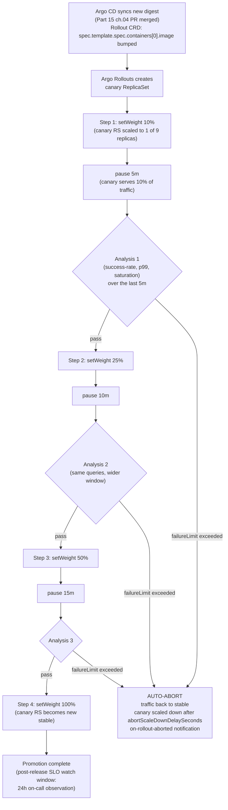

# 15.06 — Progressive delivery in production

> The production deepening of [Part 07 ch.05](../07-delivery/05-progressive-delivery.md):
> an Argo Rollouts canary in **production**, gated by an `AnalysisTemplate`
> querying real Prometheus **SLO metrics** (success-rate, p99 latency,
> saturation), auto-promote on green / auto-rollback on red, **blue-green
> for stateful workloads** where rolling-traffic-shift would split
> writes, **manual pause / resume** as a deliberate intervention surface,
> the SLO-gate handoff between Rollouts and Grafana, and the production
> footguns the dev-cluster demo couldn't surface — the "canary that
> succeeded but the long-tail user broke", canary-as-percentage vs
> canary-as-cohort, and the rollback-to-last-known-good runbook.

**Estimated time:** ~30 min read · ~90 min hands-on
**Prerequisites:** [Part 07 ch.05](../07-delivery/05-progressive-delivery.md): Rollouts mechanics this chapter productionizes · [Part 06 ch.01](../06-production-readiness/01-observability-metrics.md): SLOs that define the gate · [Part 15 ch.04](./04-multi-environment-promotion.md): promotion path the canary lives on

**You'll know after this:** • configure an Argo Rollouts canary gated by an `AnalysisTemplate` over real Prometheus SLO metrics (success-rate, p99 latency, saturation) · • implement auto-promote on green / auto-rollback on red without human intervention · • choose blue-green for stateful workloads where rolling traffic shift would split writes · • design manual pause/resume as a deliberate intervention surface, not a workaround · • debug the production footguns dev-cluster demos hide ("canary succeeded but long-tail user broke", canary-as-percentage vs canary-as-cohort)

<!-- tags: argo-rollouts, slo, day-2, observability, gitops -->

## Why this exists

[Part 07 ch.05](../07-delivery/05-progressive-delivery.md) shipped the
mechanics: Argo Rollouts CRD replaces the Deployment, canary steps with
`setWeight` and `pause`, an `AnalysisTemplate` queries Prometheus, the
rollout auto-aborts on `failureLimit`. The demo was honest: a kind
cluster, a single catalog Pod, errors induced by an env-var flip. The
mechanic works.

In **production** three things change:

1. **The metric IS the SLO.** A demo can pick a Prometheus query that
   captures errors; production must pick a query that captures the
   *service-level objective* the platform commits to ([Part 06 ch.01](../06-production-readiness/01-observability-metrics.md)
   was the SRE-grade observability foundation). A 99.9% availability
   SLO is a 0.1% error budget; a canary that emits 0.2% errors for 5
   minutes is **already 100% over budget for an hour**. The
   `AnalysisTemplate` query must encode the actual SLO, including the
   time window over which it is measured, the percentile latency the
   platform commits to, and the saturation thresholds that predict
   imminent failure (CPU, memory, queue depth).
2. **The traffic is real and adversarial.** Demo traffic is uniform;
   production traffic has cohorts (large customer A, region B, browser
   C). A 10% canary serves a 10% slice of *random* requests by default
   — but the long-tail customer whose query plan takes 2 seconds is
   unevenly distributed, and a 10% canary that successfully serves 999
   out of 1000 normal users while breaking the 1 enterprise customer's
   $50k/month order is a successful rollout *by metrics* and a fired
   account manager *by reality*. The platform's defense — **canary by
   cohort, not just by percentage** — costs more to wire but saves
   careers.
3. **The blast radius compounds with the platform.** A canary that
   takes down the catalog might not just take orders; it might
   cascade: orders retry → orders' DB connection pool fills →
   payments-worker stalls → events backlog grows → recommendations'
   feature serving falls behind. The SLO-gate has to see *upstream*
   and *downstream* signals, not just the canary's own metrics. The
   platform's pattern: each canary's `AnalysisTemplate` queries the
   service's own `RED` metrics **and** the immediate downstream's
   `USE` metrics; either tripping aborts the canary.

This chapter is the production-grade canary made real on the Bookstore
Platform's catalog service: a Rollout CRD shipped via Argo CD ([ch.04](04-multi-environment-promotion.md)),
gated by an `AnalysisTemplate` querying real SLO metrics from Prometheus,
with auto-rollback wired through Argo Rollouts notifications to PagerDuty
and Grafana. Blue-green is the companion pattern for releases whose old
and new versions cannot serve writes at the same time, where the canary's
"shift some traffic" model would split the data.

## Mental model

**Production progressive delivery is not "canary mechanics"; it is "an
SLO-gated control loop with bounded blast radius and a manual override
that NEVER kills user experience to satisfy the rollout".**

- **Canary = traffic-shift release.** vN serves 100%; vN+1 stands up;
  the controller shifts a *slice* of traffic to vN+1 in steps (10 → 25
  → 50 → 100%), measures SLOs at each step, promotes if green, aborts
  + rolls back if red. The catalog Deployment is the textbook canary
  target — stateless, idempotent reads, horizontal scaling.
- **Blue-green = full-stack swap.** vN and vN+1 both run at full scale
  in parallel; the controller flips the Service from blue to green at
  one instant. Use it where the two versions must not serve writes at
  once, such as a release that changes a schema the old version still
  reads: a 10% slice of writes would land in both shapes. A flip moves
  traffic, not data. The trade-off is 2x capacity during the bake, and
  a flip back is a clean rollback only until green has written data
  that blue cannot read. Hands-on step 5 covers the database side.
- **AnalysisTemplate = the SLO encoded as PromQL.** Three queries
  matter: (a) **success-rate** — the inverse of error-rate, gated to
  the canary's traffic (not the stable's); (b) **p99 latency** —
  bounded to the SLO's promised tail; (c) **saturation** — CPU /
  memory / queue depth predicting near-future failure even when
  current errors are zero. All three must pass; any one failing more
  than failureLimit times aborts the rollout.
- **Pause-resume is the human override surface.** A canary at 25%
  that has passed analysis can be *paused indefinitely* with `kubectl
  argo rollouts pause`. The traffic stays at 25%; the rollout waits
  for `kubectl argo rollouts promote` (or `abort`). This is the
  surface for: (a) overnight soaks; (b) coordinating with another
  team's deploy; (c) waiting for a customer's incident window to
  close; (d) holding traffic during a black-Friday freeze. The rule:
  **pause does not block subsequent rollouts of OTHER services** —
  only this one waits.
- **Auto-rollback sends a notification.** Rollback is mechanical (the
  controller moves traffic back to stable and scales the canary down),
  but the human-facing signal is critical: the `on-rollout-aborted`
  notification trigger pages the on-call, and it can reach Grafana too. Without the human signal, "auto-rollback" feels
  like magic the team cannot reason about: the
  [Part 06 ch.01](../06-production-readiness/01-observability-metrics.md)
  observability discipline.

The trap to keep in view: **a successful canary is not a successful
release**. The canary proves the new code doesn't break the 10% of
traffic measured during analysis. It does not prove the new code
handles a Black Friday spike, an enterprise customer's batch job at
midnight UTC, or a feature flag that has not been turned on yet ([15.08](08-feature-flags-and-dark-launches.md)).
Canary is *necessary*, not *sufficient*. The discipline: pair every
canary with a **post-release SLO watch window** (the platform's rule:
24h after 100% rollout, the on-call watches the same dashboards the
canary's AnalysisTemplate queried; any regression triggers a rollback
PR — Part 15 ch.07's pattern).

## Threats and controls

| Threat | Control | Deeper |
|---|---|---|
| A bad release passes analysis, or missing data reads as healthy | Queries scoped to the canary's pods, and `len(result) > 0` in every `successCondition`, so an empty result fails the gate | [06.01](../06-production-readiness/01-observability-metrics.md) |
| Someone who should not move the rollout pauses, promotes or aborts it | A Role that binds pause, promote and abort to the release group only (Hands-on step 6) | [05.01](../05-security/01-authn-authz-rbac.md) |
| The rollout changes outside Git, so the reviewed spec is not what runs | The Rollout changes only by pull request, and Argo CD reverts drift | [15.01](01-pr-to-production-lifecycle.md) |
| A client sets `x-canary-cohort` to force the canary or to skip it | The edge drops any value a client sent, on every route (`edge/gateway.yaml` and `edge/cohort-header-strip.yaml`), and the storefront sets the header from the verified session | [Part 11 ch.04](../11-advanced-production-patterns/04-service-mesh.md) |

## Diagrams

### Diagram A — The catalog Rollout: steps, analysis, abort path (Mermaid)



### Diagram B — Canary by percentage vs canary by cohort (ASCII)

```
 CANARY BY PERCENTAGE (the default) ───────────────────────────────────────
                                  10%   25%   50%   100%
   vN  (stable)  ████████████████ 90 │ 75 │ 50 │   0
   vN+1 (canary) ░░░░░░░░░░░░░░░░ 10 │ 25 │ 50 │ 100
                                  └───┴────┴────┘
                                  Random sampling of all users.

   PRO: simple to configure (Istio VirtualService weight, or Argo
        Rollouts' direct ReplicaSet ratio).
   CON: "long-tail breaks for 1 enterprise customer" → false-green.
        The canary measures the average; the enterprise customer's
        bespoke query plan is the outlier the average misses.

 CANARY BY COHORT (the production-grade pattern) ──────────────────────────
   Header: x-canary-cohort
     internal      → 100% canary (employees + integration tests)
     beta-tenants  → 25% canary  (volunteer customer cohort)
     enterprise    → 0% canary   (NEVER until 100% promoted)
     default       → percentage canary (10 → 25 → 50)

   Routing is in the Istio VirtualService:
     match:
       - headers: { x-canary-cohort: { exact: internal } }
         route: [{ destination: catalog, subset: canary, weight: 100 }]
       - headers: { x-canary-cohort: { exact: enterprise } }
         route: [{ destination: catalog, subset: stable,  weight: 100 }]
       - route: [ stable: 90, canary: 10 ]

   PRO: blast-radius IS bounded by cohort. The enterprise customer
        cannot be the canary's victim.
   CON: needs the upstream (storefront / API gateway) to set the
        cohort header — the cohort definition is the API team's contract.

 The platform uses BOTH: percentage canary for the default cohort PLUS
 explicit cohort routing for internal (100% canary) and enterprise
 (0% canary until the rollout completes).
```

## Hands-on with the Bookstore Platform

**Assumed working directory: the guide repo root (`full-guide/`).** This
chapter extends [Part 07 ch.05](../07-delivery/05-progressive-delivery.md)'s
catalog Rollout with the production AnalysisTemplate, a blue-green
strategy, and the cohort routing in the Istio VirtualService.

The steps need Argo Rollouts, Prometheus and Istio on a cluster you own.
The lab cluster has none of them, so nothing here was applied there. The
output shown after a command is illustrative, and no step runs on a cloud.
The AnalysisTemplate is in
`examples/bookstore-platform/argocd/rollouts/analysis-template-slo.yaml`,
because the gate reads `{{ }}` in a chapter block as template text. The
Rollout is inline. The objects it needs (the namespace, the `catalog`
ServiceAccount, the Services, the DestinationRule and the VirtualService)
are in `examples/bookstore-platform/argocd/rollouts/catalog-traffic.yaml`.
Apply that file before the Rollout.

We will: (0) verify Argo Rollouts, Prometheus and Istio are installed;
(1) apply the AnalysisTemplate with three SLO queries; (2) apply the
catalog Rollout that consumes it; (3) ship a good digest and watch it
promote; (4) ship a bad digest and watch it abort; (5) look at the
blue-green strategy and the database beneath it; (6) check who may
promote or abort.

### 0. Prerequisites — Rollouts, Prometheus, Istio, Argo CD

```sh
# Argo Rollouts (Part 07 ch.05, own namespace); Prometheus from
# kube-prometheus-stack (Part 06 ch.01); Istio (Part 11 ch.04).
kubectl get deploy -n argo-rollouts
kubectl get statefulset -n monitoring | grep prometheus
kubectl get deploy -n istio-system | grep istiod
kubectl get application -n argocd | grep bookstore

# The Argo Rollouts kubectl plugin (best UX):
kubectl argo rollouts version
```

### 1. The production AnalysisTemplate: three SLO queries

The AnalysisTemplate is named, reusable and parameterized by the service.
It has three metrics, each with its own `successCondition` and
`failureLimit`. Apply the complete object from the examples tree:

```sh
kubectl apply -f examples/bookstore-platform/argocd/rollouts/analysis-template-slo.yaml
```

The first metric below shows the shape. The object in the examples tree
adds the metadata and the three args, and carries the other two metrics.

```yaml
# One entry from spec.metrics. The complete object is in the examples tree.
metrics:
  - name: success-rate
    interval: 60s
    count: 5                      # five samples, five minutes
    successCondition: len(result) > 0 && result[0] >= 0.999
    failureLimit: 2
    provider:
      prometheus:
        address: http://kube-prometheus-stack-prometheus.monitoring.svc:9090
        query: |
          sum(rate(catalog_http_requests_total{
            namespace="{{args.namespace}}",
            pod=~"{{args.service-name}}-{{args.canary-pod-hash}}-.*",
            status!~"5.."
          }[2m]))
          /
          sum(rate(catalog_http_requests_total{
            namespace="{{args.namespace}}",
            pod=~"{{args.service-name}}-{{args.canary-pod-hash}}-.*"
          }[2m]))
```

Each part of the query earns its place:

- `status` is the status class the catalog records (`2xx`, `5xx` and so
  on), so `status!~"5.."` counts the responses that are not 5xx.
- The `pod=~` matcher pins the query to the canary's pods, through
  `podTemplateHashValue: Latest`. Without it the query averages canary
  and stable: a canary at 80% success, averaged with a stable at 99.9%
  over a 90/10 split, reads 97.9% and passes a 95% threshold.
- `len(result) > 0 &&` is the empty-result guard. The Argo Rollouts
  analysis documentation uses this form for Prometheus and marks an
  empty `[]` as Failed. It does not document an unguarded `result[0]`
  on an empty array, so do not rely on one.

The latency and saturation metrics use the same pattern. The p99 query
takes `histogram_quantile` over `catalog_http_request_duration_seconds`,
and the CPU query divides two `sum`s, so the two sides match on no labels.

### 2. The catalog Rollout: three canary steps, analysis after each

The Rollout replaces the catalog Deployment and carries its pod template
over. It carries the [baseline](../01-core-workloads/01-pods.md#baseline)
in full: the `catalog` ServiceAccount with no token, the non-root user the
image declares, the read-only root with an `emptyDir` for `/tmp`, and
requests with a memory limit. Set the image to the digest your overlay
promotes ([15.04](04-multi-environment-promotion.md)) and apply it.

```yaml
apiVersion: argoproj.io/v1alpha1
kind: Rollout
metadata:
  name: catalog
  namespace: bookstore-platform-catalog
spec:
  replicas: 9
  revisionHistoryLimit: 5
  selector:
    matchLabels:
      app: catalog
  strategy:
    canary:
      canaryService: catalog-canary
      stableService: catalog-stable
      trafficRouting:
        istio:
          virtualService:
            name: catalog
            routes:
              - primary
      abortScaleDownDelaySeconds: 30   # keep the canary up while requests drain
      steps:
        - setWeight: 10
        - pause: { duration: 5m }
        - analysis:
            templates:
              - templateName: bookstore-slo-gate
            args:
              - name: service-name
                value: catalog
              - name: namespace
                value: bookstore-platform-catalog
              - name: canary-pod-hash
                valueFrom:
                  podTemplateHashValue: Latest
        - setWeight: 25
        - pause: { duration: 10m }
        - analysis:
            templates:
              - templateName: bookstore-slo-gate
            args:
              - name: service-name
                value: catalog
              - name: namespace
                value: bookstore-platform-catalog
              - name: canary-pod-hash
                valueFrom:
                  podTemplateHashValue: Latest
        - setWeight: 50
        - pause: { duration: 15m }
        - analysis:
            templates:
              - templateName: bookstore-slo-gate
            args:
              - name: service-name
                value: catalog
              - name: namespace
                value: bookstore-platform-catalog
              - name: canary-pod-hash
                valueFrom:
                  podTemplateHashValue: Latest
  template:
    metadata:
      labels:
        app: catalog
    spec:
      serviceAccountName: catalog
      automountServiceAccountToken: false
      securityContext:
        runAsNonRoot: true
        runAsUser: 65532
        runAsGroup: 65532
        seccompProfile:
          type: RuntimeDefault
      containers:
        - name: catalog
          image: <registry>/bookstore-platform/catalog@sha256:<digest>  # promoted by 15.04
          ports:
            - { containerPort: 8080, name: http }
          env:
            - { name: PORT, value: "8080" }
          resources:
            requests:
              cpu: 25m
              memory: 32Mi
            limits:
              cpu: 100m
              memory: 64Mi
          readinessProbe:
            httpGet: { path: /healthz, port: 8080 }
            initialDelaySeconds: 5
            periodSeconds: 10
            failureThreshold: 3
          securityContext:
            allowPrivilegeEscalation: false
            readOnlyRootFilesystem: true
            capabilities:
              drop: ["ALL"]
          volumeMounts:
            - name: tmp
              mountPath: /tmp
      volumes:
        - name: tmp
          emptyDir: {}
```

The Rollout's `trafficRouting` needs an HTTP route named `primary`, which
the `routes` list names, and a DestinationRule that defines the `stable`
and `canary` subsets. The
[Argo Rollouts Istio page](https://argoproj.github.io/argo-rollouts/features/traffic-management/istio/)
lists both requirements.

The VirtualService in that file carries the cohort routing from Diagram B.
The `x-canary-cohort` header overrides the percentage: `internal` goes 100%
to canary and `enterprise` goes 100% to stable. The storefront sets the
header from the verified session. The edge drops any value a client sent,
as the next Production note explains.

### 3. Ship a good digest and watch it promote

Change the image through Git, as [15.04](04-multi-environment-promotion.md)
describes: a pull request that moves the overlay to the new digest. Argo
CD syncs it, and the Rollout's image field changes. Then watch it:

```sh
kubectl argo rollouts get rollout catalog -n bookstore-platform-catalog --watch
```

```text
# Illustrative output, not captured on any cluster.
#   Step: setWeight 10, canary at 1 of 9 replicas
#   Step: paused 5m
#   Step: analysis bookstore-slo-gate, all measurements Successful
#   Step: setWeight 25
#   ...
#   Status: Healthy, canary is now the stable ReplicaSet
```

A promotion sends no notification by default. To record it outside the
cluster, subscribe the `on-rollout-completed` trigger in the notifications
configuration (Production notes).

### 4. Ship a bad digest and watch it abort

Do not use `kubectl argo rollouts set image` on a Rollout that Argo CD
manages. The change is outside Git. With self-heal on, Argo CD reverts
it, and the audit trail shows a kubectl session instead of a reviewed
change. Send the bad release the same way as every other, through a pull
request, to a cluster you own. The test digest is one built from an
unmerged branch whose handlers return errors on the catalog path.

```text
# Illustrative output, not captured on any cluster.
#   success-rate: 0.85 against 0.999, measurement Failed
#   success-rate: 0.83 against 0.999, measurement Failed
#   success-rate: 0.84 against 0.999, measurement Failed
#   analysis run Failed (failureLimit 2 exceeded): rollout aborted
#   traffic back to stable; canary scaled down after abortScaleDownDelaySeconds
```

Each failed measurement counts toward `failureLimit`. The limit is the
number of failures the metric tolerates, so with `failureLimit: 2` the first
two failed measurements are allowed and the third fails the run. The API
type's comment describes it as the maximum number of failures allowed before
the metric is considered Failed. The `on-rollout-aborted` trigger then sends the
page (Production notes). Find the failing run from the cluster:

```sh
kubectl get analysisruns -n bookstore-platform-catalog
kubectl describe analysisrun <name> -n bookstore-platform-catalog
```

### 5. Blue-green for a schema-coupled release, and the database beneath it

Argo Rollouts' `blueGreen` strategy flips the active Service from one
ReplicaSet to another of the same Rollout. It fits a release whose two
versions must not serve writes at once. The block below is the strategy of an orders Rollout. That Rollout is a
separate object with its own Services and namespace, and the catalog Rollout
from step 2 keeps its canary strategy. The orders Rollout is not built in
this chapter. It is a fragment, so it has no `kind`:

```yaml
strategy:
  blueGreen:
    activeService: orders
    previewService: orders-preview
    autoPromotionEnabled: false           # a person promotes after checks
    scaleDownDelaySeconds: 1800           # keep the old ReplicaSet 30 minutes
```

`autoPromotionEnabled` defaults to true, so set it to false explicitly.
`scaleDownDelaySeconds` sets how long the old ReplicaSet stays up; 1800
keeps it for a 30-minute rollback window. No pre-promotion analysis is
wired here. The SLO template measures `catalog_*` series in the catalog
namespace, so it cannot gate orders as written. A smoke check against
`orders-preview` before the promote command is recommended, and a
per-service template is the extension this chapter does not build.

The Service flip moves traffic, not data. The database under a release
like this keeps its own replication. CloudNativePG does not need
blue-green for a minor-version bump. A change to `imageName` runs a
rolling update: standbys first, one at a time, and the primary last,
restarted in place or switched over as `primaryUpdateMethod` allows. The
Pods are replaced and keep their PVCs. To rehearse a cutover on a second
cluster, CloudNativePG runs a replica cluster: `spec.replica.enabled:
true` with a `source` that names an `externalClusters` entry, so the new
cluster streams from the old one. Setting `enabled` to `false` promotes
it, and that step is one-way: the new cluster stops replicating and
becomes a primary. Plan the rollback before the promotion. The way back
is a new replica in the other direction, not a flip. See the
[rolling update](https://cloudnative-pg.io/docs/current/rolling_update)
and [replica cluster](https://cloudnative-pg.io/docs/current/replica_cluster)
pages.

### 6. Who may pause, promote or abort

Pause and promote write the Rollout itself: promote clears `spec.paused`,
and both promote and abort write its status. The kubectl plugin patches
the `rollouts` resource and its `rollouts/status` subresource. A Role has
to grant both. RBAC cannot limit a patch to one field, so `patch` on the
Rollout goes only to the release group, and `create`, `update` and
`delete` stay off it:

```yaml
apiVersion: rbac.authorization.k8s.io/v1
kind: Role
metadata:
  name: rollout-operator
  namespace: bookstore-platform-catalog
rules:
  # Pause and promote write the Rollout itself (spec.paused).
  - apiGroups: ["argoproj.io"]
    resources: ["rollouts"]
    verbs: ["get", "list", "watch", "patch"]
  # Promote and abort write the status subresource.
  - apiGroups: ["argoproj.io"]
    resources: ["rollouts/status"]
    verbs: ["get", "patch"]
  # Read the analysis runs behind a pause or an abort.
  - apiGroups: ["argoproj.io"]
    resources: ["analysisruns"]
    verbs: ["get", "list", "watch"]
```

Bind the Role to the release group with a RoleBinding
([05.01](../05-security/01-authn-authz-rbac.md)). A subject without a
binding is refused. To check a subject before you rely on it, ask the
API server. The command reads RBAC and creates nothing:

```sh
kubectl auth can-i patch rollouts.argoproj.io/status \
  -n bookstore-platform-catalog --as=release-viewer
```

For a subject with no binding the answer is `no`.

## How it works under the hood

**Argo Rollouts' controller and the ReplicaSet machinery.** A
Rollout's `spec.template` is a Pod template, exactly like a
Deployment's. The controller creates a ReplicaSet per template-hash
(also like a Deployment) but adds the canary/blue-green orchestration:
which RS is "stable", which is "canary", how to set their replica
counts to match the step weight. The traffic routing (Istio
VirtualService, Nginx Ingress, ALB) is what shifts the actual traffic
percentages — Argo Rollouts patches the routing object as part of each
step. Without traffic routing, the percentage IS the replica ratio
(works on kind; works in production at low scale; not good at high
scale where you want fine-grained percentage control without scaling
to 100 replicas).

**Why the canary-pod-hash matters in the AnalysisTemplate.** The
Prometheus matcher `pod=~"{{args.service-name}}-{{args.canary-pod-hash}}-.*"`
restricts the metrics to the canary RS only. Without it, the query sees
the average across stable AND canary: a canary at 80% success, averaged
with a stable at 99.9% over a 90/10 split, reads 97.9%, and that passes
a 95% threshold the canary alone fails. The `valueFrom:
podTemplateHashValue: Latest` argument is Argo Rollouts filling in the
current canary RS's hash at analysis time.

**The "successCondition" expression language.** Argo Rollouts evaluates
`successCondition` with expr-lang
([github.com/expr-lang/expr](https://github.com/expr-lang/expr)). The
`result` variable is the Prometheus query result, and `result[0]` is the
first sample. The platform's discipline: **always guard for an empty
result**. A query that returns no data (Prometheus is down, the service
has no traffic, the pod hash does not match) must evaluate to failure,
not to a pass. The `len(result) > 0 &&` guard does that, and the analysis
documentation uses it for exactly this case.

**Auto-rollback's mechanics.** When the analysis run fails, the rollout
aborts: traffic moves back to the stable ReplicaSet, which by default
stays at full scale through the update, so the move is immediate. The
canary Pods go after `abortScaleDownDelaySeconds`, which keeps them up
while in-flight requests finish. With `dynamicStableScale` set, the
canary scales down as traffic returns instead. Connections to a canary
Pod end when the Pod terminates, which respects its
`terminationGracePeriodSeconds`. The `on-rollout-aborted` notification
trigger then sends the page.

**The "long-tail customer broke" pattern, mechanically.** A 10%
canary serves 10% of *requests*, not 10% of *customers*. If customer A
makes 1000 requests per minute and customer B makes 1 request per
minute, the canary serves ~100 of A's requests and ~0.1 of B's. The
analysis sees only A's behavior — a regression that ONLY breaks B is
invisible to the percentage canary. The defense: cohort routing (the
storefront sets `x-canary-cohort: enterprise` for B; the
VirtualService routes B's traffic 100% to stable). The cohort is the
*business unit's blast-radius decision*, not a technical one — the
storefront product team decides which customers are "never canary",
and the platform's VirtualService encodes that decision.

**Why blue-green when versions cannot coexist.** A canary sends a slice
of requests to vN+1 while vN serves the rest, so during the bake both
versions write to the same tables. If the new version writes something
the old one cannot read, that data is a problem the moment traffic moves
back. Blue-green keeps one version on the write path at a time: the flip
moves all new traffic at once. The cost is capacity for both versions
during the bake. For the database, the same reasoning applies to the
cutover, and the operator's own replication does the copying (Hands-on
step 5).

**Pause-resume semantics.** A Rollout in a `pause: {}` step (no
`duration`) waits indefinitely; `kubectl argo rollouts promote
catalog` advances it. A `pause: { duration: 10m }` waits 10m by
default but can be force-promoted earlier or paused-indefinitely with
`kubectl argo rollouts pause catalog`. The state machine is small:
Healthy → Progressing → Paused (or → Aborted); Paused → Progressing
(promote) or Aborted (abort) or back to Paused (force-pause re-
applied). An Inconclusive analysis also pauses the rollout at its step,
until a person promotes or aborts it. The catalog Rollout has no
indefinite pause: its timed pauses are the observation windows, and its
analysis steps are the gates.

**Cohort routing's API contract.** The `x-canary-cohort` header is a
**platform-team-owned contract**. Every service that supports it has
a stable `subset` label and a canary `subset` label on its
Deployment/Rollout; the Istio `DestinationRule` defines the subsets;
the `VirtualService` matches on headers. Adding a new cohort
(`partner`, `internal-test`, `beta-tier-2`) is a `VirtualService`
change committed to GitOps. The header lifecycle is: storefront sets
it at the edge based on a customer attribute; every internal hop
preserves it (the Istio sidecar copies it forward). A service that
strips the header at its hop breaks the contract.

**The edge drops what clients send.** Every hop copies the header forward,
so a client that sent `x-canary-cohort: internal` would reach the unreviewed
canary, and one that sent `enterprise` would skip it. The route in
`examples/bookstore-platform/edge/cohort-header-strip.yaml` removes the
header with a `RequestHeaderModifier` filter before any hop sees it. Only
the storefront sets it afterwards. Every route in `edge/gateway.yaml` carries
the same filter, because `/api/v1` also reaches the catalog, and a new route
needs it too.

## Production notes

> **In production:** Every Rollout has an `AnalysisTemplate`, never
> "promote on time alone". The "pause 60s then go" pattern in tutorials
> is the dev pattern; production gates on Prometheus, not on
> wall-clock. A rollout without analysis is a slow RollingUpdate — it
> proves nothing. Make CI fail a Rollout PR whose spec has no `analysis`
> step.

> **In production:** The AnalysisTemplate's queries ARE the SLO. The
> three queries (success-rate, p99, saturation) are the same queries
> the Grafana SLO dashboard renders. The same numbers. The same time
> windows. The same labels. A canary that fails analysis is a canary
> that pushed the service over its SLO budget; a canary that passes
> analysis is one whose effect on the SLO was bounded. This is the
> [Part 06 ch.01](../06-production-readiness/01-observability-metrics.md)
> "SLO is a budget" idea applied at the release surface.

> **In production:** Canary by cohort for high-value customers, never
> just by percentage. The enterprise customer cohort is `x-canary-
> cohort: enterprise` → 100% stable; the internal cohort is `x-canary-
> cohort: internal` → 100% canary; the default cohort gets the
> percentage canary. The storefront API gateway sets the header; the
> platform's discipline is to surface this in the API team's
> onboarding doc. Without cohort routing the canary is a statistical
> rollout, not a controlled one.

> **In production:** Choose the strategy by whether the two versions can
> coexist. A canary fits when they can: the platform's stateless services
> take canaries, and their requests can be split between versions. A
> blue-green fits when they cannot, such as a release that changes a
> schema the old version still reads. Neither strategy is a database
> cutover. Hands-on step 5 covers how that is done.

> **In production:** A canary advances on its steps and analysis with no
> person involved, and that is intended. A blueGreen Rollout has
> `autoPromotionEnabled`, which defaults to true. For a schema-coupled
> release, set it to false, so that a person promotes after the
> pre-promotion checks. A flip is cheap to undo only until the new
> version writes data the old one cannot read, and whoever promotes
> should know where the release stands against that point.

> **In production:** `abortScaleDownDelaySeconds` is the window that lets
> in-flight requests drain before the canary's Pods go. The Argo Rollouts specification gives
> the default as 30 seconds for a canary, so the 30 above is that default. Set
> it on every Rollout anyway, so the value shows up in review. Too short and
> customers see connection resets; too long and the canary lingers after
> a rollback. The platform's rule of thumb is twice the service's p99
> request duration, so a service with 60-second requests needs more than
> 30 seconds.

> **In production:** A rollback that nobody is told about feels like
> magic, and the team cannot reason about it. Wire Argo Rollouts
> notifications: the `on-rollout-aborted` trigger for the page, and
> `on-rollout-completed` for the record. Argo Rollouts ships PagerDuty and
> Grafana notification services. Configure them in the notifications
> config; the chapter does not run this on the lab.

> **In production:** The post-deploy SLO watch is what catches the
> "deploy worked, soak missed it" bugs. A canary's analysis window
> is ≤30min; bugs that surface at minute-31 (a memory leak that
> takes 45min to OOM, a cron-triggered code path that runs hourly,
> a customer batch job at midnight UTC) are NOT what canary catches.
> The on-call's 24h watch window is the second line of defense; the
> [rollback playbook](07-rollback-playbook.md) is the third.

> **In production:** The "successful canary, but customer still
> broke" pattern is the ONLY way to hold release discipline. After
> 100% promotion, the on-call watches the same dashboards the
> AnalysisTemplate queried for 24 hours. Any regression is a
> rollback PR ([15.07](07-rollback-playbook.md)). The
> platform's invariant: every release has a named 24h watch owner
> in the merge commit; if the watch owner is on PTO, the release
> waits. This makes "we deployed, it's green, we moved on" the
> failure mode; "we deployed, watched, signed off after 24h" the
> norm.

## Quick Reference

```sh
# Inspect a rollout's status, live:
kubectl argo rollouts get rollout catalog -n bookstore-platform-catalog --watch

# Pause indefinitely, for example during a freeze (needs patch on the Rollout):
kubectl argo rollouts pause catalog -n bookstore-platform-catalog

# Resume after a paused step:
kubectl argo rollouts promote catalog -n bookstore-platform-catalog

# Abort and roll back by hand. NOT a normal operation; the Git rollback
# (15.07) is the one that sticks:
kubectl argo rollouts abort catalog -n bookstore-platform-catalog

# Inspect the analysis runs behind a pause or an abort:
kubectl get analysisruns -n bookstore-platform-catalog
kubectl describe analysisrun <name> -n bookstore-platform-catalog

# Check whether a subject may promote or abort (reads RBAC, creates nothing):
kubectl auth can-i patch rollouts.argoproj.io/status \
  -n bookstore-platform-catalog --as=<subject>

# Validate the AnalysisTemplate against the cluster. Without Argo Rollouts
# installed the answer is "no matches for kind AnalysisTemplate" (07.05).
kubectl apply --dry-run=server \
  -f examples/bookstore-platform/argocd/rollouts/analysis-template-slo.yaml

# Inspect the Istio routing during a canary:
kubectl get virtualservice catalog -n bookstore-platform-catalog -o yaml | yq .spec.http
```

The production-canary checklist:

- [ ] Rollout's `analysis` step references an AnalysisTemplate that
      encodes the actual SLO (not a placeholder threshold).
- [ ] AnalysisTemplate queries the canary's pods specifically via
      `pod=~"{{args.service-name}}-{{args.canary-pod-hash}}-.*"`, never
      averaged with stable.
- [ ] Three metrics: success-rate, p99 latency, saturation. Each with
      `failureLimit: 2` or more (single-spike noise should not abort).
- [ ] Empty-result guard in every `successCondition` (`len(result) > 0 &&`):
      empty is a failed measurement, never a silent pass.
- [ ] Cohort routing via Istio VirtualService: enterprise cohort always
      stable, internal cohort always canary.
- [ ] `abortScaleDownDelaySeconds` set explicitly, at least twice the
      service's p99 request duration.
- [ ] Canary steps for stateless services; `blueGreen` with
      `autoPromotionEnabled: false` for a release whose versions cannot
      coexist.
- [ ] `on-rollout-aborted` and `on-rollout-completed` wired to the pager
      and the record.
- [ ] Only the release group can pause, promote or abort (the Role in
      Hands-on step 6), with no `create`, `update` or `delete` on Rollouts.
- [ ] Post-deploy 24h SLO watch owner named in the merge commit.
- [ ] Pre-merge CI verifies the Rollout spec compiles and references live
      AnalysisTemplates (no dangling `templateName`).

## Test your understanding

> Try each before opening the answer drawer. The act of trying is the exercise; the answer is the check.

1. **Why does the chapter say "a successful canary is not a successful release"?**
   <details><summary>Show answer</summary>

   A canary proves the new code didn't break the 10-50% of traffic measured during analysis windows of 5-15 minutes each. It does not prove the new code handles a Black Friday spike, an enterprise customer's midnight batch job, a cohort the canary didn't sample, or a feature flag not yet flipped. Canary is necessary but not sufficient. The discipline: pair every canary with a **post-release 24h SLO watch window** — the on-call watches the same dashboards the canary's AnalysisTemplate queried; any regression triggers a rollback PR.

   </details>

2. **A team's canary completes successfully, ships 100% of traffic, and immediately gets a P1 from their largest enterprise customer whose nightly batch job times out. Walk through why the canary missed it and what the chapter recommends.**
   <details><summary>Show answer</summary>

   The canary sampled 10% of *random* requests; the enterprise customer's batch job is a small fraction of total volume but a huge fraction of the customer's contract value. Random sampling misses cohort-specific regressions when the cohort is small but high-stakes. The chapter's defence: **canary by cohort, not just by percentage**. Use Istio VirtualService to keep the enterprise cohort *always on stable* during canaries, route only internal/test traffic to the canary, validate against the enterprise cohort separately in staging with a replay of their request shape, then enable cohort exposure as a manual gate after stable's metrics are clean. "10% random + enterprise excluded" is the discipline that saves accounts.

   </details>

3. **For a release whose old and new versions cannot serve writes at the same time, why does the chapter use blue-green rather than a canary?**
   <details><summary>Show answer</summary>

   A canary shifts a *slice* of traffic to vN+1 while vN serves the rest, so both versions write to the same tables during the bake. If the new version writes data the old one cannot read, the split is undefined and hard to unwind. Blue-green flips the active Service from one ReplicaSet to the other in one step, so one version holds the write path at a time. The trade-off is capacity for both versions during the bake, and a flip back is a clean rollback only until the new version has written data the old one cannot read. For the database itself, a CloudNativePG minor-version bump is a rolling update, and promoting a replica cluster is one-way (Hands-on step 5).

   </details>

4. **Hands-on extension: apply a Rollout whose AnalysisTemplate query has a typo, such as `success_rate` instead of the `sum(rate(...))` form. Deploy a new image.**
   <details><summary>What you should see</summary>

   The query returns no data. The `len(result) > 0` guard turns the empty result into a failed measurement, so after more than `failureLimit` failed measurements the run fails and the
   rollout aborts, even though the new code is fine. The chapter's discipline: **pre-merge CI verifies the Rollout spec compiles and references live AnalysisTemplates** with sanity-checked queries. A canary that auto-aborts because of a typo is a worse failure mode than a canary that ships broken code, because the team starts ignoring the auto-aborts.

   </details>

5. **Who should be able to promote a paused canary, and what does RBAC on the Rollout not protect?**
   <details><summary>Show answer</summary>

   The release group, through a Role that binds `patch` on `rollouts` and `rollouts/status` (Hands-on step 6), and nobody else. Promote clears `spec.paused` and writes status, so it needs both resources. RBAC grants a verb on a whole object, not on a field: `patch` on the Rollout also allows a change to `spec.template`, which holds the image. Argo CD's self-heal reverts such a change when it is on, and the Git history is the record that matters. So the Role keeps `create`, `update` and `delete` off the Rollout and leaves the spec to pull requests.

   </details>

## Further reading

- **Argo Rollouts documentation — Analysis & Progressive Delivery**
  <https://argoproj.github.io/argo-rollouts/features/analysis/>; the
  authoritative reference for AnalysisTemplate / AnalysisRun /
  ClusterAnalysisTemplate, metric providers, expression language.
- **Argo Rollouts — Best Practices**
  <https://argoproj.github.io/argo-rollouts/best-practices/>; the
  upstream team's guidance on choosing canary vs blue-green, sizing
  analysis windows, and integrating with traffic providers.
- **Sloss et al., _Site Reliability Engineering_ ch.4 — SLOs and
  Error Budgets** — the SLO definition this chapter's
  AnalysisTemplate encodes; the error-budget framing of canary
  failure-budget.
- **Sloss et al., _Site Reliability Engineering_ ch.6 — Monitoring
  Distributed Systems** — the RED + USE method this chapter's three
  metrics (success-rate, latency, saturation) implement.
- **Beyer et al., _Site Reliability Workbook_ ch.16 — Canarying
  Releases** — the canary discipline as practiced at Google;
  cohort routing, blast-radius bounding, the "successful canary
  but feature still broke" pattern.
- **Argo Rollouts: Notifications**
  <https://argoproj.github.io/argo-rollouts/features/notifications/>; the
  `on-rollout-aborted` and `on-rollout-completed` triggers and the services.
- **Argo Rollouts: Istio traffic management**
  <https://argoproj.github.io/argo-rollouts/features/traffic-management/istio/>;
  the VirtualService route and DestinationRule subsets a canary needs.
- **CloudNativePG: Rolling updates** and **Replica clusters**
  <https://cloudnative-pg.io/docs/current/rolling_update> and
  <https://cloudnative-pg.io/docs/current/replica_cluster>.
- Part 07 ch.05 — the Argo Rollouts foundations this deepens.
- Part 06 ch.01 — the observability foundation the SLO queries rest
  on.
- Part 15 ch.04 — the GitOps mechanic that fires this canary
  (Argo CD sync of an updated Rollout spec).
- Part 15 ch.07 — the rollback playbook for when canary missed a
  bug that surfaced later.
