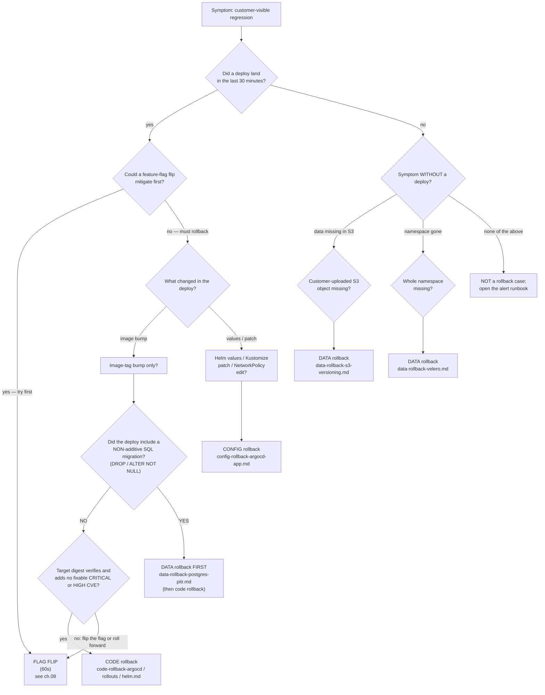
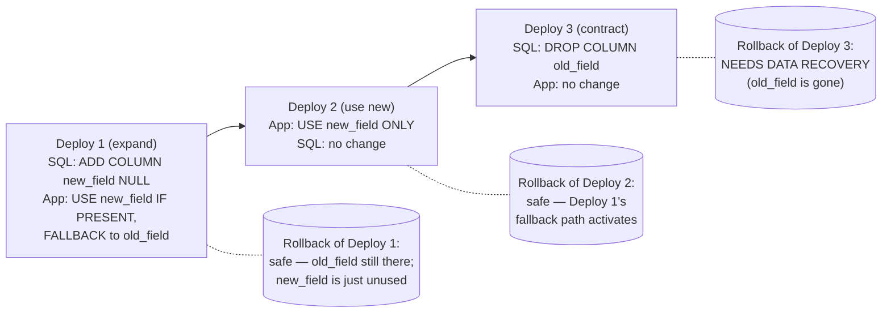

# 15.07 — Rollback playbook

> The production deepening of [Part 07 ch.05](../07-delivery/05-progressive-delivery.md)
> (Argo Rollouts auto-rollback) and [Part 08 ch.02](../08-day-2-operations/02-backup-and-dr.md)
> (backup + DR): the three rollback **layers** every production
> platform needs — **code** (Argo CD / Argo Rollouts / Helm), **data**
> (Postgres PITR / S3 versioning / Velero), **config** (Argo CD
> Application git-revert) — with the **decision tree** that picks the
> right layer per symptom, the **forward-compatible-schema** footgun
> that turns code rollback into data corruption, the **canary-blast-
> radius** trade-off during peak traffic, and the **monthly rollback
> drill** discipline that keeps the runbooks current.

**Estimated time:** ~30 min read · ~90 min hands-on
**Prerequisites:** [Part 15 ch.06](./06-progressive-delivery-in-production.md) — automated canary rollback is the first layer · [Part 08 ch.02](../08-day-2-operations/02-backup-and-dr.md) — backup + DR underpinning data rollback · [Part 14 ch.14](../14-eks-in-production-a-to-z/14-backup-and-restore-velero.md) — Velero that anchors cluster-shaped rollback

**You'll know after this:** • name the three rollback layers (code, data, config) and the tools that own each (Argo CD/Rollouts/Helm, Postgres PITR/S3 versioning/Velero, Argo CD git-revert) · • apply the decision tree that picks the right layer per symptom · • avoid the forward-compatible-schema footgun that turns code rollback into data corruption · • weigh the canary-blast-radius trade-off during peak traffic when deciding "rollback now or pause" · • run the monthly rollback drill that keeps every runbook fresh

<!-- tags: rollback, dr, day-2, argo-rollouts, velero -->

## Why this exists

[Part 07 ch.05](../07-delivery/05-progressive-delivery.md) shipped the
**automated** rollback: an Argo Rollouts AnalysisRun fails three times,
the controller scales the canary ReplicaSet to zero, the stable comes
back. That's the **best case** — a regression caught inside the canary
window, by metrics, before any human is paged. It works for code
regressions that produce visible 5xx or latency signals on the canary
slice.

It does **not** cover the cases that produce most of the rollback
work in production:

1. **Regressions that ride past the canary.** A 0.05% error rate
   (a success rate of 0.9995) passes the 0.999 gate in 15.06; the canary promotes;
   the regression accumulates at 100% over hours. Now you're rolling
   back a fully-promoted release.
2. **Regressions that aren't in the code.** A bad Helm values change.
   A new NetworkPolicy that blocks egress to a backing service. A
   Kustomize patch that drops a critical resource limit. The code
   is fine; the **config** changed.
3. **Regressions that aren't in the cluster.** A bad SQL migration
   that ran ahead of the binary. An app bug that double-charged.
   A user-error `DELETE * FROM orders`. The K8s objects are healthy;
   the **data** is wrong.
4. **Regressions that aren't even Kubernetes.** A bad S3 object
   uploaded by a customer. An accidental S3 prefix delete by an
   internal cleanup script.

Each case has a different rollback tool, a different blast radius, a
different recovery time. The **single biggest cause** of extended
outages is **picking the wrong tool** — reverting in Git when
the bad change was a Kustomize patch (no-op; ops keep failing);
reverting a commit when the bad change was a SQL migration
(now the binary is rolled back AND the data is corrupted because the
old binary can't read the new schema).

This chapter is the **rollback playbook**: the three-layer mental model,
the decision tree, and the runbooks (in `examples/bookstore-platform/
rollback/`) the on-call follows at 3am. [Part 13 ch.12](../13-grand-capstone-bookstore-platform/12-day-2-runbook-on-call-dr-chaos.md)'s
runbook discipline applies; this chapter adds the rollback-specific
runbooks to the tree.

> **In production:** Without this chapter, the team has Argo Rollouts'
> auto-rollback for the regressions a canary catches, and ad-hoc,
> Slack-driven recovery for the rest. Ad-hoc recovery means: longer
> outages, data loss from picking the wrong tool, postmortems that name
> the tooling gap that already had an obvious fix.

## Mental model

**Rollback in production = (the right LAYER for the symptom) × (a
runbook structured so the on-call can execute it without thinking) ×
(a monthly drill that proves the runbook still works).** The three
layers are not interchangeable; picking the wrong layer is the most
common rollback failure mode.

- **The three layers — code, data, config.**
  - **Code.** The binary serving traffic regressed; the data is fine;
    the config is fine. **Tool**: a revert PR that Argo CD syncs, or Argo Rollouts
    `abort` for an in-flight canary. **RTO**: 30 seconds to 5
    minutes for an abort; a revert adds review. **Risk**: a forward-only DB migration makes this layer
    insufficient (see the footgun).
  - **Data.** The binary is fine; the config is fine; some mutation
    in Postgres / S3 / a whole namespace is wrong. **Tool**: a new CNPG
    Cluster bootstrapped from a backup and its WAL, S3 object-version
    restore, Velero restore. **RTO**: 5 minutes to 4 hours depending on
    data size + PV count. **Risk**: customer-visible downtime + lost
    writes between bad mutation and recovery cut-over.
  - **Config.** The binary is fine; the data is fine; a Helm values
    edit, a Kustomize patch, a NetworkPolicy, a Crossplane
    Composition revision is wrong. **Tool**: git-revert the bad PR +
    Argo CD sync. **RTO**: 2 to 10 minutes (the PR review is the
    bottleneck). **Risk**: Argo CD auto-sync fighting the manual
    revert if the PR doesn't merge cleanly. The RTO figures are example
    targets, not measurements: the monthly drill replaces them with
    measured numbers.
- **The decision tree.** The on-call's first 60 seconds is **not**
  "let me dig into the symptom"; it's **"which LAYER is this?"**.
  The decision is symptom-driven (see Diagram A). The full tree
  lives in `examples/bookstore-platform/rollback/README.md`; this
  chapter teaches the shape, not the mechanics.
- **The forward-compatible-schema footgun.** A code release with a
  forward-only DB migration breaks the "code rollback alone" path.
  The mitigation discipline:
  - **Expand-contract migrations.** Phase 1 of the schema change
    ADDS columns / tables; Phase 1 of the code USES the new columns
    if present, falls back to old. Phase 2 of the code switches to
    only-new path; Phase 3 of the schema DROPS old columns. Three
    deploys; each one is independently rollback-safe. The
    discipline costs three deploys but earns "code rollback always
    works".
  - **Pre-flight check.** Every code rollback runbook starts with a
    `git diff` of the migration directory between the bad SHA and
    the rollback target. If empty / additive only: safe. If
    DROP / ALTER / NOT NULL on existing column: stop; data-layer
    rollback is required first (`data-rollback-postgres-pitr.md`).
- **The peak-traffic trade-off.** A canary that's already at 50%
  caught a regression. The choice:
  - **Abort the canary** (the conservative move). Scale canary RS to
    0, stable RS to 100%. The 50% of users currently on the canary
    are briefly served by stable Pods that need to scale up — a
    capacity event during peak. Possible **brown-out** as the stable
    RS scales.
  - **Hold and observe** (the dangerous move). The canary is at 50%;
    the regression is mild; the team bets it won't get worse before
    the next deploy. Sometimes correct; usually a postmortem with
    the action item "we should have rolled back immediately".
  - **The discipline**: keep the stable ReplicaSet at full size for the whole
    canary, so an abort moves no traffic onto a stable that is still
    scaling. That needs `trafficRouting`, as in the catalog Rollout of
    [Part 15 ch.06](06-progressive-delivery-in-production.md): the weight
    moves at the router, and `dynamicStableScale` stays off (its default),
    so stable keeps its replicas ([Argo Rollouts canary docs](https://argoproj.github.io/argo-rollouts/features/canary/)).
    The replica-based Rollout in
    `examples/bookstore/argocd/rollouts/catalog-rollout.yaml` has no router.
    Its canary is a share of `replicas`, so an abort at 50% leaves stable at
    half capacity until it is scaled back. Use that file to learn the
    mechanics, not as the abort-capacity pattern. The canary is additive only
    with `trafficRouting`.
- **Monthly rollback drills.** Without exercise, every rollback
  runbook is stale within 90 days. The Bookstore Platform's monthly
  DR drill ([Part 13 ch.12](../13-grand-capstone-bookstore-platform/12-day-2-runbook-on-call-dr-chaos.md))
  rotates through:
  - Month 1: code rollback (Argo CD).
  - Month 2: code rollback (Argo Rollouts).
  - Month 3: data rollback (Postgres PITR).
  - Month 4: data rollback (Velero namespace).
  - Repeat.
  - Each drill outputs the three numbers: RTO actual, RPO actual
    (where applicable), human action time. The runbooks not
    exercised in 90 days carry a STALE banner.

The trap to keep in view: **a rollback is not a victory; it's a debt
to repay**. Every rollback is followed by (a) a postmortem and (b) a
forward fix that re-introduces the change without the regression.
Skipping the forward fix means the team has the same release blocked
for weeks; the team's velocity drops; pressure to skip the next
canary builds. The discipline: a rollback opens a ticket; the
ticket is owned; the forward fix is shipped within the same sprint
the rollback happened. Otherwise the rollback was a tax on the team's
future, not a fix.

> **In production:** Rollback ≠ undo. A rollback restores function;
> it does NOT restore time. Customer trust, lost orders, the
> on-call's sleep — none of it is rolled back. The discipline of
> rollback-drills + forward-fixes is what makes the rollback
> tool affordable. A team that needs rollback every week has a CI
> investment problem, not a rollback problem.

## Threats and controls

A rollback redeploys an older release, so its threats are what that release
carries back into the cluster.

| Threat | Control | Deeper |
|---|---|---|
| The target digest now fails verification, or carries a fixable CRITICAL or HIGH CVE that the current digest does not have | Roll back to a digest, never a tag. Verify its signature and scan it before the rollback starts (the checks in step 2). On a failure, stop and roll forward to a patched, signed digest, or flip a flag | [15.04](04-multi-environment-promotion.md) for digest promotion, [15.03](03-image-signing-and-provenance.md) for signing, [05.03](../05-security/03-supply-chain.md) for the concept |
| A data restore brings back a Secret or a database role that was rotated after the backup, so an old credential works again | Secrets come from the store through ESO, which overwrites a restored Secret with the current value. The restore also brings back role passwords inside Postgres, so the application roles are re-rotated after the cutover (section 3). A backup that held an exposed credential starts a rotation, not a restore | [15.05](05-production-secrets-vault-eso.md) for stores and rotation, [05.04](../05-security/04-secrets-and-cluster-hardening.md) for the concept |

## Diagrams

### Diagram A — the rollback decision tree (Mermaid)



### Diagram B — the three layers and their tools (ASCII)

```text
ROLLBACK LAYER        SYMPTOM                                    TOOL                        RTO
─────────────────     ────────────────────────────────────────   ─────────────────────       ───────────
CODE                  bad binary; data fine; config fine         git revert PR, Argo CD sync   PR review + sync
                                                                 kubectl argo rollouts abort   30s-2m (in-flight canary)
─────────────────     ────────────────────────────────────────   ─────────────────────       ───────────
DATA                  bad data in Postgres                       new CNPG Cluster (recovery) 15-90m
                      bad data in S3                             aws s3api delete-object     2-10m
                                                                   (the delete-marker version)
                      whole namespace gone                       velero restore create       5-30m
─────────────────     ────────────────────────────────────────   ─────────────────────       ───────────
CONFIG                bad Helm values / Kustomize patch          git revert + argocd sync    2-10m
                      bad NetworkPolicy / ResourceQuota          git revert + argocd sync    2-10m
                      bad Crossplane Composition                 git revert + revision-ref   5-20m
─────────────────     ────────────────────────────────────────   ─────────────────────       ───────────

PRE-FLIGHT (every rollback):
  1. Could a feature-flag flip mitigate first? (faster; lower blast radius)
  2. Did the bad release include a forward-only DB migration? (if yes:
     DATA rollback FIRST; CODE rollback alone corrupts data)
  3. What's the blast radius? One tenant / one region / cluster-wide?
  4. Does the target digest verify, and does it carry no fixable CRITICAL
     or HIGH CVE that the current digest lacks? If not, flip the flag or
     roll forward.
```

### Diagram C — the expand-contract migration that makes rollback safe (Mermaid)



## Hands-on with the Bookstore Platform

We walk the three layers against the Bookstore Platform's catalog
service. The order: (1) prerequisites; (2) walk the decision tree
through a simulated regression; (3) execute a code rollback (Argo
Rollouts); (4) execute a data rollback (CNPG PITR — dry-run);
(5) execute a config rollback (Argo CD git-revert).

The output after `#` in these blocks is illustrative: it describes a
made-up incident, not a captured run. Steps that call AWS are reference
only and were not run for this chapter.

### 0. Prerequisites — runbooks, Argo CD, Argo Rollouts, Velero

```sh
# The runbook tree, one file per runbook:
ls examples/bookstore-platform/rollback/
# README.md
# code-rollback-argocd.md
# code-rollback-rollouts.md
# code-rollback-helm.md
# config-rollback-argocd-app.md
# data-rollback-postgres-pitr.md
# data-rollback-s3-versioning.md
# data-rollback-velero.md

# Argo CD CLI configured against the platform's Argo CD.
argocd context bookstore-platform-us-east

# Argo Rollouts kubectl plugin.
kubectl argo rollouts version

# Velero CLI configured against the platform's Velero install
# (Part 14 ch.14):
velero version

# CNPG operator running (the platform-base path):
kubectl -n cnpg-system get pods
```

### 1. Walk the decision tree (a simulated regression)

```sh
# A page fires at HH:MM UTC:
# [PAGE] BookstoreCatalogP99Latency
# Region: us-east; Tenant: acme-books; p99 = 1.2s

# Step 1 (60s): when did the last deploy land?
argocd app history bookstore-catalog-us-east | head -4
# ID  DATE                      REVISION  SOURCE
# 42  2026-05-20 14:22:13 UTC   d8f3c2a   image-tag bump only
# 41  2026-05-20 11:08:51 UTC   a1b2c3d   no changes
# 40  2026-05-19 17:42:09 UTC   9e8d7c6   values.yaml: CPU request

# 42 landed 5 min before the alert. STRONG signal.

# Step 2 (60s): could a flag flip mitigate? Check the flag service
# (ch.08) for the flag the release touched.
# The bad release enabled meilisearch_v1 for acme-books. A flag flip
# to legacy_postgres_ilike would mitigate.

# Decision: FLIP THE FLAG FIRST. ch.08 runbook.
# (After flag flip, write the rollback PR for the bad image bump.)
```

### 2. Execute a code rollback — the Argo Rollouts path

Before a rollback that deploys an older digest, check that digest. A git revert, or a commit that re-pins an older digest, deploys it
again. An abort keeps the stable ReplicaSet that already runs, so it
pulls nothing new. Name the image by digest, because a tag can move
([15.04](04-multi-environment-promotion.md)).

```sh
# The target digest, from the Git revision you roll back to.
git -C ./bookstore-platform-config show <TARGET-SHA>:<PATH-TO-ROLLOUT> \
  | grep 'image:'
#   image: ghcr.io/acme/catalog@sha256:<TARGET-DIGEST>

# The signature, bound to the workflow that built it (15.03).
cosign verify \
  --certificate-identity <WORKFLOW-SUBJECT> \
  --certificate-oidc-issuer <OIDC-ISSUER> \
  ghcr.io/acme/catalog@sha256:<TARGET-DIGEST>

# Fixable CRITICAL or HIGH CVEs. Exit 1 means the target has one: compare
# it with the current digest before you decide.
trivy image --ignore-unfixed --severity CRITICAL,HIGH --exit-code 1 \
  ghcr.io/acme/catalog@sha256:<TARGET-DIGEST>
```

A failed signature means the digest is not what CI built. A CVE means the
rollback ships it again. Stop, and roll forward to a patched, signed digest
or flip the flag. Record the decision in the incident.

```sh
# Walk through code-rollback-rollouts.md. The catalog service is a
# Rollout (not a plain Deployment).
kubectl argo rollouts get rollout catalog \
  -n bookstore-platform-catalog
# Status:        Paused
# Strategy:      Canary; Step 4/9; SetWeight 25
# Images:        ghcr.io/acme/catalog:v1.5.0 (stable)
#                ghcr.io/acme/catalog@sha256:<CANARY-DIGEST> (canary)

# AnalysisRun status?
kubectl -n bookstore-platform-catalog get analysisruns

# If the AnalysisRun caught it, the rollout is already Degraded; the
# controller already scaled canary RS to 0. Otherwise:

kubectl argo rollouts abort catalog -n bookstore-platform-catalog
# rollout 'catalog' aborted
# The abort keeps the new image in spec.template. The git revert in
# step 4 is what keeps a later sync from bringing it back.

# Wait for stable.
kubectl argo rollouts get rollout catalog \
  -n bookstore-platform-catalog -w

# Verify metric recovery, with the query path the SLO gate in 15.06 uses.
kubectl -n monitoring exec -ti \
  prometheus-kube-prometheus-stack-prometheus-0 -c prometheus -- \
  promtool query instant http://localhost:9090 \
  'histogram_quantile(0.99, sum by (le) (rate(catalog_http_request_duration_seconds_bucket{namespace="bookstore-platform-catalog"}[5m])))'
# Expect: drops below 0.5 within 2-3 minutes.
```

### 3. The data-rollback dry-run — Postgres PITR via CNPG

The full procedure is destructive (creates a recovered cluster +
cuts over the application). We **dry-run** the discovery + planning
phases here; the destructive steps belong in the monthly DR drill.

```sh
# Step 1: identify the affected cluster.
kubectl -n cnpg-system get clusters

# Step 2: identify the target time. Suppose the regression at HH:MM
#   wrote bad rows for 5 minutes; the safe target is HH:MM - 1 minute.

# Step 3: confirm PITR is even possible for this target.
kubectl -n cnpg-system get cluster bookstore-platform-cnpg-orders \
  -o jsonpath='{.status.firstRecoverabilityPointByMethod}{"\n"}'
# {"plugin":"2026-05-15T12:00:00Z"}
# If target > that timestamp -> PITR is possible.

```

The recovery Cluster assumes the source backs up through the Barman Cloud
plugin. The examples in this guide still use the native `barmanObjectStore`
method, which CloudNativePG deprecated in 1.26 and removes in 1.32. Move the
backups to the plugin before you rely on this path.

**Step 4 is a dry run.** Save this Cluster as `recovery-cluster.yaml`:

```yaml
apiVersion: postgresql.cnpg.io/v1
kind: Cluster
metadata:
  name: orders-recovered
  namespace: cnpg-system
spec:
  instances: 1                 # dry run: one instance; production runs three
  seccompProfile:
    type: RuntimeDefault
  podSecurityContext:          # merged with the operator's defaults
    runAsNonRoot: true
    runAsUser: 26              # the postgres user in the CloudNativePG image
    runAsGroup: 26
    fsGroup: 26
  securityContext:
    allowPrivilegeEscalation: false
    readOnlyRootFilesystem: true
    capabilities:
      drop: ["ALL"]
  storage:
    size: 100Gi
    storageClass: <encrypted-storage-class>
  resources:
    requests:
      cpu: 250m
      memory: 512Mi
    limits:
      memory: 1Gi
  bootstrap:
    recovery:
      source: orders-cold
      recoveryTarget:
        targetTime: "2026-05-20 13:43:00.000000+00"
  externalClusters:
    - name: orders-cold
      plugin:
        name: barman-cloud.cloudnative-pg.io
        parameters:
          barmanObjectName: orders-backup   # the ObjectStore with the backups
          serverName: bookstore-platform-cnpg-orders
```

```sh
kubectl apply --dry-run=server -f recovery-cluster.yaml
```

The dry run needs the CloudNativePG CRDs. Without them it fails with
`no matches for kind`. This chapter did not run it: the manifest was checked
against the Cluster schema in the CloudNativePG repository instead. The full
procedure (apply and cut over) is in data-rollback-postgres-pitr.md.

**After any data restore, rotate the roles.** A PITR or Velero restore also
restores the role passwords stored inside Postgres. A credential rotated
after the backup can log in again, even though ESO has written the current
value to the Secret. After the cutover, rotate every static application role
the restore brought back. For dynamic Vault roles, confirm that the roles
created before the backup have passed their `VALID UNTIL`. ESO's refresh
updates the Secret only; it does not change the password inside the database.

### 4. The config-rollback exercise — `git revert` + Argo CD sync

```sh
# Suppose PR a1b2c3d landed a bad ResourceQuota change:
# resourcequota-catalog.yaml: cpu: 10 -> 2
# Effect: catalog Pods OOM-evicted because they can't scale.

# Step 1: locate the bad PR.
git -C ./bookstore-platform-config log --oneline -n 5 main

# Step 2: revert.
git -C ./bookstore-platform-config checkout -b revert-resourcequota
git -C ./bookstore-platform-config revert a1b2c3d
git -C ./bookstore-platform-config push origin revert-resourcequota
gh pr create --title "Revert: catalog ResourceQuota cpu cap" \
  --body "Reverts a1b2c3d (caused evictions)."

# Step 3: get the revert reviewed and merged. A P0 gets the fast review
# path. Breakglass merges belong to 15.09, not to this step.

# Step 4: Argo CD picks up the new commit on its next refresh, or sooner
# through a webhook.
argocd app get bookstore-platform-tenant-acme-books
# Sync Status: Synced from <revert-SHA>

# Step 5: verify.
kubectl -n bookstore-platform-acme-books describe resourcequota
# Used  cpu: 5     Hard: 10  -> old quota back
```

### 5. The monthly drill

Add the rollback runbooks to the monthly DR cadence (Part 13 ch.12). Each
month, pick one runbook, exercise it in a non-prod tenant, time detection,
decision and mitigation, and record the three numbers in a dated drill note.
`dr-drill-script.sh` writes that note for the regional drill. The rollback
drills write theirs by hand, because the example tree has no exercise
scripts for them yet.

## How it works under the hood

**The three layers, expressed mechanically.**

The **code** layer rolls back what's on the running Pods. Argo CD
syncs the revert commit; the manifests and the image reference from
that commit get applied; the Deployment / Rollout controller rolls Pods
to the old image. **Argo Rollouts** `abort` is faster than a
revert commit because the stable ReplicaSet is **already alive** — the
abort scales the canary RS to 0 and the stable to full count. **Helm
rollback** re-applies the chart's rendered manifests from the
previous release's stored Secret; the same Pod-roll semantics.

The **data** layer rolls back what's on disk. **CNPG PITR** stands up
a NEW cluster from a base backup + replays WAL up to the target
timestamp; the application is repointed at the new cluster. **S3
versioning** does not even copy data — deleting a delete-marker re-
exposes the previous object version. **Velero restore** re-applies
the Kubernetes objects in the backup and **separately** restores PV
data via CSI VolumeSnapshots (a Velero `--restore-volumes=true`
flag); the workloads come up against pre-restored disks.

The **config** layer rolls back what's in git. `git revert` creates a
new commit that undoes the bad PR's changes (NOT a `reset` —
`revert` preserves history). Argo CD's auto-sync picks up the new
commit and applies the diff (which is the inverse of the bad change).
Crossplane's twist: a `Composition` revision is immutable; `git
revert` makes a NEW revision; the existing XRs still reference the
old revision and must be patched to roll over to the reverted
revision.

**Why the three layers don't substitute for each other.** A code
rollback does not restore deleted rows. A data rollback does not
restore a deleted Deployment. A config rollback does not restore the
binary version on the Pods (it just restores the YAML that selects
the binary). The decision tree's value is forcing the on-call to
identify which layer the regression IS, not which one is fastest to
type. Picking the wrong layer is fast and ineffective; picking the
right layer is the rollback.

**The forward-compatible-schema discipline.** Every Bookstore Platform
migration ships in the **expand-contract** shape (see Diagram C). The
review standard requires:

- Migrations may add columns, tables, indexes (always safe).
- Migrations may add NOT NULL constraints **only** if the column has
  a default.
- Migrations may NOT drop columns, drop tables, rename columns,
  change column types in a single deploy. Those changes are
  three-deploy sequences.

This list is a review standard, not a built check. No migration lint
exists in `examples/bookstore-platform/ci/`, so reviewers enforce it until a
check is added (a recommended control, not built here). A PR that breaks it
needs explicit sign-off from the platform team and the runbook in
`data-rollback-postgres-pitr.md` updated for the specific recovery
path. The discipline is **not** "never break the rule"; it's "every
break is a deliberate, audited decision".

**Peak-traffic abort capacity planning.** The Bookstore Platform's
Rollout strategy keeps the stable RS at 100% throughout the canary
(the canary is **additive**, not replacing). The cluster therefore
needs spare capacity for the canary's share of replicas while the canary
runs. Cluster autoscaler + Karpenter cover this on EKS
(Part 14 ch.09); on resource-constrained kind clusters, the canary
is sized smaller. The capacity preserves the **abort safety**: an
abort doesn't scale up stable; stable is already at 100%.

## Production notes

> **In production:** **The forward-compatible-schema is the deepest
> rollback footgun.** A "we rolled back the code; the app crashed
> because it can't read the migrated schema" event is the most-cited
> production-rollback failure mode. The remedy is process: the
> expand-contract pattern; the CI migration linter; the PR template
> that asks "is this rollback-safe?". Teams that ship this discipline
> earn confident rollbacks; teams that don't carry rollback as a
> brittle, fearful operation.

> **In production:** **The "rollback during peak" judgement call.**
> A regression noticed at 14:00 UTC (US peak); the choice is
> rollback-now (a brief capacity-shift brown-out) or hold-until-off-
> hours (hours of degraded service). The default: **rollback-now
> for any P0 / P1**; **hold-until-off-hours for P2 only**. The
> conservative move (rollback) tends to look reckless in the moment
> and correct in the postmortem; the reckless move (hold) tends to
> look reasonable in the moment and disastrous in the postmortem.

> **In production:** **Rollback drills monthly; the rollback runbooks
> are the most-drift-prone.** A code-rollback runbook from 90 days
> ago references an Argo CD version with a different `argocd app sync`
> flag set. A data-rollback runbook references a CNPG version with
> a different `Recovery` CR shape. The monthly DR drill ([Part 13
> ch.12](../13-grand-capstone-bookstore-platform/12-day-2-runbook-on-call-dr-chaos.md))
> rotates a rollback runbook in; each drill outputs a "did the
> runbook work?" verdict and an updated copy.

> **In production:** **The "we'll roll forward instead" anti-pattern.**
> The pressure during an incident is to ship a hotfix forward
> (a CI run, and the fix is "done") rather than roll back. Roll-forward feels
> productive; rollback feels like failure. **Discipline**: rollback
> first, always; the hotfix (if any) follows as a CLEAN PR after the
> regression is mitigated. The "rolled forward and the hotfix had
> its own bug" double-incident is the worst-case the discipline
> defends against.

> **In production:** **Argo CD auto-sync and rollback.** Self-heal reverts any
> change made outside Git, so a manual rollback in the cluster is undone
> within minutes. The rollback is therefore a revert commit that Argo CD
> syncs. Auto-sync is not paused for a rollback. If a sync has to stop (a
> bad revision keeps re-applying), the stop is itself a reviewed Git change
> to the Application, or the time-boxed, audited breakglass path in
> [Part 15 ch.09](09-hotfix-workflow-and-breakglass.md).

> **In production we did not build:** automated rollback-decision
> support (a controller that reads symptoms and recommends a layer)
> — the failure mode of bad automated advice is worse than a slower
> manual decision; cross-layer atomic rollback (code + data + config
> in one command) — each layer needs independent verification;
> application-tier "soft" rollback via Istio `VirtualService` weight
> shift — cache-invalidation and version-skew handling are too
> application-specific to bundle; and rollback-to-arbitrary-revision
> beyond Argo CD's history limit — for older revisions the procedure
> is `git checkout <SHA> + argocd app sync --revision <SHA>`,
> documented in the runbooks but not the default path.

## Quick Reference

```sh
# CODE: check the target digest first (any rollback that deploys an older one)
cosign verify --certificate-identity <SUBJECT> \
  --certificate-oidc-issuer <ISSUER> <IMAGE>@<DIGEST>
trivy image --ignore-unfixed --severity CRITICAL,HIGH --exit-code 1 \
  <IMAGE>@<DIGEST>

# CODE, Git: the revert PR is the rollback, and Argo CD syncs it
git checkout -b revert-<DESC> && git revert <BAD-SHA>

# CODE, Argo Rollouts, for an in-flight canary only
kubectl argo rollouts abort <ROLLOUT> -n <NS>
kubectl argo rollouts get   <ROLLOUT> -n <NS> -w       # verify

# A raw Helm release outside Argo CD breaks the Git-only rule. Treat it as an
# incident, and roll it back through its chart in Git.

# DATA: Postgres PITR (CNPG); the full procedure is in
# data-rollback-postgres-pitr.md
kubectl apply --dry-run=server -f recovery-cluster.yaml
# Watch:
kubectl -n cnpg-system get clusters <RECOVERED> -w

# DATA — S3 versioning
aws s3api list-object-versions --bucket <B> --prefix <K>
aws s3api delete-object --bucket <B> --key <K> --version-id <DELETE-MARKER-VERSION>

# DATA — Velero
velero restore create <NAME> --from-backup <BACKUP> --restore-volumes=true --wait

# CONFIG — git revert
git checkout -b revert-<DESC>
git revert <BAD-SHA>
git push origin revert-<DESC>
gh pr create
# After merge:
argocd app sync <APP> --prune
```

The runbooks live in `examples/bookstore-platform/rollback/`. The
decision tree is in `examples/bookstore-platform/rollback/README.md`.
Drill them monthly.

## Test your understanding

> Try each before opening the answer drawer. The act of trying is the exercise; the answer is the check.

1. **The chapter calls the rollback layer choice (code / data / config) the on-call's "first 60 seconds." Why is picking the wrong layer often worse than not rolling back at all?**
   <details><summary>Show answer</summary>

   Picking the wrong layer compounds the incident. Examples from the chapter: reverting in Git when the bad change was a Kustomize patch — the rollback is a no-op, ops keep failing, the on-call wastes 20 minutes trying variants of the wrong tool. Reverting a commit when the bad change was a forward-only SQL migration — the binary rolls back to vN, but the schema is at vN+1, the old binary can't read the new schema, the service is fully down. reverting in Git to undo a config change while the data-layer issue continues — the symptoms keep firing, the team's confidence drops, the next escalation is "we don't know what's wrong." The discipline: classify the symptom layer first, then execute the matched runbook; never spray multiple rollback tools at the symptom.

   </details>

2. **A code rollback's first step in the chapter's runbook is `git diff` on the migration directory. You inherit an incident where someone already reverted a commit on a service that had a forward-only `ALTER TABLE ... DROP COLUMN` migration. The pod CrashLoops with column-not-found errors. What's the recovery?**
   <details><summary>Show answer</summary>

   You're in the canonical "rollback when migration already ran" trap. The schema is at vN+1 (column dropped), the binary is at vN (expecting the column). Two options: (1) **roll forward** — re-deploy vN+1 binary (since it's compatible with the new schema) and accept the regression that caused the original rollback, while you build a fix; or (2) **data-layer rollback first** — restore the database from PITR or a Velero snapshot taken before the migration ran, then roll the binary back. Option 1 is fastest if vN+1's regression isn't catastrophic; option 2 is correct if vN+1's regression was data-corrupting. The chapter's discipline: the pre-flight `git diff` of the migration directory exists to prevent this exact situation — if the diff has `DROP` or `NOT NULL`, the runbook says "stop; data-layer rollback required first."

   </details>

3. **A canary catches a regression at 50%. The on-call has two options: abort immediately (capacity event as stable scales up) or hold and observe. What's the chapter's stance, and what's the prevention?**
   <details><summary>Show answer</summary>

   Abort immediately is the safe move; hold-and-observe is "usually a postmortem with the action item 'we should have rolled back immediately.'" The capacity-event risk is real — if stable was scaled down to 50% to make room for the canary, scaling back up to 100% is a sudden burst. The chapter's prevention: keep stable RS at 100% during canary (`maxUnavailable: 0`), making the canary purely *additive*. The catalog Rollout in the example tree uses this pattern — the canary is extra capacity, not a replacement; aborting at 50% just scales the canary RS to zero without touching stable. The trade-off: spare capacity for the canary, in exchange for an abort that is instant and moves no traffic onto a scaling stable.

   </details>

4. **The chapter says "a rollback is not a victory; it's a debt to repay." What's the discipline that turns a rollback into a complete operation rather than a partial fix?**
   <details><summary>Show answer</summary>

   Every rollback opens a ticket; the ticket is owned by a specific engineer; the forward fix (the same change, without the regression) ships within the same sprint as the rollback. Skipping the forward fix means: (1) the team has the same release blocked indefinitely; (2) velocity drops because each new attempt at the change feels riskier; (3) pressure to skip the next canary builds because "canary slows us down." The complete operation is rollback → postmortem with action items → forward fix → re-deploy with stricter analysis → verify. The chapter's mantra: rollback restores function; it does not restore time. Customer trust, lost orders, the on-call's sleep — none of those are rolled back. The forward-fix is what pays the debt.

   </details>

5. **Hands-on extension — apply a Helm chart that overrides a Deployment's `resources.limits.memory` to `64Mi` (intentionally too low). Roll it out, watch pods OOMKill, then practice the config-layer rollback runbook.**
   <details><summary>What you should see</summary>

   Pods start, immediately get OOMKilled, restart, OOMKill, enter CrashLoopBackOff. The symptom: code is fine, data is fine, *config* changed — the wrong layer for a digest rollback, because the values lived in Git. The right tool: `git revert <BAD-SHA>` in the GitOps repo + Argo CD sync. RTO measured from "PR opens" to "pods stable" should be 2-10 minutes (the PR review is the bottleneck — drill it on a non-prod cluster to remove friction). The lesson: the symptom (CrashLoop) doesn't tell you the layer; the *change* that introduced it does. Always check what changed in the last 30 minutes before picking the rollback tool.

   </details>

6. **The on-call wants to roll back to last week's digest. `cosign verify`
   passes for it, and `trivy image --ignore-unfixed` reports a fixable
   CRITICAL CVE that the current digest does not have. Should the rollback
   go ahead?**
   <details><summary>Show answer</summary>

   Not as it stands. A valid signature shows that the expected workflow built
   the digest. It says nothing about what the digest contains, so the rollback
   would put a known CVE back into service. Stop it. Flip the flag behind the
   regression if one exists, or roll forward to a patched digest that the same
   workflow built and signed. Record the decision in the incident. If the team
   accepts the CVE for a rollback anyway, that is a security decision with an
   owner and an expiry, and it goes in the postmortem.

   </details>

## Further reading

- **[Argo CD docs — auto-sync](https://argo-cd.readthedocs.io/en/stable/user-guide/auto_sync/)** —
  how auto-sync is switched off and on, which the rollback steps depend on.
- **[`kubectl argo rollouts abort`](https://github.com/argoproj/argo-rollouts/blob/master/docs/generated/kubectl-argo-rollouts/kubectl-argo-rollouts_abort.md)** —
  reverts the steps and keeps the new version in `spec.template`, so a Git
  revert must follow it.
- **[Helm docs — `helm rollback`](https://helm.sh/docs/helm/helm_rollback/)** —
  the release ledger + rollback semantics + the CRDs-not-rolled-back
  footgun.
- **[CloudNativePG — "Recovery"](https://cloudnative-pg.io/docs/current/recovery)** —
  recovery as a bootstrap method, the `recoveryTarget` options, and the
  deprecation of native Barman Cloud in 1.26.
- **[Velero — "Restore"](https://velero.io/docs/main/restore-reference/)** —
  restore flags, including the resource filters and volume restore.
- **[Google SRE Book ch.16 — "Tracking Outages"](https://sre.google/sre-book/tracking-outages/)** —
  the postmortem-after-rollback discipline this chapter assumes.
- **[Martin Fowler — "Parallel Change" (expand-contract)](https://martinfowler.com/bliki/ParallelChange.html)** —
  the schema-migration pattern that makes rollback safe.
