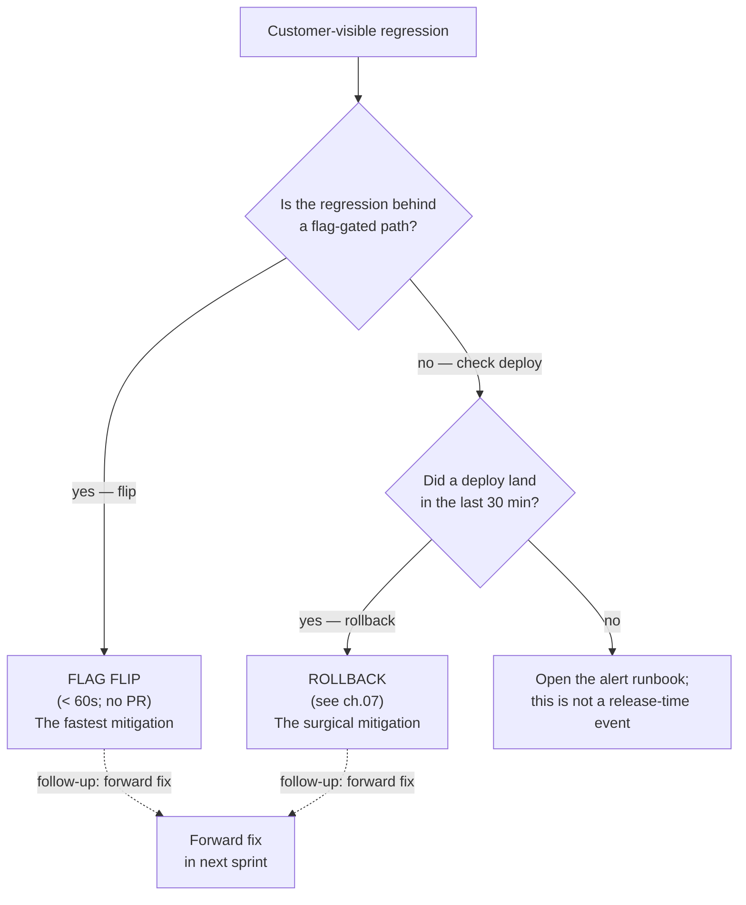

# 15.08 — Feature flags and dark launches

> Decoupling **deploy** from **release**: a binary that ships dark
> (the new code is in production but disabled by a flag), then a
> targeted flag flip rolls the feature to a subset, then a wider
> subset, then 100%. The four flag use-cases — **dark launch**,
> **canary by cohort**, **A/B experiment**, **kill switch**.
> Provider trade-offs: **Flagsmith** (self-hosted; this chapter's default),
> **LaunchDarkly** (SaaS; data-residency cost), **Unleash** (self-
> hosted alternative), **OpenFeature** (the SDK abstraction). The
> stale-flag accumulation footgun; flags vs config; the < 60-second
> kill-switch use case as the most-valuable flag.

**Estimated time:** ~30 min read · ~60 min hands-on
**Prerequisites:** [Part 15 ch.07](./07-rollback-playbook.md) — rollback is the alternative this chapter decouples deploy from · [Part 15 ch.06](./06-progressive-delivery-in-production.md) — canary that flags complement, not replace · [Part 11 ch.01](../11-advanced-production-patterns/10-platform-engineering.md) — release-vs-deploy framing

**You'll know after this:** • understand why decoupling deploy from release unlocks the four flag use-cases: dark launch, canary by cohort, A/B experiment, kill switch · • choose between Flagsmith (self-hosted, this chapter's default), LaunchDarkly (SaaS, data-residency cost), Unleash (self-hosted alt), OpenFeature (SDK abstraction) · • implement a <60-second kill switch as the most-valuable flag use case · • avoid stale-flag accumulation through a flag-cleanup cadence · • distinguish a flag from a config and keep each in the right system

<!-- tags: feature-flags, day-2, app-cicd, gitops, observability -->

## Why this exists

[Part 15 ch.07](07-rollback-playbook.md) shipped the rollback
playbook for the cases where deploy + release are **the same act**:
the binary lands; the new behaviour is on; if it's bad, you roll
back. That model is unavoidable for some changes (a security patch;
a perf fix that has no dark-launch path). But it has three structural
costs:

1. **The rollback window is the regression window.** Every regression
   means real customer impact while you mitigate. Even with Argo
   Rollouts' 10% canary, 10% of customers see the bug.
2. **The deploy IS the change.** You can't separate "ship the code"
   from "turn on the feature". Coordinating a launch (marketing +
   customer comm + the engineering team) requires aligning to the
   deploy window — pressure on the deploy schedule that the team
   pays for in 3am pages.
3. **The kill switch problem.** A bad feature in production needs
   to disable in **seconds**, not the **minutes** of a rollback. A
   payment-processor outage; a recommendation model showing
   inappropriate items; a compliance hold. Rollback is too slow.

**Feature flags decouple deploy from release.** The code ships dark
(the flag is OFF; the new code is unreachable). The release is a
**flag flip** — a configuration change, not a code change. The
release window is independent of the deploy window. The kill switch
is "flag flip OFF" — < 60 seconds, no redeploy.

This chapter is the production discipline of feature flags on the
Bookstore Platform: the **Flagsmith** install (self-hosted, this chapter's
default for data residency), the **OpenFeature** SDK abstraction
(vendor lock-in defence), the four use cases the platform actually
ships, and the stale-flag governance discipline that keeps flag-debt
manageable.

> **In production:** Without feature flags, every release is a
> rollback-or-no-rollback bet. With them, releases become **gradual
> reveals**: code ships safely; flags flip incrementally;
> regressions disable in seconds. The cost is operational
> complexity (a flag service to operate; flag debt to manage); the
> benefit is a fundamentally different release shape that turns
> "release day" from a high-anxiety event into a routine
> configuration change.

## Mental model

**Feature flags are the layer between "the code is in production"
and "the customer sees the new behaviour". The two events are
decoupled by a runtime check; the runtime check is configurable
without redeploy; the configuration is versioned, audited, and
observable.**

- **Flags vs config.** A **flag** is a runtime conditional whose
  truth value can change without a deploy. A **config** value is a
  parameter the binary reads at startup (or on SIGHUP) — it
  re-deploys to change. The boundary is a judgement call:
  - If you'll **flip it more than once a quarter** → flag.
  - If it has **per-tenant / per-user overrides** → flag.
  - If a **kill-switch use case** applies → flag.
  - Otherwise → config (Helm values; ConfigMap).
  - The flag-everything anti-pattern: putting your DB hostname in a
    flag. Don't. Flags ARE config that needs to change fast; config
    that doesn't doesn't need a flag service.
- **The four use cases.**
  1. **Dark launch.** Code ships disabled; flag flips it on for a
     subset (internal users → beta tenants → 10% → 50% → 100%).
     The release IS the flag rollout, not the deploy.
  2. **Canary by cohort.** A finer-grained version of Part 15 ch.06's
     traffic-percentage canary: flag-gated cohorts (internal,
     beta-tenants, enterprise) get different versions of the code-
     path. Catches the "long-tail enterprise customer breaks even
     though average is fine" failure that traffic-percentage canary
     misses ([Part 15 ch.06 Diagram B](06-progressive-delivery-in-production.md)).
  3. **A/B experiment.** Multivariate flag (33/33/33 split); each
     variant is a different code path; outcomes (conversion, latency,
     revenue) are measured. Time-boxed; ends with a decision.
  4. **Kill switch.** The flag IS the disable. Default ON
     (feature works); flip OFF (feature disabled, graceful
     degradation). < 60 seconds end-to-end.
- **Provider trade-offs.**
  | Provider       | Cost              | Operational load          | Data residency |
  |----------------|-------------------|---------------------------|----------------|
  | **Flagsmith**  | self-host compute | Postgres, API and frontend Pods | yes, data stays in your cluster |
  | **LaunchDarkly** | SaaS subscription, priced by the vendor | none | set by the vendor's region choice |
  | **Unleash**    | self-host compute | Postgres and Pods         | yes, data stays in your cluster |
  | **OpenFeature**| SDK abstraction   | a provider must exist     | n/a |
  - This chapter's default: **Flagsmith** behind **OpenFeature**. The SDK
    abstraction means swapping providers is a config change, not a
    code change — the team can move to LaunchDarkly later if SaaS
    becomes the right trade-off.
- **Targeting — per-user vs per-tenant vs per-percentage.** Flags
  support three targeting strategies; the right one depends on the
  use case:
  - **Per-user**: "this individual user gets the new behaviour".
    For dogfooding (the team's own user IDs); for high-touch
    enterprise customers ("turn it on for acme-corp's CEO only").
  - **Per-tenant**: "all users in tenant X". The most common shape
    for multi-tenant platforms; lets a tenant opt-in / opt-out.
  - **Per-percentage**: "10% of all identities (deterministic hash)".
    For statistical sampling — A/B tests; gradual rollouts that
    don't care which 10%, just consistent which 10%.
  - **Combination**: "internal + beta-tenants + 10% of enterprise"
    is the realistic Bookstore Platform pattern.
- **Kill switches are the most-valuable flag.** A team often
  thinks they need a flag for the "future cool feature"; the team
  ACTUALLY needs a flag for the "thing that goes wrong tomorrow".
  In `sample-flag-config.json`, `kill_switch_checkout` and
  `kill_switch_recommendations` default to ON. They stay ON until an
  incident needs one flip.
- **Default-on-failure.** Every flag call passes a SAFE default. The
  default is what happens if the flag service is unreachable. For
  kill switches, the default is "feature enabled" — i.e. the flag
  service being DOWN does NOT disable every kill-switched feature
  (which would make the flag service a SPOF for the product).
- **Flags are not authorization.** A flag chooses between code paths
  the caller may already use. It never decides whether the caller may
  act. The check for "may this user do this" stays in server code, with
  its own tests, so a flag set wrong, or a flag service that is down,
  cannot grant access.
- **Who can flip, and the record.** Production flag changes go to the
  platform team and on-call. Flagsmith documents role-based access control
  as a paid-plan feature ([RBAC docs](https://docs.flagsmith.com/system-administration/rbac)).
  This chapter's open-source install does not enforce it, so the restriction
  is a process control. A flip is either a reviewed PR to
  `sample-flag-config.json` or an entry in the incident log, and each one
  records who made it, when, and the value before and after. The self-hosted
  page lists audit logs under the Enterprise plan
  ([Flagsmith self-hosted](https://www.flagsmith.com/self-hosted)), so the
  record does not depend on them. During an incident, post every flip to
  `#bookstore-platform-status` with the incident ID, the flag and the
  reason.

The trap to keep in view: **flags accumulate**. A flag has three
states: "actively rolling out" → "rolled out at 100%" → "should be
removed". Most flags get stuck at state 2; the codebase fills with
`if flags.Bool("featureXyz")` branches that are always true; every
code path doubles in cost-to-test. The Bookstore Platform's defence
is the **30-day stale-flag policy**: every flag has an owner +
expected-removal date; the weekly report names stale flags; an
expired flag becomes a tech-debt ticket the platform team chases.

> **In production:** Flag-debt is the discipline failure that bites
> back hardest. A codebase with 500 flags is a codebase no one can
> reason about. Aggressive flag retirement is what separates teams
> that use flags effectively from teams that drown in them.

## Threats and controls

| Threat | Control in this chapter | Deeper |
|---|---|---|
| A flag decides an access check, so a wrong or unavailable flag opens an admin or tenant path | Flags choose among code paths the caller may already use. Authorization stays in server code, with its own tests | [Part 05 ch.01](../05-security/01-authn-authz-rbac.md) |
| The environment key leaks from a manifest, a command line or a client bundle | The key comes from an ExternalSecret and reaches the Pod as a secret reference, never as a literal | [Part 15 ch.05](05-production-secrets-vault-eso.md), [Part 11 ch.05](../11-advanced-production-patterns/05-secrets-at-scale.md) |
| A production flag changes with no named person, no reason and no record | Production flips go to the platform team and on-call, as a reviewed PR or a logged incident entry. The open-source edition does not enforce Flagsmith RBAC or audit logs, so this is a process control | [Part 15 ch.09](09-hotfix-workflow-and-breakglass.md) |
| A stale flag keeps a dead branch reachable and untested | The 30-day removal rule: each flag has an owner and a removal date, and removal is a code PR | [Mental model](#mental-model) |

## Diagrams

### Diagram A — deploy vs release: the four use cases (Mermaid)

```mermaid
flowchart TB
    subgraph "WITHOUT FLAGS"
      d1["Deploy code v1.5.1"] --> r1["RELEASE IS DEPLOY<br/>(every user gets new behaviour)"]
    end
    subgraph "WITH FLAGS"
      d2["Deploy code v1.5.1<br/>(flag OFF; new code dark)"]
      f1["Flip flag: internal=true"]
      f2["Flip flag: beta_tenants=true"]
      f3["Flip flag: percentage_split_10=true"]
      f4["Flip flag: default=true (100%)"]
      d2 --> f1 --> f2 --> f3 --> f4
    end
    subgraph "KILL SWITCH"
      live["Feature live at 100%"]
      bad["Regression detected"]
      kill["Flip kill switch OFF<br/>(< 60s)"]
      fix["Forward fix"]
      live --> bad --> kill --> fix
    end
```



### Diagram B — when which flag use-case (ASCII)

```text
USE CASE                  PURPOSE                                    LIFETIME
─────────────────         ────────────────────────────────────────   ──────────
Dark launch               Decouple deploy from release               weeks
                          New feature ships dark, ramps to 100%
─────────────────         ────────────────────────────────────────   ──────────
Canary by cohort          Catch enterprise / long-tail bugs that     days-weeks
                          % canary misses                            (per release)
─────────────────         ────────────────────────────────────────   ──────────
A/B experiment            Measure variant performance; pick winner   days
                          based on data                              (time-boxed)
─────────────────         ────────────────────────────────────────   ──────────
Kill switch               Emergency disable in < 60 seconds          permanent
                          Default ON; flip OFF when needed

LIFETIME RULE:
  Dark launch + A/B → REMOVE within 30 days of completion
  Canary by cohort → REMOVE per release
  Kill switch      → KEEP indefinitely (re-evaluate annually)
```

### Diagram C — flag flip vs rollback decision (Mermaid)



## Hands-on with the Bookstore Platform

> **Not run.** These steps target the Bookstore Platform's cloud
> cluster. They were not run for this guide, and nothing here was
> applied to a cluster. Treat them as reference. Output marked
> illustrative is not captured output. The values file was rendered with
> `helm template` and scanned with Trivy. The namespace file passed a
> client-side dry run.

We install Flagsmith, create the flags, wire the catalog Go service via
OpenFeature, and exercise the four use cases. The order: (1)
prerequisites; (2) install Flagsmith via Helm; (3) create the flags;
(4) wire the catalog SDK; (5) exercise dark launch, kill switch, A/B.

### 0. Prerequisites — Flagsmith chart, Vault secrets, the Go service

```sh
# The platform-base path has installed (Part 15 ch.05):
#  - Vault + ESO
#  - CNPG (Flagsmith's Postgres lives here)
#  - kube-prometheus-stack
kubectl -n external-secrets get pods
kubectl -n cnpg-system get pods
kubectl -n monitoring get pods

# The Flagsmith Helm values are at:
ls examples/bookstore-platform/feature-flags/flagsmith-helm-values.yaml
```

### 1. Install Flagsmith

The namespace file creates the restricted namespace, the LimitRange, the
ServiceAccounts and the NetworkPolicies. The ExternalSecret then puts the
database URL and the Django key into that namespace. The values file pins
the chart version and the image digests.

```sh
helm repo add flagsmith https://flagsmith.github.io/flagsmith-charts/
helm repo update

# Namespace, LimitRange, ServiceAccounts and NetworkPolicies.
kubectl apply -f examples/bookstore-platform/feature-flags/flagsmith-namespace.yaml

# Provision the Postgres database (Bookstore Platform pattern: a
# `Database` CR on the platform's CNPG cluster). The owner role must
# already exist among the cluster's managed roles.
kubectl apply -f - <<'EOF'
apiVersion: postgresql.cnpg.io/v1
kind: Database
metadata: { name: flagsmith, namespace: cnpg-system }
spec:
  cluster: { name: bookstore-platform-cnpg-shared }
  name: flagsmith
  owner: flagsmith
EOF

# The flagsmith namespace reads Vault through its own namespaced store, never
# a ClusterSecretStore (15.05). Create the vault-server-ca ConfigMap in this
# namespace first, as 15.05 step 3 does. The policy is in
# feature-flags/vault-flagsmith-read.hcl, and the platform admin writes it with
# the stdin pattern from 15.05 step 2.
kubectl apply -f - <<'EOF'
apiVersion: external-secrets.io/v1
kind: SecretStore
metadata: { name: vault-flagsmith, namespace: flagsmith }
spec:
  provider:
    vault:
      server: "https://vault-active.vault.svc.cluster.local:8200"
      path: "secret"
      version: "v2"
      caProvider: { type: ConfigMap, name: vault-server-ca, key: ca.crt }
      auth:
        kubernetes:
          mountPath: kubernetes
          role: flagsmith
          serviceAccountRef:
            name: flagsmith-api
            audiences: [https://vault.bookstore-platform.example.com]
EOF

# ExternalSecret: the database URL and the Django secret key from Vault.
kubectl apply -f - <<'EOF'
apiVersion: external-secrets.io/v1
kind: ExternalSecret
metadata: { name: flagsmith-api-secrets, namespace: flagsmith }
spec:
  refreshInterval: 1h
  secretStoreRef: { name: vault-flagsmith, kind: SecretStore }
  target: { name: flagsmith-api-secrets, creationPolicy: Owner }
  data:
    - secretKey: DATABASE_URL
      remoteRef: { key: feature-flags/flagsmith/database, property: url }
    - secretKey: django-secret-key
      remoteRef: { key: feature-flags/flagsmith/django, property: secret_key }
EOF

helm upgrade --install flagsmith flagsmith/flagsmith \
  --version 0.85.0 \
  --namespace flagsmith \
  --values examples/bookstore-platform/feature-flags/flagsmith-helm-values.yaml \
  --wait
kubectl -n flagsmith get pods
```

### 2. Create the flags

Port-forward the Flagsmith frontend, then sign in with an operator account
from your password manager. Create the project and environment, and create
the flags from `sample-flag-config.json`. The UI, Flagsmith's Terraform
provider and the Admin API can all do this. The Flagsmith docs on updating
flags list the API calls.

```sh
kubectl -n flagsmith port-forward svc/flagsmith-frontend 8080:8080
# Open http://localhost:8080 and create the flags. Stop the
# port-forward when done.
```

Keep `sample-flag-config.json` in git. Changes to the live flags go through
a PR that updates it, so the export always matches the environment.

### 3. Wire the catalog Go service via OpenFeature

The integration code is in
`examples/bookstore-platform/feature-flags/catalog-go-sdk-integration.md`.
Add the modules to the catalog service. The provider module is
`providers/flagsmith`, and its Go package is in the `pkg` directory below it:

```sh
cd examples/bookstore-platform/app/catalog
go get github.com/open-feature/go-sdk
go get github.com/open-feature/go-sdk-contrib/providers/flagsmith
go get github.com/Flagsmith/flagsmith-go-client/v3
```

The server-side environment key reaches the catalog through an ExternalSecret
from a namespaced SecretStore in the catalog namespace. That store logs in
with the `bookstore-platform-catalog-flagsmith` Vault role, bound to the
`catalog` ServiceAccount, and the role's policy reads one path, shown in
`feature-flags/vault-catalog-flagsmith-read.hcl`. Egress to Flagsmith is one
allow in `feature-flags/catalog-flagsmith-egress.yaml`, added to the
namespace's default-deny egress from 15.06. This is the same explicit-allow
pattern as 02.06.

```sh
kubectl apply -f - <<'EOF'
apiVersion: external-secrets.io/v1
kind: SecretStore
metadata: { name: vault-catalog-flagsmith, namespace: bookstore-platform-catalog }
spec:
  provider:
    vault:
      server: "https://vault-active.vault.svc.cluster.local:8200"
      path: "secret"
      version: "v2"
      caProvider: { type: ConfigMap, name: vault-server-ca, key: ca.crt }
      auth:
        kubernetes:
          mountPath: kubernetes
          role: bookstore-platform-catalog-flagsmith
          serviceAccountRef:
            name: catalog
            audiences: [https://vault.bookstore-platform.example.com]
EOF

kubectl apply -f - <<'EOF'
apiVersion: external-secrets.io/v1
kind: ExternalSecret
metadata: { name: flagsmith-sdk, namespace: bookstore-platform-catalog }
spec:
  refreshInterval: 1h
  secretStoreRef: { name: vault-catalog-flagsmith, kind: SecretStore }
  target: { name: flagsmith-sdk, creationPolicy: Owner }
  data:
    - secretKey: FLAGSMITH_ENV_KEY
      remoteRef: { key: bookstore-platform/catalog/flagsmith-sdk, property: server_side_environment_key }
EOF
```

The catalog is a Rollout that Argo CD manages ([15.06](06-progressive-delivery-in-production.md)),
so the wiring goes into its container spec through a pull request. `kubectl set env`
changes the live object, which self-heal reverts, and the audit trail shows no
review. Add these entries to the existing `env` list of the catalog Rollout:

```yaml
# In the catalog Rollout's containers[0].env (15.06), changed by pull request.
env:
  - name: FEATURE_FLAG_PROVIDER
    value: flagsmith
  - name: FLAGSMITH_API_URL
    value: http://flagsmith-api.flagsmith.svc:8000/api/v1/
  - name: FLAGSMITH_ENV_KEY
    valueFrom:
      secretKeyRef:
        name: flagsmith-sdk
        key: FLAGSMITH_ENV_KEY
```

### 4. Exercise dark launch: the `catalog_v2_search_engine` flag

The flag starts OFF for everyone, and the `internal_users` segment sees the
new engine. Check the routing as an internal user and as an external user
(illustrative output, not captured):

```sh
curl -sH "x-user-id: alice@bookstore-platform.example.com" \
  https://api.bookstore-platform.example.com/v1/catalog/search?q=kubernetes \
  | jq -r '.engine'
# meilisearch_v1   (illustrative)

curl -sH "x-user-id: bob@external.example.com" \
  https://api.bookstore-platform.example.com/v1/catalog/search?q=kubernetes \
  | jq -r '.engine'
# legacy_postgres_ilike   (illustrative)
```

Ramp the segment rule in the Flagsmith UI: 10%, then 50%, then 100%. Hold
each step while the SLOs of the new path stay green. Watch the split in
Prometheus through the `prometheus-operated` service:

```sh
kubectl -n monitoring port-forward svc/prometheus-operated 9090:9090 &
curl -sG http://localhost:9090/api/v1/query \
  --data-urlencode 'query=sum by (engine) (rate(catalog_search_total[5m]))'
kill %1
```

Remove the flag from the code after it has been at 100% for 30 days.

### 5. Exercise the kill switch: `kill_switch_checkout`

The flag defaults to ON, so checkout works. Suppose the payment provider has
an outage. Set `kill_switch_checkout` to disabled in the Flagsmith UI, post
the flip to `#bookstore-platform-status` with the incident ID, and wait one
refresh interval (60 seconds by default). Then check the route (illustrative
output, not captured):

```sh
curl -si -X POST https://api.bookstore-platform.example.com/v1/checkout \
  -H "x-user-id: bob@external.example.com" \
  -d '{...cart...}' | head -1
# HTTP/2 503   (illustrative)
```

When the provider recovers, set the flag back to enabled and post that flip
the same way. No deploy and no PR are involved.

### 6. Exercise A/B: the recommendations model

The `recommendations_ab_test_model_v3` flag is a multivariate flag with three
variants: v2 (current), v3 (new) and control (no recommendations). Set the
split in the Flagsmith UI. Real traffic assigns the variants, so the chapter
does not generate load against the live API. Compare click-through rate per
variant over a window long enough to decide, using the platform's metric
names (illustrative). Start the Prometheus port-forward from step 4 again
first, because `kill %1` ended it:

```sh
curl -sG http://localhost:9090/api/v1/query \
  --data-urlencode 'query=sum by (variant) (rate(recommendation_click_total[14d])) / sum by (variant) (rate(recommendation_impression_total[14d]))'
```

After two weeks, declare the winner, ramp it to 100%, and remove the flag.

### 7. The stale-flag review (weekly)

Each week, list the flags that have been at 100% for more than 30 days,
using the Flagsmith UI and each flag's change history. The chapter does not
ship an audit script. A script that reads the Flagsmith API needs its
endpoints and token handling checked against the Flagsmith version you run.
For each stale flag, open a PR that deletes the `if flags.Bool(...)` branch
and the flag in Flagsmith.

## How it works under the hood

**The OpenFeature abstraction.** OpenFeature is a vendor-neutral SDK
specification and a CNCF incubating project. Each provider (Flagsmith,
LaunchDarkly, Unleash, ConfigCat, ...) ships a Go (or Java, Python, JS, ...) module
that implements the OpenFeature `Provider` interface. The Bookstore
catalog imports **OpenFeature's** client; the provider is registered
at startup with a single call (`openfeature.SetProvider(...)`).
Swapping providers is a one-line config + a Pod restart — no
application code change.

The trade-off: the OpenFeature SDK has a smaller feature set than
each vendor's native SDK. Vendor-specific features (LaunchDarkly's
"experiment results" API; Flagsmith's "real-time updates via SSE")
require breaking the OpenFeature abstraction. This chapter's
discipline: stick to OpenFeature unless the vendor-specific feature
is unambiguously needed; otherwise the vendor lock-in defeats the
point of the abstraction.

**Flagsmith's local-evaluation mode.** Flagsmith offers two SDK modes:

- **Remote evaluation**: every flag check calls the Flagsmith API.
  Simple but every check is a network round-trip; bad for high-QPS
  services like catalog.
- **Local evaluation**: the SDK pulls the **environment definition**
  (all flags, all segments, all rules) every 60 seconds and
  evaluates flags **in-process**. Sub-millisecond; tolerant of brief
  Flagsmith API outages.

The Bookstore Platform's default: **local evaluation** for every
service except the admin UI (where remote is fine because QPS is
low). The SDK keeps the environment definition it last loaded in memory,
so a Flagsmith outage leaves flags as they were until a refresh
succeeds.

**The default-on-failure invariant.** Every flag call has the shape
(pseudocode, not a specific SDK call):

```go
val := flags.Bool(ctx, "key", DEFAULT_VALUE, eval)
```

If the provider fails (network error; flag not found; type
mismatch), the SDK returns `DEFAULT_VALUE`. The application logic
is built around the default: `default = safe`. The discipline:

- For **dark-launch** flags, default is OFF (the feature is hidden;
  fail-safe is "don't show users an untested code path").
- For **kill-switch** flags, default is ON (the feature works;
  fail-safe is "don't disable a working feature because the flag
  service is down").
- For **A/B-experiment** flags, default is the **control** variant
  (the safe baseline; not the new code).

**Audit and observability.** Every flag flip is recorded in Flagsmith's
change history, with who, when, and the value before and after. Ship that
history to the observability stack, so a postmortem can ask "did anyone
flip a flag during the incident window?" and see the answer on the
incident timeline. This chapter does not wire that feed.

**Real-time vs polling.** The Flagsmith local-evaluation SDK polls every
60 seconds by default, so a kill switch takes effect within about one
interval (on average about 30 seconds). The chart ships an SSE component
for streaming updates, and this chapter's values leave it off. Turning it
on is a separate decision, because the SDK in use must support the stream
and each Pod keeps a connection open. This chapter's default is 60-second
polling.

## Production notes

> **In production:** **Flag-debt is the most-cited regret of
> teams that adopted feature flags.** A team that starts with 10
> flags has 50 within a year; the codebase fills with `if
> flags.Bool(...)` branches that are always true; engineers spend
> review time mentally reasoning about flag combinations. The
> defence is a hard policy with teeth. Recommended, not built in this guide:
> flags older than 30 days at 100% are auto-tagged for removal, and the
> platform team's weekly review tracks retirement rate. The weekly review
> here is the manual list check in section 7.

> **In production:** **The "I'll add a flag, just in case" anti-
> pattern.** Engineers under-pressure-to-ship will wrap small
> changes in flags to "have a kill switch if it breaks". 95% of
> those flags never flip; they pollute the codebase forever. The
> discipline: a flag has a **named owner**, an **expected
> behaviour at 100%**, and an **expected removal date** at
> creation. Recommended, not built: a CI check that rejects a flag without all
> three. Until one exists, review enforces it.

> **In production:** **The "I'll use flags instead of canaries"
> anti-pattern.** A team replaces Argo Rollouts canary with a flag-
> based rollout. The trade-off:
> - **Flag rollouts** are good for FEATURE rollouts (visible to
>   users); they DON'T test infrastructure / capacity (the new code
>   is running on 100% of Pods regardless of the flag's percentage).
> - **Canary rollouts** test infrastructure (10% of Pods are the
>   new version; if the new version is leaky, 10% of capacity
>   degrades).
> Both have a place: canary at the infrastructure layer + flag at
> the feature layer is the production-grade shape.

> **In production we did not build:** distributed-tracing-aware flag
> evaluation (OpenFeature SDK hooks can emit flag evaluation spans to
> Tempo/Jaeger; the Bookstore Platform wires Prometheus only);
> per-region flag overrides (Flagsmith supports this via one
> environment per region, but nine environments are not exhaustively
> covered); flag-based blue-green (Argo Rollouts blue-green is the
> better tool — it handles service-selector swap + Pod lifecycle);
> a formal A/B-testing analysis pipeline (impressions + conversions
> + significance testing are outside platform scope); and an
> auto-retirement bot that opens PRs removing stale `if flags.Bool`
> branches (this chapter ships no audit script; humans open the PR).

## Quick Reference

```sh
# Install Flagsmith (chart 0.85.0; image digests pinned in the values file)
kubectl apply -f examples/bookstore-platform/feature-flags/flagsmith-namespace.yaml
helm upgrade --install flagsmith flagsmith/flagsmith \
  --version 0.85.0 \
  --namespace flagsmith \
  --values examples/bookstore-platform/feature-flags/flagsmith-helm-values.yaml \
  --wait

# The catalog's server-side key comes from the flagsmith-sdk Secret, wired into
# the Rollout by pull request (section 3).

# Flip a flag in the Flagsmith UI, post the flip in the status channel,
# then wait one SDK refresh interval (60 seconds by default) before you
# test the route.
```

The OpenFeature SDK integration is in
`examples/bookstore-platform/feature-flags/catalog-go-sdk-
integration.md`. The Flagsmith install is in
`examples/bookstore-platform/feature-flags/flagsmith-helm-
values.yaml`. The namespace, LimitRange, ServiceAccounts and
NetworkPolicies are in
`examples/bookstore-platform/feature-flags/flagsmith-namespace.yaml`.
The sample flag config is in
`examples/bookstore-platform/feature-flags/sample-flag-config.json`.
The four use cases — dark launch, canary by cohort, A/B, kill
switch — are exercised in Hands-on.

## Test your understanding

> Try each before opening the answer drawer. The act of trying is the exercise; the answer is the check.

1. **The chapter says feature flags "decouple deploy from release." What does that buy you that Argo Rollouts canary doesn't?**
   <details><summary>Show answer</summary>

   Argo Rollouts decouples *traffic* from *deploy* — but the new behavior is on for whatever slice gets the canary. Feature flags decouple *behavior* from *deploy*: the code ships dark (flag OFF, new path unreachable for everyone), the release is a flag flip that doesn't redeploy. This buys (1) release windows independent of deploy windows — marketing/customer comm can align with a Tuesday flag-flip, not a deploy schedule; (2) sub-60-second kill switches when something goes wrong (no redeploy required); (3) per-cohort releases (internal → beta tenants → 10% → 100%) without traffic-shifting infrastructure. Argo Rollouts is the *traffic* layer; flags are the *behavior* layer; both compose.

   </details>

2. **You discover a feature flag has been at 100% for 8 months. Removing it from the codebase requires deleting code paths that have been dead for 7 months. What's the chapter's stance on this situation and what's the prevention?**
   <details><summary>Show answer</summary>

   "Flag stuck enabled in prod" is the canonical flag-debt failure. Every flag has three states: "actively rolling out" → "rolled out at 100%" → "should be removed." Most flags get stuck at state 2: the rollout finished, nobody decommissioned, the codebase accumulates `if flags.Bool(...)` branches that are always true, every code path doubles in cost-to-test. The chapter's defence: a **30-day stale-flag policy** with every flag having an owner + expected-removal date; the weekly report names stale flags; an expired flag becomes a tech-debt ticket the platform team chases. The discipline is "aggressive flag retirement separates teams that use flags effectively from teams that drown in them." For this one specific 8-month case: open a PR that removes the flag and the dead branch, take the normal review, and ship it through the normal deploy lifecycle.

   </details>

3. **Why does the chapter recommend the kill switch's default-on-failure value be "feature enabled" rather than "feature disabled"?**
   <details><summary>Show answer</summary>

   If the default-on-failure is "feature disabled," then the flag service becomes a single point of failure for the product — every kill-switched feature breaks whenever Flagsmith is unreachable, including transient network blips. "Feature enabled" makes the kill switch fail open: if the flag service is down, features stay on (the normal behavior); only when the flag service is up AND the kill switch has been flipped does the feature disable. The kill switch is a *deliberate* off-button, not an *accidental* off-button. The trade-off: in the rare case where the flag service is down AND you need to kill a feature, you have to redeploy with the flag's default flipped — a slower path, but only in the corner case.

   </details>

4. **A team picks LaunchDarkly because "we don't want to operate Flagsmith." Six months later they need to comply with EU data-residency rules. What's the chapter's advice and how does OpenFeature help?**
   <details><summary>Show answer</summary>

   LaunchDarkly's data residency depends on the region and plan the team buys; EU residency may need a different plan or provider. The chapter's pre-emptive defence is **OpenFeature**: the vendor-neutral SDK abstraction. If the team's code uses OpenFeature client calls (`client.BooleanValue(...)`) instead of LaunchDarkly's SDK directly, swapping providers from LaunchDarkly → Flagsmith (self-hosted, in-region) is a *config change*, not a code change. Without OpenFeature, the same migration is a multi-week refactor touching every flag call site. The chapter's v2 default, Flagsmith behind OpenFeature, is what makes the residency problem a 1-day fix rather than a quarter-long project.

   </details>

5. **Hands-on extension: wire a kill switch into a stateless code path, flip it OFF, watch traffic respond. Then deliberately make Flagsmith unreachable (`kubectl -n flagsmith scale deployment/flagsmith-api --replicas=0`, on a cluster you own) and observe behavior with kill switch at "feature enabled" default.**
   <details><summary>What you should see</summary>

   With Flagsmith reachable, flipping the flag OFF propagates to clients within the SDK refresh interval (default 60s); the gated code path is unreachable, requests bypass it cleanly. With Flagsmith unreachable AND default-on-failure set to "feature enabled," clients keep the environment definition they last loaded, so each kill switch keeps its last value and the service keeps working. The safe default applies only where no definition was ever loaded, such as a pod that starts during the outage, and that pod gets "feature enabled". If the default had been "feature disabled" the flag service outage would have killed every kill-switched feature simultaneously. The lesson: defaults matter more than the flag values themselves; pick them so flag-service failures degrade gracefully rather than catastrophically.

   </details>

6. **A teammate wants to hide the admin "export all customer data" button behind `flags.Bool("admin_export_enabled", ...)` with the default ON, so the button stays visible when Flagsmith is down. What is wrong with this, and where should the check live?**
   <details><summary>Show answer</summary>

   Flags are not authorization. A flag decides which code path a caller takes, not whether the caller may act, and anyone with the wrong Flagsmith role can flip it. Defaulting the flag to ON on failure opens the export path to everyone exactly when the flag service is down. Keep the export behind the server-side authorization check, see [Part 05 ch.01](../05-security/01-authn-authz-rbac.md), and test that check without any flag. The flag may choose the button's layout. It must never decide whether the export runs.

   </details>

## Further reading

- **[OpenFeature documentation](https://openfeature.dev/)** —
  the vendor-neutral SDK abstraction. The Bookstore Platform's
  default; the right choice for any new flag adoption.
- **[Flagsmith documentation](https://docs.flagsmith.com/)** — the
  self-hosted provider this chapter uses.
- **[LaunchDarkly](https://launchdarkly.com/)**: the SaaS provider in
  the trade-off table above.
- **[Unleash documentation](https://docs.getunleash.io/)** — the
  open-source self-hosted alternative.
- **[Martin Fowler — "Feature Toggles"](https://martinfowler.com/articles/feature-toggles.html)** —
  the canonical reference on flag types (release toggles vs
  experiment toggles vs ops toggles vs permission toggles); the
  source of much of this chapter's mental model.
- **[Google SRE Workbook ch.16 — "Canarying Releases"](https://sre.google/workbook/canarying-releases/)** —
  the SRE-perspective on dark launches + canary cohorts.
