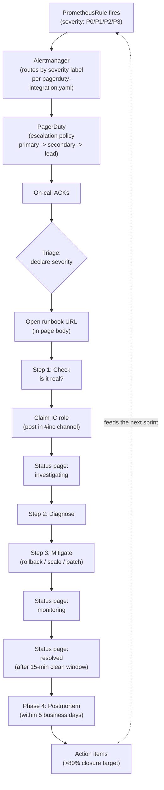
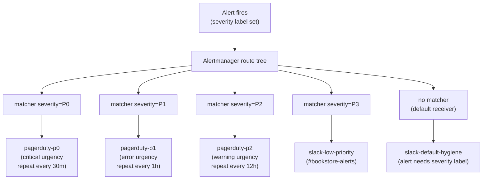

# 15.10 — Incident response & on-call

> The full lifecycle: **detect → triage → resolve → learn**. Each phase
> with the artefact that operationalizes it (Alertmanager → PagerDuty
> for detect; severity matrix for triage; runbook + IC discipline for
> resolve; blameless postmortem for learn). The chapter walks the
> [`incident/`](../examples/bookstore-platform/incident/) artefact tree
> end-to-end and surfaces the three production traps: alerts without
> runbooks, services without owners, and the "we'll write the
> postmortem next week" trap that leaves postmortems unwritten.

**Estimated time:** ~45 min read · ~90 min hands-on
**Prerequisites:** [Part 13 ch.12](../13-grand-capstone-bookstore-platform/12-day-2-runbook-on-call-dr-chaos.md): Part 13 runbook/on-call/postmortem foundation · [Part 06 ch.01](../06-production-readiness/01-observability-metrics.md): SLOs that drive paging thresholds · [Part 15 ch.09](./09-hotfix-workflow-and-breakglass.md): hotfix lane the resolve phase often invokes

**You'll know after this:** • run the full lifecycle — detect → triage → resolve → learn — with the artefact that operationalizes each phase · • wire Alertmanager → PagerDuty for detect, severity matrix for triage, runbook + IC discipline for resolve, blameless postmortem for learn · • walk the `incident/` artefact tree end-to-end against a real Bookstore page · • avoid the three production traps (alerts without runbooks, services without owners, "we'll write the postmortem next week") · • measure incident maturity via on-call review weekly, MTTR per service, postmortem-completion-rate

<!-- tags: incident-response, pagerduty, postmortem, on-call, day-2 -->

## Why this exists

[Part 13 ch.12](../13-grand-capstone-bookstore-platform/12-day-2-runbook-on-call-dr-chaos.md)
introduced the runbook structure, the on-call rotation pattern, the
severity definitions, and the postmortem template. That chapter
walked an alert end-to-end from page to mitigation. It was correct in
shape and intentionally compact in depth: a Part 13 capstone chapter
covering four operational topics at once.

This chapter deepens **one** of those topics: the full incident-response
lifecycle. We treat each phase as its own discipline with its own
artefacts, owners, time scale, and failure modes. The lifecycle has
four phases:

1. **Detect** — Prometheus alert → Alertmanager → PagerDuty page. Seconds.
2. **Triage** — the on-call's first 5 minutes. Decide severity. Claim IC.
3. **Resolve** — mitigate (not root-cause-fix). Stop customer-visible impact.
4. **Learn** — blameless postmortem within 5 business days; action items tracked.

Each phase has its own failure mode:

- **Detect fails when alerts route to the wrong PagerDuty service or
  have no severity label.** The page goes to the catch-all; the on-call
  has no context; the response is slow.
- **Triage fails when the on-call jumps to debugging without declaring
  severity.** No status-page entry; no IC; the customer-comm SLA breaches
  silently.
- **Resolve fails when responders confuse mitigation with root-cause
  fix.** "We'll fix the underlying bug" can take a day; "we'll roll
  back" takes 90 seconds.
- **Learn fails when the postmortem is written next week.** Next week
  never comes; the incident's details fade; the action items never get
  filed.

The deepening from Part 13 ch.12 is concrete in three ways:

- **The artefact tree** at
  [`../examples/bookstore-platform/incident/`](../examples/bookstore-platform/incident/)
  is new: PagerDuty Alertmanager config (real YAML, not pseudocode);
  the incident-channel automation wiring; the fuller postmortem
  template with explicit 5 Whys; a fully worked sample postmortem.
- **The PagerDuty integration is walked through with the real
  Alertmanager config.** Part 13 said "routes to a PagerDuty
  receiver"; this chapter ships the receiver block.
- **Three production traps are named with the mitigations.** The
  "page that wasn't actionable" (mitigation: every alert must have a
  `runbook_url` annotation); the "we didn't know who to page"
  (mitigation: every service in Backstage has an owner); the
  "we'll write the postmortem next week" (mitigation: 5-business-day
  rule + automation that enforces it).

This chapter and [chapter 15.11](./11-day-to-day-production-ops.md)
close the on-call discipline arc; together they answer the question
"the page fires — what happens next, and how do we make sure the same
page doesn't fire again next month?"

> **In production:** Without this lifecycle, the platform team becomes
> a 24/7 reactive queue. Every page is a fresh investigation; every
> postmortem is "we'll talk about it in standup"; every on-call shift
> burns the engineer out a little more. The remedy is mechanical: the
> four phases below, each with its artefact, each with its owner, each
> with its time budget.

## Mental model

**The incident-response lifecycle is four phases, each with one
artefact, one owner, and one time budget. Detect is automated; triage
is the on-call; resolve is the team; learn is the organization. Every
P0/P1 alert produces a postmortem within 5 business days, or the
process is broken — not optionally, not "when we have time," not
"unless it was a small one." 5 days, every time.**

The four phases visualized:

- **Phase 1 — Detect (seconds; automated).** A Prometheus
  `PrometheusRule` fires. Alertmanager evaluates the route tree (in
  `pagerduty-integration.yaml`), assigns the receiver by severity
  label, sends the page. PagerDuty's escalation policy takes it from
  there (primary → secondary → platform lead). The on-call's phone
  buzzes; the dashboard URL is in the page body.
- **Phase 2 — Triage (first 5 minutes; on-call primary).** Ack the
  page. Glance at the dashboard. Decide severity per the matrix.
  Open the runbook (URL is in the page body). Run Step 1 (Check) of
  the runbook. Decide: is this a real incident? If yes, claim or
  declare the IC (whoever takes the IC role: type "IC: \<name\>" in
  the incident Slack channel). Open the status-page entry. A security
  signal (an unexpected shell in a running container, or a credential used
  from an unknown place) takes the compromised-workload steps in hands-on
  section 7 before any clean-up.
- **Phase 3 — Resolve (minutes to hours; on-call + responders).** Walk
  Steps 2-4 of the runbook (Diagnose → Mitigate). The goal is
  **mitigation**, not root-cause fix. Rollback. Scale. Patch. Every
  mitigation goes through Git, so that Argo CD does not revert it
  (see [15.01](./01-pr-to-production-lifecycle.md): Git is the only
  write path to production, and self-heal reverts drift). Three
  example mitigations:
  - **Rollback** (revert the release commit, or Argo Rollouts abort →
    previous version, per [15.07](./07-rollback-playbook.md)): usually
    the quickest. Always the first option if the cause is "a recent
    deploy."
  - **Scale-up** (raise `replicas` in the GitOps repo and merge): quick
    when the pods fit on existing nodes; new nodes take longer. The
    mitigation for capacity-related failures.
  - **Patch** (commit the ConfigMap change, then let Argo CD sync and
    restart the pods): the mitigation when a misconfiguration is the
    cause and rollback isn't viable.
  - **Live edit** (`kubectl scale`, `kubectl edit`, `kubectl set image`)
    is an exception, not a mitigation. Self-heal reverts it within
    minutes unless you pause auto-sync for that Application first. If
    you use it, label it in the incident channel, pause auto-sync, make
    the change, and commit the same change back to Git before you close
    the incident. An unlabelled live edit is an audit finding.
  Customer-visible impact ends; status page updates to "monitoring";
  after a 15-minute clean window, "resolved."
- **Phase 4 — Learn (5 business days; IC + author + team).** The IC
  starts the postmortem doc DURING the incident (the timeline is
  scribed live; do not try to reconstruct from Slack search after the
  fact). Within 5 business days: summary + customer impact + timeline
  + root cause (5 Whys) + action items + lessons + sign-off. Published
  in `#bookstore-platform-postmortems`. Action items tracked in the
  GitHub Project board, with a closure target of 80 % by the quarterly
  review.

Each phase has time-budget anti-patterns to watch:

- **Detect anti-pattern: the silent alert.** A Prometheus rule that
  never fires (because the query is wrong) is invisible: there is no
  alert telling you the alert isn't working. The defence: every
  `PrometheusRule` has a "test the rule fires when expected" runbook
  exercise quarterly.
- **Triage anti-pattern: skipping the severity decision.** The
  on-call starts debugging without typing "P0" or "P1" anywhere; no
  status-page entry; no IC. The defence: the severity goes into the
  incident channel as the first message, before any debugging, and the
  status-page entry follows from it.
- **Resolve anti-pattern: chasing root cause during the incident.**
  The on-call says "let me figure out why" instead of "let me stop
  the bleeding." The customer pays for every minute of "let me
  figure out why." The defence: the runbook's Step 3 is **Mitigate**,
  not "diagnose root cause"; root cause comes in the postmortem.
- **Learn anti-pattern: the "we'll write it next week" postmortem.**
  Next week never comes; the incident details fade; the postmortem
  either never appears or appears 2 months late with half the
  timeline guessed. The defence: 5-business-day rule + a
  `postmortem_overdue` alert, routed as P3 to Slack and tracked by the
  platform lead (severity-matrix.md).

The most important conceptual move in this chapter: **mitigation is
not the same as fix**. Mitigation is what stops the bleeding;
mitigation buys you the time to write the postmortem at human pace.
The fix is in the action items. A team that conflates the two will
either ship rushed fixes (high risk; introduces new bugs) or stay
in the incident loop longer than necessary (high customer impact).

## Threats and controls

| Threat | Control | Deeper |
|---|---|---|
| A compromised workload keeps acting while the team debates, or a delete destroys the evidence | Isolate first with a quarantine label and a deny-all NetworkPolicy, capture what kubectl can read, roll back through Git, rotate, then delete (hands-on section 7). The label does not reliably end connections that are already open | [05.08](../05-security/08-audit-detection-and-incident-response.md) for the attack, the detection and the audit record. No chapter captures memory or disk |
| Routing keys or other credentials typed into the response stay in shell history or chat | Deliver them as an ExternalSecret from Vault, and rotate on exposure | [15.05](./05-production-secrets-vault-eso.md), [11.05](../11-advanced-production-patterns/05-secrets-at-scale.md) |
| Emergency access granted during the incident and never taken back | AWS: a one-hour breakglass role behind a Vault login with MFA, found by the 24-hour CloudTrail review. This guide ships no alert on use. Kubernetes: a time-limited grant is not built | [15.09](./09-hotfix-workflow-and-breakglass.md) |

## Diagrams

### Diagram A — the four phases end-to-end (Mermaid)



### Diagram B — phase ownership and time budgets (ASCII)

```text
PHASE     OWNER                     TIME BUDGET            ARTEFACT(S)
────────  ───────────────────────   ────────────────────   ───────────────────────────────────
Detect    Alertmanager + PD         seconds                pagerduty-integration.yaml
                                                           PrometheusRule (annotations: runbook_url + dashboard_url)
Triage    On-call primary           first 5 min            severity-matrix.md
                                                           runbook-<ALERT>.md (Step 1: Check)
                                                           incident-channel auto-creation
Resolve   On-call + IC + team       5 min - 4 hrs (P0/P1)  runbook-<ALERT>.md (Steps 2-4)
                                                           incident-channel-bot-config.md
                                                           status-page entries
Learn     IC + author + team        5 business days        postmortem-template.md
                                                           sample-postmortem-2026-04-15.md
                                                           action-item tracking board
────────  ───────────────────────   ────────────────────   ───────────────────────────────────
SLA TARGETS (the on-call contract):
  P0  ack 5 min, mitigate 30 min, postmortem 5 business days
  P1  ack 15 min, mitigate 4 hours, postmortem 5 business days
  P2  ack 1 business day, mitigate when convenient, postmortem optional
  P3  Slack only, triage in next sprint planning
```

### Diagram C — the routing tree inside Alertmanager (Mermaid)



## Hands-on with the Bookstore Platform

### 0. Prerequisites

- [Part 13 ch.09](../13-grand-capstone-bookstore-platform/09-observability-otel-tempo-loki-prometheus-grafana.md)
  ran. kube-prometheus-stack is installed; Alertmanager is reachable;
  PrometheusRules fire against the bookstore services.
- The runbook tree at
  [`../examples/bookstore-platform/runbooks/`](../examples/bookstore-platform/runbooks/)
  exists (from Part 13 ch.12). The `incident/` tree we add in this
  chapter complements the runbooks; it does not replace them.
- A PagerDuty account (free tier works for the walkthrough; paid for
  real on-call). For the hands-on we use the PagerDuty Events API V2
  routing keys; you'll need at least one PD service to receive pages.
- Slack workspace + a Slack app with `chat:write` + `channels:manage`
  scopes (for the incident-channel-bot wire-up).
- A SecretStore named `vault-monitoring` in `monitoring`, built the way
  [15.05](./05-production-secrets-vault-eso.md) builds the tenant stores,
  for the routing keys in step 2.

### 1. Apply the artefact tree

```bash
# The tree we'll walk through.
ls examples/bookstore-platform/incident/
```

The README walks the four phases and which file owns each. Read it
once before applying anything.

### 2. Apply the Alertmanager configuration

The `AlertmanagerConfig` CR (`monitoring.coreos.com/v1beta1`) plugs
into the kube-prometheus-stack-installed Alertmanager:

```bash
# Inspect the routing tree first. P0 goes to pagerduty-p0, P1 to
# pagerduty-p1, P2 to pagerduty-p2 and P3 to slack-low-priority.
yq '.spec.route.routes[] | {severity: .matchers[0].value, receiver: .receiver}' \
  examples/bookstore-platform/incident/pagerduty-integration.yaml
```

Keep the routing keys out of the terminal. Vault holds them, and an
ExternalSecret syncs them into the `pagerduty-keys` Secret that the receivers
read. Do not use `kubectl create secret --from-literal` for this: the literal
lands in your shell history. Store each key in Vault once, through the Vault
UI or with `vault kv put` and the `key=@file` form, so the value stays off the
command line. Save the block below as `incident-secrets-externalsecret.yaml`. It
uses the `vault-monitoring` SecretStore from the prerequisites. It has two
documents: the PagerDuty routing keys, and the Slack webhook that the P3 and
hygiene receivers read. The AlertmanagerConfig references both Secrets, and
the operator rejects the whole configuration when a referenced Secret is
missing, so the P0 route fails along with the rest. Create both before you
apply the configuration.

```yaml
apiVersion: external-secrets.io/v1
kind: ExternalSecret
metadata:
  name: pagerduty-keys
  namespace: monitoring
spec:
  refreshInterval: "1h"
  secretStoreRef:
    name: vault-monitoring
    kind: SecretStore
  target:
    name: pagerduty-keys
    creationPolicy: Owner
  data:
    - secretKey: p0-routing-key
      remoteRef: { key: bookstore/pagerduty, property: p0-routing-key }
    - secretKey: p1-routing-key
      remoteRef: { key: bookstore/pagerduty, property: p1-routing-key }
    - secretKey: p2-routing-key
      remoteRef: { key: bookstore/pagerduty, property: p2-routing-key }
---
apiVersion: external-secrets.io/v1
kind: ExternalSecret
metadata:
  name: slack-webhooks
  namespace: monitoring
spec:
  refreshInterval: "1h"
  secretStoreRef:
    name: vault-monitoring
    kind: SecretStore
  target:
    name: slack-webhooks
    creationPolicy: Owner
  data:
    - secretKey: bookstore-alerts-webhook
      remoteRef: { key: bookstore/slack, property: bookstore-alerts-webhook }
```

`ExternalSecret` is a CRD from External Secrets Operator. Until the operator
is installed, a dry-run reports `no matches for kind "ExternalSecret"`.

```bash
kubectl apply -f incident-secrets-externalsecret.yaml
kubectl -n monitoring get externalsecret pagerduty-keys slack-webhooks

# Apply the AlertmanagerConfig and the sample PrometheusRule.
kubectl apply -f examples/bookstore-platform/incident/pagerduty-integration.yaml
```

The `AlertmanagerConfig` is a CRD-intrinsic resource: the
kube-prometheus-stack operator watches it and reconciles it into the
Alertmanager StatefulSet's runtime config. **CRD-intrinsic note: the
AlertmanagerConfig CRD ships with the kube-prometheus-stack chart; do
not apply the CR without the chart installed, or the API server
returns `no matches for kind`.**

### 3. Test the route tree with a synthetic alert

Verify the routing actually fires by creating a synthetic alert:

```bash
# Send a synthetic alert directly to Alertmanager.
# Note: in production Alertmanager you typically do NOT enable
# public ingress for the API; this is a test against the in-cluster
# service.
kubectl -n monitoring port-forward svc/alertmanager-operated 9093:9093 &

curl -X POST http://localhost:9093/api/v2/alerts -H "Content-Type: application/json" -d '[{
  "labels": {
    "alertname": "BookstoreSynthetic",
    "severity": "P0",
    "service": "checkout",
    "region": "us-east-1",
    "namespace": "monitoring"
  },
  "annotations": {
    "summary": "Synthetic test alert — please ack and resolve",
    "runbook_url": "https://github.com/your-org/bookstore-platform/blob/main/examples/bookstore-platform/runbooks/README.md",
    "dashboard_url": "https://grafana.example.com/d/bookstore-overview"
  }
}]'
```

The `namespace` label is required, not decorative. The Prometheus Operator
scopes an AlertmanagerConfig to alerts whose `namespace` label equals the
config's own namespace (`monitoring` here), unless the Alertmanager sets
`alertmanagerConfigMatcherStrategy` to `None`. An alert without the label
falls through to the default receiver. The sample PrometheusRule carries the
same label for the same reason.

A page should arrive in PagerDuty's high-urgency policy within 30
seconds. Verify in the PagerDuty UI:

- The incident has the **severity, alertname, service, region**
  fields visible (from the `details` block in the receiver config).
- The two **links** (Runbook + Grafana dashboard) appear in the
  PagerDuty incident sidebar.
- The PagerDuty notification on your phone includes the alert name
  + the summary.

ACK the synthetic page. Resolve it from PagerDuty's UI. The synthetic
test should take < 5 minutes end-to-end.

### 4. Walk a real incident end-to-end

Trigger a real-shape failure on purpose: scale the `payments-gateway`
deployment to zero in the bookstore namespace. This is a deliberate
action for the drill; never run it against production traffic.

Run the drill in a namespace whose Argo CD Application has self-heal off.
In a namespace with self-heal on, Argo CD restores `replicas: 3` within
minutes, and the drill measures the restore instead of the alert path. The
drill is the only place in this chapter where a live scale is the point; the
mitigation below goes through Git.

```bash
# (Run in a dedicated terminal; this is the "incident" being created)
kubectl -n bookstore-platform-acme-books scale deployment payments-gateway --replicas=0
```

Within ~2 minutes the `BookstoreCheckoutErrorRateHigh` rule fires
(assuming the sample PrometheusRule from `pagerduty-integration.yaml`
is wired against your bookstore traffic; in a real cluster the
PrometheusRule already exists from Part 13 ch.09's observability
artefacts).

**Phase 2 — Triage.** Ack the page in PagerDuty. Open the incident
channel in Slack (`#inc-YYYY-MM-DD-001`; auto-created by the wire-up
from `incident-channel-bot-config.md` if you configured it; manually
created otherwise). Decide severity from the matrix:
`severity-matrix.md` says checkout-affecting = P0. Type
"Sev: P0; IC claiming: \<your-name\>" in the channel. Open the
status-page entry (manually via Statuspage UI, or via slash command
if Incident.io is wired).

**Phase 3 — Resolve.** Open the runbook URL from the page body. The
runbook (`runbook-payments-failure-rate.md`) Step 1 (Check) is
`kubectl get pods -l app=payments-gateway` — confirms the pod count
is 0; the alert is real. Step 2 (Diagnose) walks to "deployment
recently scaled to 0?" Step 3 (Mitigate) is to restore
`replicas: 3`. Run the mitigation through Git: set `replicas: 3` for
`payments-gateway` in the GitOps overlay, open the PR, and merge it. Argo CD
syncs the change. If you must use a live scale for speed, pause auto-sync on
the Application first, label the action in the incident channel, and commit
the same replica count back before you close the incident.

```bash
# In the GitOps repo: set replicas: 3 for payments-gateway, open a PR, and
# merge it after review. Then wait for Argo CD to converge (<APP> is the
# Application that owns the overlay):
argocd app wait <APP> --health --sync
```

Watch the error rate drop. Update the status page: "Mitigation
deployed; monitoring." After a 15-minute clean window: "Resolved."

**Phase 4 — Learn.** Open `postmortem-template.md`. Copy to
`docs/postmortems/INC-YYYY-MM-DD-001.md`. Fill in metadata,
summary, customer impact, timeline (transcribe from the incident
Slack channel; UTC timestamps), root cause (5 Whys: why did the
deployment scale to 0? "I did it for this walkthrough" — for a
real walkthrough you'd push deeper). Action items: e.g. "add a
guard that prevents `kubectl scale --replicas=0` against
production deployments without a `--reason` annotation." Publish
within 5 business days.

For the canonical reference, read
[`sample-postmortem-2026-04-15.md`](../examples/bookstore-platform/incident/sample-postmortem-2026-04-15.md)
— the fully worked example of a 39-minute P0 checkout outage. The
sample shows what dense-timeline + 5-Whys + complete-action-items
looks like at production discipline.

### 5. Wire up the incident-channel automation

The vendor-neutral wire-up is documented in
[`incident-channel-bot-config.md`](../examples/bookstore-platform/incident/incident-channel-bot-config.md).
The minimum-viable wire-up uses PagerDuty webhooks + a small Slack
bot:

```bash
# In the bookstore-platform repo:
# 1. Create a Slack app at https://api.slack.com/apps
#    Scopes: chat:write, channels:manage, channels:read, users:read
# 2. Install to the workspace; copy the bot token.
# 3. Create a PagerDuty webhook subscription:
#    https://your-org.pagerduty.com/integrations/v2/webhook
#    Events: incident.triggered, incident.acknowledged, incident.resolved
#    URL: https://your-bot-host/pd-webhook
# 4. Run the bot (sample implementation deferred — every team writes
#    a small one; or buy Incident.io / FireHydrant / Rootly).
```

The full Slack app code is out of scope for this chapter; the
`incident-channel-bot-config.md` walks the three off-the-shelf
options + the minimum-viable build-your-own.

### 6. The weekly handoff

Every Monday at 10:00 UTC the outgoing primary creates a handoff doc
from `oncall-handoff-template.md`:

```bash
# Create this week's handoff doc.
WEEK_OF=$(date -u +"%Y-%m-%d")
cp examples/bookstore-platform/incident/oncall-handoff-template.md \
   docs/handoffs/${WEEK_OF}.md

# Fill in: pages received, active incidents, recent postmortems,
# planned changes, known flapping alerts, runbooks updated.
$EDITOR docs/handoffs/${WEEK_OF}.md

# Walk it with the incoming primary at the 10:00 UTC sync.
# The incoming primary signs off (the checkbox at the bottom).
```

The handoff doc is the most-overlooked weekly artefact. The
template's structure forces the conversation that closes the "the
incoming on-call didn't know about the open issue from last week"
anti-pattern.

### 7. Isolate a compromised workload before you delete it

Use this path when the signal is a security one: an unexpected shell in a
running container, a credential used from an address you do not know, or a
process nobody can explain. The order is isolate, capture, roll back, rotate,
then delete. Isolation keeps the pod and its state alive while you work.
Capture reads what kubectl can see before anything goes away. Rollback is the
usual fix for a bad deploy, but a rollout scales the old ReplicaSet down, and
that can delete the suspect pod before you have read it. So the rollback comes
after capture, not before. Rotation invalidates the values the pod could
already read. It does not keep new values from the pod, as the Rotate step
explains.

Keep this policy in the namespace before any incident, so that the response
is one label. A NetworkPolicy that selects pods and lists no rules denies the
traffic that new connections would carry, in both directions ([Kubernetes
NetworkPolicy
docs](https://kubernetes.io/docs/concepts/services-networking/network-policies/)).
Save the block as `quarantine-deny-all.yaml` and apply it once:

```yaml
apiVersion: networking.k8s.io/v1
kind: NetworkPolicy
metadata:
  name: quarantine-deny-all
  namespace: bookstore-platform-acme-books
spec:
  podSelector:
    matchLabels:
      quarantine: "true"
  policyTypes:
    - Ingress
    - Egress
```

```bash
kubectl apply -f quarantine-deny-all.yaml
```

Policies add up. An allow policy that also selects the pod, such as a
namespace-wide allow with an empty `podSelector`, still lets its traffic
through. Check the namespace for one before you rely on the quarantine.

The quarantine has three limits you must plan around. It stops new flows; it
does not reliably end flows that are already open. The Kubernetes docs leave
it to the network plugin whether a change to a pod's labels or policies
applies to an existing connection (the section "NetworkPolicy's impact on
existing connections"). A reverse shell or command-and-control stream may keep
running after the label goes on. Second, the policy does not stop traffic from
the pod's own node, which is always allowed, so kubelet probes still reach the
pod. Third, the policy is not the only control: the rotation and the delete
below do the work that the label cannot.

**Isolate.** Removing the `app` label takes the pod out of the Service and the
ReplicaSet, which the bookstore manifests select on. The ReplicaSet starts a
replacement, and the suspect pod keeps running:

```bash
NS=bookstore-platform-acme-books
POD=suspect-pod-name   # the suspect pod's name
kubectl -n "$NS" label pod "$POD" quarantine=true app-
```

Removing the label also starts a replacement from the same ReplicaSet, which
runs the same image. Nothing about the suspect pod changes; it keeps running
under the quarantine policy until you delete it.

**Capture.** Save what kubectl can read before the pod restarts or goes away:

```bash
mkdir -p "evidence/$POD"
kubectl -n "$NS" get pod "$POD" -o yaml > "evidence/$POD/pod.yaml"
kubectl -n "$NS" describe pod "$POD" > "evidence/$POD/describe.txt"
kubectl -n "$NS" logs "$POD" --all-containers --timestamps \
  > "evidence/$POD/logs.txt"
kubectl -n "$NS" get events \
  --field-selector "involvedObject.name=$POD" > "evidence/$POD/events.txt"
```

Add `--previous` to the logs command if a container restarted. Record the
image digest from `.status.containerStatuses[].imageID` in `pod.yaml`, not
the tag, since a tag can move ([15.04](./04-multi-environment-promotion.md)).
Evidence files can hold sensitive values, such as environment literals and
tokens that reached a log line, so keep them where only the incident team can
read them. The steps above do not capture process memory or the
container's disk, and no chapter in this guide teaches either capture.
[05.08](../05-security/08-audit-detection-and-incident-response.md) saves
only what kubectl can read, as this section does. A team that needs memory
or disk evidence has to choose and rehearse the tooling before an incident.

**Roll back.** If the image is the suspect, roll the Deployment back to a
known-good digest, through Git, as [15.07](./07-rollback-playbook.md)
describes. The rollout creates a ReplicaSet for the known-good digest and
scales the old one down. The isolated pod no longer matches the old
ReplicaSet's selector, so the rollout leaves it running. Wait until the
replacement is Ready on the known-good digest before you continue:

```bash
kubectl -n "$NS" rollout status deployment/<DEPLOYMENT>
kubectl -n "$NS" get pods -l app=<LABEL> \
  -o custom-columns=NAME:.metadata.name,IMAGE:.spec.containers[*].image
```

**Rotate.** Rotate the credentials the pod could read, through the
ExternalSecret path in [15.05](./05-production-secrets-vault-eso.md), so the
values it already holds stop working. Then remove the pod's ServiceAccount from
its RoleBindings, as [05.01](../05-security/01-authn-authz-rbac.md) describes,
so its token stops authorizing API calls. A dedicated ServiceAccount keeps this
from touching other workloads. Rotation does not keep new values from the
isolated pod. The kubelet updates a Secret mounted as a volume in place, so
the quarantined pod can read the rotated value. Only a Secret read as an
environment variable stays at the old value, and only until the pod restarts.
Do not treat the egress block as the control that protects the new values,
because it does not end open connections. Delete the pod soon after rotation.

**Delete.** Only now:

```bash
kubectl -n "$NS" delete pod "$POD"
```

Deleting the orphaned pod starts nothing new. The ReplicaSet already started
its replacement when the label went, and the rollback already moved the
workload to the known-good digest. Check the replacement's image digest
against the one [15.03](./03-image-signing-and-provenance.md) verified before
you call the workload clean.

Check the policy before you rely on it, with two tests:

- From a healthy pod in the namespace, send a new request to the quarantined
  pod's IP with `curl --max-time 3`. Expect a timeout, not a connection
  refused, because most policy engines drop packets.
- Before you apply the label, open a long-lived TCP connection from a healthy
  pod to a port the suspect pod serves, and keep it open. After the label, see
  whether that connection still carries data. Your network plugin decides
  this, and the upstream docs say so. Record what your plugin does.

Neither result is captured in this chapter. The expected outcomes are the
ones above, not measured ones.

## How it works under the hood

### Why the severity-label-based route tree

Alertmanager's routing tree is a depth-first matcher: an alert flows
into the tree from the root, the first `matchers` block that matches
all label-value pairs wins. The pattern in
`pagerduty-integration.yaml` puts severity-based matchers at the top
level for one reason: **severity is the most important routing axis**.
A P0 alert from any service routes to the same high-urgency PagerDuty
service with the same escalation policy; a P3 alert from the same
service routes to Slack only.

The alternative — service-based routing — works but doesn't scale:
every new service needs a new route added; the route tree grows
linearly with the number of services. The severity-based tree is
O(1) in service count and O(severities) in routing complexity.

The trade-off: per-team escalation policies. Some teams want
"payments-team P0 pages payments-on-call FIRST, then platform lead";
other teams want "any P0 pages platform lead directly." The
severity-based tree handles this via PagerDuty's own escalation
policies, not Alertmanager: the routing key is per-severity, but
within PagerDuty, each routing key maps to a service with its own
escalation policy. Per-team escalation lives in PagerDuty, not in
Alertmanager.

### The runbook_url annotation — every alert, no exceptions

The PagerDuty receiver template injects the `runbook_url` annotation
into the page body. The annotation is on the `PrometheusRule`; the
template extracts it via `{{ .CommonAnnotations.runbook_url }}`.

The discipline: **every PrometheusRule has a `runbook_url`
annotation**. Without it, the page body lacks the runbook link; the
on-call has to search for the runbook by alert name; the precious
first 60 seconds is wasted on navigation instead of triage.

The alert-hygiene review (see ch.15.11) tags alerts that
fail this check + creates a P3 action item per failing alert.
Alerts without runbooks are not deleted (some are too new) but they
ARE tracked.

The most common runbook-URL anti-pattern: the URL points to a
private wiki that the on-call doesn't have access to at 3am (the
SSO timed out; the VPN is broken; the wiki is down because the
incident took it down). The defence: runbook URLs point to the
GitHub repo (markdown rendered by GitHub), not Confluence/Notion;
GitHub auth is the on-call's existing GitHub identity; the repo sits
outside your cluster, so a cluster outage does not take the runbook down
with it.

### The inhibit rules — suppressing the cascade

When a region goes down, every service in that region trips its own
latency / availability alerts. Without inhibit rules, the on-call's
phone explodes with 50 pages in 30 seconds — none of which add
information beyond "the region is down."

The `inhibitRules` block in `pagerduty-integration.yaml` says: if a
P0 fires for a `(service, region)`, suppress P1+P2+P3 for the same
`(service, region)` until the P0 resolves. The cascade is
contained; the on-call sees one P0 page; the dashboard shows the
underlying cause (region down) rather than 50 surface symptoms.

The inhibit rules have to be tested. The most common inhibit-rule
bug: the `equal` fields don't match between the source and target
matchers, so the inhibit silently does nothing. The defence: a
synthetic test that triggers both a P0 region-down AND a P1
service-latency for the same region, then verifies only the P0
paged.

### The 5-business-day postmortem deadline

Five business days is a policy, and `severity-matrix.md` states it. The
reason matches the 48-hour draft: incident details fade, and a postmortem
written weeks later rebuilds the timeline from memory instead of recording
it. Pick a deadline the team will meet, and make a miss visible. A deadline
with no consequence is only a suggestion.

The implementation: a `postmortem_overdue` rule fires when an open incident
in the tracking system (Incident.io, Rootly, or a custom system) has no
postmortem doc and its all-clear is more than five business days old. The
severity matrix routes it as P3, so it reaches Slack, and the platform lead
tracks it. It stays open until the doc is published.

This is one of the few cases where **the alert is the policy**. The
policy is "5 business days." The alert is what makes the policy
real.

> **Reconciling with Part 13 ch.12's 48-hour deadline:** Part 13 ch.12 set
> a 48-hour postmortem target. This chapter keeps 48 hours for the
> **draft**: the incident commander has the timeline and summary written
> while the details are fresh. **Publication** takes up to five business
> days, which is the severity matrix's rule. The extra days cover
> root-cause analysis, action-item priorities and sign-off.

### Why mitigation, not root-cause fix, during the incident

The arithmetic needs no revenue figure. Let each minute of customer impact
cost R. A rollback that takes about one minute costs about R. A 40-minute
root-cause investigation costs 40R before the fix lands. The rollback wins at
any value of R, even if it only patches around the root cause. (The one
minute and the 40 minutes are illustrative, not measured.)

The root cause goes in the postmortem; the action item ships the
real fix at human pace. The discipline is:

1. **Default to rollback if the cause is "recent deploy."**
2. **Default to scale-up if the cause is "load."**
3. **Default to patch if the cause is "misconfiguration."**
4. **NEVER default to "let me find the root cause."**

The bookstore Spring Sale incident
([`sample-postmortem-2026-04-15.md`](../examples/bookstore-platform/incident/sample-postmortem-2026-04-15.md))
applied this. Its first mitigation, a scale-up, cut the error rate from
78 % to 31 % within three minutes. Its second, a body-size limit change,
closed the rest within five. The sample's root cause, a cross-service
invariant that no check covered, is written up in its review section.

## Production notes

> **In production:** **The "page that wasn't actionable" anti-pattern
> is a common source of on-call burnout.** An alert fires;
> the on-call wakes up, opens the dashboard, and… can't tell what to
> do. The page has no runbook URL; the alert name doesn't match any
> documented service; the on-call ends up debugging from scratch at
> 3am with no context.
>
> The defence: **every alert MUST have a `runbook_url` annotation.**
> No exceptions. The alert-hygiene review (ch.15.11)
> catches alerts that lack the annotation and creates action items
> to either add the runbook or delete the alert. The choice is
> binary: an alert is either actionable (has a runbook) or it
> shouldn't page (delete it / route to Slack-only).
>
> The guide's example repo does not ship this lint yet. A team that
> adopts the rule adds one to CI: a rule without a `runbook_url`
> annotation fails the build. New alerts ship with their runbook;
> existing alerts get a grace period that the team sets.

> **In production:** **The "we didn't know who to page" gap is the
> common source of on-call confusion.** An alert fires for
> a service; the on-call doesn't know which team owns it. The page
> goes to the platform team by default; the platform team has to
> figure out which application team to escalate to; 20 minutes pass
> before the right human is involved.
>
> The defence: **every service in Backstage has an owner field +
> an oncall field.** The owner is a team; the oncall is the team's
> PagerDuty schedule. The Alertmanager routing tree extracts the
> service label from the alert, looks up the team's PD routing key
> via a sidecar service (or — simpler — encodes the routing in
> the PrometheusRule's `team` label), and pages the right
> team directly.
>
> Part 13 ch.11 sets up the Backstage catalog, where the service's
> `catalog-info.yaml` carries `spec.owner: team-payments`. The example
> in this chapter routes on severity only. A team label extends it: a
> PrometheusRule with `team: payments` routes to a `team-payments`
> receiver, which uses that team's PD routing key.

> **In production:** **The "we'll write the postmortem next week"
> trap is a common way postmortems die.** Each week of delay costs
> detail, and a draft started after the incident week is usually a
> guess. Start the draft during the incident, as Phase 4 describes.
>
> The defence: **the 5-business-day rule plus a `postmortem_overdue`
> alert.** The alert fires when an open Incident.io / Rootly incident
> has no postmortem doc and its all-clear is older than 5 business
> days. Publishing the doc is what clears it. When the IC is away, the
> platform lead writes the postmortem in their stead.

> **In production:** **Status-page silence during incidents is the
> common breach of customer trust.** A customer sees
> an error; they refresh; the error persists; they check the
> status page; the page says "all systems operational." They lose
> faith in everything you ship after that.
>
> The defence: **a status-page entry within 15 minutes of any P0;
> within 1 hour of any P1.** The IC owns this; the status-page
> entry is part of the runbook. The automation in
> `incident-channel-bot-config.md` reduces the cost: a Slack
> slash command (`/status update`) posts to the status page
> directly. No tab-switching; no logging into Statuspage; no
> "let me get to that next."
>
> The status-page "resolved" state has its own discipline: don't
> mark resolved until the metrics show 15 minutes of clean
> behaviour AND at least one tenant has confirmed in Slack.
> Premature "resolved" entries are worse than late ones; the
> customer who saw the resolved entry and then encountered the
> residual error has lost twice.

> **In production:** **The "IC role unclaimed" gap delays every
> downstream action.** Without an IC, the on-call tries to debug
> AND coordinate AND communicate, doing all three poorly. The
> sample postmortem
> ([`sample-postmortem-2026-04-15.md`](../examples/bookstore-platform/incident/sample-postmortem-2026-04-15.md))
> documents a 12-minute IC-claim gap that delayed status-page
> updates, customer email, and recorder assignment.
>
> The defence: **the incident-channel bot prompts "who is the IC?"
> when the incident opens; the first responder to react with
> :raised_hand: becomes the IC; if no one claims within 5 minutes,
> the platform lead pages.** The automation prevents the gap by
> making the IC role a default expectation, not an afterthought.

> **In production:** **Page volume is itself a metric.** The
> [`severity-matrix.md`](../examples/bookstore-platform/incident/severity-matrix.md)
> sets four bands for pages per shift: normal (0 to 2), elevated (3 to
> 5), high (6 to 10) and critical (11 to 20). Above 20, the rotation
> itself is a P1. The platform lead tracks pages per shift weekly, and
> chapter 15.11 holds the weekly review that closes the loop.

## What's next

[Chapter 15.11](./11-day-to-day-production-ops.md) covers the
day-to-day ops cadence: the weekly cost / capacity / on-call
reviews; the monthly postmortem-closure review; the scaling
decisions (when to add a NodePool; when to bump system-node-group
sizes; when to enable Cluster Autoscaler in addition to Karpenter).
Together with this chapter, the two close the on-call discipline
arc.

Chapter 15.12 (capstone — first 90 days) ties everything in Part 15
together with the 90-day onboarding discipline for a team taking
over a production EKS platform.

## Quick Reference

```bash
# Pinned install — assumes kube-prometheus-stack already installed
# (the AlertmanagerConfig CRD lives in monitoring.coreos.com/v1beta1)

# 1. Apply the routing tree + sample rule
kubectl apply -f examples/bookstore-platform/incident/pagerduty-integration.yaml

# 2. Sync the PagerDuty routing keys from Vault (ExternalSecret, step 2)
kubectl apply -f pagerduty-keys-externalsecret.yaml

# 3. Test the route tree with a synthetic alert
kubectl -n monitoring port-forward svc/alertmanager-operated 9093:9093 &
curl -X POST http://localhost:9093/api/v2/alerts -H "Content-Type: application/json" \
  -d '[{"labels":{"alertname":"BookstoreSynthetic","severity":"P0","service":"checkout","region":"us-east-1","namespace":"monitoring"},"annotations":{"summary":"test","runbook_url":"https://example.com/runbook","dashboard_url":"https://example.com/dashboard"}}]'

# 4. Walk a real-shape incident (scale payments-gateway to zero, as a drill,
#    in a namespace whose Application has self-heal off)
kubectl -n bookstore-platform-acme-books scale deployment payments-gateway --replicas=0
# wait for page; ack; open runbook; mitigate through Git (replicas: 3 in the
# GitOps overlay, reviewed and merged), not with a live scale

# 5. Open the sample postmortem to see what "good" looks like
$PAGER examples/bookstore-platform/incident/sample-postmortem-2026-04-15.md

# 6. Weekly handoff
cp examples/bookstore-platform/incident/oncall-handoff-template.md \
   docs/handoffs/$(date -u +%Y-%m-%d).md

# 7. Security signal: quarantine the pod (label it, capture, roll back through
#    Git, rotate, then delete; a label does not reliably end open connections)
kubectl -n bookstore-platform-acme-books label pod "$POD" quarantine=true app-
```

Minimal rule fragment: the labels and annotations every alert must have to
route correctly. It is one entry under `rules:` and has no kind field. The
complete PrometheusRule is in the example file.

```yaml
- alert: <AlertName>
  expr: <PROMQL>
  for: <DURATION>
  labels:
    severity: <P0|P1|P2|P3>    # routes the alert
    service:  <SERVICE>        # surfaces in PD details
    region:   <REGION>         # surfaces in PD details
    team:     <TEAM>           # (optional) per-team escalation
  annotations:
    summary: "<one-line summary>"
    description: "<detailed description>"
    runbook_url: "<URL to the runbook>"      # MANDATORY
    dashboard_url: "<URL to the dashboard>"  # MANDATORY
```

Incident-response checklist (the lifecycle is healthy when all six are yes):

- [ ] Every PrometheusRule has `runbook_url` + `dashboard_url`
      annotations (a CI lint should enforce this; the example repo does not
      ship one).
- [ ] Every service in Backstage has `spec.owner` + an on-call
      mapping.
- [ ] Alertmanager routing tree is severity-keyed + inhibit-tested.
- [ ] Incident-channel automation opens the channel when a P0/P1 page
      fires.
- [ ] IC role claimed within 5 minutes of a P0 page; if not, the
      bot escalates.
- [ ] Postmortem published within 5 business days for every P0/P1;
      `postmortem_overdue` P3 alert enforces.

## Test your understanding

> Try each before opening the answer drawer. The act of trying is the exercise; the answer is the check.

1. **The chapter says mitigation is not the same as fix. Why does conflating them hurt incident response?**
   <details><summary>Show answer</summary>

   Mitigation stops the bleeding (rollback, scale-up, patch — minutes to seconds). Fix addresses the root cause (write tests, refactor, redesign — hours to days). A team that conflates them either (a) ships rushed root-cause fixes during the incident under time pressure, introducing new bugs and lengthening the incident; or (b) stays in incident-response mode longer than necessary trying to "really fix it" while customers continue to be affected. The discipline: Phase 3 (Resolve) is mitigation only; Phase 4 (Learn) produces action items that schedule the fix at human pace. Mitigation buys time to write a postmortem at human pace.

   </details>

2. **A team's postmortems consistently land 5 days after the chapter's 5-business-day deadline. The IC says "we got busy." What's the chapter's stance and what's the mechanism for fixing it?**
   <details><summary>Show answer</summary>

   "Postmortem 5 days late" is one of the chapter's three production traps. The mechanism is a `postmortem_overdue` alert, routed as P3 and tracked by the platform lead, which turns the deadline from an aspiration into a visible miss. The deeper problem is cultural: postmortems are most valuable in the first 48 hours when the incident details are fresh; a week later, half the timeline is guessed and the action items are vague. The chapter's discipline: the IC starts the postmortem doc *during* the incident (timeline scribed live), so the draft exists before the incident ends. "Got busy" is the symptom; the prevention is making the postmortem a load-bearing part of the incident itself, not a separate-week task.

   </details>

3. **A platform engineer just finished a P0 on-call rotation; he was paged 12 times in one week, had two postmortems overdue, and Slack messages him daily on his off-week asking incident questions. What patterns does the chapter say address this and what's the team-level mistake?**
   <details><summary>Show answer</summary>

   The chapter calls this "on-call burnout" — the canonical Day-2-ops failure. Symptoms: page volume per shift, postmortem backlog, off-shift Slack pressure. The patterns: (1) every page must be **actionable** with a `runbook_url` (CI-lint enforced) — un-actionable pages are noise that compounds burnout; (2) reduce page volume by closing action items from prior postmortems (the >80% closure rate target); (3) split rotations: weekly primary + secondary + escalation lead; (4) explicit off-shift discipline: questions about prior incidents go to the channel, not to the off-rotation engineer's DMs. The team-level mistake is treating high-page-volume as the on-call's individual failure ("you should learn the system better") rather than a systemic signal (the alerts are too noisy; the action items aren't being shipped). Fix the system; don't burn the engineer.

   </details>

4. **An alert fires at 03:14 with no `runbook_url` annotation. The on-call has 5 minutes to triage. What does the chapter say should happen — both to this incident and to the alert definition?**
   <details><summary>Show answer</summary>

   For *this* incident: the on-call has to do the runbook walk from scratch: dashboard URL (also mandatory), then guess based on the alert name. This is the worst-case triage shape; expected time-to-mitigation is longer than with a runbook, and this chapter
does not put a number on the difference. For the *alert definition*: the chapter's discipline is a CI lint that fails any PR adding a `PrometheusRule` without both `runbook_url` and `dashboard_url` annotations. The example repo does not ship that lint yet, so a team adds it. The post-incident action item ships the missing runbook before the next quarter. The general principle: an un-actionable page is a noise contribution to burnout, and most "noisy" alert systems are noisy because too many alerts lack the metadata to triage.

   </details>

5. **Hands-on extension — write a synthetic P1 incident in a test cluster (a deliberately-broken deploy), trigger the page, walk the four phases, and write the postmortem in the first 24 hours.**
   <details><summary>What you should see</summary>

   Phase 1 (Detect): the PrometheusRule fires, Alertmanager routes it to the test PagerDuty service, the test phone rings. Phase 2 (Triage): on-call acks, decides P1, types `IC: <name>` in the incident channel, opens the runbook from the page's `runbook_url`. Phase 3 (Resolve): the runbook says "check Argo Rollouts status; abort canary if recent deploy" — execute, customer-visible impact ends. Phase 4 (Learn): IC drafts the postmortem during the incident; within 24h the doc has summary + timeline + 5 Whys + action items + lessons. The drill exposes runbook gaps — every "what does this metric mean?" moment is a runbook revision. The lesson: the lifecycle is mechanical when drilled; it's chaotic when invented mid-incident.

   </details>

6. **Security dimension: a pod shows an unexpected shell at 02:10, and the
   on-call deletes it "to stop the bleeding." What is lost, and what should
   have happened first?**
   <details><summary>Show answer</summary>

   Deleting the pod removes its running state and its container filesystem.
   The process list, open connections and files the attacker touched go with
   it, and so do the logs of the current container. The Deployment's
   replacement can come up from the same image, which may be the problem.
   Section 7 orders the response differently: isolate while the pod still
   runs (remove its `app` label and apply the deny-all policy), capture what
   kubectl can read, rotate what the pod could read, then delete. For a
   security signal, the first mitigation is to cut the pod off from the
   network and its API rights, not to remove it.

   </details>

## Further reading

- **Google SRE Book ch.14 — Managing Incidents**
  <https://sre.google/sre-book/managing-incidents/>; the canonical
  incident-response framework this chapter operationalizes.
- **Google SRE Book ch.15 — Postmortem Culture**
  <https://sre.google/sre-book/postmortem-culture/>; the
  blameless-postmortem discipline + the action-item-driven
  follow-up.
- **PagerDuty Incident Response guide**
  <https://response.pagerduty.com/>; the production-grade incident
  playbook this chapter draws from.
- **PagerDuty Events API V2 reference**
  <https://developer.pagerduty.com/docs/events-api-v2/overview/>;
  the routing-key + payload schema the Alertmanager receiver uses.
- **Prometheus Operator AlertmanagerConfig CRD reference**
  <https://prometheus-operator.dev/docs/operator/api/#alertmanagerconfigspec>;
  the schema of the CR we apply in `pagerduty-integration.yaml`.
- **Atlassian — *Incident Response* documentation**
  <https://www.atlassian.com/incident-management>; the
  alternative-vendor view; useful for teams on Statuspage /
  Opsgenie.
- **Allspaw — *Blameless PostMortems and a Just Culture***
  <https://www.etsy.com/codeascraft/blameless-postmortems>; the
  foundational essay on blameless culture; the philosophy behind
  the template in this chapter.
- **Beyer et al., *Site Reliability Workbook* ch.9 — Incident
  Response**; the SRE-Workbook update to the SRE-Book chapter,
  with practical implementation notes.
